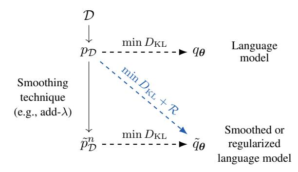

# The Role of *n*-gram Smoothing in the Age of Neural Networks

# Luca Malagutti Andrius Buinovskij Anej Svete Clara Meister Afra Amini Ryan Cotterell

lmalagutti@inf.ethz.ch andriusb@student.ethz.ch
{asvete, meistecl, aamini, ryan.cotterell}@inf.ethz.ch

## **ETH** zürich

#### **Abstract**

For nearly three decades, language models derived from the n-gram assumption held the state of the art on the task. The key to their success lay in the application of various smoothing techniques that served to combat overfitting. However, when neural language models toppled n-gram models as the best performers, n-gram smoothing techniques became less relevant. Indeed, it would hardly be an understatement to suggest that the line of inquiry into n-gram smoothing techniques became dormant. This paper re-opens the role classical n-gram smoothing techniques may play in the age of neural language models. First, we draw a formal equivalence between label smoothing. a popular regularization technique for neural language models, and add- $\lambda$  smoothing. Second, we derive a generalized framework for converting any n-gram smoothing technique into a regularizer compatible with neural language models. Our empirical results find that our novel regularizers are comparable to and, indeed, sometimes outperform label smoothing on language modeling and machine translation.

https://github.com/rycolab/
ngram\_regularizers

### 1 Introduction

Let  $\Sigma$  be an **alphabet**.1 A **language model** is a probability distribution p over  $\Sigma^*$ , the set of all strings  $\boldsymbol{x} = x_1 \cdots x_T$  with symbols  $x_t$  drawn from  $\Sigma$ . A fundamental task in natural language processing (NLP) is to estimate a language model—often from a parametric family—that places a high probability on held-out, humangenerated text. A common design choice is to construct a locally normalized language model, i.e., one which factorizes autoregressively2 as  $p(\boldsymbol{x}) = p(\mathrm{EOS} \mid \boldsymbol{x}) \prod_{t=1}^{|\boldsymbol{x}|} p(x_t \mid \boldsymbol{x}_{< t})$ , where  $\mathrm{EOS} \not\in \Sigma$  is a distinguished end-of-string symbol and  $\boldsymbol{x}_{< t} \stackrel{\mathrm{def}}{=} x_1 \cdots x_{t-1}$  is a prefix of  $\boldsymbol{x}$ .

Figure 1: An illustration of the introduced framework. With maximum-likelihood estimation (MLE), a language model  $q_{\theta}$  is trained to match  $p_{\mathcal{D}}$ , the empirical distribution induced by a dataset  $\mathcal{D}$ . However, we can also modify (smooth)  $p_{\mathcal{D}}$  into  $\tilde{p}_{\mathcal{D}}^n$  and train a language model  $\tilde{q}_{\theta}$  on  $\tilde{p}_{\mathcal{D}}^n$ . We show that the latter can be thought of as training  $\tilde{q}_{\theta}$  with a regularized maximum-likelihood objective.

For years, the best parametric families of language models for this estimation task applied the n-gram assumption, detailed below.

**Assumption 1.1** (*n*-gram assumption). A language model obeys the *n*-gram assumption if the following conditional independence holds

$$p(x_t \mid \boldsymbol{x}_{\leq t}) \stackrel{\text{def}}{=} p(x_t \mid x_1 \cdots x_{t-1})$$

$$= p(x_t \mid x_{t-n+1} \cdots x_{t-1}) \quad (1)$$

$$\stackrel{\text{def}}{=} p(x_t \mid \boldsymbol{x}_t^n)$$

where  $x_t$  for t < 1 is treated as a distinguished padding symbol BOS  $\notin \Sigma$ .3 We will call  $\mathbf{x}_t^n \stackrel{\text{def}}{=} x_{t-n+1} \cdots x_{t-1}$  the **history** of  $x_t$ . We use  $\mathbf{x}^n$  for histories where the time step t is irrelevant.

Assumption 1.1 was, historically, considered a practically effective manner to fight the curse of dimensionality, despite its inability to attend to contexts longer than  $n\!-\!1$  words and thus capture long-range dependencies.4

&lt;sup>1An alphabet is a finite, non-empty set.

&lt;sup>2Autoregressivization is without loss of generality (Cotterell et al., 2023, Theorem 2.4.2).

&lt;sup>3The symbol BOS stands for <u>beginning of string</u>.

&lt;sup>4*n*-gram LMs are linguistically very primitive. They are an instance of *strictly local* languages, one of the simplest language classes (Jäger and Rogers, 2012). It has long been argued that we require LMs that are more expressive and capture more complex phenomena in human language (Chomsky, 1957; Chelba and Jelinek, 1998; Abney et al., 1999).

The maximum-likelihood estimator of a model  $q_{\mathrm{MLE}}^n$  under the n-gram assumption is straightforward to derive. Indeed, one can express it simply using counts of sub-string occurrences:

$$q_{\text{MLE}}^{n}\left(x\mid\boldsymbol{x}^{n}\right) = \frac{\#(\boldsymbol{x}^{n}x)}{\#(\boldsymbol{x}^{n})} \tag{2}$$

where, intuitively, #(y) denotes the number of times substring y occurs in the training dataset.6 Critically, the simplicity enforced by Assumption 1.1 alone is *not* enough to prevent overfitting for reasonably sized n: a minimally parameterized n-gram model has  $\mathcal{O}(|\Sigma|^n)$  free parameters, one for each n-gram. Therefore, the maximumlikelihood solution of an n-gram language model overfits on its training data by assigning probability 0 to any string containing an n-gram that does not occur in the training dataset, which is undesirable. To solve this issue, in addition to making the n-gram assumption, modelers applied a variety of **smoothing** techniques to regularize the estimation of n-gram probabilities and obtain smoothed probabilities  $\tilde{q}_{\text{MLE}}^n$ .

One of the simplest n-gram smoothing techniques is known as  $\mathbf{add}$ - $\lambda$   $\mathbf{smoothing}$ , which can be informally described as hallucinating n-grams in the training dataset that occur at frequency  $\lambda$ . In other words, the counts of all n-grams—including those that are unobserved in the dataset—are augmented by  $\lambda$ :

$$\tilde{q}_{\mathrm{MLE}}^{n}\left(x\mid \boldsymbol{x}^{n}\right) \stackrel{\mathrm{def}}{=} \frac{\#(\boldsymbol{x}^{n}x) + \lambda}{\#(\boldsymbol{x}^{n}) + (|\Sigma| + 1)\lambda}.$$
 (3)

In the context of NLP, add- $\lambda$  smoothing has often served a pedagogical purpose and is thus commonly taught, but its efficacy in practice was considered limited (Eisner, 2023). However, researchers developed more sophisticated related smoothing methods (Jelinek, 1980; Katz, 1987; Ney et al., 1995) that were useful in practice. Ney et al. (1995), for example, was long considered the best available method (Chen and Goodman, 1999) and its popularity inspired a principled Bayesian interpretation (Teh, 2006). Interestingly though, add- $\lambda$  smoothing still has a place in today's literature; as we prove in §2, it is identical to a regularization technique called label smoothing,

common in the training of (conditional) neural language models (Pereyra et al., 2017; Meister et al., 2020), and particularly common in machine translation (Costa-jussà et al., 2022).

In this context, we present the primary theoretical research question addressed in our paper. If add- $\lambda$  smoothing is equivalent to label smoothing—an effective regularization technique for training today's neural language models—can we reverse-engineer further regularization methods starting from other n-gram smoothing methods? Given that add- $\lambda$  smoothing was not known to perform well compared to other smoothing techniques in the context of n-gram language models, it is natural to suspect that reverse-engineered regularizers based on empirically more successful smoothing techniques may indeed outperform label smoothing.

To this end, we derive a straightforward relationship between training on a smoothed empirical distribution and additive regularization methods, e.g., entropy regularization. Using that relationship. we further show that any smoothing method can be reformulated as an additive regularization of the standard maximum-likelihood objective, and, hence, we provide an explicit way to construct the regularizer that can be applied to the training of any (neural) language model, helping connect classical smoothing methods and modern language models by introducing a way to incorporate smoothing techniques into the training of neural language models. We complement our theoretical analysis by empirically verifying the validity of our proposed methods on two small-scale datasets and observe that some regularizers based on more complex n-gram smoothing techniques do indeed perform better than label smoothing on language modeling and machine translation.

### 2 Label Smoothing and add- $\lambda$ Smoothing

In this section, we derive a formal relationship between the add- $\lambda$  smoothing applied to n-gram models and label smoothing. The relationship is based on a regularizer that, when applied during MLE, simulates add- $\lambda$  smoothing exactly. Additionally, we contend that, in this sense, label smoothing *generalizes* add- $\lambda$  smoothing from a method applicable only to n-gram language models to one that can be used with neural language models.8 To the best of the authors'

&lt;sup>5We discuss the MLE of language models in detail in §2.1. 6We formally introduce the counting function # in §2.1 accounting for the presence of EOS at the end of each string.

&lt;sup>7In the special case that  $\lambda = 1$ , this technique is generally referred to as Lidstone smoothing.

 $^8$ There is no obvious manner to apply add- $\lambda$  smoothing to the training of a neural language model since it is designed as

knowledge, this derivation and the relationship it exposes are novel. We re-use this meta paradigm in §4 to derive novel regularizers, which we then compare experimentally to label smoothing.

#### 2.1 Preliminaries

**Some Notation.** We define  $\overline{\Sigma} \stackrel{\text{def}}{=} \Sigma \cup \{\text{EOS}\}$ . To make it possible to always condition on exactly n-1 symbols, whenever the history is shorter than n-1 symbols, we prepend a string with the appropriate number of BOS symbols. Thus, we define  $\Sigma_{\text{BOS}}^{n-1} \stackrel{\text{def}}{=} \bigcup_{\ell=1}^{n-1} \{\text{BOS}\}^{\ell} \times \Sigma^{n-1-\ell}$  (the set of all possible histories) and  $\Sigma_{\text{BOS}}^* \stackrel{\text{def}}{=} \Sigma_{\text{BOS}}^{n-1} \cup \bigcup_{\ell=n}^{\infty} \Sigma^{\ell}$  as the set of all strings that are either prefixed by BOS or contain more than n-1 symbols.

**Maximum-likelihood Estimation.** We now introduce maximum-likelihood estimation in the context of language modeling. Suppose we observe a collection of samples  $\mathcal{D} = \{\boldsymbol{x}^{(m)}\}_{m=1}^{M}$  where  $\boldsymbol{x}^{(m)} \sim p$  and p is the distribution over strings that we are trying to model. Let  $p_{\mathcal{D}}$  be the empirical distribution induced by  $\mathcal{D}$ , i.e., the probability distribution defined as

$$p_{\mathcal{D}}(\boldsymbol{x}) = \frac{1}{M} \sum_{m=1}^{M} \mathbb{1}\{\boldsymbol{x} = \boldsymbol{x}^{(m)}\}.$$
 (4)

Choosing a model  $q_{\theta}$  that minimizes the forward KL divergence  $D_{\mathrm{KL}}(p_{\mathcal{D}} \mid\mid q_{\theta})$  is known as maximum-likelihood estimation. Under regularity conditions (Le Cam, 1952), MLE is consistent, i.e., in the limit of infinite data, we arrive at the true parameters of the data-generating distribution if the data-generating distribution indeed came from the model's parametric family.

Counting Substrings in a Dataset. As discussed in §1, estimation of n-gram language models relies on *counting* the occurrences of various substrings in a dataset. Given the dataset  $\mathcal{D} = \{\boldsymbol{x}^{(m)}\}_{m=1}^{M}$ , we define the counting function # as

$$\#(\boldsymbol{x}) \stackrel{\text{def}}{=} \sum_{m=1}^{M} \sum_{t=1}^{|\boldsymbol{x}|+1} \sum_{s=t+1}^{|\boldsymbol{x}|+1} \mathbb{1}\left\{\boldsymbol{x} = \boldsymbol{x}_{t:s}^{(m)}\right\}$$
 (5a)

$$\#(\boldsymbol{x} \text{EOS}) \stackrel{\text{def}}{=} \sum_{t=1}^{M} \sum_{t=1}^{|\boldsymbol{x}|+1} \mathbb{1} \left\{ \boldsymbol{x} = \boldsymbol{x}_{t:}^{(m)} \right\}, \quad (5b)$$

where  $\boldsymbol{x}_{t:s} \stackrel{\text{def}}{=} x_t \cdots x_{s-1}$  and  $\boldsymbol{x}_{t:} \stackrel{\text{def}}{=} \boldsymbol{x}_{t:|\boldsymbol{x}|+1}$ . As hinted at in §1, # counts the number of times the

an operation on count-based data.

string x appears as a substring of a string in  $\mathcal{D}^9$ . This is to be distinguished from simply counting the number of occurrences of x in  $\mathcal{D}$ .

**Empirical Distributions.** Using the counting functions defined in Eq. (5), we define two empirical probability distributions. The **autoregressive empirical probability** distribution is defined as

$$p_{\mathcal{D}}(y \mid \boldsymbol{x}) \stackrel{\text{def}}{=} \frac{\#(\boldsymbol{x}y)}{\#(\boldsymbol{x})},$$
 (6)

where  $x_{< t} \in \Sigma^*$  and  $y \in \overline{\Sigma}$ . Eq. (6) is the autoregressive decomposition of Eq. (4). Then, the **autoregressive empirical** n-gram probability distribution is defined as follows

$$p_{\mathcal{D}}^{n}(y \mid \boldsymbol{x}^{n}) \stackrel{\text{def}}{=} \frac{\#(\boldsymbol{x}^{n}y)}{\#(\boldsymbol{x}^{n})},$$
 (7)

where  $\boldsymbol{x}^n \in \Sigma_{\mathrm{BOS}}^{n-1}$  and  $y \in \overline{\Sigma}$ . Note that the autoregressive empirical n-gram probabilities are equivalent to the maximum-likelihood estimator of an n-gram model  $q_{\mathrm{MLE}}^n$ , as seen in Eq. (2).

**Prefix Probabilities.** Prefix probabilities (Cotterell et al., 2023, §2.4.2) are useful quantities in language modeling and are found both in the language model's autoregressive factorization as well as in maximum-likelihood estimation (Jelinek and Lafferty, 1991; Nowak and Cotterell, 2023). We give a formal definition below.

**Definition 2.1.** We define the **prefix probability** function  $\pi$  of a language model p over  $\Sigma^*$  as

$$\pi(\boldsymbol{x}) \stackrel{\text{def}}{=} \sum_{\boldsymbol{y} \in \Sigma^*} p(\boldsymbol{y}) \mathbb{1} \{ \boldsymbol{x} \leq \boldsymbol{y} \} = \sum_{\boldsymbol{y} \in \Sigma^*} p(\boldsymbol{x}\boldsymbol{y}), (8)$$

where  $x \prec y$  indicates that x is a prefix of y.

We now relate the MLE of a language model to the matching of *next-symbol* conditional distributions. It will later allow us to reason about the relationship between smoothing and regularized maximum-likelihood estimation.

**Theorem 2.2.** Let p and q be two language models over  $\Sigma$  and  $\pi$  the prefix probability function of p. Furthermore, we assume that  $H(p,q) < \infty$ . Then, the following equality holds

$$D_{\mathrm{KL}}(p \mid\mid q) = \sum_{\boldsymbol{x} \in \Sigma^*} \pi(\boldsymbol{x}) D_{\mathrm{KL}}(p(\cdot \mid \boldsymbol{x}) \mid\mid q(\cdot \mid \boldsymbol{x})).$$
 (9)

 $^9$ Note that, for complete generality, # should also take the dataset  $\mathcal D$  as argument. For conciseness, we leave this parameter implicit.

Proof. App. A.1.2.

We also consider the following corollary for  $p = p_D$  and an n-gram language model q.

**Corollary 2.3.** Let  $p_D$  be an empirical distribution induced by a dataset D. Let q be an n-gram language model. Then, it holds that:

$$D_{\mathrm{KL}}(p_{\mathcal{D}} \parallel q) \qquad (10)$$

$$\propto \sum_{\boldsymbol{x}^{n} \in \Sigma_{\mathrm{BOS}}^{n-1}} \#(\boldsymbol{x}^{n}) D_{\mathrm{KL}}(p_{\mathcal{D}}(\cdot \mid \boldsymbol{x}^{n}) \parallel q(\cdot \mid \boldsymbol{x}^{n})).$$

Crucially, the n-gram assumption allows us to reduce the infinite sum over  $\Sigma^*$  in the definition of  $D_{\mathrm{KL}}\left(p_{\mathcal{D}}\mid\mid q_{\mathrm{MLE}}^n\right)$  to one over  $\Sigma_{\mathrm{BoS}}^{n-1}$  due to the resulting conditional independence of  $x_t$  and  $x_1\cdots x_{t-n}$  given  $\boldsymbol{x}_t^n=x_{t-n+1}\cdots x_{t-1}$ . Further, it allows us to restrict the summation to the n-grams that are present in the training corpus.

#### 2.2 Label Smoothing of *n*-gram LMs

Let  $q_{\theta}$  be a language model parametrized by parameters  $\theta \in \Theta$ . We further assume that  $q_{\theta}$  is a differentiable function in  $\theta$  and that  $\Theta$  is compact. Optimizing the objective in Eq. (10) gives us the maximum-likelihood estimate of model parameters  $\theta$ . To prevent overfitting and improve generalization abilities, this estimation can be regularized.

**Principle 2.4.** The principle of regularization states that we should add an inductive bias to the parameter estimation procedure, the goal of which is to help the model generalize to unseen data at the expense of its ability to better fit the training data.

By Principle 2.4, we can intuitively see that smoothing techniques are a form of regularization. However, they form regularization that is defined procedurally in terms of the manipulation of count-based estimates. **Label smoothing**, on the other hand, is defined as an additive augmentation of the *training objective*—it represents the addition of the following regularizer to the training objective

$$\mathcal{R}_{LS}(\boldsymbol{\theta}, \boldsymbol{x}) = D_{KL}(u \mid\mid q_{\boldsymbol{\theta}}(\cdot \mid \boldsymbol{x})), \qquad (11)$$

where  $u=1/|\overline{\Sigma}|\cdot \mathbf{1}$  is the uniform distribution over  $\overline{\Sigma}$ . In words, label smoothing regularizes the maximum-likelihood objective toward a uniform distribution over the next symbol. In the case of an

n-gram model, we have the regularized objective

$$\sum_{\boldsymbol{x}^{n} \in \Sigma_{BOS}^{n-1}} \#(\boldsymbol{x}^{n}) \Big[ D_{KL} \Big( p_{\mathcal{D}}(\cdot \mid \boldsymbol{x}^{n}) \mid\mid q_{\boldsymbol{\theta}}(\cdot \mid \boldsymbol{x}^{n}) \Big) + \gamma \mathcal{R}_{LS}(\boldsymbol{\theta}, \boldsymbol{x}^{n}) \Big]. \tag{12}$$

The optimum of Eq. (12),  $\tilde{q}_{\theta}$ , is then what we refer to as the label-smoothed version of the maximum-likelihood solution.10

In §1, we introduced add- $\lambda$  smoothing of n-gram language models as a way to improve their generalization. However, regularization of the form Eq. (12) can be applied to any language model  $q_{\theta}$  whose parameters are learned through standard maximum-likelihood estimation—usually via gradient descent. Attractively, we can show that, if  $q_{\theta}$  is a n-gram language model, regularization from Eq. (12) is equivalent to add- $\lambda$  smoothing of n-gram counts in the sense that its optimum recovers the same model. We believe this to be the first formal connection made between add- $\lambda$  smoothing and label smoothing of n-gram language models.11

**Theorem 2.5.** Estimating an n-gram model under regularized MLE with regularizer  $\mathcal{R}_{LS}$  with strength parameter  $\gamma$  is equivalent to estimating an n-gram model and applying add- $\lambda$  smoothing with  $\lambda = \frac{\gamma}{|\Sigma|+1}$ .

Theorem 2.5 establishes an interpretable connection between a *smoothing technique*—in this case, add- $\lambda$  smoothing, which can only be performed in the context of n-gram language models—and an *additive regularizer*, which can be applied to general language models. While additive regularizers are not common in the context of n-gram language models, where an augmentation of counts is usually more appropriate, this framing will facilitate the connection to more modern neural language models, as we showcase in §4.

#### 3 Smoothing *n*-Gram Counts

In the context of n-gram models, smoothing procedures generally modify the count-based MLE computation to address the fact that not all n-grams oc-

 $^{10}$ Throughout the paper, we will use the notation  $\tilde{q}$  for the smoothed version of the distribution q.

 $^{11}$ The restriction to n-gram language models is natural since the simple nature of n-gram language models permits the augmentation with hallucinated substring counts. Later in the paper, we show how this can be translated to neural language models by pre-processing the empirical data distribution.

cur in the training data. We follow Chen and Goodman (1999) and review four well-known smoothing techniques of *n*-gram language models before connecting them to a generalized framework of regularization in §4.

### 3.1 Good-Turing (1953)

Good–Turing (GT) smoothing is one of the earliest methods devised to compute a smoothed n-gram model  $\tilde{q}_{\text{MLE}}^n$  from a n-gram model  $q_{\text{MLE}}^n$ . GT smoothing assigns cumulative probability mass to n-grams that appear i times in the training data to be equal to the total probability mass of n-grams that appear i+1 times in the training data. To do so, adjusted n-gram counts  $\#_{\text{GT}}(\boldsymbol{x}^n x)$  are computed as

$$\#_{GT}(\boldsymbol{x}^n x) = (\#(\boldsymbol{x}^n x) + 1) \frac{r_{\#(\boldsymbol{x}^n x) + 1}}{r_{\#(\boldsymbol{x}^n x)}}, \quad (13)$$

where  $r_{\#(\boldsymbol{x}^n x)}$  is the total number of n-grams that occur  $\#(\boldsymbol{x}^n x)$  times in the training data, i.e.,  $r_i \stackrel{\text{def}}{=} \sum_{\boldsymbol{x}^n \in \Sigma_{\text{BoS}}^{n-1}} \mathbb{1}\{\#(\boldsymbol{x}^n x) = i\}$ . The probability of  $\boldsymbol{x}^n$  is then defined as

$$\tilde{q}_{\mathrm{GT}}^{n}(x \mid \boldsymbol{x}^{n}) = \frac{\#_{\mathrm{GT}}(\boldsymbol{x}^{n}x)}{\sum_{i=1}^{\infty} ir_{i}},$$
(14)

where the denominator in Eq. (14) is equivalent to the total number of tokens in  $\mathcal{D}$ . Note that any symbol whose successive count of counts is null is also assigned a null smoothed count. To avoid this issue, Gale and Sampson (1995) propose to interpolate the missing counts through linear regression and use the regressed counts to compute the smoothed probabilities.

#### 3.2 Jelinek-Mercer (1980)

Jelinek–Mercer (JM) smoothing relies on interpolation between higher-order and lower-order n-gram models to smooth  $q_{\mathrm{MLE}}^n$ . The interpolation is applied recursively according to the following convex combination

$$\tilde{q}_{\text{JM}}^{n}(x \mid \boldsymbol{x}^{n}) = \lambda_{n} q_{\text{MLE}}^{n}(x \mid \boldsymbol{x}^{n}) + (1 - \lambda_{n}) \tilde{q}_{\text{JM}}^{n-1}(x \mid \boldsymbol{x}^{n-1}).$$
(15)

The recursion can be grounded either at the unigram level or with a uniform distribution over  $\overline{\Sigma}$ .

### 3.3 Katz (1987)

Katz smoothing relies on smoothed counts to compute its smoothed probabilities. These counts are

computed as follows

$$\#_{\mathrm{K}}(\boldsymbol{x}^{n}x) \stackrel{\text{def}}{=} \left\{ \begin{array}{l} \#_{\mathrm{K}}(\boldsymbol{x}^{n}x) \\ \quad \text{if } \#_{\mathrm{K}}(\boldsymbol{x}^{n}x) > k \\ d_{\#_{\mathrm{K}}(\boldsymbol{x}^{n}x)} \#_{\mathrm{K}}(\boldsymbol{x}^{n}x) \\ \quad \text{if } 0 < \#_{\mathrm{K}}(\boldsymbol{x}^{n}x) \leq k \\ \alpha(\boldsymbol{x}^{n}) q_{\mathrm{MLE}}^{n}(\boldsymbol{x}^{n-1}x) \\ \quad \text{otherwise} \end{array} \right.$$
(16)

where k is a hyperparameter whose value is usually assigned to a high-range, single-digit integer. For large counts, smoothed counts are equivalent to the empirical n-gram counts as the latter are assumed to be reliable. Small non-zero counts, however, are discounted using count-specific discount factors  $d_{\#_{\rm K}}$ , which are derived from the Good–Turing counts in Eq. (13) and computed as

$$d_{\#_{K}(\boldsymbol{x}^{n}x)} = \frac{\frac{\#_{GT}(\boldsymbol{x}^{n}x)}{\#(\boldsymbol{x}^{n}x)} - \frac{(k+1)r_{k+1}}{r_{1}}}{1 - \frac{(k+1)r_{k+1}}{r_{1}}}.$$
 (17)

The total amount obtained by discounting is then redistributed to the n-grams with null counts, weighted by the probability of the lower-order n-gram and according to the normalization factor

$$\alpha(\boldsymbol{x}^n) = \frac{1 - \sum_{x: \#(\boldsymbol{x}^n x) > 0} \tilde{q}_{K}^n(x \mid \boldsymbol{x}^n)}{1 - \sum_{x: \#(\boldsymbol{x}^n x) > 0} q_{MLE}^n(\boldsymbol{x}^{n-1} x)}.$$
(18)

Finally, smoothed probabilities are computed by normalizing the smoothed counts according to the following formula

$$\tilde{q}_{K}^{n}(x \mid \boldsymbol{x}^{n}) = \frac{\#_{K}(\boldsymbol{x}^{n}x)}{\sum_{u \in \overline{\Sigma}} \#_{K}(\boldsymbol{x}^{n}y)}.$$
 (19)

#### 3.4 Kneser-Essen-Nev (1995)

Kneser–Essen–Ney (KEN) smoothing is similar to Katz smoothing in that it also computes higher-order n-gram probabilities as a function of lower-order n-gram probabilities. However, in contrast to other smoothing methods, KEN smoothing does not construct n-gram probability distributions using simple counts, but rather using type counts. The type count of an n-gram is defined as the number of distinct histories that the n-gram follows, rather than the absolute number of its occurrences in the data. Formally, the type count function  $\#_T^n$  of order n is defined as

$$\#_{\mathrm{T}}^{n}(\boldsymbol{x}^{n}, x) \stackrel{\text{def}}{=} \begin{cases} 1 & \text{if } \#(\boldsymbol{x}^{n} x) > 0\\ 0 & \text{otherwise.} \end{cases}$$
 (20)

We further define  $\#_{T}^{n}(\bullet, x)$ ,  $\#_{T}^{n}(\boldsymbol{x}^{n}, \bullet)$  and  $\#_{T}^{n}(\bullet, \bullet)$  as the type count function with bulleted arguments summed out. Type counts allow us to reduce the probability assigned to n-grams that occur many times in the data, but whose constituent (n-1)-grams have low probability. A common illustrative example in the literature (Chen and Goodman, 1999) is the bigram San Francisco. If the term San Francisco appears frequently in a dataset, then the unigram probability assigned to Francisco by smoothing methods that rely on lower-order n-gram distributions to compute higher-order n-gram distributions will be quite high. However, this is arguably undesirable in many situations, since the unigram Francisco does not often appear after words other than San.

At the unigram level, the probability estimates of a KEN-smoothed distribution are computed using type counts for unigrams and bigrams as

$$\tilde{q}_{\text{KEN}}^{1}(x) = \frac{\#_{\text{T}}^{1}(\bullet, x)}{\#_{\text{T}}^{1}(\bullet, \bullet)}.$$
(21)

These probabilities are then used to ground the recursion that computes the smoothed probabilities  $\tilde{q}_{\text{KEN}}^n$  for higher-order n-grams according to the following formula

$$\tilde{q}_{\text{KEN}}^{n}(x \mid \boldsymbol{x}^{n}) = \frac{\max\{\#(\boldsymbol{x}^{n}x) - D, 0\}}{\sum_{y \in \overline{\Sigma}} \#(\boldsymbol{x}^{n}y)} + \frac{D \cdot \#_{\text{T}}^{n}(\boldsymbol{x}^{n} \bullet) \cdot \tilde{q}_{\text{KEN}}^{n-1}(x \mid \boldsymbol{x}^{n-1})}{\sum_{y \in \overline{\Sigma}} \#(\boldsymbol{x}^{n}y)}.$$
(22)

#### 4 A Generalized Framework

In §2, we evince a connection between  $add-\lambda$  smoothing and regularization of the maximum-likelihood objective. However, the derivation we formalize (cf. App. A.1.2) is tedious and long. Moreover, it exploits several specific properties of  $add-\lambda$  smoothing. Performing such a derivation for each smoothing technique individually would be laborious and further, it would hinder building intuitions about the relationships between different methods. Luckily, we can introduce a more general framework. Specifically, in this section, we propose a framework that allows us to formulate equivalent regularizers for *any* smoothing technique and apply them to the training of neural language models.

### 4.1 *n*-Gram Smoothing as Regularization

Without further ado, we now introduce our framework for connecting the smoothing of n-gram

language models to the regularization of the maximum-likelihood objective. This allows us to expand the notion of n-gram smoothing to neural language models. To this end, we first revisit MLE.

One way of framing MLE is using the KL divergence. Specifically, given an empirical distribution  $p_{\mathcal{D}}$ , the principle of MLE dictates that we should choose a model  $q_{\theta}$  such that  $D_{\mathrm{KL}}\left(p_{\mathcal{D}}\mid\mid q_{\theta}\right)=0$ . In comparison, n-gram smoothing techniques are often not defined so declaratively. Instead, they are presented as procedures that directly modify the empirical counts derived from a large dataset (e.g., Eq. (3) in the simple case of add- $\lambda$  smoothing). The crucial observation in this work is that we can treat n-gram smoothing as a two-step process. First, we view the smoother as a map  $p_{\mathcal{D}}^n \mapsto \tilde{p}_{\mathcal{D}}^n$  that outputs a smoothed empirical n-gram distribution. Then, we choose the  $q_{\theta}$  that minimizes  $D_{\mathrm{KL}}\left(\tilde{p}_{\mathcal{D}}^n\mid\mid q_{\theta}\right)$  where we have replaced  $p_{\mathcal{D}}$  with  $\tilde{p}_{\mathcal{D}}^n$ .

In that context, the question we ask is this: Rather than minimizing  $D_{\mathrm{KL}}\left(\tilde{p}_{\mathcal{D}}^{n}\mid\mid q_{\theta}\right)$ , can we always find a regularizer  $\mathcal{R}(\theta)$  such that  $D_{\mathrm{KL}}\left(\tilde{p}_{\mathcal{D}}^{n}\mid\mid q_{\theta}\right) = D_{\mathrm{KL}}\left(p_{\mathcal{D}}\mid\mid q_{\theta}\right) + \mathcal{R}(\theta)$ ? Such a result would be a natural generalization of the add- $\lambda$  case, discussed in Theorem 2.5 that would apply to any n-gram smoothing techniques, including all of those presented in §3.

## 4.2 Smoothing as Regularization

Now we turn to the primary question of this paper. How do we construct a regularizer that corresponds to an *arbitrary* n-gram smoothing technique? We begin by defining the following two probability distributions that together capture the difference between the empirical distribution and the smoothed empirical n-gram distribution:

$$p_{+}(\boldsymbol{x}) \stackrel{\text{def}}{=} \frac{1}{Z_{+}} \max(0, \tilde{p}_{\mathcal{D}}^{n}(\boldsymbol{x}) - p_{\mathcal{D}}(\boldsymbol{x}))$$
 (23a)

$$p_{-}(\boldsymbol{x}) \stackrel{\text{def}}{=} \frac{1}{Z_{-}} \max(0, p_{\mathcal{D}}(\boldsymbol{x}) - \tilde{p}_{\mathcal{D}}^{n}(\boldsymbol{x})), \quad (23b)$$

where the normalization constants are defined as

$$Z_{+} \stackrel{\text{def}}{=} \sum_{\boldsymbol{x} \in \Sigma^{*}} \max(0, \tilde{p}_{\mathcal{D}}^{n}(\boldsymbol{x}) - p_{\mathcal{D}}(\boldsymbol{x})) \qquad (24a)$$

$$Z_{-} \stackrel{\text{def}}{=} \sum_{\boldsymbol{x} \in \Sigma^{*}} \max(0, p_{\mathcal{D}}(\boldsymbol{x}) - \tilde{p}_{\mathcal{D}}^{n}(\boldsymbol{x})). \quad (24b)$$

This results in the following simple decomposition:

$$\tilde{p}_{\mathcal{D}}^{n}(x) = p_{\mathcal{D}}(x) + Z_{+}p_{+}(x) - Z_{-}p_{-}(x).$$
 (25)

Why does the above formulation help? Fundamental to our derivation in §2 was the idea that we could

think of add- $\lambda$  smoothing as adding a regularization term to the maximum-likelihood objective that penalizes diverging from a simple distribution—in the case of add- $\lambda$  smoothing, the uniform distribution over  $\overline{\Sigma}$ . Similarly, the decomposition of  $\tilde{p}^n_{\mathcal{D}}$  given in Eq. (25) facilitates the interpretation of training a language model on  $\tilde{p}^n_{\mathcal{D}}$  as training  $p_{\mathcal{D}}$  with the addition of regularization. Concretely, we define the following regularizer

$$\mathcal{R}(\boldsymbol{\theta}) \stackrel{\text{def}}{=} Z_{+} D_{\text{KL}}(p_{+} \mid\mid q_{\boldsymbol{\theta}})$$

$$+ Z_{-} D_{\text{KL}}(p_{-} \mid\mid q_{\boldsymbol{\theta}}).$$
(26)

Now, the relation between estimating an n-gram model with a smoothing technique and using the regularizer formalized in Eq. (26) is given by the following theorem.

**Theorem 4.1.** Let  $p_{\mathcal{D}}$  be the empirical distribution induced by the dataset  $\mathcal{D}$  and  $\tilde{p}_{\mathcal{D}}^n$  a smoothed empirical n-gram distribution. For  $\gamma = 1$ , the following holds

$$D_{\mathrm{KL}}(\tilde{p}_{\mathcal{D}}^{n} || q_{\boldsymbol{\theta}}) = D_{\mathrm{KL}}(p_{\mathcal{D}} || q_{\boldsymbol{\theta}}) + \gamma \mathcal{R}(\boldsymbol{\theta}) + C,$$
(27)

where C is constant with respect to  $q_{\theta}$ .

Theorem 4.1 formalizes how training on the smoothed distribution  $\tilde{p}_{\mathcal{D}}^n$  computed by smoothing the n-gram counts affects the maximum-likelihood objective. It brings us to an interesting observation about smoothing methods in general—they can all be formalized as solutions to a regularized maximum-likelihood objective. Inspecting Eq. (27), we see that, crucially, only the first term depends on the *original* empirical distribution  $p_{\mathcal{D}}$ —indeed, it represents the original maximumlikelihood objective. The other two terms depend both on the empirical data distribution as well as its smoothed variant. We can therefore interpret Eq. (27) as a regularized loss where the last two terms correspond to the equivalent regularizer of the smoothing method used to construct  $\tilde{p}_{\mathcal{D}}^n$ . In practice, we might want to modulate the strength of the regularization towards the smoothed distribution  $\tilde{p}_{\mathcal{D}}^n$ . We can achieve such an effect through an additional hyperparameter  $\gamma$ , by which we multiply our regularizer in Eq. (27) to control its influence. The regularized loss can be decomposed further by splitting the  $\gamma$  hyperparameter into two terms  $\gamma_+$ 

and  $\gamma_-$  and applying them separately to the positive and negative terms of the regularizer  $\mathcal R$ 

$$D_{\mathrm{KL}}(p_{\mathcal{D}} \mid\mid q_{\boldsymbol{\theta}}) + \gamma_{+} Z_{+} D_{\mathrm{KL}}(p_{+} \mid\mid q_{\boldsymbol{\theta}}) + \gamma_{-} Z_{-} D_{\mathrm{KL}}(p_{-} \mid\mid q_{\boldsymbol{\theta}}),$$

$$(28)$$

where Eq. (28) is equivalent to  $D_{\mathrm{KL}}(\tilde{p}_{\mathcal{D}}^n \mid\mid q_{\theta})$  when both  $\gamma_+$  and  $\gamma_-$  are equal to 1.

Our generalized framework, therefore, presents a novel way of constructing regularizers to be used in the language modeling objective based on insights from classical methods for smoothing n-gram language models. Importantly, it provides a direct mechanism by which smoothing-based regularization can be applied to any language model  $q_{\theta}$ . In the following section, we use this framework to explore the empirical effects of using regularizers constructed from smoothing methods (cf. §3) in the training of neural language models.

Runtime Analysis. The distributions  $p_+$  and  $p_-$  require  $\mathcal{O}(|\Sigma|^n)$  space to represent where n is the n-gram order, i.e., the space complexity is of the order of the number of n-gram contexts in the model. While the exponential increase in n of  $\mathcal{O}(|\Sigma|^n)$  is one of the main limitations for scalability of n-gram models, our method does not require increasing n to large values, as it leverages (smoothed) n-gram models only in the construction of a regularizer for the training of a much larger neural model. Further, the scalability issues of n-gram models can be circumvented by using bespoke data structures (Liu et al., 2024).

#### 5 Experiments

#### 5.1 Setup

We validate our proposed regularization framework on two tasks: language modeling and machine translation. We rely on the small-scale WikiText-2 (Merity et al., 2017) and IWSLT-14 (Cettolo et al., 2014) data sets, respectively, and compare the performance of standard MLE and label smoothing to the performance obtained by using regularizers based on the smoothing methods illustrated in §3. For both tasks, we perform our experiments via the fairseq library (Ott et al., 2019) on Transformer-based (Vaswani et al., 2017) language models.

Our implementation of (Simple) Good–Turing smoothing in fairseq builds on an open-source implementation, 12 while we leverage the efficient implementation of Kneser–Essen–Ney smoothing

12github.com/maxbane/simplegoodturing

| Smoothing Method                                 | ppl ↓           |
|--------------------------------------------------|-----------------|
| None                                             | 147.12 ±0.34 |
| add-λ (γ+ = 0.1, γ− = 0.05, γLS = 0.01) | 142.10† ±0.65   |
| GT (γ+ = 0.1, γ− = 0.05)                   | 141.93† ±0.73   |
| JM (γ+ = 0.1, γ− = 0.5, λ1 = 0.75)      | 137.41† ±0.40   |
| Katz (γ+ = 0.1, γ− = 0.01, k = 5)       | 142.69† ±0.54   |
| KEN (γ+ = 0.1, γ− = 0.1)                   | 142.30† ±0.29   |

Table 1: Perplexity on WikiText-2 test set. Included are performances of models trained with no regularization (None), and with various smoothing methods. Reported perplexities are mean values for 5 independently trained models, together with their standard errors. The bestperforming method is in bold, while the second-best is underlined. † indicates statistical significance with respect to the unregularized baseline with p < 0.05.

available through the KenLM [\(Heafield,](#page-9-12) [2011;](#page-9-12) [Heafield et al.,](#page-9-13) [2013\)](#page-9-13) library.[13](#page-7-0) The remaining smoothing methods were implemented natively in fairseq. Note that, as all data sets are small in scale, we limit the maximum n-gram order to 2 (i.e., bigrams) for all smoothing methods. We use dropout for all experiments fixing the dropout probability to 0.1 and 0.3 for language modeling and machine translation, respectively. For all smoothing techniques, we set Γ def = {0.005, 0.01, 0.05, 0.1, 0.5} and grid search regularization hyperparameter pairs γ+, γ− ∈ Γ × Γ. For smoothing methods that have additional hyperparameters, we extend the grid search described above to include them. We provide the complete list of method-specific hyperparameter values in Tab. [3.](#page-8-0) Additional dataset details are provided in Tab. [4.](#page-16-0)

### 5.2 Language Modeling

For language modeling, we evaluate the performance of our regularizers on the raw version of the WikiText-2 dataset [\(Merity et al.,](#page-10-9) [2017\)](#page-10-9) which we preprocess to remove all empty samples. We tokenize the data using BPE [\(Sennrich](#page-10-12) [et al.,](#page-10-12) [2016\)](#page-10-12) with 16,000 merge operations through the subword-nmt library.[14](#page-7-1) For modeling, we use the decoder-only Transformer architecture denoted as transformer-lm in fairseq while adopting standard hyperparameter settings as suggested by fairseq[15](#page-7-2) to encourage reproducibility. We train

| Smoothing Method                                 | BLEU ↑         |
|--------------------------------------------------|----------------|
| None                                             | 32.86 ±0.04 |
| add-λ (γ+ = 0.1, γ− = 0.01, γLS = 0.01) | 33.23† ±0.03   |
| = 0.05, γ− = 0.5) GT (γ+                   | 33.37† ±0.01   |
| = 0.1, γ− = 0.5, λ1 = 0.5) JM (γ+       | 33.67† ±0.05   |
| = 0.1, γ− = 0.1, k = 5) Katz (γ+        | 33.23† ±0.02   |
| = 0.1, γ− = 0.1) KEN (γ+                   | 33.38† ±0.03   |

Table 2: BLEU on test set of IWSLT-14 DE-EN. Different regularized methods are compared to no regularization (None). Reported values are means over 5 independently trained models together with their standard errors. The best-performing method is in bold, while the second-best is underlined. † indicates statistical significance with respect to the unregularized baseline with p < 0.05.

all models using early stopping and take as the best-performing models the ones with the lowest perplexity on the validation set. For each method, the best-performing hyperparameter setting is then trained over 5 different seeds. We summarize the results for the best-performing hyperparameter settings in Tab. [1.](#page-7-3) We find that all regularized objectives outperform the unregularized baseline, with Jelinek–Mercer obtaining the lowest perplexity. We test for mean separation using the Wilcoxon ranksum test finding that all smoothing methods obtain statistically significant improvements over the unregularized baseline. Perplexity scores for the best-performing runs are shown in App. [C](#page-16-1) together with p-value under a paired permutation test.

## 5.3 Machine Translation

We evaluate the performance of our proposed regularizers on machine translation on the German-to-English task of the IWLST-14 dataset. In the translation setting, we limit the application of smoothing only to distributions over the vocabulary of the target language. We preprocess the data set by following the processing script provided by fairseq[16](#page-7-4) and tokenize the dataset with BPE using 10,000 merge operations for both languages. As our model, we use the small-sized transformer\_iwslt\_de\_en encoder–decoder Transformer and its corresponding standard training hyperparameters.[17](#page-7-5) We repeat the same grid search procedure over regularization hyperparameters as

13<github.com/kpu/kenlm>

14<github.com/rsennrich/subword-nmt>

15[github.com/facebookresearch/fairseq/tree/](github.com/facebookresearch/fairseq/tree/main/examples/language_model) [main/examples/language\\_model](github.com/facebookresearch/fairseq/tree/main/examples/language_model)

16[github.com/facebookresearch/fairseq/blob/](github.com/facebookresearch/fairseq/blob/main/examples/translation/prepare-iwslt14.sh) [main/examples/translation/prepare-iwslt14.sh](github.com/facebookresearch/fairseq/blob/main/examples/translation/prepare-iwslt14.sh)

17[github.com/facebookresearch/fairseq/tree/](github.com/facebookresearch/fairseq/tree/main/examples/translation) [main/examples/translation](github.com/facebookresearch/fairseq/tree/main/examples/translation)

| Method | Hyperparameters                  |
|--------|----------------------------------|
| add-λ  | ∈ {0.01, 0.1} γLS 0.05, |
| GT     | None                             |
| JM     | ∈ {0.25, 0.75} λ1 0.5,  |
| Katz   | ∈ {5, 10} k 7,          |
| KEN    | None                             |

Table 3: Method-specific hyperparameters on which a grid search was performed for both tasks. Note that in Jelinek–Mercer, λ2 is obtained following its normalization constraint.

previously outlined, and use BLEU [\(Papineni et al.,](#page-10-13) [2002\)](#page-10-13) on the validation set to determine the bestperforming model checkpoints. To decode text from the model, we use beam search with a beam size of 5. We evaluate the generated translations with sacreBLEU [\(Post,](#page-10-14) [2018\)](#page-10-14).[18,](#page-8-1)[19](#page-8-2) Tab. [2](#page-7-6) contains our results. All smoothing methods improve over the baseline (no regularizer), and Jelinek– Mercer smoothing is the best-performing technique. We repeat the mean separation tests outlined in the language modeling subsection and find that all smoothing methods obtain statistically significant improvements over the unregularized baseline. In App. [C](#page-16-1) we additionally show the results of the best-performing models for each method and test their significance using paired bootstrap resampling [\(Koehn,](#page-10-15) [2004\)](#page-10-15). Further, in App. [C.1](#page-16-2) we present the results of a preliminary evaluation of our methods on the English-to-German task of the larger WMT14 machine translation dataset.

# 6 Related Work

Hybrid Neural and n-gram Models. The relationship between neural networks and n-gram models has been explored in previous work. For instance, [Bengio et al.](#page-9-14) [\(2000\)](#page-9-14) famously introduced a neural parameterization of an n-gram model, achieving state-of-the-art results at the time. More recently, [Sun and Iyyer](#page-10-16) [\(2021\)](#page-10-16) scaled [Bengio](#page-9-14) [et al.'](#page-9-14)s [\(2000\)](#page-9-14) model on modern hardware and demonstrated a small performance increase on language modeling over a Transformer model using a hybrid n-gram–Transformer model. [Schwenk](#page-10-17) [\(2007\)](#page-10-17) explored interpolating neural and n-gram language models. [Neubig and Dyer](#page-10-18) [\(2016\)](#page-10-18) expanded [Schwenk'](#page-10-17)s [\(2007\)](#page-10-17) approach by

exploring various ways to combine neural and n-gram language models.

Regularization. On the topic of smoothingbased regularization, [Lee et al.](#page-10-19) [\(2022\)](#page-10-19) propose dynamically adjusting the strength of label smoothing regularization based on the entropy of the model distribution and using an earlier version of the model as a regularizer. In a similar vein, [Bazi](#page-9-15)[otis et al.](#page-9-15) [\(2020\)](#page-9-15) propose using a monolingual language model as a regularizer for a translation model. The idea is that monolingual data is far more abundant than bilingual data, so a language model of the target language is used to guide the target distribution of the translation model. [Peters and](#page-10-20) [Martins](#page-10-20) [\(2021\)](#page-10-20) generalize label smoothing to the broader family of Fenchel–Young losses, making it applicable to entmax-based models, while [Meister](#page-10-4) [et al.](#page-10-4) [\(2020\)](#page-10-4) generalize label smoothing to a set of entropy-based regularizers.

# 7 Conclusion

In this work, we re-imagine the application of classical n-gram smoothing techniques in the context of modern neural NLP models. For several of these historic methods, we derive equivalent, differentiable regularizers that can be added to neural models' training objectives. We present these results within a generalized framework that allows for insights about the smoothing methods themselves and their relationships to each other. We apply these smoothing methods in the training of neural language models and machine translation models. We find that our smoothing-based regularizers outperform label smoothing and standard MLE in language modeling, while some methods also achieve competitive results with label smoothing for machine translation.

## Limitations

We present results only for English (for language modeling) and between German and English (for machine translation). Most experiments are limited to small datasets for both language modeling and machine translation. Future work could verify how scaling the amount of data impacts present results and whether the observed performance improvements are also achievable in a wider set of languages. While in some experimental settings, we observed performance improvements for some smoothing methods, the additional computational

18<github.com/mjpost/sacrebleu>

19SacreBLEU signature: nrefs:1|case:mixed|eff:no| tok:13a|smooth:exp|version:2.3.2

complexity required by their use may not be a worthwhile trade-off for their performance benefits.

## Ethics Statement

This paper is theoretical in nature, as it aims to shed light on the relationship between n-gram smoothing methods and language model regularization. For this reason, the authors foresee no ethical concerns with the research presented in this paper.

## Acknowledgements

We thank Li Du for helpful feedback on a draft of this paper. Anej Svete and Afra Amini are supported by the ETH AI Center Doctoral Fellowship.

## References

- Steven Abney, David McAllester, and Fernando Pereira. 1999. [Relating probabilistic grammars and automata.](https://doi.org/10.3115/1034678.1034759) In *Proceedings of the 37th Annual Meeting of the Association for Computational Linguistics on Computational Linguistics*, page 542–549, USA. Association for Computational Linguistics.
- Christos Baziotis, Barry Haddow, and Alexandra Birch. 2020. [Language model prior for low-resource neural](https://doi.org/10.18653/v1/2020.emnlp-main.615) [machine translation.](https://doi.org/10.18653/v1/2020.emnlp-main.615) In *Proceedings of the 2020 Conference on Empirical Methods in Natural Language Processing*, pages 7622–7634, Online. Association for Computational Linguistics.
- Yoshua Bengio, Réjean Ducharme, and Pascal Vincent. 2000. [A neural probabilistic language model.](https://proceedings.neurips.cc/paper/2000/file/728f206c2a01bf572b5940d7d9a8fa4c-Paper.pdf) In *Advances in Neural Information Processing Systems*, volume 13. MIT Press.
- Mauro Cettolo, Jan Niehues, Sebastian Stüker, Luisa Bentivogli, and Marcello Federico. 2014. [Report on](https://aclanthology.org/2014.iwslt-evaluation.1) [the 11th IWSLT evaluation campaign.](https://aclanthology.org/2014.iwslt-evaluation.1) In *Proceedings of the 11th International Workshop on Spoken Language Translation: Evaluation Campaign*, pages 2–17, Lake Tahoe, California.
- Ciprian Chelba and Frederick Jelinek. 1998. [Exploit](https://doi.org/10.3115/980845.980882)[ing syntactic structure for language modeling.](https://doi.org/10.3115/980845.980882) In *36th Annual Meeting of the Association for Computational Linguistics and 17th International Conference on Computational Linguistics, Volume 1*, pages 225–231, Montreal, Quebec, Canada. Association for Computational Linguistics.
- Stanley F. Chen and Joshua Goodman. 1999. [An em](https://doi.org/https://doi.org/10.1006/csla.1999.0128)[pirical study of smoothing techniques for language](https://doi.org/https://doi.org/10.1006/csla.1999.0128) [modeling.](https://doi.org/https://doi.org/10.1006/csla.1999.0128) *Computer Speech & Language*, 13(4):359– 394.
- Noam Chomsky. 1957. *[Syntactic Structures](https://doi.org/doi:10.1515/9783112316009)*. De Gruyter Mouton, Berlin, Boston.

- Marta R. Costa-jussà, James Cross, Onur Çelebi, Maha Elbayad, Kenneth Heafield, Kevin Heffernan, Elahe Kalbassi, Janice Lam, Daniel Licht, Jean Maillard, Anna Sun, Skyler Wang, Guillaume Wenzek, Al Youngblood, Bapi Akula, Loic Barrault, Gabriel Mejia Gonzalez, Prangthip Hansanti, John Hoffman, Semarley Jarrett, Kaushik Ram Sadagopan, Dirk Rowe, Shannon Spruit, Chau Tran, Pierre Andrews, Necip Fazil Ayan, Shruti Bhosale, Sergey Edunov, Angela Fan, Cynthia Gao, Vedanuj Goswami, Francisco Guzmán, Philipp Koehn, Alexandre Mourachko, Christophe Ropers, Safiyyah Saleem, Holger Schwenk, and Jeff Wang. 2022. [No language left behind: Scaling](http://arxiv.org/abs/2207.04672) [human-centered machine translation.](http://arxiv.org/abs/2207.04672) *arXiv preprint arXiv:2207.04672*.
- Ryan Cotterell. 2023. [Natural language processing as](https://drive.google.com/file/d/1xSRoDFd9Gv943RlzrJV_CKqXOTX5lCCT/view)[signment 4: CKY.](https://drive.google.com/file/d/1xSRoDFd9Gv943RlzrJV_CKqXOTX5lCCT/view) Homework Assignment. ETH Zurich, Natural Language Processing, 252-3005-00L, Fall 2023.
- Ryan Cotterell, Anej Svete, Clara Meister, Tianyu Liu, and Li Du. 2023. [Formal aspects of language model](http://arxiv.org/abs/2311.04329)[ing.](http://arxiv.org/abs/2311.04329) *CoRR*, abs/2311.04329.
- Jason Eisner. 2023. [Natural language processing home](https://www.cs.jhu.edu/~jason/465/hw-lm/hw-lm.pdf)[work 3: Smoothed language modeling.](https://www.cs.jhu.edu/~jason/465/hw-lm/hw-lm.pdf) Homework Assignment. Johns Hopkins University, Natural Language Processing, 601.465/665, Fall 2023.
- Gerald B. Folland. 1999. *[Real Analysis: Modern Tech](https://www.wiley.com/en-us/Real+Analysis:+Modern+Techniques+and+Their+Applications,+2nd+Edition-p-9780471317166)[niques and Their Applications](https://www.wiley.com/en-us/Real+Analysis:+Modern+Techniques+and+Their+Applications,+2nd+Edition-p-9780471317166)*, 2nd edition. Wiley.
- William A. Gale and Geoffrey Sampson. 1995. [Good](https://doi.org/10.1080/09296179508590051)[turing frequency estimation without tears.](https://doi.org/10.1080/09296179508590051) *Journal of Quantitative Linguistics*, 2(3):217–237.
- I. J. Good. 1953. [The population frequencies of](https://doi.org/10.1093/biomet/40.3-4.237) [species and the estimation of population parameters.](https://doi.org/10.1093/biomet/40.3-4.237) *Biometrika*, 40(3-4):237–264.
- Kenneth Heafield. 2011. [KenLM: Faster and smaller](https://aclanthology.org/W11-2123) [language model queries.](https://aclanthology.org/W11-2123) In *Proceedings of the Sixth Workshop on Statistical Machine Translation*, pages 187–197, Edinburgh, Scotland. Association for Computational Linguistics.
- Kenneth Heafield, Ivan Pouzyrevsky, Jonathan H. Clark, and Philipp Koehn. 2013. [Scalable modified Kneser-](https://aclanthology.org/P13-2121)[Ney language model estimation.](https://aclanthology.org/P13-2121) In *Proceedings of the 51st Annual Meeting of the Association for Computational Linguistics (Volume 2: Short Papers)*, pages 690–696, Sofia, Bulgaria. Association for Computational Linguistics.
- Gerhard Jäger and James Rogers. 2012. [Formal lan](https://doi.org/10.1098/rstb.2012.0077)[guage theory: Refining the Chomsky hierarchy.](https://doi.org/10.1098/rstb.2012.0077) *Philosophical Transactions of the Royal Society B: Biological Sciences*, 367(1598):1956–1970.
- Frederick Jelinek. 1980. [Interpolated estimation of](https://www.semanticscholar.org/paper/Interpolated-estimation-of-Markov-source-parameters-Jelinek/6a923c9f89ed53b6e835b3807c0c1bd8d532687b) [markov source parameters from sparse data.](https://www.semanticscholar.org/paper/Interpolated-estimation-of-Markov-source-parameters-Jelinek/6a923c9f89ed53b6e835b3807c0c1bd8d532687b) In *Workshop on Pattern Recognition in Practice*.

- Frederick Jelinek and John D. Lafferty. 1991. [Computa](https://aclanthology.org/J91-3004)[tion of the probability of initial substring generation](https://aclanthology.org/J91-3004) [by stochastic context-free grammars.](https://aclanthology.org/J91-3004) *Computational Linguistics*, 17(3):315–353.
- S. Katz. 1987. [Estimation of probabilities from sparse](https://doi.org/10.1109/TASSP.1987.1165125) [data for the language model component of a speech](https://doi.org/10.1109/TASSP.1987.1165125) [recognizer.](https://doi.org/10.1109/TASSP.1987.1165125) *IEEE Transactions on Acoustics, Speech, and Signal Processing*, 35(3):400–401.
- Philipp Koehn. 2004. [Statistical significance tests for](https://aclanthology.org/W04-3250) [machine translation evaluation.](https://aclanthology.org/W04-3250) In *Proceedings of the 2004 Conference on Empirical Methods in Natural Language Processing*, pages 388–395, Barcelona, Spain. Association for Computational Linguistics.
- Lucien M. Le Cam. 1952. *[On Some Asymptotic Proper](https://books.google.ch/books?id=qze-vgEACAAJ)[ties of Maximum Likelihood Estimates and Related](https://books.google.ch/books?id=qze-vgEACAAJ) [Bayes' Estimates](https://books.google.ch/books?id=qze-vgEACAAJ)*. University of California: Publ. in statistics. University of California, Berkeley.
- Dongkyu Lee, Ka Chun Cheung, and Nevin Zhang. 2022. [Adaptive label smoothing with self-knowledge](https://doi.org/10.18653/v1/2022.emnlp-main.664) [in natural language generation.](https://doi.org/10.18653/v1/2022.emnlp-main.664) In *Proceedings of the 2022 Conference on Empirical Methods in Natural Language Processing*, pages 9781–9792, Abu Dhabi, United Arab Emirates. Association for Computational Linguistics.
- Jiacheng Liu, Sewon Min, Luke Zettlemoyer, Yejin Choi, and Hannaneh Hajishirzi. 2024. [Infini-gram:](https://arxiv.org/abs/2401.17377) Scaling unbounded n[-gram language models to a](https://arxiv.org/abs/2401.17377) [trillion tokens.](https://arxiv.org/abs/2401.17377) *arXiv preprint arXiv:2401.17377*.
- Clara Meister, Elizabeth Salesky, and Ryan Cotterell. 2020. [Generalized entropy regularization or: There's](https://doi.org/10.18653/v1/2020.acl-main.615) [nothing special about label smoothing.](https://doi.org/10.18653/v1/2020.acl-main.615) In *Proceedings of the 58th Annual Meeting of the Association for Computational Linguistics*, pages 6870–6886, Online. Association for Computational Linguistics.
- Stephen Merity, Caiming Xiong, James Bradbury, and Richard Socher. 2017. [Pointer sentinel mixture mod](https://openreview.net/forum?id=Byj72udxe)[els.](https://openreview.net/forum?id=Byj72udxe) In *5th International Conference on Learning Representations*, Toulon, France.
- Graham Neubig and Chris Dyer. 2016. [Generalizing](https://doi.org/10.18653/v1/D16-1124) [and hybridizing count-based and neural language](https://doi.org/10.18653/v1/D16-1124) [models.](https://doi.org/10.18653/v1/D16-1124) In *Proceedings of the 2016 Conference on Empirical Methods in Natural Language Processing*, pages 1163–1172, Austin, Texas. Association for Computational Linguistics.
- Hermann Ney, Ute Essen, and Reinhard Kneser. 1995. [On the estimation of small probabilities by leaving](https://ieeexplore.ieee.org/document/476512)[one-out.](https://ieeexplore.ieee.org/document/476512) *IEEE Transactions on Pattern Analysis and Machine Intelligence*, 17(12):1202–1212.
- Franz Nowak and Ryan Cotterell. 2023. [A fast algo](https://doi.org/10.18653/v1/2023.acl-short.6)[rithm for computing prefix probabilities.](https://doi.org/10.18653/v1/2023.acl-short.6) In *Proceedings of the 61st Annual Meeting of the Association for Computational Linguistics (Volume 2: Short Papers)*, pages 57–69, Toronto, Canada. Association for Computational Linguistics.

- Myle Ott, Sergey Edunov, Alexei Baevski, Angela Fan, Sam Gross, Nathan Ng, David Grangier, and Michael Auli. 2019. [fairseq: A fast, extensible toolkit for](https://doi.org/10.18653/v1/N19-4009) [sequence modeling.](https://doi.org/10.18653/v1/N19-4009) In *Proceedings of the 2019 Conference of the North American Chapter of the Association for Computational Linguistics (Demonstrations)*, pages 48–53, Minneapolis, Minnesota. Association for Computational Linguistics.
- Kishore Papineni, Salim Roukos, Todd Ward, and Wei-Jing Zhu. 2002. [BLEU: a method for automatic eval](https://doi.org/10.3115/1073083.1073135)[uation of machine translation.](https://doi.org/10.3115/1073083.1073135) In *Proceedings of the 40th Annual Meeting of the Association for Computational Linguistics*, pages 311–318, Philadelphia, Pennsylvania, USA. Association for Computational Linguistics.
- Gabriel Pereyra, George Tucker, Jan Chorowski, Łukasz Kaiser, and Geoffrey E. Hinton. 2017. [Regularizing](https://openreview.net/forum?id=HyhbYrGYe¬eId=HyhbYrGYe) [neural networks by penalizing confident output distri](https://openreview.net/forum?id=HyhbYrGYe¬eId=HyhbYrGYe)[butions.](https://openreview.net/forum?id=HyhbYrGYe¬eId=HyhbYrGYe) In *5th International Conference on Learning Representations*, Toulon, France.
- Ben Peters and André F. T. Martins. 2021. [Smooth](https://doi.org/10.18653/v1/2021.naacl-main.210)[ing and shrinking the sparse Seq2Seq search space.](https://doi.org/10.18653/v1/2021.naacl-main.210) In *Proceedings of the 2021 Conference of the North American Chapter of the Association for Computational Linguistics: Human Language Technologies*, pages 2642–2654, Online. Association for Computational Linguistics.
- Matt Post. 2018. [A call for clarity in reporting BLEU](https://doi.org/10.18653/v1/W18-6319) [scores.](https://doi.org/10.18653/v1/W18-6319) In *Proceedings of the Third Conference on Machine Translation: Research Papers*, pages 186– 191, Brussels, Belgium. Association for Computational Linguistics.
- Holger Schwenk. 2007. [Continuous space language](https://doi.org/https://doi.org/10.1016/j.csl.2006.09.003) [models.](https://doi.org/https://doi.org/10.1016/j.csl.2006.09.003) *Computer Speech & Language*, 21(3):492– 518.
- Rico Sennrich, Barry Haddow, and Alexandra Birch. 2016. [Neural machine translation of rare words with](https://doi.org/10.18653/v1/P16-1162) [subword units.](https://doi.org/10.18653/v1/P16-1162) In *Proceedings of the 54th Annual Meeting of the Association for Computational Linguistics (Volume 1: Long Papers)*, pages 1715–1725, Berlin, Germany. Association for Computational Linguistics.
- Simeng Sun and Mohit Iyyer. 2021. [Revisiting simple](https://doi.org/10.18653/v1/2021.naacl-main.407) [neural probabilistic language models.](https://doi.org/10.18653/v1/2021.naacl-main.407) In *Proceedings of the 2021 Conference of the North American Chapter of the Association for Computational Linguistics: Human Language Technologies*, pages 5181–5188, Online. Association for Computational Linguistics.
- Yee Whye Teh. 2006. [A Bayesian interpretation of](https://www.stats.ox.ac.uk/~teh/research/compling/hpylm.pdf) [interpolated Kneser–Ney.](https://www.stats.ox.ac.uk/~teh/research/compling/hpylm.pdf) Technical report, National University of Singapore.
- Ashish Vaswani, Noam Shazeer, Niki Parmar, Jakob Uszkoreit, Llion Jones, Aidan N. Gomez, Łukasz Kaiser, and Illia Polosukhin. 2017. [Attention is all](https://proceedings.neurips.cc/paper_files/paper/2017/file/3f5ee243547dee91fbd053c1c4a845aa-Paper.pdf) [you need.](https://proceedings.neurips.cc/paper_files/paper/2017/file/3f5ee243547dee91fbd053c1c4a845aa-Paper.pdf) In *Advances in Neural Information Processing Systems*, volume 30. Curran Associates, Inc.

#### A Proofs

This section contains the proofs of all the theorems in the main text. We begin by discussing prefix probabilities in App. A.1 as a tool for analyzing the relationship between the full Kullback–Leibler divergence  $D_{\mathrm{KL}}\left(p\mid q\right)$  and the divergences between the conditional probabilities  $D_{\mathrm{KL}}\left(p\left(\cdot\mid \boldsymbol{x}\right)\mid\mid q\left(\cdot\mid \boldsymbol{x}\right)\right)$  for  $\boldsymbol{x}\in\Sigma^*$ . We then move on to the proofs of the results characterizing the aforementioned relationship in App. A.2.

#### A.1 Prefix Probabilities

#### A.1.1 Introductory Notes on Prefix Probabilities

In this section, we provide supplementary commentary on prefix probabilities. First, proving the second equality in Eq. (8) is a useful exercise; indeed, the last author often assigns the task to his students (Cotterell, 2023). Second, it is important to keep in mind that while  $\pi(x)$  is the probability of a certain event—namely, the event that a string *starts* with the prefix x,  $\pi$  itself is not a valid probability distribution, i.e.,  $\sum_{x \in \Sigma^*} \pi(x) \neq 1$ . Indeed,  $\pi$  may not even be normalizable, i.e., we may have that  $\sum_{x \in \Sigma^*} \pi(x) \to \infty$ . This property should make intuitive sense: By the definition of  $\pi$ , we count the probability of certain events under p in our computation of prefix probabilities under  $\pi$  *multiple times*. For example, in the case that  $\Sigma = \{a\}$ , p(a) counts towards both  $\pi(a)$  and  $\pi(aa)$ . Since p is a valid probability distribution, i.e., its probabilities sum to 1, then our prefix probabilities will often sum to > 1.

In the special case of empirical distributions, the prefix probability of a substring is proportional to the number of times the substring appears in the dataset  $\mathcal{D}$ . Concretely, we have that

$$\pi_{\mathcal{D}}(x) \propto \text{number of strings in } \mathcal{D} \text{ starting with } x,$$
 (29)

which means that

$$\sum_{\boldsymbol{y} \in \Sigma^*} \pi_{\mathcal{D}}(\boldsymbol{y}\boldsymbol{x}) \propto \sum_{\boldsymbol{y} \in \Sigma^*} \text{number of strings in } \mathcal{D} \text{ starting with } \boldsymbol{y}\boldsymbol{x}$$
(30a)

$$\propto \#(\boldsymbol{x}).$$
 (30b)

That is, the number of occurrences of x in  $\mathcal{D}$  is proportional to  $\sum_{y \in \Sigma^*} \pi_{\mathcal{D}}(yx)$ . Why is Eq. (30b) true? Because every time we observe a x in the training dataset it must have some prefix that starts with the beginning of a string.

### A.1.2 Prefix Probabilities and Local Kullback–Leibler Divergences

We now move on to proving a crucial component of analyzing the relationship between dataset smoothing and regularized training—the relationship between the global Kullback–Leibler divergence and the local Kullback–Leibler divergences of the next-symbol conditional probabilities. Intuitively, we show that the global Kullback–Leibler divergence  $D_{\mathrm{KL}}(p \mid q)$  can be written as a prefix-probability-weighted sum of local next-symbol probability distributions  $D_{\mathrm{KL}}\left(p\left(\cdot\mid \boldsymbol{x}\right)\mid\mid q\left(\cdot\mid \boldsymbol{x}\right)\right)$  for  $\boldsymbol{x}\in\Sigma^*$ . This result, which we believe to be novel, is formally captured by Theorem 2.2.

**Theorem 2.2.** Let p and q be two language models over  $\Sigma$  and  $\pi$  the prefix probability function of p. Furthermore, we assume that  $H(p,q) < \infty$ . Then, the following equality holds

$$D_{\mathrm{KL}}(p \mid\mid q) = \sum_{\boldsymbol{x} \in \Sigma^*} \pi(\boldsymbol{x}) D_{\mathrm{KL}}(p(\cdot \mid \boldsymbol{x}) \mid\mid q(\cdot \mid \boldsymbol{x})).$$
(9)

*Proof.* Let  $\Sigma$  be an alphabet and let p and q be distributions over  $\Sigma^*$ . We make use of the following definition. Let  $x \in \Sigma^*$  be a string and  $T \in \mathbb{N}_{>0}$ . The bounded prefix probability of x is defined as

$$\pi_T(\boldsymbol{x}) \stackrel{\text{def}}{=} \sum_{\boldsymbol{y} \in \Sigma^*} \mathbb{1}\{\boldsymbol{x} \leq \boldsymbol{y}\} p(\boldsymbol{y} \mid T), \tag{31}$$

where x ⪯ y indicates that x is a prefix of y, p(y | T) is the conditional of language model p to strings of length T, and p(T) = P x∈ΣT p(x). Note that the following equality relates π and πT

$$\pi(\boldsymbol{x}) = \sum_{T=0}^{\infty} p(T)\pi_T(\boldsymbol{x}). \tag{32}$$

To prove Eq. [\(9\)](#page-2-7), we split DKL into a cross-entropy and an entropy term as follows

$$D_{\mathrm{KL}}(p \mid\mid q) \stackrel{\text{def}}{=} \sum_{\boldsymbol{x} \in \Sigma^*} p(\boldsymbol{x}) \log \left( \frac{p(\boldsymbol{x})}{q(\boldsymbol{x})} \right)$$
(33a)

$$= -\sum_{\boldsymbol{x} \in \Sigma^*} p(\boldsymbol{x}) \log(q(\boldsymbol{x})) + \sum_{\boldsymbol{x} \in \Sigma^*} p(\boldsymbol{x}) \log(p(\boldsymbol{x}))$$
(33b)

$$= H(p,q) - H(p). \tag{33c}$$

We show the equivalence of cross-entropy, as entropy is the special case when H(p, p). [20](#page-12-0) Starting with the cross-entropy we have

$$H(p,q) \stackrel{\text{def}}{=} -\sum_{\boldsymbol{x} \in \Sigma^*} p(\boldsymbol{x}) \log q(\boldsymbol{x})$$
 (34a)

$$= -\sum_{\boldsymbol{x} \in \Sigma^*} p(\boldsymbol{x}) \left[ \log \left( q(\text{EOS} \mid \boldsymbol{x}) \prod_{t=1}^{T} q(x_t \mid \boldsymbol{x}_{< t}) \right) \right]$$
(34b)

$$= -\sum_{\boldsymbol{x} \in \Sigma^*} \sum_{T=0}^{\infty} p(T) p(\boldsymbol{x} \mid T) \left[ \log \left( q(\text{EOS} \mid \boldsymbol{x}) \prod_{t=1}^{T} q(x_t \mid \boldsymbol{x}_{< t}) \right) \right]$$
(34c)

$$= -\sum_{T=0}^{\infty} p(T) \sum_{\boldsymbol{x} \in \Sigma^*} p(\boldsymbol{x} \mid T) \left[ \log \left( q(\text{EOS} \mid \boldsymbol{x}) \prod_{t=1}^{T} q(x_t \mid \boldsymbol{x}_{< t}) \right) \right]$$
(34d)

$$= -\sum_{T=0}^{\infty} p(T) \left[ \sum_{\boldsymbol{x} \in \Sigma^*} p(\boldsymbol{x} \mid T) \log q(\text{Eos} \mid \boldsymbol{x}) \right]$$
 (34e)

$$+ \sum_{t=1}^{T} \sum_{\boldsymbol{x} \in \Sigma^*} p(\boldsymbol{x} \mid T) \log q(x_t \mid \boldsymbol{x}_{< t}) \Bigg] \quad \text{(distribute log and } p(\boldsymbol{x} \mid T)\text{)}$$

$$= -\sum_{T=0}^{\infty} p(T) \left[ \sum_{\boldsymbol{x} \in \Sigma^*} p(\boldsymbol{x} \mid T) \log q(\text{EOS} \mid \boldsymbol{x}) + \sum_{t=1}^{T} \sum_{\boldsymbol{y} \in \Sigma^*} \sum_{\boldsymbol{x}_{\leq t} \in \Sigma^t} p(\boldsymbol{x}_{\leq t} \boldsymbol{y} \mid T) \log q(x_t \mid \boldsymbol{x}_{< t}) \right]$$
(34f)

$$= -\sum_{T=0}^{\infty} p(T) \left[ \sum_{\boldsymbol{x} \in \Sigma^*} p(\boldsymbol{x} \mid T) \log q(\text{EOS} \mid \boldsymbol{x}) + \sum_{t=1}^{T} \sum_{\boldsymbol{x} \leq t \in \Sigma^t} \log q(x_t \mid \boldsymbol{x}_{< t}) \sum_{\boldsymbol{y} \in \Sigma^*} p(\boldsymbol{x} \leq t \boldsymbol{y} \mid T) \right]$$
(34g)

$$= -\sum_{T=0}^{\infty} p(T) \left[ \sum_{\boldsymbol{x} \in \Sigma^*} p(\boldsymbol{x} \mid T) \log q(\text{EOS} \mid \boldsymbol{x}) \right]$$
 (34h)

$$+ \sum_{t=1}^{T} \sum_{\boldsymbol{x} \leq t \in \Sigma^{t}} \log q(x_{t} \mid \boldsymbol{x}_{\leq t}) \pi_{T}(\boldsymbol{x}_{\leq t}) \right] \quad \text{(definition of } \pi_{T})$$

$$= -\sum_{T=0}^{\infty} p(T) \left[ \sum_{\boldsymbol{x} \in \Sigma^*} p(\boldsymbol{x} \mid T) \log q(\text{EOS} \mid \boldsymbol{x}) + \sum_{t=1}^{T} \sum_{x \in \Sigma} \sum_{\boldsymbol{x}_{< t} \in \Sigma^{t-1}} \log q(x \mid \boldsymbol{x}_{< t}) \pi_T(\boldsymbol{x}_{< t}x) \right]$$
(34i)

20In what follows, we will frequently interchange infinite sums. Since the terms involved are either all ≥ 0 or all ≤ 0, Tonelli's theorem guarantees that such interchanges are valid [\(Folland,](#page-9-17) [1999,](#page-9-17) Theorem 2.37.a applied to discrete measures).

$$= -\sum_{T=0}^{\infty} p(T) \left[ \sum_{\boldsymbol{x} \in \Sigma^*} p(\boldsymbol{x} \mid T) \log q(\text{EOS} \mid \boldsymbol{x}) + \sum_{x \in \Sigma} \sum_{t=1}^{T} \sum_{\boldsymbol{x}_{< t} \in \Sigma^{t-1}} \log q(x \mid \boldsymbol{x}_{< t}) \pi_T(\boldsymbol{x}_{< t}x) \right]$$
(34j)

$$= -\sum_{T=0}^{\infty} p(T) \left[ \sum_{\boldsymbol{x} \in \Sigma^*} p(\boldsymbol{x} \mid T) \log q(\text{EOS} \mid \boldsymbol{x}) + \sum_{x \in \Sigma} \sum_{\boldsymbol{x} \in \Sigma^{(34k)$$

$$= -\sum_{T=0}^{\infty} p(T) \left[ \sum_{\boldsymbol{x} \in \Sigma^*} p(\boldsymbol{x} \mid T) \log q(\text{EOS} \mid \boldsymbol{x}) + \sum_{x \in \Sigma} \sum_{\boldsymbol{x} \in \Sigma^*} \log q(x \mid \boldsymbol{x}) \pi_T(\boldsymbol{x}x) \right]$$
(341)

$$= -\sum_{\boldsymbol{x} \in \Sigma^*} \sum_{T=0}^{\infty} p(T) p(\boldsymbol{x} \mid T) \log q(\text{EOS} \mid \boldsymbol{x}) + \sum_{x \in \Sigma} \sum_{\boldsymbol{x} \in \Sigma^*} \sum_{T=0}^{\infty} p(T) \pi_T(\boldsymbol{x} x) \log q(x \mid \boldsymbol{x})$$
(34m)

$$= -\sum_{\boldsymbol{x} \in \Sigma^*} p(\boldsymbol{x}) \log q(\text{EOS} \mid \boldsymbol{x}) - \sum_{\boldsymbol{x} \in \Sigma} \sum_{\boldsymbol{x} \in \Sigma^*} \pi(\boldsymbol{x}\boldsymbol{x}) \log q(\boldsymbol{x} \mid \boldsymbol{x})$$
(34n)

$$= -\sum_{\boldsymbol{x} \in \Sigma^*} \pi(\boldsymbol{x}) p(\text{EOS} \mid \boldsymbol{x}) \log q(\text{EOS} \mid \boldsymbol{x}) - \sum_{\boldsymbol{x} \in \Sigma^*} \pi(\boldsymbol{x}) \sum_{x \in \Sigma} p(x \mid \boldsymbol{x}) \log q(x \mid \boldsymbol{x})$$
(34o)

$$= -\sum_{\boldsymbol{x} \in \Sigma^*} \pi(\boldsymbol{x}) \sum_{x \in \overline{\Sigma}} p(x \mid \boldsymbol{x}) \log q(x \mid \boldsymbol{x})$$
(34p)

$$= \sum_{\boldsymbol{x} \in \Sigma^*} \pi(\boldsymbol{x}) \operatorname{H} \left( p(\cdot \mid \boldsymbol{x}), q(\cdot \mid \boldsymbol{x}) \right). \tag{34q}$$

Now, we substitute Eq. [\(34q\)](#page-13-1) into the following equation

$$D_{\mathrm{KL}}(p \mid\mid q) = \sum_{\boldsymbol{x} \in \Sigma^*} p(\boldsymbol{x}) \log \left( \frac{p(\boldsymbol{x})}{q(\boldsymbol{x})} \right)$$
(35a)

$$= H(p,q) - H(p) \tag{35b}$$

$$= \sum_{\boldsymbol{x} \in \Sigma^*} \pi(\boldsymbol{x}) \operatorname{H} \left( p(\cdot \mid \boldsymbol{x}), q(\cdot \mid \boldsymbol{x}) \right) - \sum_{\boldsymbol{x} \in \Sigma^*} \pi(\boldsymbol{x}) \operatorname{H} \left( p(\cdot \mid \boldsymbol{x}) \right)$$
(35c)

$$= \sum_{\boldsymbol{x} \in \Sigma^*} \pi(\boldsymbol{x}) \left( -\sum_{x \in \overline{\Sigma}} p(x \mid \boldsymbol{x}) \log q(x \mid \boldsymbol{x}) \right) - \sum_{\boldsymbol{x} \in \Sigma^*} \pi(\boldsymbol{x}) \left( -\sum_{x \in \overline{\Sigma}} p(x \mid \boldsymbol{x}) \log p(x \mid \boldsymbol{x}) \right)$$
(35d)

$$= \sum_{\boldsymbol{x} \in \Sigma^*} \pi(\boldsymbol{x}) \left( \sum_{x \in \overline{\Sigma}} p(x \mid \boldsymbol{x}) \log \frac{p(x \mid \boldsymbol{x})}{q(x \mid \boldsymbol{x})} \right)$$
(35e)

$$= \sum_{\boldsymbol{x} \in \Sigma^*} \pi(\boldsymbol{x}) D_{\mathrm{KL}}(p(\cdot \mid \boldsymbol{x}) \mid\mid q(\cdot \mid \boldsymbol{x})). \tag{35f}$$

Note that because we have assumed that H(p, q) < ∞ and H(p) ≤ H(p, q), we have that both additive terms in the KL divergence are finite. This is sufficient to avoid ∞ − ∞ and the unpleasantries that follow. ■

### A.2 Smoothing and Regularization

Corollary 2.3. *Let* pD *be an empirical distribution induced by a dataset* D*. Let* q *be an* n*-gram language model. Then, it holds that:*

$$D_{\mathrm{KL}}(p_{\mathcal{D}} \mid\mid q)$$

$$\propto \sum_{\boldsymbol{x}^{n} \in \Sigma_{\mathrm{Bos}}^{n-1}} \#(\boldsymbol{x}^{n}) D_{\mathrm{KL}}(p_{\mathcal{D}}(\cdot \mid \boldsymbol{x}^{n}) \mid\mid q(\cdot \mid \boldsymbol{x}^{n})).$$
(10)

*Proof.* Then, we have

$$D_{\mathrm{KL}}\left(p_{\mathcal{D}}\mid\mid q_{\mathrm{MLE}}^{n}\right) = \sum_{\boldsymbol{x}\in\Sigma^{*}} \pi_{\mathcal{D}}(\boldsymbol{x})D_{\mathrm{KL}}\left(p_{\mathcal{D}}(\cdot\mid\boldsymbol{x})\mid\mid q(\cdot\mid\boldsymbol{x})\right) \tag{Theorem 2.2}$$

$$\propto \sum_{\boldsymbol{x} \in \Sigma^*} \#(\boldsymbol{x}) D_{\mathrm{KL}} \left( p_{\mathcal{D}}(\cdot \mid \boldsymbol{x}) \mid\mid q(\cdot \mid \boldsymbol{x}) \right) \tag{Eq. (29)}$$

$$= \sum_{\boldsymbol{x} \in \Sigma^*} \#(\boldsymbol{x}) D_{\mathrm{KL}} \left( p_{\mathcal{D}}(\cdot \mid \boldsymbol{x}^n) \mid\mid q(\cdot \mid \boldsymbol{x}^n) \right)$$
 (Assumption 1.1) (36c)

$$= \sum_{\boldsymbol{x}^{n} \in \Sigma_{\text{BOS}}^{n-1}} \#(\boldsymbol{x}^{n}) D_{\text{KL}} \left( p_{\mathcal{D}}(\cdot \mid \boldsymbol{x}^{n}) \mid\mid q(\cdot \mid \boldsymbol{x}^{n}) \right), \tag{36d}$$

in which the final manipulation follows by Assumption 1.1 and rearranging the terms in the sum. This finishes the proof.

**Theorem 2.5.** Estimating an n-gram model under regularized MLE with regularizer  $\mathcal{R}_{LS}$  with strength parameter  $\gamma$  is equivalent to estimating an n-gram model and applying add- $\lambda$  smoothing with  $\lambda = \frac{\gamma}{|\Sigma|+1}$ .

*Proof.* Let q be an n-gram model. As introduced in Eq. (3), add- $\lambda$  smoothing defines the following smoothed n-gram probability distribution for  $x \in \overline{\Sigma}$  given a history  $x^n$ :21

$$\tilde{q}_{\text{MLE}}^{n}(x \mid \boldsymbol{x}^{n}) \stackrel{\text{def}}{=} \frac{\#(\boldsymbol{x}^{n}x) + \lambda}{\#(\boldsymbol{x}^{n}) + \lambda(|\Sigma| + 1)}.$$
(37)

We want to show that the  $\lambda$ -count-augmented maximum-likelihood solution  $\tilde{q}_{\mathrm{MLE}}^n$  is also the optimum of the label smoothing objective. We first decompose the KL divergence, which is the objective we optimize under the principle of maximum likelihood

$$D_{\mathrm{KL}}\left(p_{\mathcal{D}}^{n} \mid\mid q\right) + \mathcal{R}_{\mathrm{LS}}(\boldsymbol{\theta}) = \tag{38a}$$

$$= \sum_{\boldsymbol{x}^{n} \in \Sigma_{\text{Bos}}^{n-1}} \#(\boldsymbol{x}^{n}) D_{\text{KL}} \left( p_{\mathcal{D}}^{n} \left( \cdot \mid \boldsymbol{x}^{n} \right) \mid\mid q \left( \cdot \mid \boldsymbol{x}^{n} \right) \right) + \gamma \sum_{\boldsymbol{x}^{n} \in \Sigma_{\text{Bos}}^{n-1}} D_{\text{KL}} \left( u \left( \cdot \mid \boldsymbol{x}^{n} \right) \mid\mid q \left( \cdot \mid \boldsymbol{x}^{n} \right) \right)$$
(38b)

$$\mathbf{x}^{n} \in \Sigma_{\text{BoS}}^{n-1} \qquad \mathbf{x}^{n} \in \Sigma_{\text{BoS}}^{n-1}$$

$$= \sum_{\mathbf{x}^{n} \in \Sigma_{\text{BoS}}^{n-1}} [\#(\mathbf{x}^{n}) D_{\text{KL}} (p_{\mathcal{D}}^{n} (\cdot \mid \mathbf{x}^{n}) \mid\mid q (\cdot \mid \mathbf{x}^{n})) + \gamma D_{\text{KL}} (u (\cdot \mid \mathbf{x}^{n}) \mid\mid q (\cdot \mid \mathbf{x}^{n}))] \qquad (38c)$$

$$= \sum_{\boldsymbol{x}^{n} \in \Sigma_{\text{pos}}^{n-1}} \left[ \#(\boldsymbol{x}^{n}) \left[ \sum_{x \in \overline{\Sigma}} p_{\mathcal{D}}^{n} \left( x \mid \boldsymbol{x}^{n} \right) \log q \left( x \mid \boldsymbol{x}^{n} \right) \right]$$
(38d)

$$+ \gamma \Big[ \sum_{x \in \overline{\Sigma}} u\left(x \mid \boldsymbol{x}^n\right) \log q\left(x \mid \boldsymbol{x}^n\right) \Big] \Bigg] + \text{const.}$$

$$= \sum_{\boldsymbol{x}^{n} \in \Sigma_{BOS}^{n-1}} \sum_{x \in \overline{\Sigma}} \left[ \#(\boldsymbol{x}^{n}) p_{\mathcal{D}}^{n} \left( x \mid \boldsymbol{x}^{n} \right) \log q \left( x \mid \boldsymbol{x}^{n} \right) + \gamma u \left( x \mid \boldsymbol{x}^{n} \right) \log q \left( x \mid \boldsymbol{x}^{n} \right) \right] + \text{const.}$$
(38e)

$$= \sum_{\boldsymbol{x}^{n} \in \Sigma_{\text{BoS}}^{n-1}} \sum_{x \in \overline{\Sigma}} \left[ \#(\boldsymbol{x}^{n}) p_{\mathcal{D}}^{n} \left( x \mid \boldsymbol{x}^{n} \right) + \gamma u \left( x \mid \boldsymbol{x}^{n} \right) \right] \log q \left( x \mid \boldsymbol{x}^{n} \right) + \text{const.}$$
(38f)

$$= \sum_{\boldsymbol{x}^{n} \in \Sigma_{BOS}^{n-1}} \sum_{x \in \overline{\Sigma}} \left[ \#(\boldsymbol{x}^{n}) \frac{\#(\boldsymbol{x}^{n}x)}{\#(\boldsymbol{x}^{n})} + \frac{\gamma}{|\Sigma| + 1} \right] \log q \left( x \mid \boldsymbol{x}^{n} \right) + \text{const.}$$
 (38g)

$$= \sum_{\boldsymbol{x}^{n} \in \Sigma_{BOS}^{n-1}} \sum_{x \in \overline{\Sigma}} \left[ \#(\boldsymbol{x}^{n} x) + \frac{\gamma}{|\Sigma| + 1} \right] \log q \left( x \mid \boldsymbol{x}^{n} \right) + \text{const.}, \tag{38h}$$

where the constant terms are independent of q. Next, note that we can optimize each  $q(x \mid x^n)$  independently, i.e., we can find the distribution  $q(x \mid x^n)$  that minimizes the following expression

$$\left[\#(\boldsymbol{x}^{n}x) + \frac{\gamma}{|\Sigma| + 1}\right] \log q\left(x \mid \boldsymbol{x}^{n}\right), \tag{39}$$

Note that  $|\overline{\Sigma}| = |\Sigma| + 1$  due to the inclusion of the EOS symbol. We use the more explicit notation  $|\Sigma| + 1$  for clarity of exposition.

under the constraint that  $\sum_{x \in \overline{\Sigma}} q(x \mid x^n) = 1$  and  $q(x \mid x^n) \ge 0$ ,  $\forall x \in \overline{\Sigma}$  independently. It is a standard result that the minimizing  $q(\cdot \mid x^n)$  for any  $x^n \in \Sigma_{BOS}^{n-1}$  is given by

$$\tilde{q}_{\text{MLE}}^{n}\left(\cdot \mid \boldsymbol{x}^{n}\right) = \frac{\#(\boldsymbol{x}^{n}x) + \frac{\gamma}{|\Sigma|+1}}{\#(\boldsymbol{x}^{n}) + \gamma} \propto \left[\#(\boldsymbol{x}^{n}x) + \frac{\gamma}{|\Sigma|+1}\right],\tag{40}$$

in which we recognize the  $\lambda=\frac{\gamma}{|\Sigma|+1}$  add- $\lambda$  smoothed maximum-likelihood solution  $\tilde{q}_{\mathrm{MLE}}^n$  from Eq. (37).

**Theorem 4.1.** Let  $p_{\mathcal{D}}$  be the empirical distribution induced by the dataset  $\mathcal{D}$  and  $\tilde{p}_{\mathcal{D}}^n$  a smoothed empirical n-gram distribution. For  $\gamma = 1$ , the following holds

$$D_{\mathrm{KL}}(\tilde{p}_{\mathcal{D}}^{n} \mid\mid q_{\theta}) = D_{\mathrm{KL}}(p_{\mathcal{D}} \mid\mid q_{\theta}) + \gamma \mathcal{R}(\theta) + C,$$
(27)

where C is constant with respect to  $q_{\theta}$ .

*Proof.* The definitions of  $p_+, p_-, Z_+, Z_-$  from Eq. (23a), (23b), (24a) and (25), respectively, results in the following simple decomposition:

$$\tilde{p}_{\mathcal{D}}^{n}(x) = p_{\mathcal{D}}(x) + Z_{+}p_{+}(x) - Z_{-}p_{-}(x). \tag{41}$$

Then, we proceed with some basic manipulations

$$D_{\mathrm{KL}}(\tilde{p}_{\mathcal{D}}^{n} \mid\mid q_{\theta}) \stackrel{\mathrm{def}}{=} \mathrm{H}(\tilde{p}_{\mathcal{D}}^{n}, q_{\theta}) - \underbrace{\mathrm{H}(\tilde{p}_{\mathcal{D}}^{n})}_{\stackrel{\mathrm{def}}{=} C}$$
(42a)

$$= H(\tilde{p}_{\mathcal{D}}^n, q_{\theta}) + C \quad \text{(independence of } H(\tilde{p}_{\mathcal{D}}^n) \text{ with respect to } q_{\theta}) \tag{42b}$$

$$= H(p_D + Z_+ p_+(x) + Z_- p_-(x), q_\theta) + C \quad \text{(definitions of } p_+, p_-, Z_+, Z_-) \tag{42c}$$

$$= H(p_{\mathcal{D}}, q_{\theta}) + Z_{+}H(p_{+}, q_{\theta}) + Z_{-}H(p_{-}, q_{\theta}) + C \quad \text{(linearity of cross-entropy)}$$
(42d)

$$= D_{\mathrm{KL}}(p_{\mathcal{D}} \mid\mid q_{\theta}) + \underbrace{Z_{+}D_{\mathrm{KL}}(p_{+} \mid\mid q_{\theta}) + Z_{-}D_{\mathrm{KL}}(p_{-} \mid\mid q_{\theta})}_{\stackrel{\mathrm{def}}{=} \mathcal{R}(q_{\theta})} + C \quad \text{(definition of } \mathcal{R})$$
(42e)

$$= D_{\mathrm{KL}}(p_{\mathcal{D}} \mid\mid q_{\theta}) + \underbrace{\gamma}_{=1} \mathcal{R}(q_{\theta}) + C. \tag{42f}$$

This proves the result.

### **B** Experimental Details

Experiments on WikiText-2 and IWSLT-14 were run on a shared cluster on NVIDIA Quadro RTX 6000 GPUs. The Transformer models used for language modeling and machine translation have 58,145,792 and 39,469,056 parameters, respectively.

| Dataset                  | Split               | Language           | Vocabulary size  | Samples        | Number of tokens     |
|--------------------------|---------------------|--------------------|------------------|----------------|----------------------|
| WikiText-2 WikiText-2 | Train Validation | English English | 16,932 16,932 | 23,767 2461 | 2,389,674 255,327 |
| WikiText-2               | Test                | English            | 16,932           | 2891           | 292,710              |
| IWSLT-14                 | Train               | English            | 6628             | 160,239        | 3,788,875            |
| IWSLT-14                 | Validation          | English            | 6628             | 7283           | 171,339              |
| IWSLT-14                 | Test                | English            | 6628             | 6750           | 150,178              |
| IWSLT-14                 | Train               | German             | 8844             | 160,239        | 3,875,352            |
| IWSLT-14                 | Validation          | German             | 8844             | 7283           | 175,309              |
| IWSLT-14                 | Test                | German             | 8844             | 6750           | 155,088              |

Table 4: Dataset details

## C Additional Experimental Results

Tab. [5](#page-16-3) and Tab. [6](#page-16-3) show the performance of the best-performing seed for each model. JM smoothing remains the best-performing technique on both datasets. For language modeling, we test for statistical significance using a paired permutation test over sentence-level log-likelihoods, using the mean of the observation differences as the test statistic. For machine translation, we test for statistical significance using paired bootstrap resampling as implemented in sacreBLEU. Different tests are performed using either the unregularized results or the add-λ results as the baseline. In Tab. [5](#page-16-3) and Tab. [6,](#page-16-3) the first symbol in †/† refers to statistical significance with respect to the unregularized model, while the second refers to statistical significance over the add-λ results. † indicates p < 0.05; ‡ indicates p < 0.01. In language modeling, all regularization methods perform significantly better than no regularization. However, only GT and JM smoothing perform better than add-λ smoothing. For machine translation, we see that all regularized methods except for Katz smoothing perform significantly better than the unregularized baseline model, while only JM smoothing performs significantly better than add-λ smoothing.

| Smoothing Method                                 | ppl ↓     |
|--------------------------------------------------|-----------|
| None                                             | 144.67    |
| add-λ (γ+ = 0.1, γ− = 0.05, γLS = 0.01) | 138.72‡   |
| GT (γ+ = 0.1, γ− = 0.05)                   | 137.00‡/‡ |
| JM (γ+ = 0.1, γ− = 0.5, λ1 = 0.75)      | 134.63‡/‡ |
| = 0.1, γ− = 0.01, k = 5) Katz (γ+       | 139.44‡   |
| = 0.1, γ− = 0.1) KEN (γ+                   | 140.71‡   |

Table 5: Perplexity on WikiText-2 test set. Included are performances of models trained with no regularization (None), and with various smoothing methods. We report the best perplexity over 5 independently trained models.

| Smoothing Method                                 | BLEU ↑   |
|--------------------------------------------------|----------|
| None                                             | 33.11    |
| add-λ (γ+ = 0.1, γ− = 0.01, γLS = 0.01) | 33.41†   |
| GT (γ+ = 0.05, γ− = 0.5)                   | 33.44†   |
| JM (γ+ = 0.1, γ− = 0.5, λ1 = 0.5)       | 33.97‡/‡ |
| Katz (γ+ = 0.1, γ− = 0.1, k = 5)        | 33.31    |
| KEN (γ+ = 0.1, γ− = 0.1)                   | 33.58‡   |

Table 6: BLEU on test set of IWSLT-14 DE-EN. Different regularized methods are compared to no regularization (None). We report the best BLEU score over 5 independently trained models.

### C.1 WMT-14 results

To evaluate the performance of our regularizers on larger datasets, we perform a preliminary evaluation of our methods on the WMT-14 machine translation dataset. We download and preprocess the data following a script provided by fairseq. [22](#page-16-4) Experiments on WMT were run on two NVIDIA Tesla V100 GPUs. Given our computational constraints, we limit our experiments to our best-performing smoothing method (Jelinek–Mercer), add-λ smoothing, and the unregularized baseline. We also use the same hyperparameter

22<https://github.com/facebookresearch/fairseq/blob/main/examples/translation/prepare-wmt14en2de.sh>

set as in the IWSLT-14 experiments for all methods. Tab. [7](#page-17-0) shows the results of our experiments. JM smoothing obtains the best performance out of the three methods. Using paired bootstrap resampling, we assessed that the improvements of JM smoothing are statistically significant over the unregularized baseline, while they are not significant over the results obtained using add-λ smoothing (p = 0.07). A regularization hyperparameter search on the new dataset might yield larger performance improvements for all smoothing-based methods.

| Smoothing Method                                 | BLEU ↑ |
|--------------------------------------------------|--------|
| None                                             | 26.75  |
| add-λ (γ+ = 0.1, γ− = 0.01, γLS = 0.01) | 27.07  |
| = 0.1, γ− = 0.5, λ1 = 0.5) JM (γ+       | 27.35‡ |

Table 7: BLEU scores on the (EN-DE) WMT14/full test set. JM and add-λ smoothing are compared to no regularization.