# Tracing Agentic Failure from the Flow of Success

## Samuel Yeh<sup>1</sup> Yiwen Zhu<sup>2</sup> Shaleen Deep<sup>2</sup> Sharon Li<sup>1</sup>

<sup>1</sup>Department of Computer Science, University of Wisconsin-Madison <sup>2</sup>Microsoft Research {samuelyeh, sharonli}@cs.wisc.edu

# Abstract

Failure attribution for LLM-based agentic systems, *i.e.*, identifying which steps in a failure trajectory caused the task to fail, is critical for debugging and improving these systems. Existing approaches either rely on prompting-based pipelines, which are computationally expensive, or require post-training on failure trajectories with step-level error annotations, which are costly to collect and difficult to scale. We argue that a practical failure attribution model should be lightweight and trainable without step-level supervision on failure data. To this end, we address unsupervised failure attribution, *i.e.*, training exclusively on successful trajectories and identifying error steps at inference time given a failure trajectory. We propose OAT, which casts this problem as one-class learning with neural controlled differential equations, modeling the dynamical pattern of successful trajectories in latent space. At inference time, each step in a failure trajectory is assigned an anomaly score based on its deviation from the dynamics learned on successful trajectories, which is then used to form a set of error steps. With training on only 100 successful trajectories, experiments show that OAT is 200–5000× faster than prompting-based baselines, and, at the same time, consistently outperforms them in both in-domain and out-of-distribution datasets with +20% and +7% F1 scores, respectively, demonstrating that OAT is a promising and efficient direction for diagnosing agentic system failures. Code & Dataset:

# 1 Introduction

When an LLM-based agentic system fails on a complex, long-horizon task, which of its dozens or hundreds of steps went wrong? Answering this question is extremely challenging: these systems solve tasks by orchestrating multiple specialized agents that interact with tools and external environments [\[1,](#page-9-0) [2,](#page-9-1) [3\]](#page-9-2), and a trajectory may span hundreds of actions across agents. Further, the root cause of a failure can be obscured by subsequent steps that partially compensate for earlier mistakes. Without automated tools, diagnosing a single failure trajectory can require a human expert to spend hours manually tracing through the entire trajectory, which is not only prohibitive at scale but also cognitively demanding and prone to inconsistency. As agentic systems are deployed in increasingly high-stakes settings, such as coding [\[4,](#page-9-3) [5,](#page-9-4) [6\]](#page-9-5) and scientific research [\[7,](#page-9-6) [8,](#page-9-7) [9\]](#page-9-8), this diagnostic bottleneck becomes a critical barrier to reliable deployment, debugging, and auditing of agentic systems.

To address this challenge, Zhang et al. [\[10\]](#page-9-9) introduced the problem of *failure attribution*, identifying the step(s) responsible for the failure given a failure trajectory, and demonstrated that even state-of-the-art reasoning models achieve below 15% accuracy on this task. Subsequent work developed increasingly sophisticated approaches, which focused on developing sophisticated prompting pipelines [\[11,](#page-9-10) [12,](#page-9-11) [13\]](#page-9-12) or post-training an LLM with reinforcement learning on failure trajectories with step-level error annotations [\[14,](#page-10-0) [15\]](#page-10-1). While these methods have shown promise on benchmarks, they suffer from two fundamental limitations. First, annotating step-level error labels on failure trajectories is costly and inherently ambiguous, making it difficult to scale up for real-world use.

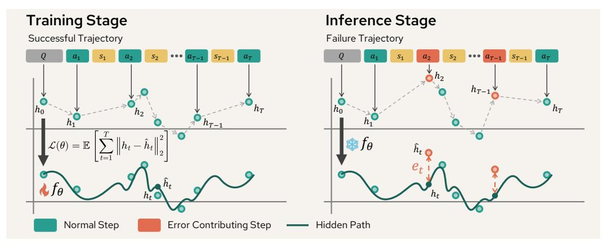

Figure 1: Overview of OAT. OAT learns to model the hidden path and to reconstruct the hidden representations of successful trajectories through Neural Control Differential Equations. At inference time, an expected successful path of a failure trajectory is predicted by OAT, and failure contributing steps are identified through anomaly scores calculated by the distance between the actual representation and the expected successful path.

Second, prompting-based approaches require running frontier LLMs at inference time, incurring substantial token costs and latency that preclude deployment in practice.

We argue that a practical failure attribution model should be lightweight, deployable without frontier LLM inference, and trainable *without step-level supervision* on failure data. To achieve this goal, we address a practical problem, *unsupervised failure attribution*: training a model exclusively on successful trajectories and, at inference time, identifying error steps given a failure trajectory. This formulation eliminates the annotation bottleneck, since successful trajectories are easy to collect from any agentic system as a byproduct of normal operation, requiring no step-level labeling effort.

To tackle the problem, we propose OAT that casts it as a One-class Agent Tracing problem in latent representation space. Our key idea is to train a model to characterize the dynamical pattern in successful trajectories, and at inference time, assign each step in a failure trajectory an anomaly score based on its deviation from the learned normal flow. Specifically, we represent each step of a trajectory as a latent vector extracted from an LLM, and model the sequence of step representations as a continuous latent path using Neural Controlled Differential Equations (Neural CDEs) [\[16\]](#page-10-2), a principled way to model irregularly structured trajectories. Drawing the connection between Neural CDEs and agentic settings is both new and non-trivial. Latent structure of agentic trajectories reflects goal-directed behavior, and detecting failure requires sensitivity to localized step-level deviations. We establish this connection through two key designs: a continuous latent path over LLM-extracted step representations that captures the temporal dynamics of agent behavior, and a novel gated control path that adaptively suppresses out-of-distribution control signals, improving robustness when the model is deployed on trajectories from unseen domains.

We train OAT on successful trajectories sampled from MCP-Atlas [\[17\]](#page-10-3), and evaluate on failure trajectories from both MCP-Atlas as well as Who&When [\[10\]](#page-9-9). Despite being trained on only 100 successful trajectories with no failure data and no step-annotation whatsoever, OAT (parameterized by a lightweight 3-layer MLP) consistently outperforms prompting frontier LLMs, including GPT-5. Furthermore, OAT requires zero token cost at inference time and runs 200–5000× faster than prompting-based approaches, making real-time failure attribution practical for the first time. Our main contributions are as follows:

- 1. We formulate unsupervised failure attribution for agentic systems, a new problem setting that eliminates the need for step-level annotation of failure trajectories by training exclusively on successful trajectories.
- 2. We propose OAT, a continuous-time one-class learning approach based on neural CDEs with a novel gated control path, modeling the dynamics of successful trajectories in latent space and detecting deviations at inference time.
- 3. We conduct extensive experiments and demonstrate that our approach is an effective, practical, and computationally efficient direction for diagnosing agentic system failures.

### 2 Related Work

**Failure attribution for LLM agents.** The problem of diagnosing failures in LLM-based multiagent systems has attracted growing attention. Early work focused on characterizing failure modes through taxonomy construction. Cemri et al. [18] developed the Multi-Agent System Failure Taxonomy, classifying failure modes into 14 categories across system design, inter-agent misalignment, and task verification. Deshpande et al. [19] introduced a fine-grained error taxonomy spanning reasoning, planning, and execution failures. Beyond failure categorization, recent works shifted focus on localizing error-contributing steps and/or actions [10, 13, 20]. In particular, Zhang et al. [10] first proposed to localize the error-contributing step within failure trajectories. They introduced the Who&When benchmark and found that even state-of-the-art reasoning models achieve below 15% accuracy on localizing the error step. Building on that, many works developed prompting pipelines or learning algorithms to identify error steps [11, 12, 13, 14, 15]. For example, Zhang et al. [14] post-trained an LLM with GRPO [21] on synthetic failure trajectories. These approaches, however, require extensive computational resources or large-scale step-level error annotations, limiting their practicality on real-world deployment. The idea of learning from successful trajectories to identify failures has been explored in the robotics community [22, 23, 24], where one-class models are trained on normal executions and anomalous trajectories are flagged at inference time. However, these works focus on trajectory-level detection, i.e., distinguishing successful from failed executions as a whole, rather than localizing the specific steps that caused the failure. Our work bridges this gap by bringing the unsupervised, one-class learning paradigm into the LLM agentic setting and extending it to step-level failure attribution, a strictly harder and more informative task that has not been attempted in the agentic AI community.

Anomaly detection. Anomaly detection is a well-studied problem in machine learning, aiming to identify observations that deviate from learned normal behavior [25, 26, 27]. One-class learning methods train exclusively on normal data and identify anomalies as out-of-distribution samples at test time [28, 29, 30, 31, 32, 33, 34, 35]. However, standard anomaly detection focuses on identifying whether a given sample is anomalous at the sample-level. In agent settings, this amounts to classifying whether a trajectory succeeded or failed, a coarse signal that reveals nothing about where a failure occurred. In this paper, we introduce a novel formulation of one-class learning for step-level failure attribution in agent trajectories. Rather than classifying trajectories at inference time, we derive anomaly score for each step in a failure trajectory and use it to localize failure contributing steps.

#### <span id="page-2-0"></span>3 Problem Statement

An agentic system consists of multiple LLM-based agents, each equipped with tool-calling and inter-agent communication capabilities, collectively designed to solve a complex, long-horizon task. At each time step t, the system observes a state  $s_t$  from an environment and chooses an agent to execute an action  $a_t$ . Given a query Q, a trajectory is denoted by

$$\tau = (Q, a_1, s_1, a_2, \dots, s_{T_{\tau} - 1}, a_{T_{\tau}}), \tag{1}$$

where  $T_{\tau}$  is the terminal step. An evaluation function  $Z(\tau) \in \{0,1\}$  determines whether the trajectory successfully completes the task  $(Z(\tau)=1)$  or not  $(Z(\tau)=0)$ .

Given a failure trajectory, failure attribution is the task of identifying which step(s) caused the failure, formalized as predicting a set of error steps  $y(\tau') \subseteq \{1,\ldots,T_{\tau'}\}$  for any failure trajectory  $\tau'$  with  $Z(\tau')=0$ . Existing works [14] have introduced supervised failure attribution, which requires training on a set of step-annotated failure trajectories. However, existing supervised approaches have two limitations. First, collecting step-level annotations is both costly and inherently ambiguous due to the reliance on an oracle rectification function that is inaccessible during practical annotation [36, 13]. Second, they focus on single-step interventions and therefore cannot capture compound errors, where multiple steps jointly contribute to failure. These limitations motivate unsupervised failure attribution, which we introduce next.

**Definition 3.1 (Unsupervised Failure Attribution)** Let  $\mathcal{D}_{succ} = \{\tau^{(k)}\}$  be a dataset of successful trajectories with no step-level annotations, i.e.,  $Z(\tau^{(k)}) = 1$  for all  $\tau^{(k)} \in \mathcal{D}_{succ}$ . The goal is to learn a predictor  $\psi_{\theta}$  trained exclusively on  $\mathcal{D}_{succ}$  that, at inference time, identifies a set of error steps in a failure trajectory  $\tau'$ :

$$\psi_{\theta}(\tau') \approx y(\tau').$$
(2)

**Definition 3.2 (Failure Contributing Steps)** Given a failure trajectory  $\tau'$ ,  $y(\tau') \subseteq \{1, \dots, T_{\tau'}\}$  denotes the set of failure contributing steps, where each step  $t \in y(\tau')$  meaningfully degrades the trajectory toward failure, regardless of whether intervening at t alone is sufficient for recovery.

### <span id="page-3-2"></span>4 Methodology

In this work, we frame unsupervised failure attribution as a *one-class learning problem* in LLM's representation space, which contains rich information beyond generated text: we train a model to characterize the dynamical pattern in successful trajectories, and at inference time identify steps in failure trajectories that deviate from the normal flow as contributing steps.

Concretely, given a trajectory  $\tau = (Q, a_1, s_1, a_2, \dots, s_{T_\tau - 1}, a_{T_\tau})$  and the LLM agent  $M_t$  active at step t, we define the representation of step t as the aggregated token representations produced by layer  $\ell$  of  $M_t$  when generating action  $a_t$ :

$$h_t = M_t^{(\ell)}(a_t \mid Q, a_1, s_1, \dots, a_{t-1}, s_{t-1}) \in \mathbb{R}^{d_h}.$$
 (3)

Multiple aggregation strategies are possible within a single step, such as using the last token or averaging across all tokens; we defer this discussion to Appendix G.2. We also define the query representation as  $h_Q = M_1^{(\ell)}(Q)$ , and denote the full sequence of representations as  $H(\tau) = (h_1, \ldots, h_{T_\tau}) \in \mathbb{R}^{T_\tau \times d_h}$ . Next, we describe how we model the dynamics  $H(\tau)$  in Section 4.1 and detect the failure steps in Section 4.2.

#### <span id="page-3-0"></span>4.1 Continuous Trajectory Modeling

Agent behavior is inherently a continuous dynamic process: each action shapes the subsequent state in a temporally coherent way. Given a successful trajectory  $\tau$ , we treat the query representation  $h_Q$  together with the step representations  $H(\tau)=(h_1,\ldots,h_{T_\tau})$  as irregularly sampled observations of an underlying continuous latent path, where the system evolves from the initial query state  $h_Q$  toward the terminal goal state  $h_T$ . Formally, we normalize all trajectories to the unit interval [0,1] via a monotonic mapping  $u:\{0,1,\ldots,T_\tau\}\to [0,1]$  with  $u(t)=t/T_\tau$ , and re-index the representations as  $h_{u_0},h_{u_1},\ldots,h_{u_{T_\tau}}$  with  $u_t=u(t)$  and  $h_{u_0}=h_Q$ . Note that the index  $u_t$  is now continuous.

**Trajectory dynamics modeling.** Under this formulation, the intermediate representations  $(h_{u_1},\ldots,h_{u_{T_\tau}})$  are observations sampled along the latent trajectory, and modeling their continuous evolution is the key technical challenge. Discrete-time models such as RNNs and Transformers treat these observations as isolated events and do not capture the continuous dynamics between them. Neural Differential Equations (NDEs) [37] offer a principled alternative for continuous-time modeling with neural networks, and are particularly well-suited to agentic trajectories, which are variable-length and irregularly structured. A natural starting point within the NDE family is Neural ODEs [38, 39, 40, 41], which model the evolution of a latent state from an initial condition:

$$\hat{h}(u) = g_1(z(u); \theta_{g_1}), \quad z(u) = z(0) + \int_0^u f(v, z(v); \theta_f) \, dv, \quad z(0) = g_2(h_Q; \theta_{g_2}), \quad (4)$$

where  $g_1: \mathbb{R}^{d_z} \to \mathbb{R}^{d_h}$  and  $g_2: \mathbb{R}^{d_h} \to \mathbb{R}^{d_z}$  are linear maps,  $h_Q$  is an initial state,  $\hat{h}: [0,1] \to \mathbb{R}^{d_h}$  and  $z: [0,1] \to \mathbb{R}^{d_z}$  are continuous functions of representations, and f is a lightweight neural network (e.g., MLP) approximating  $\mathrm{d}z(v)/\mathrm{d}v$ . We can train  $g_1, g_2$ , and f so that the reconstructed representation  $\hat{h}(u_t)$  matches the representation of successful trajectories at each step. Formally, the training objective is:

<span id="page-3-1"></span>
$$\mathcal{L}(\theta) = \mathbb{E}_{\tau \sim \mathcal{D}_{\text{succ}}} \left[ \sum_{t=1}^{T_{\tau}} \left\| h_t - \hat{h}(u_t) \right\|_2^2 \right]. \tag{5}$$

One limitation of Neural ODEs is that the latent trajectory is driven solely by the initial condition h(0) and does not take subsequent observations into account. As a result, the learned dynamics define a deterministic flow that maps each initial state to a single trajectory. This is particularly limiting in agentic systems, where multiple distinct action sequences may all lead to successful outcomes. To address this issue, we consider its variant, Neural Controlled Differential Equations (Neural

CDEs) [16, 42], which resolve this limitation by continuously conditioning the latent dynamics on the observed trajectory. A continuous control path  $X : [0,1] \to \mathbb{R}^{d_h+1}$  is constructed by interpolating the discrete step representations via cubic spline, with  $X(u_t) = (h_t, u_t)$ , whose derivative  $\mathrm{d}X(v)/\mathrm{d}v$  drives the latent dynamics at every integration step:

<span id="page-4-1"></span>
$$z(u) = z(0) + \int_0^u f(v, z(v); \theta_f) dX(v), \tag{6}$$

where the integral is interpreted as a Riemann-Stieltjes integral, and can be rewritten as

$$\int_0^u f(v, z(v); \theta_f) dX(v) = \int_0^u f(v, z(v); \theta_f) \frac{dX(v)}{dv} dv.$$
 (7)

Note that X is not learnable. Eq. (7) indicates that, rather than relying only on a fixed initial condition, f is continuously modulated by  $\mathrm{d}X(v)/\mathrm{d}v$  at every integration step, which encodes the direction and rate of change of the observations. As a result, the latent state  $\hat{h}(u)$  is sensitive to the local behavior of the trajectory at each step, making Neural CDEs well-suited to detecting localized deviations in failure trajectories. We adopt the same  $g_1$  and  $g_2$  to project z(u) and  $h_Q$ , respectively, and use the same loss to train them as defined in Eq. (5).

Gated control path. One practical challenge of deploying Neural CDEs in a real-world setting is that the control path X(u) may carry spurious signals when the input trajectory is out-of-distribution. Since the model is trained exclusively on successful trajectories from certain domains, the magnitudes of the spline derivatives  $\mathrm{d}X(u)/\mathrm{d}u$  at test time may deviate significantly from those seen during training, causing the control path to inject misleading dynamics into the latent state rather than informative guidance. To address this, we propose a gated control path that adaptively regulates the influence of the control signal. Specifically, we introduce a gating function  $q:\mathbb{R}^{d_h+1}\to [0,1]^{d_h+1}$  parameterized by a neural network, and replace the standard control path derivative with a gated variant:

<span id="page-4-2"></span>
$$\frac{\mathrm{d}\tilde{X}(u)}{\mathrm{d}u} = q\left(\frac{\mathrm{d}X(u)}{\mathrm{d}u};\theta_q\right) \odot \frac{\mathrm{d}X(u)}{\mathrm{d}u},\tag{8}$$

where  $\odot$  denotes element-wise multiplication. When the trajectory is in-distribution, q can pass the control signal through at full strength; when the trajectory is out-of-distribution and the spline derivatives are atypically large or directionally unfamiliar, q suppresses them, reducing the risk of the control path destabilizing the latent dynamics. The modified CDE then evolves as:

$$z(u) = z(0) + \int_0^u f(v, z(v); \theta_f) \frac{\mathrm{d}\tilde{X}(v)}{\mathrm{d}v} dv. \tag{9}$$

This design preserves the full expressiveness of Neural CDEs in the in-domain setting while improving robustness to distributional shift, as confirmed by our ablation study in Section 6.

#### <span id="page-4-0"></span>4.2 Detecting Failure Contributing Steps

**Step-level anomaly score.** At inference time, given a failure trajectory  $\tau'$  with step representations  $H(\tau')=(h'_Q,h'_1,\ldots,h'_{T_{\tau'}})$ , we pass it into f and produce the predicted states  $\hat{h}(u_t)$  for each step t. The anomaly score for each step t is then the reconstruction error:

$$e_t = \left\| h_t' - \hat{h}(u_t) \right\|_2^2. \tag{10}$$

Since f is trained exclusively on successful trajectories, it learns to predict the expected dynamics of a well-functioning system. Steps in a failure trajectory where the actual latent state deviates substantially from the predicted dynamics will yield high anomaly scores.

Given the per-step anomaly scores  $\{e_t\}_{t=1}^{T_{\tau'}}$  produced by the model, the final step is to identify which steps constitute the set of failure contributing steps  $y(\tau')$ . We consider two detection strategies.

**Top-**k **detection.** The simplest approach is to select the k steps with the highest anomaly scores:

$$\hat{y}(\tau') = \{ t \mid e_t \in \text{top-}k(\{e_1, \dots, e_{T_{\tau'}}\}) \}, \tag{11}$$

where k is a fixed hyperparameter. This strategy is straightforward but requires prior knowledge of how many failure contributing steps a typical failure trajectory contains, which may vary across tasks and systems.

Conformal prediction (CP) detection. To obtain a more principled and adaptive threshold, we adopt conformal prediction [\[43\]](#page-11-12), which provides distribution-free coverage guarantees without assumptions on the underlying data distribution. Specifically, we construct a calibration set Dcal ⊂ Dsucc of held-out successful trajectories. For each calibration trajectory τ ∈ Dcal, we compute the per-step anomaly scores and treat them as conformity scores measuring how well each step conforms to the learned distribution. The threshold δ is then set as the (1−α)-quantile of the calibration scores:

$$\delta = \text{Quantile}\left(1 - \alpha, \left\{e_t^{(\tau)}\right\}_{\tau \in \mathcal{D}_{\text{cal}}, t \in \{1, \dots, T_\tau\}}\right),\tag{12}$$

where α ∈ (0, 1) is a user-specified miscoverage rate. At inference time, steps in the failure trajectory whose anomaly scores exceed δ are flagged as failure contributing steps:

$$\hat{y}(\tau') = \{t \mid e_t > \delta\}. \tag{13}$$

This strategy adaptively determines the number of failure contributing steps based on the learned distribution of normal behavior, and provides a formal guarantee that the false positive rate on in-distribution steps is controlled at level α.

# <span id="page-5-1"></span>5 Experiments

## <span id="page-5-0"></span>5.1 Experimental Setup.

Datasets. We construct the training and in-domain evaluation set by sampling trajectories from MCP-Atlas [\[17\]](#page-10-3). MCP-Atlas is a benchmark for tool-calling agents with claim-level evaluation. We sample trajectories with Qwen3.5-27B [\[44\]](#page-11-13) and consider trajectories with no claim-level error as successful trajectories. We manually annotate the set of contribution steps for failure trajectories. In total, we obtain 103 successful and 88 failure trajectories. We use Who&When [\[10\]](#page-9-9) for out-ofdistribution (OOD) evaluation, which contains 184 step-annotated failure trajectories sampled with GPT-4o [\[45\]](#page-11-14). We provide the details of these two datasets and annotation process in Appendix [D](#page-14-0) and [E,](#page-14-1) respectively.

Evaluation metrics. We consider the following set-based metrics: (1) Precision: P t∈yˆ(τ) I[t ∈ y(τ )]/|yˆ(τ )|, (2) Recall: P t∈y(τ) I[t ∈ yˆ(τ )]/|y(τ )|, (3) F1 score: harmonic mean of precision and recall, and (4) Hit rate: I[|yˆ(τ ) ∩ y(τ )| > 0]. We also consider decoder-agnostic metrics, including (5) AUROC and (6) AUPRC, both evaluate the rank of the anomaly scores. All the metrics are reported as the average across all trajectories.

Baselines. We compare OAT with prompt-based approaches, which identify failure contributing steps by prompting an LLM. We evaluate two different LLMs, including GPT-4o [\[45\]](#page-11-14) and GPT-5 [\[46\]](#page-11-15). The prompt is modified from the all-at-once prompt in Zhang et al. [\[10\]](#page-9-9) to support predicting a set of failure contributing steps (See Appendix [I](#page-21-0) for detailed prompt design). We also compare it with the random and first-step baselines. For these two baselines, we select only one step for each trajectory.

Implementation details. We extract step representations using Qwen3.5-27B, taking the last-layer hidden states and applying mean-pooling to aggregate token representations within each step. We use Qwen3.5-27B as it is the same model used to simulate trajectories on MCP-Atlas. To improve generalizability and reduce computational cost, we apply PCA to project the representations to d<sup>h</sup> = 64 dimensions. The Neural CDE vector field f is parameterized by a 3-layer MLP with hidden dimension 64, and the control path X is constructed via natural cubic spline interpolation over the sequence of step representations. We adopt Euler's method as an CDE solver. For the two detection strategies, we set k = 3 for top-k detection and miscoverage rate α = 0.2 for conformal prediction detection. We train Neural CDE on 80% of successful trajectories and use the rest of 20% trajectories as validation/calibration set for early stopping and determining threshold of conformal prediction. Other implementation details and hyperparameters can be found in Appendix [F.](#page-16-1)

## 5.2 Experimental Results

All experiments based on OAT are run with 5 different random seeds. We report the mean and standard deviation of each metric across the 5 runs.

Table 1: OAT outperforms baselines across metrics in an in-domain scenario. We train and evaluate models on MCP-Atlas. The highest score is marked as bold.

<span id="page-6-0"></span>

| Approach                | Precision                  | Recall                     | F1                         | Hit                        | AUROC       | AUPRC       |
|-------------------------|----------------------------|----------------------------|----------------------------|----------------------------|-------------|-------------|
| Random-Step             | 0.284                      | 0.246                      | 0.255                      | 0.284                      | 0.529       | 0.226       |
| First-Step              | 0.136                      | 0.108                      | 0.116                      | 0.136                      | 0.469       | 0.206       |
| GPT-4o                  | 0.233                      | 0.210                      | 0.212                      | 0.250                      | 0.509       | 0.217       |
| GPT-5                   | 0.217                      | 0.183                      | 0.181                      | 0.250                      | 0.515       | 0.217       |
| OAT (Top-k)<br>OAT (CP) | 0.321±0.006<br>0.443±0.019 | 0.706±0.015<br>0.484±0.018 | 0.420±0.008<br>0.435±0.013 | 0.777±0.012<br>0.566±0.024 | 0.629±0.007 | 0.324±0.009 |

Table 2: OAT achieves a comparable performance or even outperforms baselines across metrics in an OOD scenario. We train models on MCP-Atlas and evaluate them on Who&When. The highest score is marked as bold.

<span id="page-6-1"></span>

| Approach                | Precision                  | Recall                     | F1                         | Hit                        | AUROC       | AUPRC       |
|-------------------------|----------------------------|----------------------------|----------------------------|----------------------------|-------------|-------------|
| Random-Step             | 0.137                      | 0.137                      | 0.137                      | 0.137                      | 0.547       | 0.061       |
| First-Step              | 0.115                      | 0.115                      | 0.115                      | 0.115                      | 0.535       | 0.057       |
| GPT-4o                  | 0.129                      | 0.198                      | 0.151                      | 0.198                      | 0.566       | 0.066       |
| GPT-5                   | 0.111                      | 0.275                      | 0.152                      | 0.275                      | 0.584       | 0.078       |
| OAT (Top-k)<br>OAT (CP) | 0.150±0.002<br>0.184±0.005 | 0.451±0.006<br>0.330±0.016 | 0.225±0.003<br>0.211±0.006 | 0.451±0.006<br>0.330±0.016 | 0.758±0.005 | 0.128±0.004 |

In-domain evaluation. Table [1](#page-6-0) presents the in-domain evaluation results on MCP-Atlas. OAT consistently outperforms all baselines across metrics with a huge performance gap (*e.g.*, +20% F1 score and +10% AUPRC). Notably, the model is trained on fewer than 100 successful trajectories, yet still surpasses frontier LLMs on failure contributing steps identification, suggesting that one-class learning on successful trajectories is a promising and label-efficient direction for failure attribution. The results also reveal a clear trade-off between the two detection strategies. Top-k detection achieves higher recall and hit rate but lower precision, indicating a tendency to over-detect failure contributing steps due to its fixed detection size. Conformal prediction detection, by contrast, achieves higher precision and a better balance between precision and recall, demonstrating the benefit of its adaptive, distribution-calibrated threshold.

OOD evaluation. Table [2](#page-6-1) presents the OOD evaluation results on Who&When. OAT again outperforms prompting-based approaches with +7% F1 score and +5% AUPRC. This is particularly encouraging given the substantial distributional differences between the two benchmarks. First, MCP-Atlas focuses on tool-calling in single-agent settings, whereas Who&When evaluates multi-agent collaboration, yielding trajectories with fundamentally different structures. Second, MCP-Atlas trajectories are generated by Qwen3.5-27B, while Who&When trajectories are generated by GPT-4o, two models that may exhibit different failure behaviors and reasoning styles. Together, *these differences make the OOD setting particularly challenging*, and the superior performance of OAT underscores its generalizability. These results also highlight a practical advantage of the unsupervised training paradigm: since training requires only successful trajectories, which are easier to collect than annotated failure trajectories, it is straightforward to augment the training set with additional indistribution data before deploying the model in a new OOD setting, without any additional annotation effort.

Computational efficiency. Beyond performance, one additional strength of OAT is its computational cost. Unlike prompting-based approaches that require running frontier LLMs, which can not be run on a local server, the deployment of OAT requires less than 1 GB VRAM, making it easily to deploy. In addition, Table [3](#page-6-2) reports the number of output tokens and latency for each approach. The result shows

Table 3: OAT costs much less than prompting-based baselines. We report the number of output tokens and detection latency for each approach. The lowest cost is marked as bold.

<span id="page-6-2"></span>

|          | MCP-Atlas  |                | Who&When   |                |  |
|----------|------------|----------------|------------|----------------|--|
| Approach | # Tokens ↓ | Latency (ms) ↓ | # Tokens ↓ | Latency (ms) ↓ |  |
| GPT-4o   | 121±31     | 4241±1684      | 118±33     | 4522±2351      |  |
| GPT-5    | 3012±683   | 39626±11079    | 2694±808   | 37819±14281    |  |
| OAT      | 0          | 7±4            | 0          | 16±22          |  |

<span id="page-7-1"></span>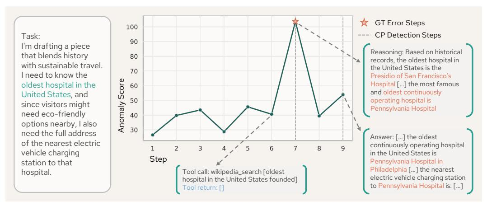

Figure 2: **Visualization of OAT's output.** OAT correctly identifies the hallucination at step 7 and the propagated error at step 9.

that OAT is much efficient than prompting-based approaches in terms of money and time, with 0 token cost and  $200-5000 \times$  faster, allowing a real-time failure attribution.

Qualitative case studies. We conduct case studies on MCP-Atlas with 6 randomly selected trajectories. Figure 2 shows a case where OAT successfully identified the failure step. Details of additional cases, including failure cases, are shown in Appendix H. Our qualitative analysis reveals several consistent patterns. In successful cases, OAT assigns significantly high anomaly scores to failure contributing steps, including hallucinations, unfaithful assumptions, and code bugs, while keeping scores for benign steps low. In failure cases, OAT misses the annotated root cause but still surfaces meaningful signals. It assigns progressively increasing scores to suboptimal plans that precede the final failure, and reliably detects steps where the failure becomes explicitly verbalized. Overall, the case studies suggest that OAT learns a reasonable notion of trajectory normality and that more adaptive detection strategies could further improve attribution coverage.

## <span id="page-7-0"></span>6 Ablation Studies

We conduct ablation studies to analyze the impact of each component of OAT. All the ablations are conducted on MCP-Atlas with conformal prediction detection unless explicit mention.

**Neural ODE vs. CDE.** Figure 3 shows the performance between Neural ODE and CDE with a non-trivial gap. The result shows that Neural CDE outperforms Neural ODE across all metrics, suggesting that the control path, which continuously injects trajectory observations into the latent dynamics, plays an important role in accurately modeling agent trajectories.

Impact of gated control path. In Section 4.1, we replace the original control path in CDE with a gated control path (Eq. (8)). We ablate on this design choice to show the impact of the gating function. Figure 4 shows that gated control path significantly improve the OOD performance by +0.172 AUROC, with a small trade-off (-0.028) on

<span id="page-7-2"></span>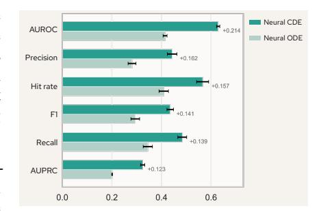

Figure 3: Neural CDE consistently outperforms Neural ODE across metrics.

in-domain performance. This asymmetric effect suggests that the gating mechanism improves the generalizability of the learned trajectory dynamics, making the model more robust to the distributional shift between MCP-Atlas and Who&When.

**Comparison with RNN-based approach.** We compare OAT with non-NDE one-class learning approach, particularly RNN, which directly takes  $h_Q, h_1, \ldots, h_{t-1}$  to predict  $\hat{h}_t$ . The anomaly score  $e_t$  for RNN is defined as  $e_t = \|h_t - \hat{h}_t\|_2^2$ . Figure 5 shows that OAT consistently outperforms RNN, suggesting that continuous model characterizes trajectory dynamics more accurately.

<span id="page-8-0"></span>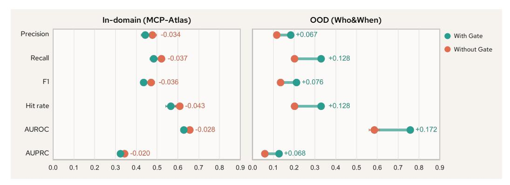

Figure 4: Gated control path improves generalizability with a small trade-off on in-domain performance. We plot the performance of with and without gating function, as well as their gaps, in both in-domain and OOD scenarios.

<span id="page-8-1"></span>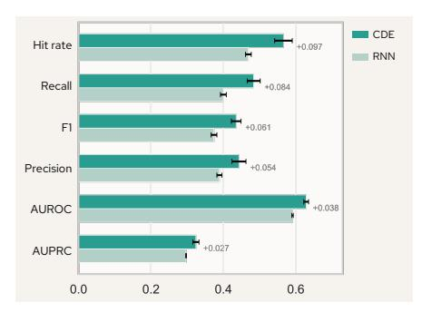

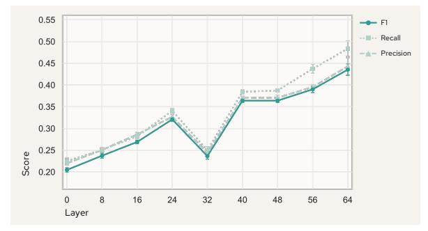

Figure 5: Neural CDE consistently outperforms RNN across metrics.

Figure 6: Later-layer representations consistently outperform earlier layers.

Representations at different layers. Rather than fixing representations to the last layer, we investigate how error step identification performance varies across model layers. Specifically, we evaluate representations extracted from layers {0, 8, 16, 24, 32, 40, 48, 56, 64} of Qwen3.5-27B. Qwen3.5- 27B has 64 layers; layer 0 corresponds to the embedding layer output. Figure [6](#page-8-1) shows that later-layer representations consistently achieve higher precision, recall, and F1 score than earlier layers. This is consistent with the well-established finding in the representation learning literature that later layers of transformer models encode more abstract, semantic, and task-relevant information [\[47,](#page-11-16) [48\]](#page-11-17), which provides a stronger signal for distinguishing normal from anomalous steps in trajectory modeling.

Additional ablations. We conduct other ablations on representation aggregation strategies, choice of proxy models, as well as the trade-off between precision and recall. See Appendix [G](#page-16-2) for more details.

# 7 Conclusion

In this paper, we introduced unsupervised failure attribution, a new problem formulation for diagnosing failures in LLM-based agentic systems, eliminating the need for step-level annotation of failure trajectories. Rather than learning from labeled failure trajectories, we propose OAT, a Neural CDE-based one-class learning approach, training exclusively on successful trajectories and identifying error steps at inference time by detecting deviations from the learned dynamics of normal behavior. Experimental results show that OAT outperforms the prompting-based approach in both in-domain and OOD scenarios. Beyond performance, OAT runs 200–5000× faster than promptingbased approaches, making real-time failure attribution practical. We hope our work inspires a broader shift in how the community approaches agentic system diagnostics, leveraging the rich signal in successful trajectories for understanding, diagnosing, and ultimately preventing failure.

# Acknowledgment

We gratefully acknowledge Changdae Oh and Leitian Tao for their valuable comments on the draft. The work is supported by Microsoft Research. Sharon Li is also supported in part by the AFOSR Young Investigator Program under award number FA9550-23-1-0184, National Science Foundation under awards IIS-2237037 and IIS-2331669, Office of Naval Research, Schmidt Sciences Foundation, Open Philanthropy (now Coefficient Giving), and Alfred P. Sloan Fellowship.

# Bibliography

- <span id="page-9-0"></span>[1] Shunyu Yao, Jeffrey Zhao, Dian Yu, Nan Du, Izhak Shafran, Karthik R Narasimhan, and Yuan Cao. React: Synergizing reasoning and acting in language models. In *The Eleventh International Conference on Learning Representations*, 2023.
- <span id="page-9-1"></span>[2] Lei Wang, Chen Ma, Xueyang Feng, Zeyu Zhang, Hao Yang, Jingsen Zhang, Zhiyuan Chen, Jiakai Tang, Xu Chen, Yankai Lin, Wayne Xin Zhao, Zhewei Wei, and Jirong Wen. A survey on large language model based autonomous agents. *Frontiers of Computer Science*, 18(6), 2024. ISSN 2095-2236.
- <span id="page-9-2"></span>[3] Taicheng Guo, Xiuying Chen, Yaqi Wang, Ruidi Chang, Shichao Pei, Nitesh V. Chawla, Olaf Wiest, and Xiangliang Zhang. Large language model based multi-agents: a survey of progress and challenges. In *Proceedings of the Thirty-Third International Joint Conference on Artificial Intelligence*, 2024.
- <span id="page-9-3"></span>[4] Carlos E Jimenez, John Yang, Alexander Wettig, Shunyu Yao, Kexin Pei, Ofir Press, and Karthik R Narasimhan. SWE-bench: Can language models resolve real-world github issues? In *The Twelfth International Conference on Learning Representations*, 2024.
- <span id="page-9-4"></span>[5] Xingyao Wang, Boxuan Li, Yufan Song, Frank F. Xu, Xiangru Tang, Mingchen Zhuge, Jiayi Pan, Yueqi Song, Bowen Li, Jaskirat Singh, Hoang H. Tran, Fuqiang Li, Ren Ma, Mingzhang Zheng, Bill Qian, Yanjun Shao, Niklas Muennighoff, Yizhe Zhang, Binyuan Hui, Junyang Lin, Robert Brennan, Hao Peng, Heng Ji, and Graham Neubig. Openhands: An open platform for AI software developers as generalist agents. In *The Thirteenth International Conference on Learning Representations*, 2025.
- <span id="page-9-5"></span>[6] Junwei Liu, Kaixin Wang, Yixuan Chen, Xin Peng, Zhenpeng Chen, Lingming Zhang, and Yiling Lou. Large language model-based agents for software engineering: A survey. *ACM Trans. Softw. Eng. Methodol.*, 2026. ISSN 1049-331X.
- <span id="page-9-6"></span>[7] Chris Lu, Cong Lu, Robert Tjarko Lange, Yutaro Yamada, Shengran Hu, Jakob Foerster, David Ha, and Jeff Clune. Towards end-to-end automation of ai research. *Nature*, 2026.
- <span id="page-9-7"></span>[8] Samuel Schmidgall, Yusheng Su, Ze Wang, Ximeng Sun, Jialian Wu, Xiaodong Yu, Jiang Liu, Michael Moor, Zicheng Liu, and Emad Barsoum. Agent laboratory: Using LLM agents as research assistants. In *Findings of the Association for Computational Linguistics: EMNLP 2025*, 2025.
- <span id="page-9-8"></span>[9] Shuo Ren, Can Xie, Pu Jian, Zhenjiang Ren, Chunlin Leng, and Jiajun Zhang. Towards scientific intelligence: A survey of llm-based scientific agents. *arXiv preprint arXiv:2503.24047*, 2026.
- <span id="page-9-9"></span>[10] Shaokun Zhang, Ming Yin, Jieyu Zhang, Jiale Liu, Zhiguang Han, Jingyang Zhang, Beibin Li, Chi Wang, Huazheng Wang, Yiran Chen, and Qingyun Wu. Which agent causes task failures and when? on automated failure attribution of LLM multi-agent systems. In *Forty-second International Conference on Machine Learning*, 2025.
- <span id="page-9-10"></span>[11] Adi Banerjee, Anirudh Nair, and Tarik Borogovac. Where did it all go wrong? a hierarchical look into multi-agent error attribution. In *NeurIPS 2025 Workshop on Evaluating the Evolving LLM Lifecycle: Benchmarks, Emergent Abilities, and Scaling*, 2025.
- <span id="page-9-11"></span>[12] Yawen Wang, Wenjie Wu, Junjie Wang, and Qing Wang. From flat logs to causal graphs: Hierarchical failure attribution for llm-based multi-agent systems. *arXiv preprint arXiv:2602.23701*, 2026.
- <span id="page-9-12"></span>[13] Yeonjun In, Mehrab Tanjim, Jayakumar Subramanian, Sungchul Kim, Uttaran Bhattacharya, Wonjoong Kim, Sangwu Park, Somdeb Sarkhel, and Chanyoung Park. Rethinking failure attribution in multi-agent systems: A multi-perspective benchmark and evaluation. *arXiv preprint arXiv:2603.2500*, 2026.

- <span id="page-10-0"></span>[14] Guibin Zhang, Junhao Wang, Junjie Chen, Wangchunshu Zhou, Kun Wang, and Shuicheng YAN. Agentracer: Who is inducing failure in the LLM agentic systems? In *The Fourteenth International Conference on Learning Representations*, 2026.
- <span id="page-10-1"></span>[15] Heng Zhang, Yuling Shi, Xiaodong Gu, Haochen You, Zijian Zhang, Lubin Gan, Yilei Yuan, and Jin Huang. Graphtracer: Graph-guided failure tracing in llm agents for robust multi-turn deep search. *arXiv preprint arXiv:2510.10581*, 2025.
- <span id="page-10-2"></span>[16] Patrick Kidger, James Morrill, James Foster, and Terry Lyons. Neural controlled differential equations for irregular time series. In *Proceedings of the 34th International Conference on Neural Information Processing Systems*, 2020.
- <span id="page-10-3"></span>[17] Chaithanya Bandi, Ben Hertzberg, Geobio Boo, Tejas Polakam, Jeff Da, Sami Hassaan, Manasi Sharma, Andrew Park, Ernesto Hernandez, Dan Rambado, Ivan Salazar, Rafael Cruz, Chetan Rane, Ben Levin, Brad Kenstler, and Bing Liu. Mcp-atlas: A large-scale benchmark for tool-use competency with real mcp servers. *arXiv preprint arXiv:2602.00933*, 2026.
- <span id="page-10-4"></span>[18] Mert Cemri, Melissa Z Pan, Shuyi Yang, Lakshya A Agrawal, Bhavya Chopra, Rishabh Tiwari, Kurt Keutzer, Aditya Parameswaran, Dan Klein, Kannan Ramchandran, Matei Zaharia, Joseph E. Gonzalez, and Ion Stoica. Why do multi-agent LLM systems fail? In *The Thirty-ninth Annual Conference on Neural Information Processing Systems Datasets and Benchmarks Track*, 2025.
- <span id="page-10-5"></span>[19] Darshan Deshpande, Varun Gangal, Hersh Mehta, Jitin Krishnan, Anand Kannappan, and Rebecca Qian. Trail: Trace reasoning and agentic issue localization. *arXiv preprint arXiv:2505.08638*, 2025.
- <span id="page-10-6"></span>[20] Chen Qian, Peng Wang, Dongrui Liu, Junyao Yang, Dadi Guo, Ling Tang, Jilin Mei, Qihan Ren, Shuai Shao, Yong Liu, Jie Fu, Jing Shao, and Xia Hu. The why behind the action: Unveiling internal drivers via agentic attribution. *arXiv preprint arXiv:2601.15075*, 2026.
- <span id="page-10-7"></span>[21] Zhihong Shao, Peiyi Wang, Qihao Zhu, Runxin Xu, Junxiao Song, Xiao Bi, Haowei Zhang, Mingchuan Zhang, Y. K. Li, Y. Wu, and Daya Guo. Deepseekmath: Pushing the limits of mathematical reasoning in open language models. *arXiv preprint arXiv:2402.03300*, 2024.
- <span id="page-10-8"></span>[22] Chen Xu, Tony Khuong Nguyen, Emma Dixon, Christopher Rodriguez, Patrick Miller, Robert Lee, Paarth Shah, Rares Andrei Ambrus, Haruki Nishimura, and Masha Itkina. Can we detect failures without failure data? uncertainty-aware runtime failure detection for imitation learning policies. In *Robot Evaluation for the Real World*, 2025.
- <span id="page-10-9"></span>[23] Ralf Römer, Adrian Kobras, Luca Worbis, and Angela P. Schoellig. Failure prediction at runtime for generative robot policies. In *The Thirty-ninth Annual Conference on Neural Information Processing Systems*, 2026.
- <span id="page-10-10"></span>[24] Shijie Zhou, Bin Zhu, Jiarui Yang, Xiangyu Zhao, Jingjing Chen, and Yu-Gang Jiang. Rc-nf: Robot-conditioned normalizing flow for real-time anomaly detection in robotic manipulation. *arXiv preprint arXiv:2603.11106*, 2026.
- <span id="page-10-11"></span>[25] P. García-Teodoro, J. Díaz-Verdejo, G. Maciá-Fernández, and E. Vázquez. Anomaly-based network intrusion detection: Techniques, systems and challenges. *Comput. Secur.*, 28(1–2), 2009. ISSN 0167-4048.
- <span id="page-10-12"></span>[26] Raghavendra Chalapathy and Sanjay Chawla. Deep learning for anomaly detection: A survey. *arXiv preprint arXiv:1901.03407*, 2019.
- <span id="page-10-13"></span>[27] Zahra Zamanzadeh Darban, Geoffrey I. Webb, Shirui Pan, Charu Aggarwal, and Mahsa Salehi. Deep learning for time series anomaly detection: A survey. *ACM Comput. Surv.*, 57(1), 2024. ISSN 0360-0300.
- <span id="page-10-14"></span>[28] Bernhard Schölkopf, Robert C Williamson, Alex Smola, John Shawe-Taylor, and John Platt. Support vector method for novelty detection. In *Advances in Neural Information Processing Systems*, volume 12, 1999.
- <span id="page-10-15"></span>[29] David M. J. Tax and Robert P. W. Duin. Support vector data description. *Mach. Learn.*, 54(1), 2004. ISSN 0885-6125.
- <span id="page-10-16"></span>[30] Toshitaka Hayashi, Dalibor Cimr, Hamido Fujita, and Richard Cimler. Critical review for one-class classification: Recent advances and reality behind them. *WIREs Data Mining and Knowledge Discovery*, 16(1), 2026. ISSN 1942-4795.

- <span id="page-11-0"></span>[31] Lukas Ruff, Robert Vandermeulen, Nico Goernitz, Lucas Deecke, Shoaib Ahmed Siddiqui, Alexander Binder, Emmanuel Müller, and Marius Kloft. Deep one-class classification. In *Proceedings of the 35th International Conference on Machine Learning*, volume 80, 2018.
- <span id="page-11-1"></span>[32] Mayu Sakurada and Takehisa Yairi. Anomaly detection using autoencoders with nonlinear dimensionality reduction. In *Proceedings of the MLSDA 2014 2nd Workshop on Machine Learning for Sensory Data Analysis*, 2014. ISBN 9781450331593.
- <span id="page-11-2"></span>[33] Jiehui Xu, Haixu Wu, Jianmin Wang, and Mingsheng Long. Anomaly transformer: Time series anomaly detection with association discrepancy. In *International Conference on Learning Representations*, 2022.
- <span id="page-11-3"></span>[34] Daehyung Park, Yuuna Hoshi, and Charles C Kemp. A multimodal anomaly detector for robotassisted feeding using an lstm-based variational autoencoder. *IEEE Robotics and Automation Letters*, 3(3), 2018.
- <span id="page-11-4"></span>[35] Ya Su, Youjian Zhao, Chenhao Niu, Rong Liu, Wei Sun, and Dan Pei. Robust anomaly detection for multivariate time series through stochastic recurrent neural network. In *Proceedings of the 25th ACM SIGKDD International Conference on Knowledge Discovery & Data Mining*, 2019. ISBN 9781450362016.
- <span id="page-11-5"></span>[36] Ming Ma, Jue Zhang, Fangkai Yang, Yu Kang, Qingwei Lin, Saravan Rajmohan, and Dongmei Zhang. Dover: Intervention-driven auto debugging for LLM multi-agent systems. In *The Fourteenth International Conference on Learning Representations*, 2026.
- <span id="page-11-6"></span>[37] YongKyung Oh, Seungsu Kam, Jonghun Lee, Dong-Young Lim, Sungil Kim, and Alex A. T. Bui. Comprehensive review of neural differential equations for time series analysis. In *Proceedings of the Thirty-Fourth International Joint Conference on Artificial Intelligence*, 2025.
- <span id="page-11-7"></span>[38] Ricky T. Q. Chen, Yulia Rubanova, Jesse Bettencourt, and David K Duvenaud. Neural ordinary differential equations. In *Advances in Neural Information Processing Systems*, 2018.
- <span id="page-11-8"></span>[39] Edward De Brouwer, Jaak Simm, Adam Arany, and Yves Moreau. Gru-ode-bayes: continuous modeling of sporadically-observed time series. In *Proceedings of the 33rd International Conference on Neural Information Processing Systems*, 2019.
- <span id="page-11-9"></span>[40] Cagatay Yildiz, Markus Heinonen, and Harri Lahdesmaki. Ode2vae: Deep generative second order odes with bayesian neural networks. In *Advances in Neural Information Processing Systems*, 2019.
- <span id="page-11-10"></span>[41] Yulia Rubanova, Ricky T. Q. Chen, and David Duvenaud. Latent odes for irregularly-sampled time series. In *Proceedings of the 33rd International Conference on Neural Information Processing Systems*, 2019.
- <span id="page-11-11"></span>[42] James Morrill, Patrick Kidger, Lingyi Yang, and Terry Lyons. Neural controlled differential equations for online prediction tasks. *arXiv preprint arXiv:2106.11028*, 2021.
- <span id="page-11-12"></span>[43] Anastasios N. Angelopoulos and Stephen Bates. Conformal prediction: A gentle introduction. *Found. Trends Mach. Learn.*, 16(4), 2023. ISSN 1935-8237.
- <span id="page-11-13"></span>[44] Qwen Team. Qwen3.5: Towards native multimodal agents, February 2026. URL [https:](https://qwen.ai/blog?id=qwen3.5) [//qwen.ai/blog?id=qwen3.5](https://qwen.ai/blog?id=qwen3.5).
- <span id="page-11-14"></span>[45] OpenAI. Gpt-4o system card. *arXiv preprint arXiv:2410.21276*, 2024.
- <span id="page-11-15"></span>[46] OpenAI. Openai gpt-5 system card. *arXiv preprint arXiv:2601.03267*, 2025.
- <span id="page-11-16"></span>[47] Wes Gurnee and Max Tegmark. Language models represent space and time. In *The Twelfth International Conference on Learning Representations*, 2024.
- <span id="page-11-17"></span>[48] Siqi Fan, Xin Jiang, Xiang Li, Xuying Meng, Peng Han, Shuo Shang, Aixin Sun, and Yequan Wang. Not all layers of llms are necessary during inference. In *Proceedings of the Thirty-Fourth International Joint Conference on Artificial Intelligence*, 2025.
- <span id="page-11-18"></span>[49] Sheo Yon Jhin, Heejoo Shin, Sujie Kim, Seoyoung Hong, Minju Jo, Solhee Park, Noseong Park, Seungbeom Lee, Hwiyoung Maeng, and Seungmin Jeon. Attentive neural controlled differential equations for time-series classification and forecasting. *Knowl. Inf. Syst.*, 66(3), 2023. ISSN 0219-1377.
- <span id="page-11-19"></span>[50] Ting Li, Jianguo Li, and Zhanxing Zhu. Neural lad: A neural latent dynamics framework for times series modeling. In *Thirty-seventh Conference on Neural Information Processing Systems*, 2023.

- <span id="page-12-0"></span>[51] Belinda Tzen and Maxim Raginsky. Neural stochastic differential equations: Deep latent gaussian models in the diffusion limit. *arXiv preprint arXiv:1905.09883*, 2019.
- <span id="page-12-1"></span>[52] Grégoire Mialon, Clémentine Fourrier, Thomas Wolf, Yann LeCun, and Thomas Scialom. GAIA: a benchmark for general AI assistants. In *The Twelfth International Conference on Learning Representations*, 2024.
- <span id="page-12-2"></span>[53] Ori Yoran, Samuel Joseph Amouyal, Chaitanya Malaviya, Ben Bogin, Ofir Press, and Jonathan Berant. AssistantBench: Can web agents solve realistic and time-consuming tasks? In *Proceedings of the 2024 Conference on Empirical Methods in Natural Language Processing*, 2024.
- <span id="page-12-3"></span>[54] Linxin Song, Jiale Liu, Jieyu Zhang, Shaokun Zhang, Ao Luo, Shijian Wang, Qingyun Wu, and Chi Wang. Adaptive in-conversation team building for language model agents. *arXiv preprint arXiv:2405.19425*, 2025.
- <span id="page-12-4"></span>[55] Adam Fourney, Gagan Bansal, Hussein Mozannar, Cheng Tan, Eduardo Salinas, Erkang, Zhu, Friederike Niedtner, Grace Proebsting, Griffin Bassman, Jack Gerrits, Jacob Alber, Peter Chang, Ricky Loynd, Robert West, Victor Dibia, Ahmed Awadallah, Ece Kamar, Rafah Hosn, and Saleema Amershi. Magentic-one: A generalist multi-agent system for solving complex tasks. *arXiv preprint arXiv:2411.04468*, 2024.
- <span id="page-12-5"></span>[56] Baochen Sun, Jiashi Feng, and Kate Saenko. Correlation alignment for unsupervised domain adaptation. *arXiv preprint arXiv:1612.01939*, 2016.
- <span id="page-12-6"></span>[57] MetaAI. Llama-4-Scout-17B-16E-Instruct. [https://huggingface.co/meta-llama/Lla](https://huggingface.co/meta-llama/Llama-4-Scout-17B-16E-Instruct) [ma-4-Scout-17B-16E-Instruct](https://huggingface.co/meta-llama/Llama-4-Scout-17B-16E-Instruct), 2025.
- <span id="page-12-7"></span>[58] Google DeepMind. Welcome Gemma 4: Frontier multimodal intelligence on device. [https:](https://huggingface.co/blog/gemma4) [//huggingface.co/blog/gemma4](https://huggingface.co/blog/gemma4), 2026.
- <span id="page-12-8"></span>[59] OpenAI. gpt-oss-120b & gpt-oss-20b model card. *arXiv preprint arXiv:2508.10925*, 2025.

# APPENDIX

# CONTENTS

| A | Limitations and future work                         | 14 |
|---|-----------------------------------------------------|----|
| B | Societal Impact                                     | 14 |
| C | Reproducibility Statement                           | 15 |
| D | Details of Datasets                                 | 15 |
| E | Annotation of Failure Contributing Steps            | 16 |
| F | Additional Implementation Details & Hyperparameters | 17 |
| G | Additional Experimental Results                     | 17 |
|   | G.1<br>Precision-Recall Trade-off<br>               | 17 |
|   | G.2<br>Ablations on Step Representations<br>        | 18 |
| H | Case Studies                                        | 18 |
|   | H.1<br>Successful Cases<br>                         | 19 |
|   | H.2<br>Failure Cases<br>                            | 21 |
| I | Prompt Templates                                    | 22 |

# <span id="page-13-0"></span>A Limitations and future work

In this work, we explore the feasibility of modeling successful trajectories with NDEs and demonstrate that Neural CDEs are effective for continuous-time modeling of agent trajectories. Beyond vanilla NDE, there are many extensions that can be explored. For example, Chen et al. [\[38\]](#page-11-7) showed that NDEs can be extended as Continuous Normalizing Flows (CNFs), enabling exact likelihood computation via the instantaneous change-of-variables formula. Under this formulation, the anomaly score for each step could be replaced by its negative log-likelihood under the learned distribution, providing a more principled measure of deviation from normal behavior. Alternatively, one can incorporate Neural CDEs with attention mechanisms for control path construction [\[49,](#page-11-18) [50\]](#page-11-19), which may be beneficial for distinguishing between decisive and trivial steps and better trajectory modeling. Beyond density estimation, Neural CDEs can also be extended with stochastic dynamics via Neural Stochastic Differential Equations (Neural SDEs) [\[51\]](#page-12-0), which model uncertainty in the latent trajectory evolution and may better capture the inherent stochasticity of LLM-generated trajectories. These extensions suggest that there is a huge room to explore in unsupervised failure attribution. We leave such exploration to future work.

# <span id="page-13-1"></span>B Societal Impact

This work aims to improve the transparency and reliability of LLM-based agentic systems by enabling automatic identification of error contributing steps without human annotation. As agentic systems are increasingly deployed in high-stakes domains such as software engineering, scientific research, and automated decision making, the ability to identify and explain failures is an important step toward building safer systems. By reducing the annotation burden for failure attribution, our approach also lowers the barrier of monitoring and debugging deployed agents, which may encourage more

Table 4: Statistics of MCP-Atlas dataset.

<span id="page-14-3"></span>

|            | # Samples | Avg. # Steps | Max # Steps | Avg. # Tokens | Max # Tokens | Avg. # Errors | Max # Errors |
|------------|-----------|--------------|-------------|---------------|--------------|---------------|--------------|
| Successful | 103       | 7.18         | 19          | 3.6K          | 18K          | -             | -            |
| Failure    | 88        | 7.32         | 20          | 4.2K          | 20K          | 1.56          | 12           |

Table 5: Statistics of Who&When dataset.

<span id="page-14-4"></span>

| # Samples | Avg. # Steps | Max # Steps | Avg. # Tokens | Max # Tokens |
|-----------|--------------|-------------|---------------|--------------|
| 184       | 20.28        | 129         | 6.8K          | 60K          |

responsible deployment practices. We do not foresee direct negative societal impacts of this work. However, we note that failure attribution tools could be used to optimize agents for evading detection rather than for genuine improvement, and that automated failure attribution should be treated as an aid to human oversight rather than a replacement for it.

# <span id="page-14-2"></span>C Reproducibility Statement

We detail the implementation of OAT in Section [5.1](#page-5-0) and Appendix [F,](#page-16-1) including representation extraction, model structure of neural CDE vector field, CDE solver, construction of control path, as well as all corresponding hyperparameters. In Section [5.1,](#page-5-0) we also illustrate the experimental settings, including baselines, datasets, and evaluation metrics. The details of datasets and step-level error annotation are further provided in Appendix [D](#page-14-0) and [E.](#page-14-1) These comprehensive reports will help future studies reproduce our experiments. Code and data are available at [https://anonymous.4open.sc](https://anonymous.4open.science/r/OAT-183C) [ience/r/OAT-183C](https://anonymous.4open.science/r/OAT-183C).

# <span id="page-14-0"></span>D Details of Datasets

MCP-Atlas. MCP-Atlas [\[17\]](#page-10-3) is a benchmark for evaluating tool-use agents, covering 36 MCP servers and 220 tools across 1,000 tasks designed to assess tool-use competency in realistic, multi-step workflows. Agents are evaluated via a claims-based rubric using LLM-as-a-Judge. In our experiments, we run Qwen3.5-27B on 203 tasks drawn from the public subset for which we have free access to the required MCP server APIs. We use the same Qwen3.5-27B as judge to evaluate each trajectory against the claims-based rubric, and manually verify all judging results. A trajectory is considered successful if it satisfies all rubric claims, and a failure if it violates at least one. This yields 103 successful and 100 failure trajectories. The successful trajectories form our training set, while the failure trajectories form our test set. For the failure trajectories, we filter out 12 trajectories, in which the failure is not caused by agent behavior. We then manually annotate step-level failure contributing steps for the rest of 88 failure trajectories; the annotation procedure is detailed in Appendix [E.](#page-14-1) Table [4](#page-14-3) summarizes the trajectory statistics for MCP-Atlas.

<span id="page-14-1"></span>Who&When. Who&When [\[10\]](#page-9-9) is a failure attribution benchmark for LLM-based multi-agent systems. The tasks are drawn from two sources: GAIA [\[52\]](#page-12-1), which contains queries requiring diverse modality processing (*e.g.*, PDFs, spreadsheets, images, videos, and audio), web browsing, and coding; and AssistantBench [\[53\]](#page-12-2), which requires agents to interact with multiple websites across topics in biology, geography, and visual arts. Trajectories were generated by two agentic systems, CaptainAgent [\[54\]](#page-12-3) and Magnetic-One [\[55\]](#page-12-4), both using GPT-4o as the base model. The dataset consists entirely of failure trajectories, comprising 184 trajectories in total, each annotated with a step-level label identifying the first decisive error. Since Who&When contains only failure trajectories, we use it exclusively as a test set, evaluating our model trained on MCP-Atlas successful trajectories. Table [5](#page-14-4) summarizes the trajectory statistics for Who&When.

<span id="page-15-0"></span>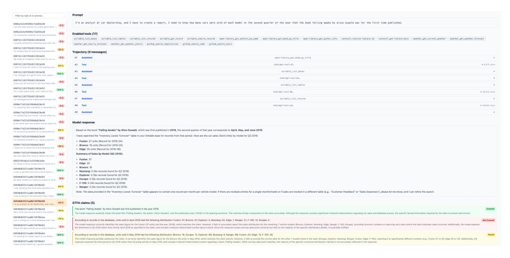

Figure 7: Visualization tool for trajectory annotation. We develop a tool to visualize trajectories and help tracing errors. The tool shows the complete trajectory as well as the claim-level judging results.

# E Annotation of Failure Contributing Steps

For each failure trajectory in MCP-Atlas, we manually annotate the set of failure contributing steps C(τ ) following the definition in Section [3.](#page-2-0) Figure [7](#page-15-0) shows the visualization tool for annotation. The annotation process proceeds in two stages: trajectory filtering and step-level labeling.

Trajectory Filtering. Prior to annotation, we exclude trajectories whose failure is attributable to infrastructure errors rather than agent behavior. Specifically, we identified a particular search API that consistently returns timeout errors regardless of the query or context. Failures caused purely by this API error are not informative for evaluating failure attribution methods, as the contributing step is trivially identifiable and reflects an environmental rather than an agent-level fault. We therefore exclude all trajectories where the sole cause of failure is this timeout issue. We also exclude cases that the trajectory logs are empty.

Step-Level Annotation. For each retained failure trajectory, we use the claim-level judging results produced during evaluation as a guide to understand the nature and location of the failure. We then read through the full trajectory step by step and label a step as a contributing step if it exhibits one or more of the following error types:

- Hallucination in reasoning content: the agent produces factually incorrect or fabricated information in its reasoning, leading to a misguided subsequent action or incorrect planning.
- Wrong arguments in tool-calling: the agent invokes a tool with incorrect, malformed, or semantically inappropriate arguments that cause the tool call to fail or return an incorrect result.
- Error messages in tool returns: the tool returns an explicit error or exception that the agent fails to handle appropriately, leading to downstream failure.

Treatment of Exploratory Tool Use. A special consideration arises for search-type tool calls, where the agent may issue multiple queries with different keywords in an attempt to retrieve relevant information. We treat such behavior as a natural exploration process and do not penalize individual failed search attempts, as trying alternative phrasings is a reasonable and expected strategy. However, if the agent issues the same query (or a semantically equivalent one) multiple times despite receiving the same unsuccessful result, we interpret this as a failure to adapt and mark all repeated attempts after the first as failure contributing steps. The first attempt is not marked as an error, as it represents legitimate exploratory behavior.

Table 6: Hyperparameters of OAT.

<span id="page-16-4"></span>

| Hyperparameter            | Value        |
|---------------------------|--------------|
| Representation Extraction |              |
| Aggregation               | Mean Pooling |
| Layer                     | Last         |
| PCA Dim                   | 64           |
| Neural CDE                |              |
| Hidden Dim                | 64           |
| # Hidden Layer            | 3            |
| Control Path              | Cubic Spline |
| Gate Hidden Dim           | 12           |
| # Gate Hidden Layer       | 4            |
| Detection                 |              |
| k (Top-k)                 | 3            |
| α (CP)                    | 0.2          |
| Training                  |              |
| Learning Rate             | −5<br>4e     |
| Batch Size                | 32           |
| Epoch                     | 300          |
| Weight Decay              | −5<br>1e     |

Annotation Quality. All annotations were performed by the authors, with each trajectory reviewed independently. Trajectories with ambiguous error attribution (*e.g.*, where a failure could be attributed to either a reasoning error or an uninformative tool return) were discussed until consensus was reached. The final contributing step labels reflect the annotators' best judgment of which steps meaningfully degraded the trajectory toward failure.

# <span id="page-16-1"></span>F Additional Implementation Details & Hyperparameters

Section [5.1](#page-5-0) introduces the core implementation details of our approach. Here we provide a comprehensive summary of all hyperparameters used in our experiments in Table [6.](#page-16-4) Key design choices are ablated and discussed in Section [6](#page-7-0) and Appendix [G,](#page-16-2) covering representation extraction strategies, the use of Neural CDE with gated control path, and the selection of k for top-k detection and α for conformal prediction detection.

Beyond the components discussed in the main paper, we apply Correlation Alignment (CORAL) [\[56\]](#page-12-5) to further mitigate the distributional shift between in-domain and OOD representations. Since PCA is fitted solely on in-domain training data from MCP-Atlas, the projected representations of OOD trajectories from WHO&WHEN may exhibit a covariance mismatch relative to in-domain representations, degrading model performance. CORAL addresses this by aligning the second-order statistics of the OOD representations to those of the in-domain representations before they are passed to the Neural CDE, reducing the effective distributional gap without requiring any labeled OOD data.

# <span id="page-16-2"></span>G Additional Experimental Results

# <span id="page-16-3"></span>G.1 Precision-Recall Trade-off

<span id="page-16-0"></span>In Section [4.2,](#page-4-0) we introduce top-k detection and conformal prediction detection, where both of them have a hyperparameter (*i.e.*, k for top-k detection and α for conformal prediction detection) that control the trade-off between precision and recall. Figure [8](#page-17-2) shows the ablation study on k ∈ {1, 3, 5} and α ∈ {0.05, 0.1, 0.2}. The result shows that OAT trades off precision with recall as k and α increase, whereas F1 score remains stable. In practice, the hyperparameters k and α can be choose depending on whether the system requires a high precision or recall.

<span id="page-17-2"></span>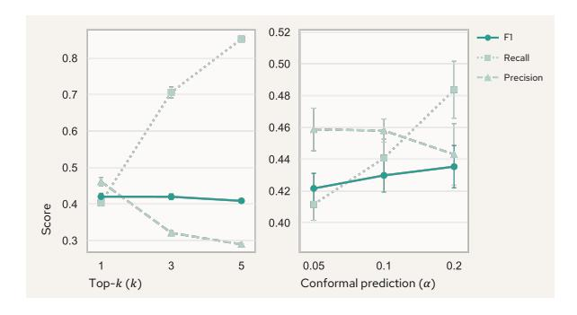

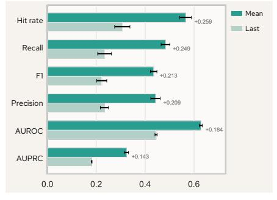

Figure 8: OAT trades off precision with recall as k and α increase.

Figure 9: Mean-pooling aggregation outperforms last token representation.

<span id="page-17-3"></span>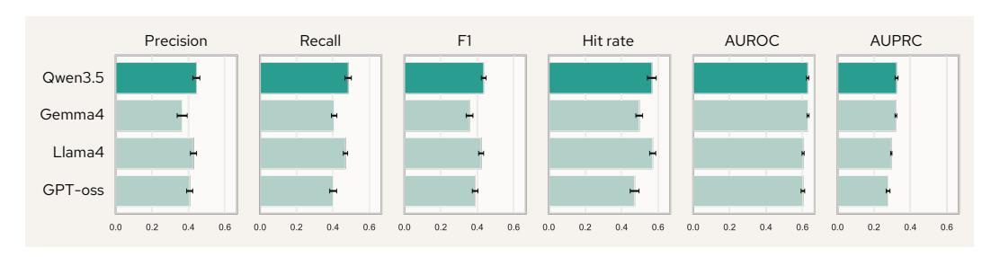

Figure 10: Performance is stable under the proxy LLM setting.

#### G.2 Ablations on Step Representations

We ablate on design choices corresponding to step representation extraction, including representation aggregation strategies and the proxy LLM setting. All of these ablation studies were conducted on MCP-Atlas conformal prediction detection.

Mean pooling vs. last token. In Section [5.1,](#page-5-0) we obtain step representations by applying mean pooling to aggregate token representations within each step. We ablate this choice by replacing mean pooling with the last token representation. Figure [9](#page-17-2) shows that this substitution significantly degrades performance. This suggests that the last token alone is insufficient to encode the complexity of an action step. Error signals in agent behavior often manifest in intermediate tokens, for instance, in the reasoning content or argument construction within a step, rather than at the final token. Mean pooling aggregates information across all tokens within a step, capturing a richer and more representative encoding of the step's content, which in turn improves the quality of the modeled trajectory.

Representations extracted by different proxy LLMs. Instead of using the same Qwen3.5-27B model to extract representations of its own trajectories, we explore the possibility of proxy LLM setup, *i.e.*, extracting representations with LLMs different from the one for generation. We examine three different LLMs, including Llama-4-Scout [\[57\]](#page-12-6), Gemma-4-31B [\[58\]](#page-12-7), and GPT-oss-120B [\[59\]](#page-12-8). Figure [10](#page-17-3) shows that OAT works well under the proxy setting, with only a small performance degradation compared to the same-LLM setting. This result highlights the generalizability of OAT, enabling it to be applied in different practical scenarios where the generator LLM is not accessible.

# <span id="page-17-0"></span>H Case Studies

<span id="page-17-1"></span>We randomly select three trajectories from MCP-Atlas where OAT identifies at least one annotated contributing step (*successful cases*), and three trajectories where it fails to identify any annotated step (*failure cases*). We analyze these cases to understand the conditions under which OAT succeeds and fails. We use conformal prediction detection for all case study outputs.

<span id="page-18-0"></span>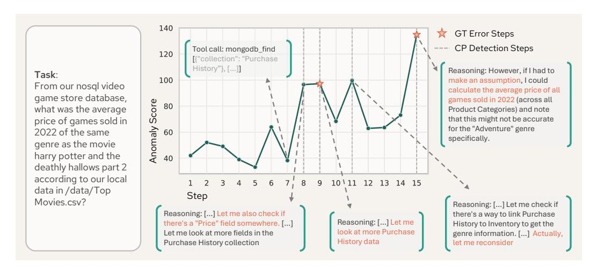

Figure 11: Second successful case. OAT identifies repeated useless actions at step 9, inconsistent reasoning at steps 8 and 11, and an unfaithful assumption at step 15.

## H.1 Successful Cases

Case 1. Figure [2](#page-7-1) in Section [5](#page-5-1) shows a task requiring the agent to find the oldest hospital in the US and nearby electric vehicle charging stations. At step 6, the agent attempts to retrieve information about the oldest hospital via the Wikipedia API but fails to obtain a result. At step 7, the agent falls back on its parametric knowledge and hallucinates an incorrect answer. Based on this fabricated result, the agent searches for nearby charging stations at step 8. Although the search itself succeeds, the query is wrong, and the error propagates to the final step, yielding an incorrect answer.

OAT assigns a significantly high anomaly score to the hallucinated step 7 while keeping the scores of benign steps low. Notably, the final step is also flagged as a contributing step, but with a more moderate score, reflecting that its logic is internally coherent while being contingent on the erroneous prior step. This case demonstrates that OAT is sensitive to the origin of an error and appropriately attenuates scores for downstream steps that inherit rather than introduce errors.

Case 2. Figure [11](#page-18-0) shows a data analysis task on a database. At step 7, the agent calls a tool to fetch information and discovers that the target collection does not contain the required data. Over steps 8–14, the agent attempts various approaches to retrieve the information, exhibiting inconsistent reasoning[1](#page-18-1) and repeatedly re-attempting actions that had already been shown to be ineffective. At step 15, the agent resorts to an unfaithful assumption to work around its failure to retrieve the required information, ultimately producing an incorrect answer.

OAT assigns high anomaly scores to both annotated contributing steps, with step 15 receiving a particularly elevated score reflecting the severity of the unfaithful assumption and its direct causal role in the failure. OAT also flags steps 8 and 11, where the reasoning traces are internally inconsistent, despite these steps not being explicitly annotated as contributing steps. This behavior suggests that OAT captures subtle precursors to failure that may not meet the threshold for annotation but nonetheless indicate degraded trajectory dynamics. This case further illustrates that the first error does not necessarily receive the highest anomaly score: a later, more consequential error can dominate the scoring.

Case 3. Figure [12](#page-19-1) shows a task requiring the agent to find the user with the 24th most comments on a project. At step 7, the agent counts comments by display name rather than email address, accidentally merging two distinct users who share the same name. As a result, the code returns an incorrect user. This error propagates to step 8, where the agent writes a downstream code block based on the wrong result, and to step 10, where the incorrect answer is returned.

<span id="page-18-1"></span><sup>1</sup>Because the agent still calls a reasonable tool at the end of these steps, we do not label the inconsistent reasoning itself as a contributing step.

<span id="page-19-1"></span>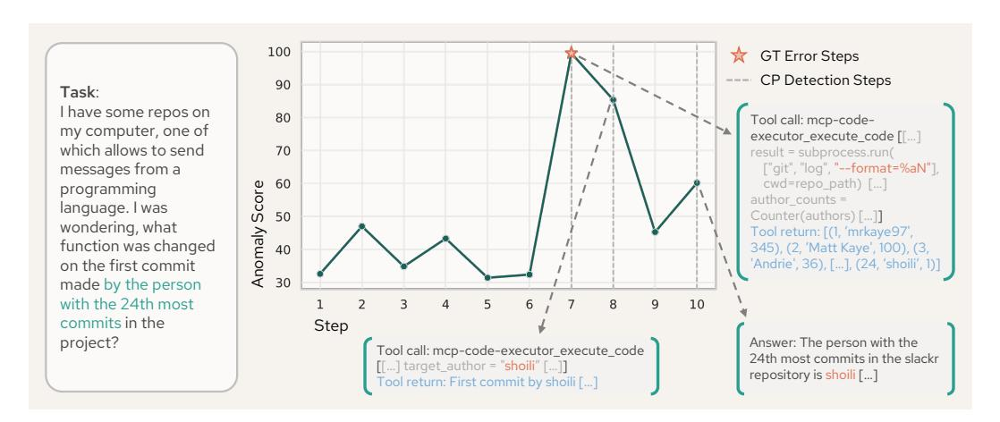

Figure 12: Third successful case. OAT identifies the bug at step 7 and the propagated errors at steps 8 and 10.

<span id="page-19-2"></span>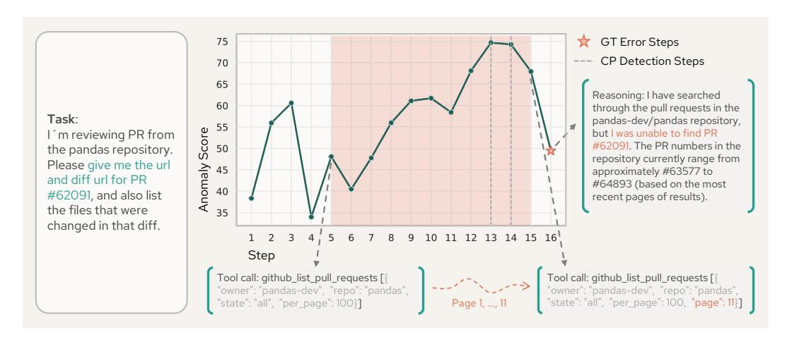

Figure 13: First failure case. OAT does not identify the incorrect answer at step 16 but assigns progressively increasing anomaly scores to the suboptimal plan spanning steps 5–15.

OAT assigns a significantly high anomaly score to the erroneous step 7 while keeping scores for benign steps low. The scores for steps 8 and 10 are elevated but progressively lower than step 7, consistent with the interpretation that these steps carry forward an inherited error rather than introducing a new one. This monotonic decay in anomaly scores along the error propagation chain is an encouraging property of the model's learned dynamics.

#### Summary.

<span id="page-19-0"></span>Across the three successful cases, we found that OAT consistently assigns significantly high anomaly scores to steps that introduce errors, including hallucination, unfaithful assumptions, or logical bugs, while keeping scores for benign steps low. In addition, when errors propagate downstream, anomaly scores decay gradually, reflecting that inherited errors are less anomalous than the steps that originate them. Notably, OAT also surfaces latent signals at steps that are not explicitly annotated as failure contributing steps, such as internally inconsistent reasoning traces, suggesting that its learned notion of trajectory normality is sensitive to subtle precursors of failure beyond the ground truth labels.

<span id="page-20-0"></span>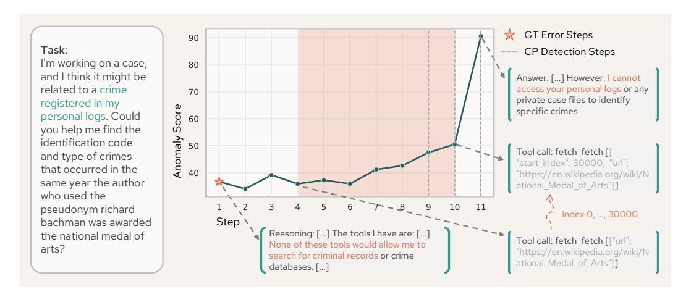

Figure 14: Second failure case. OAT does not identify the root reasoning error at step 1, but assigns high scores to the suboptimal plan at steps 4–10 and the explicit failure verbalization at step 11.

## H.2 Failure Cases

Case 1. Figure [13](#page-19-2) shows a task requiring the agent to retrieve information about a specific pull request. The agent adopts a suboptimal strategy of paginating through all pull requests sequentially from step 5 to step 15. While this approach is not inherently incorrect, it is inefficient and leads to step 16, where the agent incorrectly concludes that the target PR could not be found.

OAT does not flag step 16 as a contributing step, likely because the verbalization of an inability to find a result is not inherently anomalous from the model's perspective. (A successful trajectory could plausibly contain a similar statement in a different context.) Nevertheless, OAT assigns progressively increasing anomaly scores across the suboptimal steps 5–15, suggesting that it recognizes the suboptimal plan as increasingly deviant from the dynamics of successful trajectories, even in the absence of an explicit error signal. This case highlights that OAT can surface latent failure precursors that are not captured by the ground truth annotation.

Case 2. Figure [14](#page-20-0) shows a task requiring the agent to locate a specific crime record in a local file. At step 1, the agent fails to identify the appropriate tool, which ultimately leads to step 11 where it explicitly reports its inability to access the target log.

OAT does not assign a high anomaly score to step 1. This is likely because reasoning traces are inherently noisy: an agent stating that no appropriate tool is available is not unambiguously anomalous, as such statements can appear in successful trajectories before the agent finds an alternative approach. At step 11, however, when the agent explicitly verbalizes its failure, OAT assigns a significantly high anomaly score. This suggests that while OAT may miss early latent errors in the reasoning process, it reliably detects downstream steps where the failure becomes obvious. OAT also assigns progressively increasing scores across steps 4–10, where the agent pursues a suboptimal retrieval strategy, consistent with the pattern observed in Case 1 above.

Case 3. Figure [15](#page-21-1) shows a task requiring the agent to retrieve transactions for a specific crypto coin discussed in a paper. At step 4, the agent searches for the target paper but the tool returns an irrelevant result. At step 5, the agent acknowledges that the retrieved paper does not focus on a specific coin, yet decides to calculate transactions for both ETH and BTC. At step 6, the agent implements this plan by writing incorrect code, which produces a wrong answer at the final step.

OAT assigns high anomaly scores to steps 5, 6, and 7, correctly identifying the range of steps involved in the failure. However, due to the hard threshold of conformal prediction detection, only step 6 is flagged as a failure contributing step, while the root cause at step 5 falls just below the detection threshold. This case illustrates a key limitation of fixed-threshold detection: when multiple steps contribute to a failure with varying degrees of severity, a threshold calibrated on the overall distribution may fail to capture subtler but causally significant errors. More adaptive detection strategies, such as trajectory-level thresholding, may further improve failure attribution in such cases.

<span id="page-21-1"></span>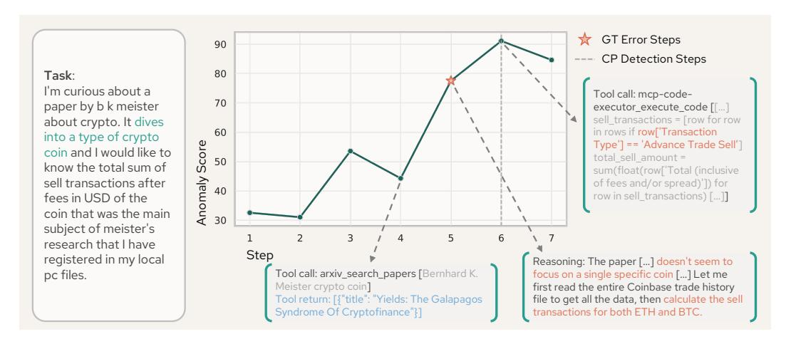

Figure 15: Third failure case. OAT identifies the code error at step 6 but misses the annotated reasoning error at step 5 due to the hard threshold of conformal prediction detection.

#### Summary.

Across the three failure cases, we found that OAT tends to miss early, latent errors in the reasoning process, particularly when the error is expressed implicitly in a noisy reasoning trace rather than through an explicit action. Despite this, OAT consistently assigns progressively increasing anomaly scores to suboptimal plans that precede the final failure, and reliably detects steps where the failure becomes explicitly manifest. A recurring limitation is the hard threshold of conformal prediction detection, which can suppress causally significant steps whose anomaly scores fall marginally below the detection boundary, suggesting that a more adaptive detection strategies may further improve the performance.

# <span id="page-21-0"></span>I Prompt Templates

We show the prompt used for prompting-based failure attribution. Trajectories were serialized by the following serialization template before sending to the attribution prompt.

# Template for all-at-once failure attribution.

You are an AI assistant tasked with analyzing a multi-agent conversation history when solving a real world problem.

The problem is: {question}

Identify one or more likely error candidates in this trajectory.

Here's the conversation: {trajectory}

Additional constraints:

- Valid step range: 0...{max\_step}
- Candidate agents: {agent\_list}
- Use 0-based step indexing
- Return at least 1 candidate
- Candidates do NOT need to be earliest mistakes

Output exactly one JSON object:

{"candidates": [{"step": <int>, "agent": "<agent name>"}, ... ]}

```
Template for trajectory serialization.
[ROLE: {role_1}] [AGENT: {agent_1}]
  [REASONING: {reasoning_content_1}]
  {content_1}
  [TOOL_CALL: {tool_args_1}]
[ROLE: {role_2}] [AGENT: {agent_2}]
  [REASONING: {reasoning_content_2}]
  {content_2}
  [TOOL_CALL: {tool_args_2}]
...
[ROLE: {role_T}] [AGENT: {agent_T}]
  [REASONING: {reasoning_content_T}]
  {content_T}
  [TOOL_CALL: {tool_args_T}]
```

# NeurIPS Paper Checklist

#### 1. Claims

Question: Do the main claims made in the abstract and introduction accurately reflect the paper's contributions and scope?

Answer: [Yes]

Justification: Section [3,](#page-2-0) [4,](#page-3-2) and [5](#page-5-1)

Guidelines:

- The answer [N/A] means that the abstract and introduction do not include the claims made in the paper.
- The abstract and/or introduction should clearly state the claims made, including the contributions made in the paper and important assumptions and limitations. A [No] or [N/A] answer to this question will not be perceived well by the reviewers.
- The claims made should match theoretical and experimental results, and reflect how much the results can be expected to generalize to other settings.
- It is fine to include aspirational goals as motivation as long as it is clear that these goals are not attained by the paper.

#### 2. Limitations

Question: Does the paper discuss the limitations of the work performed by the authors?

Answer: [Yes]

Justification: Appendix [A](#page-13-0)

Guidelines:

- The answer [N/A] means that the paper has no limitation while the answer [No] means that the paper has limitations, but those are not discussed in the paper.
- The authors are encouraged to create a separate "Limitations" section in their paper.
- The paper should point out any strong assumptions and how robust the results are to violations of these assumptions (e.g., independence assumptions, noiseless settings, model well-specification, asymptotic approximations only holding locally). The authors should reflect on how these assumptions might be violated in practice and what the implications would be.
- The authors should reflect on the scope of the claims made, e.g., if the approach was only tested on a few datasets or with a few runs. In general, empirical results often depend on implicit assumptions, which should be articulated.
- The authors should reflect on the factors that influence the performance of the approach. For example, a facial recognition algorithm may perform poorly when image resolution is low or images are taken in low lighting. Or a speech-to-text system might not be used reliably to provide closed captions for online lectures because it fails to handle technical jargon.
- The authors should discuss the computational efficiency of the proposed algorithms and how they scale with dataset size.
- If applicable, the authors should discuss possible limitations of their approach to address problems of privacy and fairness.
- While the authors might fear that complete honesty about limitations might be used by reviewers as grounds for rejection, a worse outcome might be that reviewers discover limitations that aren't acknowledged in the paper. The authors should use their best judgment and recognize that individual actions in favor of transparency play an important role in developing norms that preserve the integrity of the community. Reviewers will be specifically instructed to not penalize honesty concerning limitations.

#### 3. Theory assumptions and proofs

Question: For each theoretical result, does the paper provide the full set of assumptions and a complete (and correct) proof?

Answer: [N/A]

Justification: The paper does not include theoretical results.

#### Guidelines:

- The answer [N/A] means that the paper does not include theoretical results.
- All the theorems, formulas, and proofs in the paper should be numbered and crossreferenced.
- All assumptions should be clearly stated or referenced in the statement of any theorems.
- The proofs can either appear in the main paper or the supplemental material, but if they appear in the supplemental material, the authors are encouraged to provide a short proof sketch to provide intuition.
- Inversely, any informal proof provided in the core of the paper should be complemented by formal proofs provided in appendix or supplemental material.
- Theorems and Lemmas that the proof relies upon should be properly referenced.

#### 4. Experimental result reproducibility

Question: Does the paper fully disclose all the information needed to reproduce the main experimental results of the paper to the extent that it affects the main claims and/or conclusions of the paper (regardless of whether the code and data are provided or not)?

Answer: [Yes]

Justification: Section [5](#page-5-1)

#### Guidelines:

- The answer [N/A] means that the paper does not include experiments.
- If the paper includes experiments, a [No] answer to this question will not be perceived well by the reviewers: Making the paper reproducible is important, regardless of whether the code and data are provided or not.
- If the contribution is a dataset and/or model, the authors should describe the steps taken to make their results reproducible or verifiable.
- Depending on the contribution, reproducibility can be accomplished in various ways. For example, if the contribution is a novel architecture, describing the architecture fully might suffice, or if the contribution is a specific model and empirical evaluation, it may be necessary to either make it possible for others to replicate the model with the same dataset, or provide access to the model. In general. releasing code and data is often one good way to accomplish this, but reproducibility can also be provided via detailed instructions for how to replicate the results, access to a hosted model (e.g., in the case of a large language model), releasing of a model checkpoint, or other means that are appropriate to the research performed.
- While NeurIPS does not require releasing code, the conference does require all submissions to provide some reasonable avenue for reproducibility, which may depend on the nature of the contribution. For example
- (a) If the contribution is primarily a new algorithm, the paper should make it clear how to reproduce that algorithm.
- (b) If the contribution is primarily a new model architecture, the paper should describe the architecture clearly and fully.
- (c) If the contribution is a new model (e.g., a large language model), then there should either be a way to access this model for reproducing the results or a way to reproduce the model (e.g., with an open-source dataset or instructions for how to construct the dataset).
- (d) We recognize that reproducibility may be tricky in some cases, in which case authors are welcome to describe the particular way they provide for reproducibility. In the case of closed-source models, it may be that access to the model is limited in some way (e.g., to registered users), but it should be possible for other researchers to have some path to reproducing or verifying the results.

#### 5. Open access to data and code

Question: Does the paper provide open access to the data and code, with sufficient instructions to faithfully reproduce the main experimental results, as described in supplemental material?

Answer: [Yes]

Justification: Appendix [C](#page-14-2)

#### Guidelines:

- The answer [N/A] means that paper does not include experiments requiring code.
- Please see the NeurIPS code and data submission guidelines ([https://neurips.cc](https://neurips.cc/public/guides/CodeSubmissionPolicy) [/public/guides/CodeSubmissionPolicy](https://neurips.cc/public/guides/CodeSubmissionPolicy)) for more details.
- While we encourage the release of code and data, we understand that this might not be possible, so [No] is an acceptable answer. Papers cannot be rejected simply for not including code, unless this is central to the contribution (e.g., for a new open-source benchmark).
- The instructions should contain the exact command and environment needed to run to reproduce the results. See the NeurIPS code and data submission guidelines ([https:](https://neurips.cc/public/guides/CodeSubmissionPolicy) [//neurips.cc/public/guides/CodeSubmissionPolicy](https://neurips.cc/public/guides/CodeSubmissionPolicy)) for more details.
- The authors should provide instructions on data access and preparation, including how to access the raw data, preprocessed data, intermediate data, and generated data, etc.
- The authors should provide scripts to reproduce all experimental results for the new proposed method and baselines. If only a subset of experiments are reproducible, they should state which ones are omitted from the script and why.
- At submission time, to preserve anonymity, the authors should release anonymized versions (if applicable).
- Providing as much information as possible in supplemental material (appended to the paper) is recommended, but including URLs to data and code is permitted.

#### 6. Experimental setting/details

Question: Does the paper specify all the training and test details (e.g., data splits, hyperparameters, how they were chosen, type of optimizer) necessary to understand the results?

Answer: [Yes]

Justification: Section [5.1](#page-5-0) and Appendix [F](#page-16-1)

## Guidelines:

- The answer [N/A] means that the paper does not include experiments.
- The experimental setting should be presented in the core of the paper to a level of detail that is necessary to appreciate the results and make sense of them.
- The full details can be provided either with the code, in appendix, or as supplemental material.

#### 7. Experiment statistical significance

Question: Does the paper report error bars suitably and correctly defined or other appropriate information about the statistical significance of the experiments?

Answer: [Yes]

Justification: Section [5](#page-5-1)

- The answer [N/A] means that the paper does not include experiments.
- The authors should answer [Yes] if the results are accompanied by error bars, confidence intervals, or statistical significance tests, at least for the experiments that support the main claims of the paper.
- The factors of variability that the error bars are capturing should be clearly stated (for example, train/test split, initialization, random drawing of some parameter, or overall run with given experimental conditions).
- The method for calculating the error bars should be explained (closed form formula, call to a library function, bootstrap, etc.)
- The assumptions made should be given (e.g., Normally distributed errors).
- It should be clear whether the error bar is the standard deviation or the standard error of the mean.

- It is OK to report 1-sigma error bars, but one should state it. The authors should preferably report a 2-sigma error bar than state that they have a 96% CI, if the hypothesis of Normality of errors is not verified.
- For asymmetric distributions, the authors should be careful not to show in tables or figures symmetric error bars that would yield results that are out of range (e.g., negative error rates).
- If error bars are reported in tables or plots, the authors should explain in the text how they were calculated and reference the corresponding figures or tables in the text.

## 8. Experiments compute resources

Question: For each experiment, does the paper provide sufficient information on the computer resources (type of compute workers, memory, time of execution) needed to reproduce the experiments?

Answer: [Yes]

Justification: Section [5](#page-5-1)

## Guidelines:

- The answer [N/A] means that the paper does not include experiments.
- The paper should indicate the type of compute workers CPU or GPU, internal cluster, or cloud provider, including relevant memory and storage.
- The paper should provide the amount of compute required for each of the individual experimental runs as well as estimate the total compute.
- The paper should disclose whether the full research project required more compute than the experiments reported in the paper (e.g., preliminary or failed experiments that didn't make it into the paper).

#### 9. Code of ethics

Question: Does the research conducted in the paper conform, in every respect, with the NeurIPS Code of Ethics <https://neurips.cc/public/EthicsGuidelines>?

Answer: [Yes]

Justification: The paper conforms to the NeurIPS Code of Ethics.

## Guidelines:

- The answer [N/A] means that the authors have not reviewed the NeurIPS Code of Ethics.
- If the authors answer [No], they should explain the special circumstances that require a deviation from the Code of Ethics.
- The authors should make sure to preserve anonymity (e.g., if there is a special consideration due to laws or regulations in their jurisdiction).

#### 10. Broader impacts

Question: Does the paper discuss both potential positive societal impacts and negative societal impacts of the work performed?

Answer: [Yes]

Justification: Appendix [B](#page-13-1)

- The answer [N/A] means that there is no societal impact of the work performed.
- If the authors answer [N/A] or [No], they should explain why their work has no societal impact or why the paper does not address societal impact.
- Examples of negative societal impacts include potential malicious or unintended uses (e.g., disinformation, generating fake profiles, surveillance), fairness considerations (e.g., deployment of technologies that could make decisions that unfairly impact specific groups), privacy considerations, and security considerations.

- The conference expects that many papers will be foundational research and not tied to particular applications, let alone deployments. However, if there is a direct path to any negative applications, the authors should point it out. For example, it is legitimate to point out that an improvement in the quality of generative models could be used to generate Deepfakes for disinformation. On the other hand, it is not needed to point out that a generic algorithm for optimizing neural networks could enable people to train models that generate Deepfakes faster.
- The authors should consider possible harms that could arise when the technology is being used as intended and functioning correctly, harms that could arise when the technology is being used as intended but gives incorrect results, and harms following from (intentional or unintentional) misuse of the technology.
- If there are negative societal impacts, the authors could also discuss possible mitigation strategies (e.g., gated release of models, providing defenses in addition to attacks, mechanisms for monitoring misuse, mechanisms to monitor how a system learns from feedback over time, improving the efficiency and accessibility of ML).

#### 11. Safeguards

Question: Does the paper describe safeguards that have been put in place for responsible release of data or models that have a high risk for misuse (e.g., pre-trained language models, image generators, or scraped datasets)?

Answer: [N/A]

Justification: We do not release pre-trained generative models or large scraped datasets that could be repurposed for harmful applications.

#### Guidelines:

- The answer [N/A] means that the paper poses no such risks.
- Released models that have a high risk for misuse or dual-use should be released with necessary safeguards to allow for controlled use of the model, for example by requiring that users adhere to usage guidelines or restrictions to access the model or implementing safety filters.
- Datasets that have been scraped from the Internet could pose safety risks. The authors should describe how they avoided releasing unsafe images.
- We recognize that providing effective safeguards is challenging, and many papers do not require this, but we encourage authors to take this into account and make a best faith effort.

## 12. Licenses for existing assets

Question: Are the creators or original owners of assets (e.g., code, data, models), used in the paper, properly credited and are the license and terms of use explicitly mentioned and properly respected?

Answer: [Yes]

Justification: Appendix [D](#page-14-0)

- The answer [N/A] means that the paper does not use existing assets.
- The authors should cite the original paper that produced the code package or dataset.
- The authors should state which version of the asset is used and, if possible, include a URL.
- The name of the license (e.g., CC-BY 4.0) should be included for each asset.
- For scraped data from a particular source (e.g., website), the copyright and terms of service of that source should be provided.
- If assets are released, the license, copyright information, and terms of use in the package should be provided. For popular datasets, <paperswithcode.com/datasets> has curated licenses for some datasets. Their licensing guide can help determine the license of a dataset.
- For existing datasets that are re-packaged, both the original license and the license of the derived asset (if it has changed) should be provided.

• If this information is not available online, the authors are encouraged to reach out to the asset's creators.

### 13. New assets

Question: Are new assets introduced in the paper well documented and is the documentation provided alongside the assets?

Answer: [Yes]

Justification: Appendix [D](#page-14-0) and [E](#page-14-1)

## Guidelines:

- The answer [N/A] means that the paper does not release new assets.
- Researchers should communicate the details of the dataset/code/model as part of their submissions via structured templates. This includes details about training, license, limitations, etc.
- The paper should discuss whether and how consent was obtained from people whose asset is used.
- At submission time, remember to anonymize your assets (if applicable). You can either create an anonymized URL or include an anonymized zip file.

#### 14. Crowdsourcing and research with human subjects

Question: For crowdsourcing experiments and research with human subjects, does the paper include the full text of instructions given to participants and screenshots, if applicable, as well as details about compensation (if any)?

Answer: [N/A]

Justification: The step-level annotations are done by the authors of this paper.

#### Guidelines:

- The answer [N/A] means that the paper does not involve crowdsourcing nor research with human subjects.
- Including this information in the supplemental material is fine, but if the main contribution of the paper involves human subjects, then as much detail as possible should be included in the main paper.
- According to the NeurIPS Code of Ethics, workers involved in data collection, curation, or other labor should be paid at least the minimum wage in the country of the data collector.

### 15. Institutional review board (IRB) approvals or equivalent for research with human subjects

Question: Does the paper describe potential risks incurred by study participants, whether such risks were disclosed to the subjects, and whether Institutional Review Board (IRB) approvals (or an equivalent approval/review based on the requirements of your country or institution) were obtained?

Answer: [N/A]

Justification: We do not conduct experiment/annotation with human subjects.

## Guidelines:

- The answer [N/A] means that the paper does not involve crowdsourcing nor research with human subjects.
- Depending on the country in which research is conducted, IRB approval (or equivalent) may be required for any human subjects research. If you obtained IRB approval, you should clearly state this in the paper.
- We recognize that the procedures for this may vary significantly between institutions and locations, and we expect authors to adhere to the NeurIPS Code of Ethics and the guidelines for their institution.
- For initial submissions, do not include any information that would break anonymity (if applicable), such as the institution conducting the review.

#### 16. Declaration of LLM usage

Question: Does the paper describe the usage of LLMs if it is an important, original, or non-standard component of the core methods in this research? Note that if the LLM is used only for writing, editing, or formatting purposes and does *not* impact the core methodology, scientific rigor, or originality of the research, declaration is not required.

Answer: [N/A]

Justification: LLM is only used for editing the paper.

- The answer [N/A] means that the core method development in this research does not involve LLMs as any important, original, or non-standard components.
- Please refer to our LLM policy in the NeurIPS handbook for what should or should not be described.