# WHAT DRIVES SUCCESS IN PHYSICAL PLANNING WITH JOINT-EMBEDDING PREDICTIVE WORLD MOD-ELS?

Basile Terver Meta FAIR INRIA Paris basileterv@meta.com Tsung-Yen Yang Meta FAIR jimmytyyang@meta.com Jean Ponce Ecole normale superieure/PSL ´ New York University jean.ponce@ens.fr

Adrien Bardes Meta FAIR abardes@meta.com Yann LeCun Meta FAIR yann@meta.com

### ABSTRACT

A long-standing challenge in AI is to develop agents capable of solving a wide range of physical tasks and generalizing to new, unseen tasks and environments. A popular recent approach involves training a world model from state-action trajectories and subsequently use it with a planning algorithm to solve new tasks. Planning is commonly performed in the input space, but a recent family of methods has introduced planning algorithms that optimize in the learned representation space of the world model, with the promise that abstracting irrelevant details yields more efficient planning. In this work, we characterize models from this family as JEPA-WMs and investigate the technical choices that make algorithms from this class work. We propose a comprehensive study of several key components with the objective of finding the optimal approach within the family. We conducted experiments using both simulated environments and real-world robotic data, and studied how the model architecture, the training objective, and the planning algorithm affect planning success. We combine our findings to propose a model that outperforms two established baselines, DINO-WM and V-JEPA-2-AC, in both navigation and manipulation tasks. Code, data and checkpoints are available at <https://github.com/facebookresearch/jepa-wms>.

# 1 INTRODUCTION

In order to build capable physical agents, [Ha & Schmidhuber](#page-13-0) [\(2018\)](#page-13-0) proposed the idea of a world model, that is, a model predicting the future state of the world, given a context of past observations and actions. Such a world model should perform predictions at a level of abstraction that allows training policies on top of it [\(Hafner et al., 2024;](#page-13-1) [Mendonca et al., 2021;](#page-14-0) [Guo et al., 2022\)](#page-13-2) or perform planning in a sample efficient manner [\(Sobal et al., 2025;](#page-15-0) [Hansen et al., 2024\)](#page-13-3).

There already exists extensive literature on world modeling, mostly from the Reinforcement Learning (RL) community. Model-free RL [\(Mnih et al., 2015;](#page-14-1) [Fujimoto et al., 2018;](#page-12-0) [Mnih et al., 2016;](#page-14-2) [Haarnoja et al., 2018;](#page-13-4) [Schulman et al., 2017;](#page-14-3) [Yarats et al., 2022\)](#page-16-0) requires a considerable number of samples, which is problematic in environments where rewards are sparse. To account for this, modelbased RL (MBRL) uses a given or learned model of the environment in the training of its policy or Q-function [\(Silver et al., 2018\)](#page-15-1). In combination with self-supervised pretraining objectives, MBRL has led to new algorithms for world modeling in simulation [\(Ha & Schmidhuber, 2018;](#page-13-0) [Seo et al.,](#page-15-2) [2022;](#page-15-2) [Schrittwieser et al., 2020;](#page-14-4) [Hafner et al., 2024;](#page-13-1) [Hansen et al., 2024\)](#page-13-3).

More recently, large-scale world models have flourished [\(Hu et al., 2023;](#page-13-5) [Yang et al., 2023;](#page-16-1) [Brooks](#page-12-1) [et al., 2024;](#page-12-1) [Bruce et al., 2024;](#page-12-2) [Parker-Holder et al., 2024;](#page-14-5) [Bartoccioni et al., 2025;](#page-11-0) [Agarwal et al.,](#page-11-1) [2025;](#page-11-1) [Bar et al., 2025\)](#page-11-2). For specific domains where data is abundant, for example to simulate driving [\(Hu et al., 2023;](#page-13-5) [Bartoccioni et al., 2025\)](#page-11-0) or egocentric video games [\(Bruce et al., 2024;](#page-12-2)

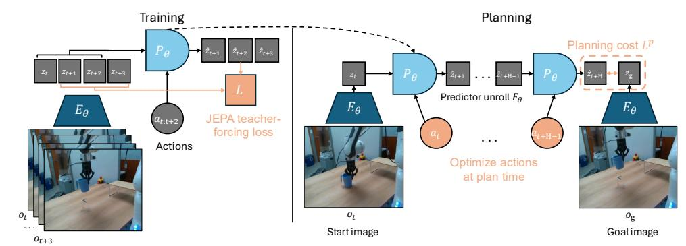

Figure 1: Left: Training of JEPA-WM: the encoder  $E_{\phi,\theta}$  embeds video and optionally proprioceptive observation, which is fed to the predictor  $P_{\theta}$ , along with actions, to predict (in parallel across timesteps) the next state embedding. Right: Planning with JEPA-WM: sample action sequences, unroll the predictor on them, compute a planning cost  $L^p$  for each trajectory, and use this cost to iteratively refine the action sampling. The action encoder  $A_{\theta}$  and proprioceptive encoder  $E_{\theta}^{prop}$  are not explicitly displayed in this figure for readability.

Parker-Holder et al., 2024; Ball et al., 2025), some methods have achieved impressive simulation accuracy on relatively long durations.

In this presentation, we model a world in which some (robotic) agent equipped with a (visual) sensor operates as a dynamical system where the states, observations and actions are all embedded in feature spaces by parametric encoders, and the dynamics itself is also learned, in the form of a parametric predictor depending on these features. The encoder/predictor pair is what we will call a world model. We will focus on action-conditioned Joint-Embedding Predictive World Models (or JEPA-WMs) learned from videos (Sobal et al., 2025; Zhou et al., 2024a; Assran et al., 2025). These models adapt to the planning problem the Joint-Embedding Predictive Architectures (JEPAs) proposed by LeCun (2022), where a representation of some data is constructed by learning an encoder/predictor pair such that the embedding of one view of some data sample predicts well the embedding of a second view. We use the term JEPA-WM to refer to this family of methods, that we formalize in Equations (1) to (4) as a unified implementation recipe rather than a novel algorithm. In practice, we optimize to find an action sequence without theoretical guarantees on the feasibility of the plan, which is closer to trajectory optimization, but we stick to the widely-used term planning.

Among these JEPA-WMs, PLDM (Sobal et al., 2025) shows that world models learned in a latent space, trained as JEPAs, offer stronger generalization than other Goal-Conditioned Reinforcement Learning (GCRL) methods, especially on suboptimal training trajectories. DINO-WM (Zhou et al., 2024a) shows that, in absence of reward, when comparing latent world models on goal-conditioned planning tasks, a JEPA model trained on a frozen DINOv2 encoder outperforms DreamerV3 (Hafner et al., 2024) and TD-MPC2 (Hansen et al., 2024), when we deprive these of reward annotation. DINO-World (Baldassarre et al., 2025) shows the capabilities in dense prediction and intuitive physics of a JEPA-WM trained on top of DINOv2 are superior to COSMOS. The V-JEPA-2-AC (Assran et al., 2025) model is able to beat Vision Language Action (VLA) baselines like Octo (Octo Model Team et al., 2024) in greedy planning for object manipulation using image subgoals.

In this paper, we focus on the learning of the dynamics (predictor) rather than of the representation (encoder), as in DINO-WM and V-JEPA-2-AC (Zhou et al., 2024a; Assran et al., 2025). Given the increasing importance of such models, we aim at filling what we see as a gap in the literature, i.e., a thorough study answering: how to efficiently learn a dynamics model in the embedding space of a pretrained visual encoder for manipulation and navigation planning tasks?

Our contributions can be summarized as follows: (i) We study several key components of training and planning with JEPA-WMs: multistep rollout, predictor architecture, training context length, using or not proprioception, encoder type, model size, data augmentation; and the planning optimizer. (ii) We use these insights to propose an optimum in the class of JEPA-WMs, outperforming DINO-WM and V-JEPA-2-AC.

#### 2 Related work

**World modeling and planning.** 'A path towards machine intelligence' (LeCun, 2022) presents planning with Model Predictive Control (MPC) as the core component of Autonomous Machine

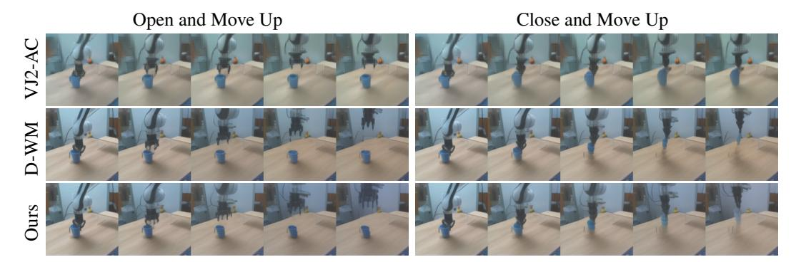

Figure 2: Comparison of different methods on the counterfactual Franka arm lift cup task, where we hardcode 2 actions, either "open and move up" or "close and move up". Each shows 5 model actions in open-loop rollout. Left: "open and move up" action. Right: "close and move up". First row: V-JEPA-2-AC. Second row: DINO-WM. Third row: our best model, described in Section [5.3.](#page-9-0) Intelligence (AMI). World Models learned via Self-Supervised Learning (SSL) [\(Fung et al., 2025\)](#page-12-3) have been used in many reinforcement learning works to control exploration using information gain estimation [\(Sekar et al., 2020\)](#page-15-3) or curiosity [\(Pathak et al., 2017\)](#page-14-7), to transfer to robotic tasks with rare data by first learning a world model [\(Mendonca et al., 2023\)](#page-14-8) or to improve sample efficiency [\(Łukasz Kaiser et al., 2020\)](#page-17-0). In addition, world models have been used in planning, to find sub-goals [\(Nair & Finn, 2020\)](#page-14-9) by using the inverse problem of reconstructing previous frames to reach the objective represented as the last frame, or by imagining goals in unseen environments [\(Mendonca](#page-14-0) [et al., 2021\)](#page-14-0). World models can be generative [\(Brooks et al., 2024;](#page-12-1) [Hu et al., 2023;](#page-13-5) [Ball et al.,](#page-11-3) [2025;](#page-11-3) [Agarwal et al., 2025\)](#page-11-1), or trained in a latent space, using a JEPA loss [\(Garrido et al., 2024;](#page-13-7) [Sobal et al., 2025;](#page-15-0) [Assran et al., 2025;](#page-11-4) [Zhou et al., 2024a;](#page-16-2) [Bar et al., 2025\)](#page-11-2). They can be used to plan in the latent space [\(Zhou et al., 2024a;](#page-16-2) [Sobal et al., 2025;](#page-15-0) [Bar et al., 2025\)](#page-11-2), to maximize a sum of discounted rewards [\(Hansen et al., 2024\)](#page-13-3), or to learn a policy [\(Hafner et al., 2024\)](#page-13-1). Other approaches for latent-space planning include locally-linear dynamics models [\(Watter et al., 2015\)](#page-16-3), gradient-based trajectory optimization [\(Srinivas et al., 2018\)](#page-15-4), and diffusion-based planners [\(Janner](#page-13-8) [et al., 2022;](#page-13-8) [Zhou et al., 2024b\)](#page-16-4). These differ from JEPA-WMs in their dynamics model class, optimization strategy, or training assumptions; we provide a detailed comparison in Section [A.](#page-19-0)

Goal-conditioned RL. Goal-conditioned RL (GCRL) offers a self-supervised approach to leverage large-scale pretraining on unlabeled (reward-free) data. Foundational methods like LEAP [\(Nasiriany et al., 2019\)](#page-14-10) and HOCGRL [\(Li et al., 2022\)](#page-13-9) show that goal-conditioned policies learned with RL can be incorporated into planning. PTP [\(Fang et al., 2022a\)](#page-12-4) decomposes the goal-reaching problem hierarchically, using conditional sub-goal generators in the latent space for a low-level model-free policy. FLAP [\(Fang et al., 2022b\)](#page-12-5) acquires goal-conditioned policies via offline reinforcement learning and online fine-tuning guided by sub-goals in a learned lossy representation space. RE-CON [\(Shah et al., 2021\)](#page-15-5) learns a latent variable model of distances and actions, along with a non-parametric topological memory of images. IQL-TD-MPC [\(Xu et al., 2023\)](#page-16-5) extends TD-MPC with Implicit Q-Learning (IQL) [\(Kostrikov et al., 2022\)](#page-13-10). HIQL [\(Park et al., 2023\)](#page-14-11) proposes a hierarchical model-free approach for goal-conditioned RL from offline data.

Robotics. Classical approaches to robotics problems rely on an MPC loop [\(Garcia et al., 1989;](#page-13-11) [Borrelli et al., 2017\)](#page-12-6), leveraging the analytical physical model of the robot and its sensors to frequently replan, as in the MIT humanoid robot [\(Chignoli et al.\)](#page-12-7) or BiconMP [\(Meduri et al., 2022\)](#page-13-12). For exteroception, we use a camera to sense the environment's state, akin to the long-standing visual servoing problem [\(Hutchinson et al., 1996\)](#page-13-13). The current state-of-the-art in manipulation has been reached by Vision-Language-Action (VLA) models, such as RT-X [\(Vuong et al., 2023\)](#page-15-6), RT-1 [\(et al.,](#page-12-8) [2023\)](#page-12-8), and RT-2 [\(Zitkovich et al., 2023\)](#page-16-6). LAPA [\(Ye et al., 2024\)](#page-16-7) goes further and leverages robot trajectories without actions, learning discrete latent actions using the VQ-VAE objective on robot videos. Physical Intelligence's first model π0 [\(Black et al., 2024\)](#page-11-6) uses the Open-X embodiment dataset and flow matching to generate action trajectories.

### 3 BACKGROUND

This section formalizes the common setup of JEPA-WMs learned from pretrained visual encoders, but does not introduce novel methods. We summarize JEPA-WM training and planning in Figure [1.](#page-1-0) Training method. In a JEPA-WM, we embed the observations with a frozen visual encoder  $E_{\phi}^{vis}$ , and an (optional) shallow proprioceptive encoder  $E_{\theta}^{prop}$ . Applying each encoder to the corresponding modality constitutes the global state encoder, which we denote  $E_{\phi,\theta}=(E_{\phi}^{vis},E_{\theta}^{prop})$ . An action encoder  $A_{\theta}$  embeds the robotic actions. On top of these, a predictor  $P_{\theta}$  takes both the state and action embeddings as input.  $E_{\theta}^{prop}$ ,  $A_{\theta}$  and  $P_{\theta}$  are jointly trained, while  $E_{\phi}^{vis}$  remains frozen. For a past window of w observations  $o_{t-w:t}:=(o_{t-w},\ldots,o_t)$  including visual and (optional) proprioceptive input and past actions  $a_{t-w:t}$ , their common training prediction objective on B elements of the batch is

$$\mathcal{L} = \frac{1}{B} \sum_{b=1}^{B} L[P_{\theta} \left( E_{\phi,\theta}(o_{t-w:t}^{b}), A_{\theta}(a_{t-w:t}^{b}) \right), E_{\phi,\theta} \left( o_{t+1}^{b} \right)], \tag{1}$$

where L is a loss, computed pairwise between visual prediction and target, and proprioceptive prediction and target. In our experiments, we chose L as the MSE. The architecture chosen for the encoder and predictor in this study is ViT (Dosovitskiy et al., 2021), as in our baselines (Zhou et al., 2024a; Assran et al., 2025). In DINO-WM (Zhou et al., 2024a), the action and proprioceptive encoder are just linear layers, and their output is concatenated to the visual encoder output along the embedding dimension, which is known as *feature conditioning* (Garrido et al., 2024), as opposed to sequence conditioning, where the action and proprioception are encoded as tokens, concatenated to the visual tokens sequence, which is adopted in V-JEPA-2 (Assran et al., 2025). We stress that  $P_{\theta}$  is trained with a frame-causal attention mask, thus, it is simultaneously trained to predict from all context lengths from w=0 to w=W-1, where W is a training hyperparameter, set to W=3. The causal predictor is trained to predict the outcome of several actions instead of one action only. To do so, one can skip f observations and concatenate the f corresponding actions to form an action of higher dimension  $f \times A$ , as in DINO-WM (Zhou et al., 2024a). More details on the training procedure in Section B.

**Planning.** Planning at horizon H is an optimization problem over the product action space  $\mathbb{R}^{H \times A}$ , where each action is of dimension A, which can be taken to be  $f \times A$  when using frameskip at training time. Given an initial and goal observation pair  $o_t, o_g$ , each action trajectory  $a_{t:t+H-1} := (a_t, \dots, a_{t+H-1})$  should be evaluated with a planning objective  $L^p$ . Like at training time, consider a dissimilarity metric L, (e.g. the  $L_1, L_2$  distance or minus the cosine similarity), applied pairwise on each modality, denoted  $L_{vis}$  between two visual embeddings and  $L_{prop}$  for proprioceptive embeddings. When planning with a model trained with both proprioception and visual input, given  $\alpha \geq 0$ , the planning objective  $L_p^p$  we aim to minimize is

$$L_{\alpha}^{p}(o_{t}, a_{t:t+H-1}, o_{g}) = (L_{vis} + \alpha L_{prop})(G_{\phi, \theta}(o_{t}, a_{t:t+H-1}), E_{\phi, \theta}(o_{g})), \tag{2}$$

with a function  $G_{\phi,\theta}$  depending on our world model. We define recursively  $F_{\phi,\theta}$  as the unrolling of the predictor from  $z_t = E_{\phi,\theta}(o_t)$  on the actions, with a maximum context length of w, (fixed to  $W^p$ , see Table S4.1)

$$F_{\phi,\theta}: (o_t, a_{t-w:t+k-1}) \mapsto \hat{z}_{t+k}, \tag{3}$$

$$\hat{z}_{i+1} = P_{\theta}(\hat{z}_{i-w:i}, A_{\theta}(a_{i-w:i})), \quad i = t, \dots, t+k-1, \quad z_t = E_{\phi,\theta}(o_t)$$
 (4)

In our case, we take  $G_{\phi,\theta}$  to be the unrolling function  $F_{\phi,\theta}$ , but could choose  $G_{\phi,\theta}$  to be a function of all the intermediate unrolling steps, instead of just the last one. We provide details about the planning optimizers in Section D.

#### 4 STUDIED DESIGN CHOICES

Our base configuration is DINO-WM without proprioception, with a ViT-S encoder and depth-6 predictor of same embedding dimension. We prioritize design choices based on their scope of impact: planning-time choices affect all evaluations, so we optimize these first and *fix the best planner for each environment for the subsequent experiments*; training and architecture choices follow; scaling experiments validate our findings. Each component is independently varied from the base configuration to isolate its effect.

**Planner.** Various optimization algorithms can be relevant to solve the problem of minimizing equation 2, which is differentiable. Zhou et al. (2024a); Hansen et al. (2024); Sobal et al. (2025);

Assran et al. (2025); Bar et al. (2025) use the Cross-Entropy-Method (CEM) (or a variant called MPPI (Williams et al., 2015)), depicted in Section D. Since this is a population-based optimization method which does not rely on the gradient of the cost function, we introduce a planner that can make use of any of the optimization methods from NeverGrad (Bennet et al., 2021). For our experiments, we choose the default NGOpt optimizer (Anonymous, 2024), which is designated as a "meta"-optimizer. We do not tune any of the parameters of this optimizer. We denote this planner NG in the remainder of this paper, see details in Section D. We also experiment with gradient-based planners (GD and Adam) that directly optimize the action sequence through backpropagation, see details in Section D. The planning hyperparameters common to the four considered optimizers are those which define the predictor-dependent cost function  $G_{\theta}$ , the planning horizon H, the number of actions of the plan that are stepped in the environment  $m \leq H$ , the maximum sliding context window size of past predictions fed to the predictor, denoted  $W^p$ . The ones common to either CEM and NG or to Adam and GD are the number of candidate action trajectories of which we evaluate the cost in parallel, denoted N, and the number of iterations J of parallel cost evaluations. After some exploration of the impact of planning hyperparameters common to both CEM and NG on success, we fix them to identical values for both, as summarized in Table S4.1 in appendix. We plan using either the  $L_1$  or  $L_2$  embedding space distance as dissimilarity metric L in the cost  $L_{\alpha}^p$ . The results in Figure 3 (left) are an average across the models considered in this study.

**Multistep rollout training.** At each training iteration, in addition to the frame-wise teacher forcing loss of equation 1, we compute additional loss terms as the k-step rollout losses  $\mathcal{L}_k$ , for  $k \geq 1$ , defined as

$$\mathcal{L}_{k} = \frac{1}{B} \sum_{b=1}^{B} L[P_{\theta}(\hat{z}_{t-w:t+k-1}^{b}, A_{\theta}(a_{t-w:t+k-1}^{b})), E_{\phi,\theta}(o_{t+k}^{b})], \tag{5}$$

where  $\hat{z}_{t+k-1}^b = F_{\phi,\theta}(o_t, a_{t-w:t+k-2})$ , see equation 3. We note that  $\mathcal{L}_1 = \mathcal{L}$ . In practice, we perform truncated backpropagation over time (TBPTT) (Elman, 1990; Jaeger, 2002), which means that we discard the accumulated gradient to compute  $\hat{z}_{t+H}$  and only backpropagate the error in the last prediction. We study variants of this loss, as detailed in Section B, including the one used in V-JEPA-2-AC. We denote the model trained with a sum of loss terms up to the  $\mathcal{L}_k$  loss as k-step. We train models with up to a 6-step loss, which requires more than the default W=3 maximum context size, hence we set W=7 to train them, similarly to the models with increased W introduced afterwards.

**Proprioception.** We compare the standard setup of DINO-WM (Zhou et al., 2024a), where we train a proprioceptive encoder jointly with the predictor and the action encoder to a setup with visual input only. We stress that, contrary to V-JEPA-2-AC, we use both the visual and proprioceptive loss terms to train the predictor, proprioceptive encoder and action encoder.

**Training context size.** We aim to test whether allowing the predictor to see a longer context at train time allows to better unroll longer sequences of actions. We test values from W=1 to W=7.

**Encoder type.** As posited by Zhou et al. (2024a), local features preserve spatial details that are crucial to solve the tasks at hand. Hence we use the local features of DINOv2 and the recently proposed DINOv3 (Siméoni et al., 2025), even stronger on dense tasks. We train a predictor on top of video encoders, namely V-JEPA (Bardes et al., 2024) and V-JEPA-2 (Assran et al., 2025). We consider their ViT-L version. After exploration of the frame encoding strategy to adopt Section B, we settle on the highest performing one, which consists in duplicating each of the  $o_{t-W+1}, \ldots, o_{t+1}$  frames and encoding each pair independently as a 2-frame video. Details comparing the encoding methods for all encoders considered are in Section B. The frame preprocessing and encoding is equalized to have the same number of visual embedding tokens per timestep, so the main difference lies in the weights of these encoders that we use out-of-the-box.

**Predictor architecture.** The main difference between the predictor architecture of Zhou et al. (2024a), and the one of Assran et al. (2025), is that the first uses feature conditioning, with sincos positional embedding, whereas the latter performs sequence conditioning with RoPE (Su et al., 2024). In the first, action embeddings  $A_{\theta}(a)$  are concatenated with visual features  $E_{\theta}(o)$  along the

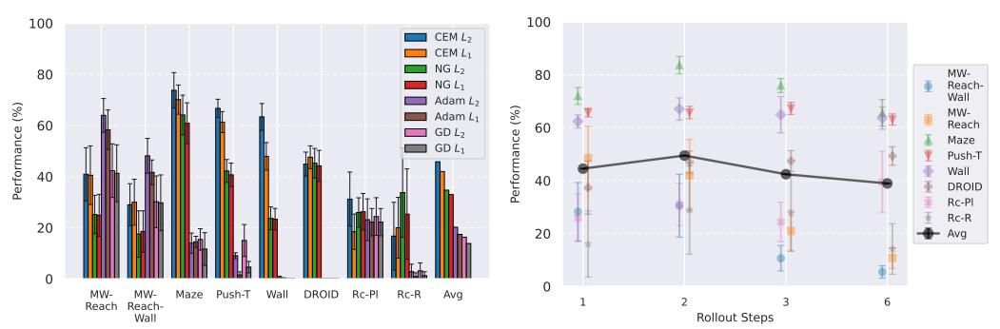

Figure 3: (a) Comparison of planning optimizers: NG is the Nevergrad-based interface that we introduce, compared to the Cross-Entropy Method (CEM), Adam, and Gradient Descent (GD), with L1 or L2 distance. (b) Effect of adding multistep rollout loss terms: models are trained with total loss L1 + · · · + Lk. Rc-Pl and Rc-R denote the Place and Reach tasks of Robocasa.

embedding dimension, and the hidden dimension of the predictor is increased from D to D+fa, with fa the embedding dimension of actions. The features are then processed with 3D sincos positional embeddings. In the second, actions are encoded as separate tokens and concatenated with visual tokens along the sequence dimension, keeping the predictor's hidden dimension to D (as in the encoder). Rotary Position Embeddings (RoPE) is used at each block of the predictor. We also test an architecture mixing feature conditioning with RoPE. Another efficient conditioning technique is AdaLN [\(Xu et al., 2019\)](#page-16-9), as adopted by [Bar et al.](#page-11-2) [\(2025\)](#page-11-2), which we also put to the test, using RoPE in this case. This approach allows action information to influence all layers of the predictor rather than only at input, potentially preventing vanishing of action information through the network. We also study the AdaLN-zero variant [\(Peebles & Xie, 2023\)](#page-14-12), which initializes the conditioning MLP to output the zero-vector, so that the predictor behaves like an unconditional ViT block at the beginning of training. Details are provided in Section [B.](#page-19-2)

Model scaling. We increase the encoder size to ViT-B and ViT-L, using DINOv2 ViT-B and ViT-L with registers [\(Darcet et al., 2024\)](#page-12-11). When increasing encoder size, we expect the prediction task to be harder and thus require a larger predictor. Hence, we increase accordingly the predictor embedding dimension to match the encoder. We also study the effect of predictor depth, varying it from 3 to 12.

### 5 EXPERIMENTS

### 5.1 EVALUATION SETUP.

Datasets. For Metaworld, we gather a dataset by training TD-MPC2 [\(Hansen et al., 2024\)](#page-13-3) online agents and evaluate two tasks, "Reach" and "Reach-Wall", denoted *MW-R* and *MW-RW*, respectively. We use the offline trajectory datasets released by [Zhou et al.](#page-16-2) [\(2024a\)](#page-16-2), namely Push-T [\(Chi](#page-12-12) [et al., 2023\)](#page-12-12), Wall and PointMaze. The train split represents 90% of each dataset. We train on DROID [\(et al., 2024\)](#page-12-13) and evaluate zero-shot on Robocasa [\(Nasiriany et al., 2024\)](#page-14-13) by defining custom pick-and-place tasks from teleoperated trajectories, namely "Place" and "Reach", denoted *Rc-Pl* and *Rc-R*. We *do not finetune* the DROID models on Robocasa trajectories. We also evaluate on a set of 16 videos of a real Franka arm filmed in our lab, closer to the DROID distribution, and denote this task *DROID*. On DROID, we track the L1 error between the actions outputted by the planner and the groundtruth actions of the trajectory from the dataset that defines initial and goal state. We then rescale the opposite of this *Action Error*, to constitute the *Action Score*, a metric to maximize. We provide details about our datasets and environments in Section [C.](#page-24-0)

Goal definition. We sample the goal frame from an expert policy provided with Metaworld, from the dataset for Push-T, DROID and Robocasa, and from a random 2D state sampler for Wall and Maze, more details in Section [C.](#page-24-0) For the models with proprioception, we plan using proprioceptive embedding distance, by setting α = 0.1 in equation [2,](#page-3-2) except for DROID and Robocasa, where we set α = 0, to be comparable to V-JEPA-2-AC.

Metrics. The main metric we seek to maximize is success rate, but track several other metrics, that track the world model quality, independently of the planning procedure, and are less noisy than success rate. These metrics are embedding space error throughout predictor unrolling, proprioceptive

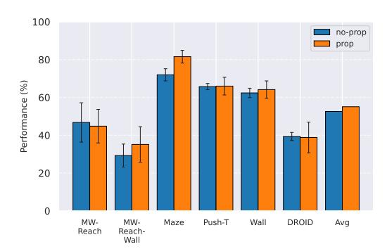

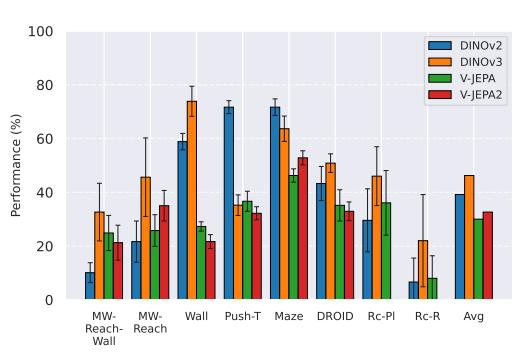

Figure 4: (a) Models trained with proprioceptive input are denoted "prop", while pure visual world models are named "no-prop". (b) Comparison of JEPA-WMs trained on top of various pretrained visual encoders, all of size ViT-L for fair comparison. Rc-Pl and Rc-R denote the Place and Reach tasks of Robocasa.

decoding error throughout unrolling, visual decoding of open-loop rollouts (and the LPIPS between these decodings and the groundtruth future frames). More details in Section [E.2.](#page-32-0)

Statistical significance. To account for training variability, we train with 3 seeds per model for our final models in Table [1.](#page-9-1) To account for the evaluation variability, at each epoch, we launch e = 96 episodes, each with a different initial and goal state, either sampled from the dataset (Push-T, Robocasa, DROID) or by the simulator (Metaworld, PointMaze, Wall). We take e = 64 for evaluation on DROID, which proves essential to get a reliable evaluation, even though we compare a continuous action score metric. We use e = 32 for Robocasa given the higher cost of a planning episode, which requires replanning 12 times, as explained in Table [S4.1.](#page-29-0) We average over these episodes to get a success rate. Although we average success at each epoch over three seeds and their evaluation episodes, we still find high variability throughout training. Hence, to get an aggregate score per model, we average success over the last n training epochs, with n = 10 for all datasets, except for models trained on DROID, for which n = 100. The error bars displayed in the plots comparing design choices are the standard deviation across the last epochs' success rate, to reflect this variability only.

### 5.2 RESULTS

One important fact to note is that, even with models which are able to faithfully unroll a large number of actions, success at the planning task is not an immediate consequence. We develop this claim in Section [E.1,](#page-30-0) and provide visualizations of rollouts of studied models and planning episodes.

Comparing planning optimizers. We compare four planning optimizers: Cross-Entropy Method (CEM), Nevergrad (NG), Adam, and Gradient Descent (GD). CEM is a variant of the CMA-ES family [\(Hansen & Ostermeier, 1996;](#page-13-15) [Hansen, 2023\)](#page-13-16) with diagonal covariance and simplified update rules. NG uses the NGOpt wizard, which selects diagonal CMA-ES [\(Hansen et al., 2019\)](#page-13-17) based on optimization space parametrization and budget, see Algorithm [2.](#page-29-1) We observe in Figure [3a](#page-5-0) that the CEM L2 planner performs best overall.

*(i) Gradient-based methods:* Adam L2 achieves the best overall performance on Metaworld, outperforming all other optimizers, and GD is also competitive with CEM. This can be explained by the nature of Metaworld tasks: they have relatively smooth cost landscapes where the goal is greedily reachable, allowing gradient-based methods to excel. In contrast, on 2D navigation tasks (Wall, Push-T, Maze) that require non-greedy planning, gradient-based methods perform very poorly compared to sampling-based ones, as GD gets stuck in local minima. On DROID, gradient-based methods also perform significantly worse than sampling-based approaches: these tasks require rich and precise understanding of complex real-world object manipulation, leading to multi-modal cost landscapes. Robocasa tasks, being simulated but closer in nature to Metaworld, allow gradient-based methods to perform reasonably well again.

*(ii) Sampling-based methods:* On 2D navigation tasks, CEM clearly outperforms NG, as these tasks require precise action sequences where CEM's faster convergence to tight action distributions is beneficial, while NG's slower, more exploratory optimization is detrimental. To compare both methods, we plot the convergence of the optimization procedure at each planning step in Figure [S4.1,](#page-28-2) and ob-

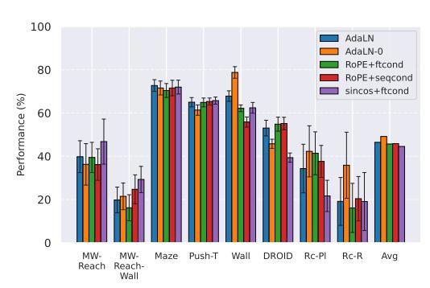

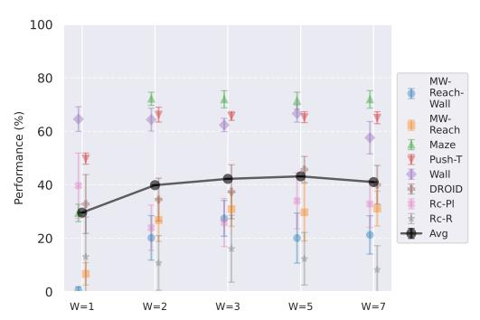

Figure 5: (a) Comparing predictor architectures: we denote positional embedding in the predictor as sincos or RoPE; the feature conditioning technique as "ftcond" and the sequence conditioning as "seqcond". The Adaptive LayerNorm conditioning technique is denoted "AdaLN". (b) Maximum number of timesteps of state embedding seen by the predictor at train time in equation 1, the predictor takes up to  $(E_{\phi,\theta}(o_{t-W+1:t}), A_{\theta}(a_{t-W+1:t}))$  as context. Rc-Pl and Rc-R denote the Place and Reach tasks of Robocasa.

serve that NG converges more slowly, indicating more exploration in the space of action trajectories. On DROID and Robocasa, CEM and NG perform similarly. When using NG, we have fewer planning hyperparameters than with CEM, which requires specifying the top-K trajectories parameter and the initialization of the proposal Gaussian distribution  $\mu^0, \sigma^0$ —parameters that heavily impact performance. Crucially, on real-world manipulation data (DROID and Robocasa), NG performs on par with CEM while requiring no hyperparameter tuning, making it a practical alternative when transitioning to new tasks or datasets where CEM tuning would be costly.

On all planning setups and models,  $L_2$  cost consistently outperforms  $L_1$  cost. To minimize the number of moving parts in the subsequent study, we *fix the planning setup* for each dataset to CEM  $L_2$ , which is either best or competitive on all environments.

Multistep rollout predictor training. At planning time, the predictor is required to rollout faithfully an action sequence by predicting future embeddings from its previous predictions. We observe in Figure 3b that the performance increases when going from pure teacher-forcing models to 2-step rollout loss models, but then decreases for models trained in simulated environments. We plan with maximum context of length  $W^p=2$ , thus adding rollout loss terms  $\mathcal{L}_k$  with k>3 might make the model less specialized in the prediction task it performs at test time, explaining the performance decrease. Interestingly, for models trained on DROID, the optimal number of rollout steps is rather six.

**Impact of proprioception.** We observe in Figure 4a that models trained with proprioceptive input are consistently better than without. On Metaworld, most of the failed episodes are due to the arm reaching the goal position quickly, then oscillating around the goal position. Thus, having more precise information on its exact distance to the goal increases performance. On 2D navigation tasks, the proprioceptive input also allows the agent to propose a more precise plan. We do not display the results on Robocasa as the proprioceptive space is not aligned between DROID and Robocasa, making models using proprioception irrelevant for zero-shot transfer.

**Maximum context size.** Training on longer context takes more iterations to converge in terms of success rate. We recall that we chose to plan with  $W^p=2$  in all our experiments, since it yields the maximal success rate while being more computationally efficient. The predictor needs two frames of context to infer velocity and use it for the prediction task. It requires 3 frames to infer acceleration. We indeed see in Figure 5b a big performance gap between models trained with W=1 and W=2, which indicates that the predictor benefits from using this context to perform its prediction. On the other hand, with a fixed training computational budget, increasing W means we slice the dataset into a fewer but longer unique trajectory slices of length W+1, thus less gradient steps. On DROID, having too low W leads to discarding some videos of the dataset that are of length lower than W+1. Yet, we observe that models trained on DROID have their optimal W at 5, higher than on simulated datasets, for which it is 3. It is likely due to the more complex dynamics of DROID, requiring longer context to notably infer real-world arm and object dynamics. One simple experiment shows a very well-known but fundamental property: the training maximum context W and planning maximum context W must be chosen so that  $W^p \leq W$ . Otherwise, we ask the model to perform a prediction

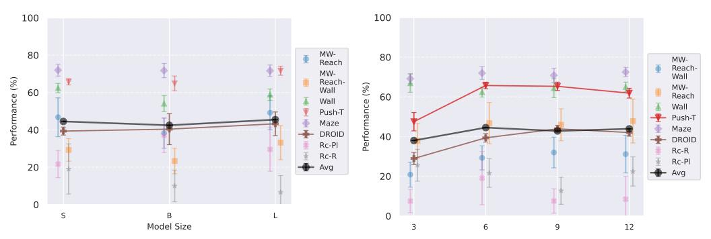

Figure 6: (a) Comparison of model size: we vary from ViT-S to ViT-L the visual encoder size, as well as the predictor embedding dimension, keeping predictor depth constant at 6. (b) Comparison of predictor depth: we vary the predictor depth from 3 to 12, keeping the encoder fixed to DINOv2-S. Rc-Pl and Rc-R denote the Place and Reach tasks of Robocasa.

task it has not seen at train time, and we see the predictions degrading rapidly throughout unrolling if  $W^p > W$ . To account for this, the W=1 model performance displayed in Figure 5b is from planning with  $W^p=1$ .

**Encoder type.** In Figure 4b, we see a clear advantage of DINO encoders compared to V-JEPA encoders. We posit this is due to the well-known fact that DINO has better fine-grained object segmentation capabilities, which is crucial in tasks requiring a precise perception of the location of the agent and objects. Interestingly, DINOv3 clearly outperforms DINOv2 only the more photorealistic environments, Robocasa and DROID, likely due to the pretraining dataset of DINOv3 being more adapted to such images. On Maze and Wall, models trained on DINOv3 take longer to converge to a lower success rate.

**Predictor architecture.** In Figure 5a, we observe that, while AdaLN with RoPE achieves the best average performance across environments, the advantage is slight, and results are task-dependent: on Metaworld, sincos+ftcond actually performs best. We do not see a substantial improvement when using RoPE instead of sincos positional embedding. A possible explanation for AdaLN's effectiveness is that this conditioning intervenes at each block of the transformer predictor, potentially avoiding the vanishing of the action information throughout the layers. It is also more compute-efficient than other conditioning methods, as explained by Peebles & Xie (2023). We also study AdaLN-zero, following Peebles & Xie (2023)'s naming. Although Peebles & Xie (2023) find AdaLN-zero to outperform AdaLN in their setup, we observe that, despite a higher average performance, AdaLN-zero underperforms AdaLN on the environments that provide the most reliable signal (DROID, PushT, Maze), which are less prone to noise in success rate and yield more consistent results across our other design choice experiments. Hence, we will consider, for our final JEPA-WMs optimum, the AdaLN variant. One important consideration when scaling predictor embedding dimension is maintaining the ratio of action to visual dimensions, which requires increasing the action embedding dimension in the feature conditioning case. To isolate the effect of the conditioning scheme from capacity differences due to different action ratios, we conduct additional experiments with equalized action ratios (see Section E.1), which reveal task-dependent preferences between conditioning schemes that cannot be attributed to action ratio alone.

**Model scaling.** We show in Figures 6a and 6b that increasing encoder size (with predictor width) or predictor depth does not improve performance on simulated environments. However, on DROID, we observe a clear positive correlation between both encoder size and predictor depth with planning performance. This indicates that real-world dynamics benefit from higher-capacity models, while simulated environments saturate at lower capacities. Notably, the optimal predictor depth appears to be 6 for most simulated environments, and possibly as low as 3 for the simplest 2D navigation tasks (Wall, Maze). Moreover, larger models may actually be detrimental on simple datasets: at planning time, although we optimize over the same action space, the planning procedure explores the visual embedding space, and larger embedding spaces make it harder for the planning optimization to distinguish nearby states (see Figure S5.9).

Table 1: Comparison of our best model to DINO-WM and V-JEPA-2-AC. MW-R and MW-RW denote the Reach and Reach-Wall tasks of Metaworld. Rc-Pl and Rc-R denote the Place and Reach tasks of Robocasa. Best model is in **bold**.

| Model | Maze       | Wall                       | Push-T     | MW-R       | MW-RW       | Rc-R        | Rc-Pl      | DROID      |
|-------|------------|----------------------------|------------|------------|-------------|-------------|------------|------------|
| DWM   | 81.6 (3.4) | 64.1 (4.6)                 | 66.0 (4.7) | 44.8 (8.9) | 35.1 (9.4)  | 19.1 (13.4) | 21.7 (7.2) | 39.4 (2.1) |
| VJ2AC | _          | _                          | _          | _          | _           | 16.2 (8.3)  | 33.1 (7.2) | 42.9 (2.5) |
| Ours  | 83.9 (2.3) | <b>78.8</b> ( <b>3.9</b> ) | 70.2 (2.8) | 58.2 (9.3) | 41.6 (10.0) | 25.4 (16.6) | 30.7 (8.0) | 48.2 (1.8) |

#### 5.3 OUR PROPOSED OPTIMUM IN THE CLASS OF JEPA-WMS

We combine the findings of our study and propose optimal models for each of our robotic environments, that we compare to concurrent JEPA-WM approaches: DINO-WM (Zhou et al., 2024a) and V-JEPA-2-AC (Assran et al., 2025). For simulated environments, we use a ViT-S encoder and a ViT-S predictor with depth 6, AdaLN conditioning, and RoPE positional embeddings. We train our models with proprioception and a 2-steps rollout loss, with a maximum context of W=3. For DROID and Robocasa, following our model size findings, we use a DINOv3 ViT-L encoder with a ViT-L predictor of depth 12, without proprioception. We plan with CEM  $L_2$  for all environments. We use DINOv2 on all environments, except on the photorealistic DROID and Robocasa, where we use DINOv3. As presented in Table 1, we outperform DINO-WM and V-JEPA-2-AC in most environments. We provide a full comparison across all planner configurations in Table S5.1. We propose in Figure 2 a qualitative comparison of the object interaction abilities of our model against DINO-WM and V-JEPA-2-AC, in a simple counterfactual experiment, where we unroll two different action sequences from the same initial state, one where the robot lifts a cup, and one where it does not. Our model demonstrates a better prediction of the effect of its actions on the environment.

#### 6 Conclusion

In this paper, we studied the effect of several training and planning design choices of JEPA-WMs on planning in robotic environments. We found that several components play an important role, such as the use of proprioceptive input, the multistep rollout loss, or the choice of visual encoder. We found that image encoders with fine object segmentation capabilities are better suited for the manipulation and navigation tasks that we considered compared to video encoders. We found that having enough context to infer velocity is important, but that too long context harms performance, obviously due to seeing less unique trajectories during training and likely also having less useful gradient from predicting from long context. On the architecture side, we found that the action conditioning technique matters, with AdaLN being a strong choice on average, compared to sequence and feature conditioning, though results are task-dependent. We found that scaling model size (encoder size with predictor width, and predictor depth) does not improve performance on simulated environments. However, on real-world data (DROID and Robocasa), both larger encoders and deeper predictors yield consistent improvements, suggesting that scaling benefits depend on task complexity. We introduced an interface for planning with Nevergrad optimizers, leaving room for exploration of optimizers and hyperparameters. On the planning side, we found that CEM  $L_2$ performs best overall. The NG planner performs similarly to CEM on real-world manipulation data (DROID and Robocasa) while requiring less hyperparameter tuning, making it a practical alternative when transitioning to new tasks or datasets. Gradient-based planners (GD and Adam) excel on tasks with smooth cost landscapes like Metaworld, but fail on 2D navigation or contact-rich manipulation tasks due to local minima. Finally, we applied our learnings and proposed models outperforming concurrent JEPA-WM approaches, DINO-WM and V-JEPA-2-AC.

### ETHICS STATEMENT

This work focuses on learning world models for physical agents, with the aim of enabling more autonomous and intelligent robots. We do not anticipate particular risk of this work, but acknowledge that further work building on it could have impact on the field of robotics, which is not exempt of risks of misuse. We also acknowledge the environmental impact of training large models, and we advocate for efficient training procedures and sharing of pretrained models to reduce redundant computation.

### REPRODUCIBILITY STATEMENT

All code, model checkpoints, and benchmarks used for this project will be released in the project's repository. We generalize and improve over DINO-WM and V-JEPA-2-AC in a common training and evaluation framework. We hope this code infrastructure will help accelerate research and benchmarking in the field of learning world models for physical agents. We include in Section [B](#page-19-1) details about the training and architecture hyperparameters, as well as the datasets and environments used in Section [C.](#page-24-0) We also provide details about our planning algorithms in Section [D.](#page-27-0) Additional experiments in Section [E.1](#page-30-0) and study on the correlation of the various evaluation metrics in Section [E.2](#page-32-0) should bring more clarity on our claims.

### ACKNOWLEDGMENTS

We thank Quentin Garrido for his help and insightful methodology and conceptualization advice throughout the project. We thank Daniel Dugas for the constructive discussions we had throughout the project, and for helping provide the Franka Arm videos we use for evaluation.

# REFERENCES

- Niket Agarwal, Arslan Ali, Maciej Bala, Yogesh Balaji, Erik Barker, Tiffany Cai, Prithvijit Chattopadhyay, Yongxin Chen, Yin Cui, Yifan Ding, et al. Cosmos world foundation model platform for physical ai. *arXiv preprint arXiv:2501.03575*, 2025.
- Anonymous. Ngiohtuned, a new black-box optimization wizard for real world machine learning. *Submitted to Transactions on Machine Learning Research*, 2024. URL [https://](https://openreview.net/forum?id=0FDiCoIStW) [openreview.net/forum?id=0FDiCoIStW](https://openreview.net/forum?id=0FDiCoIStW). Rejected.
- Mido Assran, Adrien Bardes, David Fan, Quentin Garrido, Russell Howes, Mojtaba, Komeili, Matthew Muckley, Ammar Rizvi, Claire Roberts, Koustuv Sinha, Artem Zholus, Sergio Arnaud, Abha Gejji, Ada Martin, Francois Robert Hogan, Daniel Dugas, Piotr Bojanowski, Vasil Khalidov, Patrick Labatut, Francisco Massa, Marc Szafraniec, Kapil Krishnakumar, Yong Li, Xiaodong Ma, Sarath Chandar, Franziska Meier, Yann LeCun, Michael Rabbat, and Nicolas Ballas. V-jepa 2: Self-supervised video models enable understanding, prediction and planning, 2025.
- Federico Baldassarre, Marc Szafraniec, Basile Terver, Vasil Khalidov, Francisco Massa, Yann Le-Cun, Patrick Labatut, Maximilian Seitzer, and Piotr Bojanowski. Back to the features: Dino as a foundation for video world models, 2025. URL <https://arxiv.org/abs/2507.19468>.
- Philip J. Ball, Jakob Bauer, Frank Belletti, Bethanie Brownfield, Ariel Ephrat, Shlomi Fruchter, Agrim Gupta, Kristian Holsheimer, Aleksander Holynski, Jiri Hron, Christos Kaplanis, Marjorie Limont, Matt McGill, Yanko Oliveira, Jack Parker-Holder, Frank Perbet, Guy Scully, Jeremy Shar, Stephen Spencer, Omer Tov, Ruben Villegas, Emma Wang, Jessica Yung, Cip Baetu, Jordi Berbel, David Bridson, Jake Bruce, Gavin Buttimore, Sarah Chakera, Bilva Chandra, Paul Collins, Alex Cullum, Bogdan Damoc, Vibha Dasagi, Maxime Gazeau, Charles Gbadamosi, Woohyun Han, Ed Hirst, Ashyana Kachra, Lucie Kerley, Kristian Kjems, Eva Knoepfel, Vika Koriakin, Jessica Lo, Cong Lu, Zeb Mehring, Alex Moufarek, Henna Nandwani, Valeria Oliveira, Fabio Pardo, Jane Park, Andrew Pierson, Ben Poole, Helen Ran, Tim Salimans, Manuel Sanchez, Igor Saprykin, Amy Shen, Sailesh Sidhwani, Duncan Smith, Joe Stanton, Hamish Tomlinson, Dimple Vijaykumar, Luyu Wang, Piers Wingfield, Nat Wong, Keyang Xu, Christopher Yew, Nick Young, Vadim Zubov, Douglas Eck, Dumitru Erhan, Koray Kavukcuoglu, Demis Hassabis, Zoubin Gharamani, Raia Hadsell, Aaron van den Oord, Inbar Mosseri, Adrian Bolton, Satinder ¨ Singh, and Tim Rocktaschel. Genie 3: A new frontier for world models. 2025. ¨
- Amir Bar, Gaoyue Zhou, Danny Tran, Trevor Darrell, and Yann LeCun. Navigation world models. In *Proceedings of the IEEE/CVF Conference on Computer Vision and Pattern Recognition (CVPR)*, pp. 15791–15801, June 2025.
- Adrien Bardes, Quentin Garrido, Jean Ponce, Xinlei Chen, Michael Rabbat, Yann LeCun, Mido Assran, and Nicolas Ballas. Revisiting feature prediction for learning visual representations from video, 2024. ISSN 2835-8856.
- Florent Bartoccioni, Elias Ramzi, Victor Besnier, Shashanka Venkataramanan, Tuan-Hung Vu, Yihong Xu, Loick Chambon, Spyros Gidaris, Serkan Odabas, David Hurych, Renaud Marlet, Alexandre Boulch, Mickael Chen, Eloi Zablocki, Andrei Bursuc, Eduardo Valle, and Matthieu ´ Cord. Vavim and vavam: Autonomous driving through video generative modeling. *arXiv preprint arXiv:2502.15672*, 2025.
- Samy Bengio, Oriol Vinyals, Navdeep Jaitly, and Noam Shazeer. Scheduled sampling for sequence prediction with recurrent neural networks, 2015. URL [https://arxiv.org/abs/1506.](https://arxiv.org/abs/1506.03099) [03099](https://arxiv.org/abs/1506.03099).
- Pauline Bennet, Carola Doerr, Antoine Moreau, Jeremy Rapin, Fabien Teytaud, and Olivier Teytaud. Nevergrad: black-box optimization platform. *SIGEVOlution*, 14(1):8–15, April 2021. doi: 10. 1145/3460310.3460312. URL <https://doi.org/10.1145/3460310.3460312>.
- Kevin Black, Noah Brown, Danny Driess, Adnan Esmail, Michael Equi, Chelsea Finn, Niccolo Fusai, Lachy Groom, Karol Hausman, Brian Ichter, Szymon Jakubczak, Tim Jones, Liyiming Ke, Sergey Levine, Adrian Li-Bell, Mohith Mothukuri, Suraj Nair, Karl Pertsch, Lucy Xiaoyang Shi,

- James Tanner, Quan Vuong, Anna Walling, Haohuan Wang, and Ury Zhilinsky. π0: A visionlanguage-action flow model for general robot control, 2024. URL [https://arxiv.org/](https://arxiv.org/abs/2410.24164) [abs/2410.24164](https://arxiv.org/abs/2410.24164).
- Francesco Borrelli, Alberto Bemporad, and Manfred Morari. *Predictive Control for Linear and Hybrid Systems*. Cambridge University Press, USA, 1st edition, 2017. ISBN 1107652871.
- Tim Brooks, Bill Peebles, Connor Holmes, Will DePue, Yufei Guo, Li Jing, David Schnurr, Joe Taylor, Troy Luhman, Eric Luhman, et al. Video generation models as world simulators, 2024. URL [https://openai.com/research/](https://openai. com/research/video-generation-modelsas-world-simulators) [video-generation-modelsas-world-simulators](https://openai. com/research/video-generation-modelsas-world-simulators).
- Jake Bruce, Michael D Dennis, Ashley Edwards, Jack Parker-Holder, Yuge Shi, Edward Hughes, Matthew Lai, Aditi Mavalankar, Richie Steigerwald, Chris Apps, et al. Genie: Generative interactive environments. In *Forty-first International Conference on Machine Learning*, 2024.
- Cheng Chi, Zhenjia Xu, Siyuan Feng, Eric Cousineau, Yilun Du, Benjamin Burchfiel, Russ Tedrake, and Shuran Song. Diffusion policy: Visuomotor policy learning via action diffusion. *The International Journal of Robotics Research*, pp. 02783649241273668, 2023.
- Matthew Chignoli, Donghyun Kim, Elijah Stanger-Jones, and Sangbae Kim. The mit humanoid robot: Design, motion planning, and control for acrobatic behaviors. In *2020 IEEE-RAS 20th International Conference on Humanoid Robots (Humanoids)*, pp. 1–8. doi: 10.1109/ HUMANOIDS47582.2021.9555782.
- Timothee Darcet, Maxime Oquab, Julien Mairal, and Piotr Bojanowski. Vision transformers need ´ registers. In *ICRL*, 2024.
- Alexey Dosovitskiy, Lucas Beyer, Alexander Kolesnikov, Dirk Weissenborn, Xiaohua Zhai, Thomas Unterthiner, Mostafa Dehghani, Matthias Minderer, Georg Heigold, Sylvain Gelly, Jakob Uszkoreit, and Neil Houlsby. An image is worth 16x16 words: Transformers for image recognition at scale. In *International Conference on Learning Representations*, 2021.
- Jeffrey L. Elman. Finding structure in time. *Cognitive Science*, 14(2):179–211, 1990. ISSN 0364-0213. doi: https://doi.org/10.1016/0364-0213(90)90002-E. URL [https://www.](https://www.sciencedirect.com/science/article/pii/036402139090002E) [sciencedirect.com/science/article/pii/036402139090002E](https://www.sciencedirect.com/science/article/pii/036402139090002E).
- Alexander Khazatsky et al. Droid: A large-scale in-the-wild robot manipulation dataset, 2024.
- Anthony Brohan et al. Rt-1: Robotics transformer for real-world control at scale, 2023.
- Kuan Fang, Patrick Yin, Ashvin Nair, and Sergey Levine. Planning to practice: Efficient online fine-tuning by composing goals in latent space. In *ICLR 2022 Workshop on Generalizable Policy Learning in Physical World*, 2022a.
- Kuan Fang, Patrick Yin, Ashvin Nair, Homer Rich Walke, Gengchen Yan, and Sergey Levine. Generalization with lossy affordances: Leveraging broad offline data for learning visuomotor tasks. In *6th Annual Conference on Robot Learning*, 2022b.
- Justin Fu, Aviral Kumar, Ofir Nachum, George Tucker, and Sergey Levine. D4rl: Datasets for deep data-driven reinforcement learning. *arXiv preprint arXiv:2004.07219*, 2020.
- Scott Fujimoto, Herke van Hoof, and David Meger. Addressing function approximation error in actor-critic methods. In Jennifer Dy and Andreas Krause (eds.), *Proceedings of the 35th International Conference on Machine Learning*, volume 80 of *Proceedings of Machine Learning Research*, pp. 1587–1596. PMLR, 10–15 Jul 2018.
- Pascale Fung, Yoram Bachrach, Asli Celikyilmaz, Kamalika Chaudhuri, Delong Chen, Willy Chung, Emmanuel Dupoux, Hongyu Gong, Herve J ´ egou, Alessandro Lazaric, Arjun Majumdar, Andrea ´ Madotto, Franziska Meier, Florian Metze, Louis-Philippe Morency, Theo Moutakanni, Juan Pino, ´ Basile Terver, Joseph Tighe, Paden Tomasello, and Jitendra Malik. Embodied ai agents: Modeling the world, 2025. URL <https://arxiv.org/abs/2506.22355>.

- C. E. Garcia, D. M. Prett, and M. Morari. Model predictive control: theory and practice—a survey. *Automatica*, 25(3):335–348, May 1989. ISSN 0005-1098. doi: 10.1016/0005-1098(89)90002-2. URL [https://doi.org/10.1016/0005-1098\(89\)90002-2](https://doi.org/10.1016/0005-1098(89)90002-2).
- Quentin Garrido, Mahmoud Assran, Nicolas Ballas, Adrien Bardes, Laurent Najman, and Yann LeCun. Learning and leveraging world models in visual representation learning, 2024.
- Zhaohan Guo, Shantanu Thakoor, Miruna Pislar, Bernardo Avila Pires, Florent Altche, Corentin ´ Tallec, Alaa Saade, Daniele Calandriello, Jean-Bastien Grill, Yunhao Tang, Michal Valko, Remi Munos, Mohammad Gheshlaghi Azar, and Bilal Piot. Byol-explore: Exploration by bootstrapped prediction. In S. Koyejo, S. Mohamed, A. Agarwal, D. Belgrave, K. Cho, and A. Oh (eds.), *Advances in Neural Information Processing Systems*, volume 35, pp. 31855–31870, 2022.
- David Ha and Jurgen Schmidhuber. Recurrent world models facilitate policy evolution. In S. Bengio, ¨ H. Wallach, H. Larochelle, K. Grauman, N. Cesa-Bianchi, and R. Garnett (eds.), *Advances in Neural Information Processing Systems*, volume 31, 2018.
- Tuomas Haarnoja, Aurick Zhou, Pieter Abbeel, and Sergey Levine. Soft actor-critic: Off-policy maximum entropy deep reinforcement learning with a stochastic actor. In *ICML*, volume 80, pp. 1856–1865. PMLR, 2018.
- Danijar Hafner, Jurgis Pasukonis, Jimmy Ba, and Timothy Lillicrap. Mastering diverse domains through world models, 2024.
- N. Hansen and A. Ostermeier. Adapting arbitrary normal mutation distributions in evolution strategies: the covariance matrix adaptation. In *Proceedings of IEEE International Conference on Evolutionary Computation*, pp. 312–317, 1996. doi: 10.1109/ICEC.1996.542381.
- Nicklas Hansen, Hao Su, and Xiaolong Wang. Td-mpc2: Scalable, robust world models for continuous control. In *The Twelfth International Conference on Learning Representations*, 2024.
- Nikolaus Hansen. The cma evolution strategy: A tutorial, 2023. URL [https://arxiv.org/](https://arxiv.org/abs/1604.00772) [abs/1604.00772](https://arxiv.org/abs/1604.00772).
- Nikolaus Hansen, Youhei Akimoto, and Petr Baudis. CMA-ES/pycma on Github. Zenodo, DOI:10.5281/zenodo.2559634, February 2019. URL [https://doi.org/10.5281/](https://doi.org/10.5281/zenodo.2559634) [zenodo.2559634](https://doi.org/10.5281/zenodo.2559634).
- Anthony Hu, Lloyd Russell, Hudson Yeo, Zak Murez, George Fedoseev, Alex Kendall, Jamie Shotton, and Gianluca Corrado. Gaia-1: A generative world model for autonomous driving, 2023. URL <https://arxiv.org/abs/2309.17080>.
- S. Hutchinson, G. Hager, and P. Corke. A tutorial on visual servo control. *IEEE Trans. on Robotics and Automation*, 12(5):651–670, October 1996.
- Herbert Jaeger. Tutorial on training recurrent neural networks, covering bppt, rtrl, ekf and the echo state network approach. *GMD-Forschungszentrum Informationstechnik, 2002.*, 5, 01 2002.
- Michael Janner, Yilun Du, Joshua Tenenbaum, and Sergey Levine. Planning with diffusion for flexible behavior synthesis. In *ICML*, 2022.
- Ilya Kostrikov, Ashvin Nair, and Sergey Levine. Offline reinforcement learning with implicit qlearning. In *International Conference on Learning Representations*, 2022.
- Yann LeCun. A path towards autonomous machine intelligence. *Open Review*, Jun 2022.
- Jinning Li, Chen Tang, Masayoshi Tomizuka, and Wei Zhan. Hierarchical planning through goalconditioned offline reinforcement learning, 2022.
- Avadesh Meduri, Paarth Shah, Julian Viereck, Majid Khadiv, Ioannis Havoutis, and Ludovic Righetti. Biconmp: A nonlinear model predictive control framework for whole body motion planning. *IEEE Transactions on Robotics*, 39:905–922, 2022. URL [https://api.](https://api.semanticscholar.org/CorpusID:246035621) [semanticscholar.org/CorpusID:246035621](https://api.semanticscholar.org/CorpusID:246035621).

- Russell Mendonca, Oleh Rybkin, Kostas Daniilidis, Danijar Hafner, and Deepak Pathak. Discovering and achieving goals via world models. In M. Ranzato, A. Beygelzimer, Y. Dauphin, P.S. Liang, and J. Wortman Vaughan (eds.), *Advances in Neural Information Processing Systems*, volume 34, pp. 24379–24391, 2021.
- Russell Mendonca, Shikhar Bahl, and Deepak Pathak. Structured world models from human videos, 2023.
- Volodymyr Mnih, Koray Kavukcuoglu, David Silver, Andrei A. Rusu, Joel Veness, Marc G. Bellemare, Alex Graves, Martin Riedmiller, Andreas K. Fidjeland, Georg Ostrovski, Stig Petersen, Charles Beattie, Amir Sadik, Ioannis Antonoglou, Helen King, Dharshan Kumaran, Daan Wierstra, Shane Legg, and Demis Hassabis. Human-level control through deep reinforcement learning. *Nature*, 518:529–533, 2015.
- Volodymyr Mnih, Adria Puigdomenech Badia, Mehdi Mirza, Alex Graves, Timothy Lillicrap, Tim Harley, David Silver, and Koray Kavukcuoglu. Asynchronous methods for deep reinforcement learning. In *Proceedings of The 33rd International Conference on Machine Learning*, volume 48 of *Proceedings of Machine Learning Research*, pp. 1928–1937. PMLR, 20–22 Jun 2016.
- Suraj Nair and Chelsea Finn. Hierarchical foresight: Self-supervised learning of long-horizon tasks via visual subgoal generation. In *International Conference on Learning Representations*, 2020.
- Soroush Nasiriany, Vitchyr H. Pong, Steven Lin, and Sergey Levine. Planning with goal-conditioned policies. In *NeurIPS*, 2019.
- Soroush Nasiriany, Abhiram Maddukuri, Lance Zhang, Adeet Parikh, Aaron Lo, Abhishek Joshi, Ajay Mandlekar, and Yuke Zhu. Robocasa: Large-scale simulation of everyday tasks for generalist robots. In *Robotics: Science and Systems (RSS)*, 2024.
- Octo Model Team, Dibya Ghosh, Homer Walke, Karl Pertsch, Kevin Black, Oier Mees, Sudeep Dasari, Joey Hejna, Charles Xu, Jianlan Luo, Tobias Kreiman, You Liang Tan, Lawrence Yunliang Chen, Pannag Sanketi, Quan Vuong, Ted Xiao, Dorsa Sadigh, Chelsea Finn, and Sergey Levine. Octo: An open-source generalist robot policy. In *Proceedings of Robotics: Science and Systems*, Delft, Netherlands, 2024.
- Seohong Park, Dibya Ghosh, Benjamin Eysenbach, and Sergey Levine. Offline goal-conditioned RL with latent states as actions. In *ICML Workshop on New Frontiers in Learning, Control, and Dynamical Systems*, 2023.
- Jack Parker-Holder, Philip Ball, Jake Bruce, Vibhavari Dasagi, Kristian Holsheimer, Christos Kaplanis, Alexandre Moufarek, Guy Scully, Jeremy Shar, Jimmy Shi, Stephen Spencer, Jessica Yung, Michael Dennis, Sultan Kenjeyev, Shangbang Long, Vlad Mnih, Harris Chan, Maxime Gazeau, Bonnie Li, Fabio Pardo, Luyu Wang, Lei Zhang, Frederic Besse, Tim Harley, Anna Mitenkova, Jane Wang, Jeff Clune, Demis Hassabis, Raia Hadsell, Adrian Bolton, Satinder Singh, and Tim Rocktaschel. Genie 2: A large-scale foun- ¨ dation world model. 2024. URL [https://deepmind.google/discover/blog/](https://deepmind.google/discover/blog/genie-2-a-large-scale-foundation-world-model/) [genie-2-a-large-scale-foundation-world-model/](https://deepmind.google/discover/blog/genie-2-a-large-scale-foundation-world-model/).
- Deepak Pathak, Pulkit Agrawal, Alexei A. Efros, and Trevor Darrell. Curiosity-driven exploration by self-supervised prediction. In *Proceedings of the 34th International Conference on Machine Learning - Volume 70*, ICML'17, pp. 2778–2787. JMLR.org, 2017.
- William Peebles and Saining Xie. Scalable diffusion models with transformers. In *ICCV*, 2023.
- Julian Schrittwieser, Ioannis Antonoglou, Thomas Hubert, Karen Simonyan, Laurent Sifre, Simon Schmitt, Arthur Guez, Edward Lockhart, Demis Hassabis, Thore Graepel, Timothy Lillicrap, and David Silver. Mastering atari, go, chess and shogi by planning with a learned model. *Nature*, 588 (7839):604–609, December 2020. ISSN 1476-4687. doi: 10.1038/s41586-020-03051-4.
- John Schulman, Filip Wolski, Prafulla Dhariwal, Alec Radford, and Oleg Klimov. Proximal policy optimization algorithms. *CoRR*, abs/1707.06347, 2017.

- Ramanan Sekar, Oleh Rybkin, Kostas Daniilidis, Pieter Abbeel, Danijar Hafner, and Deepak Pathak. Planning to explore via self-supervised world models. In *Proceedings of the 37th International Conference on Machine Learning*, ICML'20. JMLR.org, 2020.
- Younggyo Seo, Danijar Hafner, Hao Liu, Fangchen Liu, Stephen James, Kimin Lee, and Pieter Abbeel. Masked world models for visual control. In *6th Annual Conference on Robot Learning*, 2022.
- Dhruv Shah, Benjamin Eysenbach, Nicholas Rhinehart, and Sergey Levine. Rapid exploration for open-world navigation with latent goal models. In *5th Annual Conference on Robot Learning*, 2021.
- David Silver, Thomas Hubert, Julian Schrittwieser, Ioannis Antonoglou, Matthew Lai, Arthur Guez, Marc Lanctot, Laurent Sifre, Dharshan Kumaran, Thore Graepel, Timothy Lillicrap, Karen Simonyan, and Demis Hassabis. A general reinforcement learning algorithm that masters chess, shogi, and go through self-play. *Science*, 362(6419):1140–1144, 2018. doi: 10.1126/science. aar6404.
- Oriane Simeoni, Huy V. Vo, Maximilian Seitzer, Federico Baldassarre, Maxime Oquab, Cijo Jose, ´ Vasil Khalidov, Marc Szafraniec, Seungeun Yi, Michael Ramamonjisoa, Francisco Massa, Daniel ¨ Haziza, Luca Wehrstedt, Jianyuan Wang, Timothee Darcet, Th ´ eo Moutakanni, Leonel Sentana, ´ Claire Roberts, Andrea Vedaldi, Jamie Tolan, John Brandt, Camille Couprie, Julien Mairal, Herve´ Jegou, Patrick Labatut, and Piotr Bojanowski. DINOv3, 2025. URL ´ [https://arxiv.org/](https://arxiv.org/abs/2508.10104) [abs/2508.10104](https://arxiv.org/abs/2508.10104).
- Vlad Sobal, Wancong Zhang, Kynghyun Cho, Randall Balestriero, Tim Rudner, and Yann Lecun. Learning from reward-free offline data: A case for planning with latent dynamics models, 02 2025.
- Aravind Srinivas, Allan Jabri, Pieter Abbeel, Sergey Levine, and Chelsea Finn. Universal planning networks: Learning generalizable representations for visuomotor control. In *ICML*, 2018.
- Jianlin Su, Murtadha Ahmed, Yu Lu, Shengfeng Pan, Wen Bo, and Yunfeng Liu. Roformer: Enhanced transformer with rotary position embedding. *Neurocomput.*, 568, 2024.
- Quan Vuong, Sergey Levine, Homer Rich Walke, Karl Pertsch, Anikait Singh, Ria Doshi, Charles Xu, Jianlan Luo, Liam Tan, Dhruv Shah, Chelsea Finn, Max Du, Moo Jin Kim, Alexander Khazatsky, Jonathan Heewon Yang, Tony Z. Zhao, Ken Goldberg, Ryan Hoque, Lawrence Yunliang Chen, Simeon Adebola, Gaurav S. Sukhatme, Gautam Salhotra, Shivin Dass, Lerrel Pinto, Zichen Jeff Cui, Siddhant Haldar, Anant Rai, Nur Muhammad Mahi Shafiullah, Yuke Zhu, Yifeng Zhu, Soroush Nasiriany, Shuran Song, Cheng Chi, Chuer Pan, Wolfram Burgard, Oier Mees, Chenguang Huang, Deepak Pathak, Shikhar Bahl, Russell Mendonca, Gaoyue Zhou, Mohan Kumar Srirama, Sudeep Dasari, Cewu Lu, Hao-Shu Fang, Hongjie Fang, Henrik I Christensen, Masayoshi Tomizuka, Wei Zhan, Mingyu Ding, Chenfeng Xu, Xinghao Zhu, Ran Tian, Youngwoon Lee, Dorsa Sadigh, Yuchen Cui, Suneel Belkhale, Priya Sundaresan, Trevor Darrell, Jitendra Malik, Ilija Radosavovic, Jeannette Bohg, Krishnan Srinivasan, Xiaolong Wang, Nicklas Hansen, Yueh-Hua Wu, Ge Yan, Hao Su, Jiayuan Gu, Xuanlin Li, Niko Suenderhauf, Krishan Rana, Ben Burgess-Limerick, Federico Ceola, Kento Kawaharazuka, Naoaki Kanazawa, Tatsuya Matsushima, Yutaka Matsuo, Yusuke Iwasawa, Hiroki Furuta, Jihoon Oh, Tatsuya Harada, Takayuki Osa, Yujin Tang, Oliver Kroemer, Mohit Sharma, Kevin Lee Zhang, Beomjoon Kim, Yoonyoung Cho, Junhyek Han, Jaehyung Kim, Joseph J Lim, Edward Johns, Norman Di Palo, Freek Stulp, Antonin Raffin, Samuel Bustamante, Joao Silv ˜ erio, Abhishek Padalkar, Jan Pe- ´ ters, Bernhard Scholkopf, Dieter B ¨ uchler, Jan Schneider, Simon Guist, Jiajun Wu, Stephen Tian, ¨ Haochen Shi, Yunzhu Li, Yixuan Wang, Mingtong Zhang, Heni Ben Amor, Yifan Zhou, Keyvan Majd, Lionel Ott, Giulio Schiavi, Roberto Mart´ın-Mart´ın, Rutav Shah, Yonatan Bisk, Jeffrey T Bingham, Tianhe Yu, Vidhi Jain, Ted Xiao, Karol Hausman, Christine Chan, Alexander Herzog, Zhuo Xu, Sean Kirmani, Vincent Vanhoucke, Ryan Julian, Lisa Lee, Tianli Ding, Yevgen Chebotar, Jie Tan, Jacky Liang, Igor Mordatch, Kanishka Rao, Yao Lu, Keerthana Gopalakrishnan, Stefan Welker, Nikhil J Joshi, Coline Manon Devin, Alex Irpan, Sherry Moore, Ayzaan Wahid, Jialin Wu, Xi Chen, Paul Wohlhart, Alex Bewley, Wenxuan Zhou, Isabel Leal, Dmitry Kalashnikov, Pannag R Sanketi, Chuyuan Fu, Ying Xu, Sichun Xu, brian ichter, Jasmine Hsu, Peng Xu,

- Anthony Brohan, Pierre Sermanet, Nicolas Heess, Michael Ahn, Rafael Rafailov, Acorn Pooley, Kendra Byrne, Todor Davchev, Kenneth Oslund, Stefan Schaal, Ajinkya Jain, Keegan Go, Fei Xia, Jonathan Tompson, Travis Armstrong, and Danny Driess. Open x-embodiment: Robotic learning datasets and RT-x models. In *Towards Generalist Robots: Learning Paradigms for Scalable Skill Acquisition @ CoRL2023*, 2023.
- Manuel Watter, Jost Tobias Springenberg, Joschka Boedecker, and Martin Riedmiller. Embed to control: A locally linear latent dynamics model for control from raw images. In *NeurIPS*, 2015.
- Grady Williams, Andrew Aldrich, and Evangelos Theodorou. Model predictive path integral control using covariance variable importance sampling, 2015.
- Jingjing Xu, Xu Sun, Zhiyuan Zhang, Guangxiang Zhao, and Junyang Lin. *Understanding and improving layer normalization*. Curran Associates Inc., Red Hook, NY, USA, 2019.
- Yingchen Xu, Rohan Chitnis, Bobak T Hashemi, Lucas Lehnert, Urun Dogan, Zheqing Zhu, and Olivier Delalleau. IQL-TD-MPC: Implicit q-learning for hierarchical model predictive control. In *ICML Workshop on New Frontiers in Learning, Control, and Dynamical Systems*, 2023.
- Mengjiao Yang, Yilun Du, Kamyar Ghasemipour, Jonathan Tompson, Dale Schuurmans, and Pieter Abbeel. Learning interactive real-world simulators. In *ICLR*, 2023.
- Denis Yarats, Rob Fergus, Alessandro Lazaric, and Lerrel Pinto. Mastering visual continuous control: Improved data-augmented reinforcement learning. In *ICLR*, 2022.
- Seonghyeon Ye, Joel Jang, Byeongguk Jeon, Sejune Joo, Jianwei Yang, Baolin Peng, Ajay Mandlekar, Reuben Tan, Yu-Wei Chao, Bill Yuchen Lin, Lars Liden, Kimin Lee, Jianfeng Gao, Luke Zettlemoyer, Dieter Fox, and Minjoon Seo. Latent action pretraining from videos, 2024. URL <https://arxiv.org/abs/2410.11758>.
- Tianhe Yu, Deirdre Quillen, Zhanpeng He, Ryan Julian, Avnish Narayan, Hayden Shively, Adithya Bellathur, Karol Hausman, Chelsea Finn, and Sergey Levine. Meta-world: A benchmark and evaluation for multi-task and meta reinforcement learning, 2019.
- Richard Zhang, Phillip Isola, Alexei A. Efros, Eli Shechtman, and Oliver Wang. The unreasonable effectiveness of deep features as a perceptual metric. In *CVPR*, 2018.
- Gaoyue Zhou, Hengkai Pan, Yann LeCun, and Lerrel Pinto. Dino-wm: World models on pre-trained visual features enable zero-shot planning, 2024a. URL [https://arxiv.org/abs/2411.](https://arxiv.org/abs/2411.04983) [04983](https://arxiv.org/abs/2411.04983).
- Guangyao Zhou, Sivaramakrishnan Swaminathan, Rajkumar Vasudeva Raju, J. Swaroop Guntupalli, Wolfgang Lehrach, Joseph Ortiz, Antoine Dedieu, Miguel Lazaro-Gredilla, and Kevin Murphy. ´ Diffusion model predictive control. *arXiv preprint arXiv:2410.05364*, 2024b.
- Yuke Zhu, Josiah Wong, Ajay Mandlekar, Roberto Mart´ın-Mart´ın, Abhishek Joshi, Soroush Nasiriany, Yifeng Zhu, and Kevin Lin. robosuite: A modular simulation framework and benchmark for robot learning. In *arXiv preprint arXiv:2009.12293*, 2020.
- Brianna Zitkovich, Tianhe Yu, Sichun Xu, Peng Xu, Ted Xiao, Fei Xia, Jialin Wu, Paul Wohlhart, Stefan Welker, Ayzaan Wahid, Quan Vuong, Vincent Vanhoucke, Huong Tran, Radu Soricut, Anikait Singh, Jaspiar Singh, Pierre Sermanet, Pannag R. Sanketi, Grecia Salazar, Michael S. Ryoo, Krista Reymann, Kanishka Rao, Karl Pertsch, Igor Mordatch, Henryk Michalewski, Yao Lu, Sergey Levine, Lisa Lee, Tsang-Wei Edward Lee, Isabel Leal, Yuheng Kuang, Dmitry Kalashnikov, Ryan Julian, Nikhil J. Joshi, Alex Irpan, Brian Ichter, Jasmine Hsu, Alexander Herzog, Karol Hausman, Keerthana Gopalakrishnan, Chuyuan Fu, Pete Florence, Chelsea Finn, Kumar Avinava Dubey, Danny Driess, Tianli Ding, Krzysztof Marcin Choromanski, Xi Chen, Yevgen Chebotar, Justice Carbajal, Noah Brown, Anthony Brohan, Montserrat Gonzalez Arenas, and Kehang Han. Rt-2: Vision-language-action models transfer web knowledge to robotic control. In Jie Tan, Marc Toussaint, and Kourosh Darvish (eds.), *Proceedings of The 7th Conference on Robot Learning*, volume 229 of *Proceedings of Machine Learning Research*, pp. 2165–2183. PMLR, 06–09 Nov 2023.

Łukasz Kaiser, Mohammad Babaeizadeh, Piotr Miłos, Błazej Osi ˙ nski, Roy H Campbell, Konrad ´ Czechowski, Dumitru Erhan, Chelsea Finn, Piotr Kozakowski, Sergey Levine, Afroz Mohiuddin, Ryan Sepassi, George Tucker, and Henryk Michalewski. Model based reinforcement learning for atari. In *International Conference on Learning Representations*, 2020.

# APPENDIX

### CONTENTS

| 1 | Introduction                                         | 1  |
|---|------------------------------------------------------|----|
| 2 | Related work                                         | 2  |
| 3 | Background                                           | 3  |
| 4 | Studied design choices                               | 4  |
| 5 | Experiments                                          | 6  |
|   | 5.1 Evaluation Setup                              | 6  |
|   | 5.2 Results                                       | 7  |
|   | 5.3 Our proposed optimum in the class of JEPA-WMs | 10 |
| 6 | Conclusion                                           | 10 |
|   | Appendix                                             | 19 |
| A | Extended Related Work                                | 20 |
| B | Training details                                     | 20 |
| C | Planning environments and datasets                   | 25 |
| D | Planning Optimization                                | 28 |
| E | Additional experiments                               | 31 |
|   | E.1 Additional results                            | 31 |
|   | E.2 Evaluation metrics                         | 33 |
|   | E.3 Is there a proxy for success rate?            | 34 |
|   | E.4 Success over epochs                           | 38 |

# A EXTENDED RELATED WORK

Alternative latent-space planning paradigms. Several approaches have been proposed for planning in learned latent spaces, differing from JEPA-WMs in their dynamics model class, optimization strategy, or training assumptions. *Locally-linear latent dynamics models*, such as Embed to Control (E2C) [\(Watter et al., 2015\)](#page-16-3), learn a latent space where dynamics are locally linear, enabling the use of iterative Linear Quadratic Regulator (iLQR) for trajectory optimization. E2C is derived directly from an optimal control formulation in latent space and can operate on raw pixel observations without requiring explicit reward signals during training, using instead a reconstruction-based objective combined with dynamics constraints. *Gradient-based trajectory optimization* through learned dynamics, as in Universal Planning Networks (UPN) [\(Srinivas et al., 2018\)](#page-15-4), uses differentiable forward models to directly backpropagate planning gradients through predicted trajectories. We compare to this paradigm in our experiments (gradient descent planner in Section [5.2\)](#page-6-2), finding it effective for smooth cost landscapes but prone to local minima in navigation tasks. *Diffusion-based planners* [\(Janner et al., 2022;](#page-13-8) [Zhou et al., 2024b\)](#page-16-4) generate trajectory distributions via iterative denoising, offering multi-modal planning and implicit constraint satisfaction. While Diffuser typically requires offline RL datasets with reward annotations [\(Janner et al., 2022\)](#page-13-8), recent work like DMPC [\(Zhou](#page-16-4) [et al., 2024b\)](#page-16-4) demonstrates diffusion-based MPC on continuous control tasks, though direct comparison with visual goal-conditioned JEPA-WMs remains challenging due to different experimental settings and assumptions. Our work focuses on systematically studying design choices within the JEPA-WM framework, which offers reward-free training from visual observations and flexible testtime goal specification—a complementary setting to these alternative paradigms.

### B TRAINING DETAILS

Predictor. We train using the AdamW optimizer, with a constant learning rate on the predictor, action encoder and optional proprioceptive encoder. We use a cosine scheduler on the weight decay coefficient. For the learning rate, we use a constant learning rate without any warmup iterations. We summarize training hyperparameters common to environments in Table [S2.1.](#page-20-0) We display the environment-specific ones in Table [S2.2.](#page-21-0) Both the action and proprioception are first embedded with a linear kernel applied to each timestep, of input dimension action dim or proprio dim (equal to the unit action or proprioceptive dimension times the frameskip) and output dimension action embed dim or proprio embed dim. We stress that, for memory requirements, for our models with 6-step and W = 7, the batch size is half the default batch size displayed in Table [S2.2,](#page-21-0) which leads to longer epochs, as in Table [S2.3.](#page-21-1) For our models trained on DROID, to compare to V-JEPA-2-AC and because of the dataset complexity compared to simulated ones, we increase the number of epochs to 315, and limit the iterations per epoch to 300, as displayed in Table [S2.2.](#page-21-0)

Action conditioning of the predictor. We study four predictor conditioning variants to inject action information in Figure [5a.](#page-7-0) The conditioning method determines where and how action embeddings are incorporated into the predictor architecture:

- Feature conditioning with sincos positional embeddings: Action embeddings Aθ(a) are concatenated with visual token features Eθ(o) along the embedding dimension. Each timestep's concatenated features are then processed with 3D sinusoidal positional embeddings. This increases the feature dimension and the hidden dimension of the predictor from D to D + fa, where fa is the action embedding dimension.
- Sequence conditioning with RoPE: Actions are encoded as separate tokens and concatenated with visual tokens along the sequence dimension, keeping the predictor's hidden dimension to D (as in the encoder). Rotary Position Embeddings (RoPE) is used at each block of the predictor.
- Feature conditioning with RoPE: This conditioning scheme combines feature concatenation (as in the first variant) with RoPE positional embeddings instead of sincos.
- AdaLN conditioning with RoPE: Action embeddings modulate the predictor through Adaptive Layer Normalization at each transformer block. Specifically, action embeddings are projected to produce scale and shift parameters that modulate the layer normalization statistics. This approach allows action information to influence all layers of the predictor

rather than only at input, potentially preventing vanishing of action information through the network. Combined with RoPE for positional encoding, this design is also more compute-efficient as it avoids increasing feature or sequence dimensions.

One can estimate the strength of the action conditioning of the predictor by looking at the *action ratio*, i.e., the ratio of dimensions (processed by the predictor) corresponding to action, on the total number of dimensions. With feature conditioning, this ratio is  $\frac{f_a}{D+f_a}$ , where  $f_a$  is the action embedding dimension. When performing sequence conditioning, this ratio is  $\frac{1}{hw+1} = \frac{1}{257}$  for standard patch sizes, with h and w being the height and width of the token grid, namely 16 (as explained in Table S2.4). Thus, feature conditioning typically yields a higher action ratio than sequence conditioning.

The inductive bias we expect from these designs relates to how strongly actions can influence predictions. AdaLN's per-layer modulation should provide the most consistent action conditioning throughout the predictor depth, which may explain its superior empirical performance, see Figure 5a.

Table S2.1: Training hyperparameters of some of the studied models common to all environments. If left empty, the hyperparameter value is the same as the leftmost column. WM-V refers to models trained with V-JEPA and V-JEPA2 encoders.

| Hyperparameter     | WM       | WM-L | WM-V |
|--------------------|----------|------|------|
| data               |          |      |      |
| W                  | 3        | 3    | 3    |
| f                  | 5        | -    | -    |
| resolution         | 224      | 224  | 256  |
| optimization       |          |      |      |
| lr                 | 5e-4     | -    | -    |
| start_weight_decay | 1e-7     | -    | -    |
| final_weight_decay | 1e-6     | -    | -    |
| AdamW $\beta_1$    | 0.9      | -    | -    |
| AdamW $\beta_2$    | 0.995    | -    | -    |
| clip_grad          | 1        | -    | -    |
| architecture       |          |      |      |
| patch_size         | 14       | -    | 16   |
| pred_depth         | 6        | -    | -    |
| pred_embed_dim     | 384      | 1024 | 1024 |
| enc_embed_dim      | 384      | 1024 | 1024 |
| hardware           |          |      |      |
| dtype              | bfloat16 | -    | -    |
| accelerator        | H100 80G | -    | -    |

**Train time.** We compute the average train time per epoch for each combination of world model and dataset in Table S2.3.

**Visual decoder.** We train one decoder per encoder on VideoxMix2M (Bardes et al., 2024) with a sum of L2 pixel space and perceptual loss (Zhang et al., 2018). With a ViT-S encoder, we choose a ViT-S decoder with depth 12. When the encoder is a ViT-L we choose a ViT-L decoder with depth 12. We train this decoder for 50 epochs with batch size 128 on trajectory slices of 8 frames.

**State decoder.** We train a depth 6 ViT-S decoder to regress the state from one CLS token (Darcet et al., 2024). A linear projection at the entry projects each patch token from the frozen encoder to the right embedding dimension, 384. At the exit, a linear layer projects the CLS token to a vector with the same number of dimensions as the state to decode.

Table S2.2: Environment-specific training hyperparameters. proprio embed dim is used only for models using proprioception. For WMW -6-step, the batch size is half the default batch size displayed here. We do not train but only evaluate DROID models on Robocasa.

| Hyperparameter    | Metaworld | Push-T | Maze | Wall | DROID |
|-------------------|-----------|--------|------|------|-------|
| optimization      |           |        |      |      |       |
| batch size        | 256       | 256    | 128  | 128  | 128   |
| epochs            | 50        | 50     | 50   | 50   | 315   |
| architecture      |           |        |      |      |       |
| action dim        | 20        | 10     | 10   | 10   | 7     |
| action embed dim  | 20        | 10     | 10   | 10   | 10    |
| proprio dim       | 4         | 4      | 4    | 4    | 7     |
| proprio embed dim | 20        | 20     | 20   | 10   | 10    |

Table S2.3: Model-specific training times in minutes per epoch on 16 H100 80 GB GPUs for Maze and Wall, on 32 H100 GPUs for Push-T and Metaworld. We denote WM-B, WM-L the variants of the base model with size ViT-B and ViT-L, WM-prop the variant with proprioception and WM-V the variant with V-JEPA encoders. For DROID, we display the train time for 10 epochs since we train for 315 epochs.

| Model   | Metaworld | Push-T | Maze | Wall | DROID |
|---------|-----------|--------|------|------|-------|
| 1-step  | 23        | 48     | 5    | 1    | 7     |
| 2-step  | 23        | 49     | 5    | 1    | 8     |
| 3-step  | 23        | 50     | 5    | 1    | 9     |
| 6-step  | 30        | 64     | 16   | 2    | 17    |
| W = 7   | 20        | 42     | 5    | 1    | 13    |
| WM-B    | 23        | 50     | 5    | 1    | 8     |
| WM-L    | 25        | 50     | 5    | 1    | 8     |
| WM-prop | 24        | 50     | 5    | 1    | 7     |
| WM-V    | 25        | 60     | 7    | 2    | 9     |

V-JEPA-2-AC reproduction. To reproduce the V-JEPA-2-AC results, we find a bug in the code that yields the official results of the paper. The 2-step rollout loss is miscomputed, what is actually computed for this loss term is ∥Pϕ(a1:T , s1, z1)−zT ∥1 in the paper's notations. This means that the model, when receiving as input a groundtruth embedding z1, concatenated with a prediction zˆ2, is trained to output zˆ2. We fix this bug and retrain the models. When evaluating the public checkpoint of the V-JEPA-2-AC on our DROID evaluation protocol, the action score is much lower than our retrained V-JEPA-2-AC models after bug fixing. Interestingly, the public checkpoint of the V-JEPA-2-AC predictor, although having much worse performance at planning, yields image decodings after unrolling very comparable to the fixed models, and seems to pass the simple counterfactual test, as shown in Figure [2.](#page-2-0)

Regarding planning, VJEPA2-AC does not normalize the action space to mean 0 and variance 1, contrary to DINO-WM, so we also do not normalize with our models, for comparability to V-JEPA-2-AC. The VJEPA2-AC CEM planner does clip the norm of the sampled actions to 0.1, which is below the typical std of the DROID actions. We find this clipping useful to increase planning performance and adopt it. Moreover, the authors use momentum in the update of the mean and std, which should be useful when the number of CEM iterations is high, but we do not find it to make a difference although we use 15 CEM iterations, hence do not adopt it in the planning setup on DROID. The planning procedure in V-JEPA-2-AC optimizes over four dimensions, the first three ones corresponding to the delta of the end-effector position in cartesian space, and the last one to the gripper closure. The 3 orientation dimensions of the proprioceptive state are 2π-periodic, so they often rapidly vary from a negative value above π to one positive below π. The actions do not have this issue and have values continuous in time.

Table S2.4: Detailed comparison of encoder configurations used in our experiments. All encoders use frozen weights during predictor training.

| Configuration        | DINOv2 ViT-L   | DINOv3 ViT-L   | V-JEPA ViT-L         | V-JEPA2 ViT-L        |
|----------------------|----------------|----------------|----------------------|----------------------|
| Encoder Architecture |                |                |                      |                      |
| Encoder type         | Image          | Image          | Video                | Video                |
| Model size           | ViT-L/14       | ViT-L/16       | ViT-L/16             | ViT-L/16             |
| Patch embedding      | Conv2d(14, 14) | Conv2d(16, 16) | Conv3d(2, 16, 16)    | Conv3d(2, 16, 16)    |
| Embedding dimension  | 1024           | 1024           | 1024                 | 1024                 |
| Patches per timestep | 16 × 16 = 256  | 16 × 16 = 256  | 16 × 16 = 256        | 16 × 16 = 256        |
| Input normalization  | ImageNet stats | ImageNet stats | ImageNet stats       | ImageNet stats       |
| Positional encoding  | Sincos         | RoPE           | Sincos               | RoPE                 |
| Attention mask       | Full           | Full           | Full                 | Full                 |
| Input Preprocessing  |                |                |                      |                      |
| Input resolution     | 224 × 224      | 256 × 256      | 256 × 256            | 256 × 256            |
| Input frame count    | 1 per timestep | 1 per timestep | 2 per timestep       | 2 per timestep       |
| Frame duplication    | No             | No             | Yes (duplicate each) | Yes (duplicate each) |

Data augmentation ablations. In V-JEPA-2-AC, the adopted random-resize-crop effectively takes a central crop with aspect ratio 1.35, instead of the original DROID [\(et al., 2024\)](#page-12-13) aspect ratio of 1280/720 ≃ 1.78, and resizes it to 256x256. On simulated datasets where videos are natively of aspect ratio 1, this augmentation does not have effect. DINO-WM does not use any data augmentation. We try applying the pretraining augmentation of V-JEPA2, namely a random-resize-crop with aspect ratio in [0.75, 1.33] and scale in [0.3, 1.0], but without its random horizontal flip with probability 0.5 (which would change the action-state correspondence), and resizing to 256x256. We find this detrimental to performance, as the agent sometimes is not fully visible in the crop.

Ablations on models trained with video encoders. When using V-JEPA and V-JEPA-2 encoders, before settling on training loss and encoding procedure, we perform some ablations. First, we find that the best performing loss across MSE, L1 and smooth L1 is the MSE prediction error, even though V-JEPA and V-JEPA-2 were trained with an L1 prediction error. Then, to encode the frame sequence, one could also leverage the ability of video encoders to model dependency between frames. To avoid leakage from information of future frames to past frames, we must in this case us a frame-causal attention mask in the encoder, just as in the predictor. We have a frameskip f between the consecutive frames sampled from the trajectory dataset, considering them consecutive without duplicating them will result in (W + 1)/2 visual embedding timesteps. In practice, we find that duplicating each frame before encoding them as a video gives better performance than without duplication. Still, these two alternative encoding techniques yield much lower performance than using video encoders as frame encoders by duplicating each frame and encoding each pair independently. V-JEPA-2-AC [\(Assran et al., 2025\)](#page-11-4) does use the latter encoding technique. They encode the context video by batchifying the video and duplicating each frame, accordingly to the method which we find to work best by far on all environments. In this case, for each video of T frames, the encoder processes a batch of T frames, so having a full or causal attention mask is equivalent.

Encoder comparison details. Given the above chosen encoding method for video encoders, we summarize the encoder configurations in Table [S2.4.](#page-22-3) The key differences are: (1) encoder weights themselves—DINOv2/v3 trained with their several loss terms on images vs V-JEPA/2 trained with masked prediction on videos; (2) frame preprocessing—video encoders require frame duplication (each frame duplicated to form a 2-frame input); (3) patch sizes—14 for DINOv2 (256 tokens/frame, 224 resolution) vs 16 for others (256 tokens/frame, 256 resolution for V-JEPA/2, DINOv3). We use raw patch tokens without aggregation or entry/exit projections and use all encoders frozen, without any finetuning. DINOv2/v3's superior performance on our tasks likely stems from better fine-grained object segmentation capabilities crucial for manipulation and navigation, as discussed in the main text.

Multistep rollout variants ablations. We ablate several rollout strategies as illustrated in Figure [S2.1,](#page-24-1) following the scheduled sampling [\(Bengio et al., 2015\)](#page-11-10) and TBPTT [\(Jaeger, 2002\)](#page-13-14) literature for sequence prediction in embedding space. When using transformers, one advantage we have compared to the classical RNN architecture, is the possibility to perform next-timestep prediction in parallel for all timesteps in a more computationally efficient way, thanks to a carefully designed attention mask. In our case, each timestep is a frame, made of H × W patch tokens. We seek to train a predictor to minimize rollout error, similarly to training RNNs to generate text [\(Bengio et al.,](#page-11-10) [2015\)](#page-11-10). One important point is that, in our planning task, we feed a context of one state (frame and optionally proprioception) ot, then recursively call the predictor as described in equation [3,](#page-3-3) equation [4](#page-3-1) to produce a sequence of predictions zˆt+1, . . . , zˆt+k. Since our predictor is a ViT, the input and output sequence of embeddings have same length. At each unrolling step, we only take the last timestep of the output sequence and concatenate it to the context for the next call to the predictor. We use a maximum sliding window Wp of two timesteps in the context at test time, see Section [4](#page-3-5) and Table [S4.1.](#page-29-0) At training time, we add multistep rollout loss terms, defined in equation [5](#page-4-0) to better align training task and unrolling task at planning time. Let us define the *order* of a prediction as the number of calls to the predictor function required to obtain it from a groundtruth embedding. For a predicted embedding z (k) t , we denote the timestep it corresponds to as t and its prediction order as k. There are various ways to implement such losses with a ViT predictor.

- 1. Increasing order rollout illustrated in Figure [S2.1.](#page-24-1) In this setup, the prediction order is increasing with the timestep. This strategy has two variants.
  - (a) The "Last-gradient only" variant is the most similar to the unrolling at planning time. We concatenate the latest timestep outputted by the predictor to the context for the next unrolling step.
  - (b) The "All-gradients" variant generalizes the previous variant, by computing strictly more (non-redundant) additional loss terms although using the same number of predictor unrolling steps. These additional loss terms correspond to other combinations of context embeddings.
- 2. "Equal-order": In this variant, at each unrolling step k, the predictor input is the full output of the previous unrolling step, denoted z (k−1) t , . . . , z (k−1) t+τ , deprived of the rightmost timestep z (k−1) t+τ since it has no matching target groundtruth embedding zt+τ .

In all the above methods, we can add sampling schedule [\(Bengio et al., 2015\)](#page-11-10), i.e. have a probability p to flip one of the context embeddings z (k) t to the corresponding groundtruth embedding zt.

The takeaways from our ablations are the following:

- The "Equal-order" strategy gives worse results. This is due to the fact that, with this implementation, the predictor does not take as input a concatenation (over time dimension) of ground truth embeddings and its predictions. Yet, at planning time, the unrolling function keeps a sliding context of ground truth embeddings as well as predictions. Hence, although this strategy uses more gradient (more timesteps have their loss computed in parallel) than the "Last-gradient only" variant, it is less aligned with the task expected from the predictor at planning time.
- The strategy that yields best success rate is the 2-step "Last-gradient only" variant with random initial context.
- Even though the "All-gradients" variant has an ensemble of loss terms that strictly includes the ones of the "Last-gradient only" strategy, it does not outperform it.
- Across all strategies, we find simultaneously beneficial in terms of success rate and training time to perform TBTT [\(Jaeger, 2002\)](#page-13-14), detaching the gradient on all inputs before each pass in the predictor.

In a nutshell, what matters is to train the predictor to receive as input a mix of encoder outputs and predictor outputs. This makes the predictor more aligned with the planning task, where it unrolls from some encoder outputs, then concatenates to it its own predictions.

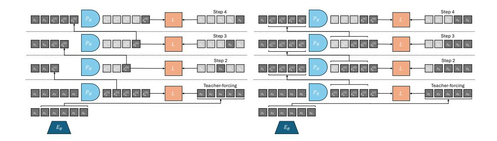

Figure S2.1: Two rollout strategies with any predictor network predicting the next timestep (frame) simultaneously for all timesteps. Predictor is used as an RNN by recursively feeding it a mix of its previous predictions and groundtruth embeddings. We vertically represent the "predictor unrolling step" dimension. For a predicted embedding  $z_t^{(k)}$ , we denote the timestep it corresponds to as t and its prediction order as k. The embeddings that enter in the loss computation are in grey whereas those which do not are in light grey. Left: "Last-gradient-only" strategy. We sample a random groundtruth embedding prefix,  $(z_1,\ldots,z_t)$  (in this figure t=2), and concatenate only the latest prediction to the predictor context at the next unrolling step. Strategy used in V-JEPA-2-AC with a groundtruth embedding prefix always equal to  $z_1$ . Right: "All-gradients" strategy, we compute all available prediction tasks without redundancies, e.g. we exclude from loss computation prediction tasks that have already been included in loss computation at previous timesteps, i.e.  $L(z_t^{(t-1)}, z_t)$ .

#### C PLANNING ENVIRONMENTS AND DATASETS

At train time, we normalize the action and optional proprioceptive input by subtracting the empirical mean and dividing by the empirical standard deviation, which are computed on each dataset. At planning time, we sample candidate actions in the normalized action space directly. When stepping the plan in the simulator, we thus denormalize the plan resulting from the optimization before stepping it in the environment. For comparability with V-JEPA-2-AC, we do not normalize actions for DROID. We stress that, in all environments considered, we are scarce in data, except for Push-T, where we have a bigger dataset, compared to the task complexity.

We summarize dataset statistics in Table S3.1. Each trajectory dataset is transformed into a dataset of trajectory slices, of length W+1 for training.

Table S3.1: Datasets statistics. We denote the number of trajectories in the dataset under *Dataset Size*, the length of trajectories under *Traj. Len.* 

|           | Dataset Size | Traj. Len. |
|-----------|--------------|------------|
| PointMaze | 2000         | 100        |
| Push-T    | 18500        | 100-300    |
| Wall      | 1920         | 50         |
| Metaworld | 12600        | 100        |
| DROID     | 8000         | 20-50      |

**DROID.** We use the same dataloader as in V-JEPA-2-AC, which defines actions as delta in measured robot positions. One could either feed all three available cameras of DROID (left, right, wrist) simultaneously (e.g. by concatenating them) or alternatively to the model. We choose to use only one view point as simultaneous input. For training, we find that allowing the batch sampler to sample from either the left or right camera allows for slightly lower validation loss than using only one of them.

For evaluation, we collected a set of 16 videos with our own DROID setup, positioning the camera to closely match the left camera setup from the original DROID dataset. These evaluation

videos specifically focus on object interaction and arm navigation scenarios, allowing us to assess the model's performance on targeted manipulation tasks.

As discussed in Section [5.1,](#page-5-2) we define the *Action Score* as a rescaling of the opposite of the Action Error, namely 800(0.1 − E) if E < 0.1 else 0, where E is the Action Error. We display the Action Score in all figures discussed in Section [5.2.](#page-6-1)

Robocasa. Robocasa [\(Nasiriany et al., 2024\)](#page-14-13) is a simulation framework, based on Robosuite [\(Zhu](#page-16-11) [et al., 2020\)](#page-16-11), with several robotic embodiments, including the Franka Panda Arm, which is the robot used in the DROID dataset. Robocasa features over 2,500 3D assets across 150+ object categories and numerous interactable furniture pieces. The framework includes 100 everyday tasks and provides both human demonstrations and automated trajectory generation to efficiently expand training data. It is licensed under the MIT License.

We evaluate DROID models on Robocasa. The already existing pick-and-place tasks require too long horizons to be solved by our current planning procedure. Hence, we need define custom easier pick-and-place task where the arm and target object start closer to the target position. To get a goal frame, we need to teleoperate a trajectory to obtain successful pick-and-place trajectories. We can then use the last frame of these trajectories as goal frame for planning. We needed to tune the camera view point to roughly correspond to the DROID left or right camera viewpoint, otherwise our models were not able to unroll well a sequence of actions. We also customize the gripper to use the same RobotiQ gripper as in DROID. We collect 16 such trajectories to form our evaluation set in the kitchen scene with various object classes. We define the "Reach" condition as having the end-effector at less than 0.2 (in simulator units, corresponding to roughly 5 cms in DROID) from the target object, the "Pick" condition as having lifted the object at more than 0.05 from its initial altitude, and the "Place" condition as having the object at less than 0.15 from the target position of the object. Our teleoperated trajectories all involve three segments, namely reaching the object (segment 1), picking it up (segment 2), and placing it at the target position (segment 3), delimited by these conditions. These three segments allow to define 6 subtasks, namely "Reach-Pick-Place", "Reach-Pick", "Pick-Place", "Reach", "Pick", and "Place". The success definition of each of these tasks is as follows:

- "Reach-Pick-Place": starting from the beginning of segment 1, success is 1 if the "Pick" and "Place" conditions are met.
- "Reach-Pick": starting from the beginning of segment 1, success is 1 if the "Pick" condition is met.
- "Pick-Place": starting from the beginning of segment 2, success is 1 if the "Place" condition is met.
- "Reach": starting from the beginning of segment 1, success is 1 if the "Reach" condition is met.
- "Pick": starting from the beginning of segment 2, success is 1 if the "Pick" condition is met.
- "Place": starting from the beginning of segment 3, success is 1 if the "Place" condition is met.

We focus on the "Place" and "Reach" tasks. Our models have low success rate on the "Pick" task, as they slightly misestimate the position of the end-effector, which proves crucial, especially for small objects.

To allow for zero-shot transfer from DROID to Robocasa, we perform 5 times action repeat of the actions outputted by our DROID model, since we trained on DROID sampled at 4 fps and the control frequency of Robocasa is 20 Hz. We also rescale the actions outputted by our planner to match the action magnitude of Robocasa, namely [-1, 1] for the delta position of the end-effector in cartesian space, and [0, 1] for the gripper closure.

Metaworld. The Metaworld [\(Yu et al., 2019\)](#page-16-12) environment is licensed under the MIT License. The 42 Metaworld tasks we consider are listed in Table [S3.2.](#page-27-1) We gather a Metaworld dataset via TD-MPC2 online agents trained on the visual and full state (39-dimensional) input from the Metaworld environment, on 42 Metaworld tasks, listed in Table [S3.2.](#page-27-1) We launch the training of each TD-MPC2 agent for three seeds per task. The re-initialization of the environment at each new training episode is therefore different, even within a given seed and task. This randomness governs the initial position of the arm and of the objects present in the scene, as well as the goal positions of the arm and potential objects. Each episode has length 100. We keep the first 100 episodes of each combination of seed and task, to limit the proportion of "expert" trajectories in the dataset, thus promoting data diversity. This results in 126 buffers, each of 100 episodes, hence 12600 episodes of length 100.

We introduce a planning evaluation procedure for each of the Metaworld tasks considered. These are long-horizon tasks that require to perform at least 60 actions to be solved, meaning it should be solvable if planning at horizon H = 60/f, if using frameskip f. This allows us to explore the use of JEPA-WMs in a context where MPC is a necessity. At planning time, we reset the environment with a different for each episode, randomizing the initial position of the arm, of the objects present in the scene, as well as the goal positions of the arm and potential objects. We then play the expert policy provided in the open-source Metaworld package for 100 steps. The last frame (and optionally proprioception) of this episode is set as the goal og for the planning objective of equation [2.](#page-3-2) We then reset the environment again with the same random seed, and let the agent plan for 100 steps to reach the goal.

Push-T. In this environment introduced by [\(Chi et al., 2023\)](#page-12-12) (MIT License), a pusher ball agent interacts with a T-shaped block. Success is achieved when both the agent and the T-block, which start from a randomly initialized state, reach a target position. For Push-T, the dataset provided in DINO-WM is made of 18500 samples, that are replays of the original released expert trajectories with various level of noise. At evaluation time, we sample an initial and goal state from the validation split, such that the initial attained the goal in H steps, with H the planning horizon. Indeed, otherwise, the task can require very long-horizon planning, and is not well solved with our planners.

PointMaze. In this environment introduced by [\(Fu et al., 2020\)](#page-12-14) (Apache 2.0 license), a forceactuated 2-DoF ball in the Cartesian directions x and y must reach a target position. The agent's dynamics incorporate its velocity, acceleration, and inertia, making the movement realistic. The PointMaze train set is made of 2000 fully random trajectories. At evaluation time, we sample a random initial and goal state from the simulator's sampler.

Wall. This 2D navigation environment introduced in [\(Zhou et al., 2024a\)](#page-16-2) (MIT License) features two rooms separated by a wall with a door. The agent's task is to navigate from a randomized starting location in one room to a goal in one of the two rooms, potentially passing through the door. The Wall dataset is made of 1920 random trajectories each with 50 time steps. At planning time, we also sample a random initial and goal state from the simulator's sampler.

| Task                  | Description                                                                         |
|-----------------------|-------------------------------------------------------------------------------------|
| turn on faucet        | Rotate the faucet counter-clockwise. Randomize faucet positions                     |
| sweep                 | Sweep a puck off the table. Randomize puck positions                                |
| assemble nut          | Pick up a nut and place it onto a peg. Randomize nut and peg positions              |
| turn off faucet       | Rotate the faucet clockwise. Randomize faucet positions                             |
| push                  | Push the puck to a goal. Randomize puck and goal positions                          |
| pull lever            | Pull a lever down 90 degrees. Randomize lever positions                             |
| push with stick       | Grasp a stick and push a box using the stick. Randomize stick positions.            |
| get coffee            | Push a button on the coffee machine. Randomize the position of the coffee machine   |
| pull handle side      | Pull a handle up sideways. Randomize the handle positions                           |
| pull with stick       | Grasp a stick and pull a box with the stick. Randomize stick positions              |
| disassemble nut       | pick a nut out of the a peg. Randomize the nut positions                            |
| place onto shelf      | pick and place a puck onto a shelf. Randomize puck and shelf positions              |
| press handle side     | Press a handle down sideways. Randomize the handle positions                        |
| hammer                | Hammer a screw on the wall. Randomize the hammer and the screw positions            |
| slide plate           | Slide a plate into a cabinet. Randomize the plate and cabinet positions             |
| slide plate side      | Slide a plate into a cabinet sideways. Randomize the plate and cabinet positions    |
| press button wall     | Bypass a wall and press a button. Randomize the button positions                    |
| press handle          | Press a handle down. Randomize the handle positions                                 |
| pull handle           | Pull a handle up. Randomize the handle positions                                    |
| soccer                | Kick a soccer into the goal. Randomize the soccer and goal positions                |
| retrieve plate side   | Get a plate from the cabinet sideways. Randomize plate and cabinet positions        |
| retrieve plate        | Get a plate from the cabinet. Randomize plate and cabinet positions                 |
| close drawer          | Push and close a drawer. Randomize the drawer positions                             |
| press button top      | Press a button from the top. Randomize button positions                             |
| reach                 | reach a goal position. Randomize the goal positions                                 |
| press button top wall | Bypass a wall and press a button from the top. Randomize button positions           |
| reach with wall       | Bypass a wall and reach a goal. Randomize goal positions                            |
| insert peg side       | Insert a peg sideways. Randomize peg and goal positions                             |
| pull                  | Pull a puck to a goal. Randomize puck and goal positions                            |
| push with wall        | Bypass a wall and push a puck to a goal. Randomize puck and goal positions          |
| pick out of hole      | Pick up a puck from a hole. Randomize puck and goal positions                       |
| pick&place w/ wall    | Pick a puck, bypass a wall and place the puck. Randomize puck and goal positions    |
| press button          | Press a button. Randomize button positions                                          |
| pick&place            | Pick and place a puck to a goal. Randomize puck and goal positions                  |
| unplug peg            | Unplug a peg sideways. Randomize peg positions                                      |
| close window          | Push and close a window. Randomize window positions                                 |
| open door             | Open a door with a revolving joint. Randomize door positions                        |
| close door            | Close a door with a revolving joint. Randomize door positions                       |
| open drawer           | Open a drawer. Randomize drawer positions                                           |
| close box             | Grasp the cover and close the box with it. Randomize the cover and box positions    |
| lock door             | Lock the door by rotating the lock clockwise. Randomize door positions              |
| pick bin              | Grasp the puck from one bin and place it into another bin. Randomize puck positions |

Table S3.2: A list of all of the Meta-World tasks and a description of each task.

#### D PLANNING OPTIMIZATION

In this section, we detail the optimization procedures for planning in our experiments. Given a modeling function  $F_{\phi,\theta}$ , a dissimilarity criterion  $(L_{vis} + \alpha L_{prop})$ , an initial and goal observation pair  $o_t, o_g$ , we remind we have the objective function  $L^p_\alpha(o_t, a_{t:t+H-1}, o_g) = (L_{vis} + \alpha L_{prop})(F_{\phi,\theta}(o_t, a_{t:t+H-1}), E_{\phi,\theta}(o_g))$ .

**Model Predictive Control.** In Metaworld only we perform MPC, a procedure where replanning is allowed after executing a plan in the environment. We set the maximum number of actions that can be stepped in the environment to 100, which constitutes an episode. At each step of the episode where we plan, we use either the CEM or NG planner.

**Cross-Entropy Method.** The CEM optimisation algorithm proceeds as in Algorithm 1. In essence, we fit parameters of a time-dependent multivariate Gaussian with diagonal covariance.

### Algorithm 1 Cross-Entropy Method

- 1:  $\mu^0 \in \mathbb{R}^{H \times A}$  is zero and covariance matrix  $\sigma^0 \mathbf{I} \in \mathbb{R}^{(H \times A)^2}$  is the identity. Number of optimisation steps J.
- 2: **for** j = 1 to J **do**
- 3: Sample N independent trajectories  $(\{a_t, \dots, a_{t+H-1}\}) \sim \mathcal{N}(\mu^j, (\sigma^j)^2 \mathbf{I})$
- 4: For each of the N trajectories, unroll predictor to predict the resulting trajectory,  $\hat{z}_i = P_{\theta}(\hat{z}_{i-1}, a_{i-1}), \quad i = t+1, \ldots, t+H$ . Compute cost  $L^p_{\alpha}(o_t, a_{t:t+H-1}, o_g)$  for each candidate trajectory.
- 5: Select top K action sequences with the lowest cost, denote them  $(\{a_t, \ldots, a_{t+H-1}\})_{1,\ldots,K}$ . Update

$$\mu^{j+1} = \frac{1}{K} \sum_{k=1}^{K} (\{a_t, \dots, a_{t+H-1}\})_k$$
$$\sigma^{j+1} = \sqrt{\frac{1}{K-1} \sum_{k=1}^{K} \left[ (\{a_t, \dots, a_{t+H-1}\})_k - \mu^{j+1} \right]^2}$$

6: Step the first m actions of  $\mu^J$ , where  $m \leq H$  is a planning hyperparameter in the environment. If we are in MPC mode, the process then repeats at the next time step with the new context observation.

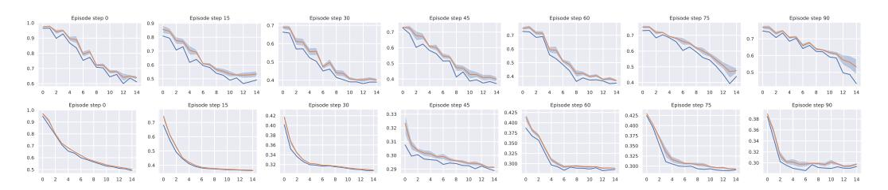

Figure S4.1: Planning a 100-steps Metaworld episode with the base DINO-WM at the end of training of WM, for the same Metaworld environment episode seed, with our two planners. We display the average objective of the top K imagined trajectories and its standard deviation (orange), and the best imagined trajectory's planning loss  $L^p_\alpha$  (blue). Bottom: Planning with CEM. Top: Planning with NG. Failure episode for both: with NG the arms stays stuck against the wall, hence the higher planning objective, whereas with CEM this episode fails because of imprecision around the goal position.

**NG Planner.** We design a procedure to use any NeverGrad optimizer with our planning objective  $L^p_\alpha(o_t, a_{t:t+H-1}, o_g)$ , with the same number of action trajectories evaluated in parallel and total budget as CEM, as detailed in Algorithm 2. As discussed in Section 5.2, in all the evaluation setups we consider in this study, the NGOpt meta-optimizer always chooses the diagonal variant of the CMA-ES algorithm with a particular parameterization. The diagonal version of CMA is advised when the search space is big. We stress that after trying other parameterizations of the Diagonal CMA algorithm, like its elitist version (with a scale factor of 0.895 instead of 1, which is the default value), success rate can drop by 20% on Wall, Maze and Push-T.

Gradient Descent Planner. We also experiment with gradient-based planners that directly optimize the action sequence through backpropagation. Unlike sampling-based methods (CEM, NG), these planners leverage the differentiability of the world model to compute gradients of the planning objective  $L^p_\alpha$  with respect to actions. The Gradient Descent (GD) planner initializes actions either from a standard Gaussian (scaled by  $\sigma_0$ ) or from zero, then performs J gradient descent steps with learning rate  $\lambda$ . After each gradient step, Gaussian noise with standard deviation  $\sigma_{\text{noise}}$  is added to the actions to encourage exploration and help escape local minima. Action clipping is applied to enforce bounds on specific action dimensions. The default hyperparameters are J=500 iterations,  $\lambda=1$ ,  $\sigma_0=1$ , and  $\sigma_{\text{noise}}=0.003$ .

#### Algorithm 2 NeverGrad planner

- 1: optimizer chosen by nevergrad.optimizers.NGOpt from budget  $N\times J$ , on space  $\mathbb{R}^{H\times A}$ , with N workers.
- 2: **for** j = 1 to J **do**
- 3: optimizer.ask() *N* trajectories sequentially.
- 4: For each of the N trajectories, unroll predictor to predict the resulting trajectory,  $\hat{z}_i = P_{\theta}(\hat{z}_{i-1}, a_{i-1}), \quad i = t+1, \ldots, t+H$ . Compute cost  $L^p_{\alpha}(o_t, a_{t:t+H-1}, o_g)$  for each candidate trajectory.
- 5: optimizer.tell() the cost  $L^p_{\alpha}(o_t, a_{t:t+H-1}, o_g)$  of the N trajectories sequentially.
- 6: Step the first m actions of optimizer.provide\_recommendation (), where  $m \leq H$  is a planning hyperparameter in the environment. If we are in MPC mode, the process then repeats at the next time step with the new context observation.

**Adam Planner.** The Adam planner extends the GD planner by using the Adam optimizer instead of vanilla stochastic gradient descent. Adam maintains exponential moving averages of the gradient (first moment) and squared gradient (second moment), which can provide more stable optimization dynamics. The default hyperparameters are  $\beta_1=0.9,\,\beta_2=0.995,\,\epsilon=10^{-8}$ , with the same defaults as GD for other parameters ( $J=500,\,\lambda=1,\,\sigma_0=1,\,\sigma_{\rm noise}=0.003$ ).

**Planning hyperparameters.** We display in Table S4.1 the hyperparameters used to plan on each environment. We keep the planning hyperparameters of DINO-WM (Zhou et al., 2024a) for Push-T, Wall and Maze, but reduce the number of "top" actions, denoted K, to 10 instead of 30. We obtain these parameters after careful grid search on DINO-WM. The success rate is very sensitive to these parameters, keeping the world model fixed.

Table S4.1: Environment-specific hyperparameters for planning, corresponding to the notations of Section D. The number of steps per planning episode is denoted M and the frameskip is denoted f. H is the planning horizon, m the number of actions to step in the environment, K the number of top actions in CEM, K the number of trajectories evaluated in parallel, K the number of iterations of the optimizer. The total number of replanning steps for an evaluation episode is K

|                               | N                 | Н           | m           | K              | J              | $W^p$ | f   | $\overline{M}$ |
|-------------------------------|-------------------|-------------|-------------|----------------|----------------|-------|-----|----------------|
| PointMaze                     | 300               | 6           | 6           | 10             | 30             | 2     | 5   | 30             |
| Push-T                        | 300               | 6           | 6           | 10             | 30             | 2     | 5   | 30             |
| Wall                          | 300               | 6           | 6           | 10             | 30             | 2     | 5   | 30             |
| Metaworld                     | 300               | 6           | 3           | 10             | 15             | 2     | 5   | 100            |
| Robocasa                      | 300               | 3           | 1           | 10             | 15             | 2     | 5   | 60             |
| DROID                         | 300               | 3           | 3           | 10             | 15             | 2     | 1   | m              |
| Wall Metaworld Robocasa | 300 300 300 | 6 6 3 | 6 3 1 | 10 10 10 | 30 15 15 | 2 2   | 5 5 |                |

# E ADDITIONAL EXPERIMENTS

### E.1 ADDITIONAL RESULTS

Equalized action ratio experiments. To isolate the effect of the conditioning scheme from capacity differences due to action ratio, we train new models for each of the considered environments where we downscale the image resolution to 128 × 128 with a DINOv3-L encoder (patch size 16), yielding 8 × 8 = 64 visual patches. This produces matched action ratios: sequence conditioning achieves 1/(hw + 1) = 1/65, while feature conditioning achieves fa/(D + fa) = 16/1040. Both variants use the same predictor architecture, RoPE positional encoding, frozen encoder, and training data.

*Results reveal task-dependent preferences*: Sequence conditioning outperforms feature conditioning on DROID, Robocasa, and Metaworld (3D manipulation tasks). Conversely, feature conditioning significantly outperforms on Wall (2D navigation). Performance is comparable on Maze and Push-T. Notably, the Wall result replicates the trend from Figure [5a](#page-7-0) (different resolution/model size), confirming statistical robustness.

We cannot provide a precise explanation of the underlying mechanism explaining why we observe such differences. What we can say for sure is that, despite matched action ratios, the conditioning schemes differ fundamentally in how action information propagates:

- *Feature conditioning*: Action embeddings are concatenated to each visual token. At the first transformer block, action-visual mixing occurs only within the MLP (after self-attention), which combines information across embedding dimensions but processes each spatial token separately.
- *Sequence conditioning*: The action token participates in self-attention from the first block, allowing immediate broadcasting to all visual tokens through attention mechanisms.

*Observations on Wall task*: Training and validation rollout losses are identical between methods, indicating both models predict dynamics equally well. However, during planning, sequenceconditioned models occasionally select very high magnitude actions, while feature-conditioned models consistently choose moderate actions. This suggests the conditioning scheme affects not only prediction but also the structure of the learned latent dynamics relevant for planning.

We hypothesize that for spatially simple tasks (Wall), feature conditioning's direct action-to-token pathway yields dynamics better suited for planning optimization, while sequence conditioning's attention-based routing is more beneficial for complex spatial reasoning in manipulation. However, further analysis would be needed to conclusively establish this mechanism.

Additional planner ablations. In Table [S5.1,](#page-31-0) we compare the performance of our model to the DINO-WM and VJEPA-2-AC baselines across all planner configurations tested in Figure [3.](#page-5-0) Our optimal JEPA-WM consistently outperforms the baselines on most tasks and planners, as in Table [1.](#page-9-1)

For completeness, we also report in Table [S5.2](#page-32-1) the per-seed variance at the final checkpoint, which isolates reproducibility across random seeds from training stability. Results are consistent with Table [S5.1,](#page-31-0) confirming that our method reliably outperforms baselines across both metrics.

In Figure [S5.2](#page-34-0) (Left), we display Figure [3](#page-5-0) again for completeness, along with Figure [S5.2](#page-34-0) (Right), where we compare the performance of all planners on all environments but *with proprioception*. We adopt the default configuration described in the beginning of Section [4,](#page-3-4) namely DINO-WM ViT-S but with proprioception. We can draw the same conclusions as for without proprioception, in Figure [3.](#page-5-0)

Let us detail the failure cases of the GD planner. On the Wall task, the GD planner gets zero performance, although the task is visually simplistic. We identify two main failure cases. Either the agent goes into the wall without being able to pass the door, which is a classical failure case for better CEM or NG planners. Or the agent finds a local planning cost minimum by going to the borders of the image, when starting close to them. We illustrate both of these in Figure [S5.1.](#page-33-1)

Object manipulation on Robocasa and DROID. We show in Figure [S5.4](#page-35-1) a successful planning episode with our proposed JEPA-WM on Robocasa on the "Place" task. Our model is able to perform

Table S5.1: Comparison of different models across all planner configurations. MW-R and MW-RW denote the Reach and Reach-Wall tasks of Metaworld. Rc-Pl and Rc-R denote the Place and Reach tasks of Robocasa. In **bold** is the best of the three models for a given planning optimizer, <u>underlined</u> is the best across all planning optimizers.

| Model                   | Planner | Maze       | Wall       | Push-T     | MW-R        | MW-RW       | Rc-R        | Rc-Pl             | DROID      |
|-------------------------|---------|------------|------------|------------|-------------|-------------|-------------|-------------------|------------|
| CEM $L_2$               | DWM     | 81.6 (3.4) | 64.1 (4.6) | 66.0 (4.7) | 44.8 (8.9)  | 35.1 (9.4)  | 19.1 (13.4) | 21.7 (7.2)        | 39.4 (2.1) |
|                         | VJ2AC   |            |            | _          |             | _           | 16.2 (8.3)  | 33.1 (7.2)        | 42.9 (2.5) |
|                         | Ours    | 83.9 (2.3) | 78.8 (3.9) | 70.2 (2.8) | 58.2 (9.3)  | 41.6 (10.0) | 25.4 (16.6) | 30.7 (8.0)        | 48.2 (1.8) |
| CEM $L_1$               | DWM     | 78.8 (2.9) | 48.7 (4.0) | 61.6 (4.5) | 45.1 (10.4) | 34.0 (9.1)  | 14.4 (11.3) | 19.6 (7.4)        | 41.7 (2.7) |
|                         | VJ2AC   | _          | _          | _          | _           | _           | 13.2 (10.3) | 30.9 (7.3)        | 38.5 (5.7) |
|                         | Ours    | 79.7 (3.1) | 46.7 (3.6) | 63.4 (2.1) | 55.1 (8.5)  | 40.8 (9.2)  | 17.6 (12.3) | 30.5 (8.7)        | 47.2 (1.8) |
| $NG L_2$                | DWM     | 54.2 (3.8) | 25.3 (4.2) | 47.6 (5.4) | 28.1 (7.8)  | 27.9 (10.0) | 25.8 (16.7) | 27.1 (8.6)        | 36.0 (3.6) |
|                         | VJ2AC   | _          | _          | _          | _           | _           | 22.1 (8.9)  | 31.1 (7.0)        | 36.2 (3.2) |
|                         | Ours    | 72.7 (4.5) | 35.4 (5.9) | 48.0 (3.0) | 29.3 (8.6)  | 21.0 (7.7)  | 30.5 (10.7) | <u>36.9 (9.1)</u> | 39.9 (1.9) |
| $NG L_1$                | DWM     | 52.3 (4.0) | 24.6 (5.2) | 46.2 (5.1) | 27.5 (8.5)  | 28.6 (8.9)  | 21.6 (15.5) | 26.0 (8.0)        | 35.4 (3.3) |
|                         | VJ2AC   | _          | _          | _          | _           | _           | 18.4 (11.8) | 29.4 (5.1)        | 33.7 (3.9) |
|                         | Ours    | 69.5 (2.1) | 30.9 (4.1) | 48.2 (5.1) | 27.8 (8.2)  | 21.3 (8.9)  | 25.7 (12.0) | 32.0 (9.9)        | 40.0 (2.2) |
| Adam $L_2$              | DWM     | 14.8 (1.5) | 0.1 (0.3)  | 8.0 (2.4)  | 62.0 (8.3)  | 49.9 (9.9)  | 2.8 (3.7)   | 21.5 (8.6)        | 0.0 (0.0)  |
|                         | VJ2AC   | _          | _          | _          | _           |             | 0.0(0.0)    | 5.9 (5.1)         | 0.0(0.0)   |
|                         | Ours    | 17.7 (3.3) | 1.1 (1.1)  | 9.0 (2.1)  | 55.3 (9.9)  | 39.7 (9.7)  | 0.0 (0.0)   | 10.5 (5.0)        | 0.0(0.0)   |
| Adam $L_1$              | DWM     | 12.6 (2.8) | 0.1 (0.3)  | 2.1 (1.5)  | 50.7 (8.5)  | 37.2 (8.3)  | 0.9 (1.4)   | 22.1 (7.5)        | 0.0 (0.0)  |
|                         | VJ2AC   | _          | _          | _          | _           | _           | 0.0(0.0)    | 3.5 (2.8)         | 0.0(0.0)   |
|                         | Ours    | 16.1 (3.5) | 0.0 (0.2)  | 0.9 (0.9)  | 53.2 (7.4)  | 43.1 (6.4)  | 0.2 (0.7)   | 7.5 (3.9)         | 0.0 (0.0)  |
| $\operatorname{GD} L_2$ | DWM     | 14.5 (1.9) | 0.1 (0.3)  | 8.1 (2.4)  | 62.2 (8.2)  | 50.0 (10.1) | 2.9 (3.8)   | 21.9 (8.4)        | 0.0(0.0)   |
|                         | VJ2AC   | _          | _          | _          | _           |             | 0.0(0.0)    | 8.1 (3.6)         | 0.0(0.0)   |
|                         | Ours    | 17.7 (3.3) | 1.1 (1.1)  | 9.1 (1.9)  | 55.3 (9.9)  | 39.7 (9.7)  | 0.0 (0.0)   | 10.5 (5.0)        | 0.0 (0.0)  |
| $\operatorname{GD} L_1$ | DWM     | 12.4 (2.6) | 0.1 (0.3)  | 2.0 (1.3)  | 50.9 (8.5)  | 37.1 (8.4)  | 1.0 (1.4)   | 22.2 (7.3)        | 0.0 (0.0)  |
|                         | VJ2AC   | _          | _          | _          | _           | _           | 0.0(0.0)    | 4.0 (2.6)         | 0.0(0.0)   |
|                         | Ours    | 16.1 (3.5) | 0.0(0.2)   | 0.9(0.9)   | 53.3 (7.3)  | 40.1 (12.3) | 0.2(0.7)    | 7.5 (3.9)         | 0.0(0.0)   |
|                         |         |            |            |            |             |             |             |                   |            |

the "Place" task but has a much lower success rate at the "Pick" task, as it misestimates the position of the arm. We illustrate the shift in camera calibration / action calibration in Figure S5.3 on the "Reach" task. On all episodes, the model always predicts a state shifted to the left compared to the ground-truth. This phenomenon is less clear on DROID, as we illustrate in Figure S5.5.

**Object manipulation on Metaworld.** Our agent solves the pose control tasks like reach and reach-wall. In addition, long-term action unrolling with object interaction seems to be well-captured by our models, as shown in Figure S5.6 for the bin-picking task. Yet, for tasks involving object manipulation, it hallucinates grasping the object. In Figure S5.7, the visual decoding of the unrolling of the action plan shows a gap between the imagined consequences of the actions and their consequences in the simulator. This calls for a separate optimization procedure for the action dimension that corresponds to the end-effector's gripper.

**Action precision Push-T.** The results in Figure S5.12 clearly show that CEM performs better than NG for the Push-T task. The Push-T task requires very precise actions, since if the ball is slightly off the position where it should be to push the T-shape, it misses the shape and fails at the task. Hence it proves essential to only step actions after convergence of the planner. Yet, we see in Figure S5.8 that the NG planner is more explorative and should therefore be parametrized differently for this type of task. Interestingly, the larger model converges faster and brings higher maximal success rate on this task.

**Embedding space and model size.** We see in Figure S5.9 that the relative difference in embedding space distance to the goal is approximately ten times smaller in the ViT-L model than in the ViT-S model. This is consistent with the fact that the ViT-L model has a higher capacity and can therefore embed more information in its latent space, in which two states of Metaworld are closer to each other than in the ViT-S model embedding space.

Table S5.2: Comparison of the final checkpoint of three methods, displaying the variance across three seeds, for all planner configurations. MW-R and MW-RW denote the Reach and Reach-Wall tasks of Metaworld. Rc-Pl and RC-R denote the Place and Reach tasks of Robocasa. In **bold** is the best of the three models for a given planning optimizer, <u>underlined</u> is the best across all planning optimizers.

| Model                              | Planner | Maze              | Wall              | Push-T            | MW-R        | MW-RW       | Rc-R                        | Rc-Pl       | DROID             |
|------------------------------------|---------|-------------------|-------------------|-------------------|-------------|-------------|-----------------------------|-------------|-------------------|
| CEM $L_2$                          | DWM     | 79.2 (2.9)        | 63.1 (2.3)        | 63.3 (3.9)        | 44.4 (5.5)  | 31.9 (2.6)  | 11.5 (7.8)                  | 20.8 (9.7)  | 40.4 (1.6)        |
|                                    | VJ2AC   | _                 | _                 | _                 | _           | _           | 7.3 (6.4)                   | 33.3 (5.9)  | 43.2 (1.9)        |
|                                    | Ours    | <u>83.3 (3.1)</u> | <u>80.9 (4.9)</u> | <u>69.4 (4.0)</u> | 49.0 (9.4)  | 29.2 (11.5) | 22.9 (21.4)                 | 34.4 (7.7)  | <u>46.5 (0.4)</u> |
| CEM $L_1$                          | DWM     | 78.3 (2.1)        | 50.0 (3.7)        | 60.6 (2.2)        | 49.3 (5.5)  | 38.2 (10.4) | 13.5 (8.2)                  | 14.6 (5.3)  | 41.6 (1.8)        |
|                                    | VJ2AC   |                   |                   |                   | _           | _           | 8.3 (3.9)                   | 31.2 (6.8)  | 40.9 (3.1)        |
|                                    | Ours    | 81.2 (4.7)        | 47.6 (2.1)        | 55.9 (3.0)        | 48.4 (10.7) | 30.7 (7.0)  | 20.8 (22.9)                 | 29.2 (11.8) | 45.0 (0.3)        |
| $NG L_2$                           | DWM     | 55.6 (2.3)        | 25.2 (4.3)        | 48.8 (3.0)        | 25.7 (2.0)  | 27.1 (1.7)  | 20.8 (7.8)                  | 33.3 (8.2)  | 35.4 (2.2)        |
|                                    | VJ2AC   | _                 | _                 | _                 | _           | _           | 18.8 (4.4)                  | 29.2 (2.9)  | 35.7 (2.1)        |
|                                    | Ours    | 76.4 (0.5)        | 38.9 (4.2)        | 49.7 (2.7)        | 23.4 (8.4)  | 13.0 (5.6)  | <b>26.0</b> ( <b>16.6</b> ) | 35.4 (6.4)  | 39.8 (0.7)        |
| $\overline{\operatorname{NG} L_1}$ | DWM     | 52.3 (2.0)        | 23.1 (6.6)        | 42.1 (4.4)        | 31.2 (6.1)  | 29.2 (3.4)  | 24.0 (8.2)                  | 28.1 (15.9) | 38.4 (3.2)        |
|                                    | VJ2AC   | _                 | _                 | _                 | _           | _           | 9.4 (2.6)                   | 28.1 (2.6)  | 34.0 (4.9)        |
|                                    | Ours    | 73.6 (3.0)        | 30.6 (1.3)        | 43.8 (0.9)        | 27.6 (6.5)  | 12.5 (6.4)  | 18.8 (19.9)                 | 32.3 (12.6) | 39.9 (1.3)        |
| Adam $L_2$                         | DWM     | 14.6 (3.1)        | 0.0 (0.0)         | 8.9 (0.5)         | 60.4 (2.9)  | 44.4 (7.7)  | 7.3 (2.9)                   | 24.0 (10.3) | 0.0 (0.0)         |
|                                    | VJ2AC   |                   |                   |                   | _           | _           | 0.0(0.0)                    | 12.5 (5.1)  | 0.0(0.0)          |
|                                    | Ours    | 21.5 (4.2)        | 1.0 (0.9)         | 8.3 (0.9)         | 45.8 (3.9)  | 25.5 (10.6) | 3.1 (3.1)                   | 9.4 (3.1)   | 0.0(0.0)          |
| Adam $L_1$                         | DWM     | 12.0 (1.6)        | 0.0 (0.0)         | 3.1 (1.0)         | 45.8 (6.8)  | 34.7 (5.2)  | 3.1 (4.4)                   | 21.9 (0.0)  | 0.0 (0.0)         |
|                                    | VJ2AC   |                   | _                 | _                 | _           | _           | 0.0(0.0)                    | 4.2 (1.5)   | 0.0(0.0)          |
|                                    | Ours    | 17.7 (1.5)        | 0.0(0.0)          | 1.0 (0.0)         | 45.8 (2.6)  | 33.9 (3.1)  | 0.0(0.0)                    | 7.8 (4.7)   | 0.0(0.0)          |
| $\operatorname{GD} L_2$            | DWM     | 13.5 (2.1)        | 0.0 (0.0)         | 8.3 (1.0)         | 61.8 (2.0)  | 45.8 (6.8)  | 7.3 (2.9)                   | 25.0 (9.2)  | 0.0 (0.0)         |
|                                    | VJ2AC   | _                 | _                 | _                 |             |             | 0.0(0.0)                    | 5.2 (1.5)   | 0.0(0.0)          |
|                                    | Ours    | 21.5 (4.2)        | 1.0 (0.9)         | 8.3 (0.9)         | 45.8 (3.9)  | 25.5 (10.6) | 3.1 (3.1)                   | 9.4 (3.1)   | 0.0(0.0)          |
| $\operatorname{GD} L_1$            | DWM     | 12.0 (1.6)        | 0.0 (0.0)         | 2.1 (0.0)         | 45.8 (6.8)  | 34.7 (5.2)  | 3.1 (4.4)                   | 21.9 (0.0)  | 0.0 (0.0)         |
|                                    | VJ2AC   |                   |                   |                   | _           |             | 0.0(0.0)                    | 4.2 (1.5)   | 0.0(0.0)          |
|                                    | Ours    | 17.7 (1.5)        | 0.0(0.0)          | 1.0 (0.0)         | 45.8 (2.6)  | 33.9 (3.1)  | 0.0 (0.0)                   | 7.8 (4.7)   | 0.0(0.0)          |

### E.2 EVALUATION METRICS

The metric we seek to optimize for planning tasks is the success rate, which can be noisy, highly dependent on the initial seed, and sparse at the beginning of training. We therefore derive several other useful metrics and study their correlation with the success rate.

**Embedding space error throughout unrolling.** Throughout training, every 300 training iterations, we unroll the predictor on a batch of the validation split for n steps. For each of these steps, we compute the  $L_1$  and  $L_2$  loss between the predicted embedding and the embedding of the ground truth corresponding future frame. The  $L_2$  loss at step 1 is the teacher-forcing loss term  $\mathcal{L}$ .

**Proprioceptive decoding error throughout unrolling.** Prior to training of the predictors, we train a small ViT probe, called "state decoder" on top of the frozen encoder to regress the state, i.e. proprioception and optionally other simulator state information. Then, when training the predictors we study in this paper, every 300 training iterations, we unroll the predictor for n steps on a batch of the validation split and use our state decoder on the predicted features. This yields n state predictions, of which we compute the distance to the ground truth future n states.

**Visual decoder.** Just like the state decoder, we train a visual decoder to reconstruct, from the embeddings outputted by the frozen encoder, the associated frames. We decode each frame independently to avoid artificial consistency across frames, as the decoder is a probing tool. Indeed, in models like COSMOS (Agarwal et al., 2025), the powerful diffusion decoder accounts for beautiful visualisations, although the underlying latent world model might not be as accurate. Every 300 training iterations, we unroll the predictor on a given sequence of actions, and compare the decoding of the predicted embeddings to the ground truth future frames, both qualitatively and with the LPIPS metric (Zhang et al., 2018).

**Action error.** To evaluate models without having to step actions in a real robot or a simulator, we compare the actions outputted by the planner and the groundtruth actions of the trajectory sampled

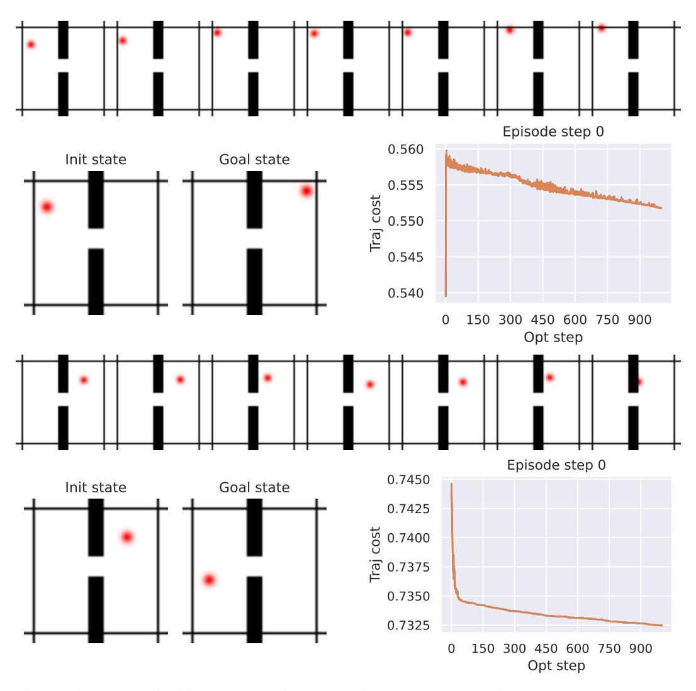

Figure S5.1: Two typical failure cases with the Gradient-Descent (GD) planner on the Wall task. For each failure case, we show: (top) the planned trajectory visualization, (bottom left) initial and goal states, (bottom right) planning cost evolution throughout gradient descent iterations. First failure case (top 3 subfigures): the agent finds a local planning cost minimum by going to the borders of the image when starting close to them. Second failure case (bottom 3 subfigures): the agent goes into the wall without being able to pass the door.

from the dataset to define initial and goal state. On DROID, throughout training, the total action error increases, and even more if we do not clip the actions magnitude in the planner, as done in V-JEPA-2-AC, since we do not normalize the actions. This is because most of the action error comes from the gripper closure and gripper orientation action dims, as detailed in Figure S5.10. Hence, on DROID, we track the action error on the three first dimensions, corresponding to the end-effector position control, which is more relevant for the tasks we consider.

#### E.3 IS THERE A PROXY FOR SUCCESS RATE?

Evaluating several independent planning recipes is compute-intensive, even more so as the model size increases, as well as the planning budget  $N \times H \times J \times W^p$ , see Table S4.1. Hence, we look for validation metrics to track throughout the training that correlate well with the success rate. Each epoch of each model and evaluation setup (among four) is a data point with a value for a validation metric and an associated success rate. Considering each epoch as an independent sample allows us to

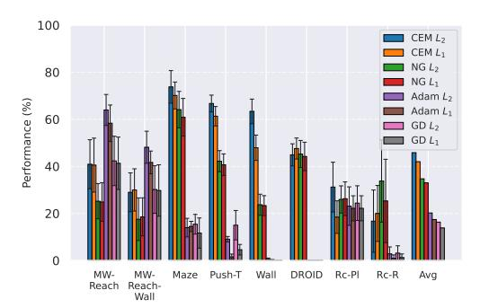

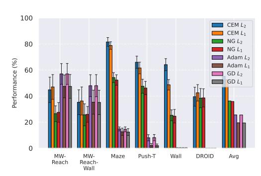

Figure S5.2: Comparison of planning optimizers. NG is the Nevergrad-based interface for trajectory optimization that we introduce, CEM is the Cross-Entropy Method, and GD is the Gradient Descent Planner with L1 or L2 distance. Left: comparison of the GD, CEM and NG planners on DINO-WM without proprioception. Right: comparison of CEM and NG planners on DINO-WM with proprioception.

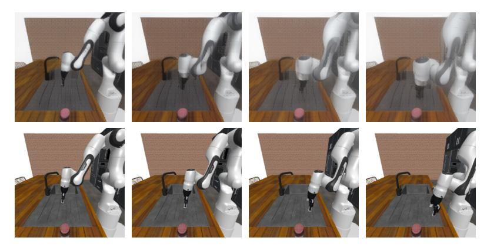

Figure S5.3: Planning at horizon 3 with our proposed JEPA-WM on Robocasa, with our best model presented in Section [5.3.](#page-9-0) The model is trained on DROID and evaluated zero-shot on Robocasa on the "Reach" task, where the goal is to reach the object. Top: the model's visual decoding of the action plan. Bottom: the ground-truth action stepping in simulator. The model predicts a state shifted to the left compared to the ground-truth.

compute the Spearman correlation between each quantitative metric and the success rate. The results in Table [S5.3,](#page-35-2) Table [S5.6,](#page-36-0) Table [S5.4](#page-35-3) and Table [S5.5](#page-36-1) first show that the correlation with training loss (Vis emb) is higher for the easier Wall task. Since we want to find the metric that correlates most to the success rate, we average the Spearman correlations instead of computing them on the union of data points, to avoid Simpson's paradox. This yields the rightmost column of each table. In both environments, the metric most correlated with the success rate is the planning objective, that is, the Vis Emb loss. Interestingly, only in Metaworld, which requires better long-horizon unrolling capability, do the unroll metrics at step H > 1 correlate better than step-1 metrics.

Since we are essentially in a supervised learning setting, training a regressor of future embeddings, it is clear that lower validation prediction losses (at all unrolling steps) means a more accurate world model. This is best observed in the visual decodings of validation rollouts throughout training.

Why the success rate does not correlate well to these losses is due to several factors. The validation prediction task is not fully aligned with the goal-conditioned planning task. The planning optimization task we use to evaluate models is a heuristic, where the objective is to minimize the embedding space distance of the last imagined state to the goal.

As we see in DROID experiments Figure [S5.10,](#page-41-1) letting the planner sample actions that are OOD for the predictor can severely harm the plan accuracy and occult the improvement of the predictor throughout training. Another caveat is that a better world model that does not prevent the planning procedure from getting stuck in local cost minima, as we see with the score obtained with gradientbased planners in Table [S5.1.](#page-31-0)

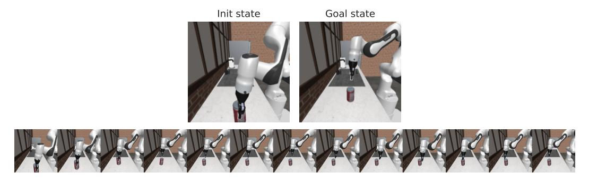

Figure S5.4: Planning episode with our proposed JEPA-WM on Robocasa, with DINOv2 ViT-S encoder, 2-step rollout, AdaLN predictor. The model is trained on DROID and evaluated zero-shot on Robocasa on the 'place' task. The planning cost is the embedding space distance to the goal frame embedding.

Table S5.3: Negative Spearman Correlation Coefficients between smoothed success rate and several validation metrics on Metaworld. In bold is highest value, underlined is 2nd highest. We denote the visual embedding prediction errors Vis Emb and the proprioceptive decoding error Proprio dec, at horizons H from one to three. We display the mean success rate over the last 10 epochs averaged over the four eval setups in the last row.

| Model name             | WM        | WMW       | WM-prop   | WM-2-step | WM-L      | Mean |
|------------------------|-----------|-----------|-----------|-----------|-----------|------|
| Proprio dec H = 1   | 0.40      | 0.44      | 0.40      | 0.26      | 0.20      | 0.34 |
| Proprio dec H = 2   | 0.41      | 0.34      | 0.45      | 0.27      | 0.21      | 0.34 |
| Proprio dec H = 3   | 0.38      | 0.44      | 0.40      | 0.33      | 0.18      | 0.35 |
| Vis emb L2 H = 1 | 0.44      | 0.51      | 0.62      | 0.39      | 0.23      | 0.44 |
| Vis emb L2 H = 2 | 0.42      | 0.46      | 0.62      | 0.39      | 0.24      | 0.42 |
| Vis emb L2 H = 3 | 0.36      | 0.44      | 0.59      | 0.37      | 0.20      | 0.39 |
| Vis emb L1 H = 1 | 0.45      | 0.55      | 0.69      | 0.41      | 0.24      | 0.47 |
| Vis emb L1 H = 2 | 0.45      | 0.52      | 0.72      | 0.43      | 0.25      | 0.47 |
| Vis emb L1 H = 3 | 0.42      | 0.52      | 0.72      | 0.42      | 0.22      | 0.46 |
| SR                     | 29.7 ±3.8 | 24.9 ±7.6 | 39.2 ±4.1 | 28.7 ±5.8 | 19.4 ±5.8 |      |

Table S5.4: Negative Spearman Correlation Coefficients across data points of the four eval setups between smoothed success rate and several validation metrics on the Push-T task. The rightmost mean column is the average of Spearman correlation of each model.In bold is highest value, underlined is 2nd highest. We display the mean success rate over the last 10 epochs in the last row.

| Model name          | WM   | WMW  | WM-prop | WM-2-step | WM-L | Mean |
|---------------------|------|------|---------|-----------|------|------|
| Proprio dec H = 1   | 0.70 | 0.73 | 0.85    | 0.71      | 0.81 | 0.76 |
| Proprio dec H = 2   | 0.78 | 0.66 | 0.87    | 0.79      | 0.84 | 0.79 |
| Proprio dec H = 3   | 0.76 | 0.70 | 0.78    | 0.83      | 0.86 | 0.79 |
| Vis emb L2 H = 1 | 0.80 | 0.73 | 0.88    | 0.82      | 0.87 | 0.82 |
| Vis emb L2 H = 2 | 0.85 | 0.76 | 0.91    | 0.84      | 0.87 | 0.85 |
| Vis emb L2 H = 3 | 0.86 | 0.70 | 0.89    | 0.80      | 0.87 | 0.82 |
| Vis emb L1 H = 1 | 0.87 | 0.79 | 0.92    | 0.83      | 0.90 | 0.86 |
| Vis emb L1 H = 2 | 0.88 | 0.78 | 0.93    | 0.84      | 0.88 | 0.86 |
| Vis emb L1 H = 3 | 0.87 | 0.75 | 0.91    | 0.83      | 0.87 | 0.85 |

Table S5.5: Negative Spearman Correlation Coefficients across data points of the eight eval setups between smoothed success rate and several validation metrics on the Wall task. In **bold** is highest value, <u>underlined</u> is 2nd highest. We denote the visual embedding prediction errors Vis Emb and the proprioceptive decoding error Proprio dec, at horizons *H* from one to three.

| Model name            | WM   | $\mathrm{WM}_W$ | WM-prop | WM-2-step   | WM-3-step | WM-L | Mean |
|-----------------------|------|-----------------|---------|-------------|-----------|------|------|
| Proprio dec $H = 1$   | 0.25 | 0.38            | 0.19    | 0.23        | 0.26      | 0.16 | 0.25 |
| Proprio dec $H = 2$   | 0.23 | 0.51            | 0.22    | 0.30        | 0.14      | 0.28 | 0.28 |
| Proprio dec $H = 3$   | 0.22 | 0.49            | 0.39    | 0.26        | 0.34      | 0.23 | 0.32 |
| Vis emb $L_2$ $H = 1$ | 0.72 | 0.94            | 0.74    | 0.73        | 0.69      | 0.75 | 0.76 |
| Vis emb $L_2$ $H = 2$ | 0.69 | 0.94            | 0.69    | 0.70        | 0.61      | 0.74 | 0.73 |
| Vis emb $L_2$ $H = 3$ | 0.68 | 0.94            | 0.65    | 0.69        | 0.56      | 0.70 | 0.70 |
| Vis emb $L_1$ $H=1$   | 0.78 | 0.96            | 0.81    | <b>0.77</b> | 0.73      | 0.80 | 0.81 |
| Vis emb $L_1$ $H=2$   | 0.74 | 0.96            | 0.76    | 0.72        | 0.69      | 0.79 | 0.78 |
| Vis emb $L_1$ $H=3$   | 0.73 | 0.96            | 0.73    | 0.72        | 0.64      | 0.75 | 0.75 |

Table S5.6: Negative Spearman Correlation Coefficients across data points of the eight eval setups between smoothed success rate and several validation metrics on the Point Maze environment. The rightmost mean column is the average of Spearman correlation of each model. In **bold** is highest value, <u>underlined</u> is 2nd highest.

| Model name                                                        | WM                    | $\mathrm{WM}_W$             | WM-prop                     | WM-2-step                   | WM-3-step                   | WM-L                         | Mean                  |
|-------------------------------------------------------------------|-----------------------|-----------------------------|-----------------------------|-----------------------------|-----------------------------|------------------------------|-----------------------|
| Proprio dec $H = 1$                                               | 0.15                  | 0.19                        | 0.15                        | 0.14                        | 0.25                        | 0.09                         | 0.16                  |
| Proprio dec $H = 2$                                               | 0.13                  | 0.21                        | 0.10                        | 0.35                        | 0.23                        | 0.21                         | 0.21                  |
| Proprio dec $H = 3$                                               | 0.10                  | 0.34                        | 0.25                        | 0.10                        | 0.27                        | 0.10                         | 0.19                  |
| Vis emb $L_2 H = 1$                                               | 0.43                  | 0.50                        | 0.82                        | 0.53                        | 0.42                        | 0.19                         | 0.48                  |
| Vis emb $L_2 H = 2$                                               | 0.23                  | 0.24                        | 0.74                        | 0.50                        | <b>0.53</b>                 | 0.03                         | 0.38                  |
| Vis emb $L_2 H = 3$                                               | 0.21                  | 0.30                        | 0.67                        | 0.46                        | 0.49                        | 0.17                         | 0.38                  |
| Vis emb $L_1 H = 1$ Vis emb $L_1 H = 2$ Vis emb $L_1 H = 3$ | <b>0.58</b> 0.37 0.29 | <b>0.68</b> 0.49 0.38 | <b>0.86</b> 0.78 0.74 | 0.54 <b>0.55</b> 0.51 | 0.38 <u>0.50</u> 0.50 | <b>0.36</b> 0.19 <u>0.29</u> | <b>0.57</b> 0.48 0.45 |

### E.4 SUCCESS OVER EPOCHS

We display in Figure [S5.11](#page-42-0) and Figure [S5.12](#page-43-0) the evolution of success rate over training epochs for some of the models that compose the design choice study of this paper.

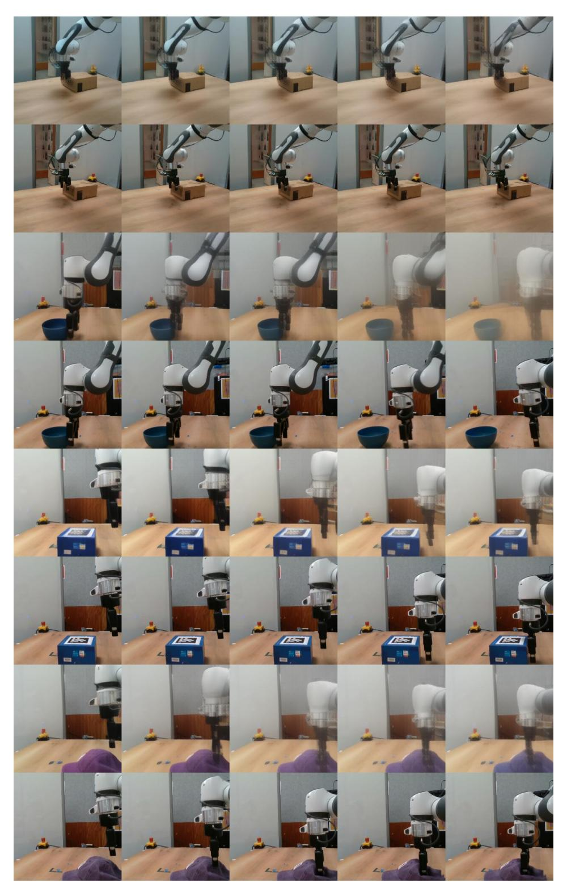

Figure S5.5: Unrolling a trajectory with our proposed JEPA-WM on some of our collected Franka arm trajectories, with our best model presented in Section [5.3.](#page-9-0) For each pair of rows, the top one is the model's visual decoding of the action unrolling, the bottom one is the ground-truth trajectory of the dataset. The model sometimes does not grasp well interaction with objects, which is the most frequent failure case.

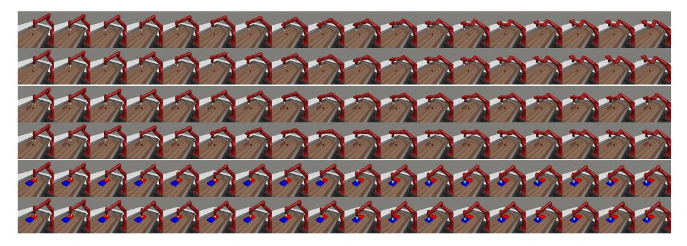

Figure S5.6: Samples of DINO-WM open-loop rollouts on the validation split, each on 18 model actions corresponding to 90 elementary actions in simulator. For each of the three pairs of rows, the groundtruth action stepping in simulator is below the decoding of the predictor rollout.

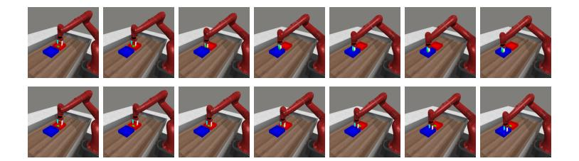

Figure S5.7: Upper row: Visual decoding of the unrolling of the action plan outputted by the NG planner, at step 1 of the Metaworld episode, on the bin-picking task. The world model's predictions resulting from the plan indicate that the object is picked. Lower row: Stepping of half of the plan in the simulator. The object is not picked and the plan leads the robotic arm to the target location without the object.

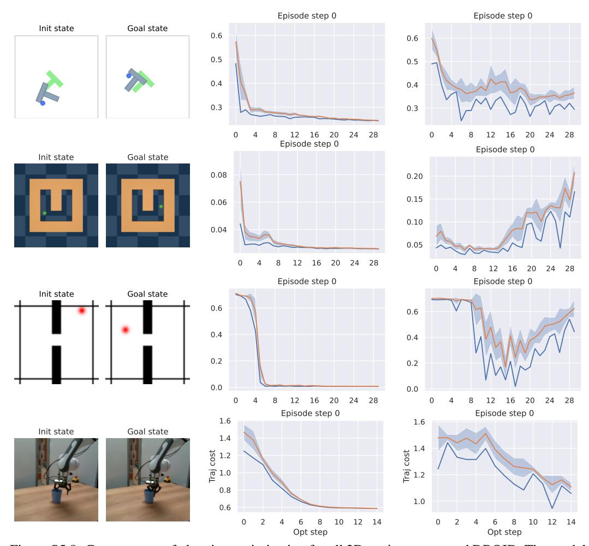

Figure S5.8: Convergence of planning optimization for all 2D environments and DROID. The model evaluated is the base WM model, at the end of training. Left: episode initial and goal state. Center: CEM planner. Right: NG planner. We display the planning cost of the best trajectory throughout the optimization steps.

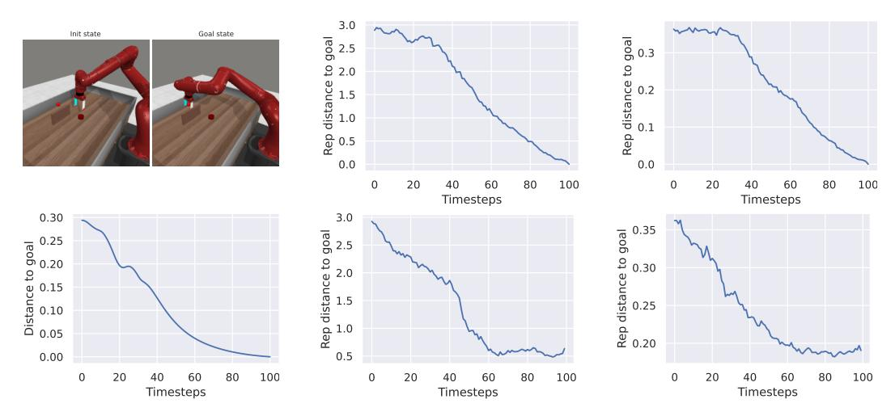

Figure S5.9: Same Metaworld reach-wall task setup: trajectory of the Base model (bottom center), the Large model (bottom right) and the expert policy (all other subfigures). Left: expert's executed episode first and last state at top, expert's distance of arm to goal position in the simulator space at bottom. Center: WM ViT-S encoder embedding space  $L_2$  distance to goal, expert trajectory on top, WM planned episode at bottom. Right: WM-L encoder embedding space, expert trajectory on top, WM planned episode at bottom.

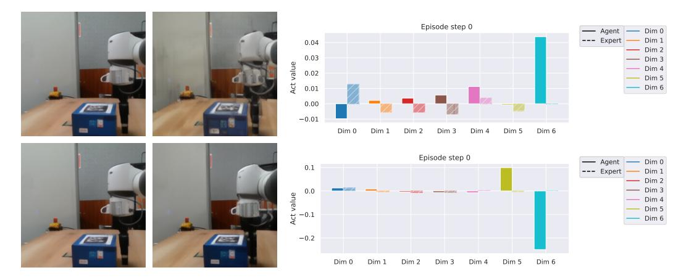

Figure S5.10: Top row: model at the end of the first training epoch. Bottom row: model at the end of training. Left: visual decoding of the horizon 1 plan. Right: comparison of the actions outputted by the planner (blue) and the groundtruth actions (orange) for the 7 action dimensions. The first three dimensions correspond to end-effector position control, the three next to end-effector orientation control, the last one to the gripper closure. The action error mostly comes from the gripper and orientation control dimensions. Hence, although only the model at the end of training correctly plans to approach the gripper from the box, its total action error is higher than at the beginning of training, if we consider all 7 dimensions.

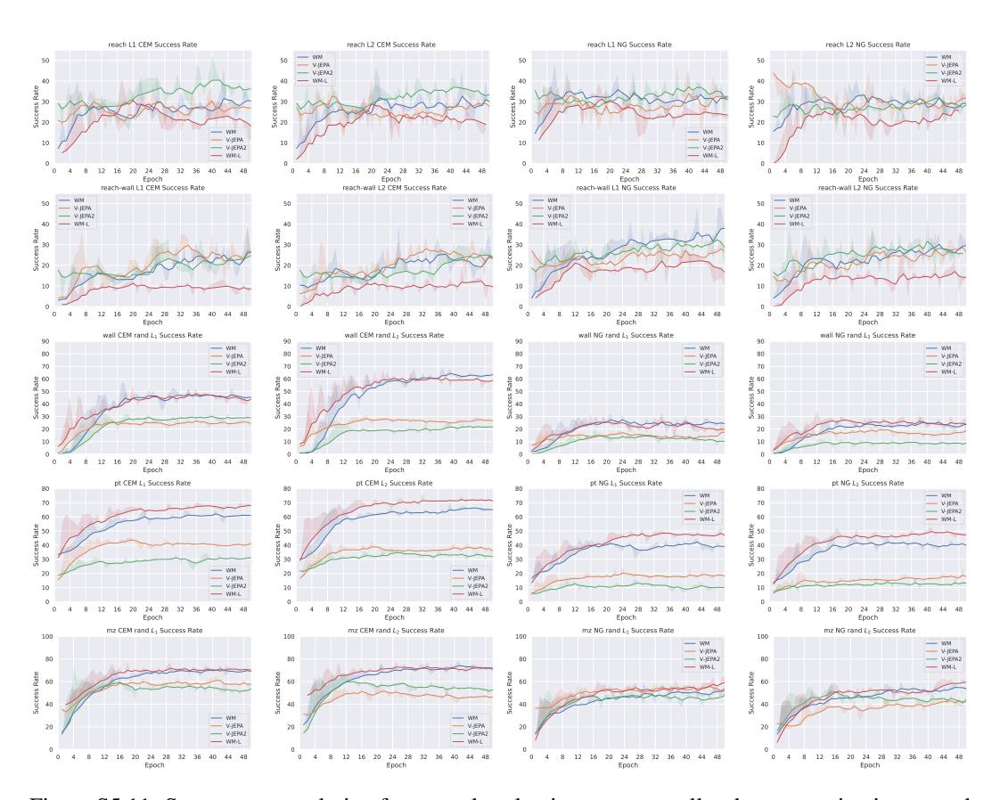

Figure S5.11: Success rate evolution for several evaluation setups on all tasks, comparing image and video encoders. At each epoch, we evaluate the success rate on 96 independent episodes and report the average. We denote WM the base model for the design choice study, namely DINO-WM (Zhou et al., 2024a) without proprioception, and WM-L its Vit-L version. We display the results for the models learned on top of V-JEPA and V-JEPA2.

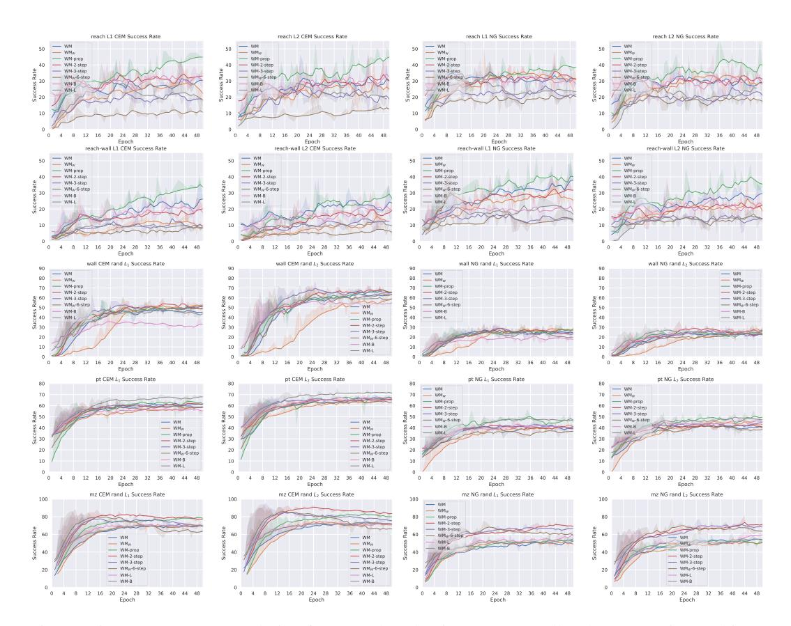

Figure S5.12: Success rate evolution for several evaluation setups on all tasks, comparing multistep rollout, proprioception and model size. We denote WM-B, WM-L the variants of the base model with size ViT-B and ViT-L, WM-prop the variant with proprioception, and the multistep rollout models as WM-k-step. Row 1: Metaworld reach, row 2: Metaworld reach-wall, row 3: Wall, row 4: Push-T, row 5: Point Maze. At each epoch, we evaluate the success rate on 96 independent episodes and report the average.