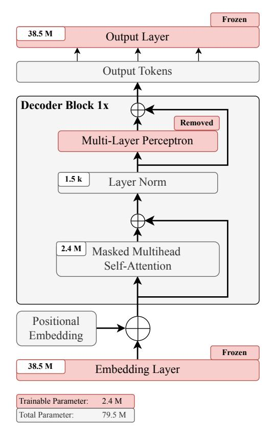
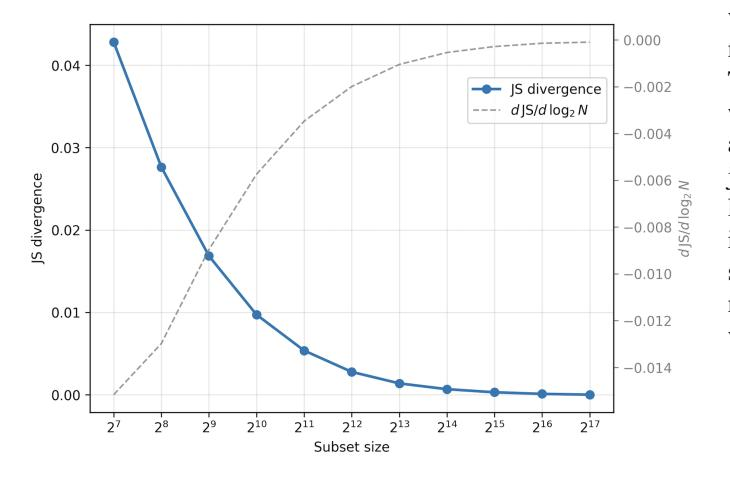
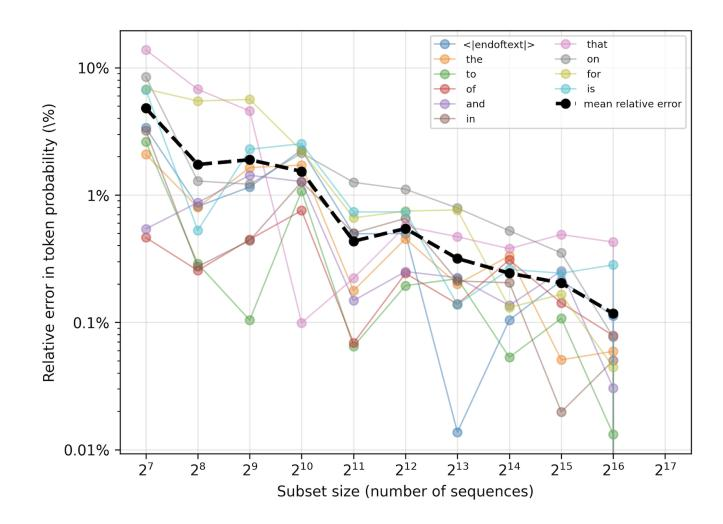
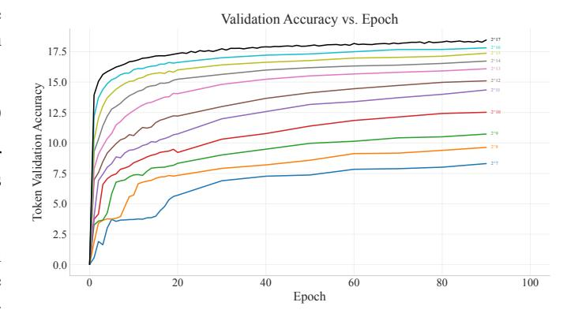

# Is More Data Worth the Cost? Dataset Scaling Laws in Tiny Attention-Only Decoder

Anonymous Authors

*Abstract*—Training Transformer language models is expensive, as performance typically improves with increasing dataset size and computational budget. While scaling laws characterize this trend at large scale, their practical implications in controlled, smaller-scale settings remain less explored. In this work, we isolate dataset-size effects under a strongly reduced decoder-only *attention-only* Transformer architecture. Training on progressively larger power-of-two datasets, we observe smooth performance improvements with increasing data and clear diminishing returns, consistent with scaling law predicted behavior. In our setup, ∼30% of the training data achieves ∼90% of full-data token-validation accuracy. This work provides actionable insights into dataset scaling behavior through a controlled, componentisolated experimental setup. In practical compute-restricted pretraining regimes, such as small research labs and exploratory model development, these findings provide concrete guidance for balancing dataset size and computational cost to achieve nearsaturated performance efficiently.

*Index Terms*—dataset scaling, attention-only Transformer, data efficiency, scaling laws, transformer pretraining, computeefficiency

# I. INTRODUCTION

Increasing model and dataset size reliably improves Large Language Model (LLM) performance but incurs substantial computational and energy costs. In practice, pretraining often involves difficult trade-offs between training cost and performance, making it crucial to understand when additional data yields diminishing returns and how much data is sufficient to approach near-saturated performance.

Prior work on scaling laws has shown that LLM performance improves smoothly with increasing model size, data, and compute, following predictable power-law relationships [\[1\]](#page-7-0). Most existing scaling law studies are conducted at industrial scale, where these factors are scaled jointly, making it difficult to disentangle their individual contributions and to attribute observed performance trends to specific model components. Throughout this work, *scaling laws* refer to the formulation introduced by Kaplan et al. [\[1\]](#page-7-0), whose analysis spans model sizes from tens of thousands to billions of parameters and wide ranges of dataset size, while examining data scaling primarily within such joint-scaling regimes. At the same time, recent advances have shown that even comparatively small and reduced-capacity models can exhibit strong capabilities, raising the question of whether the scaling-law behavior observed at industrial scale persists in tiny models. Resolving this question through the controlled analyses presented in this work is particularly valuable for compute-constrained pretraining settings, where identifying diminishing returns in dataset scaling is essential for reducing training cost.

We adopt a controlled experimental setup that isolates dataset-size effects under a fixed-capacity *attention-only* decoder architecture. Our objective is to determine whether increasing training data alone reproduces the characteristic diminishing returns predicted by scaling laws, when learning is primarily restricted to the self-attention mechanism. This design emphasizes interpretability and controlled analysis over absolute model performance. We train our model on progressively larger power-of-two datasets and analyze how dataset size and the token-to-parameter ratio influence training dynamics and final performance. Beyond subset size, we also examine qualitative properties of scaled datasets, including variance across random samplings, token distribution stability, and representativeness relative to the full corpus. This allows us to assess whether observed performance trends are robust to dataset selection and whether dataset size alone accounts for the observed training behavior.

Our main contributions are:

- A fixed-capacity attention-only architecture that freezes pretrained embeddings and the output projection while removing Multi-Layer Perceptron (MLP) sublayers.
- An analysis of dataset representativeness and robustness via token-distribution and multi-seed experiments.
- A controlled dataset-scaling study[1](#page-0-0) conducted with a fixed attention-only decoder architecture.
- A characterization of the cost–performance trade-off in dataset scaling, showing that moderate dataset sizes yield most full-data performance at reduced training cost.

Taken together, our findings offer practical guidance on dataefficient pretraining, with particular relevance for computeconstrained or exploratory development of small and tiny models.

1The code for our work is available at *anonymized for review*.

### II. RELATED WORK

# *A. Scaling Laws and Diminishing Returns*

The relationship between LLM performance and scale was formalized by Kaplan et al. [\[1\]](#page-7-0), who showed that validation loss follows a power-law decay as model size, dataset size, and compute increase. Within this framework, performance is governed by the relationship between the number of training tokens and the number of trainable model parameters. A key implication of these scaling laws is the presence of diminishing returns: each doubling of data or parameters yields progressively smaller performance improvements. Together, these findings established scaling laws as a predictive framework for large-scale language model training.

Subsequent work refined and extended these insights. Hoffmann et al. [\[2\]](#page-7-1) showed that many LLMs, including GPT-3 and Gopher, were under-trained relative to their parameter count. They introduced a compute-optimal scaling prescription "Chinchilla", which emphasizes balancing model size and dataset size under a fixed compute budget. This perspective shifts emphasis from scaling model size to understanding data efficiency under a fixed compute budget, motivating our focus on dataset scaled training. Other studies explored the limits of data scaling under constrained settings. Hernandez et al. [\[3\]](#page-7-2) examined the effect of repeated exposure to the same dataset and found that excessive repetition can lead to overfitting and degraded performance, indicating that more training steps or epochs do not always yield better generalization. Similarly, Chen et al. [\[4\]](#page-7-3) identified a "sub-scaling" regime in which performance gains slow due to redundancy in the training data. These findings reinforce the notion that dataset size alone does not linearly translate into improved performance. Muennighoff et al. [\[5\]](#page-7-4) further investigated data efficiency by studying training under data-constrained regimes. They showed that repeating data can remain useful for a limited number of epochs, after which returns diminish sharply. This observation informs our choice of training budgets and epoch counts in subset-based experiments.

#### *B. Subset Pretraining and Data Efficiency*

Complementary to theoretical scaling-law analyses, recent work has explored practical strategies for improving data efficiency by training on subsets, which correspond to fractions of large datasets. Our work also builds on recent advances in efficient transformer training via subset pretraining. Sporer et al. [\[6\]](#page-7-5) proposed ¨ *subset pretraining*, showing that training on small subsets as a pretraining strategy before switching to full dataset training can match the performance of full-dataset training at a fraction of the computational cost in computer vision tasks. Their findings motivate our investigation of whether similarly small and representative subsets can capture most of the learning signal in decoder-only LLMs.

Wang et al. [\[7\]](#page-7-6) introduced Influential Subset Selection (ISS), demonstrating that carefully selected, extremely small subsets can achieve competitive pretraining performance and consistently outperform randomly sampled or heuristic subset baselines. These results highlight the importance of data selection and representativeness, reinforcing the view that model performance depends not only on data volume, but also on the quality and informativeness of the training data.

Taken together, scaling laws characterize how performance improves with increasing data and compute, while subset pretraining methods demonstrate that much of this performance can be achieved using only a fraction of the available data. Prior work typically varies model size, data size, and training strategies simultaneously, making it difficult to attribute observed behavior to specific architectural components. In contrast, our work connects these two lines of research by studying dataset scaling under a fixed decoder-only architecture and optimization procedure, while explicitly isolating the self-attention mechanism.

#### III. ARCHITECTURE

# *A. Base Model*

To study the persistence of scaling-law behavior at small model scales, we adopt a decoder-only Transformer configuration based on the smallest GPT-2 design [\[8\]](#page-7-7). We adopt a controlled setup that yields tiny, reduced-capacity models through two architectural constraints: *(1) freezing the embedding and output layers* and *(2) removing the MLP sublayers*. Under this configuration, only the parameters of the self-attention layers are updated during training. Token embeddings, positional embeddings, and the output projection layer are frozen, and the MLP sublayers of decoder blocks are removed entirely, as highlighted in red in Fig. [1.](#page-2-0)

The smallest GPT-2 design [\[8\]](#page-7-7) provides a standardized architecture together with a widely used tokenizer and pretrained embedding space at minimal scale. The availability of pretrained embeddings for such small models is limited in practice; GPT-2 thus offers a pragmatic and wellestablished basis for isolating dataset-scaling effects by leveraging its pretrained embedding layer, thereby avoiding confounding variability from representation learning. The model employs learned absolute positional embeddings added to token embeddings, rather than relative or rotary positional encoding schemes such as RoPE. Our design comprises approximately 2.4 million trainable parameters and is trained on datasets ranging from 0.1 million to 134 million tokens. This range spans regimes from strongly data-limited to token-to-parameter ratios suggested by commonly cited compute-optimal heuristics, while keeping model capacity constant [\[2\]](#page-7-1). By avoiding architectural variations, we ensure that observed performance differences can be attributed primarily to changes in dataset size rather than model capacity or structural choices.

Fig. 1. Decoder-only Transformer architecture aligned with GPT-2. Red components are frozen (token embedding & output projection) or removed (MLP sublayer).

*1) Freezing Pretrained Embedding and Output Layer:* Prior architectural ablation and scaling studies have shown that treating token embeddings as fixed input representations can be essential for isolating core sequence modeling components. In particular, embedding parameters are often abstracted away from effective model capacity in scaling analyses [\[1\]](#page-7-0), or explicitly frozen to prevent representation learning from dominating learning behavior [\[9\]](#page-7-8). This consideration is especially critical in the tiny-model regime studied here. In our setting, the pretrained token embedding matrix constitutes a substantial fraction of the total parameter count and would dominate the trainable capacity if left unfrozen, relative to the comparatively small number of parameters in the decoders. In preliminary experiments where the embedding layer was trained jointly with the decoder, we observed rapid overfitting and unstable training dynamics, with apparent performance gains driven primarily by embedding adaptation rather than by learning contextual relationships through self-attention. Training the embedding layer would fundamentally alter the learning problem across data regimes, since in small-data settings much of the model capacity would be spent relearning token representations.

To avoid this imbalance, we freeze the pretrained token embedding layer and the output projection layer throughout training, leveraging GPT-2 representations. In GPT-2, the output projection is weight-tied to the input embedding matrix, such that next-token prediction compares the decoder hidden state against all token embeddings. Freezing the output layer therefore fixes this shared embedding space. This design choice stabilizes optimization in low-data regimes by preventing the model from relearning token-level representations from scratch and ensures that all models start from identical lexical representations. As a result, performance differences across subset sizes can be attributed directly to dataset scaling effects in the self-attention mechanism rather than to dataset-dependent representation learning.

*2) Attention-Only Transformer via MLP Removal:* To further operate in the tiny-model regime, we remove the MLP sublayers from each Transformer decoder block, yielding an *attention-only* architecture. While MLPs are commonly justified as the primary source of nonlinearity in Transformer models, recent work has shown that selfattention itself is highly nonlinear due to its data-dependent weighting and Softmax-based similarity computation, and can capture complex relationships even without an explicit feed-forward network. Bermeitinger et al. [\[9\]](#page-7-8) demonstrate that attention-only architectures can achieve competitive performance while substantially reducing the number of trainable parameters. Since the MLP typically accounts for the majority of parameters in a Transformer block, removing it reduces model capacity in a controlled and interpretable manner, allowing observed scaling behavior to be attributed more directly to the self-attention mechanism.

All scaling experiments in this work therefore use a fixed *attention-only* architecture with frozen embeddings and output layers (Table [I\)](#page-2-1), ensuring that observed performance differences are driven primarily by dataset scaling effects rather than architectural complexity.

# *B. Implications of Model Reduction on Parameter Count and Design Decisions*

Freezing pretrained components and removing the MLP sublayers substantially reduce the number of trainable parameters since the majority of parameters reside in frozen

TABLE I BASE MODEL ARCHITECTURE AND ARCHITECTURAL REDUCTION

| Architecture              |                          |
|---------------------------|--------------------------|
| Model Type                | Decoder-only Transformer |
| Sequence Length           | 1024                     |
| Embedding Dimension       | 768                      |
| Number of Attention Heads | 1                        |
| Number of Decoder Layers  | 1                        |
| MLP Ratio                 | 4                        |
| Remove MLP                | True                     |
| Frozen Embedding Layer    | True                     |
| Frozen Output Layer       | True                     |
| Parameter Count           |                          |
| Total Parameters          | 79,556,352               |
| Trainable Parameters      | 2,361,600                |
|                           |                          |

or removed components. Table I summarizes the final *attention-only* model architeture used for all subset-size scaling experiments in this work. Under this configuration, the full model contains 79,556,352 parameters in total, of which only 2,361,600 are trainable.

As a consequence of freezing the embedding layer, the token embedding layer is initialized from pretrained GPT-2 weights and excluded from optimization. GPT-2 does not define an explicit padding token. Since reusing pretrained GPT-2 embeddings requires preserving the original vocabulary size, introducing an additional padding token would break compatibility with the pretrained embedding matrix. We therefore reuse the end-of-sequence (EOS) token for padding, mask these positions during self-attention, and exclude them from loss and accuracy computation by assigning the ignore label (e.g., -100) to padded targets.

#### IV. DATASET

#### A. Dataset

The experiments were conducted on the *All the News 2.0* dataset [10], a large-scale corpus of approximately 2.7 million news articles from 27 U.S. publications spanning the years 2016 to 2020. We select this dataset because it was not included in the original GPT-2 training corpus, ensuring that our experiments evaluate dataset-scaling behavior without overlap with the data used to pretrain the embedding representations. The dataset was accessed via a publicly available Hugging Face distribution [10].

Prior to training, the dataset is cleaned to remove duplicate and non-english entries in order to reduce variance across sampled training subsets. The resulting corpus is then tokenized using the standard GPT-2 tokenizer. GPT-2 operates with a fixed maximum context length of 1024 tokens. Since short articles introduce substantial padding, we analyze padding utilization under different minimum article-length (MAL) thresholds. Without length filtering, padding accounts for approximately 46% of all processed tokens, whereas enforcing a MAL substantially reduces this overhead (Table II). The padding ratio denotes the fraction of all processed tokens that correspond to padding after chunking articles into fixed-length sequences.

TABLE II
PADDING RATIO (IN %) AS A FUNCTION OF MINIMUM ARTICLE LENGTH
(MAL) FOR A FIXED CONTEXT LENGTH OF 1024 TOKENS (GPT-2)

| MAL (tokens)      | 0    | 256  | 384  | 512  |
|-------------------|------|------|------|------|
| Padding Ratio (%) | 46.4 | 36.7 | 32.4 | 28.4 |

Based on this analysis, we adopt a MAL of 500 tokens for all experiments, reducing the padding ratio to approximately 28% while preserving a sufficiently large and diverse corpus. All remaining sequences are padded or truncated to 1024 tokens, with padded positions masked during self-attention and excluded from loss and accuracy computation. We use a fixed training-validation partition, consisting of 131,072

TABLE III
TRAINING AND VALIDATION DATASET STATISTICS OF ARTICLES AFTER
CLEANING (> 500 TOKENS)

| 131,072          |
|------------------|
| 1024 tokens      |
| 76,800,000       |
| 21,504,000 (28%) |
|                  |
| 20,000           |
| 1024 tokens      |
| 10,240,000       |
| 2,867,200 (28%)  |
|                  |

training sequences and a held-out validation set of 20,000 sequences. The validation set is kept fixed and evaluated in full for all experiments, independent of training subset size. After preprocessing, padding tokens account for approximately 28% of all tokens across both splits, a ratio that remains stable across subset sizes and random samplings. Dataset statistics for the training and validation splits are summarized in Table III.

#### B. Subset Construction

To study dataset scaling in a controlled manner, we construct training subsets by selecting a fixed number of sequences from the cleaned full training set. Let  $\mathcal{D} = \{x_1, \dots, x_N\}$  denote the full training set, where each  $x_i$  is a token sequence of fixed length 1024. We define a sequence of nested subsets  $\{\mathcal{D}_k\}_{k=0}^K$ , where the index k denotes the subset level, with cardinalities

$$D_k|=2^k, \quad k \in \{7,\dots,17\},$$

corresponding to subset sizes ranging from 128 to 131,072 sequences. Each subset  $\mathcal{D}_k$  is constructed by random sampling without replacement using a fixed random seed, and satisfies  $\mathcal{D}_k \subset \mathcal{D}_{k+1}$ .

To maintain consistent optimization dynamics across subset sizes, all subset sizes are constrained to be multiples of the batch size. As a result, increasing the subset size leads to a proportional increase in the number of optimization steps per epoch, while all other training hyperparameters remain fixed.

#### C. Subset Analysis

Beyond subset size alone, we analyze qualitative properties of the constructed subsets to ensure that observed performance differences can be attributed primarily to dataset size rather than systematic biases introduced by subset selection. In particular, we distinguish between (1) Distributional Similarity to the full dataset and (2) Robustness to Random Subset Sampling.

1) Distributional Similarity: We assess the extent to which randomly sampled training subsets approximate the token distribution of the full corpus as subset size increases. While distributional convergence is expected for sufficiently large random subsets, our goal is to quantify the *rate and scale* at which this convergence occurs in our experimental setup. We compare token probability distributions of subsets of

increasing size to a reference distribution derived from the full dataset. For each subset, token frequencies are converted into probability distributions. These distributions are then compared using Jensen–Shannon (JS) divergence [11], a bounded and symmetric measure of distributional similarity. Given two discrete probability distributions p (subset distribution) and q (full dataset distribution), JS divergence is defined as

$$JS(p \| q) = \frac{1}{2}KL(p \| m) + \frac{1}{2}KL(q \| m)$$
 (2)

where 
$$m = \frac{1}{2}(p+q)$$
. (3)

JS divergence quantifies the information-theoretic deviation of each distribution from their shared middle distribution m. Here,  $\mathrm{KL}(p \parallel m) = \sum_i p_i \log \frac{p_i}{m_i}$  denotes the Kullback–Leibler divergence. JS divergence values close to zero indicate that the subset and full dataset token distributions are nearly identical.

As shown in Fig. 2, JS divergence between subset and reference token distributions decreases rapidly with increasing subset size, indicating that moderate and large subsets closely approximate the statistical structure of the full dataset. The same plot additionally shows the first derivative of JS divergence with respect to  $\log_2 N$ , which quantifies the rate at which distributional mismatch diminishes as more data is added. Small subsets  $(2^7$  – $2^8$  sequences) exhibit measurable distributional deviation, while for subset sizes of  $2^{12}$  sequences and above, JS divergence falls below 0,003, rendering subsets effectively indistinguishable from the full dataset.

Fig. 2. Jensen–Shannon divergence between token distributions of training subsets and the full dataset. The dashed curve shows the first derivative of JS divergence with respect to  $\log_2$  subset size.

In addition to distribution-level metrics, we analyze per-token relative probability errors to study convergence behavior for frequent tokens (Fig. 3). Relative errors between subset-based token probability estimates and the reference distribution are shown for selected high-frequency tokens and their mean. Taken together, Figs. 2 and 3 aim to show *scale* and rate at which distributional convergence is reached in

Fig. 3. Fig. 3. Convergence of relative token probability error for selected high-frequency tokens as a function of training subset size. The relative error is defined as  $100 \cdot |p_{\rm subset} - p_{\rm ref}|/p_{\rm ref}$ .

practice. The rapid decay of JS divergence shows that already moderate-sized subsets recover the global token distribution of the full dataset. Beyond this regime, the remaining differences between subsets are small, supporting the interpretation that observed differences in model performance are driven primarily by data quantity.

2) Robustness to Random Subset Sampling: To further validate these findings, we repeat training experiments across multiple random seeds for selected subset sizes. As shown in Table IV, variability across random seeds decreases rapidly with increasing subset size, confirming that training outcomes are robust to sampling variability. This empirical stability justifies the use of a fixed random seed: for moderate and large subsets, independently sampled subsets exhibit nearly identical token frequency distributions, padding ratios and low standard deviation across seeds. Consequently, differences in model performance for larger subsets can be attributed to data volume rather than sampling-induced distributional bias.

TABLE IV Robustness to random subset sampling across seeds. Mean  $\pm$  standard deviation over five seeds at epoch 1.

| Subset Level | Val. Loss        | Val. Perplexity  | Val. Accuracy    |
|--------------|------------------|------------------|------------------|
| $(2^k)$      |                  |                  |                  |
| $2^{7}$      | $11.24 \pm 0.07$ | $76320 \pm 4973$ | $0.40 \pm 0.12$  |
| $2^{8}$      | $9.71 \pm 0.10$  | $16453 \pm 1588$ | $2.12 \pm 0.41$  |
| $2^{9}$      | $8.68 \pm 0.05$  | $5911 \pm 268$   | $3.13 \pm 0.21$  |
| $2^{10}$     | $8.21 \pm 0.02$  | $3683 \pm 80$    | $4.00 \pm 0.50$  |
| $2^{11}$     | $7.70 \pm 0.08$  | $2203 \pm 178$   | $5.74 \pm 1.20$  |
| $2^{12}$     | $7.36 \pm 0.04$  | $1574 \pm 63$    | $7.13 \pm 0.27$  |
| $2^{13}$     | $7.20 \pm 0.06$  | $1336 \pm 86$    | $7.80 \pm 0.31$  |
| $2^{14}$     | $6.88 \pm 0.05$  | $974 \pm 47$     | $9.18 \pm 0.28$  |
| $2^{15}$     | $6.61 \pm 0.05$  | $746 \pm 35$     | $10.37 \pm 0.19$ |
| $2^{16}$     | $6.34 \pm 0.03$  | $567 \pm 16$     | $11.87 \pm 0.20$ |

#### V. EXPERIMENTAL SETUP

#### A. Training Setup

Each training run is performed on a single Tesla V100-SXM3-32GB GPU using PyTorch (CUDA); the optimizer, learning rate, batch size, model architecture, and training schedule are held constant across all experiments, and validation is always performed on the same held-out dataset. We train all models using the AdamW optimizer with a learning rate of  $3\times 10^{-4}$  and a fixed batch size of 16 for 150 epochs. Dropout is disabled, and no learning rate scheduling or early stopping is applied. A single random seed is used for all main experiments. Each training sequence consists of 1024 tokens. With a batch size of 16, each optimization step processes  $16\times 1024=16{,}384$  tokens. Training subsets are defined by the number of available sequences and therefore directly determine the number of optimization steps per epoch according to

steps per epoch = 
$$\frac{\text{subset size}}{16}$$
. (4)

Importantly, increasing the subset size increases the number of steps per epoch while leaving all other training parameters unchanged.

To contextualize our setup relative to compute-optimal analyses, our model contains approximately 2.36 M trainable parameters. Prior analyses of fully trainable Transformer models indicate that compute-optimal training is typically achieved when the number of training tokens exceeds the number of model parameters by at least an order of magnitude [2]. It is important to emphasize that this commonly cited heuristics was derived under the assumption of full-model training, including embedding and output layers.

In our setting, large parameter blocks (token embeddings, output projection, and MLP sublayers) are frozen or removed, such that learning is restricted to a comparatively small set of attention parameters. Consequently, the compute-optimal heuristic is not interpreted as a normative benchmark, but rather as a reference for situating our experiments along a datalimited to data-sufficient continuum. Under this reference, the heuristic corresponds to approximately 47 M training tokens for our architecture. By comparison, the full dataset used in our experiments processes approximately 134 M tokens, while smaller subsets operate deep in the data-limited regime. Table V illustrates how increasing subset size systematically increases the effective token-to-parameter ratio.

# B. Evaluation Protocol

Models are evaluated on a fixed held-out validation set using masked cross-entropy loss and masked token-level accuracy. Logits and targets are aligned via next-token shifting, and padded target positions are assigned the ignore label (-100), ensuring that padding is excluded from both loss and accuracy computation.

We report the token-averaged cross-entropy  $\mathcal{L}_{token}$  as the primary validation loss, where averaging is performed over

TABLE V DATASET TOKEN-TO-PARAMETER RATIO AS A FUNCTION OF SUBSET SIZE  $(2.4M\ \text{Trainable parameters})$ 

| Subset Level                      | % of Full | Subset Size | Subset Size Training Tokens |       |
|-----------------------------------|-----------|-------------|-----------------------------|-------|
| $(2^k)$                           | Dataset   | (sequences) | (in Million)                |       |
| • 27                              | 0.1       | 128         | 0.13                        | 0.056 |
| • 2 8                  | 0.2       | 256         | 0.26                        | 0.111 |
| <ul> <li>29</li> </ul> | 0.3       | 512         | 0.52                        | 0.222 |
| • 2 10                 | 0.7       | 1,024       | 1.05                        | 0.444 |
| $2^{11}$                          | 1.4       | 2,048       | 2.10                        | 0.888 |
| $\bullet 2^{12}$                  | 2.7       | 4,096       | 4.19                        | 1.776 |
| • 2 13                 | 5.5       | 8,192       | 8.39                        | 3.553 |
| $\bullet 2^{14}$                  | 10.9      | 16,384      | 16.78                       | 7.105 |
| • 2 15                 | 21.8      | 32,768      | 33.55                       | 14.21 |
| • 2 16                 | 43.7      | 65,536      | 67.11                       | 28.43 |
| • 2 17                 | 100       | 131,072     | 134.22                      | 56.86 |

Fig. 4. Training dynamics across dataset subset sizes, measured by validation token-level accuracy.

non-padding target tokens, thereby weighting batches proportionally to their number of valid tokens. Validation perplexity is computed as  $\exp(\mathcal{L}_{\text{token}})$ . Token accuracy is defined as the fraction of correct next-token predictions over non-padding target positions. Evaluation is performed prior to training (epoch 0), at every epoch for the first 20 epochs, and subsequently every N epochs (N=10), as well as at the final epoch.

In addition to validation metrics, we log the  $\ell_2$  gradient norm at each training step and report its epoch-average to monitor optimization stability and training trajectory. All metrics are computed in evaluation mode without gradient tracking. We select the best checkpoint based on the minimum token-averaged validation loss  $\mathcal{L}_{token}$ .

# VI. RESULTS

# A. Subset Scaling and Cost-Performance Trade-off

All results refer to the fixed *attention-only* Transformer architecture described in Section IV and the training setup in Section V.

Fig. 4 shows validation token-level accuracy and Cross-Entropy (CE) loss as a function of subset size. Accuracy improves monotonically with increasing data, but the magnitude of improvement decreases steadily, exhibiting clear diminishing returns. Early in the scaling regime, increasing

subset size yields substantial accuracy gains, whereas for larger subsets the curves progressively converge, indicating that additional data contributes only marginal improvements. This smooth, sublinear behavior is characteristic of the scalinglaw regime observed in prior work [\[1\]](#page-7-0). Training cost, however, increases approximately linearly with dataset size, as each doubling of the subset doubles the number of tokens processed per epoch (Table [VI\)](#page-6-0).

TABLE VI SUBSET SIZES AND TRAINING TIME IN HOURS:MINUTES.

| Subset size | 7 2  | 8 2  | 9 2  | 10 2 | 11 2 | 12 2 |
|-------------|---------|---------|---------|---------|---------|---------|
| Train time  | 0:08    | 0:15    | 0:31    | 1:01    | 2:02    | 3:44    |
| Subset size | 13 2 | 14 2 | 15 2 | 16 2 | 17 2 |         |
| Train time  | 8:08    | 16:01   | 32:32   | 60:51   | 123:55  |         |

*Note:* 2 17 corresponds to the full dataset training.

Consequently, marginal accuracy gains per unit of compute decrease rapidly as dataset size grows. Moderate subset sizes therefore achieve a large fraction of the attainable performance at a fraction of the computational cost, defining a favorable efficiency regime.

To make the observed scaling behavior actionable, we fit a model that relates validation accuracy to data efficiency. We define the *Target Model Accuracy* (TMA) as validation accuracy normalized by the full-data run (2 17 sequences) and model it as a logarithmic function of the ratio between training tokens and model parameters. Here, t/p denotes the number of training tokens per parameter, with p fixed at ∼79M total parameters in our model:

$$TMA(t,p) = a + b \log\left(\frac{t}{p}\right)$$
 (5)

The parameters a and b are obtained by ordinary least-squares regression of normalized validation accuracy against log(t/p) across all dataset subsets, evaluated at the epoch of minimum validation CE. The fitted model provides an estimate of the amount of training data required to reach a desired fraction of full-data performance:

$$t = p \cdot \exp\left(\frac{\text{TMA} - a}{b}\right). \tag{6}$$

Table [VII](#page-6-1) summarizes representative operating points implied by the fitted model, reporting the estimated data fraction and training cost required to reach a given fraction of full-data accuracy. In practice, this enables selecting subset sizes that achieve a specified TMA while minimizing training cost. Concretely, reaching roughly 90% of the full-data accuracy requires only about 30% of the training data, corresponding to a reduction in training cost of more than 70% compared to full-data training. Since training time scales approximately linearly with the number of processed tokens, the model directly translates accuracy targets into expected computational savings. While the fitted parameters are specific to the architecture and dataset used here, the

TABLE VII COST–PERFORMANCE TRADE-OFFS IMPLIED BY THE FITTED TMA MODEL

| TMA  | Subset  | Data (%) | Train Time (h) | Cost (%) |
|------|---------|----------|----------------|----------|
| 80%  | 13 2 | 7        | 8              | 7        |
| 90%  | 15 2 | 29       | 32             | 26       |
| 95%  | 16 2 | 56       | 60             | 49       |
| 100% | 17 2 | 100      | 123            | 100      |

approach provides a practical framework for reasoning about cost–performance trade-offs under fixed-model scaling.

# *B. Scaling-Law Analysis of Performance Limits*

To place the experimental setting of our *attention-only* transformer in context, we relate our results to the empirical scaling laws for language modeling proposed by Kaplan et al. [\[1\]](#page-7-0). The scaling-law prediction provides a reference for assessing whether, at a given model and dataset scale, performance is primarily limited by data availability or by model capacity. Their analysis models the test loss of a Transformer language model as a joint function of model size N and dataset size D:

$$L(N,D) = \left[ \left( \frac{N_c}{N} \right)^{\alpha_N/\alpha_D} + \left( \frac{D_c}{D} \right) \right]^{\alpha_D} \tag{7}$$

where αN , αD, Nc, and Dc are empirically fitted constants. Although these constants were obtained on WebText under a different training setup, the formulation remains a useful reference for diagnosing whether performance is primarily limited by data availability or by model capacity.

Using the reported joint-fit constants, we evaluate the predicted loss for our experimental setting:

$$\alpha_N = 0.076,$$
  $\alpha_D = 0.103,$   $N_c = 6.4 \times 10^{13},$   $D_c = 1.8 \times 10^{13}.$  (8)

Our model contains approximately N = 4.0 × 107 (40 M) parameters, including all parameters except token and positional embedding, and is trained on D ≈ 1.34 × 108 tokens (134 M). Substituting these values into Eq. [\(7\)](#page-6-2) yields a predicted test loss of

$$L(N, D) \approx 3.46$$
 nats/token. (9)

The scaling law further allows us to estimate the asymptotic limits imposed by data and model capacity. In the limit of infinite data size,

$$L(N,\infty) = \left(\frac{N_c}{N}\right)^{\alpha_N} \approx 2.96,$$
 (10)

while in the limit of infinite model capacity,

$$L(\infty, D) = \left(\frac{D_c}{D}\right)^{\alpha_D} \approx 3.37. \tag{11}$$

We compare the predicted joint loss in Eq. [\(9\)](#page-6-3) to the two asymptotic limits. Since it is much closer to the infinitemodel limit Eq. [\(11\)](#page-6-4) than to the infinite-data limit Eq. [\(10\)](#page-6-5), performance is primarily constrained by data rather than model capacity. Even with substantially larger model capacity, the scaling law predicts only marginal loss improvements unless additional data is available. Since the predicted joint loss is already near the infinite-model limit, increasing model capacity would yield only minor improvements unless additional data is provided. This suggests that the diminishing returns observed in our experiments are not caused by insufficient model capacity or architectural constraints, but reflect a fundamental data-limited regime.

These findings have two implications for our experimental setup:

- 1) They validate the use of a reduced, *attention-only* architecture. Since performance is primarily constrained by data, our adopted architectural reductions do not qualitatively alter the observed scaling behavior.
- 2) They support subset-based training as an effective pretraining strategy for small models, as performance saturates rapidly with increasing dataset size and moderate subsets already capture most of the achievable performance. This favors efficient base model training over marginal gains at high computational cost, with early stopping naturally complementing this regime.

Taken together, these results identify subset-based pretraining with early stopping as principled, compute-efficient strategies, particularly for small or capacity-limited models. Consistent with scaling-law predictions, the proximity of the predicted joint loss to the infinite-model limit indicates that performance in our experiments is primarily data-limited rather than modellimited.

# VII. CONCLUSION

We investigated whether the subset-scaling behavior observed for industrial-scale LLMs persists in the tiny-model regime. Using a controlled experimental setup, we trained a fixed-capacity *attention-only* decoder aligned with the smallest GPT-2 design, in which token embeddings and the output projection are frozen and MLP sublayers are removed. This configuration isolates learning to the self-attention mechanism, enabling systematic analysis of dataset-size effects without architectural confounds. At the same time, it yields a tiny, reduced-capacity model, allowing scaling behavior to be studied in a strongly compute-constrained regime.

Across power-of-two training subsets, validation accuracy improves smoothly with increasing data and exhibits clear diminishing returns. In particular, moderate subsets recover a large fraction of full-data performance at substantially reduced training cost, demonstrating that the scaling behavior observed at industrial scale persists even for sub-50Mparameter decoder models. Robustness analyses further show that moderate random subsets are statistically representative of the full corpus and that performance trends are stable across random seeds, indicating that the observed gains are driven primarily by data volume rather than sampling artifacts.

Taken together, our results extend large-scale scaling-law insights to a practical, compute-constrained regime by showing that tiny decoder models exhibit consistent dataset-scaling behavior while enabling substantial cost savings in practice. Rather than optimizing for the final percentage points of accuracy, our findings emphasize the effectiveness of subsetbased pretraining with early stopping as a principled strategy for efficient base model training. This makes tiny *attentiononly* decoders a valuable experimental substrate for studying scaling behavior and for rapid, economical pretraining in small research labs and exploratory model development.

#### REFERENCES

- [1] J. Kaplan, S. McCandlish, T. Henighan, T. B. Brown, B. Chess, R. Child, S. Gray, A. Radford, J. Wu, and D. Amodei. Scaling Laws for Neural Language Models. [Online]. Available:<http://arxiv.org/abs/2001.08361>
- [2] J. Hoffmann, S. Borgeaud, A. Mensch, E. Buchatskaya, T. Cai, E. Rutherford, D. d. L. Casas, L. A. Hendricks, J. Welbl, A. Clark, T. Hennigan, E. Noland, K. Millican, G. van den Driessche, B. Damoc, A. Guy, S. Osindero, K. Simonyan, E. Elsen, J. W. Rae, O. Vinyals, and L. Sifre. Training Compute-Optimal Large Language Models. [Online]. Available:<http://arxiv.org/abs/2203.15556>
- [3] D. Hernandez, T. Brown, T. Conerly, N. DasSarma, D. Drain, S. El-Showk, N. Elhage, Z. Hatfield-Dodds, T. Henighan, T. Hume, S. Johnston, B. Mann, C. Olah, C. Olsson, D. Amodei, N. Joseph, J. Kaplan, and S. McCandlish. Scaling Laws and Interpretability of Learning from Repeated Data. [Online]. Available: [http://arxiv.org/abs/](http://arxiv.org/abs/2205.10487) [2205.10487](http://arxiv.org/abs/2205.10487)
- [4] Z. Chen, S. Wang, T. Xiao, Y. Wang, S. Chen, X. Cai, J. He, and J. Wang, "Revisiting Scaling Laws for Language Models: The Role of Data Quality and Training Strategies," in *Proceedings of the 63rd Annual Meeting of the Association for Computational Linguistics (Volume 1: Long Papers)*. Association for Computational Linguistics, 2025, pp. 23 881–23 899. [Online]. Available:<https://aclanthology.org/2025.acl-long.1163>
- [5] N. Muennighoff, A. M. Rush, B. Barak, T. L. Scao, A. Piktus, N. Tazi, S. Pyysalo, T. Wolf, and C. Raffel. Scaling Data-Constrained Language Models. [Online]. Available:<http://arxiv.org/abs/2305.16264>
- [6] J. Sporer, B. Bermeitinger, T. Hrycej, N. Limacher, and S. Handschuh, ¨ "Efficient Neural Network Training via Subset Pretraining," in *Proceedings of the 16th International Joint Conference on Knowledge Discovery, Knowledge Engineering and Knowledge Management*, 2024, pp. 242–249. [Online]. Available:<http://arxiv.org/abs/2410.16523>
- [7] X. Wang, W. Zhou, Q. Zhang, J. Zhou, S. Gao, J. Wang, M. Zhang, X. Gao, Y. Chen, and T. Gui. Farewell to Aimless Large-scale Pretraining: Influential Subset Selection for Language Model. [Online]. Available:<http://arxiv.org/abs/2305.12816>
- [8] A. Radford, J. Wu, R. Child, D. Luan, D. Amodei, and I. Sutskever, "Language Models are Unsupervised Multitask Learners," OpenAI technical report, 2019. [Online]. Available: [https://api.semanticscholar.](https://api.semanticscholar.org/CorpusID:160025533) [org/CorpusID:160025533](https://api.semanticscholar.org/CorpusID:160025533)
- [9] B. Bermeitinger, T. Hrycej, M. Pavone, J. Kath, and S. Handschuh, "Reducing the Transformer Architecture to a Minimum," in *Proceedings of the 16th International Joint Conference on Knowledge Discovery, Knowledge Engineering and Knowledge Management*, 2024, pp. 234–241. [Online]. Available:<http://arxiv.org/abs/2410.13732>
- [10] A. Thompson, "All the news 2.0," Dataset, 2020. [Online]. Available: <https://huggingface.co/datasets/rjac/all-the-news-2-1-Component-one>
- [11] J. Lin, "Divergence measures based on the Shannon entropy," *IEEE Transactions on Information Theory*, vol. 37, no. 1, pp. 145–151, 1991. [Online]. Available:<http://ieeexplore.ieee.org/document/61115/>