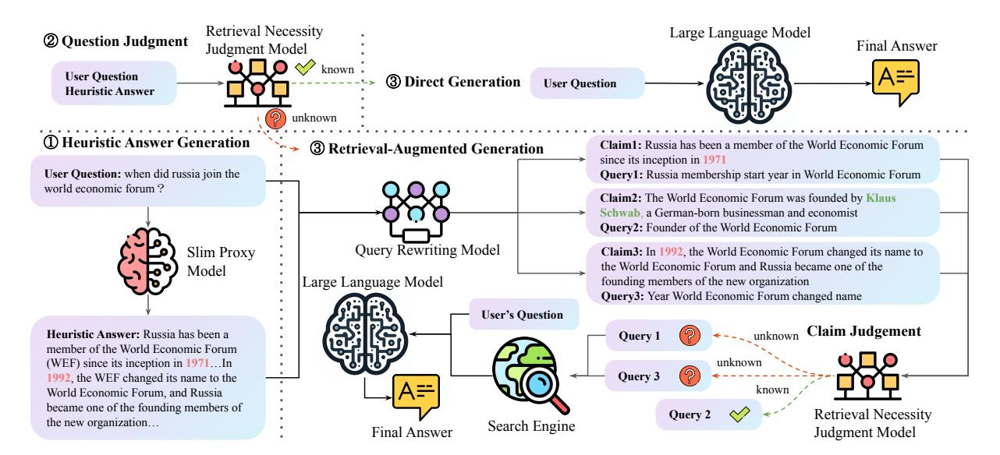
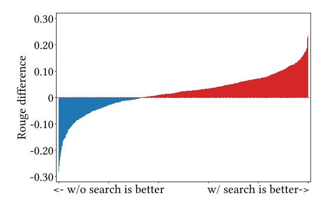
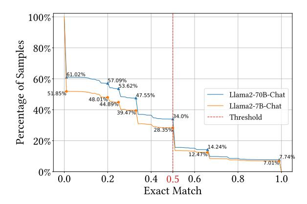

# <span id="page-0-0"></span>Small Models, Big Insights: Leveraging Slim Proxy Models to Decide When and What to Retrieve for LLMs

Jiejun Tan<sup>1</sup>[\\*](#page-0-0), Zhicheng Dou<sup>1</sup>[†](#page-0-0) , Yutao Zhu<sup>1</sup> , Peidong Guo<sup>2</sup> Kun Fang<sup>2</sup> , and Ji-Rong Wen<sup>1</sup>

<sup>1</sup>Gaoling School of Artificial Intelligence, Renmin University of China <sup>2</sup> Baichuan Intelligent Technology {zstanjj, dou}@ruc.edu.cn

## Abstract

The integration of large language models (LLMs) and search engines represents a significant evolution in knowledge acquisition methodologies. However, determining the knowledge that an LLM already possesses and the knowledge that requires the help of a search engine remains an unresolved issue. Most existing methods solve this problem through the results of preliminary answers or reasoning done by the LLM itself, but this incurs excessively high computational costs. This paper introduces a novel collaborative approach, namely SlimPLM, that detects missing knowledge in LLMs with a slim proxy model, to enhance the LLM's knowledge acquisition process. We employ a proxy model which has far fewer parameters, and take its answers as heuristic answers. Heuristic answers are then utilized to predict the knowledge required to answer the user question, as well as the known and unknown knowledge within the LLM. We only conduct retrieval for the missing knowledge in questions that the LLM does not know. Extensive experimental results on five datasets with two LLMs demonstrate a notable improvement in the end-to-end performance of LLMs in question-answering tasks, achieving or surpassing current state-of-the-art models with lower LLM inference costs.[1](#page-0-1)

## 1 Introduction

Large language models (LLMs) have demonstrated significant prowess in various natural language processing (NLP) tasks [\(OpenAI,](#page-10-0) [2023\)](#page-10-0), attributed to their advanced language comprehension and generation capabilities. Despite being trained on extensive text corpora, these models occasionally produce hallucinated content [\(Zhou et al.,](#page-13-0) [2021;](#page-13-0) [Maynez et al.,](#page-10-1) [2020\)](#page-10-1). To tackle this problem, the integration of retrieval systems with LLMs has been proposed, enabling access to external knowledge bases for more accurate and reliable text generation.

Retrieval-augmented generation (RAG) involves using a retrieval system to supplement LLMs with relevant external information, thereby improving text generation quality [\(Peng et al.,](#page-11-0) [2023;](#page-11-0) [He et al.,](#page-9-0) [2023\)](#page-9-0). Yet, recent studies have suggested that retrieval may not always be beneficial. In cases where LLMs can adequately respond without external knowledge, retrieval may introduce irrelevant information, potentially degrading performance [\(Ka](#page-9-1)[davath et al.,](#page-9-1) [2022;](#page-9-1) [Wang et al.,](#page-12-0) [2023b;](#page-12-0) [Shi et al.,](#page-11-1) [2023a;](#page-11-1) [Petroni et al.,](#page-11-2) [2020\)](#page-11-2). Therefore, it is critical to determine when retrieval is necessary for user questions [\(Shuster et al.,](#page-11-3) [2021\)](#page-11-3). The challenge lies in identifying questions that exceed the LLMs' intrinsic knowledge and require external retrieval, due to the prevalence of content hallucination. Efforts to address this challenge can be categorized into two groups: (1) The first group of methods involves fine-tuning LLMs for RAG scenarios, allowing them to autonomously signal the need for external knowledge [\(Nakano et al.,](#page-10-2) [2021;](#page-10-2) [Liu et al.,](#page-10-3) [2023b;](#page-10-3) [Qin et al.,](#page-11-4) [2023b\)](#page-11-4). This method, while effective, demands substantial computational resources and risks diminishing the LLMs' general capabilities due to potential catastrophic forgetting [\(Kotha](#page-9-2) [et al.,](#page-9-2) [2023;](#page-9-2) [Zhai et al.,](#page-13-1) [2023\)](#page-13-1). (2) The second category avoids direct tuning of LLMs, assessing the necessity for retrieval based on the quality of the generated content or specific indicators within it [\(Ram et al.,](#page-11-5) [2023;](#page-11-5) [Min et al.,](#page-10-4) [2022\)](#page-10-4). However, this approach still has its drawbacks, as it requires multiple inferences, thereby increasing both the inference costs and the latency of responses to user questions.

In light of this, we put forward a question: *Is it feasible to employ a proxy model with a relatively*

<sup>\*</sup>This work was done when Jiejun Tan was doing internship at Baichuan Intelligent Technology.

<span id="page-0-1"></span><sup>†</sup>Corresponding author.

<sup>1</sup>Our code and datasets are available at [https://github.](https://github.com/plageon/SlimPlm) [com/plageon/SlimPlm](https://github.com/plageon/SlimPlm).

*smaller parameter size to facilitate effective retrieval results for an LLM?* Theoretically, existing decoder-only language models share similar Transformer structures, and they are pre-trained on some common text corpora, such as Common Crawl web pages, books, and Wikipedia pages [\(Touvron](#page-12-1) [et al.,](#page-12-1) [2023;](#page-12-1) [Bai et al.,](#page-8-0) [2023;](#page-8-0) [Scao et al.,](#page-11-6) [2022;](#page-11-6) [Almazrouei et al.,](#page-8-1) [2023;](#page-8-1) [Zhang et al.,](#page-13-2) [2024\)](#page-13-2). Therefore, it is possible for them to reach a consensus on relative mastery over different knowledge and the necessity of retrieval. Our preliminary quantitative analysis, shown in Section [4.6,](#page-6-0) also supports this hypothesis. The experimental results show that on questions well understood by the LLM, the relatively smaller language model also has considerable knowledge. The gap between larger and smaller LLMs mainly manifests in questions they do not understand. This further validates the possibility of employing a proxy model to help determine the necessity of retrieval.

Based on our analysis, in this paper, we introduce a novel approach, called SlimPLM (Slim Proxy Language Model), which leverages a relatively smaller language model as a "proxy model" to help determine when and how to perform retrieval for LLMs. Specifically, for a user question, SlimPLM first uses the proxy model to generate a preliminary "heuristic answer". This heuristic answer serves two purposes. First, it is evaluated by a lightweight model designed to assess the necessity for retrieval. If this evaluation shows that the heuristic answer is of high quality, it implies that the question may be addressed directly by LLMs without additional information retrieval. In contrast, a lower-quality answer triggers the retrieval process to identify and supplement missing knowledge. To facilitate this, SlimPLM utilizes the heuristic answer again to generate multiple queries, each reflecting a specific aspect of the initial response. These queries are then individually assessed for their need for retrieval, filtering out queries that do not require retrieval. By this means, the remaining queries can retrieve more relevant knowledge that is lacking in LLMs. The integration of SlimPLM into existing RAG frameworks offers a flexible and effective enhancement without notably increasing computational costs or response latency. Experimental results across five commonly used questionanswering datasets validate SlimPLM's effectiveness in determining the necessity for retrieval and improving retrieval results.

Our contributions are threefold: (1) We pro-

pose a novel approach that leverages a small proxy model to generate heuristic answers, helping determine when and how to perform retrieval for LLMs. (2) We devise a retrieval necessity judgment model based on the heuristic answer. It is capable of accurately identifying which queries necessitate further information retrieval. (3) We formulate a query rewriting strategy that decomposes the heuristic answer into distinct claims. This is complemented by a claim-based filtering mechanism to enhance the relevance of the retrieval results for LLMs' text generation.

## 2 Related Work

### 2.1 Retrieval-Augmented Generation (RAG)

RAG has been studied for a long time. In the era of pre-trained language models, RAG has been applied to provide models with relevant knowledge, significantly enhancing the generation quality in applications such as dialogue systems [\(Tahami et al.,](#page-12-2) [2020;](#page-12-2) [Tao et al.,](#page-12-3) [2019\)](#page-12-3) and question-answering systems [\(Izacard and Grave,](#page-9-3) [2021;](#page-9-3) [Tahami et al.,](#page-12-2) [2020\)](#page-12-2). With the development of LLMs, RAG has emerged as a crucial strategy to tackle the problem of hallucination and outdated information [\(Shuster](#page-11-3) [et al.,](#page-11-3) [2021;](#page-11-3) [White,](#page-12-4) [2023\)](#page-12-4).

The mainstream RAG methods follow a "retrieve-then-read" architecture. In this setup, a retrieval module first gathers external knowledge, providing additional context that is subsequently processed by LLMs to generate the final output [\(Ram et al.,](#page-11-5) [2023;](#page-11-5) [Yu et al.,](#page-13-3) [2023b\)](#page-13-3). Typically, a RAG pipeline [\(Zhu et al.,](#page-13-4) [2023;](#page-13-4) [Liu](#page-10-5) [et al.,](#page-10-5) [2023a;](#page-10-5) [Shi et al.,](#page-11-7) [2023b\)](#page-11-7) includes several components: a query rewriter that refines the initial query [\(Wang et al.,](#page-12-5) [2023a;](#page-12-5) [Gao et al.,](#page-9-4) [2023\)](#page-9-4), a retriever that fetches relevant documents [\(Guu](#page-9-5) [et al.,](#page-9-5) [2020;](#page-9-5) [Neelakantan et al.,](#page-10-6) [2022\)](#page-10-6), a filter or reranker [\(Yoran et al.,](#page-12-6) [2023;](#page-12-6) [Yu et al.,](#page-12-7) [2023a;](#page-12-7) [Xu](#page-12-8) [et al.,](#page-12-8) [2023\)](#page-12-8) that ensures only the most relevant knowledge is kept, and an LLM as reader that generates the final results. To optimize these systems, some approaches focus on enhancing individual components of the RAG architecture to improve overall performance [\(Zhu et al.,](#page-13-5) [2024;](#page-13-5) [Jin et al.,](#page-9-6) [2024\)](#page-9-6), while others involve direct fine-tuning of the LLM to better integrate with RAG-specific tasks [\(Asai et al.,](#page-8-2) [2023;](#page-8-2) [Kadavath et al.,](#page-9-1) [2022\)](#page-9-1).

<span id="page-2-0"></span>

Figure 1: A display of the main process of SlimPLM. Solid lines with arrows represent the flow of data, while dashed lines with arrows signify control signals from the retrieval necessity judgment model. Step 1 and step 2 are mandatory in the pipeline, but step 3 involves choosing between direct generation and RAG.

### 2.2 Retrieval Necessity Judgment

In a Retrieval-Augmented Generation (RAG) system, a critical challenge is determining when to initiate the retrieval process. Several approaches have been proposed to address this issue:

- (1) Fine-tuning Large Language Models (LLMs) has proven effective but comes with substantial computational costs (Qin et al., 2023a; Lin et al., 2022). Some studies have focused on fine-tuning the LLM to mimic human-like web browsing behavior (Schick et al., 2023; Nakano et al., 2021). Self-RAG (Asai et al., 2023) introduces special tokens known as reflection tokens to regulate retrieval behavior.
- (2) Another intuitive approach involves evaluating the LLM's confidence based on the logits generated by the model (Jiang et al., 2021; Guo et al., 2017). FLARE (Jiang et al., 2023) dynamically activates RAG if the logits fall below a predefined threshold.
- (3) Other research has employed iterative prompting to determine if additional information is required (Wei et al., 2022; Liu et al., 2022; Rubin et al., 2022), or has combined Chain-of-Thought prompting (Wei et al., 2022) with RAG (Press et al., 2023; Khattab et al., 2022). For instance, ReAct (Yao et al., 2023) alternates between generating thoughts and actions, creating a sequence of thought-action-observation steps.
- (4) Evaluating the complexity or popularity of user questions to assess the need for retrieval is

also a feasible approach (Mallen et al., 2023). SKR (Wang et al., 2023b) refers to similar questions it has previously encountered to determine the necessity of retrieval.

Distinct from these existing methods, SlimPLM evaluates the necessity of retrieval by analyzing the answer generated by a smaller LLM. This approach does not increase LLM inference times while enhancing judgment accuracy.

#### 2.3 Query Formulation

In addition to determining when to retrieve information, the question of what to retrieve is also of great importance. A simplistic approach that merely judges the necessity of retrieval based on the user's query would be inadequate. The aforementioned retrieval necessity judgment work has also proposed solutions for query rewriting. Numerous studies have encouraged the use of Large Language Models (LLMs) to autonomously generate queries (Yao et al., 2023; Press et al., 2023; Schick et al., 2023). Some research has utilized previously generated content as queries (Shao et al., 2023; Asai et al., 2023), or have taken a further step by masking low logit tokens within the generated content (Jiang et al., 2023). Other studies have employed specially fine-tuned query rewriting models to rewrite either the user's question or previously generated content (Wang et al., 2023a; Ma et al., 2023).

In contrast, SlimPLM formulates queries by meticulously analyzing the answers generated by a smaller LLM, thereby providing an accurate understanding of the required knowledge.

### 3 Methodology

In this paper, we aim to leverage a relatively smaller model as the *proxy model* to determine whether the user-issued question requires supplementary retrieval results and further provide clues for retrieving relevant knowledge. Our method, SlimPLM, can be flexibly used as a plug-in to various retrieval-augmented generation scenarios, without additional training requirements. The illustration of our method is shown in Figure 1.

#### 3.1 Problem Formulation & Framework

Before diving into the details of our method, we first formulate the concept and notations involved in this paper.

Given a user input x and a text corpus (e.g., a Wikipedia dump)  $D = \{d_i\}_{i=1}^N$  of size N, models are expected to generate the annotated answer y. To obtain the information in D that is relevant to x, a retriever (R) is employed. This retriever takes a query q as input and returns a relevant text list  $D_{\text{ref}} = R(q)$ . Typically, the user input x is used as the query, namely q = x. However, existing studies have demonstrated that using refined queries for retrieval can improve the final generation quality (Gao et al., 2023; Wang et al., 2023a). Therefore, we denote the refined queries as  $\{q_1, \ldots, q_n\}$ . With these refined queries, a collection of relevant retrieval results  $D_{\text{ref}} = R(q_1), \dots, R(q_n)$  is assembled to support the generation process, formalized as  $\hat{y} = \text{LLM}(D_{\text{ref}}, x)$ . Note that, when  $D_{\text{ref}} = \emptyset$ , the process degenerates to normal generation without retrieval.

We define a proxy model (PM), which is implemented by a relatively smaller LLM. The proxy model generates an answer for the input x as:

$$\hat{a} = PM(x), \tag{1}$$

where  $\hat{a}$  is called a *heuristic answer* in this paper. This heuristic answer serves two purposes: (1) It is used for determining whether the retrieval is necessary for the current input x. The determination is made by a retrieval necessity judgment model (introduced in Section 3.2). (2) It also provides clues for query rewriting. The query rewriting results will help identify knowledge gaps within the LLM that necessitate further retrieval (introduced in Section 3.3).

#### <span id="page-3-0"></span>3.2 Retrieval Necessity Judgment

Because existing LLMs are typically trained on common corpora (such as CommonCrawl and Wikipedia (Touvron et al., 2023; Penedo et al., 2023; Gao et al., 2021)) and employ a similar Transformer decoder-based architecture, it is promising to leverage a smaller LLM for judging the knowledge mastered by larger LLMs and determining the need for additional retrieval. Thus, we propose a retrieval necessity judgment component.

**Judgment Model** Given the heuristic answer  $\hat{a}$  generated by the proxy model (Equation 1), we fine-tune a judgment model RJ (implemented by Llama2-7B in our experiments) by using both the user input x and the heuristic answer  $\hat{a}$ . We use the following instructions for fine-tuning:

```
Input:
```

After fine-tuning, the RJ model can predict whether a user question needs further retrieval with the help of the heuristic answer.

**Judgment Label Collection** To fine-tune the RJ model, we need to collect training samples with reliable labels. Existing studies (Wang et al., 2023b) have proposed an annotation strategy that compares the models' outputs generated with and without retrieval. In our preliminary study, we find that this strategy is highly influenced by the capability of the retriever and the completeness of the corpus, leading to annotations that cannot accurately reflect the model's necessity for search. To tackle this problem, we propose to leverage the quality of our heuristic answers, i.e., if the quality of the heuristic answer is higher than a predefined threshold, we infer that the question can be well answered without retrieval; otherwise, we consider retrieval necessary.

<span id="page-3-1"></span>Specifically, we collect samples with short answers from existing question-answering datasets and employ the matching ratio between the heuristic answers and the ground-truth answers as the metric. Compared to rouge scores (Lin, 2004) or perplexity (Huyen, 2019), this metric can better

align with the evaluation and reflect the generation quality. Notably, while we only use short answers for label collection, the obtained model can well generalize to different datasets, such as long-form QA datasets. Formally, for a question with multiple short answers  $Y = \{y_1, y_2, \ldots, y_n\}$ , we compute the matching ratio r between  $\hat{a}$  and Y as:

$$r = \frac{|\{y \mid y \in \hat{a} \land y \in Y\}|}{|Y|}.$$
 (2)

Then, we set a threshold  $\theta$  and obtain the label as:

$$\label{eq:Label} \operatorname{Label}(\hat{a},x) = \begin{cases} \operatorname{Known} \, (\operatorname{True}), & \text{if } r > \theta; \\ \operatorname{Known} \, (\operatorname{False}), & \text{otherwise}. \end{cases}$$

#### <span id="page-4-0"></span>3.3 Retrieval Target Determination

After determining the necessity of retrieval, the next question is how to perform effective retrieval. A straightforward method is using user input x as the query to retrieve relevant information from the corpora D. However, many studies have reported that the information retrieved by x may lose details and introduce redundant content (Wang et al., 2023a). To address this issue, we propose a query rewrite method based on the heuristic answers and a query filter method to refine these rewritten queries.

Heuristic Answer-Driven Query Rewrite Restricted by parameter scale, the proxy model often hallucinates during the process of answering questions, but the direction in which they answer questions is heuristic (Dhuliawala et al., 2023; Gao et al., 2023). They can extend related aspects and sub-topics of thought when analyzing questions. Inspired by claim decomposition operation intended for factual evaluation (Min et al., 2023; Kryscinski et al., 2020), we perform query rewriting based on each fact mentioned in the heuristic answer given by the proxy models. The specific operations are as follows: we decompose the heuristic answer  $\hat{a}$  into multiple claims related to the question,  $\{c_1, c_2, \dots, c_n\}$ , where each claim related to the question can lead to a query,  $\{q_{c_1}, q_{c_2}, \dots, q_{c_n}\}$ . In addition, we combine the query rewrites directly derived from the user's input  $\{q_{x_1}, q_{x_2}, \dots, q_{x_n}\}$ . Our query rewriting model QR takes the user question and the heuristic answer as input and outputs all query rewrite results,  $QR(x, \hat{a}) = \{q_{x_1}, \dots, q_{x_n}, q_{c_1}, \dots, q_{c_n}\}.$ 

To train the query rewriting model, we collect and annotate a dataset with the help of GPT-4(OpenAI, 2023). In each dataset used in our experiments, we sample 1,000 user questions. We utilize

the method of instruction fine-tuning (Ouyang et al., 2022; Chung et al., 2022) to fine-tune a decoderonly generative model, accomplishing the task of claim extraction and query rewriting in a single round. Our instructions and the model output are displayed as follows.

```
Input:
```

**Claim-based Query Filter** In the previous step, our method generates several rewritten queries  $QR(x, \hat{a})$ , which correspond to the claims in the heuristic answers.

To achieve this, we reuse the judgment model RJ trained in Section 3.2. Specifically, we replace the input of the heuristic answer by the extracted claim and the input of user questions by the rewritten query. Then, the model can predict whether the rewritten query requires external knowledge from retrieval. We only perform retrieval when the result is Known (False), namely, we have:

$$D_{\text{ref}} = \{R(q_{c_i}) | \text{RJ}(c_i, q_{c_i}) = \text{Known (False)} \}.$$

By this means, we can obtain the retrieved result set  $D_{\text{ref}}$  that only contains the knowledge missing by the LLM.

#### 4 Experiments

We conduct experiments on five widely used question-answering (QA) datasets and compare the performance of our method with several baselines.

#### 4.1 Datasets

We use the following five QA datasets: (1) Natural Questions (NQ) (Kwiatkowski et al., 2019): a dataset consisting of real user questions from Google search. (2) Trivia-QA (Joshi et al., 2017): a realistic text-based question answering dataset. (3) ASQA (Stelmakh et al., 2022): a dataset targeting ambiguous questions requiring answers that integrate factual information from various sources. (4) MuSiQue (Trivedi et al., 2022): a synthetic multihop question-answering dataset. (5) ELI5 (Fan et al., 2019): a long-form question answering

<span id="page-5-0"></span>

| Method         | #API | ASQA  |       | NQ    |                                   | Trivia-QA |       | MuSiQue | ELI5    |         |         |
|----------------|------|-------|-------|-------|-----------------------------------|-----------|-------|---------|---------|---------|---------|
|                |      | EM    | Hit@1 | EM    | Hit@1                             | EM        | Hit@1 | EM      | ROUGE-1 | ROUGE-2 | ROUGE-L |
|                |      |       |       |       | Llama2-70B-Chat without Retrieval |           |       |         |         |         |         |
| Vanilla Chat   | 1    | 29.68 | 62.50 | 40.49 | 55.00                             | 27.44     | 90.75 | 11.50   | 28.66   | 4.88    | 14.27   |
| CoT            | 1    | 26.21 | 54.50 | 35.36 | 48.75                             | 23.50     | 79.00 | 11.50   | 28.12   | 4.73    | 14.06   |
|                |      |       |       |       | Llama2-70B-Chat with Retrieval    |           |       |         |         |         |         |
| Direct RAG     | 1    | 27.63 | 58.00 | 42.40 | 56.00                             | 28.07     | 92.25 | 10.50   | 28.61   | 4.76    | 15.76   |
| FLARE          | 2.10 | 30.08 | 63.50 | 41.36 | 55.75                             | 27.41     | 89.50 | 11.25   | 27.95   | 4.72    | 13.91   |
| Self-Eval      | 2    | 29.45 | 60.75 | 42.15 | 55.75                             | 27.58     | 91.50 | 10.25   | 28.70   | 4.83    | 15.39   |
| Self-Ask       | 2.67 | 26.37 | 60.25 | 38.56 | 53.00                             | 26.56     | 89.50 | 9.50    | -       | -       | -       |
| ITER-RETGEN    | 3    | 30.15 | 60.50 | 42.85 | 55.50                             | 28.31     | 91.00 | 13.00   | 28.44   | 4.74    | 15.72   |
| SKR-KNN        | 1    | 29.38 | 61.75 | 41.90 | 55.75                             | 28.16     | 92.25 | 10.25   | 28.71   | 4.80    | 15.73   |
| SlimPLM (Ours) | 1    | 30.73 | 65.00 | 47.43 | 62.25                             | 28.35     | 92.00 | 13.00   | 29.97   | 5.61    | 15.13   |
|                |      |       |       |       | Qwen-72B-Chat without Retrieval   |           |       |         |         |         |         |
| Vanilla Chat   | 1    | 26.65 | 58.50 | 40.38 | 53.75                             | 27.82     | 90.25 | 11.75   | 30.61   | 5.21    | 15.90   |
| CoT            | 1    | 27.74 | 59.50 | 40.49 | 53.75                             | 27.62     | 91.75 | 12.75   | 29.94   | 4.94    | 14.75   |
|                |      |       |       |       | Qwen-72B-Chat with Retrieval      |           |       |         |         |         |         |
| Direct RAG     | 1    | 25.85 | 57.00 | 41.27 | 52.75                             | 26.39     | 87.75 | 7.75    | 25.93   | 4.55    | 16.74   |
| FLARE          | 2.29 | 27.68 | 59.00 | 40.89 | 54.50                             | 27.10     | 88.50 | 12.75   | 30.31   | 5.20    | 15.77   |
| Self-Eval      | 2    | 27.64 | 60.00 | 42.43 | 56.00                             | 27.13     | 90.50 | 7.75    | 29.19   | 5.14    | 16.05   |
| Self-Ask       | 2.76 | 22.82 | 52.25 | 36.16 | 49.25                             | 25.29     | 87.50 | 9.75    | -       | -       | -       |
| ITER-RETGEN    | 3    | 29.38 | 61.50 | 43.51 | 57.50                             | 27.16     | 89.75 | 12.25   | 26.15   | 4.41    | 16.52   |
| SKR-KNN        | 1    | 28.08 | 61.50 | 43.08 | 56.00                             | 26.38     | 88.50 | 11.25   | 27.29   | 4.75    | 16.31   |
| SlimPLM (Ours) | 1    | 27.97 | 62.25 | 44.07 | 57.75                             | 28.03     | 92.25 | 9.75    | 29.56   | 5.91    | 16.36   |

Table 1: Evaluation results of SlimPLM and baselines on five QA benchmarks. #API is the average LLM inference times. Hit@1 is the proportion of instances where at least one short answer matches.

dataset originated from the Reddit forum. Due to our limited resources, we randomly sample 400 questions from the test set (if any) or validation set of each dataset as the test set for evaluation.

### 4.2 Evaluation Metrics

For all QA tasks, LLMs can freely generate any answers. For datasets annotated with long-form answers, we employ the Rouge Score [\(Lin,](#page-10-12) [2004\)](#page-10-12) (ROUGE) to evaluate the quality of the generated answers by comparing them with the ground-truth ones. For datasets with short answers, we use the Exact Match (EM) metric to compare the generated answer with the golden one. If the dataset provides multiple optional short answers, we also report the proportion of instances where at least one short answer matches (Hit@1).

### 4.3 Baselines

We first select two baselines without retrieval:

- (1) Vanilla Chat: This method directly inputs the user question into LLMs to get the answer.
- (2) CoT Prompting [\(Wei et al.,](#page-12-9) [2022\)](#page-12-9): This method introduces a prompt method that lets LLMs think step-by-step to derive the final answer.

We also consider several retrieval-augmented generation methods. They differ in time and approach for retrieval necessity judgment and construction of retrieval queries. We include more baseline implementation details in Appendix [B.](#page-13-6)

- (1) Direct RAG: This approach applies retrievalaugmentation for all questions and directly utilizes the user question as the search query.
- (2) FLARE [\(Jiang et al.,](#page-9-9) [2023\)](#page-9-9): This method examines the content of each sentence generated by the LLM, and uses retrieval if the generation logits are below a threshold. FLARE uses the masked sentence as a query, wherein tokens associated with low logits are masked.
- (3) Self-Eval [\(Kadavath et al.,](#page-9-1) [2022\)](#page-9-1): This method uses prompts and few-shot learning to let LLM itself decide whether it needs retrieval or not.
- (4) Self-Ask [\(Press et al.,](#page-11-11) [2023\)](#page-11-11): This method iteratively prompts the LLM to decide whether to generate follow-up questions as queries or generate the final answer directly.
- (5) SKR-KNN [\(Wang et al.,](#page-12-0) [2023b\)](#page-12-0). It uses a dense retriever to retrieve top-k nearest neighbor questions from the training set. The necessity of retrieval is determined by the number of neighboring

questions that require or do not require retrieval.

#### 4.4 Implementation Details

We conduct experiments on two open-source LLMs, Llama2-70B-Chat (Touvron et al., 2023) and Qwen-72b-Chat (Bai et al., 2023). The default proxy model, fine-tuned query rewriting model, and retrieval necessity judgment model are built on Llama2-7B-Chat. We build a search engine on the KILT dataset's document library, which is based on the 2019 Wikipedia mirror (Petroni et al., 2021). BM25 (Robertson and Zaragoza, 2009) is used as the retriever and E5<sub>base</sub> (Wang et al., 2022) is employed as the reranker. More implementation details are provided in Appendix A.

### 4.5 Experimental Results

The evaluation results are shown in Table 1, where we uniformly chose Llama2-7B-Chat as the proxy model, a fine-tuned query rewriting model, and a fine-tuned retrieval necessity judgment model. Generally, our SlimPLM achieves superior or competitive performance on all datasets. This clearly demonstrates the effectiveness of our method. Besides, we have the following observations:

- (1) On most datasets, retrieval-augmented generation methods can outperform the methods without using retrieval. This clearly demonstrates the benefit of incorporating external knowledge into open-domain QA tasks.
- (2) Compared to methods that initiate retrieval based on the results or logits generated by LLMs (*i.e.*, Self-Eval, Self-Ask, and FALRE), our method yields better results. This validates the superiority of our method, which employs a proxy model to determine when and what the LLM needs to retrieve. Notably, our method requires the LLM to infer only once, significantly reducing the cost of inference.
- (3) Comparing methods that judge retrieval necessity merely based on user questions (SKR-KNN), our method also has advantages. By using heuristic answers, it can more accurately assess the LLM's knowledge capability and formulate queries that are more precisely tailored to the question, thereby improving overall performance.
- (4) Intriguingly, we notice that retrieval does not uniformly benefit all user questions. For example, in the ELI5 dataset, approximately 66.4% of samples show improvement with retrieval, as shown in Figure 2. This observation highlights the critical need to judge the necessity of retrieval. More cases

<span id="page-6-1"></span>

Figure 2: The rouge performance for with and without retrieval on ELI5 dataset.

where retrieval has negative impact are shown in Appendix C.

### 4.6 Further Analysis

We further conduct a series of experiments to investigate the impact of different settings in our method.

**Ablation Study** We first examine the effectiveness of different modules in our method by an ablation study. This experiment is conducted by removing the heuristic-answer-driven query rewriting (*w/o* QR), question-Level retrieval necessity judgment (*w/o* RJ), and Claim-based Query Filter (*w/o* QF), respectively. From the results are shown in Table 2, we can see:

- (1) If query rewriting is removed, then retrieval necessity judgment between vanilla chat and direct RAG is applied. Performing query rewriting can both enhance the comprehensiveness and relevance of retrieved references.
- (2) When retrieval necessity judgment is removed, all questions will use retrieval results for generation. LLMs will be led astray on questions that they can perform well on their own knowledge.
- (3) If claim-based query filter is removed, then retrieval is applied to every query derived from the heuristic answer. Not filtering queries which contain contents that do not require retrieval worsens the search results.

<span id="page-6-0"></span>Knowledge Ability Consensus between Proxy Models and LLMs In this experiment, we compared the knowledge capabilities of LLMs and proxy models, and confirmed their consensus. Our findings can be summarized as follows:

(1) The difference in capabilities between the proxy model and the LLM is primarily manifested in the knowledge of lower mastery levels. As illustrated in Figure 3, on the ASQA dataset, the

<span id="page-7-0"></span>

| Method     | AS             | QA            | N             | Q               | Trivi          | a-QA          | MuSiQue       |
|------------|----------------|---------------|---------------|-----------------|----------------|---------------|---------------|
| 1/10/11/04 | EM             | Hit@1         | EM            | Hit@1           | EM             | Hit@1         | EM            |
| SlimPLM    | 30.73          | 65.00         | 47.43         | 62.25           | 28.35          | 92.00         | 13.00         |
| w/o QR     | 29.19 (5.0%↓)  | 61.75 (5.0%↓) | 45.16 (4.8%↓) | 59.75 (4.0%↓)   | 28.07 (1.0%↓)  | 92.50 (0.5%†) | 11.50 (1.2%↓) |
| w/o QJ     | 29.43 (4.2%\() | 61.75 (5.0%↓) | 43.03 (9.3%↓) | 57.25 (8.0%↓)   | 27.91 (1.6%\() | 90.25 (1.9%↓) | 12.75 (1.9%↓) |
| w/o QF     | 30.73 (0.0%)   | 64.75 (0.4%↓) | 46.62 (1.7%↓) | 61.25 (1.6%\( ) | 28.27 (0.3%↓)  | 91.75 (0.3%↓) | 12.50 (3.9%1) |

Table 2: Ablation study on Llama2-70B-Chat. "QR", "QJ", and "QF" denote the query rewriting, question-level retrieval necessity judgment, and claim-based query filter, respectively.

<span id="page-7-2"></span>

| Method                                                                                                     | AS                                                        | SQA                                                       | N                                                         | <b>VQ</b>                                                 | Triv                                                      | ia-QA                                                     | MuSiQue                                                   |                                                           | ELI5                                                |                                                           |
|------------------------------------------------------------------------------------------------------------|-----------------------------------------------------------|-----------------------------------------------------------|-----------------------------------------------------------|-----------------------------------------------------------|-----------------------------------------------------------|-----------------------------------------------------------|-----------------------------------------------------------|-----------------------------------------------------------|-----------------------------------------------------|-----------------------------------------------------------|
|                                                                                                            | EM                                                        | Hit@1                                                     | EM                                                        | Hit@1                                                     | EM                                                        | Hit@1                                                     | EM                                                        | ROUGE-1                                                   | ROUGE-2                                             | ROUGE-L                                                   |
|                                                                                                            |                                                           |                                                           |                                                           | Llaı                                                      | na2-70I                                                   | 3-Chat                                                    |                                                           |                                                           |                                                     |                                                           |
| Vanilla Chat Llama2-7B-Chat Baichuan2-7B-Chat Qwen-7B-Chat Phi-2 (2.7B) TinyLlama-1.1B-Chat                | 29.68<br>30.73<br><b>31.19</b><br>29.62<br>28.96<br>30.47 | 62.50<br><b>65.00</b><br>63.25<br>60.25<br>60.50<br>60.50 | 40.49<br><b>47.43</b><br>44.57<br>42.53<br>43.33<br>44.24 | 55.00<br><b>62.25</b><br>58.75<br>56.25<br>57.50<br>56.75 | 27.44<br>28.35<br><b>28.44</b><br>27.93<br>27.99<br>28.02 | 90.75<br>92.75<br><b>93.25</b><br>92.25<br>91.50<br>91.00 | 11.50<br>13.00<br><b>14.00</b><br>13.00<br>13.75<br>11.50 | 28.66<br>29.97<br>29.95<br>29.95<br><b>30.34</b><br>30.05 | 4.88<br>5.61<br>5.64<br>5.57<br><b>5.82</b><br>5.56 | 14.27<br>15.13<br>15.49<br><b>16.16</b><br>15.48<br>15.37 |
| Thry Diama-1.1B-Chat                                                                                       | 30.47                                                     | 00.30                                                     | 77.27                                                     |                                                           | ven-72B                                                   |                                                           | 11.50                                                     | 30.03                                                     | 3.30                                                | 13.37                                                     |
| Vanilla Chat<br>Llama2-7B-Chat<br>Baichuan2-7B-Chat<br>Qwen-7B-Chat<br>Phi-2 (2.7B)<br>TinyLlama-1.1B-Chat | 26.65<br>27.97<br><b>28.11</b><br>27.76<br>26.95<br>27.61 | 58.50<br><b>62.25</b><br>62.00<br>59.75<br>59.50<br>58.25 | 40.38<br><b>44.07</b><br>43.46<br>42.54<br>42.22<br>42.36 | 53.75<br><b>57.75</b><br>57.25<br>55.75<br>54.25<br>55.25 | 27.82<br>28.03<br>27.65<br>27.22<br>27.10<br>27.67        | 90.25<br><b>92.25</b><br>91.75<br>90.25<br>89.00<br>91.25 | 11.75<br>9.75<br>11.00<br>8.75<br>10.75<br>9.25           | 30.61<br>29.56<br>28.36<br>29.44<br>29.17<br>28.80        | 5.21<br><b>5.91</b><br>5.69<br>5.74<br>5.83<br>5.64 | 15.90<br><b>16.36</b><br>16.28<br>16.33<br>16.32<br>16.12 |

Table 3: Performance Comparison of Various Proxy Methods to Vanilla Chat.

difference between the 70B and 7B language models is very slight for samples with an EM score greater than 0.5. Their differences are primarily evident in samples with an EM score less than 0.5.

(2) The higher the level of some knowledge mastered by the proxy model, the higher the level of mastery by the LLM. Further experiments on ASQA shows over 82.19% of the samples with an EM score greater than 0.5 for the 7B model overlaps with those of the 70B model.

The experimental results above offer a theoretical basis for our method. If the proxy model can correctly answer the question, then the LLM is very likely to answer it correctly as well. Applying vanilla chat for them can better leverage the inherent knowledge capabilities of LLMs.

Impact of Various Proxy Models We also explore the impact of using different proxy models in our method. This experiment is conducted by using four open-source LLMs with different sizes as the proxy model, including Llama2-7B-Chat (Touvron et al., 2023), Baichuan2-7B-Chat (Yang et al., 2023), Qwen-7B-Chat (Bai et al., 2023), and Phi-2 (Li et al., 2023), TinyLlama-1.1B-Chat (Zhang

<span id="page-7-1"></span>

Figure 3: The proportion of samples (y-axis) with EM scores higher than certain values (x-axis).

et al., 2024). Experimental results are shown in Table 3. We can see that in most datasets, Llama2-7B-Chat can provide the best results. Furthermore, Llama2-7B-Chat contributes a greater improvement to Llama2-70B-Chat than to Qwen-72B-Chat, we attribute this to the better knowledge alignment between Llama models.

**Computational Cost Analysis** In our method, we use a proxy model, a query rewriting model, and a retrieval necessity judgment model based on

<span id="page-8-4"></span>

| Dataset | Chat   | Proxy | Rewrite | Judge | Total |
|---------|--------|-------|---------|-------|-------|
| ASQA    | 192.86 | 24.42 | 35.27   | 3.38  | 63.07 |
| NQ      | 249.74 | 29.61 | 38.65   | 3.65  | 71.91 |
| TQA     | 114.07 | 15.73 | 28.13   | 2.47  | 46.33 |
| MuSiQ   | 168.47 | 19.00 | 30.84   | 2.36  | 52.20 |
| ELI5    | 471.22 | 47.82 | 46.82   | 4.23  | 98.87 |

Table 4: The number of tokens used by LLM, and the additional tokens brought by components of SlimPLM separately and in total(Total). Components includes proxy model (Proxy), query rewriting model((Rewrite), and search necessity judge model(Judge).

relatively smaller LLMs (Llama2-7B-Chat). To investigate their computational efficiency, we analyze the average number of tokens generated by each model and calculate the associated costs. This calculation is based on the assumption that the computational expense per token for a 7B model is roughly 1/10 that of a 70B model—–a conservative estimate, given that the actual cost differential is likely to exceed this ratio [\(Kaplan et al.,](#page-9-18) [2020\)](#page-9-18). Table [4](#page-8-4) lists the additional computational costs required by each component and the total cost. The analysis reveals that the additional costs are substantially lower (1/4 to 1/3) compared to the costs of a single inference by an LLM. This observation validates the economic advantages of our method.

## 5 Conclusion

In conclusion, our research proposes a new paradigm for RAG, utilizing a smaller LLM as proxy model. Based on the heuristic answer by proxy model, we conduct query rewriting, retrieval necessity judgment, and claim-based query filtering. This approach enables accurate perception for when and what to retrieve for LLMs. Experiments across various datasets show a marked improvement in the end-to-end performance of LLM question-answering, achieving or exceeding stateof-the-art results. Moreover, this enhancement is attained with little additional computational cost.

## Limitations

In scenarios where almost all user questions are primarily outside the scope of the LLM's pre-training corpus, or where almost all the questions do not require external knowledge, our method proves challenging to utilize. In these situations, opting either for a full retrieval or without retrieval at all may be a more suitable approach. Additionally, we acknowledge a gap in the knowledge capabilities

between proxy models and LLMs. Heuristic answers are unable to fully reflect the true knowledge capability of the LLMs. Moreover, our current method employs three models: a proxy model, a query rewriting model, and a retrieval necessity judgment model. The pipeline appears somewhat complex; integrating these functions into a single generative framework would be preferable.

## Acknowledgments

This work was supported by Beijing Natural Science Foundation No. L233008, CCF-BaiChuan-Ebtech Foundation Model Fund, National Natural Science Foundation of China No. 62272467, the fund for building world-class universities (disciplines) of Renmin University of China, and Public Computing Cloud, Renmin University of China. The work was partially done at the Engineering Research Center of Next-Generation Intelligent Search and Recommendation, MOE.

## References

<span id="page-8-1"></span>Ebtesam Almazrouei, Hamza Alobeidli, Abdulaziz Alshamsi, Alessandro Cappelli, Ruxandra Cojocaru, Mérouane Debbah, Étienne Goffinet, Daniel Hesslow, Julien Launay, Quentin Malartic, Daniele Mazzotta, Badreddine Noune, Baptiste Pannier, and Guilherme Penedo. 2023. [The falcon series of open language](https://doi.org/10.48550/ARXIV.2311.16867) [models.](https://doi.org/10.48550/ARXIV.2311.16867) *CoRR*, abs/2311.16867.

<span id="page-8-2"></span>Akari Asai, Zeqiu Wu, Yizhong Wang, Avirup Sil, and Hannaneh Hajishirzi. 2023. [Self-rag: Learning to](https://doi.org/10.48550/ARXIV.2310.11511) [retrieve, generate, and critique through self-reflection.](https://doi.org/10.48550/ARXIV.2310.11511) *CoRR*, abs/2310.11511.

<span id="page-8-0"></span>Jinze Bai, Shuai Bai, Yunfei Chu, Zeyu Cui, Kai Dang, Xiaodong Deng, Yang Fan, Wenbin Ge, Yu Han, Fei Huang, Binyuan Hui, Luo Ji, Mei Li, Junyang Lin, Runji Lin, Dayiheng Liu, Gao Liu, Chengqiang Lu, Keming Lu, Jianxin Ma, Rui Men, Xingzhang Ren, Xuancheng Ren, Chuanqi Tan, Sinan Tan, Jianhong Tu, Peng Wang, Shijie Wang, Wei Wang, Shengguang Wu, Benfeng Xu, Jin Xu, An Yang, Hao Yang, Jian Yang, Shusheng Yang, Yang Yao, Bowen Yu, Hongyi Yuan, Zheng Yuan, Jianwei Zhang, Xingxuan Zhang, Yichang Zhang, Zhenru Zhang, Chang Zhou, Jingren Zhou, Xiaohuan Zhou, and Tianhang Zhu. 2023. [Qwen technical report.](https://doi.org/10.48550/ARXIV.2309.16609) *CoRR*, abs/2309.16609.

<span id="page-8-3"></span>Hyung Won Chung, Le Hou, Shayne Longpre, Barret Zoph, Yi Tay, William Fedus, Eric Li, Xuezhi Wang, Mostafa Dehghani, Siddhartha Brahma, Albert Webson, Shixiang Shane Gu, Zhuyun Dai, Mirac Suzgun, Xinyun Chen, Aakanksha Chowdhery, Sharan Narang, Gaurav Mishra, Adams Yu, Vincent Y. Zhao, Yanping Huang, Andrew M. Dai, Hongkun Yu, Slav Petrov, Ed H. Chi, Jeff Dean, Jacob Devlin, Adam

- Roberts, Denny Zhou, Quoc V. Le, and Jason Wei. 2022. [Scaling instruction-finetuned language models.](https://doi.org/10.48550/ARXIV.2210.11416) *CoRR*, abs/2210.11416.
- <span id="page-9-13"></span>Shehzaad Dhuliawala, Mojtaba Komeili, Jing Xu, Roberta Raileanu, Xian Li, Asli Celikyilmaz, and Jason Weston. 2023. [Chain-of-verification reduces](https://doi.org/10.48550/ARXIV.2309.11495) [hallucination in large language models.](https://doi.org/10.48550/ARXIV.2309.11495) *CoRR*, abs/2309.11495.
- <span id="page-9-17"></span>Angela Fan, Yacine Jernite, Ethan Perez, David Grangier, Jason Weston, and Michael Auli. 2019. [ELI5:](https://doi.org/10.18653/V1/P19-1346) [long form question answering.](https://doi.org/10.18653/V1/P19-1346) In *Proceedings of the 57th Conference of the Association for Computational Linguistics, ACL 2019, Florence, Italy, July 28- August 2, 2019, Volume 1: Long Papers*, pages 3558–3567. Association for Computational Linguistics.
- <span id="page-9-11"></span>Leo Gao, Stella Biderman, Sid Black, Laurence Golding, Travis Hoppe, Charles Foster, Jason Phang, Horace He, Anish Thite, Noa Nabeshima, Shawn Presser, and Connor Leahy. 2021. [The pile: An](http://arxiv.org/abs/2101.00027) [800gb dataset of diverse text for language modeling.](http://arxiv.org/abs/2101.00027) *CoRR*, abs/2101.00027.
- <span id="page-9-4"></span>Luyu Gao, Xueguang Ma, Jimmy Lin, and Jamie Callan. 2023. [Precise zero-shot dense retrieval without rel](https://doi.org/10.18653/V1/2023.ACL-LONG.99)[evance labels.](https://doi.org/10.18653/V1/2023.ACL-LONG.99) In *Proceedings of the 61st Annual Meeting of the Association for Computational Linguistics (Volume 1: Long Papers), ACL 2023, Toronto, Canada, July 9-14, 2023*, pages 1762–1777. Association for Computational Linguistics.
- <span id="page-9-8"></span>Chuan Guo, Geoff Pleiss, Yu Sun, and Kilian Q. Weinberger. 2017. [On calibration of modern neural net](http://proceedings.mlr.press/v70/guo17a.html)[works.](http://proceedings.mlr.press/v70/guo17a.html) In *Proceedings of the 34th International Conference on Machine Learning, ICML 2017, Sydney, NSW, Australia, 6-11 August 2017*, volume 70 of *Proceedings of Machine Learning Research*, pages 1321–1330. PMLR.
- <span id="page-9-5"></span>Kelvin Guu, Kenton Lee, Zora Tung, Panupong Pasupat, and Ming-Wei Chang. 2020. [REALM: retrieval](http://arxiv.org/abs/2002.08909)[augmented language model pre-training.](http://arxiv.org/abs/2002.08909) *CoRR*, abs/2002.08909.
- <span id="page-9-0"></span>Hangfeng He, Hongming Zhang, and Dan Roth. 2023. [Rethinking with retrieval: Faithful large language](https://doi.org/10.48550/ARXIV.2301.00303) [model inference.](https://doi.org/10.48550/ARXIV.2301.00303) *CoRR*, abs/2301.00303.
- <span id="page-9-12"></span>Chip Huyen. 2019. Evaluation metrics for language modeling. *The Gradient*.
- <span id="page-9-3"></span>Gautier Izacard and Edouard Grave. 2021. [Leveraging](https://doi.org/10.18653/V1/2021.EACL-MAIN.74) [passage retrieval with generative models for open do](https://doi.org/10.18653/V1/2021.EACL-MAIN.74)[main question answering.](https://doi.org/10.18653/V1/2021.EACL-MAIN.74) In *Proceedings of the 16th Conference of the European Chapter of the Association for Computational Linguistics: Main Volume, EACL 2021, Online, April 19 - 23, 2021*, pages 874– 880. Association for Computational Linguistics.
- <span id="page-9-7"></span>Zhengbao Jiang, Jun Araki, Haibo Ding, and Graham Neubig. 2021. [How can we know](https://doi.org/10.1162/TACL_A_00407) *When* language [models know? on the calibration of language mod](https://doi.org/10.1162/TACL_A_00407)[els for question answering.](https://doi.org/10.1162/TACL_A_00407) *Trans. Assoc. Comput. Linguistics*, 9:962–977.

- <span id="page-9-9"></span>Zhengbao Jiang, Frank F. Xu, Luyu Gao, Zhiqing Sun, Qian Liu, Jane Dwivedi-Yu, Yiming Yang, Jamie Callan, and Graham Neubig. 2023. [Active retrieval](https://doi.org/10.18653/V1/2023.EMNLP-MAIN.495) [augmented generation.](https://doi.org/10.18653/V1/2023.EMNLP-MAIN.495) In *Proceedings of the 2023 Conference on Empirical Methods in Natural Language Processing, EMNLP 2023, Singapore, December 6-10, 2023*, pages 7969–7992. Association for Computational Linguistics.
- <span id="page-9-6"></span>Jiajie Jin, Yutao Zhu, Yujia Zhou, and Zhicheng Dou. 2024. [BIDER: bridging knowledge inconsistency for](https://doi.org/10.48550/ARXIV.2402.12174) [efficient retrieval-augmented llms via key supporting](https://doi.org/10.48550/ARXIV.2402.12174) [evidence.](https://doi.org/10.48550/ARXIV.2402.12174) *CoRR*, abs/2402.12174.
- <span id="page-9-16"></span>Mandar Joshi, Eunsol Choi, Daniel S. Weld, and Luke Zettlemoyer. 2017. [Triviaqa: A large scale distantly](https://doi.org/10.18653/V1/P17-1147) [supervised challenge dataset for reading comprehen](https://doi.org/10.18653/V1/P17-1147)[sion.](https://doi.org/10.18653/V1/P17-1147) In *Proceedings of the 55th Annual Meeting of the Association for Computational Linguistics, ACL 2017, Vancouver, Canada, July 30 - August 4, Volume 1: Long Papers*, pages 1601–1611. Association for Computational Linguistics.
- <span id="page-9-1"></span>Saurav Kadavath, Tom Conerly, Amanda Askell, Tom Henighan, Dawn Drain, Ethan Perez, Nicholas Schiefer, Zac Hatfield-Dodds, Nova DasSarma, Eli Tran-Johnson, Scott Johnston, Sheer El Showk, Andy Jones, Nelson Elhage, Tristan Hume, Anna Chen, Yuntao Bai, Sam Bowman, Stanislav Fort, Deep Ganguli, Danny Hernandez, Josh Jacobson, Jackson Kernion, Shauna Kravec, Liane Lovitt, Kamal Ndousse, Catherine Olsson, Sam Ringer, Dario Amodei, Tom Brown, Jack Clark, Nicholas Joseph, Ben Mann, Sam McCandlish, Chris Olah, and Jared Kaplan. 2022. [Language models \(mostly\) know what](https://doi.org/10.48550/ARXIV.2207.05221) [they know.](https://doi.org/10.48550/ARXIV.2207.05221) *CoRR*, abs/2207.05221.
- <span id="page-9-18"></span>Jared Kaplan, Sam McCandlish, Tom Henighan, Tom B. Brown, Benjamin Chess, Rewon Child, Scott Gray, Alec Radford, Jeffrey Wu, and Dario Amodei. 2020. [Scaling laws for neural language models.](http://arxiv.org/abs/2001.08361) *CoRR*, abs/2001.08361.
- <span id="page-9-10"></span>Omar Khattab, Keshav Santhanam, Xiang Lisa Li, David Hall, Percy Liang, Christopher Potts, and Matei Zaharia. 2022. [Demonstrate-search-predict:](https://doi.org/10.48550/ARXIV.2212.14024) [Composing retrieval and language models for](https://doi.org/10.48550/ARXIV.2212.14024) [knowledge-intensive NLP.](https://doi.org/10.48550/ARXIV.2212.14024) *CoRR*, abs/2212.14024.
- <span id="page-9-2"></span>Suhas Kotha, Jacob Mitchell Springer, and Aditi Raghunathan. 2023. [Understanding catastrophic forgetting](https://doi.org/10.48550/ARXIV.2309.10105) [in language models via implicit inference.](https://doi.org/10.48550/ARXIV.2309.10105) *CoRR*, abs/2309.10105.
- <span id="page-9-14"></span>Wojciech Kryscinski, Bryan McCann, Caiming Xiong, and Richard Socher. 2020. [Evaluating the factual](https://doi.org/10.18653/V1/2020.EMNLP-MAIN.750) [consistency of abstractive text summarization.](https://doi.org/10.18653/V1/2020.EMNLP-MAIN.750) In *Proceedings of the 2020 Conference on Empirical Methods in Natural Language Processing, EMNLP 2020, Online, November 16-20, 2020*, pages 9332– 9346. Association for Computational Linguistics.
- <span id="page-9-15"></span>Tom Kwiatkowski, Jennimaria Palomaki, Olivia Redfield, Michael Collins, Ankur P. Parikh, Chris Alberti, Danielle Epstein, Illia Polosukhin, Jacob Devlin, Kenton Lee, Kristina Toutanova, Llion Jones, Matthew

- Kelcey, Ming-Wei Chang, Andrew M. Dai, Jakob Uszkoreit, Quoc Le, and Slav Petrov. 2019. [Natu](https://doi.org/10.1162/TACL_A_00276)[ral questions: a benchmark for question answering](https://doi.org/10.1162/TACL_A_00276) [research.](https://doi.org/10.1162/TACL_A_00276) *Trans. Assoc. Comput. Linguistics*, 7:452– 466.
- <span id="page-10-15"></span>Yuanzhi Li, Sébastien Bubeck, Ronen Eldan, Allie Del Giorno, Suriya Gunasekar, and Yin Tat Lee. 2023. [Textbooks are all you need II: phi-1.5 technical report.](https://doi.org/10.48550/ARXIV.2309.05463) *CoRR*, abs/2309.05463.
- <span id="page-10-12"></span>Chin-Yew Lin. 2004. [ROUGE: A package for auto](https://aclanthology.org/W04-1013)[matic evaluation of summaries.](https://aclanthology.org/W04-1013) In *Text Summarization Branches Out*, pages 74–81, Barcelona, Spain. Association for Computational Linguistics.
- <span id="page-10-7"></span>Stephanie Lin, Jacob Hilton, and Owain Evans. 2022. [Teaching models to express their uncertainty in](https://openreview.net/forum?id=8s8K2UZGTZ) [words.](https://openreview.net/forum?id=8s8K2UZGTZ) *Trans. Mach. Learn. Res.*, 2022.
- <span id="page-10-8"></span>Jiachang Liu, Dinghan Shen, Yizhe Zhang, Bill Dolan, Lawrence Carin, and Weizhu Chen. 2022. [What](https://doi.org/10.18653/V1/2022.DEELIO-1.10) [makes good in-context examples for gpt-3?](https://doi.org/10.18653/V1/2022.DEELIO-1.10) In *Proceedings of Deep Learning Inside Out: The 3rd Workshop on Knowledge Extraction and Integration for Deep Learning Architectures, DeeLIO@ACL 2022, Dublin, Ireland and Online, May 27, 2022*, pages 100–114. Association for Computational Linguistics.
- <span id="page-10-5"></span>Jiongnan Liu, Jiajie Jin, Zihan Wang, Jiehan Cheng, Zhicheng Dou, and Ji-Rong Wen. 2023a. [RETA-](https://doi.org/10.48550/ARXIV.2306.05212)[LLM: A retrieval-augmented large language model](https://doi.org/10.48550/ARXIV.2306.05212) [toolkit.](https://doi.org/10.48550/ARXIV.2306.05212) *CoRR*, abs/2306.05212.
- <span id="page-10-3"></span>Xiao Liu, Hanyu Lai, Hao Yu, Yifan Xu, Aohan Zeng, Zhengxiao Du, Peng Zhang, Yuxiao Dong, and Jie Tang. 2023b. [Webglm: Towards an efficient](https://doi.org/10.1145/3580305.3599931) [web-enhanced question answering system with hu](https://doi.org/10.1145/3580305.3599931)[man preferences.](https://doi.org/10.1145/3580305.3599931) In *Proceedings of the 29th ACM SIGKDD Conference on Knowledge Discovery and Data Mining, KDD 2023, Long Beach, CA, USA, August 6-10, 2023*, pages 4549–4560. ACM.
- <span id="page-10-10"></span>Xinbei Ma, Yeyun Gong, Pengcheng He, Hai Zhao, and Nan Duan. 2023. [Query rewriting for](https://doi.org/10.48550/ARXIV.2305.14283) [retrieval-augmented large language models.](https://doi.org/10.48550/ARXIV.2305.14283) *CoRR*, abs/2305.14283.
- <span id="page-10-9"></span>Alex Mallen, Akari Asai, Victor Zhong, Rajarshi Das, Daniel Khashabi, and Hannaneh Hajishirzi. 2023. [When not to trust language models: Investigating](https://doi.org/10.18653/V1/2023.ACL-LONG.546) [effectiveness of parametric and non-parametric mem](https://doi.org/10.18653/V1/2023.ACL-LONG.546)[ories.](https://doi.org/10.18653/V1/2023.ACL-LONG.546) In *Proceedings of the 61st Annual Meeting of the Association for Computational Linguistics (Volume 1: Long Papers), ACL 2023, Toronto, Canada, July 9-14, 2023*, pages 9802–9822. Association for Computational Linguistics.
- <span id="page-10-1"></span>Joshua Maynez, Shashi Narayan, Bernd Bohnet, and Ryan T. McDonald. 2020. [On faithfulness and fac](https://doi.org/10.18653/V1/2020.ACL-MAIN.173)[tuality in abstractive summarization.](https://doi.org/10.18653/V1/2020.ACL-MAIN.173) In *Proceedings of the 58th Annual Meeting of the Association for Computational Linguistics, ACL 2020, Online, July 5-10, 2020*, pages 1906–1919. Association for Computational Linguistics.

- <span id="page-10-13"></span>Sewon Min, Kalpesh Krishna, Xinxi Lyu, Mike Lewis, Wen-tau Yih, Pang Wei Koh, Mohit Iyyer, Luke Zettlemoyer, and Hannaneh Hajishirzi. 2023. [Factscore: Fine-grained atomic evaluation of factual](https://doi.org/10.18653/V1/2023.EMNLP-MAIN.741) [precision in long form text generation.](https://doi.org/10.18653/V1/2023.EMNLP-MAIN.741) In *Proceedings of the 2023 Conference on Empirical Methods in Natural Language Processing, EMNLP 2023, Singapore, December 6-10, 2023*, pages 12076–12100. Association for Computational Linguistics.
- <span id="page-10-4"></span>Sewon Min, Xinxi Lyu, Ari Holtzman, Mikel Artetxe, Mike Lewis, Hannaneh Hajishirzi, and Luke Zettlemoyer. 2022. [Rethinking the role of demonstrations:](https://doi.org/10.18653/V1/2022.EMNLP-MAIN.759) [What makes in-context learning work?](https://doi.org/10.18653/V1/2022.EMNLP-MAIN.759) In *Proceedings of the 2022 Conference on Empirical Methods in Natural Language Processing, EMNLP 2022, Abu Dhabi, United Arab Emirates, December 7-11, 2022*, pages 11048–11064. Association for Computational Linguistics.
- <span id="page-10-2"></span>Reiichiro Nakano, Jacob Hilton, Suchir Balaji, Jeff Wu, Long Ouyang, Christina Kim, Christopher Hesse, Shantanu Jain, Vineet Kosaraju, William Saunders, Xu Jiang, Karl Cobbe, Tyna Eloundou, Gretchen Krueger, Kevin Button, Matthew Knight, Benjamin Chess, and John Schulman. 2021. [Webgpt: Browser](http://arxiv.org/abs/2112.09332)[assisted question-answering with human feedback.](http://arxiv.org/abs/2112.09332) *CoRR*, abs/2112.09332.
- <span id="page-10-6"></span>Arvind Neelakantan, Tao Xu, Raul Puri, Alec Radford, Jesse Michael Han, Jerry Tworek, Qiming Yuan, Nikolas Tezak, Jong Wook Kim, Chris Hallacy, Johannes Heidecke, Pranav Shyam, Boris Power, Tyna Eloundou Nekoul, Girish Sastry, Gretchen Krueger, David Schnurr, Felipe Petroski Such, Kenny Hsu, Madeleine Thompson, Tabarak Khan, Toki Sherbakov, Joanne Jang, Peter Welinder, and Lilian Weng. 2022. [Text and code embeddings by con](http://arxiv.org/abs/2201.10005)[trastive pre-training.](http://arxiv.org/abs/2201.10005) *CoRR*, abs/2201.10005.
- <span id="page-10-0"></span>OpenAI. 2023. [GPT-4 technical report.](https://doi.org/10.48550/ARXIV.2303.08774) *CoRR*, abs/2303.08774.
- <span id="page-10-14"></span>Long Ouyang, Jeffrey Wu, Xu Jiang, Diogo Almeida, Carroll L. Wainwright, Pamela Mishkin, Chong Zhang, Sandhini Agarwal, Katarina Slama, Alex Ray, John Schulman, Jacob Hilton, Fraser Kelton, Luke Miller, Maddie Simens, Amanda Askell, Peter Welinder, Paul F. Christiano, Jan Leike, and Ryan Lowe. 2022. [Training language models to follow instruc](http://papers.nips.cc/paper_files/paper/2022/hash/b1efde53be364a73914f58805a001731-Abstract-Conference.html)[tions with human feedback.](http://papers.nips.cc/paper_files/paper/2022/hash/b1efde53be364a73914f58805a001731-Abstract-Conference.html) In *Advances in Neural Information Processing Systems 35: Annual Conference on Neural Information Processing Systems 2022, NeurIPS 2022, New Orleans, LA, USA, November 28 - December 9, 2022*.
- <span id="page-10-11"></span>Guilherme Penedo, Quentin Malartic, Daniel Hesslow, Ruxandra Cojocaru, Hamza Alobeidli, Alessandro Cappelli, Baptiste Pannier, Ebtesam Almazrouei, and Julien Launay. 2023. [The refinedweb dataset for fal](http://papers.nips.cc/paper_files/paper/2023/hash/fa3ed726cc5073b9c31e3e49a807789c-Abstract-Datasets_and_Benchmarks.html)[con LLM: outperforming curated corpora with web](http://papers.nips.cc/paper_files/paper/2023/hash/fa3ed726cc5073b9c31e3e49a807789c-Abstract-Datasets_and_Benchmarks.html) [data only.](http://papers.nips.cc/paper_files/paper/2023/hash/fa3ed726cc5073b9c31e3e49a807789c-Abstract-Datasets_and_Benchmarks.html) In *Advances in Neural Information Processing Systems 36: Annual Conference on Neural Information Processing Systems 2023, NeurIPS 2023, New Orleans, LA, USA, December 10 - 16, 2023*.

- <span id="page-11-0"></span>Baolin Peng, Michel Galley, Pengcheng He, Hao Cheng, Yujia Xie, Yu Hu, Qiuyuan Huang, Lars Liden, Zhou Yu, Weizhu Chen, and Jianfeng Gao. 2023. [Check](https://doi.org/10.48550/ARXIV.2302.12813) [your facts and try again: Improving large language](https://doi.org/10.48550/ARXIV.2302.12813) [models with external knowledge and automated feed](https://doi.org/10.48550/ARXIV.2302.12813)[back.](https://doi.org/10.48550/ARXIV.2302.12813) *CoRR*, abs/2302.12813.
- <span id="page-11-2"></span>Fabio Petroni, Patrick S. H. Lewis, Aleksandra Piktus, Tim Rocktäschel, Yuxiang Wu, Alexander H. Miller, and Sebastian Riedel. 2020. [How context affects](https://doi.org/10.24432/C5201W) [language models' factual predictions.](https://doi.org/10.24432/C5201W) In *Conference on Automated Knowledge Base Construction, AKBC 2020, Virtual, June 22-24, 2020*.
- <span id="page-11-13"></span>Fabio Petroni, Aleksandra Piktus, Angela Fan, Patrick S. H. Lewis, Majid Yazdani, Nicola De Cao, James Thorne, Yacine Jernite, Vladimir Karpukhin, Jean Maillard, Vassilis Plachouras, Tim Rocktäschel, and Sebastian Riedel. 2021. [KILT: a benchmark for](https://doi.org/10.18653/V1/2021.NAACL-MAIN.200) [knowledge intensive language tasks.](https://doi.org/10.18653/V1/2021.NAACL-MAIN.200) In *Proceedings of the 2021 Conference of the North American Chapter of the Association for Computational Linguistics: Human Language Technologies, NAACL-HLT 2021, Online, June 6-11, 2021*, pages 2523–2544. Association for Computational Linguistics.
- <span id="page-11-11"></span>Ofir Press, Muru Zhang, Sewon Min, Ludwig Schmidt, Noah A. Smith, and Mike Lewis. 2023. [Measuring](https://doi.org/10.18653/V1/2023.FINDINGS-EMNLP.378) [and narrowing the compositionality gap in language](https://doi.org/10.18653/V1/2023.FINDINGS-EMNLP.378) [models.](https://doi.org/10.18653/V1/2023.FINDINGS-EMNLP.378) In *Findings of the Association for Computational Linguistics: EMNLP 2023, Singapore, December 6-10, 2023*, pages 5687–5711. Association for Computational Linguistics.
- <span id="page-11-8"></span>Yujia Qin, Zihan Cai, Dian Jin, Lan Yan, Shihao Liang, Kunlun Zhu, Yankai Lin, Xu Han, Ning Ding, Huadong Wang, Ruobing Xie, Fanchao Qi, Zhiyuan Liu, Maosong Sun, and Jie Zhou. 2023a. [Webcpm:](https://doi.org/10.18653/V1/2023.ACL-LONG.499) [Interactive web search for chinese long-form ques](https://doi.org/10.18653/V1/2023.ACL-LONG.499)[tion answering.](https://doi.org/10.18653/V1/2023.ACL-LONG.499) In *Proceedings of the 61st Annual Meeting of the Association for Computational Linguistics (Volume 1: Long Papers), ACL 2023, Toronto, Canada, July 9-14, 2023*, pages 8968–8988. Association for Computational Linguistics.
- <span id="page-11-4"></span>Yujia Qin, Shengding Hu, Yankai Lin, Weize Chen, Ning Ding, Ganqu Cui, Zheni Zeng, Yufei Huang, Chaojun Xiao, Chi Han, Yi Ren Fung, Yusheng Su, Huadong Wang, Cheng Qian, Runchu Tian, Kunlun Zhu, Shihao Liang, Xingyu Shen, Bokai Xu, Zhen Zhang, Yining Ye, Bowen Li, Ziwei Tang, Jing Yi, Yuzhang Zhu, Zhenning Dai, Lan Yan, Xin Cong, Yaxi Lu, Weilin Zhao, Yuxiang Huang, Junxi Yan, Xu Han, Xian Sun, Dahai Li, Jason Phang, Cheng Yang, Tongshuang Wu, Heng Ji, Zhiyuan Liu, and Maosong Sun. 2023b. [Tool learning with foundation](https://doi.org/10.48550/ARXIV.2304.08354) [models.](https://doi.org/10.48550/ARXIV.2304.08354) *CoRR*, abs/2304.08354.
- <span id="page-11-5"></span>Ori Ram, Yoav Levine, Itay Dalmedigos, Dor Muhlgay, Amnon Shashua, Kevin Leyton-Brown, and Yoav Shoham. 2023. [In-context retrieval-augmented lan](https://doi.org/10.48550/ARXIV.2302.00083)[guage models.](https://doi.org/10.48550/ARXIV.2302.00083) *CoRR*, abs/2302.00083.
- <span id="page-11-14"></span>Stephen E. Robertson and Hugo Zaragoza. 2009. [The](https://doi.org/10.1561/1500000019) [probabilistic relevance framework: BM25 and be](https://doi.org/10.1561/1500000019)[yond.](https://doi.org/10.1561/1500000019) *Found. Trends Inf. Retr.*, 3(4):333–389.

- <span id="page-11-10"></span>Ohad Rubin, Jonathan Herzig, and Jonathan Berant. 2022. [Learning to retrieve prompts for in-context](https://doi.org/10.18653/V1/2022.NAACL-MAIN.191) [learning.](https://doi.org/10.18653/V1/2022.NAACL-MAIN.191) In *Proceedings of the 2022 Conference of the North American Chapter of the Association for Computational Linguistics: Human Language Technologies, NAACL 2022, Seattle, WA, United States, July 10-15, 2022*, pages 2655–2671. Association for Computational Linguistics.
- <span id="page-11-6"></span>Teven Le Scao, Angela Fan, Christopher Akiki, Ellie Pavlick, Suzana Ilic, Daniel Hesslow, Roman Castagné, Alexandra Sasha Luccioni, François Yvon, Matthias Gallé, Jonathan Tow, Alexander M. Rush, Stella Biderman, Albert Webson, Pawan Sasanka Ammanamanchi, Thomas Wang, Benoît Sagot, Niklas Muennighoff, Albert Villanova del Moral, Olatunji Ruwase, Rachel Bawden, Stas Bekman, Angelina McMillan-Major, Iz Beltagy, Huu Nguyen, Lucile Saulnier, Samson Tan, Pedro Ortiz Suarez, Victor Sanh, Hugo Laurençon, Yacine Jernite, Julien Launay, Margaret Mitchell, Colin Raffel, Aaron Gokaslan, Adi Simhi, Aitor Soroa, Alham Fikri Aji, Amit Alfassy, Anna Rogers, Ariel Kreisberg Nitzav, Canwen Xu, Chenghao Mou, Chris Emezue, Christopher Klamm, Colin Leong, Daniel van Strien, David Ifeoluwa Adelani, and et al. 2022. [BLOOM:](https://doi.org/10.48550/ARXIV.2211.05100) [A 176b-parameter open-access multilingual language](https://doi.org/10.48550/ARXIV.2211.05100) [model.](https://doi.org/10.48550/ARXIV.2211.05100) *CoRR*, abs/2211.05100.
- <span id="page-11-9"></span>Timo Schick, Jane Dwivedi-Yu, Roberto Dessì, Roberta Raileanu, Maria Lomeli, Eric Hambro, Luke Zettlemoyer, Nicola Cancedda, and Thomas Scialom. 2023. [Toolformer: Language models can teach themselves](http://papers.nips.cc/paper_files/paper/2023/hash/d842425e4bf79ba039352da0f658a906-Abstract-Conference.html) [to use tools.](http://papers.nips.cc/paper_files/paper/2023/hash/d842425e4bf79ba039352da0f658a906-Abstract-Conference.html) In *Advances in Neural Information Processing Systems 36: Annual Conference on Neural Information Processing Systems 2023, NeurIPS 2023, New Orleans, LA, USA, December 10 - 16, 2023*.
- <span id="page-11-12"></span>Zhihong Shao, Yeyun Gong, Yelong Shen, Minlie Huang, Nan Duan, and Weizhu Chen. 2023. [En](https://doi.org/10.18653/V1/2023.FINDINGS-EMNLP.620)[hancing retrieval-augmented large language models](https://doi.org/10.18653/V1/2023.FINDINGS-EMNLP.620) [with iterative retrieval-generation synergy.](https://doi.org/10.18653/V1/2023.FINDINGS-EMNLP.620) In *Findings of the Association for Computational Linguistics: EMNLP 2023, Singapore, December 6-10, 2023*, pages 9248–9274. Association for Computational Linguistics.
- <span id="page-11-1"></span>Freda Shi, Xinyun Chen, Kanishka Misra, Nathan Scales, David Dohan, Ed H. Chi, Nathanael Schärli, and Denny Zhou. 2023a. [Large language models can](https://proceedings.mlr.press/v202/shi23a.html) [be easily distracted by irrelevant context.](https://proceedings.mlr.press/v202/shi23a.html) In *International Conference on Machine Learning, ICML 2023, 23-29 July 2023, Honolulu, Hawaii, USA*, volume 202 of *Proceedings of Machine Learning Research*, pages 31210–31227. PMLR.
- <span id="page-11-7"></span>Weijia Shi, Sewon Min, Michihiro Yasunaga, Minjoon Seo, Rich James, Mike Lewis, Luke Zettlemoyer, and Wen-tau Yih. 2023b. [REPLUG: retrieval-augmented](https://doi.org/10.48550/ARXIV.2301.12652) [black-box language models.](https://doi.org/10.48550/ARXIV.2301.12652) *CoRR*, abs/2301.12652.
- <span id="page-11-3"></span>Kurt Shuster, Spencer Poff, Moya Chen, Douwe Kiela, and Jason Weston. 2021. [Retrieval augmentation](https://doi.org/10.18653/V1/2021.FINDINGS-EMNLP.320) [reduces hallucination in conversation.](https://doi.org/10.18653/V1/2021.FINDINGS-EMNLP.320) In *Findings of the Association for Computational Linguistics:*

- *EMNLP 2021, Virtual Event / Punta Cana, Dominican Republic, 16-20 November, 2021*, pages 3784– 3803. Association for Computational Linguistics.
- <span id="page-12-11"></span>Ivan Stelmakh, Yi Luan, Bhuwan Dhingra, and Ming-Wei Chang. 2022. [ASQA: factoid questions meet](https://doi.org/10.18653/V1/2022.EMNLP-MAIN.566) [long-form answers.](https://doi.org/10.18653/V1/2022.EMNLP-MAIN.566) In *Proceedings of the 2022 Conference on Empirical Methods in Natural Language Processing, EMNLP 2022, Abu Dhabi, United Arab Emirates, December 7-11, 2022*, pages 8273–8288. Association for Computational Linguistics.
- <span id="page-12-2"></span>Amir Vakili Tahami, Kamyar Ghajar, and Azadeh Shakery. 2020. [Distilling knowledge for fast retrieval](https://doi.org/10.1145/3397271.3401296)[based chat-bots.](https://doi.org/10.1145/3397271.3401296) In *Proceedings of the 43rd International ACM SIGIR conference on research and development in Information Retrieval, SIGIR 2020, Virtual Event, China, July 25-30, 2020*, pages 2081– 2084. ACM.
- <span id="page-12-3"></span>Chongyang Tao, Wei Wu, Can Xu, Wenpeng Hu, Dongyan Zhao, and Rui Yan. 2019. [Multi](https://doi.org/10.1145/3289600.3290985)[representation fusion network for multi-turn response](https://doi.org/10.1145/3289600.3290985) [selection in retrieval-based chatbots.](https://doi.org/10.1145/3289600.3290985) In *Proceedings of the Twelfth ACM International Conference on Web Search and Data Mining, WSDM 2019, Melbourne, VIC, Australia, February 11-15, 2019*, pages 267– 275. ACM.
- <span id="page-12-1"></span>Hugo Touvron, Louis Martin, Kevin Stone, Peter Albert, Amjad Almahairi, Yasmine Babaei, Nikolay Bashlykov, Soumya Batra, Prajjwal Bhargava, Shruti Bhosale, Dan Bikel, Lukas Blecher, Cristian Canton-Ferrer, Moya Chen, Guillem Cucurull, David Esiobu, Jude Fernandes, Jeremy Fu, Wenyin Fu, Brian Fuller, Cynthia Gao, Vedanuj Goswami, Naman Goyal, Anthony Hartshorn, Saghar Hosseini, Rui Hou, Hakan Inan, Marcin Kardas, Viktor Kerkez, Madian Khabsa, Isabel Kloumann, Artem Korenev, Punit Singh Koura, Marie-Anne Lachaux, Thibaut Lavril, Jenya Lee, Diana Liskovich, Yinghai Lu, Yuning Mao, Xavier Martinet, Todor Mihaylov, Pushkar Mishra, Igor Molybog, Yixin Nie, Andrew Poulton, Jeremy Reizenstein, Rashi Rungta, Kalyan Saladi, Alan Schelten, Ruan Silva, Eric Michael Smith, Ranjan Subramanian, Xiaoqing Ellen Tan, Binh Tang, Ross Taylor, Adina Williams, Jian Xiang Kuan, Puxin Xu, Zheng Yan, Iliyan Zarov, Yuchen Zhang, Angela Fan, Melanie Kambadur, Sharan Narang, Aurélien Rodriguez, Robert Stojnic, Sergey Edunov, and Thomas Scialom. 2023. [Llama 2: Open foundation and fine](https://doi.org/10.48550/ARXIV.2307.09288)[tuned chat models.](https://doi.org/10.48550/ARXIV.2307.09288) *CoRR*, abs/2307.09288.
- <span id="page-12-12"></span>Harsh Trivedi, Niranjan Balasubramanian, Tushar Khot, and Ashish Sabharwal. 2022. [Musique: Multi](https://doi.org/10.1162/TACL_A_00475)[hop questions via single-hop question composition.](https://doi.org/10.1162/TACL_A_00475) *Trans. Assoc. Comput. Linguistics*, 10:539–554.
- <span id="page-12-13"></span>Liang Wang, Nan Yang, Xiaolong Huang, Binxing Jiao, Linjun Yang, Daxin Jiang, Rangan Majumder, and Furu Wei. 2022. [Text embeddings by](https://doi.org/10.48550/ARXIV.2212.03533) [weakly-supervised contrastive pre-training.](https://doi.org/10.48550/ARXIV.2212.03533) *CoRR*, abs/2212.03533.
- <span id="page-12-5"></span>Liang Wang, Nan Yang, and Furu Wei. 2023a. [Query2doc: Query expansion with large language](https://doi.org/10.18653/V1/2023.EMNLP-MAIN.585)

- [models.](https://doi.org/10.18653/V1/2023.EMNLP-MAIN.585) In *Proceedings of the 2023 Conference on Empirical Methods in Natural Language Processing, EMNLP 2023, Singapore, December 6-10, 2023*, pages 9414–9423. Association for Computational Linguistics.
- <span id="page-12-0"></span>Yile Wang, Peng Li, Maosong Sun, and Yang Liu. 2023b. [Self-knowledge guided retrieval augmenta](https://doi.org/10.18653/V1/2023.FINDINGS-EMNLP.691)[tion for large language models.](https://doi.org/10.18653/V1/2023.FINDINGS-EMNLP.691) In *Findings of the Association for Computational Linguistics: EMNLP 2023, Singapore, December 6-10, 2023*, pages 10303– 10315. Association for Computational Linguistics.
- <span id="page-12-9"></span>Jason Wei, Xuezhi Wang, Dale Schuurmans, Maarten Bosma, Brian Ichter, Fei Xia, Ed H. Chi, Quoc V. Le, and Denny Zhou. 2022. [Chain-of-thought prompting](http://papers.nips.cc/paper_files/paper/2022/hash/9d5609613524ecf4f15af0f7b31abca4-Abstract-Conference.html) [elicits reasoning in large language models.](http://papers.nips.cc/paper_files/paper/2022/hash/9d5609613524ecf4f15af0f7b31abca4-Abstract-Conference.html) In *Advances in Neural Information Processing Systems 35: Annual Conference on Neural Information Processing Systems 2022, NeurIPS 2022, New Orleans, LA, USA, November 28 - December 9, 2022*.
- <span id="page-12-4"></span>Ryen W. White. 2023. [Navigating complex search tasks](https://doi.org/10.48550/ARXIV.2311.01235) [with AI copilots.](https://doi.org/10.48550/ARXIV.2311.01235) *CoRR*, abs/2311.01235.
- <span id="page-12-8"></span>Fangyuan Xu, Weijia Shi, and Eunsol Choi. 2023. [RECOMP: improving retrieval-augmented lms with](https://doi.org/10.48550/ARXIV.2310.04408) [compression and selective augmentation.](https://doi.org/10.48550/ARXIV.2310.04408) *CoRR*, abs/2310.04408.
- <span id="page-12-14"></span>Aiyuan Yang, Bin Xiao, Bingning Wang, Borong Zhang, Ce Bian, Chao Yin, Chenxu Lv, Da Pan, Dian Wang, Dong Yan, Fan Yang, Fei Deng, Feng Wang, Feng Liu, Guangwei Ai, Guosheng Dong, Haizhou Zhao, Hang Xu, Haoze Sun, Hongda Zhang, Hui Liu, Jiaming Ji, Jian Xie, Juntao Dai, Kun Fang, Lei Su, Liang Song, Lifeng Liu, Liyun Ru, Luyao Ma, Mang Wang, Mickel Liu, MingAn Lin, Nuolan Nie, Peidong Guo, Ruiyang Sun, Tao Zhang, Tianpeng Li, Tianyu Li, Wei Cheng, Weipeng Chen, Xiangrong Zeng, Xiaochuan Wang, Xiaoxi Chen, Xin Men, Xin Yu, Xuehai Pan, Yanjun Shen, Yiding Wang, Yiyu Li, Youxin Jiang, Yuchen Gao, Yupeng Zhang, Zenan Zhou, and Zhiying Wu. 2023. [Baichuan 2: Open large-scale language models.](https://doi.org/10.48550/ARXIV.2309.10305) *CoRR*, abs/2309.10305.
- <span id="page-12-10"></span>Shunyu Yao, Jeffrey Zhao, Dian Yu, Nan Du, Izhak Shafran, Karthik R. Narasimhan, and Yuan Cao. 2023. [React: Synergizing reasoning and acting in language](https://openreview.net/pdf?id=WE_vluYUL-X) [models.](https://openreview.net/pdf?id=WE_vluYUL-X) In *The Eleventh International Conference on Learning Representations, ICLR 2023, Kigali, Rwanda, May 1-5, 2023*. OpenReview.net.
- <span id="page-12-6"></span>Ori Yoran, Tomer Wolfson, Ori Ram, and Jonathan Berant. 2023. [Making retrieval-augmented lan](https://doi.org/10.48550/ARXIV.2310.01558)[guage models robust to irrelevant context.](https://doi.org/10.48550/ARXIV.2310.01558) *CoRR*, abs/2310.01558.
- <span id="page-12-7"></span>Wenhao Yu, Hongming Zhang, Xiaoman Pan, Kaixin Ma, Hongwei Wang, and Dong Yu. 2023a. [Chain-of](https://doi.org/10.48550/ARXIV.2311.09210)[note: Enhancing robustness in retrieval-augmented](https://doi.org/10.48550/ARXIV.2311.09210) [language models.](https://doi.org/10.48550/ARXIV.2311.09210) *CoRR*, abs/2311.09210.

<span id="page-13-3"></span>Wenhao Yu, Zhihan Zhang, Zhenwen Liang, Meng Jiang, and Ashish Sabharwal. 2023b. [Improving lan](https://doi.org/10.48550/ARXIV.2305.14002)[guage models via plug-and-play retrieval feedback.](https://doi.org/10.48550/ARXIV.2305.14002) *CoRR*, abs/2305.14002.

<span id="page-13-1"></span>Yuexiang Zhai, Shengbang Tong, Xiao Li, Mu Cai, Qing Qu, Yong Jae Lee, and Yi Ma. 2023. [Investigating the](https://doi.org/10.48550/ARXIV.2309.10313) [catastrophic forgetting in multimodal large language](https://doi.org/10.48550/ARXIV.2309.10313) [models.](https://doi.org/10.48550/ARXIV.2309.10313) *CoRR*, abs/2309.10313.

<span id="page-13-2"></span>Peiyuan Zhang, Guangtao Zeng, Tianduo Wang, and Wei Lu. 2024. [Tinyllama: An open-source small](https://doi.org/10.48550/ARXIV.2401.02385) [language model.](https://doi.org/10.48550/ARXIV.2401.02385) *CoRR*, abs/2401.02385.

<span id="page-13-0"></span>Chunting Zhou, Graham Neubig, Jiatao Gu, Mona T. Diab, Francisco Guzmán, Luke Zettlemoyer, and Marjan Ghazvininejad. 2021. [Detecting hallucinated](https://doi.org/10.18653/V1/2021.FINDINGS-ACL.120) [content in conditional neural sequence generation.](https://doi.org/10.18653/V1/2021.FINDINGS-ACL.120) In *Findings of the Association for Computational Linguistics: ACL/IJCNLP 2021, Online Event, August 1-6, 2021*, volume ACL/IJCNLP 2021 of *Findings of ACL*, pages 1393–1404. Association for Computational Linguistics.

<span id="page-13-4"></span>Yutao Zhu, Huaying Yuan, Shuting Wang, Jiongnan Liu, Wenhan Liu, Chenlong Deng, Zhicheng Dou, and Ji-Rong Wen. 2023. [Large language models for infor](https://doi.org/10.48550/ARXIV.2308.07107)[mation retrieval: A survey.](https://doi.org/10.48550/ARXIV.2308.07107) *CoRR*, abs/2308.07107.

<span id="page-13-5"></span>Yutao Zhu, Peitian Zhang, Chenghao Zhang, Yifei Chen, Binyu Xie, Zhicheng Dou, Zheng Liu, and Ji-Rong Wen. 2024. [INTERS: unlocking the power of large](https://doi.org/10.48550/ARXIV.2401.06532) [language models in search with instruction tuning.](https://doi.org/10.48550/ARXIV.2401.06532) *CoRR*, abs/2401.06532.

## <span id="page-13-7"></span>A SlimPLM Implementation Details

Model Fine-tuning Our query rewriting model and the retrieval necessity judgment model are both obtained by instruction fine-tuning from Llama2- 7B-Chat. We find that models fine-tuned with data collected from datasets annotated with multiple short answers possess better generalization abilities. They can adapt to various tasks including ambiguous QA, natural questions, long-form QA, and rewritten queries. We collect 5000 samples each from the training sets of ASQA, Natural Questions, and Trivia-QA. Through rule-based filtering, we formed the fine-tuning data for the retrieval necessity judgment model, as shown in Table [5.](#page-14-1) Because the number of unknown samples significantly exceeds that of known samples, we downsample the unknown samples to make their proportions roughly equal. For the query rewriting model, we collecte 1000 samples each from ASQA, Natural Questions, Trivia-QA, MuSiQue, ELI5, and then use GPT-4 for auxiliary annotation. The prompt we use to induce GPT-4 annotation is displayed in Table [8.](#page-15-0)

RAG Prompts RAG prompts concatenate the reference document in front of the question for enhanced retrieval generation. For datasets annotated with short-form answers and long-form answers, we use different RAG prompts. This is because short-form QA requires the completeness of answers, while long-answer QA demands the fluency of answers. Prompts we use are demonstrated in Table [9.](#page-16-0) We apply the same prompt strategy across all baselines unless some methods have very strict requirements for prompts, such as Self-Ask [\(Press](#page-11-11) [et al.,](#page-11-11) [2023\)](#page-11-11) and FLARE [\(Jiang et al.,](#page-9-9) [2023\)](#page-9-9).

## <span id="page-13-6"></span>B Baseline Implementation Details

For methods that require multiple rounds of large language model reasoning, we observe that three rounds of reasoning can already solve most of the problems in our dataset. Methods with an indefinite number of reasoning rounds (Self-Ask [\(Press](#page-11-11) [et al.,](#page-11-11) [2023\)](#page-11-11), FLARE [\(Jiang et al.,](#page-9-9) [2023\)](#page-9-9)) mostly stop iterating after three rounds. Considering the limitations of computational resources, we set the maximum number of iterations to three rounds. We also set the iteration count of 3 for ITER-RETGEN [\(Shao et al.,](#page-11-12) [2023\)](#page-11-12).

The results of Self-Ask [\(Press et al.,](#page-11-11) [2023\)](#page-11-11) on the ELI5 dataset are not compared is that Self-Ask can only output short answers due to prompt limi-

<span id="page-14-1"></span>

| Dataset | Known | Unknown | Dropped |
|---------|-------|---------|---------|
| ASQA    | 593   | 592     | 3,168   |
| NQ      | 1,873 | 1,874   | 1,253   |
| TQA     | 588   | 588     | 3,824   |

<span id="page-14-2"></span>Table 5: The number of unknown, known and dropped samples for retrieval necessity judgment model.

| RAG Prompt for FLARE                      |  |
|-------------------------------------------|--|
| Search results:<br>[1] doc 1<br>[2] doc 2 |  |
| <br>question                              |  |

Table 6: RAG prompt for FLARE.

tations, which does not meet the ELI5 setting for long text annotations.

The special prompt for FLARE is demonstrated in Table [6.](#page-14-2)

The special prompt for Self-Ask is demonstrated in Table [10.](#page-16-1) Specifically, we use the LLM itself as a reader to extract concise answers as intermediate answers from the documents found in search. This was implemented using the Google API in the original paper, but we use our own Wiki document search library, hence the need for this approach.

## <span id="page-14-0"></span>C Case Study

We provide some cases of misleading references in Table [7.](#page-15-1) There are mainly two scenarios where searching can have adverse effects: (1) The references retrieved is misleading, the LLM is provided incorrect references; (2) The references retrieved is incomplete, causing the language model to focus on the answer found and overlook other possible answers.

<span id="page-15-1"></span>Question: Where are the winter Olympics and when do they start?

reference: Åre and Östersund, Sweden will host the next World Winter Games between February 2 to 13, 2021. It will mark the first time that Sweden has ever hosted the Special Olympics World Games.

Error Type: irrelevant reference

reference: The EOC launched the bid process on 20 September 2018 after a meeting of the constituent National Olympic

Committees in Stockholm. Error Type: irrelevant reference

Question: When did the golden state warriors win the finals?

reference: The 2017 NBA playoffs began on April 15, 2017. It concluded with the Golden State Warriors defeating the

Cleveland Cavaliers 4 games to 1 in the NBA Finals, their third consecutive meeting at the Finals.

Error Type: incomplete reference

reference: This Finals was the first time in NBA history the same two teams had met for a third consecutive year. The Cavaliers sought to repeat as champions after winning the championship in 2016, while the Warriors won the first meeting in 2015.

Error Type: incomplete reference

Table 7: Cases of misleading and incomplete references.

#### <span id="page-15-0"></span>GPT-4 Prompt for Annotating Query Rewrite from User Question

Your task is to perform text analysis on user conversations, and complete the last json item. You need to follow the following rules:

- 1. Classify user conversations into the following categories: text rewriting, mathematical problems, knowledge questions, text creation, table processing, translation, summarization, logical reasoning, open qa, coding, text classification, information extraction, brainstorming, exams, role-playing, others. The format should be a string and stored in the task field.
- 2. Determine whether the answer of user input is closely related to current datetime, and store it in the timeliness field in boolean format.
- 3. If the user's request involves reasoning, each reasoning process should be described as questions and split into as many sub-questions as possible.
- 4. The sub-questions after splitting should be placed in the question field in questions, and the sub-questions should be fully described without using pronouns such as "he", "this", or "that".
- 5. If the sub-question involves very strict factual information such as personal relationships, time, location, policies, regulations, etc., which requires the use of a search engine to answer, then it needs to be marked as needSearch=true, and the generated search term should be placed in searchWord.
- 6. If the sub-question is a chit-chat question such as "how are you" or a pure mathematical problem, coding, logical reasoning, creative thinking, or common sense problem, then no search is needed.
- 7. Extract the entities and events involved in the user's request and store them in the entities and events fields respectively. The format is a list of strings. Note that the entities and events should be higly informative, and should not be a user instruction or a question.

### GPT-4 Prompt for Annotating Query Rewrite from User Question

«SYS»You are asked to first separate a given text by claims and then provide a search query to verify each claim if needed. Here are some requirements: 1. The separation is conducted according to the meaning and each claim should be be brief and contain as one key claim. 2. Do not add any hallucinated information or miss any information. 3. The claims should be independent and self-contained, and the claims should be fully described without using pronouns such as "he", "this", or "that". 4. The query is derived from it's corresponding claim and the original user question, and should be useful to check the factuality of the claim. 5. If the claim does not contain any fact relevant with the original user question, or only contains simple commen senses, then search is not required. 6. The final return should strictly follow the given format. Like this: <Claims> <Claim(claim1)> <Search(True/False)> <Query(query1)> <Claim(claim2)> <Search(True/False)> <Query(query2)> <Claim(claim3)><Search(True/False)><Query(query3)>......</Claims> «/SYS»

Table 8: The prompt to induce GPT-4 auxiliary annotation for query rewriting model.

#### <span id="page-16-0"></span>RAG Prompt for Short-Form QA

«SYS»

Now, based on the following reference and your knowledge, please answer the question more succinctly and professionally. The reference is delimited by triple brackets [[[]]]. The question is delimited by triple parentheses ((())). You should include as many possible answers as you can.

«/SYS»

Reference: [[[reference]]], question: (((question)))

#### RAG Prompt for Long-form QA

«SYS»

Now, based on the following reference and your knowledge, please answer the question more succinctly and professionally. The reference is delimited by triple brackets [[[]]]. The question is delimited by triple parentheses ((())). You are not allowed to add fabrications or hallucinations.

«/SYS»

Reference: [[[reference]]], question: (((question)))

Table 9: RAG prompt for different tasks.

#### <span id="page-16-1"></span>RAG Prompt for Self-Ask

«SYS»

Given the following question, answer it by providing follow up questions and intermediate answers. If no follow up questions are necessary, answer the question directly.

«SYS»

Question: Who lived longer, Muhammad Ali or Alan Turing?

Are follow up questions needed here: Yes.

Follow up: How old was Muhammad Ali when he died?

Intermediate answer: Muhammad Ali was 74 years old when he died.

Follow up: How old was Alan Turing when he died?

Intermediate answer: Alan Turing was 41 years old when he died.

So the final answer is: Muhammad Ali

Question: When was the founder of craigslist born? Are follow up questions needed here: Yes.

Follow up: Who was the founder of craigslist?

Intermediate answer: Craigslist was founded by Craig Newmark.

Follow up: When was Craig Newmark born?

Intermediate answer: Craig Newmark was born on December 6, 1952.

So the final answer is: December 6, 1952

Question: question

#### RAG Prompt for Self-Ask Reference Reader

Given the following reference, answer it by a brief sentence. You are not allowed to add fabrications or hallucinations.

reference

Question: How old was Muhammad Ali when he died? Answer: Muhammad Ali was 74 years old when he died.

Question: Who was the founder of craigslist? Answer: Craigslist was founded by Craig Newmark. Question: Who was the father of Mary Ball Washington? Answer: The father of Mary Ball Washington was Joseph Ball.

Question: Who is the director of Casino Royale?

Answer: The director of Casino Royale is Martin Campbell.

Question: question

Answer:

Table 10: RAG prompt for Self-Ask.