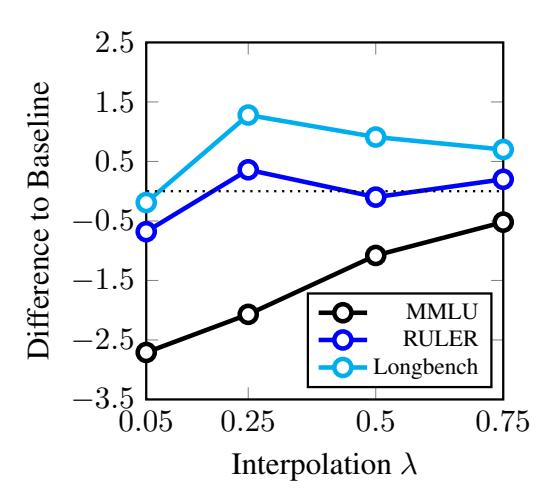
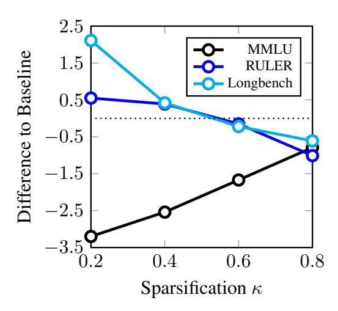
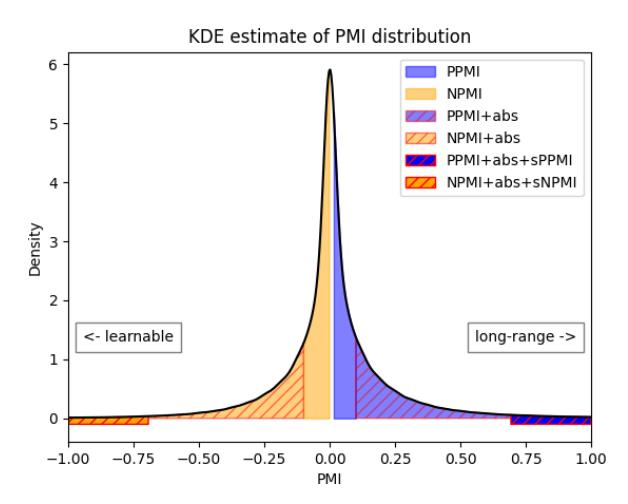
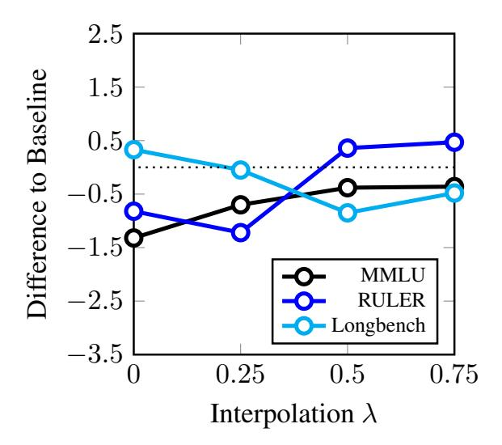
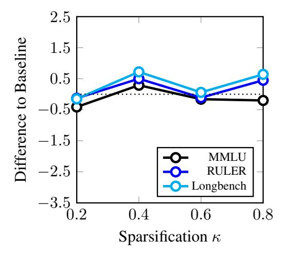

# Token Weighting for Long-Range Language Modeling

# Falko Helm Nico Daheim Iryna Gurevych

Ubiquitous Knowledge Processing Lab (UKP Lab) Department of Computer Science and Hessian Center for AI (hessian.AI) Technical University of Darmstadt <www.ukp.tu-darmstadt.de>

# Abstract

Many applications of large language models (LLMs) require long-context understanding, but models continue to struggle with such tasks. We hypothesize that conventional next-token prediction training could contribute to this, because each token is assigned equal weight. Yet, intuitively, the amount of context needed to predict the next token accurately varies greatly across different data. To reflect this, we propose various novel token-weighting schemes that assign different weights to each training token in the loss, thereby generalizing existing works. For this, we categorize token-weighting methods using a two-step framework which compares the confidences of a long-context and short-context model to score tokens. We evaluate all methods on multiple long-context understanding tasks and show that non-uniform loss weights are helpful to improve the long-context abilities of LLMs. Different short-context models can be used effectively for token scoring, including models that are much smaller than the long-context model that is trained. All in all, this work contributes to a better understanding of the trade-offs long-context language modeling faces and provides guidelines for model steering via loss-weighting based on empirical evidence. The code can be found on [Github.](https://github.com/UKPLab/naacl2025-token-weighting)

## 1 Introduction

Many Natural Language Processing applications require models to reason about large amounts of contiguous texts, such as legal documents or textbooks in education applications [\(Wang et al.,](#page-15-0) [2024\)](#page-15-0). To solve such tasks, recently various Large Language Models (LLMs) have been proposed that can process such large texts in one forward pass by allowing a large input context [\(Dubey et al.,](#page-9-0) [2024\)](#page-9-0). However, while they make use of various approaches, such as data augmentation or different positional encodings, it is still unclear how well the

resulting models are actually able to use their context [\(Liu et al.,](#page-12-0) [2024\)](#page-12-0) and what exactly contributes to making LLMs understand long contexts better.

Broadly speaking, related works on training long-range LLMs tend to focus on two aspects, namely the training data and model architecture. Since long-range dependencies can be scarce, also because the number of possible strings explodes with sequence length and only a small share might be captured in common training data, model-based dataset filtering [\(Chen et al.,](#page-9-1) [2024\)](#page-9-1) and data augmentation with synthetic long-range dependencies [\(Wu et al.,](#page-15-1) [2024\)](#page-15-1) is often used to up-weigh longrange data. In terms of model architecture, there is a focus on computational efficiency, as the complexity of dot-product attention-based Transformers scales quadratically with the input length. For example, sub-quadratic attention mechanisms [\(Tay](#page-15-2) [et al.,](#page-15-2) [2022,](#page-15-2) inter alia) and Transformers with a memory mechanism, in which previous (compressed) context is stored, have been proposed [\(Wu](#page-15-3) [et al.,](#page-15-3) [2022;](#page-15-3) [Bulatov et al.,](#page-9-2) [2022\)](#page-9-2). Finally, various positional encodings like RoPE [\(Su et al.,](#page-15-4) [2024a\)](#page-15-4) and ALiBi [\(Press et al.,](#page-13-0) [2022\)](#page-13-0) are often used to facilitate long-context understanding. However, little attention has been paid to the link between model and data: the loss function and training criterion.

We hypothesize that the lack of long context capabilities could also come from a training criterion that weighs the contribution of each token equally. Intuitively, a weighting that emphasizes long-range dependencies (LRDs) by weighing data that exhibits such dependencies higher should be beneficial for model performance on these tasks. While there are existing approaches which use nonuniform loss weights [\(Lin et al.,](#page-12-1) [2024;](#page-12-1) [Ren et al.,](#page-14-0) [2018\)](#page-14-0), they rather focus on efficiency and the specific choices that are made in them are not well understood. In this work we generalize these methods in a comprehensive framework and thoroughly evaluate how token weightings should be chosen

|                             | " inspired by the prints in one of Melquíades' books" |      |      |        |      |      |       |      |      |        |      |      |       |
|-----------------------------|-------------------------------------------------------|------|------|--------|------|------|-------|------|------|--------|------|------|-------|
| Long-Context Model Loss  | 8.75                                                  | 0.20 | 0.58 | 7.82   | 1.32 | 4.54 | 0.02  | 3.76 | 0.02 | < 0.01 | 0.01 | 0.04 | 0.26  |
| Short-Context Model Loss | 8.49                                                  | 0.21 | 0.64 | 8.82   | 1.03 | 4.40 | 0.02  | 4.84 | 0.63 | 0.01   | 0.00 | 0.72 | 0.46  |
| Absolute Loss Difference | 0.26                                                  | 0.01 | 0.07 | 1.00   | 0.29 | 0.14 | <0.01 | 1.08 | 0.61 | <0.01  | 0.01 | 0.68 | 0.20  |
| Loss Weights             | inspired                                              | by   | the  | prints | in   | one  | of    | Mel  | qu   | í      | ades | ,    | books |

Table 1: Schematic example of our token scoring method. Sequences are processed with either long and short context. Green: weight bigger than one due to high absolute loss difference. Red: weight smaller than one due to low absolute loss difference. The example sequence is taken from chapter 6 of "One Hundred Years of Solitude" (Márquez, 2000), where character *Melquíades* reappears after having not been mentioned for 10k tokens before that passage. A model with 8k context sees this name for the first time and is uncertain. A 32k model can look back far enough to achieve a lower loss. Based on this, our method assigns a high weight to the "Mel" token, indicating a long-range dependency. Also, tokens which are learnable for the long-context model ("inspired") are upweighted, whereas trivial ("ades") and inherently hard ("one") tokens are downweighted.

for better long-context performance in LLMs.

Our framework divides token weighting into two subsequent stages: scoring and postprocessing. Token scoring contrasts the confidences of a short- and a long-context model and sets them to dense or sparse weights. We compare these two types of postprocessing in detail. Furthermore, we compare using a frozen pretrained model for the short-context model (which can also be much smaller than the long-context model) against using the same long-context model with artificially short-ened input context as a short-context model. We pose the following two research questions:

- 1. What are the effects of sparse and dense weightings (i.e. of postprocessing)?
- 2. What is the effect of the token scoring?

Our experiments focus on extending the context of an existing language model (Dubey et al., 2024; Stallone et al., 2024). In particular, we extend the context of Llama-3 8B and Phi-2 2.7B from 8k resp. 2k to 32k input tokens and compare different token weighting methods on RULER (Hsieh et al., 2024) and Longbench (Bai et al., 2024b), while contrasting how well they retain performance on short contexts as measured on MMLU (Hendrycks et al., 2021) and BBH (Suzgun et al., 2023). Our results show that non-uniform token weights can improve the long-context performance of LLMs effectively and are better than using uniform weights. This holds across various short-context models, namely, a frozen version of the long-context model, a weight-shared model with artificially shortened context, and a much smaller (8x) model, similar to weak-to-strong generalization (Burns et al., 2024). Still, improving long-context capabilities can form

a trade-off with retaining original performance as shown in extensive ablations with different sparsity levels and interpolation strengths.

### 2 Background

In this section, we first introduce LLM training as next-token prediction with per-token weights (Sec. 2.1). Then, we re-interpret it in terms of the training data, which allows token weighting to be understood as data curation (Sec. 2.2). Finally, we provide an overview of related works that use (non-uniform) token weights (Sec. 2.3).

#### 2.1 Next-Token Prediction

Current-day large language models (LLMs) are usually trained on large collections of text using a self-supervised next-token prediction objective (Radford et al., 2019; Touvron et al., 2023). Corresponding to that, LLMs usually define a distribution over tokens in a sequence  $\mathbf{y}=(y_1,\ldots,y_N)\in\mathcal{V}^N$  with variable but bounded length N that is constructed from a predetermined vocabulary  $\mathcal{V}$ , for example, of Byte-Pair-Encoding tokens (Sennrich et al., 2016). Then, the probability of a sequence  $\mathbf{y}$  is determined autoregressively from a locally-normalized model as:

$$p_{\boldsymbol{\theta}}(\mathbf{y}) = \prod_{i=1}^{N} p_{\boldsymbol{\theta}}(y_i \mid \mathbf{y}_{< i}). \tag{1}$$

Here,  $\theta$  are the learned parameters of the LLM. Learning the LLM is then usually done by minimizing the negative log-likelihood on a training corpus. Denoting this training data as a multiset1

&lt;sup>1Oftentimes it is a proper set due to data deduplication (Tirumala et al., 2024, inter alia).

 $\mathcal{D} = \{\mathbf{y}^{(j)}\}_{j=1}^{M}$ , the training criterion is:

$$\mathcal{L}(\boldsymbol{\theta}; \mathcal{D}) = -\sum_{\mathbf{y} \in \mathcal{D}} \sum_{i=1}^{|\mathbf{y}|} w_i(\mathbf{y}) \log p_{\boldsymbol{\theta}}(y_i \mid \mathbf{y}_{< i}),$$
(2)

where  $w_i(\mathbf{y}) \geq 0$  are weights that are given to each token2. This training criterion is also referred to as cross-entropy loss because it minimizes the (weighted) cross-entropy between the model and the empirical data distribution.

**Perplexity** The cross-entropy criterion is directly related to the perplexity of a model on a given corpus  $\mathcal{D}$ , which is defined as the exponential of the average loss over the data with weights  $w_i = 1$ . Accordingly, perplexity is often used for assessing the goodness of fit of the model. In contrast, surprisal theory from psycholinguistics shows that humans process words highly non-uniformly (Hale, 2001).

For LLMs, the average perplexity per token position already decreases with increasing token position (Gao et al., 2020; Reid et al., 2024) and perplexity can even be negatively correlated with long-range reasoning abilities (Levy et al., 2024). This naturally leads to the question if perplexity is the correct measure to evaluate long-context understanding, which is also discussed in Hu et al. (2024). On the other hand, (Chen et al., 2024) suggest that the root of the problem may be not so much with perplexity itself but rather that the data does not exhibit enough long-range dependencies (LRDs). In this work, we focus on evaluating on data that has been specifically collected for long-range dependency modeling to overcome this.

### 2.2 Dataset Curation

In most cases, the weights  $w_i$  in Eq. 2 are chosen to be uniformly 1 such that each token in the sequence receives the same importance. In the limit of infinite data, uniform weights are preferred because then the true data-generating distribution is the optimum of the training criterion. However, in practice, training data is finite and accordingly a lot of the gains of modern LLMs can be attributed to better choices of the training set  $\mathcal{D}$ . For example, it has become standard to also train on code to improve the model's reasoning abilities (Ma et al., 2024) or use clean LLM-generated text as training data (Gunasekar et al., 2023, inter alia). For

long-context understanding specifically, synthetic long-range dependencies have been added to the training data (Wu et al., 2024). This is directly connected to using non-uniform weights  $w_i$ : to-kens with weight  $w_i = 0$  are ignored, tokens with  $w_i \in (0,1)$  downsampled, and tokens with  $w_i > 1$  upsampled.

**Reinforcement Learning** By applying Jensen's inequality to Eq. (2) we obtain

$$\mathcal{L}(\theta; \mathcal{D}) \ge -\log \sum_{\mathbf{y} \in \mathcal{D}} \sum_{i=1}^{|\mathbf{y}|} w_i(\mathbf{y}) p_{\theta}(y_i \mid \mathbf{y}_{< i})$$

$$\approx -\log \mathbb{E}_{\theta}(W)$$

with weighting function  $W(y_i, \mathbf{y}_{< i}) = w_i(\mathbf{y})$ . Now W can be interpreted as the reward function of a reinforcement learning problem with action space  $\mathcal{V}$  and state space  $\bigcup_{i=0}^{N} \mathcal{V}^i$  where our goal is to maximize the expected return. In this way, we can see our generalized cross-entropy loss from Eq. (2) as a form of reward-weighted regression (RWR; Peters and Schaal, 2007). RWR was recently applied as a model-based dataset curation technique to pretrain LLMs with document-level (Wettig et al., 2024) and segment-level (Korbak et al., 2023) weights. We discuss concrete weighting functions in the following and propose new methods in Sec. 3.

#### 2.3 Token Weighting

Different weighted cross-entropy criteria have been proposed in the literature. For example, focal loss weighs each class by its confidence, i.e. the predicted class probability (Lin et al., 2017). Related to this, MiLe (Su et al., 2024b) weighs tokens in language modeling according to one minus the entropy of the token-level model distribution. As entropy is a measurement of uncertainty, this weighs uncertain tokens higher, but in doing so runs the risk of excessively favoring tokens that are simply hard to learn or ambiguous, for example, due to plausible variation (Baan et al., 2024, inter alia).

Empirically, it is also observed that such tokens remain challenging throughout training and Lin et al. (2024) propose  $\rho$  which promises to tackle this by using sparse  $w_i$ . In particular,  $\rho$  builds on Mindermann et al. (2022), who propose a function that can be used to select data that is learnable but not yet learned. For this,  $\rho$  relies on training a model checkpoint  $\theta_0$  on a clean dataset  $\mathcal{D}_0$ . For

 $^{2}$ We will drop the dependency on  $\mathbf{y}$  in the following for notational convenience.

| Model Co   | onfidence   |           |            | Example    |
|------------|-------------|-----------|------------|------------|
| Long-ctxt. | Short-ctxt. | Token     | Score      | Tab.1      |
| $\uparrow$ | 1           | Easy      | ₩          | "ades"     |
| <b>1</b>   | <b>#</b>    | LRD       | $\uparrow$ | "Mel"      |
| <b></b>    | 1           | Learnable | $\uparrow$ | "inspired" |
| <b></b>    | <b>↓</b>    | Hard      | ₩          | "one"      |

Table 2: We obtain token weights by contrasting short and long-context models. Here, tokens exhibit different properties: they are either easy, hard, learnable3 or a long-range dependency (LRD).

training the target model  $\theta$  on noisy  $\mathcal{D}$ , the checkpoint  $\theta_0$  is then used to filter out tokens whose weights  $w_i$  are set to 0. Formally, the weights are determined by

$$\tilde{w}_i^{\rho} = -\log p_{\theta}(i) - (-\log p_{\theta_0}(i)) \tag{3}$$

$$= \log \left( \frac{p_{\theta_0}(i)}{p_{\theta}(i)} \right), \tag{4}$$

where we will use the shorthand  $p_{\theta}(i)$  $p_{\theta}(\mathbf{y}_i|\mathbf{y}_{< i})$  for notational simplicity from now on. We call this stage **token scoring**. It can be shown theoretically that this form of token scoring approximately selects optimal examples for reducing test loss (Mindermann et al., 2022). Note that this requires training a second model which can be prohibitively expensive. A final stage is then postprocessing which is applied after token scoring. In  $\rho$ , weights are set to 0 or  $1/\kappa$  according to whether they score low or high such that a quantile  $1 - \kappa \in (0, 1]$  is set to 0, where  $\kappa$  is the sparsity ratio. This quantile-based postprocessing is naturally robust to outliers produced by the scoring function. Yet, sparsification can also have drawbacks, since part of the signal is ignored. Furthermore, it is not clear whether the choice of  $\kappa$  will be robust across datasets and even sequences in the same dataset, which might exhibit different signal-to-noise ratios. In the following, we will explore such tokenweighting methods thoroughly with the focus of long-context understanding and propose new ones that could overcome the mentioned issues.

### 3 Methodology

Our goal is to provide an in-depth comparison of existing and novel token-weighting methods for training language models for long-context understanding. For this, we present a two-step framework to determine these weights, which allows deriving existing approaches as well as finding new ones. The framework consists of the steps **token scoring** and **postprocessing**. This naturally generalizes the weight calculation and normalization steps from (Ren et al., 2018). In the following, we discuss different choices for both steps but first look at the general setting.

We assume to have a language model  $\theta_0$  that was pre-trained on a dataset  $\mathcal{D}_{:n}$  consisting of sequences of length at most n and therefore has context size n. Next, we extend the context size of  $\theta_0$  to handle sequences of length N >> n. For example, we can interpolate positions (Chen et al., 2023) or increase the base of RoPE embeddings (Xiong et al., 2024). The resulting new model  $\theta$  is then subsequently trained on  $\mathcal{D}_{:N}$ .

Our goal now is to introduce methods that will make the training on  $\mathcal{D}_{:N}$  effective for long-range dependencies. For this, it is plausible to not restrict weights to sparse 0s and 1s but rather to allow any (non-negative) real number as token weight.

### 3.1 Token Scoring

A meaningful token scoring method for context extension should exhibit four desiderata corresponding to four different cases. We outline these in Table 2. All token scoring methods use two models: a long-context and short-context model. The latter is oftentimes  $\theta_0$  if context extension is used and the long-context one is a finetuning  $\theta$  of it. The goal is to score such tokens highly, where the long-context model is certain and the short-context model is uncertain and vice versa, because those either exhibit a long-range dependency (e.g. "Mel" in Tab. 1) or are tokens the long-context model has not yet learned but can learn (e.g. "inspired"). Tokens that are inherently hard to predict (e.g. "one") or trivial (e.g. "ades"), however, should get a low weight. Importantly, these properties change during training, since the long-context model will improve and the weighting of a single token is highly context dependent. In principle, any model  $\theta'$  can be used for the short-context model, not just  $\theta_0$ , for example, a smaller language model for more efficient scoring.

In accordance with these requirements, we choose the following scoring function:

$$|\tilde{w}_i| = \left| \log \left( \frac{p_{\boldsymbol{\theta}'}^{(n)}(i)}{p_{\boldsymbol{\theta}}^{(N)}(i)} \right) \right| \tag{5}$$

$$= \left| \log(p_{\boldsymbol{\theta}'}^{(n)}(i)) - \log(p_{\boldsymbol{\theta}}^{(N)}(i)) \right|. \quad (6)$$

&lt;sup>3The postulate of learnable tokens might seem problematic in cases where the extended context should make the model more uncertain (e.g. by contradicting the previous context), but it has to hold on average. See App. A for a proof.

| Dataset→   |         | MMLU  |       | Longbench |       | RULER    |       |       | Average |       |       |       |
|------------|---------|-------|-------|-----------|-------|----------|-------|-------|---------|-------|-------|-------|
| Weighting↓ | Subset→ | full  | full  | ≤8k       | >8k   | combined | 8k    | 16k   | 24k     | 32k   | long  | full  |
|            | 8k      | 65.39 | 35.62 | -         | -     | -        | 91.18 | -     | -       | -     | -     | -     |
| No-train   | 32k     | 62.25 | 38.22 | 39.04     | 37.20 | 77.87    | 88.56 | 81.91 | 74.40   | 66.60 | 58.04 | 59.45 |
| -          | LCDE    | 63.68 | 37.43 | 39.57     | 35.34 | 88.80    | 91.79 | 90.83 | 87.81   | 84.77 | 63.12 | 63.30 |
| -          | Uniform | 63.44 | 44.37 | 45.91     | 41.07 | 89.87    | 91.82 | 91.41 | 88.87   | 87.38 | 67.12 | 65.89 |
|            | Sparse  | 60.24 | 46.48 | 46.67     | 43.69 | 90.42    | 91.93 | 91.68 | 89.40   | 88.69 | 68.45 | 65.71 |
| Unfrozen   | Dense   | 62.92 | 45.09 | 47.02     | 43.19 | 90.07    | 91.40 | 91.38 | 89.74   | 87.74 | 67.57 | 66.02 |
|            | Sparse  | 63.73 | 45.09 | 46.35     | 41.87 | 90.37    | 91.65 | 91.50 | 89.50   | 88.84 | 67.73 | 66.40 |
| Frozen     | Dense   | 63.08 | 43.89 | 46.54     | 41.58 | 90.34    | 91.58 | 91.63 | 89.90   | 88.23 | 67.11 | 65.77 |

Table 3: Main results for Llama-3 8B on MMLU, Longbench and RULER (higher is better). The largest value of each column is bolded (values in italic are not considered). While Unfrozen Sparse dominates the 8-16k context, Frozen Sparse has the best performance overall. BBH results are in Table A[.10](#page-19-0) but highly correlated with MMLU.

Here, the superscript indicates how many past tokens the model can use to predict the current token. By comparing to Tab. [1](#page-1-2) again, it is easy to see that this fulfills our desiderata: If the numerator is large and the denominator small, we will get a high weight. If both are roughly equal, the weight is close to 0. If the denominator is large and the numerator small, the weight is again large due to the absolute value.

This absolute value also distinguishes our method from the scoring used in ρ shown in Eq. [4.](#page-3-3) Without it, tokens where the short-context model is less certain than the long-context model would get a negative score. This makes sense when both models have the same context size. However, when doing context extension, it would violate the second requirement which pushes the model to learn longrange dependencies by upweighing them. Note that no backpropagation is done through the token weights. Rather, they are treated as constants.

The ratio w˜i is the negative conditional pointwise mutual information (CPMI) between the current token and the faraway context[4](#page-4-0) . This CPMI value is an indicator of long-range dependency because it measures the influence of the faraway context on the current token. Therefore it is a natural choice to realize requirement two.

Note that there are many scoring methods fulfilling the desiderata but ours is arguably one of the simplest and thus should be preferred according to Occam's razor. Empirically, we ablate the importance of the absolute value in Section [5.3.](#page-7-0) Next, we discuss different choices of the base model θ ′ which we use to determine the score.

Choice of base model There are various intuitive choices of the base model. The first is to set θ ′ =

θ0 and freeze the short-context model which is used to initialize the long-context model. This is similar to the approach of ρ. However, it either requires scoring the full dataset before training, which is time-consuming, or keeping two models during training in order to perform token scoring which doubles GPU memory consumption.

Intuitively, this could be overcome by sharing the weights of long-context and short-context model, i.e. setting θ ′ = θ, and artificially shortening the context of the model to be trained. This way the GPU memory consumption is the same and improvements in the short-context setting might be beneficial for long-context training. We provide a detailed comparison of both approaches in Sec. [5.2.](#page-7-1)

Another approach is to use a smaller model than the long-context model as a short-context model. The small model is then used as a "teacher" similar to weak-to-strong generalization [\(Burns et al.,](#page-9-4) [2024\)](#page-9-4). For example, current open-source LLMs often come in various sizes with the same base architecture and can be easily used as long as they share the same vocabulary [\(Dubey et al.,](#page-9-0) [2024;](#page-9-0) [Gemma-Team et al.,](#page-11-2) [2024\)](#page-11-2).

# 3.2 Postprocessing

One option that is used in ρ is to set the weights for the smallest (1 − κ)% scores to zero. The others are all set to 1/κ such that they sum to N. This is robust to outliers but might ignore the signal of meaningful tokens with zero weight. Further, due to inherent constraints in autoregressive language modeling with transformer decoders, no speed-up of the backward pass is possible, even if only a fraction of tokens contribute to the loss. Thus, we employ a dense weighting scheme by using the scores |w˜i | directly which provides a dense weighting. As the scores are unbounded, it is important

4A proof can be found in App. [A.](#page-16-0)

Figure 1: We compare different λ for the *dense* unfrozen setting with Llama-3 8B (Eq. [8\)](#page-5-0). λ = 1 coincides with the baseline (dotted). While short-context benefits from large λ, for long-context λ = 0.25 is best.

to normalize them such that they sum to N, i.e.

$$\operatorname{norm}(|\tilde{w}_i|) = N \cdot \frac{|\tilde{w}_i|}{\sum_{i=1}^{N} |\tilde{w}_i|}.$$
 (7)

This ensures that the same learning rate can be used as with standard training [\(Ren et al.,](#page-14-0) [2018\)](#page-14-0). Based on initial experiments we also interpolate them with the standard uniform weighting scheme

$$w_i = \lambda + (1 - \lambda) \cdot \text{norm}(|\tilde{w}_i|).$$
 (8)

Here, λ ∈ [0, 1] is a hyperparameter that allows to control how close the weights are to uniform, similar to introducing a temperature parameter. For λ = 1 we recover the standard uniform weighting with zero standard deviation, whereas λ = 0 uses the normalized scores directly, which maximizes temperature. Note that interpolation does not affect the normalization and the wi still sum up to N.

## 4 Experiments

Here we describe the experimental details. We first describe the used models, then the datasets which we use for evaluation and finally the used metrics.

Models We conduct our experiments on the opensource Llama-3 8B model [\(Dubey et al.,](#page-9-0) [2024\)](#page-9-0). Llama-3 8B was trained with a context of 8192 tokens using RoPE embeddings [\(Su et al.,](#page-15-4) [2024a\)](#page-15-4). To extend the context size to 32768 tokens, we increase the base of RoPE from 500k to 15.3M, following Gradient AI[5](#page-5-1) . In initial experiments, this

Figure 2: We compare sparsity values κ for the *sparse* unfrozen setting with Llama-3 8B (Sec. [2.3\)](#page-2-1). κ = 1 coincides with the baseline (dotted). Increasing κ benefits short-context tasks but hurts long-context capabilities.

yielded better long-context performance than using 3.5M as the base of RoPE, which is the value predicted by NTK-theory [\(Peng et al.,](#page-12-13) [2024\)](#page-12-13). More detailed information regarding the exact experimental setup, including all technical hyperparameters and runtime comparisons, can be found in App. [B.](#page-16-1)

Weighting variants We use four different weighting variants. The Uniform baseline uses standard cross-entropy loss with weights 1. The *frozen* model uses Llama-3 8B out-of-the-box with 8k context as token scorer, i.e. θ ′ = θ0. *Unfrozen* models are their own scorers, i.e. θ ′ = θ. A *dense* model uses the normalized scores directly, interpolated with uniform loss. *Sparse* models use a threshold to set some token weights to zero. We train all four combinations Sparse Frozen, Sparse Unfrozen, Dense Frozen, Dense Unfrozen in the exact same setup and report results in Table [3.](#page-4-1) Unless otherwise noted, dense models use λ = 0.75 and sparse models use κ = 0.2 resp. 0.4 for the unfrozen resp. frozen variant. Ablations for these choices can be found in Fig. [1](#page-5-2) and Fig. [2.](#page-5-3)

Generalizability To show generalizability, we use the same hyperparameters to extend the context of Phi-2 [\(Javaheripi et al.,](#page-12-14) [2023\)](#page-12-14) from 2k to 32k by increasing the base of RoPE from 10k to 500k following [\(Chen et al.,](#page-9-6) [2023\)](#page-9-6) and report results in Table [7](#page-18-0) in the Appendix. Again, the NTKpredicted value of 1.3M performed subpar in initial experiments. Finally, we conduct a weak-to-strong experiment by using scores obtained from smaller models of the Llama family to extend Llama-3 8B

5 [https://huggingface.co/gradientai/](https://huggingface.co/gradientai/Llama-3-8B-Instruct-Gradient-1048k) [Llama-3-8B-Instruct-Gradient-1048k](https://huggingface.co/gradientai/Llama-3-8B-Instruct-Gradient-1048k)

in the *frozen* setting, see Table [5](#page-7-2) for results.

Datasets We use the book corpus PG-19 [\(Rae](#page-13-3) [et al.,](#page-13-3) [2020\)](#page-13-3) for continual pretraining and tokenize each document separately by splitting it into chunks of size 32k. We remove the last chunk if it is smaller than 32k tokens. PG19 was chosen because we can obtain 70k continuous sequences of text from it, each of length 32k (2B tokens in total). As an ablation, we also apply Long-Context Data Engineering (LCDE) [\(Fu et al.,](#page-11-3) [2024\)](#page-11-3) to perform per-source length upsampling of sequences longer than 8k tokens from SlimPajama [\(Soboleva et al.,](#page-15-12) [2023\)](#page-15-12) and packing them together randomly. An additional ablation with rare 32k sequences (less than 0.1%) from the recent FineWeb dataset [\(Penedo](#page-12-15) [et al.,](#page-12-15) [2024\)](#page-12-15) can be found in Table A[.11.](#page-19-1)

To calculate the loss with a context of 8k, we unfold the 32k sequence with an overlap of 2k tokens to avoid a loss spike. For the frozen variant, we perform two forward passes with doubled batch size using Llama 3 8B without context extension. For the unfrozen variant, we get the logits for the first 8k tokens from the forward pass with the long context model. The four remaining chunks can be combined and computed with two forward passes.[6](#page-6-0)

Evaluation As mentioned in Sec. [2.1,](#page-2-4) evaluating models on their long-context understanding capability is challenging. Since both using perplexity and needle-in-a-haystack tasks can be inconclusive [\(Hsieh et al.,](#page-12-3) [2024;](#page-12-3) [Hu et al.,](#page-12-7) [2024\)](#page-12-7), we instead evaluate on the RULER benchmark [\(Hsieh et al.,](#page-12-3) [2024\)](#page-12-3).[7](#page-6-1) RULER is a synthetic dataset and consists of the task categories retrieval, multi-hop tracing, aggregation and question answering. We calculate the RULER score according to [Hsieh et al.](#page-12-3) [\(2024\)](#page-12-3) [8](#page-6-2) . In order to obtain the score, the recall over each of the 13 tasks is calculated. Then, all task-specific recalls are averaged such that each value reflects 6500 sequences of a given length. The *combined* score is the average over sequence length results 8k, 16k, 24k, 32k for Llama-3 resp. 2k, 4k, 8k, 16k, 32k for Phi-2. A detailed description of RULER can be found in App. [C.](#page-16-2) As a non-synthetic benchmark we choose the English part of Longbench [\(Bai et al.,](#page-9-3) [2024b\)](#page-9-3) which consists of 16 tasks over the six categories. Following [\(Lu et al.,](#page-12-16) [2024\)](#page-12-16) we further split

| Model    | MMLU  | Longbench | RULER | Avg.  |
|----------|-------|-----------|-------|-------|
| PPMI     | 59.27 | 43.79     | 85.26 | 62.77 |
| NPMI     | 64.06 | 40.29     | 77.71 | 60.69 |
| sPPMI    | 62.68 | 45.79     | 90.29 | 66.25 |
| sNPMI    | 63.45 | 44.36     | 89.47 | 65.76 |
| abs(PMI) | 63.73 | 45.09     | 90.37 | 66.40 |

Table 4: Ablation over different PMI variants as scoring functions. Bolded values are highest, italic values lowest per column.

Figure 3: A kernel density estimate of the PMI distribution of all tokens in PG19-eval, measured with the uniform 32k model at the end of training.

each task into sequences of length ≤ 8k and > 8k and report the macro-average over tasks. If documents exceed the sequence length of the evaluated model, we truncate in the middle[9](#page-6-3) . To measure whether long-context models lose performance on short-context, we do 5-shot evaluation on MMLU [\(Hendrycks et al.,](#page-12-4) [2021\)](#page-12-4) [10](#page-6-4). MMLU is well suited as 99% of its questions are shorter than 500 tokens and the longest one is around 1000 tokens. The whole 5-shot prompt mostly consists of less than 3k tokens. To diversify the short-context evaluations, we test the models on BigBench-hard in a 5-shot Chain-of-Thought setting [\(Suzgun et al.,](#page-15-6) [2023\)](#page-15-6) (see Table [10](#page-19-0) in the Appendix). We average *RULERcombined* and *Longbench-full* to *Long-Average*.

# 5 Results

In this section, we detail our results from continuously pretraining models with different loss weighting schemes for long-context understanding. We first discuss the main results which compare dense

6We also tried using sliding window attention but did not find this strategy to work well, potentially due to the attention sink problem [\(Xiao et al.,](#page-15-13) [2024\)](#page-15-13).

7 For perplexity evaluation see Table [9](#page-19-2) (Appendix).

8 <https://github.com/hsiehjackson/RULER>.

9 <https://github.com/Leooyii/LCEG/>

10We use the code from [https://github.com/](https://github.com/EleutherAI/lm-evaluation-harness) [EleutherAI/lm-evaluation-harness](https://github.com/EleutherAI/lm-evaluation-harness)

and sparse self-weighting models in Sec. 5.1. Then, we discuss the influence of whether the model that is used for weighting tokens is frozen or trained along with the long-context model in Sec. 5.2. Finally, we discuss ablations in Sec. 5.3.

#### 5.1 Dense vs. Sparse Weights

In Table 3 we present results for Llama-3 8B extended to a context of 32k tokens. Sparse unfrozen dominates the 8-16k contexts and is the best model for long context. It should be noted that sequences longer than 16k tokens are not common in Longbench. This performance is remarkable because the sparsity omits 80% of the tokens from the training. In this way, the model focuses strongly on LRDs which benefits retrieval-heavy tasks. This is further exemplified by Table 8, where Longbench scores are broken down by task. There, the sparse model excels in the QA and synthetic categories. But we also see that this model performs worst on MMLU and BBH. The underlying problem is that the unfrozen method cannot score the original 8k tokens in a meaningful way. As there is no context difference, all scores will be zero. Thus, the sparse unfrozen method never considers the first 8k tokens for training. For the dense method, interpolating with standard cross-entropy ensures that all tokens get non-zero weight. Accordingly, the performance of the dense unfrozen model is not as skewed. Although not performing best on any dataset it ranks second on the overall average. To answer RQ1: What are the effects of sparse and dense weighting?, we can say that a sparse weighting pushes the model to perform well on LRDs and specializes it mostly on retrieval-heavy QA tasks. This is because retrieval is a sparse extraction task and the sparse weighting teaches the model to ignore irrelevant information and focus import pieces of information. By choosing a dense weighting on the other hand, the model remains more general and retains much of its short-context ability.

### 5.2 Frozen vs. Unfrozen Weighting Model

Table 3 shows that sparse frozen is the best overall model. It combines the ability of the sparse method to focus on LRDs but can also assign meaningful weights to the first 8k tokens. This is because it uses the frozen Llama 3 8B model as the scorer. Dense frozen is on the level of the uniform weighting for long context and subpar overall. Table A.7 shows results for Phi-2 2.7B for further insights. First, we see that, immediately after context extension, Phi-2

| Weighting | Scoring | MMLU          | Longbench     | RULER         |
|-----------|---------|---------------|---------------|---------------|
| Baseline  | -       | 63.44         | 44.37         | 89.87         |
| Sparse    | 3.2 1B  | 63.08 (-0.65) | 44.36 (-0.73) | 90.47 (+0.10) |
|           | 3.2 3B  | 63.39 (-0.34) | 44.78 (-0.31) | 90.47 (+0.09) |
|           | 3.1 8B  | 63.31 (-0.42) | 44.09 (-1.00) | 89.88 (-0.49) |
| Dense     | 3.2 1B  | 63.47 (+0.39) | 44.85 (+0.96) | 90.52 (+0.18) |
|           | 3.2 3B  | 63.52 (+0.44) | 44.30 (+0.41) | 90.48 (+0.14) |
|           | 3.1 8B  | 63.10 (+0.01) | 44.71 (+0.82) | 90.24 (-0.10) |

Table 5: Results for weak-to-strong generalization. *Scoring* means the frozen scoring model of the Llama-3.x family. The colours indicate the difference to using the model to be trained (i.e. Llama 3 8B) as frozen scorer. Underlined entries improve over the baseline. Dense models benefit from different scoring models, sparse ones not.

is very bad on all contexts. Interestingly, this does not harm the unfrozen performance. Apparently, we do not need a good long-context model to start with for the unfrozen approach to work. On the other hand, we see the frozen models falling short here. This might be because here we extend the context by a factor of 16 and not four as for Llama-3. Thus, the model and its frozen scorer might move too far away from each other. This hypothesis is supported by the results in Table 5, where we use Llama 3.2 1B with 8k context as the frozen scoring model. Here, the results are reasonable with sparse frozen dropping to baseline level and dense frozen even gaining performance. To answer RQ2: What is the effect of the token scoring? we can say that, somewhat surprisingly, the unfrozen approach can recover from the model initially being bad on long-context. Additionally, the frozen approach has a hard time coping with differences in context lengths between scorer and model. On the other hand, the size of the scorer does not matter much.

#### 5.3 Ablations

Here we discuss several important design choices. First we present a dataset comparison and then ablate over interpolation scale and sparsity ratio.

**Dataset comparison** As can be seen in the top rows of Table 3, all our models outperform the LCDE method of (Fu et al., 2024), especially on 16k+ context. This makes sense as although their upsampling method creates 32k sequences, manual inspection yields that they mostly consist of *two* random documents, thus limiting the contained LRDs to 16k on average. We again see the problem of "long context is not long at all" exemplified here (Chen et al., 2024). On the other hand, training on 32k sequences from FineWeb (Penedo et al., 2024)

yields comparable results to training on PG19 (see Tab. A[.11\)](#page-19-1).

Influence of interpolation scale Fig. [1](#page-5-2) shows various interpolation parameters λ when using a dense weighting and unfrozen Llama 3 model. For long-context data we see the best performance at λ = 0.25. For MMLU there is a clear trend: as the interpolation value equals the weight of the first 8k tokens, increasing it benefits this task. These gains lead to the maximum average score at λ = 0.75. Thus, we chose λ = 0.75 for our main experiment (Tab. [3\)](#page-4-1). The ablation for dense frozen is more robust and can be found in Figure A[.4.](#page-18-1)

Influence of sparsity ratio When training with sparse weights the hyperparameter κ determines how many weights are kept (i.e. (1 − κ)% are set to zero) which we refer to as sparsity ratio. We show an ablation over different κ in Fig. [2](#page-5-3) for Llama-3. We see a similar picture as for λ but more extreme: the more tokens we use the better for MMLU, but at the same time the focus on LRDs gets blurred. Interestingly, the best average performance is achieved for κ = 0.2. The ablation for sparse frozen is much more robust and can be found in Figure [5.](#page-18-2)

Influence of scoring function Recall from Section [3](#page-3-0) that our scoring function can be seen as abs(PMI) where abs is the absolute value and PMI the (conditional) pointwise mutual information. We argued that the absolute value is necessary to fulfill our desiderata. Here, we ablate this choice by comparing to well-known PMI variants. These are PPMI := max(PMI, 0), NPMI := max(−PMI, 0), sPPMI := max(PMI − ln(k), 0) and sNPMI := max(−PMI − ln(k)). Shifted PPMI with integer shift k ≥ 2 was introduced by [\(Levy and Goldberg,](#page-12-17) [2014\)](#page-12-17). We train our bestperforming model, sparse frozen with κ = 0.4, with these alternative scoring functions and set k = 2. The results are in Table [4.](#page-6-5) We see that PPMI is bad on short context and does also not perform well on long context. If we look at Figure [3,](#page-6-6) we see that PPMI only selects tokens with high PMI. Some of them are valuable long-range dependencies (high PMI), but we also select a lot of tokens with PMI slightly bigger than zero. As loss decreases naturally with sequence length [\(Gao](#page-11-0) [et al.,](#page-11-0) [2020;](#page-11-0) [Reid et al.,](#page-13-2) [2024\)](#page-13-2), these tokens are not informative and dilute the training set, leading to suboptimal long context performance. On the other

hand, no learnable tokens are selected at all, violating desiderata 3, which leads to bad short-context performance. NPMI, which violates desiderata 2, shows opposite behavior, excelling in short-context but failing to learn long-context. It selects tokens which are learnable but not long-range in Fig. [3.](#page-6-6) For the shifted variants, roughly 85-95% of tokens have a score of zero. Thus we randomly sample until we reach κ = 40%. Both variants exhibit the same tendencies as their unshifted counterparts, but the random sampling balances out the extremes. Thus, both of them give good overall performance. Fig. [3](#page-6-6) also shows the superiority of the absolute value, which selects learnable and long-range tokens and avoids uninformative and hard ones. This leads to good overall performance.

# 6 Conclusion

In this work, we show that the weights assigned to tokens in the training objective of LLMs influence their long-context understanding capabilities. While standard cross-entropy assigns equal weights to each token, the methods proposed in this work weigh them according to different notions of importance. This importance is determined by comparing the confidences of a long- and short-context model. We compare setting weights densely against having sparse weights and compare using a frozen model for weighting against using a self-weighting approach, where a model assigns its own weights via a forward pass with less context.

Overall, we find that using dense weights improves performance across long-context tasks. Sparse weights mainly improve performance on retrieval-heavy QA tasks, at the cost of short context understanding. By changing a single hyperparameter we can smoothly trade off long-context and short-context abilities in both approaches. The frozen weighting scheme is only meaningful if the context is not extended too much but provides a powerful alternative in this setting, by allowing precomputation and caching of the scores and even using a much smaller model for scoring.

Our work contributes to a better understanding of token-weighting methods for language models and shows that non-uniform weights can improve longcontext abilities. We hope this can spark further investigations into scoring methods, for example, to incorporate uncertainty in other ways.

# 7 Limitations

An important limitation of this work is that we did not combine it with other context extension approaches. As we are the first to investigate dense weighting schemes for loss functions, our work is orthogonal to all changes of model architecture and it would be interesting to see with which of the methods it works well together. Another limitation is that all our model-based scoring methods need a good language model as a scorer, so our method is not suitable for the early phases of training from scratch. Additionally, we did not instruction-tune our context extended models to keep possible confounders minimal, especially as long-context instruction-tuning is a new area of research in itself [\(Bai et al.,](#page-9-7) [2024a;](#page-9-7) [Wu et al.,](#page-15-1) [2024\)](#page-15-1). Studying the interplay of context extension and instruction-tuning with respect to general performance [\(Gao et al.,](#page-11-4) [2024\)](#page-11-4) and safety is an exciting direction of future work. Finally, it remains unclear how our method will scale to modern context lengths of 128k or more. We implemented the sequence parallelism approach of [\(Gao et al.,](#page-11-4) [2024\)](#page-11-4) but saw that a single run with 5B tokens takes more than 60 hours on 32 A100 80GB GPUs. This compute demand exceeds our resources, so we will leave scaling questions to future work.

## 8 Ethics Statement

The models presented here are not meant to be deployed directly, because they are not optimized for safety or deployment. Hence, it can not be guaranteed that no harmful content would be generated by these models. Apart from that, another ethical consideration is the use of PG19 as a training dataset. Because of copyright issues it only contains novels published before 1919. The societies and values depicted in these books do not hold up to modern standards, which leads the model to inherit these biases.

## Acknowledgements

FH is funded by the German Federal Ministry of Education and Research (BMBF) within the hessian.AI Service Center. The model training was supported by a compute grant at the 42 supercomputer provided by hessian.AI (HMD: S-DIW04/0013/003; BMBF: 01IS22091). ND is funded by the German Federal Ministry of Education and Research and the Hessian Ministry of Higher Education, Research, Science and the Arts

within their joint support of the National Research Center for Applied Cybersecurity ATHENE.

## References

Joris Baan, Raquel Fernández, Barbara Plank, and Wilker Aziz. 2024. [Interpreting predictive proba](https://aclanthology.org/2024.eacl-short.24)[bilities: Model confidence or human label variation?](https://aclanthology.org/2024.eacl-short.24) In *Proceedings of the 18th Conference of the European Chapter of the Association for Computational Linguistics (Volume 2: Short Papers)*, pages 268–277, St. Julian's, Malta. Association for Computational Linguistics.

Yushi Bai, Xin Lv, Jiajie Zhang, Yuze He, Ji Qi, Lei Hou, Jie Tang, Yuxiao Dong, and Juanzi Li. 2024a. [Longalign: A recipe for long context alignment of](https://aclanthology.org/2024.findings-emnlp.74) [large language models.](https://aclanthology.org/2024.findings-emnlp.74) In *Findings of the Association for Computational Linguistics: EMNLP 2024, Miami, Florida, USA, November 12-16, 2024*, pages 1376–1395. Association for Computational Linguistics.

Yushi Bai, Xin Lv, Jiajie Zhang, Hongchang Lyu, Jiankai Tang, Zhidian Huang, Zhengxiao Du, Xiao Liu, Aohan Zeng, Lei Hou, Yuxiao Dong, Jie Tang, and Juanzi Li. 2024b. [LongBench: A bilingual, mul](https://doi.org/10.18653/v1/2024.acl-long.172)[titask benchmark for long context understanding.](https://doi.org/10.18653/v1/2024.acl-long.172) In *Proceedings of the 62nd Annual Meeting of the Association for Computational Linguistics (Volume 1: Long Papers)*, pages 3119–3137, Bangkok, Thailand. Association for Computational Linguistics.

Aydar Bulatov, Yury Kuratov, and Mikhail Burtsev. 2022. [Recurrent memory transformer.](https://proceedings.neurips.cc/paper_files/paper/2022/hash/47e288629a6996a17ce50b90a056a0e1-Abstract-Conference.html) *Advances in Neural Information Processing Systems*, 35:11079– 11091.

Collin Burns, Pavel Izmailov, Jan Hendrik Kirchner, Bowen Baker, Leo Gao, Leopold Aschenbrenner, Yining Chen, Adrien Ecoffet, Manas Joglekar, Jan Leike, Ilya Sutskever, and Jeffrey Wu. 2024. [Weak](https://proceedings.mlr.press/v235/burns24b.html)[to-strong generalization: Eliciting strong capabili](https://proceedings.mlr.press/v235/burns24b.html)[ties with weak supervision.](https://proceedings.mlr.press/v235/burns24b.html) In *Proceedings of the 41st International Conference on Machine Learning*, volume 235 of *Proceedings of Machine Learning Research*, pages 4971–5012. PMLR.

Longze Chen, Ziqiang Liu, Wanwei He, Yinhe Zheng, Hao Sun, Yunshui Li, Run Luo, and Min Yang. 2024. [Long context is not long at all: A prospector of long](https://doi.org/10.18653/v1/2024.acl-long.447)[dependency data for large language models.](https://doi.org/10.18653/v1/2024.acl-long.447) In *Proceedings of the 62nd Annual Meeting of the Association for Computational Linguistics (Volume 1: Long Papers)*, pages 8222–8234, Bangkok, Thailand. Association for Computational Linguistics.

Shouyuan Chen, Sherman Wong, Liangjian Chen, and Yuandong Tian. 2023. [Extending Context Window of](https://doi.org/10.48550/arXiv.2306.15595) [Large Language Models via Positional Interpolation.](https://doi.org/10.48550/arXiv.2306.15595) ArXiv:2306.15595 [cs].

Abhimanyu Dubey, Abhinav Jauhri, Abhinav Pandey, Abhishek Kadian, Ahmad Al-Dahle, Aiesha Letman, Akhil Mathur, Alan Schelten, Amy Yang, Angela Fan, Anirudh Goyal, Anthony Hartshorn, Aobo Yang, Archi Mitra, Archie Sravankumar, Artem Korenev, Arthur Hinsvark, Arun Rao, Aston Zhang, Aurelien Rodriguez, Austen Gregerson, Ava Spataru, Baptiste Roziere, Bethany Biron, Binh Tang, Bobbie Chern, Charlotte Caucheteux, Chaya Nayak, Chloe Bi, Chris Marra, Chris McConnell, Christian Keller, Christophe Touret, Chunyang Wu, Corinne Wong, Cristian Canton Ferrer, Cyrus Nikolaidis, Damien Allonsius, Daniel Song, Danielle Pintz, Danny Livshits, David Esiobu, Dhruv Choudhary, Dhruv Mahajan, Diego Garcia-Olano, Diego Perino, Dieuwke Hupkes, Egor Lakomkin, Ehab AlBadawy, Elina Lobanova, Emily Dinan, Eric Michael Smith, Filip Radenovic, Frank Zhang, Gabriel Synnaeve, Gabrielle Lee, Georgia Lewis Anderson, Graeme Nail, Gregoire Mialon, Guan Pang, Guillem Cucurell, Hailey Nguyen, Hannah Korevaar, Hu Xu, Hugo Touvron, Iliyan Zarov, Imanol Arrieta Ibarra, Isabel Kloumann, Ishan Misra, Ivan Evtimov, Jade Copet, Jaewon Lee, Jan Geffert, Jana Vranes, Jason Park, Jay Mahadeokar, Jeet Shah, Jelmer van der Linde, Jennifer Billock, Jenny Hong, Jenya Lee, Jeremy Fu, Jianfeng Chi, Jianyu Huang, Jiawen Liu, Jie Wang, Jiecao Yu, Joanna Bitton, Joe Spisak, Jongsoo Park, Joseph Rocca, Joshua Johnstun, Joshua Saxe, Junteng Jia, Kalyan Vasuden Alwala, Kartikeya Upasani, Kate Plawiak, Ke Li, Kenneth Heafield, Kevin Stone, Khalid El-Arini, Krithika Iyer, Kshitiz Malik, Kuenley Chiu, Kunal Bhalla, Lauren Rantala-Yeary, Laurens van der Maaten, Lawrence Chen, Liang Tan, Liz Jenkins, Louis Martin, Lovish Madaan, Lubo Malo, Lukas Blecher, Lukas Landzaat, Luke de Oliveira, Madeline Muzzi, Mahesh Pasupuleti, Mannat Singh, Manohar Paluri, Marcin Kardas, Mathew Oldham, Mathieu Rita, Maya Pavlova, Melanie Kambadur, Mike Lewis, Min Si, Mitesh Kumar Singh, Mona Hassan, Naman Goyal, Narjes Torabi, Nikolay Bashlykov, Nikolay Bogoychev, Niladri Chatterji, Olivier Duchenne, Onur Çelebi, Patrick Alrassy, Pengchuan Zhang, Pengwei Li, Petar Vasic, Peter Weng, Prajjwal Bhargava, Pratik Dubal, Praveen Krishnan, Punit Singh Koura, Puxin Xu, Qing He, Qingxiao Dong, Ragavan Srinivasan, Raj Ganapathy, Ramon Calderer, Ricardo Silveira Cabral, Robert Stojnic, Roberta Raileanu, Rohit Girdhar, Rohit Patel, Romain Sauvestre, Ronnie Polidoro, Roshan Sumbaly, Ross Taylor, Ruan Silva, Rui Hou, Rui Wang, Saghar Hosseini, Sahana Chennabasappa, Sanjay Singh, Sean Bell, Seohyun Sonia Kim, Sergey Edunov, Shaoliang Nie, Sharan Narang, Sharath Raparthy, Sheng Shen, Shengye Wan, Shruti Bhosale, Shun Zhang, Simon Vandenhende, Soumya Batra, Spencer Whitman, Sten Sootla, Stephane Collot, Suchin Gururangan, Sydney Borodinsky, Tamar Herman, Tara Fowler, Tarek Sheasha, Thomas Georgiou, Thomas Scialom, Tobias Speckbacher, Todor Mihaylov, Tong Xiao, Ujjwal Karn, Vedanuj Goswami, Vibhor Gupta, Vignesh Ramanathan, Viktor Kerkez, Vincent Gonguet, Virginie Do, Vish Vogeti, Vladan Petrovic, Weiwei Chu, Wenhan Xiong, Wenyin Fu, Whitney Meers, Xavier Martinet, Xiaodong Wang, Xiaoqing Ellen Tan, Xinfeng Xie, Xuchao Jia, Xuewei

Wang, Yaelle Goldschlag, Yashesh Gaur, Yasmine Babaei, Yi Wen, Yiwen Song, Yuchen Zhang, Yue Li, Yuning Mao, Zacharie Delpierre Coudert, Zheng Yan, Zhengxing Chen, Zoe Papakipos, Aaditya Singh, Aaron Grattafiori, Abha Jain, Adam Kelsey, Adam Shajnfeld, Adithya Gangidi, Adolfo Victoria, Ahuva Goldstand, Ajay Menon, Ajay Sharma, Alex Boesenberg, Alex Vaughan, Alexei Baevski, Allie Feinstein, Amanda Kallet, Amit Sangani, Anam Yunus, Andrei Lupu, Andres Alvarado, Andrew Caples, Andrew Gu, Andrew Ho, Andrew Poulton, Andrew Ryan, Ankit Ramchandani, Annie Franco, Aparajita Saraf, Arkabandhu Chowdhury, Ashley Gabriel, Ashwin Bharambe, Assaf Eisenman, Azadeh Yazdan, Beau James, Ben Maurer, Benjamin Leonhardi, Bernie Huang, Beth Loyd, Beto De Paola, Bhargavi Paranjape, Bing Liu, Bo Wu, Boyu Ni, Braden Hancock, Bram Wasti, Brandon Spence, Brani Stojkovic, Brian Gamido, Britt Montalvo, Carl Parker, Carly Burton, Catalina Mejia, Changhan Wang, Changkyu Kim, Chao Zhou, Chester Hu, Ching-Hsiang Chu, Chris Cai, Chris Tindal, Christoph Feichtenhofer, Damon Civin, Dana Beaty, Daniel Kreymer, Daniel Li, Danny Wyatt, David Adkins, David Xu, Davide Testuggine, Delia David, Devi Parikh, Diana Liskovich, Didem Foss, Dingkang Wang, Duc Le, Dustin Holland, Edward Dowling, Eissa Jamil, Elaine Montgomery, Eleonora Presani, Emily Hahn, Emily Wood, Erik Brinkman, Esteban Arcaute, Evan Dunbar, Evan Smothers, Fei Sun, Felix Kreuk, Feng Tian, Firat Ozgenel, Francesco Caggioni, Francisco Guzmán, Frank Kanayet, Frank Seide, Gabriela Medina Florez, Gabriella Schwarz, Gada Badeer, Georgia Swee, Gil Halpern, Govind Thattai, Grant Herman, Grigory Sizov, Guangyi, Zhang, Guna Lakshminarayanan, Hamid Shojanazeri, Han Zou, Hannah Wang, Hanwen Zha, Haroun Habeeb, Harrison Rudolph, Helen Suk, Henry Aspegren, Hunter Goldman, Ibrahim Damlaj, Igor Molybog, Igor Tufanov, Irina-Elena Veliche, Itai Gat, Jake Weissman, James Geboski, James Kohli, Japhet Asher, Jean-Baptiste Gaya, Jeff Marcus, Jeff Tang, Jennifer Chan, Jenny Zhen, Jeremy Reizenstein, Jeremy Teboul, Jessica Zhong, Jian Jin, Jingyi Yang, Joe Cummings, Jon Carvill, Jon Shepard, Jonathan McPhie, Jonathan Torres, Josh Ginsburg, Junjie Wang, Kai Wu, Kam Hou U, Karan Saxena, Karthik Prasad, Kartikay Khandelwal, Katayoun Zand, Kathy Matosich, Kaushik Veeraraghavan, Kelly Michelena, Keqian Li, Kun Huang, Kunal Chawla, Kushal Lakhotia, Kyle Huang, Lailin Chen, Lakshya Garg, Lavender A, Leandro Silva, Lee Bell, Lei Zhang, Liangpeng Guo, Licheng Yu, Liron Moshkovich, Luca Wehrstedt, Madian Khabsa, Manav Avalani, Manish Bhatt, Maria Tsimpoukelli, Martynas Mankus, Matan Hasson, Matthew Lennie, Matthias Reso, Maxim Groshev, Maxim Naumov, Maya Lathi, Meghan Keneally, Michael L. Seltzer, Michal Valko, Michelle Restrepo, Mihir Patel, Mik Vyatskov, Mikayel Samvelyan, Mike Clark, Mike Macey, Mike Wang, Miquel Jubert Hermoso, Mo Metanat, Mohammad Rastegari, Munish Bansal, Nandhini Santhanam, Natascha Parks, Natasha White, Navyata Bawa, Nayan Singhal, Nick Egebo, Nicolas Usunier, Nikolay Pavlovich Laptev,

Ning Dong, Ning Zhang, Norman Cheng, Oleg Chernoguz, Olivia Hart, Omkar Salpekar, Ozlem Kalinli, Parkin Kent, Parth Parekh, Paul Saab, Pavan Balaji, Pedro Rittner, Philip Bontrager, Pierre Roux, Piotr Dollar, Polina Zvyagina, Prashant Ratanchandani, Pritish Yuvraj, Qian Liang, Rachad Alao, Rachel Rodriguez, Rafi Ayub, Raghotham Murthy, Raghu Nayani, Rahul Mitra, Raymond Li, Rebekkah Hogan, Robin Battey, Rocky Wang, Rohan Maheswari, Russ Howes, Ruty Rinott, Sai Jayesh Bondu, Samyak Datta, Sara Chugh, Sara Hunt, Sargun Dhillon, Sasha Sidorov, Satadru Pan, Saurabh Verma, Seiji Yamamoto, Sharadh Ramaswamy, Shaun Lindsay, Shaun Lindsay, Sheng Feng, Shenghao Lin, Shengxin Cindy Zha, Shiva Shankar, Shuqiang Zhang, Shuqiang Zhang, Sinong Wang, Sneha Agarwal, Soji Sajuyigbe, Soumith Chintala, Stephanie Max, Stephen Chen, Steve Kehoe, Steve Satterfield, Sudarshan Govindaprasad, Sumit Gupta, Sungmin Cho, Sunny Virk, Suraj Subramanian, Sy Choudhury, Sydney Goldman, Tal Remez, Tamar Glaser, Tamara Best, Thilo Kohler, Thomas Robinson, Tianhe Li, Tianjun Zhang, Tim Matthews, Timothy Chou, Tzook Shaked, Varun Vontimitta, Victoria Ajayi, Victoria Montanez, Vijai Mohan, Vinay Satish Kumar, Vishal Mangla, Vítor Albiero, Vlad Ionescu, Vlad Poenaru, Vlad Tiberiu Mihailescu, Vladimir Ivanov, Wei Li, Wenchen Wang, Wenwen Jiang, Wes Bouaziz, Will Constable, Xiaocheng Tang, Xiaofang Wang, Xiaojian Wu, Xiaolan Wang, Xide Xia, Xilun Wu, Xinbo Gao, Yanjun Chen, Ye Hu, Ye Jia, Ye Qi, Yenda Li, Yilin Zhang, Ying Zhang, Yossi Adi, Youngjin Nam, Yu, Wang, Yuchen Hao, Yundi Qian, Yuzi He, Zach Rait, Zachary DeVito, Zef Rosnbrick, Zhaoduo Wen, Zhenyu Yang, and Zhiwei Zhao. 2024. [The Llama 3](https://doi.org/10.48550/arXiv.2407.21783) [Herd of Models.](https://doi.org/10.48550/arXiv.2407.21783) ArXiv:2407.21783.

Robert M Fano and David Hawkins. 1961. [Transmis](https://mitpress.mit.edu/9780262561693/transmission-of-information/)[sion of information: A statistical theory of commu](https://mitpress.mit.edu/9780262561693/transmission-of-information/)[nications.](https://mitpress.mit.edu/9780262561693/transmission-of-information/) *American Journal of Physics*, 29(11):793– 794.

Yao Fu, Rameswar Panda, Xinyao Niu, Xiang Yue, Hannaneh Hajishirzi, Yoon Kim, and Hao Peng. 2024. [Data engineering for scaling language models to 128k](https://openreview.net/forum?id=TaAqeo7lUh) [context.](https://openreview.net/forum?id=TaAqeo7lUh) In *Forty-first International Conference on Machine Learning*.

Leo Gao, Stella Biderman, Sid Black, Laurence Golding, Travis Hoppe, Charles Foster, Jason Phang, Horace He, Anish Thite, Noa Nabeshima, Shawn Presser, and Connor Leahy. 2020. [The Pile: An](https://doi.org/10.48550/arXiv.2101.00027) [800GB Dataset of Diverse Text for Language Model](https://doi.org/10.48550/arXiv.2101.00027)[ing.](https://doi.org/10.48550/arXiv.2101.00027) ArXiv:2101.00027 [cs].

Tianyu Gao, Alexander Wettig, Howard Yen, and Danqi Chen. 2024. [How to Train Long-Context Language](https://doi.org/10.48550/arXiv.2410.02660) [Models \(Effectively\).](https://doi.org/10.48550/arXiv.2410.02660) ArXiv:2410.02660.

Gemma-Team, Morgane Riviere, Shreya Pathak, Pier Giuseppe Sessa, Cassidy Hardin, Surya Bhupatiraju, Léonard Hussenot, Thomas Mesnard, Bobak Shahriari, Alexandre Ramé, Johan Ferret, Peter Liu, Pouya Tafti, Abe Friesen, Michelle Casbon, Sabela Ramos, Ravin Kumar, Charline Le Lan,

Sammy Jerome, Anton Tsitsulin, Nino Vieillard, Piotr Stanczyk, Sertan Girgin, Nikola Momchev, Matt Hoffman, Shantanu Thakoor, Jean-Bastien Grill, Behnam Neyshabur, Olivier Bachem, Alanna Walton, Aliaksei Severyn, Alicia Parrish, Aliya Ahmad, Allen Hutchison, Alvin Abdagic, Amanda Carl, Amy Shen, Andy Brock, Andy Coenen, Anthony Laforge, Antonia Paterson, Ben Bastian, Bilal Piot, Bo Wu, Brandon Royal, Charlie Chen, Chintu Kumar, Chris Perry, Chris Welty, Christopher A. Choquette-Choo, Danila Sinopalnikov, David Weinberger, Dimple Vijaykumar, Dominika Rogozinska, ´ Dustin Herbison, Elisa Bandy, Emma Wang, Eric Noland, Erica Moreira, Evan Senter, Evgenii Eltyshev, Francesco Visin, Gabriel Rasskin, Gary Wei, Glenn Cameron, Gus Martins, Hadi Hashemi, Hanna Klimczak-Plucinska, Harleen Batra, Harsh Dhand, ´ Ivan Nardini, Jacinda Mein, Jack Zhou, James Svensson, Jeff Stanway, Jetha Chan, Jin Peng Zhou, Joana Carrasqueira, Joana Iljazi, Jocelyn Becker, Joe Fernandez, Joost van Amersfoort, Josh Gordon, Josh Lipschultz, Josh Newlan, Ju-yeong Ji, Kareem Mohamed, Kartikeya Badola, Kat Black, Katie Millican, Keelin McDonell, Kelvin Nguyen, Kiranbir Sodhia, Kish Greene, Lars Lowe Sjoesund, Lauren Usui, Laurent Sifre, Lena Heuermann, Leticia Lago, Lilly McNealus, Livio Baldini Soares, Logan Kilpatrick, Lucas Dixon, Luciano Martins, Machel Reid, Manvinder Singh, Mark Iverson, Martin Görner, Mat Velloso, Mateo Wirth, Matt Davidow, Matt Miller, Matthew Rahtz, Matthew Watson, Meg Risdal, Mehran Kazemi, Michael Moynihan, Ming Zhang, Minsuk Kahng, Minwoo Park, Mofi Rahman, Mohit Khatwani, Natalie Dao, Nenshad Bardoliwalla, Nesh Devanathan, Neta Dumai, Nilay Chauhan, Oscar Wahltinez, Pankil Botarda, Parker Barnes, Paul Barham, Paul Michel, Pengchong Jin, Petko Georgiev, Phil Culliton, Pradeep Kuppala, Ramona Comanescu, Ramona Merhej, Reena Jana, Reza Ardeshir Rokni, Rishabh Agarwal, Ryan Mullins, Samaneh Saadat, Sara Mc Carthy, Sarah Cogan, Sarah Perrin, Sébastien M. R. Arnold, Sebastian Krause, Shengyang Dai, Shruti Garg, Shruti Sheth, Sue Ronstrom, Susan Chan, Timothy Jordan, Ting Yu, Tom Eccles, Tom Hennigan, Tomas Kocisky, Tulsee Doshi, Vihan Jain, Vikas Yadav, Vilobh Meshram, Vishal Dharmadhikari, Warren Barkley, Wei Wei, Wenming Ye, Woohyun Han, Woosuk Kwon, Xiang Xu, Zhe Shen, Zhitao Gong, Zichuan Wei, Victor Cotruta, Phoebe Kirk, Anand Rao, Minh Giang, Ludovic Peran, Tris Warkentin, Eli Collins, Joelle Barral, Zoubin Ghahramani, Raia Hadsell, D. Sculley, Jeanine Banks, Anca Dragan, Slav Petrov, Oriol Vinyals, Jeff Dean, Demis Hassabis, Koray Kavukcuoglu, Clement Farabet, Elena Buchatskaya, Sebastian Borgeaud, Noah Fiedel, Armand Joulin, Kathleen Kenealy, Robert Dadashi, and Alek Andreev. 2024. [Gemma 2: Improving Open Language](https://doi.org/10.48550/arXiv.2408.00118) [Models at a Practical Size.](https://doi.org/10.48550/arXiv.2408.00118) ArXiv:2408.00118 [cs].

Suriya Gunasekar, Yi Zhang, Jyoti Aneja, Caio César Teodoro Mendes, Allie Del Giorno, Sivakanth Gopi, Mojan Javaheripi, Piero Kauffmann, Gustavo de Rosa, Olli Saarikivi, Adil Salim, Shital Shah,

- Harkirat Singh Behl, Xin Wang, Sébastien Bubeck, Ronen Eldan, Adam Tauman Kalai, Yin Tat Lee, and Yuanzhi Li. 2023. [Textbooks Are All You Need.](https://doi.org/10.48550/arXiv.2306.11644) ArXiv:2306.11644 [cs].
- John Hale. 2001. [A probabilistic earley parser as a](https://doi.org/10.3115/1073336.1073357) [psycholinguistic model.](https://doi.org/10.3115/1073336.1073357) In *Proceedings of the second meeting of the North American Chapter of the Association for Computational Linguistics on Language technologies*, NAACL '01, pages 1–8, USA. Association for Computational Linguistics.
- Dan Hendrycks, Collin Burns, Steven Basart, Andy Zou, Mantas Mazeika, Dawn Song, and Jacob Steinhardt. 2021. [Measuring massive multitask language](https://openreview.net/forum?id=d7KBjmI3GmQ) [understanding.](https://openreview.net/forum?id=d7KBjmI3GmQ) In *9th International Conference on Learning Representations, ICLR 2021, Virtual Event, Austria, May 3-7, 2021*. OpenReview.net.
- Cheng-Ping Hsieh, Simeng Sun, Samuel Kriman, Shantanu Acharya, Dima Rekesh, Fei Jia, and Boris Ginsburg. 2024. [RULER: What's the real context size of](https://openreview.net/forum?id=kIoBbc76Sy) [your long-context language models?](https://openreview.net/forum?id=kIoBbc76Sy) In *First Conference on Language Modeling*.
- Yutong Hu, Quzhe Huang, Mingxu Tao, Chen Zhang, and Yansong Feng. 2024. [Can perplexity reflect large](https://openreview.net/forum?id=Cjp6YKVeAa) [language model's ability in long text understanding?](https://openreview.net/forum?id=Cjp6YKVeAa) In *The Second Tiny Papers Track at ICLR 2024*.
- Mojan Javaheripi, Sébastien Bubeck, Marah Abdin, Jyoti Aneja, Sebastien Bubeck, Caio César Teodoro Mendes, Weizhu Chen, Allie Del Giorno, Ronen Eldan, Sivakanth Gopi, et al. 2023. Phi-2: The surprising power of small language models. *Microsoft Research Blog*.
- Greg Kamradt. 2023. [Needle in a haystack.](https://github.com/gkamradt/LLMTest_NeedleInAHaystack)
- Tomasz Korbak, Kejian Shi, Angelica Chen, Rasika Vinayak Bhalerao, Christopher L. Buckley, Jason Phang, Samuel R. Bowman, and Ethan Perez. 2023. [Pretraining Language Models with](https://proceedings.mlr.press/v202/korbak23a.html) [Human Preferences.](https://proceedings.mlr.press/v202/korbak23a.html) In *International Conference on Machine Learning, ICML 2023, 23-29 July 2023, Honolulu, Hawaii, USA*, volume 202 of *Proceedings of Machine Learning Research*, pages 17506–17533. PMLR.
- Mosh Levy, Alon Jacoby, and Yoav Goldberg. 2024. [Same task, more tokens: the impact of input length](https://doi.org/10.18653/v1/2024.acl-long.818) [on the reasoning performance of large language mod](https://doi.org/10.18653/v1/2024.acl-long.818)[els.](https://doi.org/10.18653/v1/2024.acl-long.818) In *Proceedings of the 62nd Annual Meeting of the Association for Computational Linguistics (Volume 1: Long Papers)*, pages 15339–15353, Bangkok, Thailand. Association for Computational Linguistics.
- Omer Levy and Yoav Goldberg. 2014. [Neural Word](https://papers.nips.cc/paper_files/paper/2014/hash/feab05aa91085b7a8012516bc3533958-Abstract.html) [Embedding as Implicit Matrix Factorization.](https://papers.nips.cc/paper_files/paper/2014/hash/feab05aa91085b7a8012516bc3533958-Abstract.html) In *Advances in Neural Information Processing Systems*, volume 27. Curran Associates, Inc.
- Tsung-Yi Lin, Priya Goyal, Ross Girshick, Kaiming He, and Piotr Dollar. 2017. Focal loss for dense object detection. In *Proceedings of the IEEE International Conference on Computer Vision (ICCV)*.

- Zhenghao Lin, Zhibin Gou, Yeyun Gong, Xiao Liu, yelong shen, Ruochen Xu, Chen Lin, Yujiu Yang, Jian Jiao, Nan Duan, and Weizhu Chen. 2024. [Not all](https://openreview.net/forum?id=0NMzBwqaAJ) [tokens are what you need for pretraining.](https://openreview.net/forum?id=0NMzBwqaAJ) In *The Thirty-eighth Annual Conference on Neural Information Processing Systems*.
- Nelson F. Liu, Kevin Lin, John Hewitt, Ashwin Paranjape, Michele Bevilacqua, Fabio Petroni, and Percy Liang. 2024. [Lost in the Middle: How Language](https://doi.org/10.1162/tacl_a_00638) [Models Use Long Contexts.](https://doi.org/10.1162/tacl_a_00638) *Transactions of the Association for Computational Linguistics*, 12:157–173.
- Ilya Loshchilov and Frank Hutter. 2019. [Decoupled](https://openreview.net/forum?id=Bkg6RiCqY7) [weight decay regularization.](https://openreview.net/forum?id=Bkg6RiCqY7) In *7th International Conference on Learning Representations, ICLR 2019, New Orleans, LA, USA, May 6-9, 2019*. OpenReview.net.
- Yi Lu, Jing Nathan Yan, Songlin Yang, Justin T. Chiu, Siyu Ren, Fei Yuan, Wenting Zhao, Zhiyong Wu, and Alexander M. Rush. 2024. [A Controlled Study on](https://doi.org/10.48550/arXiv.2409.12181) [Long Context Extension and Generalization in LLMs.](https://doi.org/10.48550/arXiv.2409.12181) ArXiv:2409.12181 [cs].
- Yingwei Ma, Yue Liu, Yue Yu, Yuanliang Zhang, Yu Jiang, Changjian Wang, and Shanshan Li. 2024. [At which training stage does code data help LLMs](https://openreview.net/forum?id=KIPJKST4gw) [reasoning?](https://openreview.net/forum?id=KIPJKST4gw) In *The Twelfth International Conference on Learning Representations*.
- Sören Mindermann, Jan M Brauner, Muhammed T Razzak, Mrinank Sharma, Andreas Kirsch, Winnie Xu, Benedikt Höltgen, Aidan N Gomez, Adrien Morisot, Sebastian Farquhar, and Yarin Gal. 2022. [Prioritized](https://proceedings.mlr.press/v162/mindermann22a.html) [training on points that are learnable, worth learning,](https://proceedings.mlr.press/v162/mindermann22a.html) [and not yet learnt.](https://proceedings.mlr.press/v162/mindermann22a.html) In *Proceedings of the 39th International Conference on Machine Learning*, volume 162 of *Proceedings of Machine Learning Research*, pages 15630–15649. PMLR.
- Amirkeivan Mohtashami and Martin Jaggi. 2023. [Land](https://openreview.net/forum?id=PkoGERXS1B)[mark attention: Random-access infinite context](https://openreview.net/forum?id=PkoGERXS1B) [length for transformers.](https://openreview.net/forum?id=PkoGERXS1B) In *Workshop on Efficient Systems for Foundation Models @ ICML2023*.
- Gabriel García Márquez. 2000. *One Hundred Years of Solitude*. Penguin Classics.
- Guilherme Penedo, Hynek Kydlícek, Loubna Ben al- ˇ lal, Anton Lozhkov, Margaret Mitchell, Colin Raffel, Leandro Von Werra, and Thomas Wolf. 2024. [The](https://doi.org/10.48550/arXiv.2406.17557) [FineWeb Datasets: Decanting the Web for the Finest](https://doi.org/10.48550/arXiv.2406.17557) [Text Data at Scale.](https://doi.org/10.48550/arXiv.2406.17557) ArXiv:2406.17557.
- Bowen Peng, Jeffrey Quesnelle, Honglu Fan, and Enrico Shippole. 2024. [YaRN: Efficient context window ex](https://openreview.net/forum?id=wHBfxhZu1u)[tension of large language models.](https://openreview.net/forum?id=wHBfxhZu1u) In *The Twelfth International Conference on Learning Representations*.
- Jan Peters and Stefan Schaal. 2007. [Reinforcement](https://doi.org/10.1145/1273496.1273590) [learning by reward-weighted regression for opera](https://doi.org/10.1145/1273496.1273590)[tional space control.](https://doi.org/10.1145/1273496.1273590) In *Machine Learning, Proceedings of the Twenty-Fourth International Conference (ICML 2007), Corvallis, Oregon, USA, June 20-24,*

*2007*, volume 227 of *ACM International Conference Proceeding Series*, pages 745–750. ACM.

Ofir Press, Noah A. Smith, and Mike Lewis. 2022. [Train](https://openreview.net/forum?id=R8sQPpGCv0) [short, test long: Attention with linear biases enables](https://openreview.net/forum?id=R8sQPpGCv0) [input length extrapolation.](https://openreview.net/forum?id=R8sQPpGCv0) In *The Tenth International Conference on Learning Representations, ICLR 2022, Virtual Event, April 25-29, 2022*. OpenReview.net.

Alec Radford, Jeffrey Wu, Rewon Child, David Luan, Dario Amodei, Ilya Sutskever, et al. 2019. [Language](https://d4mucfpksywv.cloudfront.net/better-language-models/language-models.pdf) [models are unsupervised multitask learners.](https://d4mucfpksywv.cloudfront.net/better-language-models/language-models.pdf) *OpenAI blog*, 1(8):9.

Jack W. Rae, Anna Potapenko, Siddhant M. Jayakumar, Chloe Hillier, and Timothy P. Lillicrap. 2020. [Compressive transformers for long-range sequence](https://openreview.net/forum?id=SylKikSYDH) [modelling.](https://openreview.net/forum?id=SylKikSYDH) In *International Conference on Learning Representations*.

Samyam Rajbhandari, Jeff Rasley, Olatunji Ruwase, and Yuxiong He. 2020. [Zero: Memory optimizations](https://dl.acm.org/doi/10.5555/3433701.3433727) [toward training trillion parameter models.](https://dl.acm.org/doi/10.5555/3433701.3433727) In *SC20: International Conference for High Performance Computing, Networking, Storage and Analysis*, pages 1– 16. IEEE.

Pranav Rajpurkar, Jian Zhang, Konstantin Lopyrev, and Percy Liang. 2016. [SQuAD: 100,000+ questions for](https://doi.org/10.18653/v1/D16-1264) [machine comprehension of text.](https://doi.org/10.18653/v1/D16-1264) In *Proceedings of the 2016 Conference on Empirical Methods in Natural Language Processing*, pages 2383–2392, Austin, Texas. Association for Computational Linguistics.

Machel Reid, Nikolay Savinov, Denis Teplyashin, Dmitry Lepikhin, Timothy Lillicrap, Jean-baptiste Alayrac, Radu Soricut, Angeliki Lazaridou, Orhan Firat, Julian Schrittwieser, Ioannis Antonoglou, Rohan Anil, Sebastian Borgeaud, Andrew Dai, Katie Millican, Ethan Dyer, Mia Glaese, Thibault Sottiaux, Benjamin Lee, Fabio Viola, Malcolm Reynolds, Yuanzhong Xu, James Molloy, Jilin Chen, Michael Isard, Paul Barham, Tom Hennigan, Ross McIlroy, Melvin Johnson, Johan Schalkwyk, Eli Collins, Eliza Rutherford, Erica Moreira, Kareem Ayoub, Megha Goel, Clemens Meyer, Gregory Thornton, Zhen Yang, Henryk Michalewski, Zaheer Abbas, Nathan Schucher, Ankesh Anand, Richard Ives, James Keeling, Karel Lenc, Salem Haykal, Siamak Shakeri, Pranav Shyam, Aakanksha Chowdhery, Roman Ring, Stephen Spencer, Eren Sezener, Luke Vilnis, Oscar Chang, Nobuyuki Morioka, George Tucker, Ce Zheng, Oliver Woodman, Nithya Attaluri, Tomas Kocisky, Evgenii Eltyshev, Xi Chen, Timothy Chung, Vittorio Selo, Siddhartha Brahma, Petko Georgiev, Ambrose Slone, Zhenkai Zhu, James Lottes, Siyuan Qiao, Ben Caine, Sebastian Riedel, Alex Tomala, Martin Chadwick, Juliette Love, Peter Choy, Sid Mittal, Neil Houlsby, Yunhao Tang, Matthew Lamm, Libin Bai, Qiao Zhang, Luheng He, Yong Cheng, Peter Humphreys, Yujia Li, Sergey Brin, Albin Cassirer, Yingjie Miao, Lukas Zilka, Taylor Tobin, Kelvin Xu, Lev Proleev, Daniel Sohn, Alberto Magni, Lisa Anne Hendricks, Isabel Gao,

Santiago Ontañón, Oskar Bunyan, Nathan Byrd, Abhanshu Sharma, Biao Zhang, Mario Pinto, Rishika Sinha, Harsh Mehta, Dawei Jia, Sergi Caelles, Albert Webson, Alex Morris, Becca Roelofs, Yifan Ding, Robin Strudel, Xuehan Xiong, Marvin Ritter, Mostafa Dehghani, Rahma Chaabouni, Abhijit Karmarkar, Guangda Lai, Fabian Mentzer, Bibo Xu, YaGuang Li, Yujing Zhang, Tom Le Paine, Alex Goldin, Behnam Neyshabur, Kate Baumli, Anselm Levskaya, Michael Laskin, Wenhao Jia, Jack W. Rae, Kefan Xiao, Antoine He, Skye Giordano, Lakshman Yagati, Jean-Baptiste Lespiau, Paul Natsev, Sanjay Ganapathy, Fangyu Liu, Danilo Martins, Nanxin Chen, Yunhan Xu, Megan Barnes, Rhys May, Arpi Vezer, Junhyuk Oh, Ken Franko, Sophie Bridgers, Ruizhe Zhao, Boxi Wu, Basil Mustafa, Sean Sechrist, Emilio Parisotto, Thanumalayan Sankaranarayana Pillai, Chris Larkin, Chenjie Gu, Christina Sorokin, Maxim Krikun, Alexey Guseynov, Jessica Landon, Romina Datta, Alexander Pritzel, Phoebe Thacker, Fan Yang, Kevin Hui, Anja Hauth, Chih-Kuan Yeh, David Barker, Justin Mao-Jones, Sophia Austin, Hannah Sheahan, Parker Schuh, James Svensson, Rohan Jain, Vinay Ramasesh, Anton Briukhov, Da-Woon Chung, Tamara von Glehn, Christina Butterfield, Priya Jhakra, Matthew Wiethoff, Justin Frye, Jordan Grimstad, Beer Changpinyo, Charline Le Lan, Anna Bortsova, Yonghui Wu, Paul Voigtlaender, Tara Sainath, Charlotte Smith, Will Hawkins, Kris Cao, James Besley, Srivatsan Srinivasan, Mark Omernick, Colin Gaffney, Gabriela Surita, Ryan Burnell, Bogdan Damoc, Junwhan Ahn, Andrew Brock, Mantas Pajarskas, Anastasia Petrushkina, Seb Noury, Lorenzo Blanco, Kevin Swersky, Arun Ahuja, Thi Avrahami, Vedant Misra, Raoul de Liedekerke, Mariko Iinuma, Alex Polozov, Sarah York, George van den Driessche, Paul Michel, Justin Chiu, Rory Blevins, Zach Gleicher, Adrià Recasens, Alban Rrustemi, Elena Gribovskaya, Aurko Roy, Wiktor Gworek, Séb Arnold, Lisa Lee, James Lee-Thorp, Marcello Maggioni, Enrique Piqueras, Kartikeya Badola, Sharad Vikram, Lucas Gonzalez, Anirudh Baddepudi, Evan Senter, Jacob Devlin, James Qin, Michael Azzam, Maja Trebacz, Martin Polacek, Kashyap Krishnakumar, Shuo-yiin Chang, Matthew Tung, Ivo Penchev, Rishabh Joshi, Kate Olszewska, Carrie Muir, Mateo Wirth, Ale Jakse Hartman, Josh Newlan, Sheleem Kashem, Vijay Bolina, Elahe Dabir, Joost van Amersfoort, Zafarali Ahmed, James Cobon-Kerr, Aishwarya Kamath, Arnar Mar Hrafnkelsson, Le Hou, Ian Mackinnon, Alexandre Frechette, Eric Noland, Xiance Si, Emanuel Taropa, Dong Li, Phil Crone, Anmol Gulati, Sébastien Cevey, Jonas Adler, Ada Ma, David Silver, Simon Tokumine, Richard Powell, Stephan Lee, Michael Chang, Samer Hassan, Diana Mincu, Antoine Yang, Nir Levine, Jenny Brennan, Mingqiu Wang, Sarah Hodkinson, Jeffrey Zhao, Josh Lipschultz, Aedan Pope, Michael B. Chang, Cheng Li, Laurent El Shafey, Michela Paganini, Sholto Douglas, Bernd Bohnet, Fabio Pardo, Seth Odoom, Mihaela Rosca, Cicero Nogueira dos Santos, Kedar Soparkar, Arthur Guez, Tom Hudson, Steven Hansen, Chulayuth Asawaroengchai, Ravi Addanki, Tianhe Yu, Wojciech Stokowiec, Mina Khan,

Justin Gilmer, Jaehoon Lee, Carrie Grimes Bostock, Keran Rong, Jonathan Caton, Pedram Pejman, Filip Pavetic, Geoff Brown, Vivek Sharma, Mario Luciˇ c,´ Rajkumar Samuel, Josip Djolonga, Amol Mandhane, Lars Lowe Sjösund, Elena Buchatskaya, Elspeth White, Natalie Clay, Jiepu Jiang, Hyeontaek Lim, Ross Hemsley, Jane Labanowski, Nicola De Cao, David Steiner, Sayed Hadi Hashemi, Jacob Austin, Anita Gergely, Tim Blyth, Joe Stanton, Kaushik Shivakumar, Aditya Siddhant, Anders Andreassen, Carlos Araya, Nikhil Sethi, Rakesh Shivanna, Steven Hand, Ankur Bapna, Ali Khodaei, Antoine Miech, Garrett Tanzer, Andy Swing, Shantanu Thakoor, Zhufeng Pan, Zachary Nado, Stephanie Winkler, Dian Yu, Mohammad Saleh, Loren Maggiore, Iain Barr, Minh Giang, Thais Kagohara, Ivo Danihelka, Amit Marathe, Vladimir Feinberg, Mohamed Elhawaty, Nimesh Ghelani, Dan Horgan, Helen Miller, Lexi Walker, Richard Tanburn, Mukarram Tariq, Disha Shrivastava, Fei Xia, Chung-Cheng Chiu, Zoe Ashwood, Khuslen Baatarsukh, Sina Samangooei, Fred Alcober, Axel Stjerngren, Paul Komarek, Katerina Tsihlas, Anudhyan Boral, Ramona Comanescu, Jeremy Chen, Ruibo Liu, Dawn Bloxwich, Charlie Chen, Yanhua Sun, Fangxiaoyu Feng, Matthew Mauger, Xerxes Dotiwalla, Vincent Hellendoorn, Michael Sharman, Ivy Zheng, Krishna Haridasan, Gabe Barth-Maron, Craig Swanson, Dominika Rogozinska, Alek Andreev, Paul Kishan Rubenstein, ´ Ruoxin Sang, Dan Hurt, Gamaleldin Elsayed, Renshen Wang, Dave Lacey, Anastasija Ilic, Yao Zhao, ´ Lora Aroyo, Chimezie Iwuanyanwu, Vitaly Nikolaev, Balaji Lakshminarayanan, Sadegh Jazayeri, Raphaël Lopez Kaufman, Mani Varadarajan, Chetan Tekur, Doug Fritz, Misha Khalman, David Reitter, Kingshuk Dasgupta, Shourya Sarcar, Tina Ornduff, Javier Snaider, Fantine Huot, Johnson Jia, Rupert Kemp, Nejc Trdin, Anitha Vijayakumar, Lucy Kim, Christof Angermueller, Li Lao, Tianqi Liu, Haibin Zhang, David Engel, Somer Greene, Anaïs White, Jessica Austin, Lilly Taylor, Shereen Ashraf, Dangyi Liu, Maria Georgaki, Irene Cai, Yana Kulizhskaya, Sonam Goenka, Brennan Saeta, Kiran Vodrahalli, Christian Frank, Dario de Cesare, Brona Robenek, Harry Richardson, Mahmoud Alnahlawi, Christopher Yew, Priya Ponnapalli, Marco Tagliasacchi, Alex Korchemniy, Yelin Kim, Dinghua Li, Bill Rosgen, Zoe Ashwood, Kyle Levin, Jeremy Wiesner, Praseem Banzal, Praveen Srinivasan, Hongkun Yu, Çaglar Ünlü, David Reid, Zora Tung, Daniel ˘ Finchelstein, Ravin Kumar, Andre Elisseeff, Jin Huang, Ming Zhang, Rui Zhu, Ricardo Aguilar, Mai Giménez, Jiawei Xia, Olivier Dousse, Willi Gierke, Soheil Hassas Yeganeh, Damion Yates, Komal Jalan, Lu Li, Eri Latorre-Chimoto, Duc Dung Nguyen, Ken Durden, Praveen Kallakuri, Yaxin Liu, Matthew Johnson, Tomy Tsai, Alice Talbert, Jasmine Liu, Alexander Neitz, Chen Elkind, Marco Selvi, Mimi Jasarevic, Livio Baldini Soares, Albert Cui, Pidong Wang, Alek Wenjiao Wang, Xinyu Ye, Krystal Kallarackal, Lucia Loher, Hoi Lam, Josef Broder, Dan Holtmann-Rice, Nina Martin, Bramandia Ramadhana, Daniel Toyama, Mrinal Shukla, Sujoy Basu, Abhi Mohan, Nick Fernando, Noah

Fiedel, Kim Paterson, Hui Li, Ankush Garg, Jane Park, DongHyun Choi, Diane Wu, Sankalp Singh, Zhishuai Zhang, Amir Globerson, Lily Yu, John Carpenter, Félix de Chaumont Quitry, Carey Radebaugh, Chu-Cheng Lin, Alex Tudor, Prakash Shroff, Drew Garmon, Dayou Du, Neera Vats, Han Lu, Shariq Iqbal, Alex Yakubovich, Nilesh Tripuraneni, James Manyika, Haroon Qureshi, Nan Hua, Christel Ngani, Maria Abi Raad, Hannah Forbes, Anna Bulanova, Jeff Stanway, Mukund Sundararajan, Victor Ungureanu, Colton Bishop, Yunjie Li, Balaji Venkatraman, Bo Li, Chloe Thornton, Salvatore Scellato, Nishesh Gupta, Yicheng Wang, Ian Tenney, Xihui Wu, Ashish Shenoy, Gabriel Carvajal, Diana Gage Wright, Ben Bariach, Zhuyun Xiao, Peter Hawkins, Sid Dalmia, Clement Farabet, Pedro Valenzuela, Quan Yuan, Chris Welty, Ananth Agarwal, Mia Chen, Wooyeol Kim, Brice Hulse, Nandita Dukkipati, Adam Paszke, Andrew Bolt, Elnaz Davoodi, Kiam Choo, Jennifer Beattie, Jennifer Prendki, Harsha Vashisht, Rebeca Santamaria-Fernandez, Luis C. Cobo, Jarek Wilkiewicz, David Madras, Ali Elqursh, Grant Uy, Kevin Ramirez, Matt Harvey, Tyler Liechty, Heiga Zen, Jeff Seibert, Clara Huiyi Hu, Mohamed Elhawaty, Andrey Khorlin, Maigo Le, Asaf Aharoni, Megan Li, Lily Wang, Sandeep Kumar, Alejandro Lince, Norman Casagrande, Jay Hoover, Dalia El Badawy, David Soergel, Denis Vnukov, Matt Miecnikowski, Jiri Simsa, Anna Koop, Praveen Kumar, Thibault Sellam, Daniel Vlasic, Samira Daruki, Nir Shabat, John Zhang, Guolong Su, Jiageng Zhang, Jeremiah Liu, Yi Sun, Evan Palmer, Alireza Ghaffarkhah, Xi Xiong, Victor Cotruta, Michael Fink, Lucas Dixon, Ashwin Sreevatsa, Adrian Goedeckemeyer, Alek Dimitriev, Mohsen Jafari, Remi Crocker, Nicholas FitzGerald, Aviral Kumar, Sanjay Ghemawat, Ivan Philips, Frederick Liu, Yannie Liang, Rachel Sterneck, Alena Repina, Marcus Wu, Laura Knight, Marin Georgiev, Hyo Lee, Harry Askham, Abhishek Chakladar, Annie Louis, Carl Crous, Hardie Cate, Dessie Petrova, Michael Quinn, Denese Owusu-Afriyie, Achintya Singhal, Nan Wei, Solomon Kim, Damien Vincent, Milad Nasr, Christopher A. Choquette-Choo, Reiko Tojo, Shawn Lu, Diego de Las Casas, Yuchung Cheng, Tolga Bolukbasi, Katherine Lee, Saaber Fatehi, Rajagopal Ananthanarayanan, Miteyan Patel, Charbel Kaed, Jing Li, Jakub Sygnowski, Shreyas Rammohan Belle, Zhe Chen, Jaclyn Konzelmann, Siim Põder, Roopal Garg, Vinod Koverkathu, Adam Brown, Chris Dyer, Rosanne Liu, Azade Nova, Jun Xu, Slav Petrov, Demis Hassabis, Koray Kavukcuoglu, Jeffrey Dean, and Oriol Vinyals. 2024. [Gemini 1.5: Unlocking](http://arxiv.org/abs/2403.05530) [multimodal understanding across millions of tokens](http://arxiv.org/abs/2403.05530) [of context.](http://arxiv.org/abs/2403.05530) ArXiv:2403.05530 [cs].

Mengye Ren, Wenyuan Zeng, Bin Yang, and Raquel Urtasun. 2018. [Learning to reweight examples for](https://proceedings.mlr.press/v80/ren18a.html) [robust deep learning.](https://proceedings.mlr.press/v80/ren18a.html) In *Proceedings of the 35th International Conference on Machine Learning*, volume 80 of *Proceedings of Machine Learning Research*, pages 4334–4343. PMLR.

Rico Sennrich, Barry Haddow, and Alexandra Birch.

- 2016. [Neural machine translation of rare words with](https://doi.org/10.18653/v1/P16-1162) [subword units.](https://doi.org/10.18653/v1/P16-1162) In *Proceedings of the 54th Annual Meeting of the Association for Computational Linguistics (Volume 1: Long Papers)*, pages 1715–1725, Berlin, Germany. Association for Computational Linguistics.
- Daria Soboleva, Faisal Al-Khateeb, Robert Myers, Jacob R Steeves, Joel Hestness, and Nolan Dey. 2023. [Slimpajama: A 627b token cleaned and deduplicated](https://huggingface.co/datasets/cerebras/SlimPajama-627B) [version of redpajama.](https://huggingface.co/datasets/cerebras/SlimPajama-627B) *Huggingface*.
- Matt Stallone, Vaibhav Saxena, Leonid Karlinsky, Bridget McGinn, Tim Bula, Mayank Mishra, Adriana Meza Soria, Gaoyuan Zhang, Aditya Prasad, Yikang Shen, Saptha Surendran, Shanmukha Guttula, Hima Patel, Parameswaran Selvam, Xuan-Hong Dang, Yan Koyfman, Atin Sood, Rogerio Feris, Nirmit Desai, David D. Cox, Ruchir Puri, and Rameswar Panda. 2024. [Scaling Granite Code Models to 128K](http://arxiv.org/abs/2407.13739) [Context.](http://arxiv.org/abs/2407.13739) ArXiv:2407.13739 [cs].
- Jianlin Su, Murtadha Ahmed, Yu Lu, Shengfeng Pan, Wen Bo, and Yunfeng Liu. 2024a. [Roformer: En](https://www.sciencedirect.com/science/article/abs/pii/S0925231223011864)[hanced transformer with rotary position embedding.](https://www.sciencedirect.com/science/article/abs/pii/S0925231223011864) *Neurocomputing*, 568:127063.
- Zhenpeng Su, Zijia Lin, Baixue Baixue, Hui Chen, Songlin Hu, Wei Zhou, Guiguang Ding, and Xing W. 2024b. [MiLe loss: a new loss for mitigating the bias](https://doi.org/10.18653/v1/2024.findings-naacl.18) [of learning difficulties in generative language models.](https://doi.org/10.18653/v1/2024.findings-naacl.18) In *Findings of the Association for Computational Linguistics: NAACL 2024*, pages 250–262, Mexico City, Mexico. Association for Computational Linguistics.
- Mirac Suzgun, Nathan Scales, Nathanael Schärli, Sebastian Gehrmann, Yi Tay, Hyung Won Chung, Aakanksha Chowdhery, Quoc V. Le, Ed H. Chi, Denny Zhou, and Jason Wei. 2023. [Challenging](https://doi.org/10.18653/V1/2023.FINDINGS-ACL.824) [big-bench tasks and whether chain-of-thought can](https://doi.org/10.18653/V1/2023.FINDINGS-ACL.824) [solve them.](https://doi.org/10.18653/V1/2023.FINDINGS-ACL.824) In *Findings of the Association for Computational Linguistics: ACL 2023, Toronto, Canada, July 9-14, 2023*, pages 13003–13051. Association for Computational Linguistics.
- Yi Tay, Mostafa Dehghani, Dara Bahri, and Donald Metzler. 2022. [Efficient transformers: A survey.](https://dl.acm.org/doi/10.1145/3530811) *ACM Computing Surveys*, 55(6):1–28.
- Kushal Tirumala, Daniel Simig, Armen Aghajanyan, and Ari Morcos. 2024. [D4: Improving llm pretrain](https://proceedings.neurips.cc/paper_files/paper/2023/hash/a8f8cbd7f7a5fb2c837e578c75e5b615-Abstract-Datasets_and_Benchmarks.html)[ing via document de-duplication and diversification.](https://proceedings.neurips.cc/paper_files/paper/2023/hash/a8f8cbd7f7a5fb2c837e578c75e5b615-Abstract-Datasets_and_Benchmarks.html) *Advances in Neural Information Processing Systems*, 36.
- Hugo Touvron, Louis Martin, Kevin Stone, Peter Albert, Amjad Almahairi, Yasmine Babaei, Nikolay Bashlykov, Soumya Batra, Prajjwal Bhargava, Shruti Bhosale, Dan Bikel, Lukas Blecher, Cristian Canton Ferrer, Moya Chen, Guillem Cucurull, David Esiobu, Jude Fernandes, Jeremy Fu, Wenyin Fu, Brian Fuller, Cynthia Gao, Vedanuj Goswami, Naman Goyal, Anthony Hartshorn, Saghar Hosseini, Rui Hou, Hakan Inan, Marcin Kardas, Viktor Kerkez, Madian Khabsa, Isabel Kloumann, Artem Korenev, Punit Singh Koura,

- Marie-Anne Lachaux, Thibaut Lavril, Jenya Lee, Diana Liskovich, Yinghai Lu, Yuning Mao, Xavier Martinet, Todor Mihaylov, Pushkar Mishra, Igor Molybog, Yixin Nie, Andrew Poulton, Jeremy Reizenstein, Rashi Rungta, Kalyan Saladi, Alan Schelten, Ruan Silva, Eric Michael Smith, Ranjan Subramanian, Xiaoqing Ellen Tan, Binh Tang, Ross Taylor, Adina Williams, Jian Xiang Kuan, Puxin Xu, Zheng Yan, Iliyan Zarov, Yuchen Zhang, Angela Fan, Melanie Kambadur, Sharan Narang, Aurelien Rodriguez, Robert Stojnic, Sergey Edunov, and Thomas Scialom. 2023. [Llama 2: Open Foundation and Fine-](https://doi.org/10.48550/arXiv.2307.09288)[Tuned Chat Models.](https://doi.org/10.48550/arXiv.2307.09288) ArXiv:2307.09288 [cs].
- Junling Wang, Jakub Macina, Nico Daheim, Sankalan Pal Chowdhury, and Mrinmaya Sachan. 2024. [Book2Dial: Generating teacher student interactions](https://aclanthology.org/2024.findings-acl.578) [from textbooks for cost-effective development of ed](https://aclanthology.org/2024.findings-acl.578)[ucational chatbots.](https://aclanthology.org/2024.findings-acl.578) In *Findings of the Association for Computational Linguistics ACL 2024*, pages 9707– 9731, Bangkok, Thailand and virtual meeting. Association for Computational Linguistics.
- Alexander Wettig, Aatmik Gupta, Saumya Malik, and Danqi Chen. 2024. [QuRating: Selecting High-](https://openreview.net/forum?id=GLGYYqPwjy)[Quality Data for Training Language Models.](https://openreview.net/forum?id=GLGYYqPwjy) In *Forty-first International Conference on Machine Learning, ICML 2024, Vienna, Austria, July 21-27, 2024*. OpenReview.net.
- Wenhao Wu, Yizhong Wang, Yao Fu, Xiang Yue, Dawei Zhu, and Sujian Li. 2024. [Long Context Alignment](https://arxiv.org/abs/2405.03939v1) [with Short Instructions and Synthesized Positions.](https://arxiv.org/abs/2405.03939v1)
- Yuhuai Wu, Markus Norman Rabe, DeLesley Hutchins, and Christian Szegedy. 2022. [Memorizing transform](https://openreview.net/forum?id=TrjbxzRcnf-)[ers.](https://openreview.net/forum?id=TrjbxzRcnf-) In *International Conference on Learning Representations*.
- Guangxuan Xiao, Yuandong Tian, Beidi Chen, Song Han, and Mike Lewis. 2024. [Efficient streaming lan](https://openreview.net/forum?id=NG7sS51zVF)[guage models with attention sinks.](https://openreview.net/forum?id=NG7sS51zVF) In *The Twelfth International Conference on Learning Representations*.
- Wenhan Xiong, Jingyu Liu, Igor Molybog, Hejia Zhang, Prajjwal Bhargava, Rui Hou, Louis Martin, Rashi Rungta, Karthik Abinav Sankararaman, Barlas Oguz, Madian Khabsa, Han Fang, Yashar Mehdad, Sharan Narang, Kshitiz Malik, Angela Fan, Shruti Bhosale, Sergey Edunov, Mike Lewis, Sinong Wang, and Hao Ma. 2024. [Effective long-context scaling of founda](https://doi.org/10.18653/v1/2024.naacl-long.260)[tion models.](https://doi.org/10.18653/v1/2024.naacl-long.260) In *Proceedings of the 2024 Conference of the North American Chapter of the Association for Computational Linguistics: Human Language Technologies (Volume 1: Long Papers)*, pages 4643–4663, Mexico City, Mexico. Association for Computational Linguistics.
- Zhilin Yang, Peng Qi, Saizheng Zhang, Yoshua Bengio, William Cohen, Ruslan Salakhutdinov, and Christopher D. Manning. 2018. [HotpotQA: A dataset for](https://doi.org/10.18653/v1/D18-1259) [diverse, explainable multi-hop question answering.](https://doi.org/10.18653/v1/D18-1259) In *Proceedings of the 2018 Conference on Empirical Methods in Natural Language Processing*, pages

2369–2380, Brussels, Belgium. Association for Computational Linguistics.

## A Proofs

The following proposition shows the connection between the pointwise mutual information [\(Fano](#page-11-5) [and Hawkins,](#page-11-5) [1961\)](#page-11-5) and our token scoring function w˜i from equation [\(6\)](#page-3-4). The pointwise mutual information measures co-occurrence, i.e. how much more likely it is for two random variables to occur together than we would expect by chance.

Proposition Let (y1, . . . , yi) be a prefix sequence for y ∈ DN . Split it into the recent context rn = (yi−n, . . . , yi−1) and the older context an = (y1, . . . , yi−(n+1)). Then we have

$$-\text{pmi}((y_i, a_n)|r_n) := -\log\left(\frac{p(y_i, a_n|r_n)}{p(y_i|r_n)p(a_n|r_n)}\right)$$
$$= \log\left(\frac{p^{(n)}(i)}{p^{(N)}(i)}\right)$$

*Proof.* We calculate

$$\begin{split} &-\operatorname{pmi}((y_i,a_n)|r_n) \\ &= -\log\left(\frac{p(y_i,a_n|r_n)}{p(y_i|r_n)p(a_n|r_n)}\right) \\ &= -\log\left(\frac{p(y_i,a_n,r_n)p(r_n)^2}{p(r_n)p(y_i,r_n)p(a_n,r_n)}\right) \\ &= -\log\left(\frac{p(y_i,a_n,r_n)p(r_n)}{p(y_i,r_n)p(a_n,r_n)}\right) \\ &= -\log\left(\frac{p(y_i|a_n,r_n)}{p(y_i|r_n)}\right) \\ &= -\log\left(\frac{p(y_i|y_{< i})}{p(y_i|r_n)}\right) \\ &= \log\left(\frac{p(y_i|y_{< i})}{p(y_i|r_n)}\right) \\ &= \log\left(\frac{p(x_i|y_{< i})}{p(y_i|r_n)}\right). \end{split}$$

The following Lemma investigates whether it is beneficial for the long-context model to be more certain than the short-context model. It shows that we need a model to be *on average* more certain on the data to fit its underlying distribution better. In particular, while desideratum 3 cannot be fulfilled all the time, we need it to be true on average.

Lemma Let π, p and q be discrete probability distributions. Then we have

$$p(x) \ge q(x) \text{ for all } x \in \operatorname{supp}(\pi)$$
  
 $\Rightarrow \mathbb{E}_{\pi}(\log(p(X))) \ge \mathbb{E}_{\pi}(\log(q(X)))$   
 $\iff KL(\pi, p) \le KL(\pi, q)$ 

*Proof.* It holds that

$$\mathbb{E}_{\pi}(\log(p(X))) = -CE(\pi, p)$$
$$= -KL(\pi, p) - H(\pi)$$

and analogously for q. Applying this to both sides shows the claim.

# B Experimental Details

All models are trained on 8 A100-80GB GPUs using Deepspeed Level 3 [\(Rajbhandari et al.,](#page-13-4) [2020\)](#page-13-4). Following [\(Touvron et al.,](#page-15-7) [2023;](#page-15-7) [Chen et al.,](#page-9-6) [2023\)](#page-9-6), we use a learning rate of 2 × 10−5 with 20 linear warmup steps. We train for 240 steps with a batch size of 8 and gradient accumulation of 16 for an effective batch size of 128 (i.e. 4M tokens as in [\(Lu et al.,](#page-12-16) [2024\)](#page-12-16)). We use the AdamW optimizer [\(Loshchilov and Hutter,](#page-12-18) [2019\)](#page-12-18) with β1 = 0.9, β2 = 0.95, ϵ = 1e − 08 and weight decay 0.01.

### B.1 Runtime Analysis

We always used 8 A100 80GB GPUs during training. Preprocessing the whole PG-19 dataset with forward passes for frozen model variants took around 17 hours for Llama 3 8B, 7.5 hours for Phi-2 2.7B and 9.3h for Llama 3.2 1B. Training the baseline or a frozen model for 240 steps took around 30 hours for Llama 3 8B and 15 hours for Phi-2 2.7B . Training the unfrozen model took around 38 hours resp. 17 hours. For a relative runtime comparison see Table [6.](#page-17-0) We see that from a runtime perspective, using a frozen or unfrozen scoring model makes almost no difference. Scored sequences can be cached and reused in the frozen setting, though.

# C RULER Description

For any sufficiently large context length, RULER [\(Hsieh et al.,](#page-12-3) [2024\)](#page-12-3) creates 500 examples in 13 categories each, so 6500 examples in total. The categories cover four different areas: retrieval, multihop tracing, aggregation, and question answering.

| Model      | Loss       | Time factor |
|------------|------------|-------------|
| Llama 3 8B | Uniform    | 1.00        |
|            | Unfrozen   | 1.27        |
|            | Frozen     | 1.24        |
|            | Frozen W2S | 1.13        |
| Phi 2 2.7B | Uniform    | 1.00        |
|            | Unfrozen   | 1.13        |
|            | Frozen     | 1.21        |

Table 6: Relative model runtimes in comparison to the uniform loss weighting. W2S stands for weak-to-strong generalization.

Retrieval In its most general form, we can describe the retrieval task as follows: There are m key-value pairs hidden in a haystack h. At the end we ask for q keys and expect r answers.

- NIAH: A key-value pair is hidden in a haystack h. At the end we ask for the key k and want the value v as the answer.
  - m = 1, k-type = word, v-type = number, h = 5 short sentences repeated, q = 1, r = 1. This is passkey-retrieval [\(Mo](#page-12-19)[htashami and Jaggi,](#page-12-19) [2023\)](#page-12-19).
  - m = 1, k-type = word, v-type = number, h = essays, q = 1, r = 1. This is vanilla NIAH [\(Kamradt,](#page-12-20) [2023\)](#page-12-20).
  - m = 1, k-type = word, v-type = uuid, h = essays, q = 1, r = 1
- NIAH multikey: m key-value pairs are hidden in a haystack h. At the end we ask for a single key k and want its value v as the answer. m = max means that there is no haystack, only key-value pairs.
  - m = 4, k-type = word, v-type = number, h = essays, q = 1, r = 1
  - m = max, k-type = word, v-type = number, h = None, q = 1, r = 1
  - m = max, k-type = uuid, v-type = uuid, h = None, q = 1, r = 1
- NIAH multivalue: A single key with m values is hidden in a haystack. At the end we ask for all m values of that key.
  - m = 4, k-type = word, v-type = number, h = essays, q = 1, a = 4

• NIAH multiquery: m key-value pairs are hidden in a haystack. At the end we ask for all m keys and expect m values.

- 
$$m = 4$$
,  $k$ -type = word,  $v$ -type = number,  
 $h$  = essays,  $q = 4$ ,  $a = 4$ 

Multi-hop tracing This task is a proxy for coreference resolution.

• Variable tracking: There are k variable assignments in the haystack, such that they form a chain, i.e. x1 = n . . . x2 = x1 . . . xk = xk−1. At the end we ask for all variables with value n.

k = 5, n-type: number, h = 5 short sentences repeated.

Aggregation This task is a proxy for summarization. A list of synthetic words is constructed.

- common words extraction: Pick 10 words from the list which occur 30 times each, which have to be returned. Generate the haystack by sampling other words from the list thrice each.
- frequent words extraction: Sampling from the list follows the zeta distribution. The top 3 most frequent words have to be returned.

Question Answering This task is based on realworld question answering datasets. One document is the needle, the haystack consists of other documents randomly sampled from the same dataset. At the end we ask the question for the needle document.

- SQuAD [\(Rajpurkar et al.,](#page-13-5) [2016\)](#page-13-5) is used for single-hop QA.
- HotPotQA [\(Yang et al.,](#page-15-14) [2018\)](#page-15-14) is used for multi-hop QA. The needed documents are not necessarily adjacent.

Prompts For detailed prompts see Appendix D of [\(Hsieh et al.,](#page-12-3) [2024\)](#page-12-3).

# D Additional Results

| Weighting     | MMLU  | Longb. | RULER | LAvg. | Avg.  |
|---------------|-------|--------|-------|-------|-------|
| Uniform       | 51.48 | 34.00  | 53.03 | 43.51 | 46.17 |
| Sparse        | 48.88 | 33.52  | 54.05 | 43.78 | 45.48 |
| Dense         | 50.77 | 33.19  | 54.92 | 44.06 | 46.29 |
| Sparse frozen | 49.53 | 34.12  | 52.17 | 43.78 | 45.27 |
| Dense frozen  | 50.19 | 34.26  | 51.81 | 43.03 | 45.42 |
| 2k no-train   | 56.51 | 11.99  | -     | -     | -     |
| 32k no-train  | 35.24 | 8.64   | 1.87  | 5.26  | 15.25 |

Table 7: Results for Phi-2 2.7B show that Dense unfrozen dominates performs best on average.

Figure 4: We compare different interpolation values  $\lambda$  for the dense *frozen* setting with Llama-3 8B (Eq. 8).  $\lambda = 1$  coincides with the baseline (dotted). While shortcontext benefits from large  $\lambda$ , for long-context it is not clear how to choose  $\lambda$ .

Figure 5: We compare different sparsity values  $\kappa$  for the sparse *frozen* setting with Llama 3 8B (Sec. 2.3).  $\kappa=1$  coincides with the baseline (dotted). Performance is robust to the choice of  $\kappa$ .

| Weighting↓ | $Subset \rightarrow$ | full  | Single Doc QA | Multi-Doc QA | Summarization | Few-Shot | Synthetic | Code  |
|------------|----------------------|-------|---------------|--------------|---------------|----------|-----------|-------|
|            | 8k Baseline          | 35.62 | 29.30         | 27.21        | 15.63         | 69.04    | 4.50      | 68.69 |
| No-train   | 32k Baseline         | 38.22 | 31.37         | 36.50        | 17.56         | 68.83    | 5.78      | 68.58 |
| -          | LCDE                 | 37.43 | 31.32         | 30.75        | 25.01         | 68.92    | 10.25     | 55.20 |
| -          | Uniform              | 44.37 | 35.20         | 38.25        | 27.08         | 69.32    | 28.30     | 71.90 |
|            | Sparse               | 46.48 | 35.50         | 39.23        | 26.98         | 69.15    | 44.78     | 70.76 |
| Unfrozen   | Dense                | 45.07 | 34.80         | 39.00        | 25.94         | 68.60    | 36.59     | 71.46 |
|            | Sparse               | 45.09 | 35.08         | 38.62        | 27.04         | 68.97    | 34.53     | 71.62 |
| Frozen     | Dense                | 43.89 | 35.00         | 38.10        | 25.34         | 68.29    | 30.07     | 70.95 |

Table 8: Results on Longbench by task (higher is better). The largest value of each column is bolded. Most interesting is the Synthetic category, where Sparse Unfrozen excels and Uniform falls short.

| Context       | 8192  | 16384 | 24576 | 32768 |
|---------------|-------|-------|-------|-------|
| 32k no-train  | 10.55 | 10.59 | 10.55 | 10.47 |
| LCDE          | 9.33  | 9.24  | 9.16  | 9.06  |
| Uniform       | 8.83  | 8.75  | 8.66  | 8.55  |
| Sparse        | 10.56 | 10.18 | 9.91  | 9.69  |
| Dense         | 9.10  | 9.04  | 8.97  | 8.87  |
| Sparse frozen | 9.24  | 9.16  | 9.07  | 8.96  |
| Dense frozen  | 8.96  | 8.88  | 8.80  | 8.70  |

Table 9: Perplexity results for Llama-3 8B on the validation set of PG19. The uniform weighting dominates, but this is not reflected in downstream task performance as shown throughout the paper.

| Model           | MMLU  | BBH   |
|-----------------|-------|-------|
| 8k              | 65.39 | 62.20 |
| 32k no train    | 62.25 | 53.65 |
| LCDE            | 63.68 | 59.24 |
| Uniform         | 63.44 | 58.30 |
| Unfrozen Sparse | 60.24 | 52.97 |
| Unfrozen Dense  | 62.92 | 55.83 |
| Frozen Sparse   | 63.73 | 58.22 |
| Frozen Dense    | 63.08 | 56.04 |

Table 10: Additional results of Llama 3 8B models on BigBench-hard with 5-shot Chain-of-thought. The performance on both short context datasets is highly correlated with Pearson's  $\rho=0.9289$  and Spearman's  $\rho=0.9286$ .

| Model           | MMLU          | Longbench     | RULER         |  |
|-----------------|---------------|---------------|---------------|--|
| Uniform         | 63.63 (+0.19) | 40.02 (-4.35) | 90.54 (+2.27) |  |
| Unfrozen Sparse | 59.30 (-0.94) | 43.33 (-3.15) | 89.95 (+2.38) |  |
| Unfrozen Dense  | 63.45 (+0.53) | 43.32 (-1.74) | 91.26 (+2.10) |  |
| Frozen Sparse   | 63.63 (-0.10) | 41.77 (-3.32) | 91.38 (+2.32) |  |
| Frozen Dense    | 63.77 (+0.72) | 43.64 (-0.25) | 91.05 (+2.01) |  |

Table 11: Additional results of Llama 3 8B models trained on continuous 32k sequences of general pretraining corpus Fine Web (Penedo et al., 2024). Sequences of this length amount to less than 0.1% of the dataset, so heavy filtering is necessary. Noted in brackets is the performance difference towards the standard models trained on PG19 (Rae et al., 2020). With FineWeb, we get consistent improvements on the synthetic RULER benchmark, but lose even more performance on Longbench, while MMLU performance stays largely constant.