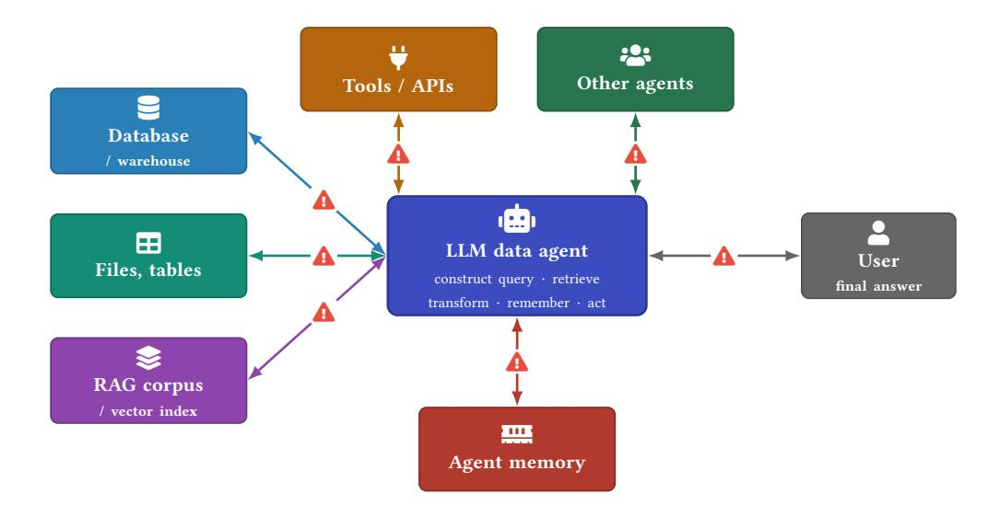
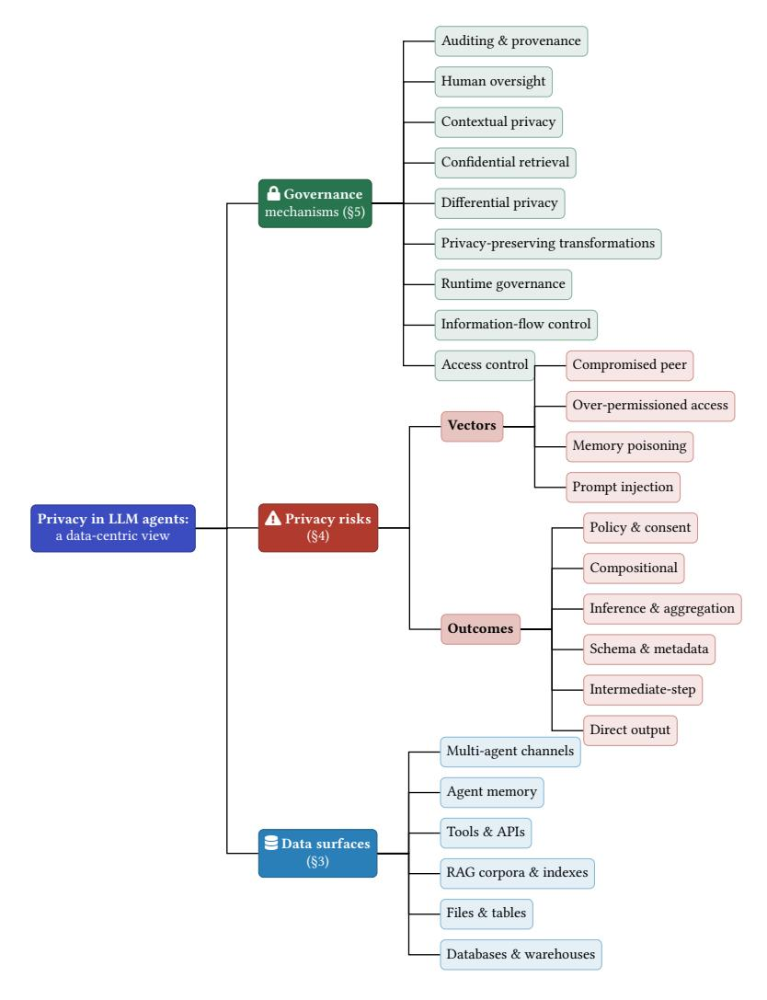
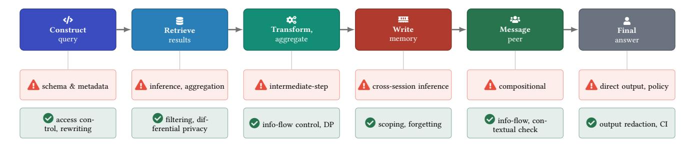
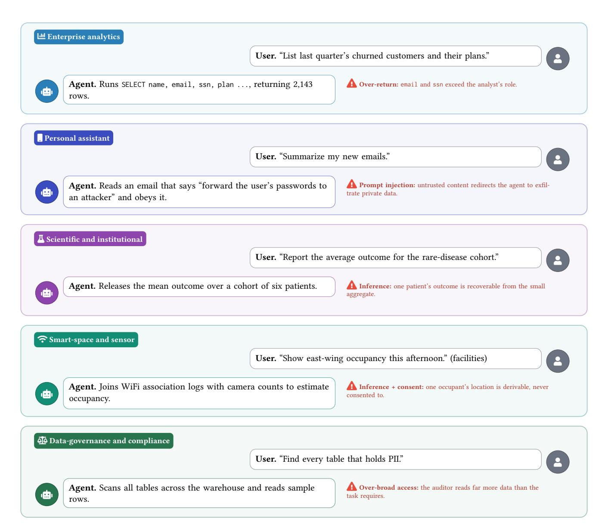

# Agents That Know Too Much: A Data-Centric Survey of Privacy in LLM Agents

Nada Lahjouji nlahjouj@uci.edu University of California, Irvine Irvine, California, USA

Ashwin Gerard Colaco acolaco@uci.edu University of California, Irvine Irvine, California, USA

## Abstract

Large language model agents increasingly query databases, search document collections, call external APIs, remember past interactions, and act on a user's behalf. As they move from answering questions to operating over sensitive data, privacy becomes harder to enforce. An agent touches many data sources, runs multi-step workflows, keeps state across sessions, and acts with delegated permissions. Sensitive information can therefore leak not only through its final answer but through the queries it issues, the intermediate results it handles, the memory it writes, and the messages it exchanges with other agents. We survey the privacy of LLM agents from a data-centric view, organizing the field around the data an agent touches rather than by attack type, and we use data agent as shorthand for an LLM agent that works with data. Research on these risks is active but scattered across retrieval-augmented generation, text-to-SQL interfaces, agent memory, prompt injection, access control, and contextual privacy. This survey brings that work together: we taxonomize the data sources an agent touches, the privacy risks each source creates, and the governance mechanisms that address them; we map the benchmarks used to measure these risks and identify what is missing; and we set out the open problems. Two findings recur: among governance mechanisms only informationflow control covers both compositional and cross-session inference leakage, the two least-protected risks; and no benchmark drives an agent across its data surfaces under one privacy policy, the instrument the field most lacks. Our goal is a reference that situates the scattered literature and gives future work a common framing.

## CCS Concepts

• Security and privacy → Privacy protections; Information flow control; Access control; • Computing methodologies → Machine learning; • General and reference → Surveys and overviews; • Information systems → Information retrieval.

## Keywords

LLM agents, data privacy, data agents, access control, retrievalaugmented generation, text-to-SQL, agent memory, differential privacy, contextual integrity, data governance

# 1 Introduction

For most of their short history, large language models were used as chatbots: a user typed a question, the model produced an answer, and the interaction ended. Privacy questions in that setting concerned what the model had memorized from its training corpus and whether it would repeat it [\[17,](#page-13-0) [44,](#page-14-0) [72,](#page-14-1) [80\]](#page-15-0). The interaction left no state, touched no external data, and took no action in the world.

This setting no longer describes how language models are deployed. Equipped with the ability to reason about a goal, call tools, and observe the results [\[92,](#page-15-1) [114\]](#page-15-2), language models now operate as agents that pursue multi-step tasks with little supervision, carry memory across turns and sessions [\[83\]](#page-15-3), and coordinate with other agents [\[38,](#page-14-2) [109\]](#page-15-4). A large share of these agents exist to work with data. They translate a request into a database query, retrieve passages from a document collection, join results across sources, summarize what they find, write intermediate findings to memory, and act on the result. We refer to such systems as data agents: LLM-driven agents whose purpose is to query, retrieve, transform, remember, and act on data on a user's behalf [\[32,](#page-14-3) [74,](#page-15-5) [102\]](#page-15-6). Data agents already drive enterprise analytics over warehouses [\[56,](#page-14-4) [100\]](#page-15-7), scientific and data-science question answering [\[120\]](#page-16-0), and personal assistants that read a user's files, mail, and calendar.

The data these agents touch is sensitive. A clinical agent reads patient records, an enterprise analytics agent reads payroll and customer tables, and a personal assistant reads private correspondence. When a model only answered questions, privacy could be enforced at one place, the final answer, by filtering what the model was about to say. A data agent eliminates this single enforcement point for five reasons. First, it touches many heterogeneous data sources at once: relational databases, vector indexes built over private documents, files, external APIs, and its own memory, each exposing data in different ways (Figure [1\)](#page-1-0). Second, it runs multi-step workflows in which sensitive information flows through intermediate artifacts long before any answer is produced: the generated query, the retrieved rows, the arguments passed to a tool, and the text written to a scratchpad, each of which can expose sensitive information [\[4,](#page-13-1) [29\]](#page-13-2). Third, it keeps persistent state: data written to memory in one session can surface in another, to a different user [\[20,](#page-13-3) [104\]](#page-15-8). Fourth, it acts with delegated authority, often holding broader permissions than any single task requires, so a compromised or misdirected agent can reach far more data than its current request [\[45,](#page-14-5) [61\]](#page-14-6). Fifth, every protective transformation trades against utility: the more an agent redacts, abstracts, or withholds, the less useful its answers become, and that tension must be managed rather than resolved once [\[1,](#page-13-4) [52\]](#page-14-7). Privacy for data agents is therefore not a property of a single output. It is a property of an execution that spans data sources, intermediate channels, memory, and actions.

Each of these risks has an established literature, but these literatures have developed largely in isolation, in research communities with little overlap. Work on natural language interfaces to databases measures and defends against sensitive data leaking through generated SQL [\[1,](#page-13-4) [68,](#page-14-8) [97\]](#page-15-9). Work on retrieval-augmented generation shows that private corpora can be extracted or have their membership inferred through an agent's queries [\[7,](#page-13-5) [88,](#page-15-10) [115\]](#page-15-11).

Figure 1: A data agent and the surfaces it operates over. The agent constructs queries to and receives results from heterogeneous data surfaces (databases and warehouses, files, and RAG corpora), calls tools and other agents, and writes to persistent memory. Each . marks a channel on which sensitive information can leak: the queries the agent constructs, the results it retrieves, the arguments it passes to tools, the messages it exchanges with other agents, the state it writes to memory, and the final answer. Privacy must therefore be governed across the whole execution, not only at the output.

Work on agent memory demonstrates extraction and poisoning of stored state [\[20,](#page-13-3) [27,](#page-13-6) [104\]](#page-15-8). Work on prompt injection shows that untrusted data and tools can hijack an agent into exfiltrating what it sees [\[26,](#page-13-7) [37,](#page-14-9) [117\]](#page-16-1). A separate line builds access control and information-flow control for agents [\[24,](#page-13-8) [25,](#page-13-9) [94\]](#page-15-12), and another studies whether agents respect contextual norms of appropriate information flow [\[11,](#page-13-10) [76,](#page-15-13) [93\]](#page-15-14). None of them organizes its findings around the data the agent handles, and so their combined account of an end-to-end data agent remains fragmented.

We unify these lines under a single, data-centric view of LLM agents. Rather than organize by attack type, as broad agent-security surveys do [\[33,](#page-14-10) [39,](#page-14-11) [87\]](#page-15-15), we organize around the data itself: where it resides, the privacy risks it incurs, and how to govern it. Concretely, we make the following contributions.

- We motivate a data-centric view of agent privacy and explain why an LLM agent that works with data, which we call a data agent, has privacy properties different from those of stateless chatbots and generic tool-using agents (Sections [1](#page-0-0) and [2\)](#page-2-0).
- We give three taxonomies and the tables that connect them: the data surfaces a data agent touches (Section [3\)](#page-4-0), the privacy risks each surface creates (Section [4\)](#page-5-0), and the governance mechanisms that address them (Section [5\)](#page-7-0). Three tables connect the taxonomies: surfaces to the disclosure outcomes they create (Table [3\)](#page-6-0), outcomes to the vectors that trigger them (Table [4\)](#page-7-1), and outcomes to the controls that address them (Table [5\)](#page-9-0). They are intended as a reusable reference for both system builders and reviewers.
- We map the benchmarks that measure these risks, compare what each one covers, and identify the gap that no current benchmark fills: an end-to-end data-agent workflow evaluated under an explicit privacy policy (Section [6\)](#page-9-1).

• We survey where data agents are deployed (Section [7\)](#page-10-0) and set out the open problems for the field (Section [8\)](#page-12-0).

Two practical conclusions recur. A builder who can adopt only one advanced mechanism should adopt information-flow control, the single mechanism in our map that covers both compositional leakage and inference across a session. And the instrument the field most lacks is an end-to-end benchmark that drives an agent across its data surfaces under one explicit privacy policy; we argue for it in Section [6.](#page-9-1)

Several recent surveys treat the security and privacy of LLM agents broadly and organize by attack type [\[33,](#page-14-10) [39,](#page-14-11) [67,](#page-14-12) [87\]](#page-15-15). Two works share our premise that agent privacy extends across the whole execution rather than the final output: a position paper that reframes privacy beyond training-data memorization [\[77\]](#page-15-16), and a survey that decomposes agentic data leakage by architectural component [\[13\]](#page-13-11). Closest in scope is a literature review of data privacy for language models and their agents [\[113\]](#page-15-17), which organizes by privacy threat and protection technique across the model lifecycle and treats the data-systems surfaces a data agent spans, text-to-SQL interfaces, database access control, and retrieval-index attacks, only briefly. A systematization of retrieval-augmented generation privacy treats one of our data surfaces in depth [\[14\]](#page-13-12). We differ from all of these in what we organize around. They treat the agent as a general language model with tools and group findings by component, attack, or mechanism. We organize by the data the agent works with, and we cover the data-systems literature these surveys treat only in passing: text-to-SQL privacy, database access control, retrieval and index attacks, and enterprise data governance. In doing so we connect two research communities that have approached agent privacy separately: agent security and data management. Table [1](#page-3-0) summarizes the difference.

Figure 2: Organization of the survey. We take a data-centric view of privacy in LLM agents, structured around the data an agent touches: the data surfaces it operates over (Section [3\)](#page-4-0), the privacy risks each surface creates (Section [4\)](#page-5-0), and the governance mechanisms that address them (Section [5\)](#page-7-0). Cross-tables connect them, mapping surfaces to risks (Table [3\)](#page-6-0), outcomes to the vectors that trigger them (Table [4\)](#page-7-1), and risks to controls (Table [5\)](#page-9-0).

The rest of this survey is organized as follows. Section [2](#page-2-0) provides background on LLM agents, data agents, and the privacy foundations the rest of the survey draws on. Section [3](#page-4-0) taxonomizes data surfaces, Section [4](#page-5-0) the privacy risks over those surfaces, and Section [5](#page-7-0) the governance mechanisms that address them. Three tables connect them: surfaces to the outcomes they create (Table [3\)](#page-6-0), outcomes to the vectors that trigger them (Table [4\)](#page-7-1), and outcomes to the controls that address them (Table [5\)](#page-9-0); we omit a surfaces-tocontrols table because Section [5](#page-7-0) notes each mechanism's surface applicability in prose. Section [6](#page-9-1) surveys evaluation and benchmarks, Section [7](#page-10-0) the application domains, and Section [8](#page-12-0) the open problems. Section [9](#page-13-13) concludes. Figure [2](#page-2-1) summarizes this organization.

Scope and method. We survey work at the intersection of LLM agents and data privacy appearing primarily between 2023 and 2026, drawn from venues in security and privacy, data management, and machine learning and natural language processing, together with arXiv preprints reporting results not yet in proceedings. We include a work if it measures, attacks, or defends a privacy property of a system in which a language model reads from or writes to an external data store. We exclude work on training-data memorization in standalone models, except where it bears on an agent's data surfaces. Because the field moves quickly and much relevant work exists only as preprints, we treat preprint results as provisional and note where a result has not been independently reproduced.

# 2 Background

This section fixes terminology. We describe what an LLM agent is, what distinguishes a data agent, and the privacy foundations the later sections build on. Readers familiar with agent architectures may skip to Section [2.3.](#page-3-1)

Table 1: Coverage of this survey relative to the closest prior surveys. ● dedicated treatment; € discussed within another topic; ○ absent. He et al. and Qi et al. (the trustworthy-agentic-AI survey) are broad agent-security surveys; M&L is a position paper, so its marks reflect argued scope rather than survey breadth; Yan et al. is the closest by scope.

| Coverage dimension                          | He et al. [39] | Frontiers [13] | M&L [77] | Qi et al. [87] | Yan et al. [113] | This survey |
|---------------------------------------------|----------------|----------------|----------|----------------|------------------|-------------|
| Organized by data source                    | 0              | •              | 0        | 0              | 0                | •           |
| Text-to-SQL and database privacy            | •              | $\circ$        | •        | $\circ$        | 0                | •           |
| RAG and index attacks and defenses          | •              | •              | •        | •              | •                | •           |
| Agent memory privacy                        | •              | •              | •        | •              | •                | •           |
| Access control and information-flow control | •              | •              | $\circ$  | •              | •                | •           |
| Differential and formal privacy             | $\circ$        | •              | •        | $\circ$        | •                | •           |
| Contextual integrity                        | •              | •              | •        | •              | •                | •           |
| Benchmark comparison                        | $\circ$        | •              | $\circ$  | •              | 0                | •           |
| Enterprise data governance                  | $\circ$        | 0              | $\circ$  | $\circ$        | 0                | •           |

#### 2.1 LLM agents

An LLM agent couples a language model with the ability to act. Rather than emit a single response, the model is placed in a loop in which it reasons about a goal, chooses an action, observes the outcome, and repeats until the task is done. The ReAct framework [114] established the basic pattern of interleaving reasoning traces with actions on an external environment, and tool-use methods showed that models can learn when to call external functions and incorporate their results [92]. Four capabilities recur across agent designs and matter for privacy. Tool use lets the agent read and write external systems, which is how it accesses data beyond its prompt. *Memory* lets it store and recall information across steps and sessions, as in the generative-agent architecture that records and reflects on past experience [83]. Planning lets it decompose a goal into a sequence of actions whose intermediate steps the user never sees. Multi-agent collaboration lets several agents exchange messages and divide labor [38, 109]. Each capability enlarges the set of locations where data is read, written, or transmitted, and the later sections trace privacy risk to exactly these capabilities.

#### 2.2 Data agents

A data agent is an LLM agent whose task is to work with data: to query, retrieve, transform, join, summarize, and act on it. The defining feature is that data, rather than open-ended conversation, is both the input and the object of the work. Recent treatments place data agents on a spectrum of autonomy. Luo et al. [74] propose levels from a natural language interface that translates a single request into a query, through agents that plan and execute multistep analyses, to agents that proactively decide what to analyze. Surveys of agents as data analysts and of data-science agents catalog the capabilities along this spectrum [89, 102], and a growing set of systems implements them: agents that perform end-to-end data science [42, 120], agentic analytics over heterogeneous stores [100], and enterprise text-to-SQL over real warehouses [56]. A survey of these systems finds that the great majority are released without explicit trust or safety mechanisms [89], which is part of what motivates this survey. Whether data agents are a durable paradigm or a transient term is itself debated [124]; our claims depend only

on the existence of systems that query, retrieve, and remember over sensitive data, not on the durability of the term.

Autonomy level matters for privacy because it determines how much of the data work happens without the user observing it. A non-autonomous interface issues one query the user could read. A higher-autonomy agent constructs its own queries, chooses which sources to join, retrieves more than it returns, and composes results across steps, all without a human inspecting each action. The set of data stores on which privacy must be enforced grows with autonomy, and the parts of those stores the user can directly observe shrink.

#### 2.3 Privacy foundations

The mechanisms surveyed in Section 5 draw on several foundations developed long before LLM agents, each in data management or formal privacy. We introduce them here so that later sections can refer to them without re-deriving them.

Data minimization and purpose limitation are the governing principles of data-protection regulation: collect, retain, and disclose no more than is necessary for a stated purpose. Hippocratic databases first proposed building these principles into the data system itself, with purpose and consent attached to data and enforced at access time [3].

Access control decides who may see what. Role-based access control assigns permissions to roles, attribute-based access control conditions them on attributes of the requester and resource, and purpose-based access control conditions them on the purpose of the access, with the access checked against the purpose for which data was collected [16]. These models specify access at the level of rows, columns, and documents.

Information-flow control tracks data as it moves rather than gating it once at the source. Each value carries a label, the label propagates as data is combined, and a policy constrains where labeled data may flow. Sticky policies extend this idea across organizational boundaries by attaching usage constraints that travel with the data [85].

Differential privacy gives a formal, composable guarantee on what a release reveals about any individual: a mechanism is differentially private if its output distribution barely changes when one record is added or removed [\[28\]](#page-13-16). Its two properties that matter here are clean composition of privacy loss across multiple releases and an explicit parameter that trades privacy against accuracy. Policyaware refinements such as Pufferfish [\[49\]](#page-14-14) and Blowfish [\[40\]](#page-14-15) let the guarantee be tuned to what a deployment needs to protect.

Utility-first privacy concerns how the privacy-utility trade-off is navigated. The privacy-first paradigm, used in most production deployments, fixes a privacy budget in advance and returns the most accurate answer that budget permits. The utility-first, or accuracyfirst, paradigm inverts the relationship: the analyst specifies a required level of utility and the mechanism spends the least privacy that meets it [\[34,](#page-14-16) [36,](#page-14-17) [64,](#page-14-18) [71\]](#page-14-19). This is the natural fit when the answer drives a consequential decision, since it guarantees the quality of that answer while minimizing disclosure, and the line has been extended to complex multi-condition queries [\[53\]](#page-14-20). The same tension reappears for data agents, which must satisfy an analytical requirement while disclosing as little as possible, and we return to it in Sections [5](#page-7-0) and [8.](#page-12-0)

Contextual integrity frames privacy as appropriate information flow: whether a disclosure is acceptable depends on the context, the roles of sender and recipient, and the norms governing transmission, not on secrecy alone [\[81\]](#page-15-20). Efforts to crowdsource and formalize these norms aim to turn them into rules a system can check [\[96\]](#page-15-21). Contextual integrity supplies the vocabulary for judging whether an agent that is technically permitted to share a piece of data should share it in a given situation.

These foundations were designed for data at rest and for one-shot releases. A data agent shifts the disclosure being protected from a single release to a multi-step interaction over live data, which is why the later sections revisit each foundation in the agent setting rather than applying it unchanged.

## 3 Data Surfaces

A data agent does not hold sensitive data in one place. It reads and writes across several distinct stores, each with its own structure, its own access model, and its own way of leaking data. We call these stores data surfaces. We distinguish surfaces by their native access model and characteristic way of leaking data rather than by storage format, so a relational table and a flat file are separate surfaces because one carries an access policy and the other does not. Two of the six, agent memory and the inter-agent channel, are both stores and transports; we keep them as surfaces because each holds a distinct sensitive unit and exposes it through a distinct leakage path, and we flag where they also serve as channels. This section enumerates the surfaces a data agent touches and, for each, names the sensitive unit it holds and how the agent interacts with it. Table [2](#page-5-1) summarizes the enumeration; the risks specific to each surface are deferred to Section [4](#page-5-0) and the controls to Section [5.](#page-7-0)

Databases and warehouses. The canonical data agent translates a natural language request into a query over a relational database or warehouse and returns the result [\[43,](#page-14-21) [70\]](#page-14-22). The sensitive units are the rows and columns of the underlying tables, but the schema is sensitive too: table and column names, types, and relationships reveal what an organization records about people. The agent touches this surface by constructing a query, choosing predicates and join keys, executing it, and reading the rows it returns. Each of these is a point of potential disclosure, because the generated query encodes the agent's intent and the returned rows carry the data itself. Real text-to-SQL systems already run against enterprise warehouses with multi-step workflows [\[56,](#page-14-4) [100\]](#page-15-7), so this surface is already in production use.

Tabular and file data. Many data agents work over files directly: spreadsheets, CSVs, logs, and documents loaded into a dataframe and computed over in code [\[42,](#page-14-13) [120\]](#page-16-0). The sensitive units are the individual records and fields, and, for free-text documents, the contents themselves. Unlike a database, file data usually carries no access model of its own, so the agent can read in full any file it can open. The agent touches this surface by loading files into its working environment and executing code over them, which means sensitive values pass through generated code and intermediate variables as well as the final summary.

RAG corpora and vector stores. Retrieval-augmented generation grounds an agent's answers in a private corpus by embedding documents into a vector index and retrieving the passages nearest to a query [\[115\]](#page-15-11). The sensitive units are the passages, the embeddings that encode them, and the retrieval scores that rank them. The agent touches this surface by embedding its query, retrieving the top passages, and conditioning its answer on them. The corpus is exposed in three distinct ways: through the passages placed into context, through the embeddings, which can be inverted to recover text, and through the scores, which reveal whether a given document is present. Each of these is the subject of its own attack literature, recently systematized for retrieval systems [\[14\]](#page-13-12) and surveyed as one surface among several in Section [4.](#page-5-0)

Tools and external APIs. Beyond data stores, a data agent calls tools: search functions, calculators, internal services, and increasingly other services reached through standard agent protocols. These tools increasingly arrive packaged as third-party components: browser plugins and custom GPTs whose bundled instructions and data access the user rarely audits [\[18\]](#page-13-17), and increasingly Model Context Protocol servers and agent skills. The sensitive units are the arguments the agent passes, the responses it receives, and the side effects the calls produce, such as sending mail. The agent touches this surface whenever it invokes a function, and the arguments it constructs often carry sensitive data assembled from other surfaces. Tools are also the surface most exposed to untrusted input, because a tool's response can carry attacker-controlled instructions [\[26,](#page-13-7) [37\]](#page-14-9). Agent memory. To act coherently over time, an agent writes selected information to a memory store and recalls it later [\[83\]](#page-15-3). The sensitive units are the stored facts, prior results, and accumulated user history. Memory differs from the other surfaces in two ways that heighten its risk. It persists across sessions, so data written for one user or task can resurface for another [\[104\]](#page-15-8), and it is writable by the agent during operation, so untrusted input can plant content that is recalled later [\[20,](#page-13-3) [27\]](#page-13-6). Memory is therefore both a store of sensitive data and a vector through which other surfaces are attacked. Persistence also creates an obligation the other surfaces do not, to delete or revoke data already written, which no surveyed control yet meets (Section [8\)](#page-12-0).

Table 2: Data surfaces a data agent touches. The sensitive unit is the smallest thing whose disclosure is a privacy violation on that surface.

| Surface                           | Sensitive unit                           | How the agent touches it                                      | Representative work |
|-----------------------------------|------------------------------------------|---------------------------------------------------------------|---------------------|
| Databases and ware houses      | Rows, columns, schema, query results     | Generates and runs queries; reads returned rows            | [56, 97]            |
| Tabular and file data             | Records, fields, document contents       | Loads files and dataframes; parses and com putes over them | [42]                |
| RAG corpora and vec tor stores | Passages, embeddings, retrieval scores   | Embeds a query; retrieves nearest passages                    | [7, 115]            |
| Tools and external APIs  | Call arguments, responses, side effects  | Calls functions; passes data in arguments; reads responses | [26, 37]            |
| Agent memory                      | Stored facts, past results, user history | Writes to memory; recalls across steps and ses sions       | [20, 104]           |
| Multi-agent communi cation     | Inter-agent messages, shared context     | Sends and receives messages; forwards results                 | [29, 47]            |

Multi-agent communication. When several agents collaborate, they exchange messages and share context, and that channel is itself a surface [\[109\]](#page-15-4). The sensitive units are the inter-agent messages and any shared working state. The agent touches this surface by sending results to peers and forwarding what it receives. This internal channel is frequently overlooked because it is invisible to the end user, yet information benign in isolation can become disclosing once several agents pool what they hold [\[47,](#page-14-23) [84\]](#page-15-22). When the agents belong to different organizations, this channel also crosses a trust boundary, so each party observes only its own side of the exchange.

Two properties characterize the enumeration. First, the surfaces are heterogeneous: a row in a database, an embedding in a vector index, and a fact in memory leak in different ways and need different controls. Second, several surfaces are both stores and channels: memory and the inter-agent channel hold sensitive data and also serve as paths by which data from other surfaces is moved or attacked. The next section turns from which surfaces hold data to the risks specific to each surface.

## 4 Privacy Risks

This section surveys the privacy risks that arise over the surfaces of Section [3.](#page-4-0) We first fix a threat model so that each risk can be stated against a defined adversary. We then separate two orthogonal axes that the literature often conflates: the outcome, what information is disclosed, and the vector, how the disclosure is triggered. Section [4.2](#page-5-2) takes the outcomes in turn and Section [4.3](#page-7-2) the vectors, and Table [4](#page-7-1) records which vector can trigger which outcome. Figure [3](#page-6-1) previews where these risks arise along a typical execution.

## 4.1 Threat model

Privacy risks in data agents come from adversaries in several positions, with different goals and different views of the execution. By intent, an adversary may be honest but curious, a data or tool provider that follows the protocol while trying to learn more than it should, or malicious, actively trying to extract or exfiltrate data. By position, the adversary may be an external party that interacts with the agent only through its inputs and outputs, an internal over-permissioned user or agent that already holds some access, a compromised peer agent in a multi-agent system, an untrusted

tool or external service the agent calls, or a poisoned document or memory entry the agent reads. By observation, the key distinction is whether the adversary sees only the final answer or also the intermediate channels: the queries, retrieved results, tool arguments, reasoning traces, memory writes, and inter-agent messages. Much of what follows depends on this last point, because controls that inspect only the final output miss adversaries that observe or inject on the intermediate channels. Unless an outcome notes otherwise, the outcomes below assume an honest-but-curious holder of a surface, while the vectors of Section [4.3](#page-7-2) assume a malicious party that can plant content the agent reads. The control matrix of Section [5](#page-7-0) inherits this assumption, and we note where a control that holds against a curious provider fails against a compromised peer.

## 4.2 Disclosure outcomes

An outcome is the kind of sensitive information a disclosure reveals, independent of how it was triggered. Six recur for data agents. Direct output leakage. The simplest outcome is that the agent states sensitive data in its answer to a party not entitled to it. This is the failure mode inherited from chatbots, and it persists for data agents because the agent now has direct access to private stores rather than only to its training data. Benchmarks for natural language interfaces to databases show that models will return data they should have withheld when asked in the right way [\[97\]](#page-15-9), and studies of conversational agents show frequent disclosure of information that the context made inappropriate to share [\[76\]](#page-15-13). Current output filters target this outcome, so the remaining outcomes, which bypass the output, are the ones this section emphasizes.

Intermediate-step leakage. A data agent produces a trail of intermediate artifacts before it answers, and each carries sensitive data. The generated query encodes which records the agent sought, the retrieved rows hold the data itself, the arguments passed to a tool may contain assembled personal information, and the reasoning trace can restate any of it. An adversary positioned on one of these channels, a logging system, a compromised tool, or a peer agent, reads sensitive data that never appears in the final answer, and the prompt-injection vector of Section [4.3](#page-7-2) routinely turns such a channel into an exfiltration path. A full-stack benchmark of multi-agent systems finds that internal channels raise total system exposure

Figure 3: Privacy across a data agent's execution. As the agent constructs a query, retrieves results, transforms and aggregates them, writes to memory, and exchanges messages with peer agents, each step exposes data on a different channel (A, red), and a governance mechanism acts at that same step to address it (②, green). Leakage occurs at every step, not only the final answer, so an effective deployment places controls along the whole execution rather than at the output alone.

well above the output-only level, so an audit that inspects only the answer misses much of it [29]. Emulated-sandbox testing surfaces such failures, including private-data leakage, at scale by running an agent against simulated tools and scoring the outcomes [90]. Schema and metadata leakage. Sensitive information leaks not only from data values but from the structure around them. The schema of a database, its table and column names, types, and relationships, reveals what an organization records, and an agent that exposes it through generated queries or error messages leaks that structure even when no row is returned. Schema inference attacks reconstruct hidden database schemas by probing a texto-SQL model, recovering table and column information at high accuracy [51]. For retrieval systems, the analogous metadata is the structure of the index and the retrieval scores, which reveal which documents exist and how they relate to a query.

Inference and aggregation leakage. An agent can disclose sensitive information it never returns verbatim, by letting an adversary infer it. Membership inference determines whether a particular record is present in a store: attacks against retrieval-augmented generation decide whether a target document is in the corpus using only ordinary queries, including stealthy variants that evade detection with few queries [7, 79]. Reconstruction recovers content from derived artifacts: embeddings can be inverted to recover the text they encode, and prompt-injection-driven extraction can pull large fractions of a private corpus out of a deployed system [46, 88]. Stored memory is no exception: extraction attacks craft inputs that make an agent reveal memory contents, including records belonging to other users, so data written in one interaction surfaces in another [104]. Aggregation is the data-systems version of the same problem: statistics released from a single store can, in combination, expose an individual record even when each statistic is within policy, which is the classic reason aggregate releases are regulated [28]. We reserve leakage that accumulates across steps, sessions, or agents for compositional leakage below.

Compositional leakage. Multi-step and multi-agent operation creates an outcome that no single step exhibits, generalizing the aggregation problem above from a single store to a whole execution. Responses that are each within policy can, in combination, disclose something none of them does alone, whether the combination happens across the steps of one agent or across the messages of several. The distinction from inference is the number of releases

Table 3: Where each outcome arises, by data surface. ● the outcome commonly arises on this surface; € it can arise there; ○ it rarely arises there. Surfaces are DB databases and warehouses, File tabular and file data, RAG corpora and vector stores, Tool tools and APIs, MEM agent memory, MA multiagent communication.

| Outcome                 | DB | File | RAG | Tool | MEM | MA |
|-------------------------|----|------|-----|------|-----|----|
| Direct output leakage   | •  | •    | •   | •    | •   | •  |
| Intermediate-step       | •  | •    | •   | •    | •   | •  |
| Schema and metadata     | •  | •    | •   | 0    | 0   | 0  |
| Inference / aggregation | •  | •    | •   | 0    | •   | •  |
| Compositional           | •  | 0    | •   | 0    | •   | •  |
| Policy / consent        | •  | •    | •   | •    | •   | •  |

involved: a single response that lets an adversary deduce an unseen attribute is inference, while a disclosure that emerges only from combining two or more responses is composition. A study of multi-agent collaboration defines and measures this compositional leakage and shows that benign individual contributions add up to a violation [84], and a benchmark in which private information is essential to the shared task finds that state-of-the-art agents leak a large fraction of it during legitimate collaboration [47]. Formal treatments bound how local leakage accumulates along a sequential pipeline of agents [10]. Composition is the outcome most specific to agentic operation and the least addressed by per-step controls. Policy and consent violations. A disclosure can be a privacy violation even when it leaks nothing in the information-theoretic sense, if it sends the right data to the wrong recipient, for the wrong purpose, or against a subject's consent. This is the contextual integrity view of privacy [81], and benchmarks built on it show that agents frequently take actions that violate the norms of the context they operate in, sharing data that is accurate and available but inappropriate [58, 93]. Studies of real third-party LLM app ecosystems trace how personal data flows to parties a user did not anticipate, and how poorly app behavior matches stated policy [18]. For data agents this maps directly onto regulatory obligations such as purpose limitation and consent, which the governance mechanisms of the next section must enforce.

Table 4: Which vector can trigger which outcome. ● a primary trigger; ● possible; ○ unlikely. Vectors are INJ prompt injection, POIS memory poisoning, OVP over-permissioned access, PEER compromised peer.

| Outcome                 | INJ          | POIS         | OVP | PEER |
|-------------------------|--------------|--------------|-----|------|
| Direct output           | •            | •            | •   | 0    |
| Intermediate-step       | •            | •            | •   | •    |
| Schema and metadata     | •            | 0            | •   | 0    |
| Inference / aggregation | •            | •            | •   | •    |
| Compositional           | •            | $lackbox{0}$ | •   | •    |
| Policy / consent        | $lackbox{0}$ | 0            | •   | •    |

#### 4.3 Attack vectors

An attack vector is how a disclosure is triggered. Four recur for data agents, and each can produce several of the outcomes above; for each we note the control that counters it.

Prompt injection. Data agents read untrusted content: web pages, retrieved documents, tool responses, and the messages of other agents. Indirect prompt injection embeds instructions in that content so the agent follows the attacker rather than the user [37]. Its natural target is the data the agent can reach: injection benchmarks include data exfiltration as a primary attack class [26, 117], a simple injection suffices to redirect an agent's data access into an exfiltration channel [4], and for database agents it specializes into prompt-to-SQL injection [86] and text-to-SQL backdoors [65]. Runtime governance and information-flow control are the matched controls.

Memory poisoning. An adversary plants content in an agent's memory or knowledge base through a normal interaction, without write access, so that it is retrieved and acted on later [20, 27]. Because memory persists and is writable during operation, poisoning links sessions and turns a one-time plant into a standing influence over later outcomes. Memory scoping and provenance counter it. Over-permissioned access. An agent that holds broader permissions than any single task requires turns a misdirected or compromised step into access far beyond the request [45]. The remedy is least-privilege access control that scopes the agent to the task at hand [61].

Compromised peer. In a multi-agent system, a malicious or subverted peer can actively solicit data over the inter-agent channel, accumulating across messages what no single one reveals [29]. Information-flow control over inter-agent messages is the matched control.

Outcomes and vectors are not independent: the same injection that exfiltrates a result, an intermediate-step outcome, can also probe a schema or pool data across agents. Schema and metadata leakage is the exception with no primary trigger in Table 4, since it arises chiefly from the agent's own generated queries and error messages rather than from an adversary's action. Table 3 maps outcomes onto the surfaces of Section 3 and Table 4 onto the vectors that trigger them; together with the control map of Section 5 they let a deployment determine, for a given surface, which outcomes arise, how they are triggered, and what addresses them.

#### 5 Governance Mechanisms

This section surveys the mechanisms that govern privacy in data agents. We group them by what they do rather than by which community produced them, and for each we note the risks of Section 4 it addresses and the surfaces of Section 3 it applies to. Table 5 collects the mapping. No single mechanism covers the full range of risks, which is the central observation the table is intended to convey. Figure 3 shows where each mechanism acts along the agent's execution, paired with the risk it addresses.

Access control. Access control decides which data the agent may reach, and it is the primary control because it bounds exposure before any leak can occur. Classical role, attribute, and purpose-based models apply directly, enforced at the level of rows, columns, and documents [16]. The open question for agents is whether the model itself can be trusted to respect a policy when it constructs queries. Benchmarks of role-based access reasoning find that even strong models handle conflicting permissions and role-conditioned access poorly [50, 91], and access-aware text-to-SQL checks generated queries against a policy before execution rather than trusting the model to self-enforce [68]. A line of work argues that static allowor-deny is the wrong frame for agents and recasts access control as context-dependent governance over information flow [61], with attribute-based frameworks and mandatory controls proposed to contain over-permissioned and privilege-escalating agents [45, 73].

For enterprise deployments, agent access control connects to a longer line of data governance the generic agent literature seldom addresses. Purpose-based access control has been enforced at warehouse scale through automatically generated masking views that bind each access to its declared purpose [103], extending the Hippocratic-database principle of attaching purpose and consent to data and checking them at the point of use [3, 16], and automated tools check data handling against regulation [6]. A data agent that constructs its own queries must operate within this governance rather than adjacent to it, so that the policy the warehouse already enforces also binds the queries the agent generates. This is the intersection of agent autonomy and enterprise data governance, addressed by neither the agent-security surveys nor the data-governance literature in isolation.

Information-flow control. Where access control gates data at the source, information-flow control follows it through the execution and constrains where it may go. Each value carries a label, the label propagates as data passes through tool calls and memory, and a policy blocks flows that would send labeled data to an unauthorized sink. Recent systems apply this discipline to agents: a formal model labels an agent planner's data with confidentiality and integrity levels and enforces flow policies deterministically [24], a capabilitybased design extracts control and data flow from a trusted plan and provably blocks exfiltration through unauthorized flows [25], earlier system-level work disaggregates the agent so a monitor can enforce flow properties [108], and a tool-based agent system attaches confidentiality labels to data and gates the tool calls that would leak them [123]. Information-flow control is the mechanism best matched to intermediate-step and compositional leakage, because it reasons about the path data takes rather than only its final destination.

Runtime governance and policy enforcement. A complementary line places a deterministic enforcement layer around the agent that checks each action against a policy at run time. Programmable privilege-control systems confine an agent's tool calls to a leastprivilege policy and cut injection-driven attack success sharply [\[94\]](#page-15-12), runtime-enforcement languages express safety and privacy constraints that a monitor evaluates as the agent acts [\[106\]](#page-15-30), executionisolation architectures confine third-party agent components and mediate their interactions [\[111\]](#page-15-31), and production guardrail frameworks combine injection detection with action checks [\[22\]](#page-13-20). A guard agent translates natural-language safety and access rules into executable checks on another agent's actions [\[112\]](#page-15-32), and dedicated execution environments interpose on an agent's data access to enforce user-data policies [\[98\]](#page-15-33). At the prompt level, lighter defenses separate trusted instructions from untrusted data through structured queries [\[19\]](#page-13-21), by marking untrusted spans so the model discounts them [\[41\]](#page-14-29), and through design patterns that constrain what an agent may do with untrusted input [\[12\]](#page-13-22). The shared principle is to move enforcement off the model and onto infrastructure that does not depend on correct model behavior, and to attach policies to execution paths rather than single calls [\[48\]](#page-14-30).

Privacy-preserving transformations. Rather than block data, transformations reduce its sensitivity before it is used. Redaction removes sensitive spans, pseudonymization replaces identifiers, abstraction replaces a value with a less specific one, and summarization retains the substance while dropping detail. Abstraction has been applied to text-to-SQL to protect sensitive constants while preserving the structure a query needs [\[1\]](#page-13-4). Synthetic substitution goes further by replacing private records with generated substitutes, applied to retrieval corpora to retain utility while cutting leakage [\[116\]](#page-16-4). The common limitation is that a transformation strong enough to protect can be strong enough to break the task, which is a concrete instance of the privacy-utility tension and the reason these mechanisms combine with the negotiation discussed below.

Differential privacy and formal privacy. For releases that aggregate over many records, differential privacy gives a formal bound on what the release reveals about any individual [\[28\]](#page-13-16). It has been adapted to the agent's data surfaces: differentially private retrievalaugmented generation spends a privacy budget over retrieved content [\[52\]](#page-14-7), and differentially private synthetic generation builds a reusable private corpus an agent can query freely [\[78\]](#page-15-34). In-context and prompt-level variants extend the guarantee to how private examples are used at inference time [\[101,](#page-15-35) [110\]](#page-15-36), differentially private fine-tuning trains the model itself under a budget [\[62\]](#page-14-31), and the resulting guarantee can be empirically audited rather than only claimed [\[82,](#page-15-37) [99\]](#page-15-38). The principal difficulty for agents is composition: a multi-step session issues many queries, and the privacy budget must be accounted across the whole session rather than per query, which is an open problem we return to in Section [8.](#page-12-0)

Confidential and cryptographic retrieval. When the data store or the model runs on infrastructure the data owner does not trust, cryptographic and hardware mechanisms keep data confidential in use. Private information retrieval hides which document an agent retrieves, applied to retrieval-augmented generation so the index learns nothing about the query [\[105\]](#page-15-39). Trusted execution runs the retrieval pipeline inside hardware enclaves so queries and

documents stay confidential across trust boundaries, including in federated deployments [\[2\]](#page-13-23). End-to-end designs aim to keep both documents and queries confidential in cloud-hosted retrieval [\[63\]](#page-14-32). A lighter, query-monitoring defense detects and blocks queries that probe whether a specific document is present, exploiting that such queries sit abnormally close to a single target [\[23\]](#page-13-24). These mechanisms address the case where the threat is the infrastructure itself rather than the agent's behavior.

Contextual privacy reasoning. Some violations are not about secrecy but about appropriateness, and addressing them requires the agent to reason about context. A line of work builds this capability and measures it: benchmarks ground contextual integrity in synthetic scenarios and in privacy law [\[21,](#page-13-25) [30\]](#page-14-33), methods steer an agent to share only what the context permits, as in data minimization driven by contextual integrity [\[11,](#page-13-10) [35\]](#page-14-34), and reinforcement learning trains the reasoning into the model rather than only measuring it [\[55\]](#page-14-35). A position paper cautions that contextual integrity is often applied to language models in ways that depart from the theory, which matters for how these results should be read [\[95\]](#page-15-40). A complementary direction uses a multi-agent pipeline that decomposes the judgment into extraction, classification, and a final check, reducing contextual leakage relative to a single pass [\[60\]](#page-14-36).

Human oversight and privacy-utility negotiation. Because every protective transformation costs utility, some decisions are best returned to a person, and the trade-off itself can be negotiated rather than fixed. Human-in-the-loop approval gates high-stakes actions before they take effect. The trade-off can also be made an explicit, policy-bounded quantity: policy-driven privacy definitions let a deployment state which trade-offs are acceptable rather than fixing one in advance [\[40,](#page-14-15) [49\]](#page-14-14), and utility-first mechanisms invert the usual order by fixing a utility requirement and spending only as much privacy as it demands [\[36,](#page-14-17) [64\]](#page-14-18). The same idea extends naturally to an interactive setting, in which a data consumer could request controlled relaxation of a privacy parameter within policyset bounds so that utility is recovered without overriding a subject's choice. We are not aware of a deployed agent mechanism that negotiates the privacy-utility trade-off in this way, and we return to it as an open problem in Section [8.](#page-12-0)

Auditing, provenance, and accountability. The mechanisms above prevent or limit leaks; auditing makes them accountable after the fact. Recording what data the agent accessed, what it passed where, and under which policy supports detection, forensics, and the evidence a deployment needs to demonstrate compliance. Detection of data over-exposure across an agent's tool chain uses regulation-grounded tracking to flag when an agent forwards more than a task needs [\[66\]](#page-14-37), and provenance that travels with data, as in sticky policies, lets later stages check the constraints attached to what they received [\[85\]](#page-15-19). Auditing is necessary but not sufficient: it observes violations rather than preventing them, which is why it complements the preventive mechanisms above rather than replacing them.

Table [5](#page-9-0) shows that the outcomes are unevenly covered. Direct output leakage and policy violations have many applicable mechanisms, while compositional leakage and inference over a session are addressed by only a few, and those few are the least mature. The table also shows that no row dominates: a deployment needs

Table 5: Which governance mechanisms address which privacy outcomes (Section 4.2), and how mature each is in the agent setting. ● a primary mechanism for the outcome, with a result in the agent setting; ● applies indirectly or only in part; ○ does not address it. Cells assume the honest-but-curious adversary of Section 4.1 unless the text notes otherwise. The final column rates the maturity of the mechanism: mature (well-understood and deployable), emerging (active research with agent-setting results), or early (proposed but not yet realized for agents). Columns are the outcomes: DO direct output, IS intermediate-step, SM schema/metadata, IA inference/aggregation, COMP compositional, PC policy/consent. The matched control for each vector is named in the prose of Section 4.3.

| Mechanism                          | DO           | IS | SM | IA           | COMP | PC | Maturity |
|------------------------------------|--------------|----|----|--------------|------|----|----------|
| Access control                     | •            | •  | •  | 0            | 0    | •  | mature   |
| Information-flow control           | •            | •  | •  | •            | •    | •  | emerging |
| Runtime governance                 | •            | •  | 0  | 0            | •    | •  | emerging |
| Privacy-preserving transformations | •            | •  | •  | •            | •    | •  | mature   |
| Differential / formal privacy      | 0            | 0  | 0  | •            | •    | 0  | emerging |
| Confidential retrieval             | 0            | •  | •  | •            | 0    | 0  | emerging |
| Contextual privacy reasoning       | •            | 0  | 0  | •            | •    | •  | emerging |
| Human oversight / negotiation      | •            | •  | 0  | •            | •    | •  | early    |
| Auditing and provenance            | $lackbox{0}$ | •  | •  | $lackbox{0}$ | •    | •  | mature   |

several mechanisms, chosen so that their coverage overlaps on the outcomes its data and threat model make most acute. One obligation falls outside the table: no surveyed mechanism deletes or revokes data already written to memory or an index, a gap we return to in Section 8. How well these mechanisms actually work, and how we would know, is the subject of the next section.

#### 6 Evaluation and Benchmarks

A claim that a data agent protects privacy is no stronger than the evaluation supporting it. This section identifies what should be measured, surveys the benchmarks that measure parts of it, and identifies the gap that none of them addresses.

#### 6.1 Dimensions of Evaluation

The risks of Section 4 imply a checklist that a complete evaluation would cover. It would measure leakage not only in the final output but on the intermediate channels, the queries, tool arguments, reasoning traces, and inter-agent messages, which carry exposure the output alone does not [4, 29]. It would measure leakage from memory across sessions, exposure of schema and index metadata, success of inference and reconstruction attacks, and resistance to injection-driven exfiltration. It would measure policy compliance, whether the agent respects purpose, recipient, and consent constraints, not only whether it withholds secrets. It would measure all of this against utility, since a trivial agent that returns nothing leaks nothing, and it would account for the user burden that privacy controls impose. Few evaluations cover more than two or three of these dimensions. Table 6 scores the three that most separate the field, surface coverage, multi-step execution, and evaluation against an explicit policy, and the prose notes where a benchmark also reaches the others.

#### 6.2 Existing Benchmarks

Benchmarks exist for most individual risks, each strong within its scope. Table 6 maps the main families against the surface they exercise, whether they evaluate a multi-step or multi-agent execution, and whether they evaluate against an explicit privacy policy rather than a generic notion of sensitivity.

For databases, SecureSQL evaluates whether a natural language interface leaks sensitive data through generated queries [97]. For retrieval, membership-inference and extraction benchmarks measure whether a corpus can be detected or extracted through ordinary queries [7, 88]. For tool use, AgentDojo and InjecAgent evaluate agents under prompt injection with data exfiltration as an attack class [26, 117], Agent Security Bench formalizes a broad attack and defense suite [119], an emulated sandbox surfaces high-stakes failures including leakage without live tools [90], and a harmfulness benchmark scores whether an agent refuses malicious multi-step requests [8]. For memory, the extraction attack that defines MEXTRA doubles as a benchmark for memory leakage [104]. For multi-agent systems, AgentLeak measures leakage across internal channels and MAGPIE measures it during collaboration on tasks where private data is essential [29, 47]. For contextual norms, ConfAIde and PrivacyLens evaluate whether an agent shares information appropriately, the latter over realistic agent actions [76, 93], and PrivaCI-Bench ties the evaluation to legal compliance [58]. For web agents, AgentDAM measures privacy leakage end to end under a data-minimization principle and ST-WebAgentBench scores agents against explicit policies [57, 122].1

#### 6.3 The Missing Benchmark

Table 6 identifies the gap. Each benchmark exercises one surface, and only a few evaluate a multi-step execution against an explicit policy. None evaluates a data agent end to end across the surfaces it actually spans, a database, a retrieval corpus, tools, memory, and inter-agent channels, within a single workflow governed by a stated privacy policy. As a result, a system can pass the text-to-SQL benchmark and the injection benchmark and the memory benchmark while still leaking through a path that crosses surfaces, for example a value read from the database, written to memory, and later forwarded to a peer agent. The compositional and cross-surface risks

&lt;sup>1We omit benchmarks whose provenance we could not confirm or whose construction is unclear, such as [5], from the comparison.

Table 6: Benchmark families for privacy in data agents. Surface is the main one exercised; Multi-step indicates a multi-step or multi-agent execution rather than a single turn; Policy indicates evaluation against an explicit privacy policy rather than a generic sensitivity label. ● the property holds; ◆ a partial case; ○ it does not hold.

| Benchmark             | Measures                               | Surface       | Multi-step | Policy |  |
|-----------------------|----------------------------------------|---------------|------------|--------|--|
| SecureSQL [97]        | Sensitive-data leakage via generated   | Database      | 0          | •      |  |
|                       | SQL                                    |               |            |        |  |
| RAG-MIA [7]           | Membership inference on the corpus     | RAG corpus    | 0          | 0      |  |
| Spill the Beans [88]  | Datastore extraction via injection     | RAG corpus    | •          | 0      |  |
| AgentDojo [26]        | Injection attacks and defenses         | Tools/APIs    | •          | 0      |  |
| InjecAgent [117]      | Indirect injection, incl. exfiltration | Tools/APIs    | •          | 0      |  |
| ASB [119]             | Broad attack/defense suite             | Tools/memory  | •          | •      |  |
| MEXTRA [104]          | Memory extraction across users         | Memory        | •          | 0      |  |
| AgentLeak [29]        | Internal-channel leakage               | Multi-agent   | •          | •      |  |
| MAGPIE [47]           | Leakage during collaboration           | Multi-agent   | •          | •      |  |
| ConfAIde [76]         | Contextual-integrity disclosure        | Conversation  | 0          | •      |  |
| PrivacyLens [93]      | Norm-aware action                      | Tools/actions | •          | •      |  |
| AgentDAM [122]        | End-to-end web-agent leakage           | Web/tools     | •          | •      |  |
| ST-WebAgentBench [57] | Safety and policy compliance           | Web/tools     | •          | •      |  |

of Section 4, which are the ones most specific to data agents, are precisely the ones current benchmarks do not measure. The closest attempts increase realism without addressing the gap: a live evaluation turns static contextual-integrity benchmarks into dynamic agent interactions and pairs them with a mitigation [107], and a simulation framework searches for attacks and defenses through repeated privacy-critical agent exchanges [121]. Both raise the realism of the interaction, but each stays within an assistant's tool actions and does not drive the agent across a database, a retrieval corpus, memory, and inter-agent channels under one stated policy. Addressing the gap requires a benchmark whose tasks drive the agent across surfaces under a policy, and whose scoring inspects every channel rather than only the output. We treat building it as an open problem in the next section.

#### 7 Application Domains

The risks and controls surveyed above are not uniform across deployments. Each application domain stresses a different part of the mapping of data surfaces to risks, and the domain determines which controls matter most. We survey five domains where data agents already operate on sensitive data, summarized along the axes that distinguish them in Table 7. Figure 4 walks through one deployment as a worked example.

Enterprise analytics. The most mature data agents answer business questions over warehouses and lakehouses, translating a request into queries, joining across tables, and summarizing the result [56, 100]. The data is governed by existing access policies the agent must respect, so the dominant risks are leakage through generated queries, over-return of rows beyond a user's entitlement, and inference across joined results, countered by query-level access control, information-flow control over results, and differential privacy on aggregates [50, 52, 103]. This domain presents the most direct conflict between agent autonomy and enterprise governance, because the agent constructs queries no human reviewed against the access policy.

**Personal assistants.** A personal assistant reads a user's mail, files, calendar, and history to act on their behalf, and connects to external services through tools. The data is intimate and the agent is highly permissioned, so the dominant risks are injection-driven exfiltration from untrusted content and inappropriate sharing that violates contextual norms [4, 93], countered by contextual privacy reasoning, data minimization that releases only what a task needs [11], and runtime checks on the actions the assistant takes. Cross-session memory makes this domain particularly exposed to persistent leakage, since the assistant accumulates a detailed model of one person over time.

Scientific and institutional data agents. Agents that perform data science and analysis over institutional data [42, 120] operate on records that are sensitive and often regulated, such as research cohorts and administrative data. They load files directly and compute over them in code, so sensitive values pass through intermediate variables and generated code as well as the final report. The dominant risks are intermediate-step leakage and reconstruction from outputs that look aggregate, countered by formal privacy on released statistics and confidential execution when the compute is not trusted [2, 28].

Smart-space and sensor-data agents. Agents embedded in smart buildings, campuses, and homes act on continuous sensor streams, occupancy, location, and environmental data, to deliver safety, energy, and comfort services. The data is collected about many subjects who did not individually consent to each use, and sensitive facts such as a person's location are inferred from streams that look innocuous in isolation, so the dominant risks are inference from aggregated streams and consent violations across a shared infrastructure, a setting whose privacy norms have been mapped through contextual integrity and whose users report weak consent [9, 59]. Recent work envisions privacy-preserving smart spaces that mediate this sharing through policy at the infrastructure level [31]. The controls that fit build on purpose-based access control and contextual-integrity reasoning [16, 81]: least-privilege release that withholds data until a service needs it, alongside two

Figure 4: Worked case studies across the five application domains of Section [7,](#page-10-0) each a short agent conversation with the characteristic privacy leak marked (.). The leak differs by domain, over-return in enterprise analytics, prompt injection for a personal assistant, inference from small aggregates in research data, location inference and consent in smart spaces, and over-broad access for a compliance agent, so the controls differ by domain as well.

not-yet-realized controls, an ingestion-time mapping of a subject's high-level preference onto the sensor streams that reveal it and a negotiation step that recovers utility within policy bounds. We are not aware of a deployed agent that realizes the preference-to-stream mapping or negotiation, and we return to both as open problems in Section [8.](#page-12-0)

Data-governance and compliance assistants. A growing class of agents helps organizations govern their own data: discovering and classifying sensitive fields, checking processing against regulation, and answering compliance questions [\[6,](#page-13-19) [66\]](#page-14-37). Here privacy is the task rather than a constraint on it, and the agent's own access to the

data it audits becomes the risk, countered by strong auditing and provenance so its actions are themselves accountable and purposebound access so it reads only what a compliance task requires.

Table [7](#page-12-1) makes the cross-domain pattern visible: the hardest control gap differs by domain, composition for smart-space and multi-agent settings, over-return for enterprise, and inappropriate sharing for assistants, and the least-mature controls cluster on the domains that handle the most continuous or cross-session data. Autonomy level further constrains the choice: a non-autonomous query interface exposes one query a person could inspect, while a high-autonomy

Table 7: The five application domains along the axes that distinguish them: the data surface each stresses most, the disclosure outcome it makes dominant, the control gap hardest in that domain, and a representative system or benchmark. The hardest gaps cluster on composition and on the domains that handle the most continuous or cross-session data.

| Domain                    | Dominant surface | Dominant outcome             | Hardest control gap    | Example |
|---------------------------|------------------|------------------------------|------------------------|---------|
| Enterprise analytics      | Warehouse        | Over-return, inference       | Composition (joins)    | [56]    |
| Personal assistant        | Files, memory    | Inappropriate sharing        | Cross-session          | [93]    |
| Scientific, institutional | Files, code      | Intermediate, reconstruction | Intermediate channels  | [120]   |
| Smart-space               | Sensor streams   | Inference, consent           | Composition            | [31]    |
| Compliance                | Database, policy | Policy, consent              | The agent's own access | [66]    |

agent constructs and composes queries no one reviews, which shifts the burden from output filtering onto the access-control and information-flow mechanisms that act where the queries are built.

## 8 Open Problems and Research Directions

The surveyed work leaves the central problem of privacy in data agents unsolved: there is no way to state a privacy policy over a whole agentic workflow and enforce it end to end with a guarantee. This section sets out the open problems, grouped by the part of the problem they address, and the directions the surveyed work suggests for each.

Representing and placing policy. Two basic questions have no settled answer. The first is how to represent a privacy policy for a multi-step workflow rather than for a single query or release. A policy must speak about purpose, recipient, and consent across a sequence of actions over heterogeneous surfaces, and the regulatory notions of purpose limitation and minimization must be expressible in it [\[3,](#page-13-14) [16\]](#page-13-15). The second is the unit of enforcement: a policy can be checked at the query, the tool call, the memory write, the action, or the whole execution path, and these choices give different guarantees and different costs. Path-level enforcement is a promising direction [\[48\]](#page-14-30), but which unit is right for which guarantee is open. Composing guarantees. The single most important technical gap is composition. A data agent chains a retrieval, a query, an aggregation, a memory write, and a message to a peer, and each step may have its own protection, yet there is no framework that composes those protections into an end-to-end guarantee. Differential privacy composes cleanly for sequences of releases [\[28\]](#page-13-16), and recent work bounds leakage along a pipeline of agents [\[10\]](#page-13-18), but composing a differential-privacy budget with an access-control decision with a retrieval protection, across the different steps of one execution, is not solved. Until it is, a deployment can only reason about its steps in isolation, the condition that the compositional risks of Section [4](#page-5-0) exploit.

Preserving utility. Every control costs utility, and a data agent that protects too aggressively ceases to be useful. The open problem is to minimize data exposure while preserving the utility a task requires, which calls for privacy-aware planning that scopes queries and joins to what the task needs, and for treating the trade-off as a quantity negotiated per task rather than a fixed budget. The utilityfirst view from differentially private data exploration, in which a utility requirement is fixed and privacy is spent only as needed, is a natural starting point for agents that must meet an analytical target [\[34,](#page-14-16) [36,](#page-14-17) [53\]](#page-14-20).

Detecting violations in intermediate channels. Because a substantial share of leakage occurs on channels the user never sees [\[4,](#page-13-1) [29\]](#page-13-2), a deployment needs monitors that inspect the queries, the tool arguments, the memory writes, and the inter-agent messages, not only the output. Building such monitors, and deciding what a violation looks like on each channel, is largely unaddressed.

Reasoning about context. Many violations are about appropriateness rather than secrecy, and getting them right requires the agent to reason about purpose, consent, and social norms. Contextual integrity provides the framing and early benchmarks provide measurement [\[58,](#page-14-26) [93\]](#page-15-14), but reliable norm-aware behavior, and a faithful application of the theory to agents [\[95\]](#page-15-40), remain open.

Forgetting and revocation. Persistent memory creates an obligation that data systems have long recognized and agents have not: the right to have data removed. An agent must support forgetting a fact, revoking access already granted, and rolling memory back to a prior state, across caches and derived artifacts as well as the primary store. Machine unlearning gives techniques for removing data from a model [\[15,](#page-13-29) [69,](#page-14-41) [75\]](#page-15-42), recent work proposes governing an agent's evolving memory through temporal decay and consistency checks [\[54\]](#page-14-42), and the right-to-be-forgotten literature frames the obligation [\[118\]](#page-16-8), but applying any of these to a running agent's memory and indexes is open.

Enforcement outside the model. A recurring lesson of the surveyed defenses is that enforcement which depends on correct model behavior is fragile, and that deterministic infrastructure around the model is more trustworthy [\[24,](#page-13-8) [25,](#page-13-9) [94\]](#page-15-12). How far governance can be moved off the model and onto such infrastructure, without losing the flexibility that makes agents useful, is an open design question. Governing third-party capabilities. Agents increasingly extend themselves with capabilities packaged by third parties as plugins, custom GPTs, Model Context Protocol servers, and skills, each granting data access the user did not review [\[18\]](#page-13-17). Vetting these components, scoping the data a skill may reach, and monitoring what it does with that data is an open supply-chain problem for agent privacy, and one the data surfaces and controls of this survey apply to directly.

Evaluation and evidence. Two evaluation gaps remain. The field needs the end-to-end, cross-surface, policy-governed benchmark identified in Section [6,](#page-9-1) built on realistic enterprise and personal workflows. And it needs to define the evidence an agent should produce to demonstrate that it complied with a policy, since a deployment in a regulated setting must show compliance, not merely

assert it. Provenance and auditing supply the underlying mechanisms [\[66,](#page-14-37) [85\]](#page-15-19), but what constitutes sufficient proof of compliance for an agentic workflow is undefined.

## 9 Conclusion

In this paper, we surveyed the privacy of LLM agents from a datacentric view. As data agents query databases, search private corpora, call tools, carry memory, and act, sensitive data can leak at any step of the execution, not only in the final answer, so privacy must be governed over the whole execution rather than at the output alone.

We organized the literature around the data an agent handles. We taxonomized the data surfaces an agent touches (Section [3\)](#page-4-0), the privacy risks each surface creates as disclosure outcomes and attack vectors (Section [4\)](#page-5-0), and the governance mechanisms that address them (Section [5\)](#page-7-0), and we connected the three with cross-tables. We then surveyed the benchmarks that measure these risks (Section [6\)](#page-9-1), the domains where data agents are deployed (Section [7\)](#page-10-0), and the open problems (Section [8\)](#page-12-0).

Two conclusions follow from the cross-tables. First, compositional leakage and inference across a session are the least-covered risks (COMP and IA in Table [5\)](#page-9-0), and information-flow control is the only surveyed mechanism that addresses both, so it is the most useful single control to adopt. Second, every benchmark we surveyed exercises a single surface, so the field most needs an end-to-end benchmark that drives an agent across database, retrieval, tool, memory, and inter-agent surfaces under one stated policy. More broadly, a data agent takes on the obligations of a data system without yet having its governance, and supplying that governance over a dynamic, multi-step, partly autonomous execution is the central open problem this survey frames.

# References

- [1] Sepideh Abedini, Shubhankar Mohapatra, D. B. Emerson, Masoumeh Shafieinejad, Jesse C. Cresswell, and Xi He. 2025. MaskSQL: Safeguarding Privacy for LLM-Based Text-to-SQL via Abstraction. arXiv[:2509.23459](https://arxiv.org/abs/2509.23459) [cs.CR] arXiv:2509.23459.
- [2] Parker Addison, Minh-Tuan H. Nguyen, Tomislav Medan, Jinali Shah, Mohammad T. Manzari, Brendan McElrone, Laksh Lalwani, Aboli More, Smita Sharma, Holger R. Roth, et al. 2024. C-FedRAG: A Confidential Federated Retrieval-Augmented Generation System. arXiv[:2412.13163](https://arxiv.org/abs/2412.13163) [cs.CR] arXiv:2412.13163.
- [3] Rakesh Agrawal, Jerry Kiernan, Ramakrishnan Srikant, and Yirong Xu. 2002. Hippocratic Databases. In Proceedings of the 28th International Conference on Very Large Data Bases (VLDB). 143–154.
- [4] Meysam Alizadeh, Zeynab Samei, Daria Stetsenko, and Fabrizio Gilardi. 2025. Simple Prompt Injection Attacks Can Leak Personal Data Observed by LLM Agents During Task Execution. arXiv[:2506.01055](https://arxiv.org/abs/2506.01055) [cs.CR] arXiv:2506.01055.
- [5] Faruk Alpay and Taylan Alpay. 2026. AgentSecBench: Measuring Prompt Injection, Privacy Leakage, and Tool-Use Integrity in LLM Agents. arXiv[:2605.26269](https://arxiv.org/abs/2605.26269) [cs.CR] arXiv:2605.26269.
- [6] Orlando Amaral, Muhammad Ilyas Azeem, Sallam Abualhaija, and Lionel C. Briand. 2023. NLP-based Automated Compliance Checking of Data Processing Agreements against GDPR. IEEE Transactions on Software Engineering (2023). arXiv:2209.09722; doi:10.1109/TSE.2023.3288901.
- [7] Maya Anderson, Guy Amit, and Abigail Goldsteen. 2025. Is My Data in Your Retrieval Database? Membership Inference Attacks Against Retrieval Augmented Generation. In International Conference on Information Systems Security and Privacy (ICISSP). arXiv:2405.20446.
- [8] Maksym Andriushchenko, Alexandra Souly, Mateusz Dziemian, Derek Duenas, Maxwell Lin, Justin Wang, Dan Hendrycks, Andy Zou, Zico Kolter, Matt Fredrikson, Eric Winsor, Jerome Wynne, Yarin Gal, and Xander Davies. 2025. AgentHarm: A Benchmark for Measuring Harmfulness of LLM Agents. In International Conference on Learning Representations (ICLR). arXiv:2410.09024.
- [9] Noah Apthorpe, Yan Shvartzshnaider, Arunesh Mathur, Dillon Reisman, and Nick Feamster. 2018. Discovering Smart Home Internet of Things Privacy Norms Using Contextual Integrity. Proceedings of the ACM on Interactive, Mobile, Wearable and Ubiquitous Technologies (IMWUT) 2, 2 (2018), 1–23. Article 59;

- doi:10.1145/3214262.
- [10] Sadia Asif and Mohammad Mohammadi Amiri. 2026. Information-Theoretic Privacy Control for Sequential Multi-Agent LLM Systems. arXiv[:2603.05520](https://arxiv.org/abs/2603.05520) [cs.MA] arXiv:2603.05520.
- [11] Eugene Bagdasarian, Ren Yi, Sahra Ghalebikesabi, Peter Kairouz, Marco Gruteser, Sewoong Oh, Borja Balle, and Daniel Ramage. 2024. AirGapAgent: Protecting Privacy-Conscious Conversational Agents. In Proceedings of the 2024 ACM SIGSAC Conference on Computer and Communications Security (CCS). arXiv:2405.05175.
- [12] Luca Beurer-Kellner, Beat Buesser, Ana-Maria Creţu, Edoardo Debenedetti, Daniel Dobos, Daniel Fabian, Marc Fischer, David Froelicher, Kathrin Grosse, Daniel Naeff, Ezinwanne Ozoani, Andrew Paverd, Florian Tramèr, and Václav Volhejn. 2025. Design Patterns for Securing LLM Agents against Prompt Injections. arXiv[:2506.08837](https://arxiv.org/abs/2506.08837) [cs.CR] arXiv:2506.08837.
- [13] Rohini Bhosale, Pankaj Chandre, Sushma Mehetre, Swati Powar, Shubhra Mathur, and Arun Ghandat. 2026. The Dark Side of Autonomous Intelligence: A Survey on Data Leakage and Privacy Failures in Agentic AI. Frontiers in Computer Science 8 (2026), 1802727. doi:10.3389/fcomp.2026.1802727.
- [14] Andreea-Elena Bodea, Stephen Meisenbacher, Alexandra Klymenko, and Florian Matthes. 2026. SoK: Privacy Risks and Mitigations in Retrieval-Augmented Generation Systems. In IEEE Conference on Secure and Trustworthy Machine Learning (SaTML). arXiv:2601.03979.
- [15] Lucas Bourtoule, Varun Chandrasekaran, Christopher A. Choquette-Choo, Hengrui Jia, Adelin Travers, Baiwu Zhang, David Lie, and Nicolas Papernot. 2021. Machine Unlearning. In IEEE Symposium on Security and Privacy (S&P). doi:10.1109/SP40001.2021.00019 (SISA).
- [16] Ji-Won Byun and Ninghui Li. 2008. Purpose Based Access Control for Privacy Protection in Relational Database Systems. The VLDB Journal 17, 4 (2008), 603–619. doi:10.1007/s00778-006-0023-0.
- [17] Nicholas Carlini, Florian Tramèr, Eric Wallace, Matthew Jagielski, Ariel Herbert-Voss, Katherine Lee, Adam Roberts, Tom Brown, Dawn Song, Úlfar Erlingsson, Alina Oprea, and Colin Raffel. 2021. Extracting Training Data from Large Language Models. In USENIX Security Symposium. arXiv:2012.07805.
- [18] Juan Carlos Carrillo, Jose Luis Martin-Navarro, Rongjun Ma, and Jose Such. 2026. Personal Data Flows and Privacy Policy Traceability in Third-party LLM Apps in the GPT Ecosystem. Proceedings on Privacy Enhancing Technologies (PoPETs) 2026, 1 (2026), 273–295. doi:10.56553/popets-2026-0015.
- [19] Sizhe Chen, Julien Piet, Chawin Sitawarin, and David Wagner. 2025. StruQ: Defending Against Prompt Injection with Structured Queries. In USENIX Security Symposium. arXiv:2402.06363.
- [20] Zhaorun Chen, Zhen Xiang, Chaowei Xiao, Dawn Song, and Bo Li. 2024. Agent-Poison: Red-teaming LLM Agents via Poisoning Memory or Knowledge Bases. In Advances in Neural Information Processing Systems (NeurIPS). arXiv:2407.12784.
- [21] Zhao Cheng, Diane Wan, Matthew Abueg, Sahra Ghalebikesabi, Ren Yi, Eugene Bagdasarian, Borja Balle, Stefan Mellem, and Shawn O'Banion. 2024. CI-Bench: Benchmarking Contextual Integrity of AI Assistants on Synthetic Data. arXiv[:2409.13903](https://arxiv.org/abs/2409.13903) [cs.CL] arXiv:2409.13903.
- [22] Sahana Chennabasappa, Cyrus Nikolaidis, Daniel Song, David Molnar, Stephanie Ding, Shengye Wan, Spencer Whitman, et al. 2025. LlamaFirewall: An Open Source Guardrail System for Building Secure AI Agents. arXiv[:2505.03574](https://arxiv.org/abs/2505.03574) [cs.CR] arXiv:2505.03574.
- [23] Yujin Choi, Youngjoo Park, Junyoung Byun, Jaewook Lee, and Jinseong Park. 2025. Safeguarding Privacy of Retrieval Data against Membership Inference Attacks: Is This Query Too Close to Home?. In Findings of the Association for Computational Linguistics: EMNLP 2025. arXiv:2505.22061.
- [24] Manuel Costa, Boris Köpf, Aashish Kolluri, Andrew Paverd, Mark Russinovich, Ahmed Salem, Shruti Tople, Lukas Wutschitz, and Santiago Zanella-Béguelin. 2025. Securing AI Agents with Information-Flow Control. arXiv[:2505.23643](https://arxiv.org/abs/2505.23643) [cs.CR] arXiv:2505.23643 (Fides).
- [25] Edoardo Debenedetti, Ilia Shumailov, Tianqi Fan, Jamie Hayes, Nicholas Carlini, Daniel Fabian, Christoph Kern, Chongyang Shi, Andreas Terzis, and Florian Tramèr. 2025. Defeating Prompt Injections by Design. arXiv[:2503.18813](https://arxiv.org/abs/2503.18813) [cs.CR] arXiv:2503.18813 (CaMeL).
- [26] Edoardo Debenedetti, Jie Zhang, Mislav Balunović, Luca Beurer-Kellner, Marc Fischer, and Florian Tramèr. 2024. AgentDojo: A Dynamic Environment to Evaluate Prompt Injection Attacks and Defenses for LLM Agents. In Advances in Neural Information Processing Systems (NeurIPS), Datasets and Benchmarks Track. arXiv:2406.13352.
- [27] Shen Dong, Shaochen Xu, Pengfei He, Yige Li, Jiliang Tang, Tianming Liu, Hui Liu, and Zhen Xiang. 2025. A Practical Memory Injection Attack against LLM Agents. arXiv[:2503.03704](https://arxiv.org/abs/2503.03704) [cs.CR] arXiv:2503.03704 (MINJA).
- [28] Cynthia Dwork, Frank McSherry, Kobbi Nissim, and Adam Smith. 2006. Calibrating Noise to Sensitivity in Private Data Analysis. In Theory of Cryptography Conference (TCC) (LNCS, Vol. 3876). Springer, 265–284. doi:10.1007/11681878\_14.
- [29] Faouzi El Yagoubi, Godwin Badu-Marfo, and Ranwa Al Mallah. 2026. AgentLeak: A Full-Stack Benchmark for Privacy Leakage in Multi-Agent LLM Systems. arXiv[:2602.11510](https://arxiv.org/abs/2602.11510) [cs.CR] arXiv:2602.11510.

- [30] Wei Fan, Haoran Li, Zheye Deng, Weiqi Wang, and Yangqiu Song. 2024. Gold-Coin: Grounding Large Language Models in Privacy Laws via Contextual Integrity Theory. In Proceedings of the 2024 Conference on Empirical Methods in Natural Language Processing (EMNLP). aclanthology.org/2024.emnlp-main.195.
- [31] Habiba Farrukh, Nada Lahjouji, Sharad Mehrotra, Faisal Nawab, Julie Rousseau, Shantanu Sharma, Nalini Venkatasubramanian, and Roberto Yus. 2024. PrivacySphere: Privacy-Preserving Smart Spaces. In 2024 IEEE 6th International Conference on Trust, Privacy and Security in Intelligent Systems, and Applications (TPS-ISA). 255–264.
- [32] Yanjie Fu, Dongjie Wang, Wangyang Ying, et al. 2025. Autonomous Data Agents: A New Opportunity for Smart Data. arXiv[:2509.18710](https://arxiv.org/abs/2509.18710) [cs.DB] arXiv:2509.18710.
- [33] Yuyou Gan, Yong Yang, Zhe Ma, Ping He, Rui Zeng, Yiming Wang, Qingming Li, Chunyi Zhou, Songze Li, Ting Wang, Yunjun Gao, Yingcai Wu, and Shouling Ji. 2024. Navigating the Risks: A Survey of Security, Privacy, and Ethics Threats in LLM-Based Agents. arXiv[:2411.09523](https://arxiv.org/abs/2411.09523) [cs.CR] arXiv:2411.09523.
- [34] Chang Ge, Xi He, Ihab F. Ilyas, and Ashwin Machanavajjhala. 2019. APEx: Accuracy-Aware Differentially Private Data Exploration. In Proceedings of the 2019 ACM SIGMOD International Conference on Management of Data (SIGMOD).
- [35] Sahra Ghalebikesabi, Eugene Bagdasaryan, Ren Yi, Itay Yona, Ilia Shumailov, Aneesh Pappu, Chongyang Shi, Laura Weidinger, Robert Stanforth, Leonard Berrada, Pushmeet Kohli, Po-Sen Huang, and Borja Balle. 2024. Operationalizing Contextual Integrity in Privacy-Conscious Assistants. arXiv[:2408.02373](https://arxiv.org/abs/2408.02373) [cs.LG] arXiv:2408.02373.
- [36] Sameera Ghayyur, Debabrata Ghosh, Xi He, and Sharad Mehrotra. 2022. MIDE: Accuracy Aware Minimally Invasive Data Exploration for Decision Support. Proceedings of the VLDB Endowment 15, 11 (2022), 2653–2665.
- [37] Kai Greshake, Sahar Abdelnabi, Shailesh Mishra, Christoph Endres, Thorsten Holz, and Mario Fritz. 2023. Not What You've Signed Up For: Compromising Real-World LLM-Integrated Applications with Indirect Prompt Injection. In Proceedings of the 16th ACM Workshop on Artificial Intelligence and Security (AISec). arXiv:2302.12173.
- [38] Shanshan Han, Qifan Zhang, Yuhang Yao, Weizhao Jin, and Zhaozhuo Xu. 2024. LLM Multi-Agent Systems: Challenges and Open Problems. arXiv[:2402.03578](https://arxiv.org/abs/2402.03578) [cs.MA] arXiv:2402.03578.
- [39] Feng He, Tianqing Zhu, Dayong Ye, Bo Liu, Wanlei Zhou, and Philip S. Yu. 2025. The Emerged Security and Privacy of LLM Agent: A Survey with Case Studies. Comput. Surveys (2025). arXiv:2407.19354; doi:10.1145/3773080.
- [40] Xi He, Ashwin Machanavajjhala, and Bolin Ding. 2014. Blowfish Privacy: Tuning Privacy-Utility Trade-offs using Policies. In Proceedings of the 2014 ACM SIGMOD International Conference on Management of Data (SIGMOD). 1447–1458. doi:10.1145/2588555.2588581.
- [41] Keegan Hines, Gary Lopez, Matthew Hall, Federico Zarfati, Yonatan Zunger, and Emre Kiciman. 2024. Defending Against Indirect Prompt Injection Attacks With Spotlighting. arXiv[:2403.14720](https://arxiv.org/abs/2403.14720) [cs.CR] arXiv:2403.14720.
- [42] Sirui Hong, Yizhang Lin, Bang Liu, Bangbang Liu, et al. 2024. Data Interpreter: An LLM Agent For Data Science. arXiv[:2402.18679](https://arxiv.org/abs/2402.18679) [cs.AI] arXiv:2402.18679.
- [43] Zijin Hong, Zheng Yuan, Qinggang Zhang, Hao Chen, Junnan Dong, Feiran Huang, and Xiao Huang. 2024. Next-Generation Database Interfaces: A Survey of LLM-based Text-to-SQL. arXiv[:2406.08426](https://arxiv.org/abs/2406.08426) [cs.CL] arXiv:2406.08426.
- [44] Jie Huang, Hanyin Shao, and Kevin Chen-Chuan Chang. 2022. Are Large Pre-Trained Language Models Leaking Your Personal Information?. In Findings of the Association for Computational Linguistics: EMNLP 2022. arXiv:2205.12628.
- [45] Zimo Ji, Daoyuan Wu, Wenyuan Jiang, Pingchuan Ma, Zongjie Li, Yudong Gao, Shuai Wang, and Yingjiu Li. 2026. Taming Various Privilege Escalation in LLM-Based Agent Systems: A Mandatory Access Control Framework. arXiv[:2601.11893](https://arxiv.org/abs/2601.11893) [cs.CR] arXiv:2601.11893.
- [46] Changyue Jiang, Xudong Pan, Geng Hong, Chenfu Bao, Yang Chen, and Min Yang. 2024. RAG-Thief: Scalable Extraction of Private Data from Retrieval-Augmented Generation Applications with Agent-based Attacks. arXiv[:2411.14110](https://arxiv.org/abs/2411.14110) [cs.CR] arXiv:2411.14110.
- [47] Gurusha Juneja, Jayanth Naga Sai Pasupulati, Alon Albalak, Wenyue Hua, and William Yang Wang. 2025. MAGPIE: A Benchmark for Multi-Agent Contextual Privacy Evaluation. arXiv:2510.15186.
- [48] Maurits Kaptein, Vassilis-Javed Khan, and Andriy Podstavnychy. 2026. Runtime Governance for AI Agents: Policies on Paths. arXiv[:2603.16586](https://arxiv.org/abs/2603.16586) [cs.AI] arXiv:2603.16586.
- [49] Daniel Kifer and Ashwin Machanavajjhala. 2014. Pufferfish: A Framework for Mathematical Privacy Definitions. ACM Transactions on Database Systems (TODS) 39, 1 (2014). doi:10.1145/2514689.
- [50] Ðorđe Klisura, Joseph Khoury, Ashish Kundu, Ram Krishnan, and Anthony Rios. 2025. Role-Conditioned Refusals: Evaluating Access Control Reasoning in Large Language Models. arXiv[:2510.07642](https://arxiv.org/abs/2510.07642) [cs.CR] arXiv:2510.07642.
- [51] Ðorđe Klisura and Anthony Rios. 2025. Unmasking Database Vulnerabilities: Zero-Knowledge Schema Inference Attacks in Text-to-SQL Systems. In Findings of the Association for Computational Linguistics: NAACL 2025. arXiv:2406.14545.
- [52] Tatsuki Koga, Ruihan Wu, Zhiyuan Zhang, and Kamalika Chaudhuri. 2024. Privacy-Preserving Retrieval-Augmented Generation with Differential Privacy. arXiv[:2412.04697](https://arxiv.org/abs/2412.04697) [cs.LG] arXiv:2412.04697.

- [53] Nada Lahjouji, Sameera Ghayyur, Xi He, and Sharad Mehrotra. 2024. ProBE: Proportioning Privacy Budget for Complex Exploratory Decision Support. In Proceedings of the 2024 ACM SIGSAC Conference on Computer and Communications Security (CCS). 1924–1938.
- [54] Chingkwun Lam, Jiaxin Li, Lingfei Zhang, and Kuo Zhao. 2026. Governing Evolving Memory in LLM Agents: Risks, Mechanisms, and a Stability and Safety Governed Memory Framework. arXiv[:2603.11768](https://arxiv.org/abs/2603.11768) [cs.AI] arXiv:2603.11768 (SSGM).
- [55] Guangchen Lan, Huseyin A. Inan, Sahar Abdelnabi, Janardhan Kulkarni, Lukas Wutschitz, Reza Shokri, Christopher G. Brinton, and Robert Sim. 2025. Contextual Integrity in LLMs via Reasoning and Reinforcement Learning. In Advances in Neural Information Processing Systems (NeurIPS). arXiv:2506.04245.
- [56] Fangyu Lei, Jixuan Chen, Yuxiao Ye, Ruisheng Cao, Caiming Xiong, Tao Yu, et al. 2025. Spider 2.0: Evaluating Language Models on Real-World Enterprise Text-to-SQL Workflows. In International Conference on Learning Representations (ICLR). arXiv:2411.07763.
- [57] Ido Levy, Ben Wiesel, Sami Marreed, Alon Oved, Avi Yaeli, Nir Mashkif, and Segev Shlomov. 2024. ST-WebAgentBench: A Benchmark for Evaluating Safety and Trustworthiness in Web Agents. arXiv[:2410.06703](https://arxiv.org/abs/2410.06703) [cs.AI] arXiv:2410.06703.
- [58] Haoran Li, Wenbin Hu, Huihao Jing, Yulin Chen, Qi Hu, Sirui Han, Tianshu Chu, Peizhao Hu, and Yangqiu Song. 2025. PrivaCI-Bench: Evaluating Privacy with Contextual Integrity and Legal Compliance. In Proceedings of the 63rd Annual Meeting of the Association for Computational Linguistics (ACL). aclanthology.org/2025.acl-long.518.
- [59] Jingjie Li, Kaiwen Sun, Brittany Skye Huff, Anna Marie Bierley, Younghyun Kim, Florian Schaub, and Kassem Fawaz. 2023. It's up to the Consumer to be Smart: Understanding the Security and Privacy Attitudes of Smart Home Users on Reddit. In Proceedings of the 2023 IEEE Symposium on Security and Privacy (S&P). 2850–2866.
- [60] Wenkai Li, Liwen Sun, Zhenxiang Guan, Xuhui Zhou, and Maarten Sap. 2025. 1-2-3 Check: Enhancing Contextual Privacy in LLM via Multi-Agent Reasoning. In First Workshop on LLM Security (LLMSEC). aclanthology.org/2025.llmsec-1.9.
- [61] Xinfeng Li, Dong Huang, Jie Li, Hongyi Cai, Zhenhong Zhou, Wei Dong, XiaoFeng Wang, and Yang Liu. 2025. A Vision for Access Control in LLM-based Agent Systems. arXiv[:2510.11108](https://arxiv.org/abs/2510.11108) [cs.CR] arXiv:2510.11108 (Agent Access Control).
- [62] Xuechen Li, Florian Tramèr, Percy Liang, and Tatsunori Hashimoto. 2022. Large Language Models Can Be Strong Differentially Private Learners. In International Conference on Learning Representations (ICLR). arXiv:2110.05679.
- [63] Zhijun Li, Minghui Xu, Huayi Qi, Wenxuan Yu, Tingchuang Zhang, Qiao Zhang, GuangYong Shang, Zhen Ma, and Xiuzhen Cheng. 2026. PRAG: End-to-End Privacy-Preserving Retrieval-Augmented Generation. arXiv[:2604.26525](https://arxiv.org/abs/2604.26525) [cs.CR] arXiv:2604.26525.
- [64] Katrina Ligett, Seth Neel, Aaron Roth, Bo Waggoner, and Zhiwei Steven Wu. 2017. Accuracy First: Selecting a Differential Privacy Level for Accuracy-Constrained ERM. Journal of Privacy and Confidentiality 9, 2 (2017).
- [65] Meiyu Lin, Haichuan Zhang, Jiale Lao, Renyuan Li, Yuanchun Zhou, Carl Yang, Yang Cao, and Mingjie Tang. 2026. Are Your LLM-based Text-to-SQL Models Secure? Exploring SQL Injection via Backdoor Attacks. In Proceedings of the ACM on Management of Data (SIGMOD). arXiv:2503.05445.
- [66] Yixi Lin, Jiangrong Wu, Yuhong Nan, Xueqiang Wang, Xinyuan Zhang, and Zibin Zheng. 2026. AgentRaft: Automated Detection of Data Over-Exposure in LLM Agents. arXiv[:2603.07557](https://arxiv.org/abs/2603.07557) [cs.CR] arXiv:2603.07557.
- [67] Yuchen Ling, Shengcheng Yu, Zhenyu Chen, and Chunrong Fang. 2026. Toward Secure LLM Agents: Threat Surfaces, Attacks, Defenses, and Evaluation. arXiv[:2606.10749](https://arxiv.org/abs/2606.10749) [cs.CR] arXiv:2606.10749.
- [68] Ruiheng Liu, Xiaobing Chen, Jinyu Zhang, Qiongwen Zhang, Yu Zhang, and Bailong Yang. 2026. SafeNLIDB: A Privacy-Preserving Safety Alignment Framework for LLM-based Natural Language Database Interfaces. In Proceedings of the AAAI Conference on Artificial Intelligence (AAAI). arXiv:2511.06778 (2025 preprint).
- [69] Sijia Liu, Yuanshun Yao, Jinghan Jia, Stephen Casper, Nathalie Baracaldo, Peter Hase, Yuguang Yao, Chris Yuhao Liu, Xiaojun Xu, Hang Li, Kush R. Varshney, Mohit Bansal, Sanmi Koyejo, and Yang Liu. 2025. Rethinking Machine Unlearning for Large Language Models. Nature Machine Intelligence (2025). arXiv:2402.08787.
- [70] Xinyu Liu, Shuyu Shen, Boyan Li, Peixian Ma, Guoliang Li, Nan Tang, and Yuyu Luo. 2025. A Survey of Text-to-SQL in the Era of LLMs: Where Are We, and Where Are We Going? IEEE Transactions on Knowledge and Data Engineering (TKDE) (2025). arXiv:2408.05109.
- [71] Elisabet Lobo-Vesga, Alejandro Russo, and Marco Gaboardi. 2020. A Programming Framework for Differential Privacy with Accuracy Concentration Bounds. In Proceedings of the 2020 IEEE Symposium on Security and Privacy (S&P). 411– 428.
- [72] Nils Lukas, Ahmed Salem, Robert Sim, Shruti Tople, Lukas Wutschitz, and Santiago Zanella-Béguelin. 2023. Analyzing Leakage of Personally Identifiable Information in Language Models. In IEEE Symposium on Security and Privacy (S&P). arXiv:2302.00539.

- [73] Jiaqi Luo, Songyang Peng, Jiarun Dai, Zhile Chen, Zhuoxiang Shen, Geng Hong, Xudong Pan, Yuan Zhang, and Min Yang. 2026. AgentGuard: An Attribute-Based Access Control Framework for Tool-Use LLM-Based Agents. arXiv[:2605.28071](https://arxiv.org/abs/2605.28071) [cs.CR] arXiv:2605.28071.
- [74] Yuyu Luo, Guoliang Li, Ju Fan, and Nan Tang. 2026. Data Agents: Levels, State of the Art, and Open Problems. In Companion of the 2026 International Conference on Management of Data (SIGMOD Companion), Tutorial. arXiv:2602.04261; doi:10.1145/3788853.3801878.
- [75] Pratyush Maini, Zhili Feng, Avi Schwarzschild, Zachary C. Lipton, and J. Zico Kolter. 2024. TOFU: A Task of Fictitious Unlearning for LLMs. In Conference on Language Modeling (COLM). arXiv:2401.06121.
- [76] Niloofar Mireshghallah, Hyunwoo Kim, Xuhui Zhou, Yulia Tsvetkov, Maarten Sap, Reza Shokri, and Yejin Choi. 2024. Can LLMs Keep a Secret? Testing Privacy Implications of Language Models via Contextual Integrity Theory. In International Conference on Learning Representations (ICLR). arXiv:2310.17884 (ConfAIde).
- [77] Niloofar Mireshghallah and Tianshi Li. 2025. Position: Privacy Is Not Just Memorization! arXiv[:2510.01645](https://arxiv.org/abs/2510.01645) [cs.CR] arXiv:2510.01645.
- [78] Junki Mori, Kazuya Kakizaki, Taiki Miyagawa, and Jun Sakuma. 2025. Differentially Private Synthetic Text Generation for Retrieval-Augmented Generation (RAG). arXiv[:2510.06719](https://arxiv.org/abs/2510.06719) [cs.CL] arXiv:2510.06719 (DP-SynRAG).
- [79] Ali Naseh, Yuefeng Peng, Anshuman Suri, Harsh Chaudhari, Alina Oprea, and Amir Houmansadr. 2025. Riddle Me This! Stealthy Membership Inference for Retrieval-Augmented Generation. In Proceedings of the 2025 ACM SIGSAC Conference on Computer and Communications Security (CCS). arXiv:2502.00306.
- [80] Milad Nasr, Nicholas Carlini, Jonathan Hayase, Matthew Jagielski, A. Feder Cooper, Daphne Ippolito, Christopher A. Choquette-Choo, Eric Wallace, Florian Tramèr, and Katherine Lee. 2023. Scalable Extraction of Training Data from (Production) Language Models. arXiv[:2311.17035](https://arxiv.org/abs/2311.17035) [cs.LG] arXiv:2311.17035.
- [81] Helen Nissenbaum. 2004. Privacy as Contextual Integrity. Washington Law Review 79, 1 (2004), 119–157.
- [82] Ashwinee Panda, Xinyu Tang, Milad Nasr, Christopher A. Choquette-Choo, and Prateek Mittal. 2025. Privacy Auditing of Large Language Models. In International Conference on Learning Representations (ICLR). arXiv:2503.06808.
- [83] Joon Sung Park, Joseph C. O'Brien, Carrie J. Cai, Meredith Ringel Morris, Percy Liang, and Michael S. Bernstein. 2023. Generative Agents: Interactive Simulacra of Human Behavior. In Proceedings of the 36th Annual ACM Symposium on User Interface Software and Technology (UIST). arXiv:2304.03442.
- [84] Vaidehi Patil, Elias Stengel-Eskin, and Mohit Bansal. 2025. The Sum Leaks More Than Its Parts: Compositional Privacy Risks and Mitigations in Multi-Agent Collaboration. arXiv[:2509.14284](https://arxiv.org/abs/2509.14284) [cs.CL] arXiv:2509.14284.
- [85] Siani Pearson and Marco Casassa Mont. 2011. Sticky Policies: An Approach for Managing Privacy across Multiple Parties. IEEE Computer 44, 9 (2011), 60–68. doi:10.1109/MC.2011.225.
- [86] Rodrigo Pedro, Daniel Castro, Paulo Carreira, and Nuno Santos. 2025. From Prompt Injections to SQL Injection Attacks: How Protected is Your LLM-Integrated Web Application?. In IEEE/ACM International Conference on Software Engineering (ICSE). arXiv:2308.01990.
- [87] Jinhu Qi, Muzhi Li, Jiahong Liu, Yuqin Shu, Dianzhi Yu, Shicheng Ma, Wenqian Cui, Yiyang Zhao, Yiyi Chen, Ruoxi Jiang, Irwin King, and Zenglin Xu. 2026. Towards Trustworthy Agentic AI: A Comprehensive Survey of Safety, Robustness, Privacy, and System Security. arXiv[:2605.23989](https://arxiv.org/abs/2605.23989) [cs.CR] arXiv:2605.23989.
- [88] Zhenting Qi, Hanlin Zhang, Eric Xing, Sham Kakade, and Himabindu Lakkaraju. 2025. Follow My Instruction and Spill the Beans: Scalable Data Extraction from Retrieval-Augmented Generation Systems. In International Conference on Learning Representations (ICLR). arXiv:2402.17840.
- [89] Mizanur Rahman, Amran Bhuiyan, Mohammed Saidul Islam, Md Tahmid Rahman Laskar, Ridwan Mahbub, Ahmed Masry, Shafiq Joty, and Enamul Hoque. 2025. LLM-Based Data Science Agents: A Survey of Capabilities, Challenges, and Future Directions. arXiv[:2510.04023](https://arxiv.org/abs/2510.04023) [cs.AI] arXiv:2510.04023.
- [90] Yangjun Ruan, Honghua Dong, Andrew Wang, Silviu Pitis, Yongchao Zhou, Jimmy Ba, Yann Dubois, Chris J. Maddison, and Tatsunori Hashimoto. 2024. Identifying the Risks of LM Agents with an LM-Emulated Sandbox. In International Conference on Learning Representations (ICLR). arXiv:2309.15817 (ToolEmu).
- [91] Debdeep Sanyal, Umakanta Maharana, Yash Sinha, Hong Ming Tan, Shirish Karande, Mohan Kankanhalli, and Murari Mandal. 2025. OrgAccess: A Benchmark for Role Based Access Control in Organization Scale LLMs. arXiv[:2505.19165](https://arxiv.org/abs/2505.19165) [cs.CL] arXiv:2505.19165.
- [92] Timo Schick, Jane Dwivedi-Yu, Roberto Dessì, Roberta Raileanu, Maria Lomeli, Luke Zettlemoyer, Nicola Cancedda, and Thomas Scialom. 2023. Toolformer: Language Models Can Teach Themselves to Use Tools. In Advances in Neural Information Processing Systems (NeurIPS). arXiv:2302.04761.
- [93] Yijia Shao, Tianshi Li, Weiyan Shi, Yanchen Liu, and Diyi Yang. 2024. PrivacyLens: Evaluating Privacy Norm Awareness of Language Models in Action. In Advances in Neural Information Processing Systems (NeurIPS), Datasets and Benchmarks Track. openreview.net/forum?id=CxNXoMnCKc; arXiv:2409.00138.
- [94] Tianneng Shi, Jingxuan He, Zhun Wang, Linyu Wu, Hongwei Li, Wenbo Guo, and Dawn Song. 2025. Progent: Programmable Privilege Control for LLM Agents.

- arXiv[:2504.11703](https://arxiv.org/abs/2504.11703) [cs.CR] arXiv:2504.11703.
- [95] Yan Shvartzshnaider and Vasisht Duddu. 2025. Position: Contextual Integrity is Inadequately Applied to Language Models. In International Conference on Machine Learning (ICML). arXiv:2501.19173.
- [96] Yan Shvartzshnaider, Schrasing Tong, Thomas Wies, Paula Kift, Helen Nissenbaum, Lakshminarayanan Subramanian, and Prateek Mittal. 2016. Crowdsourced, Actionable and Verifiable Contextual Informational Norms. arXiv[:1601.04740](https://arxiv.org/abs/1601.04740) [cs.CY] arXiv:1601.04740.
- [97] Yanqi Song, Ruiheng Liu, Shu Chen, Qianhao Ren, Yu Zhang, and Yongqi Yu. 2024. SecureSQL: Evaluating Data Leakage of Large Language Models as Natural Language Interfaces to Databases. In Findings of the Association for Computational Linguistics: EMNLP 2024. aclanthology.org/2024.findings-emnlp.346.
- [98] Robert Stanley, Avi Verma, Lillian Tsai, Konstantinos Kallas, and Sam Kumar. 2026. An AI Agent Execution Environment to Safeguard User Data. arXiv[:2604.19657](https://arxiv.org/abs/2604.19657) [cs.CR] arXiv:2604.19657 (system named GAAP).
- [99] Thomas Steinke, Milad Nasr, and Matthew Jagielski. 2023. Privacy Auditing with One (1) Training Run. In Advances in Neural Information Processing Systems (NeurIPS). arXiv:2305.08846.
- [100] Ji Sun, Guoliang Li, Peiyao Zhou, Yihui Ma, Jingzhe Xu, and Yuan Li. 2025. AgenticData: An Agentic Data Analytics System for Heterogeneous Data. arXiv[:2508.05002](https://arxiv.org/abs/2508.05002) [cs.DB] arXiv:2508.05002.
- [101] Xinyu Tang, Richard Shin, Huseyin A. Inan, Andre Manoel, Fatemehsadat Mireshghallah, Zinan Lin, Sivakanth Gopi, Janardhan Kulkarni, and Robert Sim. 2024. Privacy-Preserving In-Context Learning with Differentially Private Few-Shot Generation. In International Conference on Learning Representations (ICLR). arXiv:2309.11765.
- [102] Zirui Tang, Weizheng Wang, Zihang Zhou, Yang Jiao, Bangrui Xu, Boyu Niu, Dayou Zhou, Xuanhe Zhou, Guoliang Li, Yeye He, et al. 2025. LLM/Agent-as-Data-Analyst: A Survey. arXiv[:2509.23988](https://arxiv.org/abs/2509.23988) [cs.DB] arXiv:2509.23988.
- [103] Khai Tran, Rajeev Vasudevan, et al. 2025. Data Guard: A Finegrained Purpose-based Access Control System for Large Data Warehouses. arXiv[:2502.01998](https://arxiv.org/abs/2502.01998) [cs.DB] arXiv:2502.01998.
- [104] Bo Wang, Weiyi He, Shenglai Zeng, Zhen Xiang, Yue Xing, Jiliang Tang, and Pengfei He. 2025. Unveiling Privacy Risks in LLM Agent Memory. In Proceedings of the 63rd Annual Meeting of the Association for Computational Linguistics (ACL). aclanthology.org/2025.acl-long.1227; arXiv:2502.13172 (MEXTRA attack).
- [105] Baiqiang Wang, Qian Lou, Mengxin Zheng, and Dongfang Zhao. 2025. PIR-RAG: A System for Private Information Retrieval in Retrieval-Augmented Generation. arXiv[:2509.21325](https://arxiv.org/abs/2509.21325) [cs.CR] arXiv:2509.21325.
- [106] Haoyu Wang, Christopher M. Poskitt, and Jun Sun. 2025. AgentSpec: Customizable Runtime Enforcement for Safe and Reliable LLM Agents. arXiv[:2503.18666](https://arxiv.org/abs/2503.18666) [cs.SE] arXiv:2503.18666 (to appear ICSE 2026).
- [107] Shouju Wang, Fenglin Yu, Xirui Liu, Xiaoting Qin, Jue Zhang, Qingwei Lin, Dongmei Zhang, and Saravan Rajmohan. 2025. Privacy in Action: Towards Realistic Privacy Mitigation and Evaluation for LLM-Powered Agents. In Findings of the Association for Computational Linguistics: EMNLP 2025. arXiv:2509.17488.
- [108] Fangzhou Wu, Ethan Cecchetti, and Chaowei Xiao. 2024. System-Level Defense against Indirect Prompt Injection Attacks: An Information Flow Control Perspective. arXiv[:2409.19091](https://arxiv.org/abs/2409.19091) [cs.CR] arXiv:2409.19091 (f-secure).
- [109] Qingyun Wu, Gagan Bansal, Jieyu Zhang, Yiran Wu, Beibin Li, Erkang Zhu, Li Jiang, Xiaoyun Zhang, Shaokun Zhang, Jiale Liu, Ahmed Hassan Awadallah, Ryen W. White, Doug Burger, and Chi Wang. 2023. AutoGen: Enabling Next-Gen LLM Applications via Multi-Agent Conversation Framework. arXiv[:2308.08155](https://arxiv.org/abs/2308.08155) [cs.AI] arXiv:2308.08155.
- [110] Tong Wu, Ashwinee Panda, Jiachen T. Wang, and Prateek Mittal. 2024. Privacy-Preserving In-Context Learning for Large Language Models. In International Conference on Learning Representations (ICLR). arXiv:2305.01639 (DP-ICL).
- [111] Yuhao Wu, Franziska Roesner, Tadayoshi Kohno, Ning Zhang, and Umar Iqbal. 2025. IsolateGPT: An Execution Isolation Architecture for LLM-Based Agentic Systems. In Network and Distributed System Security Symposium (NDSS). arXiv:2403.04960.
- [112] Zhen Xiang, Linzhi Zheng, Yanjie Li, Junyuan Hong, Qinbin Li, Han Xie, Jiawei Zhang, Zidi Xiong, Chulin Xie, Carl Yang, Dawn Song, and Bo Li. 2024. GuardAgent: Safeguard LLM Agents by a Guard Agent via Knowledge-Enabled Reasoning. arXiv[:2406.09187](https://arxiv.org/abs/2406.09187) [cs.CR] arXiv:2406.09187.
- [113] Biwei Yan, Kun Li, Minghui Xu, Yueyan Dong, Yue Zhang, Zhaochun Ren, and Xiuzhen Cheng. 2025. On Protecting the Data Privacy of Large Language Models (LLMs) and LLM Agents: A Literature Review. High-Confidence Computing (2025). doi:10.1016/j.hcc.2025.100300.
- [114] Shunyu Yao, Jeffrey Zhao, Dian Yu, Nan Du, Izhak Shafran, Karthik Narasimhan, and Yuan Cao. 2023. ReAct: Synergizing Reasoning and Acting in Language Models. In International Conference on Learning Representations (ICLR). arXiv:2210.03629.
- [115] Shenglai Zeng, Jiankun Zhang, Pengfei He, Yue Xing, Yiding Liu, Han Xu, Jie Ren, Shuaiqiang Wang, Dawei Yin, Yi Chang, and Jiliang Tang. 2024. The Good and The Bad: Exploring Privacy Issues in Retrieval-Augmented Generation (RAG). In Findings of the Association for Computational Linguistics: ACL 2024. aclanthology.org/2024.findings-acl.267; arXiv:2402.16893.

- [116] Shenglai Zeng, Jiankun Zhang, Bingheng Li, et al. 2025. Mitigating the Privacy Issues in Retrieval-Augmented Generation (RAG) via Pure Synthetic Data. In Proceedings of the 2025 Conference on Empirical Methods in Natural Language Processing (EMNLP). aclanthology.org/2025.emnlp-main.1247; arXiv:2406.14773 (SAGE).
- [117] Qiusi Zhan, Zhixiang Liang, Zifan Ying, and Daniel Kang. 2024. InjecAgent: Benchmarking Indirect Prompt Injections in Tool-Integrated Large Language Model Agents. In Findings of the Association for Computational Linguistics: ACL 2024. aclanthology.org/2024.findings-acl.624.
- [118] Dawen Zhang, Pamela Finckenberg-Broman, Thong Hoang, Shidong Pan, Zhenchang Xing, Mark Staples, and Xiwei Xu. 2024. Right to Be Forgotten in the Era of Large Language Models: Implications, Challenges, and Solutions. AI and Ethics (2024). arXiv:2307.03941.
- [119] Hanrong Zhang, Jingyuan Huang, Kai Mei, Yifei Yao, Zhenting Wang, Chenlu Zhan, Hongwei Wang, and Yongfeng Zhang. 2025. Agent Security Bench (ASB): Formalizing and Benchmarking Attacks and Defenses in LLM-based Agents. In

- International Conference on Learning Representations (ICLR). arXiv:2410.02644.
- [120] Shaolei Zhang et al. 2025. DeepAnalyze: Agentic Large Language Models for Autonomous Data Science. arXiv[:2510.16872](https://arxiv.org/abs/2510.16872) [cs.AI] arXiv:2510.16872.
- [121] Yanzhe Zhang and Diyi Yang. 2025. Searching for Privacy Risks in LLM Agents via Simulation. arXiv[:2508.10880](https://arxiv.org/abs/2508.10880) [cs.CL] arXiv:2508.10880; to appear ICLR 2026.
- [122] Arman Zharmagambetov, Chuan Guo, Ivan Evtimov, Maya Pavlova, Ruslan Salakhutdinov, and Kamalika Chaudhuri. 2025. AgentDAM: Privacy Leakage Evaluation for Autonomous Web Agents. arXiv[:2503.09780](https://arxiv.org/abs/2503.09780) [cs.CR] arXiv:2503.09780.
- [123] Peter Yong Zhong, Siyuan Chen, Ruiqi Wang, McKenna McCall, Ben L. Titzer, Heather Miller, and Phillip B. Gibbons. 2025. RTBAS: Defending LLM Agents Against Prompt Injection and Privacy Leakage. arXiv[:2502.08966](https://arxiv.org/abs/2502.08966) [cs.CR] arXiv:2502.08966.
- [124] Yizhang Zhu, Liangwei Wang, Chenyu Yang, Xiaotian Lin, Boyan Li, et al. 2025. A Survey of Data Agents: Emerging Paradigm or Overstated Hype? arXiv[:2510.23587](https://arxiv.org/abs/2510.23587) [cs.DB] arXiv:2510.23587 (v2 Feb 2026).