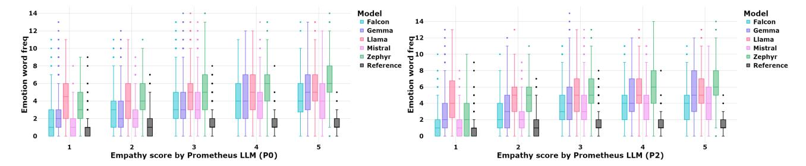
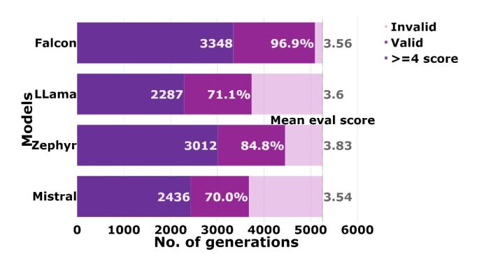
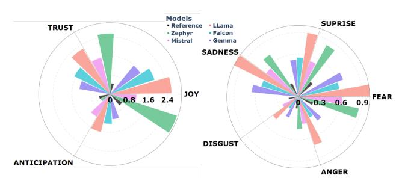
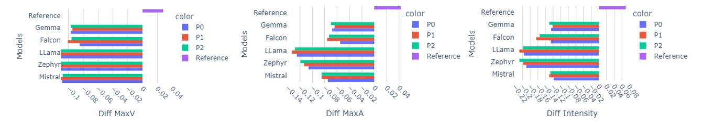
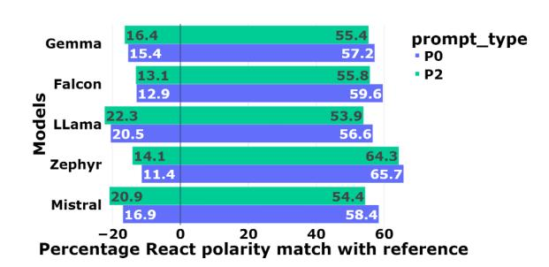

# Probing the Inherent Ability of Large Language Models for Generating Empathetic Responses

Aishwarya Maheswaran *Department of AI Indian Institute of Technology Hyderabad* Hyderabad, India

ai21resch11002@iith.ac.in

Caslon Chua *Computing Technologies Swinburne University of Technology* Melbourne, Australia cchua@swin.edu.au

Maunendra Sankar Desarkar *Department of CSE Indian Institute of Technology Hyderabad* Hyderabad, India maunendra@cse.iith.ac.in

*Abstract*—Large Language Models (LLMs) have demonstrated capabilities beyond basic text generation, like question answering, translation, and even stylistic text generation. Since these models are available for public use, enormous effort has been put into safety engineering to ensure that undesirable and harmful text is not generated and the generations are polite and empathetic. In this work, we examine the inherent empathy capabilities of five open-source LLMs and evaluate them from multiple angles using automated metrics to understand their capabilities and limitations. In the context of this work, "inherent" refers to the LLM's ability to generate empathetic text without having to explicitly prompt for it. We examine if empathy is treated as a style change or is the model demonstrating some understanding of the specific user's context. We find that LLMs use more emotion words than humans in their generations. They can also infer the user's emotional state, a crucial characteristic of empathy. Due to the probabilistic nature of obtaining generations, there is a tendency for the responses to drift away from the user's actual intent. In such cases, specific prompting allows the model to respond appropriately. We summarize the differences observed between human and LLM generations and conclude with a potential research direction for empathetic dialog generation that leverages the capabilities of LLMs.

*Index Terms*—Generative AI, Large language models, Conversational AI

# I. INTRODUCTION

LLMs trained on a large amount of data have been shown to possess some fundamental understanding of human natural language (at least for English) and can respond more fluently and acceptably. This has resulted in many works on studying the abilities and limits of these models for various use cases and scenarios. In this paper, we focus on the empathetic ability of these models. To understand, from the LLMs' perspective, what it means to be empathetic. The observations can guide us on further general development/enhancement of empathetic models. Empathy, which refers to the ability to comprehend and, to an extent, mentally simulate what the other is feeling, is a valuable trait desired in conversations. Fundamentally, the current LLMs are not known to have their own thoughts [1]. Consequently, they may not be empathetic as they cannot relate a situation to their personal experience. However, they are very good at simulation and make the user feel as though they are conversing with a mindful entity. We work towards (a) understanding the emotional ability of the current LLMs, (b) the ability to comprehend the emotional state of the user and explain the same, and (c) the context relevance and helpfulness of the generations.

We obtain generations from five popular open-source LLMs and evaluate them using various automated evaluation approaches. Previous works have focused on evaluating empathy mainly from a single perspective - whether empathy is expressed or not. This is evaluated mostly using humans as the judge. We look at empathy from mainly two perspectives: (a) the emotion part and (b) the context relevance part. We aim to enhance the understanding of the empathetic capabilities of recent LLMs with the intent to serve as a baseline for future research on developing empathetic dialogue systems that will leverage LLMs. Through our experiments, we find the following useful insights. (1) The increased (non human like) reliance on emotion words to mimic empathy. This might not be a desirable feature for building human-like empathetic system (refer Table II). (2) We see in our experiments that if the text contains emotion words and expresses emotion at a surface level, the LLMs still consider the text as empathetic. This gap in emotion comprehension/ emotion reasoning abilities opens up scope for new work (refer Figure 2). (3) LLMs are prone to express positive emotions more than negative emotions, which may be an unintended consequence of human preference alignment (refer Figure 3). Hence, in the quest towards building more human-like conversational systems, we need to view empathy as something beyond emotion and comprehend how empathy is expressed in a holistic manner.

## II. RELATED WORK

Models specifically trained for empathy typically have relied on emotion labels for dialogues in conversation as a means to learn and eventually mimic empathy in the text they generate. In [2], they motivate the need to consider multiple emotional attributes over single emotion labels for dialogues. LLMs are inherently capable of generating multiple emotion labels, making them useful for emotion understanding (see Table III). Leveraging the generally superior capabilities of LLMs [3] argues that a small model specifically trained to detect emotion is superior to a general-purpose model in that task. Making it suitable for use to steer the LLM in the desirable direction. This idea is similar to one of the prompting approaches used in [4] where a two-stage prompting strategy is used with the first

Fig. 1. Box Plot of emotion keyword frequency (y-axis) in generations distributed according to the empathy scores (x-axis) for prompt 0 and prompt 2 respectively

prompt used to gather the relevant emotional details of the user and the second prompt able to be used as additional knowledge to generate the appropriate response. In this work, we want to examine the inherent empathetic ability in LLMs and focus on emotion comprehension as a means of evaluation. Looking at papers that leverage LLMs for empathetic dialog generation, ChatGPT and other recent GPT models have been a popular choice to test. [5] experimented with GPT3 model to get empathetic dialog generations. In [4] the performance of GPT family of LLMs for empathetic generation is shown. They compared the generations from ChatGPT with generations obtained from previous state of the art models specifically trained to produce empathetic generations. Human evaluations found that ChatGPT generations were more desirable. This trend was also observed in [6], where responses of empathyspecific models were compared with a few popular LLMs. They noted that LLM responses seemed to be more empathetic in many cases. Motivated by these, we focus our study on the inherent empathetic capability through multidimensional evaluation.

## *A. Empathetic dialog evaluation*

Dialogues evaluated for empathy rely on human evaluation for scoring empathy, fluency, and relevance. Classifiers specifically trained on emotion-labeled datasets have also been used to evaluate if empathy is present in the text generated. It is important to note here that, in this case, the presence of empathy is equated to the presence of appropriate emotion. EPITOME evaluation strategy proposed in [7] performs(a) empathy identification and (b) rationale extraction for the conversation (seeker-response) by training classifiers to score response on a scale of 0-2. In this work, we explore these dimensions through LLM-based evaluations due to the lack of associated annotations for the dataset considered. [5] proposed a modification of the EPITOME-based evaluation strategy where they calculated the difference of the model scores for the reference and the generation. A lower score meant the generation was close to the reference. [4] also used LLM (GPT4) to evaluate the empathetic generations and found a correlation with the human scores, concluding that LLMs are suitable for evaluation. This point is also reinforced in [8], where they use the GPT family of models for various theory of mind (ToM) and mental state inference tasks and find

that it performs well. They also conclude that LLMs can be used for tasks like empathy evaluation. In the discussion of the evaluation of empathy, it is important to highlight that empathy is a complex attribute that goes beyond expressing the appropriate emotion and needs to incorporate helpfulness and specificity to context. This multidimensional approach elaborated in [9] proposes evaluation for emotional aspect, specificity, relevance to context and use of generic phrases as part of evaluating empathy. Taking inspiration from here, we use automated metrics for our evaluations as detailed in Section III-D1.

# III. METHODOLOGY

To evaluate the empathetic ability in LLMs, we first obtained responses by prompting five different models for dialog response generation. The models we use in our experiments are some of the popular open-source ones: Falcon (falcon-7binstruct) [10], Mistral (Mistral-7B-Instruct-v0.1) [11], Llama (Llama-2-7b-chat-hf) [12], Gemma (gemma-7b-it) [13] and Zephyr (zephyr-7b-beta) [14]. These models are available in various versions based on their size and use case, the exact version used is specified in parenthesis above. Falcon and Mistral have been previously used for empathetic generation in [6] and [3], respectively. Zephyr is a fine-tuned version of Mistral specifically for chat. Llama and Gemma are opensource LLMs by Meta and Google, which we have included in our analysis. ChatGPT and other GPT models have been tested in [6] and other papers. Our intent in choosing different LLMs is to get a general idea of their performance for empathetic dialog generation. For experimentation purposes, the size for all models tested was kept the same at 7B. For Falcon, Gemma, and Mistral, the instruct version of the model was used. For Llama, the chat-hf version was used, and for Zephyr, Zephyrβ was used. We will address different evaluation dimensions for empathy through the research questions (RQ) below.

# *A. RQ1: Are LLMs inherently empathetic?*

The intention of this RQ is to learn if the model is able to consider the context and realize that empathy is required in the response without explicit prompting. To measure this capability, we leverage slight variations in prompts to either explicitly (P2) or implicitly request (P1) an empathetic response and compare the generations with those from a prompt not asking

Fig. 2. LLM Emotion comprehension scores

for an empathetic response (P0). The exact prompts used are given below. P0: Please give the corresponding response to the User according to the existing context. You only need to provide the next round of response of Assistant.

P1: Please give the corresponding response to the User according to the existing context. Comprehend the emotional state of the User and respond accordingly. You only need to provide the next round of response of Assistant.

P2: Respond to the User as the Assistant in an empathetic way. You only need to provide the next immediate response of the Assistant in the conversation. The responses obtained are evaluated for empathy using the metrics mentioned in III-D1. The intuition behind the design of the prompts is that if P0 has empathy scores equivalent to P1 or P2, then the model can implicitly predict a situation that requires empathy.

*1) Do LLMs use emotionally intense words to simulate empathy?:* While demonstration of appropriate emotion is the first step in being empathetic, it is not sufficient to be called empathetic. We explore if these models take a shortcut to empathy by choosing emotionally laden words and skip the interpretation and reasoning part of empathy. To measure the presence of such emotion-laden words, we use the NRC Emotion Intensity Lexicon (NRC-EIL) [15] to get the intensity, valence, and arousal scores for the generations. The metrics based on these values show high values (refer to Figures 4), leading to the need for a deeper analysis.

To consider the most relevant emotion words from all valence words as identified from NRC-EIL, we use an unsupervised keyword extraction method YAKE [16]. In Figure 1, we plot the frequency distribution of emotion words separated by their empathy scores (obtained by Prometheus LLM) for prompts P0 and P2. It is important to note here that a particular word can be used in different emotional circumstances. The distribution of the mean frequency of words belonging to the different emotion labels is shown in Figure 3.

# *B. RQ2: Can LLMs comprehend the user's emotional state from context alone?*

As explained in [17], empathetic ability is dependent on the richness of one's personal emotional experiences. Work done in [18] uses external commonsense datasets like COMET and

Fig. 3. Polar bar plot of mean frequency of emotion words used in generation

HEAL to mimic this mental simulation state while modeling for empathetic text generation. We want to evaluate if this trait is implicit in the model by testing its ability to infer the user's emotional state from the dialogue context alone. The following prompt is used for this test.

P3: In the following conversation, summarize the mental state of the first user and the emotions being expressed by them. Justify the reason for their emotion in the context of the conversation provided. The dialogue context provided as input has the label "user" u who begins the conversation, thus becoming the "first user". Generations without the phrase "The User" or "The first User" (this pattern was chosen through manual inspection of the generations) phrase were considered invalid and not included in the evaluation. By prompting this way, we observed on average ∼ 19% of cases where the model failed to recognize the user correctly (as illustrated in Figure2). We then evaluate the accuracy of the identified emotions and associated justification using Prometheus LLM. The exact number of generations evaluated and evaluation scores are shown in Figure 2. The Gemma model failed to produce generations that describe the user's emotion with this prompt. It tended to continue the conversation instead. For consistency, we have used the same prompt for all models.

## *C. RQ3: Is the expressed empathy generic?*

Phrases that are not context-specific but still appropriate for an empathetic conversation might help get higher empathy scores but may not be helpful to the user. For example, given a user who has disclosed an unfortunate incident, the reply "Oh, I am sorry to hear that.", while appropriate for the context, is generic and does not aid the user in any way. A more specific response along the line of "That must have made you feel upset, are you comfortable sharing some more with me?" might show the user that the listener has understood their unspoken emotional intent, making them feel understood. Experiments in [19] shows how empathy evaluation models score such generic responses highly, which is undesirable. As LLMs are known to be context-specific, we evaluate if this ability is also seen in empathetic text generation. In particular, we use Normalized Inverse Document Frequency metric (NIDF) [20] which measures the specificity of a dialogue. A higher score indicates the dialogues are not repetitive and are context specific. That is they might not have common generic

Fig. 4. Diff Max Valence (Diff MaxV) and Diff Max Arousal (Diff MaxA) and Diff Intensity (Diff Intensity)

| Model   | Prometheus LLM scores (5) |       |       |              |       |       |                   | NIDF  |       |              |       |       |
|---------|---------------------------|-------|-------|--------------|-------|-------|-------------------|-------|-------|--------------|-------|-------|
|         | Empathy↑                  |       |       | Helpfulness↑ |       |       | Context specific↑ |       |       | Specificity↑ |       |       |
|         | P0                        | P1    | P2    | P0           | P1    | P2    | P0                | P1    | P2    | P0           | P1    | P2    |
| Mistral | 3.035                     | 3.144 | 3.135 | 3.595        | 3.714 | 3.694 | 3.490             | 3.574 | 3.555 | 0.328        | 0.327 | 0.321 |
| Zephyr  | 3.438                     | 3.673 | 3.690 | 4.078        | 4.133 | 4.169 | 3.960             | 4.031 | 4.076 | 0.408        | 0.412 | 0.400 |
| Llama   | 3.333                     | 3.462 | 3.463 | 3.832        | 3.904 | 3.959 | 3.842             | 3.910 | 3.908 | 0.364        | 0.367 | 0.354 |
| Falcon  | 2.798                     | 3.186 | 3.164 | 3.198        | 3.558 | 3.560 | 3.106             | 3.422 | 3.381 | 0.346        | 0.355 | 0.335 |
| Gemma   | 2.269                     | 2.239 | 2.299 | 2.763        | 2.691 | 2.773 | 2.844             | 2.796 | 2.864 | 0.367        | 0.363 | 0.368 |
| Ground  | 1.865                     |       |       | 2.057        |       |       | 2.170             |       | 0.278 |              |       |       |
| TABLE I |                           |       |       |              |       |       |                   |       |       |              |       |       |

METRICS EVALUATING CONTENT OF GENERATIONS

phrases that are suitable for many scenarios. Ex: responses like "I am sorry to hear " or "It sounds great", will have low NIDF scores. We also apply LLM-based evaluation to score the "helpfulness" and "context specificity" of the responses from these models.

*1) Inquisitiveness:* Asking questions to understand the user's situation and emotions better is an important aspect of empathy. To measure the *inquisitiveness* present in generations, we use a clustering-based technique. First, the text is encoded using a sentence transformer model (all-MiniLM-L6-v2) [21]. Then we perform clustering using the util.community detection function in sentence transformers package with the clustering parameters "min community size"=10 and "threshold"=0.70. These clusters are then manually inspected to find generic question clusters. Additionally, we report the ratio of reference and generation length, which shows the LLM generations are typically much longer ∼ 5x than the reference text.

# *D. Evaluation Methodology*

We evaluate empathy from two perspectives: Context Relevance (Specificity) and Emotion (word intensity scores). Apart from the metrics that are based on linguistic statistical features. We use Prometheus Eval [22], for automating the empathy and context relevance evaluations (which typically require human efforts). Prometheus is an open-source model used in Prometheus Eval, a library for evaluating with LLMs. Prometheus achieves comparable results to state of the art closed models [23], making it suitable for our experiments. This model was also used in [24] for evaluation.

*1) Empathy - Emotion:* We use two different ways to evaluate empathy. In the first approach, we use the word level score based metric described in [9]. Here we extract words in the generations that have an emotion score according to the NRC Emotion Intensity Lexicon (NRC-EIL) [15], and calculate the difference of the maximum score of Valence (Diff MaxV), Arousal (Diff MaxA) and emotion Intensity (Diff Intensity) in the dialog input and corresponding response generation. Here a score closer to 0 indicates a match in emotional intensity. In the second approach, we use the Prometheus LLM to evaluate empathy and user emotion comprehension for the generations on a scale of 1 to 5 and compare its scores. The exact prompt used to obtain the evaluation is mentioned in Table VII.

*2) Relevance - Specificity:* To measure the diversity of the generations we use NIDF-Specificity, show in TableI. The scores obtained for both these metrics are higher for LLMs compared to empathy-specific models in the papers mentioned. To evaluate the model for context specificity and helpfulness, we use Prometheus Eval. III.D sub section 2 on Relevance-Specificity, we are referring to Table I with the scores for the metrics discussed.

## *E. Dataset details*

The dataset we use in our experiments is the benchmark empathetic dialog dataset [25]. Papers on building empathetic dialog systems utilize this dataset, making it ideal for our experiments. Since we do not fine-tune the LLMs for our experiments, we utilize only the test set as defined in the dataset, consisting of 5255 test cases.

# IV. OBSERVATIONS

The generations in response to the user, from the different prompt settings are evaluated from various perspectives. Here the user refers to the person facing the emotional issue in the dataset. This is the person who initiates the dialog, or is the first user (u). The metrics (D) are computed between the scores of the utterance/post (Pu) of the user u (the person facing the emotional issue) and the response in consideration which can be a human response (Rh) obtained from the dataset or the LLM-generated response (Rg). In following sections we compare D(Pu, Rh) and D(Pu, Rg). Table II summarizes the observations.

| Human (From References in Dataset)                             | LLM                                                                                                     |  |  |  |
|----------------------------------------------------------------|---------------------------------------------------------------------------------------------------------|--|--|--|
| Short concise responses                                        | Longer generations that acknowledge the user's emotion, provide some context relevant information and   |  |  |  |
|                                                                | typically end with a context specific question or request for the next query.                           |  |  |  |
| Uses words with lower emotional intensity (Arousal, Valence)   | Uses words with higher emotional intensity (Arousal, Valence) scores                                    |  |  |  |
| scores                                                         |                                                                                                         |  |  |  |
| Inquisitiveness is demonstrated through the presence of ques   | Inquisitiveness varies with the type of LLM used, the percentage of questions in responses range from   |  |  |  |
| tions in about 34.7% of the responses                          | ∼ 20% to ∼ 64% of which 2% to 18% consists of generic questions                                         |  |  |  |
| Helpfulness and Context Specificity scores by LLM are lower    | Helpfulness and Context Specificity scores are higher (≥ 3) for the LLMs tested excluding Gemma         |  |  |  |
| (∼ 2)                                                          |                                                                                                         |  |  |  |
| Humans are good at recognizing the intent of the user, whether | Intent recognition is probabilistic, specific prompting can help the model be more precise              |  |  |  |
| they need assurance/consolation or feedback                    |                                                                                                         |  |  |  |
| Responses can vary based on the personal emotional state of    | Responses can follow an empathetic style 24/7, the models even suggest the user to speak to a friend or |  |  |  |
| the person responding                                          | therapist                                                                                               |  |  |  |
|                                                                | TABLE II                                                                                                |  |  |  |

COMPARISON OF GENERATIONS OF MODELS AND HUMANS (HUMAN REFERENCE AS IN DATASET)

## *A. RQ 1 Are LLMs inherently empathetic?*

For the models tested, we observe negative scores for Diff MaxV, Diff MaxA, and Diff Intensity metrics, which indicates the generations have words associated with higher emotion scores compared to the reference. The human baseline (reference response in dataset) had positive scores for all these metrics, showing the human response typically had lower emotion intensity than the user. This raises the question of whether having a higher emotional intensity is necessary for empathy. Looking at the empathy score given by Prometheus LLM in Table I, we see P1 and P2 have similar scores. P1 asks the model to understand the user's emotion and respond accordingly, and P2 instructs it to generate an empathetic response. The similar scores for P1 and P2 in this experiment indicates that the model treats understanding the user's emotional state as equivalent to being empathetic. The P0 case has comparatively lower scores by a small margin for few of the models tested. According to the rubric used for evaluation (see Table VII), score 3 corresponds to *The model generally demonstrates empathy by attempting to understand others' emotions or perspectives. It shows a moderate level of sensitivity and consideration*. The score for the reference generation is comparatively lower, with a score rounded to 2. This indicates that while the model gives good scores for the generations having emotionally intense words, the human references that do not use such words are viewed poorly. Overall, the model can, to an extent, identify if the given context requires empathy. However, it can misunderstand the user's intent, see Table VIII where with Prompt 0 (P0) the model Llama incorrectly responds with suggestions on expressing gratitude to their family. This completely misses the user's intent of talking about the incident that led them to appreciate their family with their utterance. Hence, having clear, explicit prompts can help bring the response closer to the desired intent. As seen in Table VI, where the generations with Prompt 2 (P2) are subjectively better than those from P0 for Mistral, Zephyr, and Llama models. The Gemma model misunderstands the intent in both cases, while the Falcon model has generic responses.

*1) Do LLMs use emotionally intense words to simulate empathy?:* The graph in Figure 3 clearly shows how the emotion words are more frequent in the model generations compared to the reference. Different LLMs show variations in the emotion frequency. And all are higher than the reference text. To understand if the emotion words are contributing to the high LLM empathy scores, we look at the plot in Figure 1, which shows that the frequency of emotion keywords increases as the empathy score increases. The reference text has a comparatively lower frequency. The frequency across the prompts P0 and P2 is similar.

Fig. 5. Reaction Polarity (refer IV-A2) match between generations and reference across positive and negative dimensions

*2) Reaction Polarity:* To understand if the user emotion interpreted by the model is similar to the ground truth, we use the COMET model [26] to annotate the generation with the reaction the user would have to the support the current generation. For example: For the generation "Did you suffer any injuries?" the potential reaction the user would have had is "hurt". These annotations are obtained through the xReact category, where x would be the user's reaction, from the perspective of the model. Then we use the Bipolar valence scores from NRC-EIL [15] to get the polarity (positive, negative) of the identified reaction for the reference (from dataset) and generation respectively. The percentage match for each polarity is calculated separately and shown in Figure 5. Positive polarity matches between 50% to 66% and negative polarity between 10% to 22% for the models compared. Comparing Prompt 0 (no mention of empathy) and Prompt 2 (explicit empathy), the positive polarity match is slightly higher for P0, while the negative polarity match is slightly lower. This indicates that the models are biased towards a positive response, which might be generally acceptable but may need to be modified for domain-specific applications accordingly.

| Model       | Model response                                                                                                                           | ECscore |
|-------------|------------------------------------------------------------------------------------------------------------------------------------------|---------|
| User Dialog | I was just thinking about how a few years ago, we lost our cat.                                                                          |         |
| Mistral     | The first user expresses sadness and nostalgia. Their mental state seems to be one of reminiscence, as they reflect on a past event      | 3       |
|             | that caused them emotional distress. The reason for their emotion is likely the loss of their cat, which may have been a beloved pet or  |         |
|             | a source of comfort and companionship                                                                                                    |         |
| Falcon      | the user, as they are reminiscing about their lost cat.                                                                                  | 1       |
| Llama       | The first user is likely feeling a range of emotions, including sadness, grief, and possibly even guilt or regret for not being able to  | 4       |
|             | protect their beloved pet. They may be thinking about the good times they had with their cat and how much they miss them.                |         |
| Zephyr      | The first user seems to be reminiscing about a past event and expresses a sense of sadness or loss. This emotional state is justified in | 4       |
|             | the context of the conversation as the user mentions that they recently lost their cat a few years ago. This memory may have brought     |         |
|             | back feelings of grief and nostalgia for the user, leading to the expression of these emotions.                                          |         |
|             | TABLE III                                                                                                                                |         |

SAMPLE GENERATION OF LLM EXPLAINING THE USER'S MENTAL STATE WITH ASSOCIATED EMOTION COMPREHENSION SCORE (ECscore)

# *B. RQ 2 Can LLMs comprehend the user's emotional state from context alone?*

The Figure 2 shows the scores for the model's ability to comprehend the user's emotional state.The average score for the model is ≥ 3, which according to the rubric (see Table VII) is *The model typically identifies the user's emotional tone but may miss the intent appropriate to the context sometimes*. This indicates the models shows a reasonable level of comprehension of the user's emotional state. We can conclude that the model, even if it cannot experience the emotion, can identify and, to an extent, explain the user's emotional state, which is essential for the demonstration of empathy.

We observe that Zephyr has the highest LLM based Emotion comprehension evaluation score followed by Llama and Falcon. Comparing this observation with Figure 3 we see Zephyr and Llama have higher usage of emotion words in their response generation. This can indicate that LLMs that are able to perform emotion comprehension well also tend to use more emotion words in their response generation. An interesting point to note is that the model generations generally include more than one emotion (see TableIII); that is, they are able to comprehend multiple emotions associated with a situation and overcome the limitation of one emotion label described in [2] implicitly. Another observation is that the dataset consists of dialogues where the users specify the emotion they are feeling explicitly. Consider the example: *"hi, i feel so lonely sometimes because all my friends live in a different country"*. This makes it easier for the response to offer consolation and related feedback for loneliness. However, the explanations given by LLMs for the user's emotional state for this dialog consists of related emotions like sadness, melancholy, longing, and feeling of missing out. It is also capable of explaining why the user might feel lonely with *"Reasoning: People often experience an inherent human need to connect with others and feel a sense of belonging in their social circles".* The explanations also go deeper, analysing the word choice of the user, for example *"The use of the word 'sometimes' suggests that this feeling is not a constant state but rather an occasional one."*. The reasoning ability does have limitations; for Example, see the generation by Falcon in Table III, it seems incomplete. This shows there are still limitations in the reasoning ability of models. Overall, at least for general cases the models seem to generate satisfactory emotion reasoning.

# *C. RQ 3 Is the expressed empathy generic?*

The NIDF-Specificity scores (refer Table I)are high, indicating that the text generated by the models is not too repetitive or generic. We see that the models typically produce generations that are indeed relevant and specific to the context. Gemma has scores lower than 3, indicating it may be responding more broadly. The score for the ground responses in the dataset is ∼ 2. Which according to the scoring rubric means, the text may not be very specific/customized to the context. This may be due to the fact that the responses in the dataset tend to be concise. The model generations tend to explain the situation and response in greater detail (sample generations given in Table VI), giving it an advantage when evaluated by LLM. Overall, we can conclude the models are not just responding with generic phrases but are customizing their output to suit the dialog context.

| Models  |      | Questions(%) |      | Len Ratio (g:r) |     |     |  |
|---------|------|--------------|------|-----------------|-----|-----|--|
|         | P0   | P1           | P2   | P0              | P1  | P2  |  |
| Mistral | 60.5 | 63.6         | 64.5 | 5.1             | 5.5 | 5.1 |  |
| Zephyr  | 25.5 | 25.1         | 41.5 | 7.4             | 8.0 | 8.3 |  |
| Llama   | 60.1 | 59.1         | 62.2 | 7.6             | 8.0 | 7.4 |  |
| Falcon  | 46.5 | 38.7         | 28.7 | 4.5             | 5.1 | 4.6 |  |
| Gemma   | 20.3 | 21.0         | 22.6 | 6.2             | 5.9 | 6.2 |  |

TABLE IV PERCENTAGE OF GENERATIONS CONTAINING QUESTIONS AND RATIO OF GENERATION LENGTH TO REFERENCE LENGTH

| Cluster | Size                                                         | Sample question                                   |  |  |  |
|---------|--------------------------------------------------------------|---------------------------------------------------|--|--|--|
| 1       | 122                                                          | Is there anything I can assist you with?          |  |  |  |
| 2       | 69                                                           | Is there anything else you'd like to discuss?     |  |  |  |
| 3       | 23                                                           | Do you have any questions or concerns?            |  |  |  |
| 4       | 23                                                           | Can I help in any way to alleviate the situation? |  |  |  |
| 5       | Do you have any other concerns on this topic? 17          |                                                   |  |  |  |
|         | Total no. of unique questions: 324, 15 clusters, min size=10 |                                                   |  |  |  |

TABLE V TOP 5 QUESTION CLUSTERS

*1) Inquisitiveness:* We look at the questions the model asks as part of the generation. Table IV shows the percentage of generations consisting of questions.

We see that the percentage of generations with questions is dependent on the specific LLM. There is some variation across the different prompts but no common trends are observed. Looking at the top 5 clusters see TableV, we can see most of the questions asked are indeed generic. We also observe questions of the style *"Have you tried reaching out to a mental health professional for support?"* or *"Have you talked to them about how you feel?"* by Mistral, Llama and Falcon.

## V. CONCLUSION

In this paper, we analyse the inherent ability of the LLMs to generate empathetic responses. Through the experiments

| Context   | "I'm so grateful for my family due to an incident with my friend" |
|-----------|-------------------------------------------------------------------|
| Reference | "Oh really? What happened with your family and friend then?"      |

| Prompt 0 |  |
|----------|--|
|----------|--|

| Mistral | That's great to hear! It's wonderful to know that you value the support of your family. Is there anything specific you would like to talk about  |
|---------|--------------------------------------------------------------------------------------------------------------------------------------------------|
|         | or share with me about your incident with your friend?                                                                                           |
| Zephyr  | Dear User, Thank you for sharing your gratitude towards your family, and we're glad to hear that you're feeling thankful. May we ask, could      |
|         | you please elaborate further on the incident with your friend that led to your appreciation for your family? This information would help us      |
|         | provide you with a more contextually appropriate response.                                                                                       |
| Llama   | Of course, I'm here to help. It sounds like you're going through a difficult time, and I'm so sorry to hear that you're dealing with an incident |
|         | involving your friend. It can be really tough to navigate situations like this, especially when it comes to family dynamics.Can you tell me more |
|         | about what happened with your friend? Sometimes talking about our feelings and experiences can help us process and understand them better.       |
| Falcon  | I understand that this must be a difficult time for you. Let's talk about what's been going on and I'll do my best to assist in any way I can.   |
|         | Remember, I'm here to help 24/7.                                                                                                                 |
| Gemma   | My friend was injured recently and I was there to help, I couldn't have done it without my family. My family was there to lend me their support  |
|         | and strength, and their presence made all the difference. I was driving home from school one day when I received a call from my friend that he   |
|         | had been injured in a motorcycle accident. I was shocked and worried, so I raced to the hospital. When I arrived, I found that he had sustained  |
|         | a serious injury to his head.                                                                                                                    |
|         |                                                                                                                                                  |

#### Prompt 2

| Mistral | I'm so glad to hear that you value your family. Would you like to talk more about what happened with your friend?                                 |
|---------|---------------------------------------------------------------------------------------------------------------------------------------------------|
| Zephyr  | I'm glad to hear that you hold your family in high regard, especially in light of a recent experience with your friend. Would you mind sharing    |
|         | with me what happened with your friend that made you appreciate your family more? As your AI language model, I'm here to listen and               |
|         | understand without judgment. Please know that I'm here to offer empathy and support.                                                              |
| Llama   | Of course, I'm here to listen and offer support. It can be really tough when something like this happens, and it's completely understandable that |
|         | you're feeling grateful for your family right now. Can you tell me more about what happened with your friend? Sometimes talking about our         |
|         | feelings and experiences can help us process and heal                                                                                             |
| Falcon  | I'm so glad to hear that your family is there for you during difficult times. If you ever need anyone to talk to, I'm here for you.               |
| Gemma   | Yesterday, I was involved in an incident with a friend that made me realize how much I appreciate my family. It was a sobering experience that    |
|         | reminded me how precious and valuable they are in my life.My friend, [friend's name], and I had been out for a night out, but things went sour    |
|         | when we had a disagreement. It was a heated moment, and things got out of hand. I made a mistake, and I was ashamed of myself.                    |
|         |                                                                                                                                                   |

TABLE VI

EXAMPLE DIALOG RESPONSES BY THE MODELS

performed, it is evident that the although LLMs appear to be capable of recognizing whether a context requires an empathetic response, they are prone to misunderstand the intent of the user. Hence specific prompts for empathy are required. LLMs rely on emotion words to express empathy which is not necessarily human-like. LLM-based evaluation views this favorably and scores such responses higher. We also observe that the LLMs do a fine job of identifying emotions and responding with appropriate emotions. However, rare or unique situations that are not seen by these models earlier (in training), may require additional efforts beyond simple prompting. For future development of empathetic dialog systems, we can leverage LLMs for emotion detection with detailed prompts explaining the requirements, for common instances. For unique or domain specific scenarios, having additional relevant information as context might be need for obtaining appropriate generations from LLMs.

# REFERENCES

- [1] W. K. et.al, "Empathy and the right to be an exception: What llms can and cannot do," *CoRR*, vol. abs/2401.14523, 2024.
- [2] F. Fu, L. Zhang, and Q. e. a. Wang, "E-CORE: Emotion correlation enhanced empathetic dialogue generation," in *Proceedings of the 2023 Conference on Empirical Methods in Natural Language Processing*, (Singapore), pp. 10568–10586, Dec. 2023.
- [3] Z. Y. et. al., "Enhancing empathetic response generation by augmenting llms with small-scale empathetic models," *CoRR*, vol. abs/2402.11801, 2024.
- [4] Y. Qian, W. Zhang, and T. Liu, "Harnessing the power of large language models for empathetic response generation: Empirical investigations and improvements," in *Findings of the Association for Computational Linguistics: EMNLP 2023*, (Singapore), pp. 6516–6528, Dec. 2023.
- [5] Y.-J. Lee, C.-G. Lim, and H.-J. Choi, "Does GPT-3 generate empathetic dialogues? a novel in-context example selection method and automatic evaluation metric for empathetic dialogue generation," in *Proceedings*

- *of the 29th International Conference on Computational Linguistics*, (Gyeongju, Republic of Korea), pp. 669–683, Oct. 2022.
- [6] S. B. Loh and A. S. Raamkumar, "Harnessing large language models' empathetic response generation capabilities for online mental health counselling support," *CoRR*, vol. abs/2310.08017, 2023.
- [7] A. Sharma, A. Miner, and D. e. a. Atkins, "A computational approach to understanding empathy expressed in text-based mental health support," in *Proceedings of the 2020 Conference on Empirical Methods in Natural Language Processing (EMNLP)*, (Online), pp. 5263–5276, 2020.
- [8] Q. Z. et. al., "Reading users' minds from what they say: An investigation into llm-based empathic mental inference," *CoRR*, vol. abs/2403.13301, 2024.
- [9] A. Lee, J. Kummerfeld, and L. e. a. Ann, "A comparative multidimensional analysis of empathetic systems," in *Proceedings of the 18th Conference of the European Chapter of the Association for Computational Linguistics (Volume 1: Long Papers)*, pp. 179–189, Mar. 2024.
- [10] E. Almazrouei, H. Alobeidli, and A. A. et. al., "The falcon series of open language models," *ArXiv*, vol. abs/2311.16867, 2023.
- [11] A. Q. Jiang, A. Sablayrolles, and A. M. et. al., "Mistral 7b," *ArXiv*, vol. abs/2310.06825, 2023.
- [12] H. Touvron, T. Lavril, and G. I. et. al., "Llama: Open and efficient foundation language models," *ArXiv*, vol. abs/2302.13971, 2023.
- [13] G. T. T. Mesnard, C. Hardin, and et. al., "Gemma: Open models based on gemini research and technology," *ArXiv*, vol. abs/2403.08295, 2024.
- [14] L. Tunstall, E. Beeching, and N. L. et. al., "Zephyr: Direct distillation of lm alignment," *ArXiv*, vol. abs/2310.16944, 2023.
- [15] S. Mohammad, "Word affect intensities," in *Proceedings of the Eleventh International Conference on Language Resources and Evaluation (LREC 2018)*, (Miyazaki, Japan), May 2018.
- [16] R. e. a. Campos, "Yake! collection-independent automatic keyword extractor," in *Advances in Information Retrieval*, (Cham), pp. 806–810, Springer International Publishing, 2018.
- [17] C. D. Aring, "SYMPATHY AND EMPATHY," *Journal of the American Medical Association*, vol. 167, pp. 448–452, 05 1958.
- [18] Y. Deng, W. Zhang, and Y. e. a. Yuan, "Knowledge-enhanced mixedinitiative dialogue system for emotional support conversations," in *Proceedings of the 61st Annual Meeting of the Association for Computational Linguistics (Volume 1: Long Papers)*, (Toronto, Canada), pp. 4079–4095, July 2023.
- [19] A. Lee, J. K. Kummerfeld, and L. e. a. An, "Empathy identification systems are not accurately accounting for context," in *Proceedings of*

| Score | Description                                                                                                                                                                                    |
|-------|------------------------------------------------------------------------------------------------------------------------------------------------------------------------------------------------|
|       |                                                                                                                                                                                                |
|       | Empathy: Does the model provide empathetic responses to the user?                                                                                                                              |
| 1     | The model shows no consideration or understanding of others' emotions or perspectives. It is completely indifferent or insensitive, showing no attempt to                                      |
|       | connect emotionally.                                                                                                                                                                           |
| 2     | The model sometimes attempts to consider others' emotions or perspectives but often misses the mark. It may come across as superficial                                                         |
| 3     | The model generally demonstrates empathy by attempting to understand others' emotions or perspectives. It shows a moderate level of sensitivity and consideration                           |
| 4     | The model regularly demonstrates empathy by accurately understanding and acknowledging others' emotions or perspectives. It is thoughtful and shows genuine attempts to connect emotionally |

#### Context Specificity: Does the model provide empathetic responses to the user?

5 The model consistently demonstrates empathy. It shows deep understanding and sensitivity to others' emotions or perspectives, offering responses that are

| 1 | The model's responses are irrelevant or generic and not relevant to the user's needs or queries.                                                          |
|---|-----------------------------------------------------------------------------------------------------------------------------------------------------------|
| 2 | The model responses are generic and does not includes words specific to the user's context.                                                               |
| 3 | The model generally provides relevant responses, that address the user's specific context, though it may occasionally miss the mark and not customized to |
|   | the specific context of the user.                                                                                                                         |
| 4 | The model regularly provides customized responses that are relevant to with the user's inquiries with keywords from the user's context, with only rare    |
|   | inaccuracies.                                                                                                                                             |
| 5 | The model consistently offers highly customized and relevant responses that perfectly cater to the user's needs and inquiries. The response contains key  |
|   | words from the user's context.                                                                                                                            |

#### Helpfulness: Does the model provide relevant and useful responses to the user's needs or questions?

| 1 | The model's responses are irrelevant or unhelpful to the user's needs or queries.                                            |
|---|------------------------------------------------------------------------------------------------------------------------------|
| 2 | The model sometimes provides helpful information, but often fails to address the user's actual needs or questions.           |
| 3 | The model generally provides helpful responses that address the user's needs, though it may occasionally miss the mark.      |
| 4 | The model regularly provides helpful responses that are well-aligned with the user's inquiries, with only rare inaccuracies. |
| 5 | The model consistently offers highly relevant and useful responses that perfectly cater to the user's needs and inquiries.   |

#### Theory of Mind: Is the model proficient in analysing the emotion expressed by the first user in the conversation?

| 1 | The model neglects to identify the emotional tone of user inputs                                                                                               |  |  |
|---|----------------------------------------------------------------------------------------------------------------------------------------------------------------|--|--|
| 2 | The model intermittently recognizes the user's emotional context                                                                                               |  |  |
| 3 | The model typically identifies user's emotional tone but may miss the user's intent sometimes.                                                                 |  |  |
| 4 | The model consistently identifies the user's emotional tone with respect to the context.                                                                       |  |  |
| 5 | The model excels in identifying the user's emotional state correctly. It provides justification for the user's emotion that is appropriate with respect to the |  |  |
|   | context.                                                                                                                                                       |  |  |

#### TABLE VII PROMETHEUS EVALUATION RUBRICS

| Prompt 0  |                                                                                                                                                       |  |
|-----------|-------------------------------------------------------------------------------------------------------------------------------------------------------|--|
| Context   | "I'm so grateful for my family due to an incident with my friend"                                                                                     |  |
| Reference | "Oh really? What happened with your family and friend then?"                                                                                          |  |
| Mistral   | It sounds like your incident with your friend was difficult to navigate, but it's great to hear that you appreciate the support of your family during |  |
|           | that time. It's important to remember that family is a valuable source of love and comfort, even in challenging situations. Is there anything else    |  |
|           | you'd like to share about this experience or would you like some guidance on how to move forward from it?                                             |  |
| Zephyr    | We're glad to hear that. Your family has been a constant source of support and comfort for you during difficult times, and we can understand          |  |
|           | why you're feeling grateful for them. Whether it's through their words of encouragement, their actions of love, or simply their presence, your        |  |
|           | family has played a significant role in helping you navigate through the incident with your friend. It's heartwarming to see the bond between         |  |
|           | families and friends                                                                                                                                  |  |
| Llama     | Of course, I'm here to help! Here's a response that acknowledges your gratitude towards your family: "Aww, thank you so much! I'm really              |  |
|           | grateful for my family too, they've been incredibly supportive during this difficult time. I'm lucky to have them by my side. How about you?          |  |
|           | Is there anything you're grateful for?"                                                                                                               |  |
| Falcon    | I'll definitely keep you in my prayers. Take care, and stay safe. Let me know if there's anything I can help you with                                 |  |
| Gemma     | My friend was injured recently and I was there to help, I couldn't have done it without my family. My family was there to lend me their support       |  |
|           | and strength, and their presence made all the difference.I was driving home from school one day when I received a call from my friend that he         |  |
|           | had been injured in a motorcycle accident. I was shocked and worried, so I raced to the hospital. When I arrived, I found that he had sustained       |  |
|           | a serious injury to his head.                                                                                                                         |  |

# TABLE VIII

EXAMPLE OF POOR DIALOG RESPONSES BY THE MODELS WITH PROMPT 0

- *the 17th Conference of the European Chapter of the Association for Computational Linguistics*, pp. 1686–1695, May 2023.
- [20] A. See, S. Roller, and D. e. a. Kiela, "What makes a good conversation? how controllable attributes affect human judgments," in *Proceedings of the 2019 Conference of the North American Chapter of the Association for Computational Linguistics: Human Language Technologies, Volume 1 (Long and Short Papers)*, pp. 1702–1723, June 2019.

supportive, compassionate, and insightful.

- [21] N. Reimers and I. Gurevych, "Sentence-BERT: Sentence embeddings using Siamese BERT-networks," in *Proceedings of the 2019 Conference on Empirical Methods in Natural Language Processing and the 9th International Joint Conference on Natural Language Processing (EMNLP-IJCNLP)*, (Hong Kong, China), pp. 3982–3992, Nov. 2019.
- [22] S. K. et. al., "Prometheus: Inducing fine-grained evaluation capability in language models," *CoRR*, vol. abs/2310.08491, 2023.
- [23] S. K. et. al., "The biggen bench: A principled benchmark for fine-grained

- evaluation of language models with language models," 2024.
- [24] K. K. Maurya, K. Srivatsa, K. Petukhova, and et.al, "Unifying ai tutor evaluation: An evaluation taxonomy for pedagogical ability assessment of llm-powered ai tutors," *arXiv preprint arXiv:2412.09416*, 2024.
- [25] H. Rashkin, E. M. Smith, M. Li, and et. al., "Towards empathetic open-domain conversation models: A new benchmark and dataset," in *Proceedings of the 57th Annual Meeting of the Association for Computational Linguistics*, (Florence, Italy), pp. 5370–5381, July 2019.
- [26] J. D. Hwang, C. Bhagavatula, R. Le Bras, J. Da, K. Sakaguchi, A. Bosselut, and Y. Choi, "(comet-) atomic 2020: On symbolic and neural commonsense knowledge graphs," in *Proceedings of the AAAI conference on artificial intelligence*, vol. 35, pp. 6384–6392, 2021.