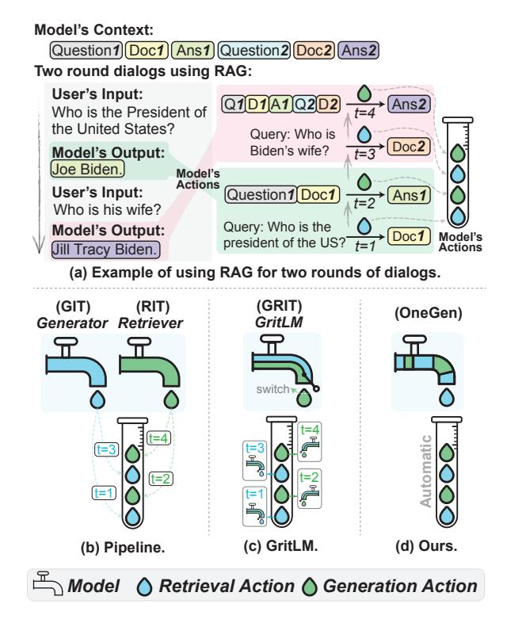
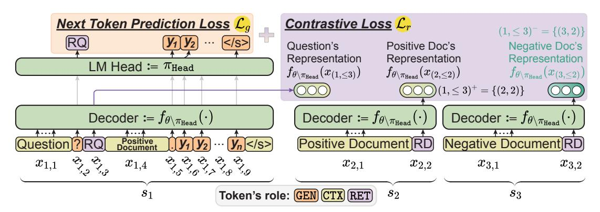
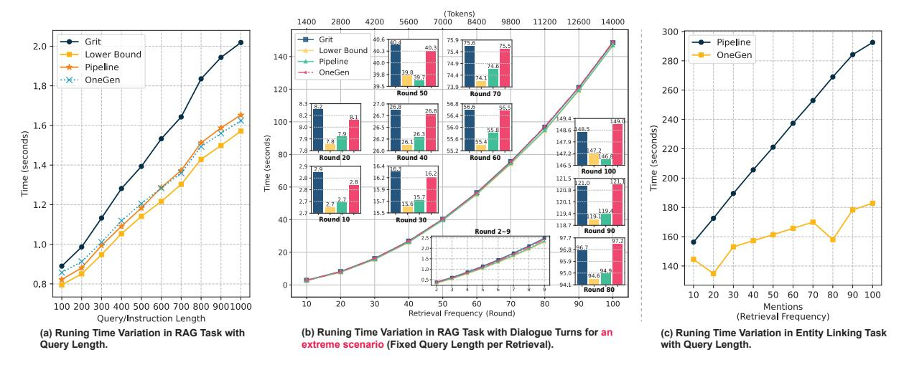
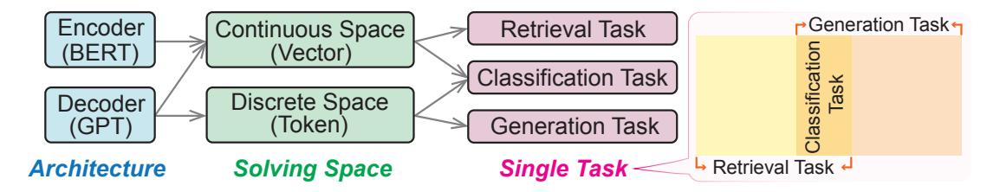
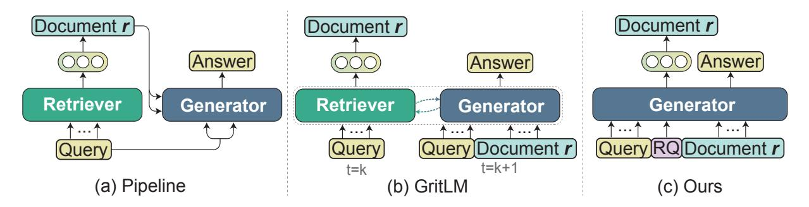
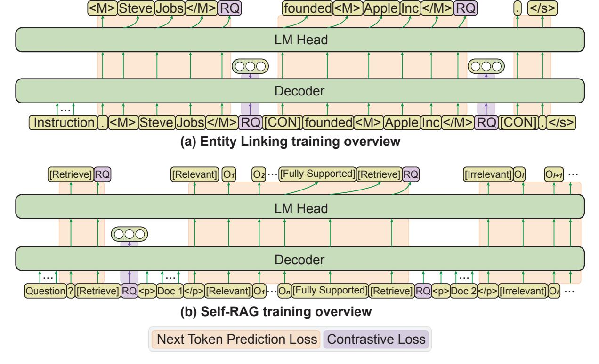
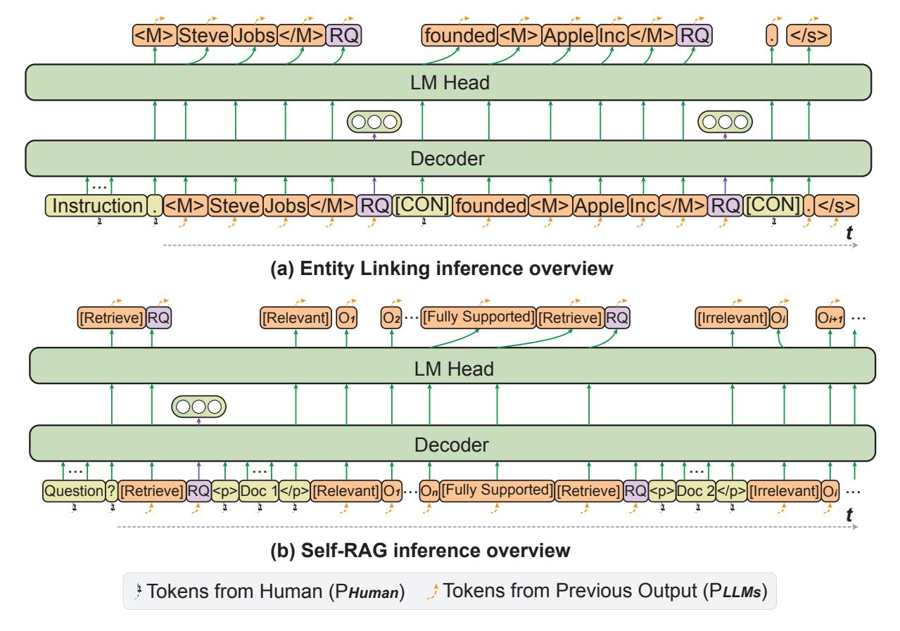
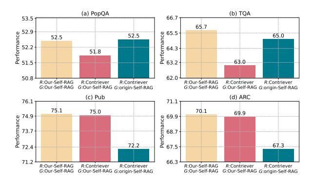
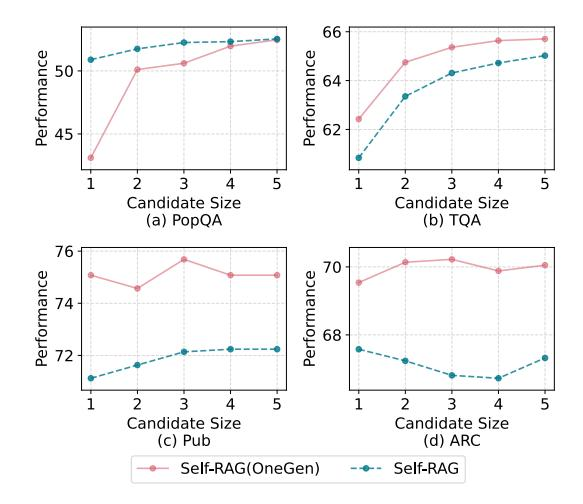
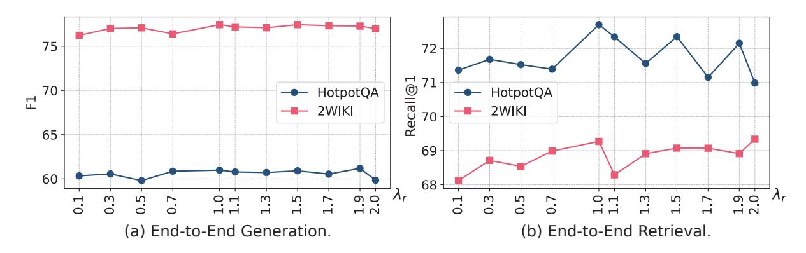

# <span id="page-0-0"></span>OneGen: Efficient One-Pass Unified Generation and Retrieval for LLMs

Jintian Zhang♠♡\*, Cheng Peng♣♡\*, Mengshu Sun♣♡, Xiang Chen♠♡, Lei Liang♣♡, Zhiqiang Zhang♣♡, Jun Zhou♣♡†, Huajun Chen♠♡, Ningyu Zhang♠♡† ♠Zhejiang University ♣Ant Group

<sup>♡</sup>Zhejiang University - Ant Group Joint Laboratory of Knowledge Graph {zhangjintian,zhangningyu}@zju.edu.cn, jun.zhoujun@antgroup.com

https://github.com/zjunlp/OneGen

#### **Abstract**

Despite the recent advancements in Large Language Models (LLMs), which have significantly enhanced the generative capabilities for various NLP tasks, LLMs still face limitations in directly handling retrieval tasks. However, many practical applications demand the seamless integration of both retrieval and generation. This paper introduces a novel and efficient **One**-pass **Gen**eration and retrieval framework (OneGen), designed to improve LLMs' performance on tasks that require both generation and retrieval. The proposed framework bridges the traditionally separate training approaches for generation and retrieval by incorporating retrieval tokens generated autoregressively. This enables a single LLM to handle both tasks simultaneously in a unified forward pass. We conduct experiments on two distinct types of composite tasks, RAG and Entity Linking, to validate the pluggability, effectiveness, and efficiency of OneGen in training and inference. Furthermore, our results show that integrating generation and retrieval within the same context preserves the generative capabilities of LLMs while improving retrieval performance. To the best of our knowledge, OneGen is the first to enable LLMs to conduct vector retrieval during the generation.

#### 1 Introduction

In the era of Large Language Models (LLMs), many Natural Language Processing (NLP) tasks can be reduced to generation, allowing them to be addressed by a single LLM (Zhao et al., 2023; Qin et al., 2023; OpenAI, 2023; Zeng et al., 2024). While LLMs excel in language generation, they still suffer from hallucinations (e.g., factual inaccuracies), stemming from their exclusive reliance on the parametric knowledge they contain (Zhang et al., 2023b; Yao et al., 2023; Tonmoy et al., 2024).

<span id="page-0-1"></span>

Figure 1: Comparison of Three Methods for RAG Task. (a) Two round dialogs using RAG (Retrieve and Generate twice each). (b) Pipeline approach requiring the deployment of two separate models for retrieval and generation, (c) GritLM (Muennighoff et al., 2024) utilizing a single model with a switching mechanism to integrate retrieval and generation, (d) OneGen (Ours) performing both functions automatically in the same model and the same context.

One promising approach is Retrieval-Augmented Generation (RAG) (Lewis et al., 2020; Jiang et al., 2023d; Asai et al., 2024; Mao et al., 2024; Gao et al., 2023), which augments the input by retrieving relevant passages based on the query either before or during generation. Other methods (Ding et al., 2024a; Luo et al., 2023a) anchor LLM generation to an external knowledge base through Entity Linking (EL) during or after generation. These systems typically rely on a *retriever* at various stages of generation.

<sup>\*</sup> Equal Contribution.

Corresponding Author.

However, due to the separate training paradigms for generation and retrieval, most prior work [\(Muennighoff et al.,](#page-11-1) [2024\)](#page-11-1) employs a separate model for text embedding. However, this pipeline approach has several drawbacks: *i)* Deploying and maintaining two separate models introduces additional hardware overhead and increases maintenance costs. *ii)* The separation of models creates two distinct representational spaces, limiting interaction between the retriever and generator (e.g., LLM) to text (i.e., query). As a result, whether the query is generated by the LLM or input directly by the user, it requires an additional forward pass through the retriever, increasing inference computational costs. *iii)* In multi-turn dialogues, as illustrated in Figure [1\(](#page-0-1)a), query rewriting is required for follow-up questions like "Who is his wife?". This rewriting adds inference overhead and risks error propagation if inaccurate. *iv)* Additionally, the pipeline approach is difficult to optimize end-to-end and requires large amounts of training data, while end-to-end optimization has been shown to yield significant benefits [\(Lin et al.,](#page-11-6) [2024\)](#page-11-6).

Our work introduces an efficient One-pass unified Generation and retrieval (OneGen) framework to enable an arbitrary LLM to generate and retrieve in one single forward pass. Inspired by the latest success in LLM for text embedding [\(Wang](#page-12-2) [et al.,](#page-12-2) [2024\)](#page-12-2), we expand the original vocabulary by adding special tokens (i.e. *retrieval tokens*) and allocate the retrieval task to retrieval tokens generated in an autoregressive manner. During training, *retrieval tokens* only participate in representation fine-tuning through contrastive learning [\(van den Oord et al.,](#page-12-3) [2018;](#page-12-3) [Rendle et al.,](#page-12-4) [2009\)](#page-12-4), whereas other output tokens are trained using language model objectives. At inference time, we use *retrieval tokens* for efficient retrieving on demand.

Unlike previous pipeline approaches, which require at least two models for retrieval and generation (as shown in Figure [1\(](#page-0-1)b)), OneGen unifies both tasks into a single model, eliminating the need for a separate retriever. [\(Muennighoff et al.,](#page-11-1) [2024\)](#page-11-1) presents Generative Representational Instruction Tuning (GRIT), which aligns with this approach by training one LLM to handle both generative and embedding tasks through different prompts and attention mechanisms, as depicted by the *"switch"* in Figure [1\(](#page-0-1)c). However, GRIT still necessitates independent forward passes for generation and retrieval tasks, reducing efficiency for tasks that intertwine

generation and retrieval.

We evaluate the effectiveness of our method on two main tasks that require both generation and retrieval: RAG (including single-hop QA which needs single-retrieval and multi-hop QA which needs multi-retrieval) and Entity Linking (EL). Empirical results show OneGen outperforms the previous pipeline solutions as well as GRIT where applicable. Specifically, OneGen achieves +1.5pt improvement on average with four Single-hop QA datasets on top of Self-RAG [\(Asai et al.,](#page-9-0) [2024\)](#page-9-0), +3.3pt F1 on average with two Multi-hop QA datasets under three different 7B-based LLMs, and +3.2pt accuracy on average with 6 out-ofdomain entity linking datasets, with less training data. Moreover, further analysis demonstrates One-Gen can enhance retrieval capability when jointly trained, with no sacrifice in generation capability. In addition, we demonstrate superior inference speed and memory consumption of OneGen compared with other LLM alternatives, particularly as retrieval frequency increases. In summary, our work makes the following contributions:

*i)* We propose a training-efficiency, inferenceefficiency, and pluggable framework OneGen that is particularly suitable for tasks interleaved with generation and retrieval. *ii)* Our model, fine-tuned on less training data, demonstrates superior performance on six RAG datasets and six entity linking datasets on average. *iii)* We demonstrate the efficiency of OneGen at inference, highlighting a significant speed improvement as the length of query increases or retrieval frequency increases, compared to other LLM alternatives. *iv)* From the perspective of methodology, OneGen is an extension of Generative Instruction Tuning (GIT) and Representative Instruction Tuning (RIT) (as shown in Figure [1\(](#page-0-1)b)). *v)* We contribute to communities by releasing our dataset as well as code.

# 2 Preliminaries and Related Works

Most text-based tasks can be reduced to generation, retrieval, or combination of the two. We first introduce several hybrid tasks and their common solutions in § [2.1.](#page-1-0) Then, we introduce the three roles of tokens in LLMs in § [2.2.](#page-2-0) Finally, we further explain the motivation of our method in § [2.3.](#page-2-1)

# <span id="page-1-0"></span>2.1 Generation & Retrieval

For NLP problem related to generation or retrieval, a user input or a query u = {u1, ..., un} and optionally document corpus K = {di} ∥K∥ <sup>i</sup>=1 are given

<span id="page-2-2"></span>

| Task       | Input            | t = 1                             | t = 2                             |
|------------|------------------|-----------------------------------|-----------------------------------|
| Generation | u                | y = G(u)                          | _                                 |
| Retrieval  | $u, \mathcal{K}$ | $\varepsilon = R(u, \mathcal{K})$ | _                                 |
| $R \to G$  | $u, \mathcal{K}$ | $\varepsilon = R(u, \mathcal{K})$ | $y = G(u, \varepsilon)$           |
| $G \to R$  | $u, \mathcal{K}$ | y = G(u)                          | $\varepsilon = R(y, \mathcal{K})$ |
| Unified    | $u, \mathcal{K}$ | $y, \varepsilon = On\epsilon$     | $eGen(u, \mathcal{K})$            |

Table 1: Comparison of different tasks and our unified solution.

(e.g., wiki articles), the end goal of the task is to generate sequence output  $y = \{y_1, ..., y_m\}$  or the most relevant documents  $\epsilon$  from  $\mathcal{K}$  with respect to u or both. We also assume that each  $d_i \in \epsilon$  is aligned to a subsequence or a whole sequence of tokens in u. We summarize the steps and typical input, output for generation, retrieval, and two hybrid tasks in Table 1.

 $\mathbf{R} \to \mathbf{G}$  Task leverages retrieval results to drive generation. In the simplest format, a dense retrieval model (e.g., a dense passage retriever, DPR) is used to retrieve a collection of relevant documents  $\varepsilon$ given user input u at t=1;  $\varepsilon$  are then used as additional context when generating the target sequence using a generator (e.g. LLM) at t=2. Retrieval Argumented Generation (RAG) is a classic example of  $R \to G$  task. Though there are some efforts in training the two model end-to-end predate the LLM era (Lewis et al., 2020), most recent work use an off-the-shelf-retriever such as Contriever (Izacard et al., 2022), BM25, or search engine (Jiang et al., 2023d). Furthermore, this task can involve multiple iterations of retrieval and generation, such as in multi-hop reasoning datasets like 2WIKI (Ho et al., 2020) and HotpotQA (Yang et al., 2018).

 $G \rightarrow R$  Task outputs retrieved documents relevant to user query in addition to generated content and are widely encountered in Information Retrieval (IR). A prominent example task is Entity Linking (EL), which involves locating mentions and disambiguating these surface forms into entities in some Knowledge Base (KB). Early EL methods (Hoffmann et al., 2011) treat EL as decomposed subtasks, such as Mention Detection (MD) and Entity Disambiguation (ED), and solve them in sequence. More recent works manage to frame EL as an end-to-end task, such as sequence generation (Cao et al., 2021b), question answering (Zhang et al., 2022), retrieve augmented generation (Xiao et al., 2023), and sequence tagging problem (Broscheit, 2019; Ayoola et al., 2022), which outperform the early pipeline approach. For

the generative EL paradigm, MD can be modeled as a generation task where entities in the original sentences are generated; ED is a typical retrieval task of retrieving the most relevant entity from the KB given a mention span.

#### <span id="page-2-0"></span>2.2 Roles of tokens in LLMs

A token  $x_i$  is the basic unit processed by an LLM. Token in the input of an LLM serves three different roles: 1) generating the next token, noted as  $role(x_i) = \text{GEN}$ ; 2) providing context information, noted as  $role(x_i) = \text{CTX}$ ; and 3) representing a sentence, noted as  $role(x_i) = \text{RET}$ . Recent works (Wang et al., 2024; Muennighoff et al., 2024) use the hidden state of the last token as the sentence representation.

#### <span id="page-2-1"></span>2.3 Motivation

Recent years have seen a rise in using LLMs to handle complex hybrid tasks, replacing traditional NLP model pipelines. Before LLMs, end-to-end approaches offered advantages for combining generation and retrieval tasks, reducing error propagation compared to pipelines and potentially improving efficiency with single-pass inference. However, earlier solutions are often task-specific and lack generalization across hybrid tasks. For instance, in generative EL, methods like constrained decoding (Cao et al., 2021b) are used to retrieve entities efficiently. Our work addresses the absence of a unified LLM framework for hybrid tasks, stemming from separate training approaches for generation and retrieval tasks, which typically use distinct objectives and datasets.

# 3 OneGen: One-Pass Generation and Retrieval for LLMs

We introduce a **One**-pass **Gen**eration and retrieval framework (**OneGen**) for fine-tuning LLMs on generation, retrieval, or hybrid tasks, as shown in Figure 2. Our core idea is to integrate generation and retrieval to the same context by allocating the retrieval task to *retrieval tokens* generated in an autoregressive manner, thus enabling LLM to perform both tasks in a single forward pass.

#### 3.1 Overview

**Notation.** To ensure clarity and precision in our subsequent discussions, we standardize the notation used in Table 1. Define the dataset  $\mathcal{D} = \{s_i\}_{i=1}^{|\mathcal{D}|}$ , which consists of  $|\mathcal{D}|$  sentences s of varying lengths, with each sentence  $s = \{x_i\}_{i=0}^{|s|}$  com-

<span id="page-3-0"></span>

Figure 2: The training framework of unified **One**-pass **Gen**eration and retrieval (**OneGen**), illustrated using RAG. Detailed training process for other tasks can be found in Figure 6 of Appendix.

prising |s| tokens x. Let  $x_{i,j}$  denote the j-th token of the i-th sentence in the dataset  $\mathcal{D}$ , and define  $x_{i,\leq j}$  as  $\{x_{i,1},x_{i,2},\ldots,x_{i,j}\}$ . We can distinguish the symbols u,y, and d defined in Table 1 based on the role of tokens x within the sentence s. Specifically, y corresponds to the segment of the s where role(x) = GEN, u corresponds to the segment where role(x) = CTX, and if all tokens x in a sentence s have role(x) = CTX, then it corresponds to d. Given the instruction dataset  $\mathcal{I}$ , where  $s = \{u,y\} \in \mathcal{I}$ , we have  $\mathcal{D} = \mathcal{I} \cup \mathcal{K}$ .

**Design.** Retrieval requires encoding both the query and the document within the same representational space. Our core idea is to incorporate query encoding into the generation process. Thus we use the same LLM for encoding both the query and the document, without altering the model structure, such as the attention mechanism, unlike the approach taken by GritLM. Specifically, for query encoding, we introduce a special token  $x_i = [RQ]$ , where  $role(x_i) = RET$ . This token is generated by the LLM and used as input to represent the query. However, assigning  $role(x_i) = RET$ prevents the generation of the next token  $x_{i+1}$  if  $role(x_{i+1}) = GEN$ . To address this, we also introduce a <CON> token during data reconstruction, ensuring the continuation of the generation process.

Inference. At inference time, the documents to be retrieved are encoded offline by the trained LLM using the template "{document}[RD]", where role([RD]) = RET. Then the trained LLM autoregressively generates tokens based on the user's input until it encounters the [RQ] token. The logits corresponding to the [RQ] token are then used for retrieval. Depending on the task requirements, the retrieved content may be concatenated with the context, potentially along with the <CON> token, before continuing with the inference until the generation

is complete.

#### <span id="page-3-1"></span>3.2 Train

**Data Reconstruction.** We augment the standard generation output with retrieval tokens wherever retrieval is needed. This makes our framework easily pluggable to existing methods. Generally, we insert [RQ] to sentence s for query representation. In particular, if the query span is explicit, we add optional tokens <LOC> and </LOC> to assist in locating the position of the query. The augmented sequence is s = $\{x_{\leq i}, \leq LOC >, x_{i+1}, \ldots, x_j, \leq LOC >, [RQ], \leq CON >, \}$ The token <CON> enables LLMs to  $x_{(>i)}$ . generate continuously and it must be included if and only if  $role(x_{i+1}) = GEN$ , i.e., generation is required after retrieval. For each document  $x \in \mathcal{K}$ , [RD] is usually appended to the end of the document to represent the document. In particular, we can add [RD] for each end of the sentence in a document  $x \in \mathcal{K}$  to get the fine-grained representation. Figure 8 and Figure 11 in appendix show two different examples for reconstructed document.

**Training Objective.** The optimization is only performed for tokens  $x_i \in s$  where  $role(x_i) \in \{\text{GEN}, \text{RET}\}$ . A simple application of OneGen in the RAG task is illustrated in Figure 2. Note that,  $role(x_i) = \text{RET iff } x_i \in \{\text{[RQ]}, \text{[RD]}\}$  (highlight in purple in Figure 2). For tokens where  $role(x_i) = \text{GEN}$  (highlight in orange), optimization employs  $\mathcal{L}_q$ :

$$\mathcal{L}_g = \sum_{i=1}^{|\mathcal{D}|} \sum_{j=1}^{|s_i|} \ell_g(f_{\theta \backslash \pi_{\mathsf{Head}}}(x_{(i, \leq j)}), \pi_{\mathsf{Head}})) \cdot \mathbb{1}_g(x_{i, j}).$$

Here,  $\theta$  is the LLM parameter.  $\pi_{\text{Head}} \in \mathbb{R}^{N \times d}$  denotes the expanded vocabulary (i.e., LM Head), consists of N d-dimensional vectors.

 $f_{\theta \setminus \pi_{\mathsf{Head}}}(x_{(i, \leq j)}) \in \mathbb{R}^d$  denotes a d-dimensional vector generated by the LLM without LM Head from processing the first to the j-th token.  $\ell_g$  typically represents the cross-entropy loss function, and  $\mathbbm{1}_g(x_{i,j})$  is an indicator function, where  $\mathbbm{1}_g(x_{i,j}) = 1$  iff  $role(x_{i,j}) = \mathsf{GEN}$ ; otherwise, it is 0. For tokens where  $role(x_i) = \mathsf{RET}$ , optimization employs  $\mathcal{L}_r$ :

$$\begin{split} \mathcal{L}_r = & \sum_{i=1}^{|\mathcal{D}|} \sum_{j=1}^{|s_i|} \mathbb{1}_r(x_{i,j}) \cdot \ell_r(f_{\theta \setminus \pi_{\mathsf{Head}}}(x_{(i, \leq j)}), \\ f_{\theta \setminus \pi_{\mathsf{Head}}}(x_{(i, \leq j)^+}), f_{\theta \setminus \pi_{\mathsf{Head}}}(x_{(i, \leq j)^-})). \end{split}$$

Here,  $\ell_r$  is the contrastive loss (e.g., InfoNCE (van den Oord et al., 2018)), with  $(i, \leq j)^-$  and  $(i, \leq j)^+$  representing the sets of indices for negative and positive samples about sequence  $x_{i,\leq j}$ , respectively. The example in Figure 2 illustrates this concept clearly and effectively.  $\mathbb{1}_r(x_{i,j})$  is an indicator function, where  $\mathbb{1}_r(x_{i,j})=1$  iff  $role(x_{i,j})=\text{RET}$ ; otherwise, it is 0. Finally, combining the two parts of loss by weighted addition gives the final optimization goal:  $\mathcal{L}=\lambda_g\mathcal{L}_g+\lambda_r\mathcal{L}_r$ , where  $\lambda_g$  and  $\lambda_r$  are hyperparameters. For a comprehensive overview of the detailed training procedures employed in other tasks, kindly refer to Figures 6 in Appendix.

Optimization. We use the standard Cross Entropy to optimize the loss function  $\ell_q$ . For the loss function  $\ell_r$ , prior work (Muennighoff et al., 2024) often utilizes the InfoNCE, which requires Grad-Cache (Gao et al., 2021) to handle large batch sizes on low-memory GPUs, adding overhead and limiting to one positive sample per batch with a carefully chosen temperature hyperparameter. In contrast, we employ the hyperparameter-free BPR (Rendle et al., 2009), a pair-wise loss function. The  $\ell_r$ loss is defined as:  $\ell_r = -\log \sigma(\|f(x_{(i, \leq j)})\|$  $(\|f(x_{(i, \leq j)_k^+})\| - \|f(x_{(i, \leq j)_k^-})\|))$ , where  $\sigma(\cdot)$  is the sigmoid function,  $\|\cdot\|$  is normalization, and  $(i, \leq j)_k^+$  and  $(i, \leq j)_k^-$  are randomly selected from  $(i, \leq j)^+$  and  $(i, \leq j)^-$  respectively. Using BPR allows for Gradient Accumulation to support larger batch sizes and multiple positive samples per batch. Experimental results in Table 4 show that BPR reduces negative impacts on generative tasks and significantly enhances retrieval tasks.

#### 3.3 Inference

For the standalone tasks of *Generation* and *Retrieval*, OneGen aligns with prior work. Here, we

exclusively address the hybrid task of Generation and Retrieval. The inference process includes two primary steps: 1) Cache document embedding. To facilitate efficient retrieval, we cache our document embedding after training is done, similar with prior work. Specifically, we append [RD] at the end of each document  $x \in \mathcal{K}$  and use  $f_{\theta \setminus \pi_{\mathsf{Head}}}$  to encoding them. We process all the documents in batch and the collection of these representations is stored in  $Emb_{doc}$  where  $Emb_{doc} \in \mathbb{R}^{|\mathcal{K}| \times d}$ . 2) Task generation. Given an instruction, 2.1) the LLM begins autoregressively generate the next token until  $role(x_i) = RET \text{ or } x_i \in Terminator (e.g., </s>$ in Llama2). If  $role(x_i) = RET$ , then  $f_{\theta \setminus \pi_{Head}}(x_{\leq i})$ is used to retrieve from  $Emb_{doc}$  to obtain the set of most relevant documents  $d_r \subset \mathcal{K}$ . Here we use cosine similarity. 2.2) How to precede to generate the next token  $x_{i+1}$ ? Since  $role(x_i) \neq GEN$ , the probability distribution  $P(x_{i+1}|x_{\leq i})$  is not intrinsically modeled by LLM, thus, should be provided by user. For the multi-turn dialogue system, the user provides the token that initiates a new round of dialogue rather than the LLM. Specifically, for the  $R \to G$  task,  $P(x_{i+1}|x_{\leq i}) = d_r$  (i.e., directly concatenating the retrieved document). For  $R \to G$ task, we specify  $P(x_{i+1}|x_{\leq i}) = [CON]$ . 2.3) Finally, the LLMs continue autoregressive prediction, repeating step 2.1. Detailed pseudocode and description can be found in Appendix F.3 and Appendix H.2.

Difference from Related Works. GritLM, GENRE (Cao et al., 2021b), and RICHES (Jain et al., 2024) can all perform specific hybrid retrieval and generation tasks using a single model. GritLM with causal attention first generates a query, then re-encodes it with bidirectional attention for retrieval in continuous space (i.e., using vector). GENRE and RICHES generate a query explicitly and use it to constrain decoding, enabling retrieval during generation in discrete space (i.e., using tokens) with just one forward pass. In contrast, One-Gen performs retrieval in continuous space during generation, avoiding the need for two forward passes. Kindly refer to related work in Appendix A for details.

#### 4 Experiments

#### 4.1 Experimental Settings

We conduct extensive experiments across three different settings to validate OneGen's *effectiveness*, *efficiency in training and inference*, and *pluggabil*-

<span id="page-5-0"></span>

|                                                                                |                    | Retriever           |                                     |                            | Dataset      |              |                     |              |
|--------------------------------------------------------------------------------|--------------------|---------------------|-------------------------------------|----------------------------|--------------|--------------|---------------------|--------------|
| LLMs                                                                           | Name               | Dataset Name        | Dataset Size                        | PopQA                      | TQA          | Pub          | ARC                 | AVG.         |
| Toolformer (Schick et al., 2023)                                               | Contriever         | MS MARCO            | $1 \times 10^{6}$                   | -                          | 48.8         | -            | -                   | _            |
| Llama27B (Touvron et al., 2023)                                                | Contriever         | MS MARCO            | $1 \times 10^{6}$                   | 38.2                       | 42.5         | 30.0         | 48.0                | 39.7         |
| Alpaca <sub>7B</sub> (Dubois et al., 2023)                                     | Contriever         | MS MARCO            | $1 \times 10^{6}$                   | 46.7                       | 64.1         | 40.2         | 48.0                | 49.8         |
| SAIL <sub>7B</sub> (Luo et al., 2023b)                                         | Contriever         | MS MARCO            | $1 \times 10^{6}$                   | -                          | -            | 69.2         | 48.4                | -            |
| Llama2-FT <sub>7B</sub> (Touvron et al., 2023)                                 | Contriever         | MS MARCO            | $1 \times 10^{6}$                   | 48.7                       | 57.3         | 64.3         | 65.8                | 59.0         |
| Mistral <sub>7B</sub> (Jiang et al., 2023a)                                    | Contriever         | MS MARCO            | $1 \times 10^{6}$                   | 23.2                       | 49.3         | 52.0         | 39.0                | 40.9         |
| GritLM <sub>7B</sub> (Muennighoff et al., 2024)                                | $GritLM_{7B}$      | E5S(w/TQA)          | $2 \times 10^6$                     | 58.0                       | 66.5         | 49.7         | 24.5                | 49.7         |
| Self-RAG <sub>7B</sub> (Asai et al., 2024)<br>Self-RAG <sub>7B</sub> (+OneGen) | Contriever<br>Self | MS MARCO<br>Sampled | $1 \times 10^{6}$ $6 \times 10^{4}$ | <u>52.5</u><br><u>52.5</u> | 65.0<br>65.7 | 72.2<br>75.1 | 67.3<br><b>70.1</b> | 64.3<br>65.8 |

Table 2: Performance comparison across different datasets. "TQA" means TriviaQA, "Pub" means PublicHealth. The best and second-best results are indicated in bold and underlined. The complete table is shown in Table 9 of appendix. The details about Self-RAG are shown in appendix F.1.

ity. We train and evaluate a model for each setting independently. Specifically, the Single-hop QA involves one round of  $R \to G$ , Multi-hop QA entails multiple  $R \to G$  executions, and Entity Linking involves multiple  $G \to R$  executions. Due to page constraints, we provide a concise overview of the workflow, baseline, training data, training backbones, evaluation datasets, and evaluation metrics for each setting in order. Detailed information for each following settings can be found in the Appendix F.5, G.3, and H.4, respectively.

 $\mathbf{R} \rightarrow \mathbf{G}$  Task: RAG for Single-hop OA. We apply OneGen directly to the Self-RAG (Asai et al., 2024) method (i.e., using Self-RAG as workflow), which incorporates adaptive retrieval and self-assessment. OneGen enhances it by enabling self-retrieval. The baselines we used are listed in Table 2. Llama2-7B-chat serves as the backbone of ours and Self-RAG. The training data is derived from the Self-RAG training dataset, modified according to § 3.2, comprising 150k instances. We construct positive and negative samples using heuristic rules for instances containing the [RQ] token. These samples are sourced from wiki, comprising 60k instances. We evaluate four datasets: PubHealth (Zhang et al., 2023a), ARC-Challenge (Clark et al., 2018), PopQA (Mallen et al., 2023), and TriviaQA (Joshi et al., 2017). For the first two, accuracy serves as the evaluation metric. For the others, evaluation is based on whether the model's output contained the ground truth. All evaluations are consistent with Self-RAG to ensure fair comparison.

R → G Task: RAG for Multi-hop QA. The following text sequence effectively demonstrates the workflow: "{Instruction} Are Alan Turing and Newton from the same country? What is Alan Turing's country? [RQ] {document 1} England. What is Newton's country? [RQ] {document 2} England.

Therefore, yes.". This workflow combines CoT and RAG, where the gray tokens represent the role of CTX, the purple tokens represent RET, and the orange tokens represent GEN. The baseline uses the Contriever for retrieval, and the generator in the baseline is trained on the constructed data, with the optimization objective solely being  $\mathcal{L}_q$ . We sample 10% of the training dataset from HotpotQA and 2WIKI, using Qwen2-72B (Bai et al., 2023) for data construction. Heuristics rules are also employed to label the positive and negative samples. Evaluation is conducted using the validation set of HotpotQA and 2WIKI, as the ground truth of test sets is unavailable. We use EM and F1 to evaluate the model's generative capability and Recall@1 for its retrieval capability.

 $G \rightarrow R$  Task: Entity Linking. The following text sequence effectively shows the workflow:" {Instruction} Steve Jobs founded Apple Inc. <LOC>Steve Jobs</LOC> [RQ] <CON> founded <LOC>Apple Inc</LOC> [RQ] <CON>.". The baselines we used are listed in Table 5. We employ the Wikipedia (totaling 6M documents, yet randomly sampling only 60K without careful selection) and AIDA (Hoffart et al., 2011) datasets, applying data augmentation to each sample in Wikipedia following established methods from previous studies (Cao et al., 2021a). We adopt heuristic rules to label each mention that includes an entity ID with both positive and negative documents, as detailed in the Appendix H.1. Llama2-7B-chat also serves as the backbone. We utilize the ELEVANT (Bast et al., 2022) for evaluation across seven datasets listed in Table 5, using Micro F1 to evaluate in-KB entities. The same datasets and metrics are applied to MD task. For ED task, following the ChatEL (Ding et al., 2024b), we evaluate nine datasets, maintaining the use of the Micro F1.

# <span id="page-6-1"></span>4.2 Main Results

In Table [2,](#page-5-0) Table [5,](#page-7-1) and Table [3,](#page-7-0) we report the performance of OneGen on three types of settings respectively, demonstrating that our method is both *effective*, *pluggable* and *training-efficient*.

R → G Task for Single-hop QA. From Table [2,](#page-5-0) we draw the following conclusions: *(1) One-Gen demonstrates efficacy in* R → G *task, and joint training of retrieval and generation yields performance gains on the RAG task.* The Self-RAG endows LLMs with self-assessment and adaptive retrieval, while OneGen adds self-retrieval. Our method outperforms the original Self-RAG across all datasets, especially achieving improvements of 3.1pt on Pub dataset and 2.8pt on ARC dataset, validating the benefits of joint training, consistent with findings from RA-DIT [\(Lin et al.,](#page-11-6) [2024\)](#page-11-6) and GRIT [\(Muennighoff et al.,](#page-11-1) [2024\)](#page-11-1). However, ours on PopQA and TQA datasets remains inferior to GritLM-7B. We attribute this to using a larger retrieval dataset, E5S, which is twice the size of MS MARCO and 33 times larger than OneGen. Additionally, E5S includes TQA training data and higher-quality data. *(2) OneGen is highly efficient in training, with instruction-finetuned LLMs showing strong retrieval capabilities with minimal additional tuning.* It requires less and lowerquality retrieval data, achieving comparable performance with just 60K noisy samples and incomplete documents, without synthetic data. This efficiency aligns with findings from previous works like PromptEoL [\(Jiang et al.,](#page-10-11) [2023c\)](#page-10-11) and EchoEmbedding [\(Springer et al.,](#page-12-9) [2024\)](#page-12-9), which demonstrate excellent performance using prompt-based methods without further training.

R → G Task for Multi-hop QA. From Table [3,](#page-7-0) we additionally find that *OneGen remains effective across multiple* R → G *settings and works well with various models and scales.* It consistently outperforms the baseline on most datasets, backbones, and metrics. Notably, on the 2WIKI, OneGen achieves an average improvement of 5.2pt in EM and 4.6pt in F1. Additionally, our evaluation of end-to-end retrieval performance indicates that OneGen's performance on retrieval surpasses the baseline across all datasets and backbones.

G → R Task. From Table [5,](#page-7-1) we can draw the following conclusions: *(1) OneGen demonstrates effectiveness and strong generalization in the* G → R *task.* It outperforms ReFinED in the F1 score by 3.2pt on average and surpasses the most

competitive baselines on the OKE16, REU, and K50 datasets by 3.1pt, 8.1pt, and 10.1pt, respectively. The lower performance on other datasets is attributed to insufficient training data, while the baselines utilized 6M data and we used only 1% of this amount. As INSGENEL [\(Xiao et al.,](#page-12-6) [2023\)](#page-12-6) has shown, increased training data can improve MD performance. In § [4.3.2,](#page-7-2) we analyze the bottlenecks in datasets with poorer outcomes, which lie in MD. Additionally, only 24% of entities in our candidate set participated in the training process. *(2) OneGen is highly efficient in training,* requiring merely 1% of data used in baselines.

#### 4.3 Analysis

#### 4.3.1 Efficiency at Inference Time

To assess the efficiency of OneGen during inference, we evaluate the inference time for various scenarios and tasks, as illustrated in Figure [3.](#page-8-0) For a fair comparison, all LLMs deployed are Mistralv0.1-7B, operating with vLLM [\(Kwon et al.,](#page-11-10) [2023\)](#page-11-10) as the inference backend. Following the optimumbenchmark[1](#page-6-0) , all tokens are randomly generated and consistently numbered across baselines. Notably, the "Pipeline" in Figure [3\(](#page-8-0)a-b) employ Contriever as the retriever, while the Figure [3\(](#page-8-0)c), following the EntGPT, the retriever in Pipeline is Mistral-v0.1- 7B, converting ED task into a QA task. The "Lower Bound" in Figure [3\(](#page-8-0)a-b) denotes results obtained without retriever. Detailed settings are provided in the Appendix [F.5.1](#page-21-2) and [H.4.1.](#page-29-2)

R → G Task. Figure [3\(](#page-8-0)a-b) depict inference latency comparisons, with the default instruction in each round serving as the query. Figure [3\(](#page-8-0)a) examines the influence of query length on inference speed in five rounds of R → G. Figure [3\(](#page-8-0)b) assesses how the retrieval frequency and context length affect inference speed with a fixed query length of 100 for each round. Key observations include: *1) Figure [3\(](#page-8-0)a) shows that OneGen's inference process is efficient, with a notably greater increase in speed as query length extends, compared to Grit.* The efficiency stems from OneGen's use of extra retrieval tokens, maintaining overall time close to that of smaller models (e.g. Contriever) used as retrievers in the Pipeline. The improvement in inference speed with increasing query length varies from 4% to 20%, mainly due to OneGen's elimination of a second query forward pass com-

<span id="page-6-0"></span><sup>1</sup> [https://github.com/huggingface/](https://github.com/huggingface/optimum-benchmark) [optimum-benchmark](https://github.com/huggingface/optimum-benchmark)

<span id="page-7-0"></span>

|             |                   | Generation Performance |                       |                       |                       | Retrieval Performance |                       |  |  |
|-------------|-------------------|------------------------|-----------------------|-----------------------|-----------------------|-----------------------|-----------------------|--|--|
|             |                   | HotpotQA 2WIKI         |                       | 'IKI                  | HotpotQA              | 2WIKI                 |                       |  |  |
| BackBone    | Retriever         | EM F1                  |                       | EM                    | F1                    | Recall@1              | Recall@1              |  |  |
| Llama2-7B   | Contriever   self | 52.83<br><b>54.82</b>  | 65.64<br><b>67.93</b> | 70.02<br><b>75.02</b> | 74.35<br><b>78.86</b> | 73.76<br><b>75.90</b> | 68.75<br><b>69.79</b> |  |  |
| Llama3.1-7B | Contriever   self | 53.72<br><b>55.38</b>  | 66.46<br><b>68.35</b> | 70.92<br><b>75.88</b> | 75.29<br><b>79.60</b> | 69.79<br><b>72.55</b> | 66.80<br><b>68.98</b> |  |  |
| Qwen2-1.5B  | Contriever   self | 48.55<br><b>48.75</b>  | <b>61.02</b> 60.98    | 68.32<br><b>73.84</b> | 72.66<br><b>77.44</b> | 72.41<br><b>72.70</b> | 67.70<br><b>69.27</b> |  |  |
| Qwen2-7B    | Contriever   self | 53.32<br><b>55.12</b>  | 66.22<br><b>67.60</b> | 70.80<br><b>76.17</b> | 74.86<br><b>79.82</b> | 74.15<br><b>75.68</b> | 69.01<br><b>69.96</b> |  |  |

| Table 3: In RAG for Multi-Hop QA settings, performance comparison across |
|--------------------------------------------------------------------------|
| different datasets using different LLMs.                                 |

| Task            | Loss Function $(\mathcal{L}_r)$ |      |  |  |  |
|-----------------|---------------------------------|------|--|--|--|
| 14011           | InfoNCE                         | BPR  |  |  |  |
| EL (7 datasets) | 61.8                            | 64.0 |  |  |  |
| ED (9 datasets) | 84.5                            | 86.5 |  |  |  |
| MD (7 datasets) | 70.7                            | 71.5 |  |  |  |

Table 4: Ablation study results of  $\mathcal{L}_r$  on EL, ED, and Mention Detection (MD) tasks. The table reports average F1 scores for each task.

<span id="page-7-1"></span>

| Method                                      | Cand. Size | Training Data <sup>♦</sup> | In-domain       | Out-of-domain |             |      |             |      |             |             |
|---------------------------------------------|------------|----------------------------|-----------------|---------------|-------------|------|-------------|------|-------------|-------------|
|                                             |            |                            | AIDA            | OKE15         | OKE16       | REU  | MSN         | SPOT | K50         | AVG.        |
| Neural EL <sup>♦</sup>                      | < 30       | AIDA                       | 76.3            | 60.6          | 53.8        | 44.0 | 56.5        | 19.5 | 38.2        | 49.8        |
| REL 2019 <sup>♦</sup>                       | < 30       | -                          | 85.4            | 66.5          | 57.7        | 53.0 | 77.8        | 24.9 | 54.0        | 59.9        |
| GENRE <sup>♦</sup>                          | < 30       | WIKI 6M+AIDA               | 85.3            | 54.9          | 44.4        | 46.3 | 69.3        | 24.6 | 56.9        | 54.5        |
| ReFinED◆                                    | < 30       | WIKI 6M+AIDA               | <del>88.6</del> | 66.6          | <u>61.2</u> | 49.8 | <u>74.7</u> | 22.2 | <u>62.8</u> | <u>60.8</u> |
| Llama2 <sub>7B</sub> (+OneGen) <sup>♦</sup> | 1.25M      | WIKI 60K+AIDA              | 83.1            | 63.5          | 64.3        | 61.1 | 74.2        | 28.8 | 72.7        | 64.0        |

Table 5: EL task performance on in-domain and out-of-domain test sets. The best value is in bold and the second best is underlined. The '♠' denotes end2end method, while the '♦' denotes pipelines.

pared with the alternatives (pipeline & GRIT). 2) Figure 3(b) reveals that OneGen maintains stable inference times, under extreme scenarios, defined as one retrieval per dialogue round for 100 rounds with each round using 140 tokens and no semantic relevancy between rounds. Even when dialogue rounds reach 80, the context length consequently extends to 11K tokens, the increase in inference latency is minimal, ranging from 0.1% to 0.5%, showcasing the OneGen's stability. In practical applications, other methods involve query rewriting on context for retrieval, leading to substantial overhead. OneGen, which can operate without an explicit query, enhancing efficiency significantly.

 $\mathbf{G} \to \mathbf{R}$  Task. Figure 3(c) demonstrates the effect of mention count on inference speed for EL tasks in sentences of 1K tokens, where each mention equates to a retrieval instance. Our findings include: (1) OneGen is resource efficient, deploying only one model compared to the dual-model setup in traditional pipelines. (2) OneGen achieves enhanced inference efficiency, particularly as retrieval frequency increase. In scenarios ranging from 10 to 100 retrievals, OneGen reduces inference time by 8% to 41%. This efficiency stems from bypassing the need to construct a query for each mention, unlike EntGPT. Furthermore, as the inference operates under the Next Token Prediction paradigm, it benefits from advanced large model serving techniques such as vLLM.

#### <span id="page-7-2"></span>4.3.2 Impacts on Generation and Retrieval

Here we examine whether situating retrieval and generation within the same context impacts the generative capacities of LLMs and assess the effectiveness of the retrieval. Given that § 4.2 evaluates end-to-end performance, where OneGen differs from other baselines in both the generation and retrieval modules, our evaluation principle here is to fix the retriever to assess generative capabilities and fix the generator to evaluate retrieval capabilities. More details are shown in Appendix F.5.2

 $G \rightarrow R$  Task. Same Retriever but different Generator: Evaluation is performed through the MD task. Additionally, we train the LLM using the same data and hyperparameters with SFT (Supervised Fine-Tuning). Table 7 reports the average performance across seven datasets. Comparing the last two columns of Table 7, we find that **OneGen does not impair the LLM's generative capabilities.** Same Generator but different Retriever: We employ the Entity Disambiguation (ED) task to evaluate retrieval performance. Table 6 summarizes the average results over nine datasets, revealing that **OneGen significantly enhances the retrieval capacity of LLMs.** 

#### 4.3.3 Ablation Study

The more ablation studies, such as  $\lambda_r$ , implicit query, are shown in App. F.5.3, G.3.1, and H.4.2.

**Loss Function.** We examine the impact of  $\mathcal{L}_r$ ,

<span id="page-8-0"></span>

Figure 3: Efficiency analysis of OneGen on RAG and Entity Linking tasks. All baselines maintain the same settings. For RAG, the output is 10 tokens, with a document length of 30 tokens. Figure (a) illustrates the impact of query length on RAG efficiency across five dialogue rounds. Figure (b) examines the influence of retrieval frequency and token length on RAG efficiency. Figure (c) depicts how retrieval frequency affects efficiency in Entity Linking tasks.

<span id="page-8-1"></span>

| Method | ReFinED | ChatEL<br>(GPT-4) | EntGPT-I<br>(GPT-3.5) | OneGen<br>(Llama27B) |
|--------|---------|-------------------|-----------------------|----------------------|
| AVG.   | 77.6    | 80.4              | 84.3                  | 86.5                 |

Table 6: Impact of OneGen on retrieval capabilities assessed through the ED task, presenting average F1 scores across nine datasets. Details are in Table [13](#page-31-0) in Appendix.

| Method | ReFinED |      | Llama27B<br>(OneGen) |  |
|--------|---------|------|----------------------|--|
| AVG.   | 72.7    | 71.1 | 71.5                 |  |

Table 7: Impact of OneGen on generation capabilities assessed through the Mention Detection task, presenting average F1 scores across seven datasets.

comparing BPR and InfoNCE, on EL, MD, and ED task. These tasks are assessed using seven, seven, and nine datasets respectively. Our results, presented in Table [4,](#page-7-0) indicate the BPR consistently surpasses InfoNCE in performance. This may be due to the overly restrictive of InfoNCE, which potentially limits the LLM's generative capabilities.

# 5 Conclusion and Future Work

In this paper, we utilize mathematical notation to formally unify generative tasks, retrieval task, and their composites such as RAG and EL. For composite tasks, we integrate retrieval and generation within the same context. Building upon this unified approach, we propose the OneGen training framework, which harmonizes and expands both generative and representative instruction tuning. We conduct extensive experiments on two distinct

types of composite tasks, RAG and EL, to validate the pluggability, effectiveness, and efficiency of OneGen in training and inference. Furthermore, our results confirm that integrating generation and retrieval within the same context does not negatively impact the generative capabilities of LLMs, while also providing significant enhancements in retrieval capabilities. Future research directions include: 1) Extending OneGen to the multimodal domain for tasks such as multimodal RAG and multimodal EL. 2) Enhancing OneGen's training with diverse datasets to improve LLMs' capability for complex retrieval and generation tasks.

# Limitations

Despite our comprehensive efforts, the study presents several limitations:

- 1) It remains unknown whether parameterefficient fine-tuning methods such as LoRA [\(Hu](#page-10-12) [et al.,](#page-10-12) [2022\)](#page-10-12) and QLoRA [\(Dettmers et al.,](#page-10-13) [2023\)](#page-10-13) could bring benefits for OneGen training. In this study, we utilized full-parameter fine-tuning. OneGen could potentially benefit from parameterefficient fine-tuning, as recent work [\(Wang et al.,](#page-12-2) [2024\)](#page-12-2) has used LoRA to equip LLMs with retrieval.
- 2) The absence of performance evaluations in more diverse and extensive data scenarios. Although we achieved gains with limited data, a more diverse set of tasks and data, such as jointly training with Entity Linking, RAG, retrieval data, and generation data, might produce a model with enhanced capabilities.

# Acknowledgments

We would like to express our sincere gratitude to the anonymous reviewers for their thoughtful and constructive feedback. We would like to thank Niels from HuggingFace for his valuable suggestions to improve the code. This work was supported by the National Natural Science Foundation of China (No. 62206246, No. NSFCU23B2055, No. NSFCU19B2027), the Fundamental Research Funds for the Central Universities (226-2023- 00138), Zhejiang Provincial Natural Science Foundation of China (No. LGG22F030011), Yongjiang Talent Introduction Programme (2021A-156-G), and Information Technology Center and State Key Lab of CAD&CG, Zhejiang University. This work was supported by Ant Group and Zhejiang University - Ant Group Joint Laboratory of Knowledge Graph.

# References

- <span id="page-9-0"></span>Akari Asai, Zeqiu Wu, Yizhong Wang, Avirup Sil, and Hannaneh Hajishirzi. 2024. [Self-rag: Learning to](https://openreview.net/forum?id=hSyW5go0v8) [retrieve, generate, and critique through self-reflection.](https://openreview.net/forum?id=hSyW5go0v8) In *The Twelfth International Conference on Learning Representations, ICLR 2024, Vienna, Austria, May 7-11, 2024*. OpenReview.net.
- <span id="page-9-3"></span>Tom Ayoola, Shubhi Tyagi, Joseph Fisher, Christos Christodoulopoulos, and Andrea Pierleoni. 2022. [Re](https://doi.org/10.18653/V1/2022.NAACL-INDUSTRY.24)[fined: An efficient zero-shot-capable approach to](https://doi.org/10.18653/V1/2022.NAACL-INDUSTRY.24) [end-to-end entity linking.](https://doi.org/10.18653/V1/2022.NAACL-INDUSTRY.24) In *Proceedings of the 2022 Conference of the North American Chapter of the Association for Computational Linguistics: Human Language Technologies: Industry Track, NAACL 2022, Hybrid: Seattle, Washington, USA + Online, July 10-15, 2022*, pages 209–220. Association for Computational Linguistics.
- <span id="page-9-5"></span>Jinze Bai, Shuai Bai, Yunfei Chu, Zeyu Cui, Kai Dang, Xiaodong Deng, Yang Fan, Wenbin Ge, Yu Han, Fei Huang, Binyuan Hui, Luo Ji, Mei Li, Junyang Lin, Runji Lin, Dayiheng Liu, Gao Liu, Chengqiang Lu, Keming Lu, Jianxin Ma, Rui Men, Xingzhang Ren, Xuancheng Ren, Chuanqi Tan, Sinan Tan, Jianhong Tu, Peng Wang, Shijie Wang, Wei Wang, Shengguang Wu, Benfeng Xu, Jin Xu, An Yang, Hao Yang, Jian Yang, Shusheng Yang, Yang Yao, Bowen Yu, Hongyi Yuan, Zheng Yuan, Jianwei Zhang, Xingxuan Zhang, Yichang Zhang, Zhenru Zhang, Chang Zhou, Jingren Zhou, Xiaohuan Zhou, and Tianhang Zhu. 2023. [Qwen technical report.](https://doi.org/10.48550/ARXIV.2309.16609) *CoRR*, abs/2309.16609.
- <span id="page-9-7"></span>Hannah Bast, Matthias Hertel, and Natalie Prange. 2022. [ELEVANT: A fully automatic fine-grained entity](https://doi.org/10.18653/V1/2022.EMNLP-DEMOS.8) [linking evaluation and analysis tool.](https://doi.org/10.18653/V1/2022.EMNLP-DEMOS.8) In *Proceedings of the The 2022 Conference on Empirical Methods in Natural Language Processing, EMNLP 2022 - System Demonstrations, Abu Dhabi, UAE, December*

- *7-11, 2022*, pages 72–79. Association for Computational Linguistics.
- <span id="page-9-9"></span>Parishad BehnamGhader, Vaibhav Adlakha, Marius Mosbach, Dzmitry Bahdanau, Nicolas Chapados, and Siva Reddy. 2024. [Llm2vec: Large language](https://doi.org/10.48550/ARXIV.2404.05961) [models are secretly powerful text encoders.](https://doi.org/10.48550/ARXIV.2404.05961) *CoRR*, abs/2404.05961.
- <span id="page-9-2"></span>Samuel Broscheit. 2019. [Investigating entity knowl](https://doi.org/10.18653/V1/K19-1063)[edge in BERT with simple neural end-to-end entity](https://doi.org/10.18653/V1/K19-1063) [linking.](https://doi.org/10.18653/V1/K19-1063) In *Proceedings of the 23rd Conference on Computational Natural Language Learning, CoNLL 2019, Hong Kong, China, November 3-4, 2019*, pages 677–685. Association for Computational Linguistics.
- <span id="page-9-8"></span>Tom B. Brown, Benjamin Mann, Nick Ryder, Melanie Subbiah, Jared Kaplan, Prafulla Dhariwal, Arvind Neelakantan, Pranav Shyam, Girish Sastry, Amanda Askell, Sandhini Agarwal, Ariel Herbert-Voss, Gretchen Krueger, Tom Henighan, Rewon Child, Aditya Ramesh, Daniel M. Ziegler, Jeffrey Wu, Clemens Winter, Christopher Hesse, Mark Chen, Eric Sigler, Mateusz Litwin, Scott Gray, Benjamin Chess, Jack Clark, Christopher Berner, Sam McCandlish, Alec Radford, Ilya Sutskever, and Dario Amodei. 2020. [Language models are few-shot learners.](https://proceedings.neurips.cc/paper/2020/hash/1457c0d6bfcb4967418bfb8ac142f64a-Abstract.html) In *Advances in Neural Information Processing Systems 33: Annual Conference on Neural Information Processing Systems 2020, NeurIPS 2020, December 6-12, 2020, virtual*.
- <span id="page-9-6"></span>Nicola De Cao, Wilker Aziz, and Ivan Titov. 2021a. [Highly parallel autoregressive entity linking with dis](https://doi.org/10.18653/V1/2021.EMNLP-MAIN.604)[criminative correction.](https://doi.org/10.18653/V1/2021.EMNLP-MAIN.604) In *Proceedings of the 2021 Conference on Empirical Methods in Natural Language Processing, EMNLP 2021, Virtual Event / Punta Cana, Dominican Republic, 7-11 November, 2021*, pages 7662–7669. Association for Computational Linguistics.
- <span id="page-9-1"></span>Nicola De Cao, Gautier Izacard, Sebastian Riedel, and Fabio Petroni. 2021b. [Autoregressive entity retrieval.](https://openreview.net/forum?id=5k8F6UU39V) In *9th International Conference on Learning Representations, ICLR 2021, Virtual Event, Austria, May 3-7, 2021*. OpenReview.net.
- <span id="page-9-10"></span>Chi-Min Chan, Chunpu Xu, Ruibin Yuan, Hongyin Luo, Wei Xue, Yike Guo, and Jie Fu. 2024. [RQ-RAG:](https://doi.org/10.48550/ARXIV.2404.00610) [learning to refine queries for retrieval augmented](https://doi.org/10.48550/ARXIV.2404.00610) [generation.](https://doi.org/10.48550/ARXIV.2404.00610) *CoRR*, abs/2404.00610.
- <span id="page-9-4"></span>Peter Clark, Isaac Cowhey, Oren Etzioni, Tushar Khot, Ashish Sabharwal, Carissa Schoenick, and Oyvind Tafjord. 2018. [Think you have solved question an](https://arxiv.org/abs/1803.05457)[swering? try arc, the AI2 reasoning challenge.](https://arxiv.org/abs/1803.05457) *CoRR*, abs/1803.05457.
- <span id="page-9-11"></span>Silviu Cucerzan. 2007. [Large-scale named entity dis](https://aclanthology.org/D07-1074/)[ambiguation based on wikipedia data.](https://aclanthology.org/D07-1074/) In *EMNLP-CoNLL 2007, Proceedings of the 2007 Joint Conference on Empirical Methods in Natural Language Processing and Computational Natural Language Learning, June 28-30, 2007, Prague, Czech Republic*, pages 708–716. ACL.

- <span id="page-10-13"></span>Tim Dettmers, Artidoro Pagnoni, Ari Holtzman, and Luke Zettlemoyer. 2023. [Qlora: Efficient finetuning](http://papers.nips.cc/paper_files/paper/2023/hash/1feb87871436031bdc0f2beaa62a049b-Abstract-Conference.html) [of quantized llms.](http://papers.nips.cc/paper_files/paper/2023/hash/1feb87871436031bdc0f2beaa62a049b-Abstract-Conference.html) In *Advances in Neural Information Processing Systems 36: Annual Conference on Neural Information Processing Systems 2023, NeurIPS 2023, New Orleans, LA, USA, December 10 - 16, 2023*.
- <span id="page-10-14"></span>Jacob Devlin, Ming-Wei Chang, Kenton Lee, and Kristina Toutanova. 2019. [BERT: pre-training of](https://doi.org/10.18653/V1/N19-1423) [deep bidirectional transformers for language under](https://doi.org/10.18653/V1/N19-1423)[standing.](https://doi.org/10.18653/V1/N19-1423) In *Proceedings of the 2019 Conference of the North American Chapter of the Association for Computational Linguistics: Human Language Technologies, NAACL-HLT 2019, Minneapolis, MN, USA, June 2-7, 2019, Volume 1 (Long and Short Papers)*, pages 4171–4186. Association for Computational Linguistics.
- <span id="page-10-1"></span>Yifan Ding, Amrit Poudel, Qingkai Zeng, Tim Weninger, Balaji Veeramani, and Sanmitra Bhattacharya. 2024a. [Entgpt: Linking generative large](https://doi.org/10.48550/ARXIV.2402.06738) [language models with knowledge bases.](https://doi.org/10.48550/ARXIV.2402.06738) *CoRR*, abs/2402.06738.
- <span id="page-10-10"></span>Yifan Ding, Qingkai Zeng, and Tim Weninger. 2024b. [Chatel: Entity linking with chatbots.](https://aclanthology.org/2024.lrec-main.275) In *Proceedings of the 2024 Joint International Conference on Computational Linguistics, Language Resources and Evaluation, LREC/COLING 2024, 20-25 May, 2024, Torino, Italy*, pages 3086–3097. ELRA and ICCL.
- <span id="page-10-7"></span>Yann Dubois, Chen Xuechen Li, Rohan Taori, Tianyi Zhang, Ishaan Gulrajani, Jimmy Ba, Carlos Guestrin, Percy Liang, and Tatsunori B. Hashimoto. 2023. [Al](http://papers.nips.cc/paper_files/paper/2023/hash/5fc47800ee5b30b8777fdd30abcaaf3b-Abstract-Conference.html)[pacafarm: A simulation framework for methods that](http://papers.nips.cc/paper_files/paper/2023/hash/5fc47800ee5b30b8777fdd30abcaaf3b-Abstract-Conference.html) [learn from human feedback.](http://papers.nips.cc/paper_files/paper/2023/hash/5fc47800ee5b30b8777fdd30abcaaf3b-Abstract-Conference.html) In *Advances in Neural Information Processing Systems 36: Annual Conference on Neural Information Processing Systems 2023, NeurIPS 2023, New Orleans, LA, USA, December 10 - 16, 2023*.
- <span id="page-10-5"></span>Luyu Gao, Yunyi Zhang, Jiawei Han, and Jamie Callan. 2021. [Scaling deep contrastive learning batch size](https://doi.org/10.18653/V1/2021.REPL4NLP-1.31) [under memory limited setup.](https://doi.org/10.18653/V1/2021.REPL4NLP-1.31) In *Proceedings of the 6th Workshop on Representation Learning for NLP, RepL4NLP@ACL-IJCNLP 2021, Online, August 6, 2021*, pages 316–321. Association for Computational Linguistics.
- <span id="page-10-0"></span>Yunfan Gao, Yun Xiong, Xinyu Gao, Kangxiang Jia, Jinliu Pan, Yuxi Bi, Yi Dai, Jiawei Sun, Qianyu Guo, Meng Wang, and Haofen Wang. 2023. [Retrieval](https://doi.org/10.48550/ARXIV.2312.10997)[augmented generation for large language models: A](https://doi.org/10.48550/ARXIV.2312.10997) [survey.](https://doi.org/10.48550/ARXIV.2312.10997) *CoRR*, abs/2312.10997.
- <span id="page-10-3"></span>Xanh Ho, Anh-Khoa Duong Nguyen, Saku Sugawara, and Akiko Aizawa. 2020. [Constructing A multi-hop](https://doi.org/10.18653/V1/2020.COLING-MAIN.580) [QA dataset for comprehensive evaluation of reason](https://doi.org/10.18653/V1/2020.COLING-MAIN.580)[ing steps.](https://doi.org/10.18653/V1/2020.COLING-MAIN.580) In *Proceedings of the 28th International Conference on Computational Linguistics, COLING 2020, Barcelona, Spain (Online), December 8-13, 2020*, pages 6609–6625. International Committee on Computational Linguistics.

- <span id="page-10-16"></span>Johannes Hoffart, Stephan Seufert, Dat Ba Nguyen, Martin Theobald, and Gerhard Weikum. 2012. [KORE: keyphrase overlap relatedness for entity dis](https://doi.org/10.1145/2396761.2396832)[ambiguation.](https://doi.org/10.1145/2396761.2396832) In *21st ACM International Conference on Information and Knowledge Management, CIKM'12, Maui, HI, USA, October 29 - November 02, 2012*, pages 545–554. ACM.
- <span id="page-10-9"></span>Johannes Hoffart, Mohamed Amir Yosef, Ilaria Bordino, Hagen Fürstenau, Manfred Pinkal, Marc Spaniol, Bilyana Taneva, Stefan Thater, and Gerhard Weikum. 2011. [Robust disambiguation of named entities in](https://aclanthology.org/D11-1072/) [text.](https://aclanthology.org/D11-1072/) In *Proceedings of the 2011 Conference on Empirical Methods in Natural Language Processing, EMNLP 2011, 27-31 July 2011, John McIntyre Conference Centre, Edinburgh, UK, A meeting of SIGDAT, a Special Interest Group of the ACL*, pages 782–792. ACL.
- <span id="page-10-4"></span>Raphael Hoffmann, Congle Zhang, Xiao Ling, Luke Zettlemoyer, and Daniel S. Weld. 2011. [Knowledge](https://aclanthology.org/P11-1055/)[based weak supervision for information extraction](https://aclanthology.org/P11-1055/) [of overlapping relations.](https://aclanthology.org/P11-1055/) In *The 49th Annual Meeting of the Association for Computational Linguistics: Human Language Technologies, Proceedings of the Conference, 19-24 June, 2011, Portland, Oregon, USA*, pages 541–550. The Association for Computer Linguistics.
- <span id="page-10-12"></span>Edward J. Hu, Yelong Shen, Phillip Wallis, Zeyuan Allen-Zhu, Yuanzhi Li, Shean Wang, Lu Wang, and Weizhu Chen. 2022. [Lora: Low-rank adaptation of](https://openreview.net/forum?id=nZeVKeeFYf9) [large language models.](https://openreview.net/forum?id=nZeVKeeFYf9) In *The Tenth International Conference on Learning Representations, ICLR 2022, Virtual Event, April 25-29, 2022*. OpenReview.net.
- <span id="page-10-2"></span>Gautier Izacard, Mathilde Caron, Lucas Hosseini, Sebastian Riedel, Piotr Bojanowski, Armand Joulin, and Edouard Grave. 2022. [Unsupervised dense in](https://openreview.net/forum?id=jKN1pXi7b0)[formation retrieval with contrastive learning.](https://openreview.net/forum?id=jKN1pXi7b0) *Trans. Mach. Learn. Res.*, 2022.
- <span id="page-10-6"></span>Palak Jain, Livio Baldini Soares, and Tom Kwiatkowski. 2024. [From rag to riches: Retrieval interlaced with](https://arxiv.org/abs/2407.00361) [sequence generation.](https://arxiv.org/abs/2407.00361) *Preprint*, arXiv:2407.00361.
- <span id="page-10-8"></span>Albert Q. Jiang, Alexandre Sablayrolles, Arthur Mensch, Chris Bamford, Devendra Singh Chaplot, Diego de Las Casas, Florian Bressand, Gianna Lengyel, Guillaume Lample, Lucile Saulnier, Lélio Renard Lavaud, Marie-Anne Lachaux, Pierre Stock, Teven Le Scao, Thibaut Lavril, Thomas Wang, Timothée Lacroix, and William El Sayed. 2023a. [Mistral](https://doi.org/10.48550/ARXIV.2310.06825) [7b.](https://doi.org/10.48550/ARXIV.2310.06825) *CoRR*, abs/2310.06825.
- <span id="page-10-15"></span>Huiqiang Jiang, Qianhui Wu, Chin-Yew Lin, Yuqing Yang, and Lili Qiu. 2023b. [LLMLingua: Compress](https://doi.org/10.18653/v1/2023.emnlp-main.825)[ing prompts for accelerated inference of large lan](https://doi.org/10.18653/v1/2023.emnlp-main.825)[guage models.](https://doi.org/10.18653/v1/2023.emnlp-main.825) In *Proceedings of the 2023 Conference on Empirical Methods in Natural Language Processing*, pages 13358–13376. Association for Computational Linguistics.
- <span id="page-10-11"></span>Ting Jiang, Shaohan Huang, Zhongzhi Luan, Deqing Wang, and Fuzhen Zhuang. 2023c. [Scaling sentence](https://doi.org/10.48550/ARXIV.2307.16645)

- [embeddings with large language models.](https://doi.org/10.48550/ARXIV.2307.16645) *CoRR*, abs/2307.16645.
- <span id="page-11-3"></span>Zhengbao Jiang, Frank F. Xu, Luyu Gao, Zhiqing Sun, Qian Liu, Jane Dwivedi-Yu, Yiming Yang, Jamie Callan, and Graham Neubig. 2023d. [Active retrieval](https://doi.org/10.18653/V1/2023.EMNLP-MAIN.495) [augmented generation.](https://doi.org/10.18653/V1/2023.EMNLP-MAIN.495) In *Proceedings of the 2023 Conference on Empirical Methods in Natural Language Processing, EMNLP 2023, Singapore, December 6-10, 2023*, pages 7969–7992. Association for Computational Linguistics.
- <span id="page-11-9"></span>Mandar Joshi, Eunsol Choi, Daniel S. Weld, and Luke Zettlemoyer. 2017. [Triviaqa: A large scale distantly](https://doi.org/10.18653/V1/P17-1147) [supervised challenge dataset for reading comprehen](https://doi.org/10.18653/V1/P17-1147)[sion.](https://doi.org/10.18653/V1/P17-1147) In *Proceedings of the 55th Annual Meeting of the Association for Computational Linguistics, ACL 2017, Vancouver, Canada, July 30 - August 4, Volume 1: Long Papers*, pages 1601–1611. Association for Computational Linguistics.
- <span id="page-11-14"></span>Nikolaos Kolitsas, Octavian-Eugen Ganea, and Thomas Hofmann. 2018. [End-to-end neural entity linking.](https://doi.org/10.18653/V1/K18-1050) In *Proceedings of the 22nd Conference on Computational Natural Language Learning, CoNLL 2018, Brussels, Belgium, October 31 - November 1, 2018*, pages 519–529. Association for Computational Linguistics.
- <span id="page-11-10"></span>Woosuk Kwon, Zhuohan Li, Siyuan Zhuang, Ying Sheng, Lianmin Zheng, Cody Hao Yu, Joseph E. Gonzalez, Hao Zhang, and Ion Stoica. 2023. Efficient memory management for large language model serving with pagedattention. In *Proceedings of the ACM SIGOPS 29th Symposium on Operating Systems Principles*.
- <span id="page-11-13"></span>Tuan Manh Lai, Heng Ji, and ChengXiang Zhai. 2022. [Improving candidate retrieval with entity profile](https://arxiv.org/abs/2202.13404) [generation for wikidata entity linking.](https://arxiv.org/abs/2202.13404) *Preprint*, arXiv:2202.13404.
- <span id="page-11-2"></span>Patrick S. H. Lewis, Ethan Perez, Aleksandra Piktus, Fabio Petroni, Vladimir Karpukhin, Naman Goyal, Heinrich Küttler, Mike Lewis, Wen-tau Yih, Tim Rocktäschel, Sebastian Riedel, and Douwe Kiela. 2020. [Retrieval-augmented generation for](https://proceedings.neurips.cc/paper/2020/hash/6b493230205f780e1bc26945df7481e5-Abstract.html) [knowledge-intensive NLP tasks.](https://proceedings.neurips.cc/paper/2020/hash/6b493230205f780e1bc26945df7481e5-Abstract.html) In *Advances in Neural Information Processing Systems 33: Annual Conference on Neural Information Processing Systems 2020, NeurIPS 2020, December 6-12, 2020, virtual*.
- <span id="page-11-6"></span>Xi Victoria Lin, Xilun Chen, Mingda Chen, Weijia Shi, Maria Lomeli, Rich James, Pedro Rodriguez, Jacob Kahn, Gergely Szilvasy, Mike Lewis, Luke Zettlemoyer, and Scott Yih. 2024. [RA-DIT: retrieval](https://openreview.net/forum?id=22OTbutug9)[augmented dual instruction tuning.](https://openreview.net/forum?id=22OTbutug9) In *ICLR*. Open-Review.net.
- <span id="page-11-11"></span>Zihan Liu, Wei Ping, Rajarshi Roy, Peng Xu, Chankyu Lee, Mohammad Shoeybi, and Bryan Catanzaro. 2024. [Chatqa: Surpassing gpt-4 on conversational qa](https://arxiv.org/abs/2401.10225) [and rag.](https://arxiv.org/abs/2401.10225) *Preprint*, arXiv:2401.10225.
- <span id="page-11-5"></span>Haoran Luo, Haihong E, Zichen Tang, Shiyao Peng, Yikai Guo, Wentai Zhang, Chenghao Ma, Guanting

- Dong, Meina Song, and Wei Lin. 2023a. [Chatkbqa:](https://doi.org/10.48550/ARXIV.2310.08975) [A generate-then-retrieve framework for knowledge](https://doi.org/10.48550/ARXIV.2310.08975) [base question answering with fine-tuned large lan](https://doi.org/10.48550/ARXIV.2310.08975)[guage models.](https://doi.org/10.48550/ARXIV.2310.08975) *CoRR*, abs/2310.08975.
- <span id="page-11-7"></span>Hongyin Luo, Yung-Sung Chuang, Yuan Gong, Tianhua Zhang, Yoon Kim, Xixin Wu, Danny Fox, Helen Meng, and James R. Glass. 2023b. [SAIL:](https://doi.org/10.48550/ARXIV.2305.15225) [search-augmented instruction learning.](https://doi.org/10.48550/ARXIV.2305.15225) *CoRR*, abs/2305.15225.
- <span id="page-11-12"></span>Xueguang Ma, Liang Wang, Nan Yang, Furu Wei, and Jimmy Lin. 2024. [Fine-tuning llama for multi-stage](https://doi.org/10.1145/3626772.3657951) [text retrieval.](https://doi.org/10.1145/3626772.3657951) In *Proceedings of the 47th International ACM SIGIR Conference on Research and Development in Information Retrieval, SIGIR 2024, Washington DC, USA, July 14-18, 2024*, pages 2421– 2425. ACM.
- <span id="page-11-8"></span>Alex Mallen, Akari Asai, Victor Zhong, Rajarshi Das, Daniel Khashabi, and Hannaneh Hajishirzi. 2023. [When not to trust language models: Investigating](https://doi.org/10.18653/V1/2023.ACL-LONG.546) [effectiveness of parametric and non-parametric mem](https://doi.org/10.18653/V1/2023.ACL-LONG.546)[ories.](https://doi.org/10.18653/V1/2023.ACL-LONG.546) In *Proceedings of the 61st Annual Meeting of the Association for Computational Linguistics (Volume 1: Long Papers), ACL 2023, Toronto, Canada, July 9-14, 2023*, pages 9802–9822. Association for Computational Linguistics.
- <span id="page-11-4"></span>Shengyu Mao, Yong Jiang, Boli Chen, Xiao Li, Peng Wang, Xinyu Wang, Pengjun Xie, Fei Huang, Huajun Chen, and Ningyu Zhang. 2024. [Rafe: Ranking](https://doi.org/10.48550/ARXIV.2405.14431) [feedback improves query rewriting for RAG.](https://doi.org/10.48550/ARXIV.2405.14431) *CoRR*, abs/2405.14431.
- <span id="page-11-1"></span>Niklas Muennighoff, Hongjin Su, Liang Wang, Nan Yang, Furu Wei, Tao Yu, Amanpreet Singh, and Douwe Kiela. 2024. [Generative representational in](https://doi.org/10.48550/ARXIV.2402.09906)[struction tuning.](https://doi.org/10.48550/ARXIV.2402.09906) *CoRR*, abs/2402.09906.
- <span id="page-11-16"></span>Andrea Giovanni Nuzzolese, Anna Lisa Gentile, Valentina Presutti, Aldo Gangemi, Darío Garigliotti, and Roberto Navigli. 2015. [Open knowledge extrac](https://doi.org/10.1007/978-3-319-25518-7_1)[tion challenge.](https://doi.org/10.1007/978-3-319-25518-7_1) In *Semantic Web Evaluation Challenges - Second SemWebEval Challenge at ESWC 2015, Portorož, Slovenia, May 31 - June 4, 2015, Revised Selected Papers*, volume 548 of *Communications in Computer and Information Science*, pages 3–15. Springer.
- <span id="page-11-17"></span>Andrea Giovanni Nuzzolese, Anna Lisa Gentile, Valentina Presutti, Aldo Gangemi, Robert Meusel, and Heiko Paulheim. 2016. [The second open knowl](https://doi.org/10.1007/978-3-319-46565-4_1)[edge extraction challenge.](https://doi.org/10.1007/978-3-319-46565-4_1) In *Semantic Web Challenges - Third SemWebEval Challenge at ESWC 2016, Heraklion, Crete, Greece, May 29 - June 2, 2016, Revised Selected Papers*, volume 641 of *Communications in Computer and Information Science*, pages 3–16. Springer.
- <span id="page-11-15"></span>OpenAI. 2022. Chatgpt: Optimizing language models for dialogue. [https://openai.com/blog/](https://openai.com/blog/chatgpt/) [chatgpt/](https://openai.com/blog/chatgpt/).
- <span id="page-11-0"></span>OpenAI. 2023. [GPT-4 technical report.](https://doi.org/10.48550/ARXIV.2303.08774) *CoRR*, abs/2303.08774.

- <span id="page-12-0"></span>Chengwei Qin, Aston Zhang, Zhuosheng Zhang, Jiaao Chen, Michihiro Yasunaga, and Diyi Yang. 2023. [Is chatgpt a general-purpose natural language pro](https://doi.org/10.18653/V1/2023.EMNLP-MAIN.85)[cessing task solver?](https://doi.org/10.18653/V1/2023.EMNLP-MAIN.85) In *Proceedings of the 2023 Conference on Empirical Methods in Natural Language Processing, EMNLP 2023, Singapore, December 6-10, 2023*, pages 1339–1384. Association for Computational Linguistics.
- <span id="page-12-10"></span>Colin Raffel, Noam Shazeer, Adam Roberts, Katherine Lee, Sharan Narang, Michael Matena, Yanqi Zhou, Wei Li, and Peter J. Liu. 2020. [Exploring the limits](http://jmlr.org/papers/v21/20-074.html) [of transfer learning with a unified text-to-text trans](http://jmlr.org/papers/v21/20-074.html)[former.](http://jmlr.org/papers/v21/20-074.html) *J. Mach. Learn. Res.*, 21:140:1–140:67.
- <span id="page-12-14"></span>Samyam Rajbhandari, Jeff Rasley, Olatunji Ruwase, and Yuxiong He. 2020. [Zero: memory optimizations](https://doi.org/10.1109/SC41405.2020.00024) [toward training trillion parameter models.](https://doi.org/10.1109/SC41405.2020.00024) In *Proceedings of the International Conference for High Performance Computing, Networking, Storage and Analysis, SC 2020, Virtual Event / Atlanta, Georgia, USA, November 9-19, 2020*, page 20. IEEE/ACM.
- <span id="page-12-4"></span>Steffen Rendle, Christoph Freudenthaler, Zeno Gantner, and Lars Schmidt-Thieme. 2009. [BPR: bayesian](https://www.auai.org/uai2009/papers/UAI2009_0139_48141db02b9f0b02bc7158819ebfa2c7.pdf) [personalized ranking from implicit feedback.](https://www.auai.org/uai2009/papers/UAI2009_0139_48141db02b9f0b02bc7158819ebfa2c7.pdf) In *UAI 2009, Proceedings of the Twenty-Fifth Conference on Uncertainty in Artificial Intelligence, Montreal, QC, Canada, June 18-21, 2009*, pages 452–461. AUAI Press.
- <span id="page-12-17"></span>Michael Röder, Ricardo Usbeck, Sebastian Hellmann, Daniel Gerber, and Andreas Both. 2014. N 3 [- A](http://www.lrec-conf.org/proceedings/lrec2014/summaries/856.html) [collection of datasets for named entity recognition](http://www.lrec-conf.org/proceedings/lrec2014/summaries/856.html) [and disambiguation in the NLP interchange format.](http://www.lrec-conf.org/proceedings/lrec2014/summaries/856.html) In *Proceedings of the Ninth International Conference on Language Resources and Evaluation, LREC 2014, Reykjavik, Iceland, May 26-31, 2014*, pages 3529– 3533. European Language Resources Association (ELRA).
- <span id="page-12-7"></span>Timo Schick, Jane Dwivedi-Yu, Roberto Dessì, Roberta Raileanu, Maria Lomeli, Eric Hambro, Luke Zettlemoyer, Nicola Cancedda, and Thomas Scialom. 2023. [Toolformer: Language models can teach themselves](http://papers.nips.cc/paper_files/paper/2023/hash/d842425e4bf79ba039352da0f658a906-Abstract-Conference.html) [to use tools.](http://papers.nips.cc/paper_files/paper/2023/hash/d842425e4bf79ba039352da0f658a906-Abstract-Conference.html) In *Advances in Neural Information Processing Systems 36: Annual Conference on Neural Information Processing Systems 2023, NeurIPS 2023, New Orleans, LA, USA, December 10 - 16, 2023*.
- <span id="page-12-9"></span>Jacob Mitchell Springer, Suhas Kotha, Daniel Fried, Graham Neubig, and Aditi Raghunathan. 2024. [Rep](https://doi.org/10.48550/ARXIV.2402.15449)[etition improves language model embeddings.](https://doi.org/10.48550/ARXIV.2402.15449) *CoRR*, abs/2402.15449.
- <span id="page-12-12"></span>Asa Cooper Stickland, Alexander Lyzhov, Jacob Pfau, Salsabila Mahdi, and Samuel R. Bowman. 2024. [Steering without side effects: Improving post](https://doi.org/10.48550/ARXIV.2406.15518)[deployment control of language models.](https://doi.org/10.48550/ARXIV.2406.15518) *CoRR*, abs/2406.15518.
- <span id="page-12-1"></span>S. M. Towhidul Islam Tonmoy, S. M. Mehedi Zaman, Vinija Jain, Anku Rani, Vipula Rawte, Aman Chadha, and Amitava Das. 2024. [A comprehensive survey of](https://doi.org/10.48550/ARXIV.2401.01313) [hallucination mitigation techniques in large language](https://doi.org/10.48550/ARXIV.2401.01313) [models.](https://doi.org/10.48550/ARXIV.2401.01313) *CoRR*, abs/2401.01313.

- <span id="page-12-8"></span>Hugo Touvron, Thibaut Lavril, Gautier Izacard, Xavier Martinet, Marie-Anne Lachaux, Timothée Lacroix, Baptiste Rozière, Naman Goyal, Eric Hambro, Faisal Azhar, Aurélien Rodriguez, Armand Joulin, Edouard Grave, and Guillaume Lample. 2023. [Llama: Open](https://doi.org/10.48550/ARXIV.2302.13971) [and efficient foundation language models.](https://doi.org/10.48550/ARXIV.2302.13971) *CoRR*, abs/2302.13971.
- <span id="page-12-13"></span>Alexander Matt Turner, Lisa Thiergart, David Udell, Gavin Leech, Ulisse Mini, and Monte MacDiarmid. 2023. [Activation addition: Steering language models](https://doi.org/10.48550/ARXIV.2308.10248) [without optimization.](https://doi.org/10.48550/ARXIV.2308.10248) *CoRR*, abs/2308.10248.
- <span id="page-12-3"></span>Aäron van den Oord, Yazhe Li, and Oriol Vinyals. 2018. [Representation learning with contrastive predictive](https://arxiv.org/abs/1807.03748) [coding.](https://arxiv.org/abs/1807.03748) *CoRR*, abs/1807.03748.
- <span id="page-12-15"></span>Johannes M. van Hulst, Faegheh Hasibi, Koen Dercksen, Krisztian Balog, and Arjen P. de Vries. 2020. [REL:](https://doi.org/10.1145/3397271.3401416) [an entity linker standing on the shoulders of giants.](https://doi.org/10.1145/3397271.3401416) In *Proceedings of the 43rd International ACM SIGIR conference on research and development in Information Retrieval, SIGIR 2020, Virtual Event, China, July 25-30, 2020*, pages 2197–2200. ACM.
- <span id="page-12-2"></span>Liang Wang, Nan Yang, Xiaolong Huang, Linjun Yang, Rangan Majumder, and Furu Wei. 2024. [Improving](https://doi.org/10.48550/ARXIV.2401.00368) [text embeddings with large language models.](https://doi.org/10.48550/ARXIV.2401.00368) *CoRR*, abs/2401.00368.
- <span id="page-12-11"></span>Jason Wei, Xuezhi Wang, Dale Schuurmans, Maarten Bosma, Brian Ichter, Fei Xia, Ed H. Chi, Quoc V. Le, and Denny Zhou. 2022. [Chain-of-thought prompting](http://papers.nips.cc/paper_files/paper/2022/hash/9d5609613524ecf4f15af0f7b31abca4-Abstract-Conference.html) [elicits reasoning in large language models.](http://papers.nips.cc/paper_files/paper/2022/hash/9d5609613524ecf4f15af0f7b31abca4-Abstract-Conference.html) In *Advances in Neural Information Processing Systems 35: Annual Conference on Neural Information Processing Systems 2022, NeurIPS 2022, New Orleans, LA, USA, November 28 - December 9, 2022*.
- <span id="page-12-16"></span>Ledell Wu, Fabio Petroni, Martin Josifoski, Sebastian Riedel, and Luke Zettlemoyer. 2020. [Scalable zero](https://doi.org/10.18653/V1/2020.EMNLP-MAIN.519)[shot entity linking with dense entity retrieval.](https://doi.org/10.18653/V1/2020.EMNLP-MAIN.519) In *Proceedings of the 2020 Conference on Empirical Methods in Natural Language Processing, EMNLP 2020, Online, November 16-20, 2020*, pages 6397– 6407. Association for Computational Linguistics.
- <span id="page-12-6"></span>Zilin Xiao, Ming Gong, Jie Wu, Xingyao Zhang, Linjun Shou, and Daxin Jiang. 2023. [Instructed language](https://doi.org/10.18653/V1/2023.EMNLP-MAIN.139) [models with retrievers are powerful entity linkers.](https://doi.org/10.18653/V1/2023.EMNLP-MAIN.139) In *Proceedings of the 2023 Conference on Empirical Methods in Natural Language Processing, EMNLP 2023, Singapore, December 6-10, 2023*, pages 2267– 2282. Association for Computational Linguistics.
- <span id="page-12-5"></span>Zhilin Yang, Peng Qi, Saizheng Zhang, Yoshua Bengio, William W. Cohen, Ruslan Salakhutdinov, and Christopher D. Manning. 2018. [Hotpotqa: A dataset](https://doi.org/10.18653/V1/D18-1259) [for diverse, explainable multi-hop question answer](https://doi.org/10.18653/V1/D18-1259)[ing.](https://doi.org/10.18653/V1/D18-1259) In *Proceedings of the 2018 Conference on Empirical Methods in Natural Language Processing, Brussels, Belgium, October 31 - November 4, 2018*, pages 2369–2380. Association for Computational Linguistics.

- <span id="page-13-3"></span>Yunzhi Yao, Peng Wang, Bozhong Tian, Siyuan Cheng, Zhoubo Li, Shumin Deng, Huajun Chen, and Ningyu Zhang. 2023. [Editing large language models: Prob](https://doi.org/10.18653/V1/2023.EMNLP-MAIN.632)[lems, methods, and opportunities.](https://doi.org/10.18653/V1/2023.EMNLP-MAIN.632) In *Proceedings of the 2023 Conference on Empirical Methods in Natural Language Processing, EMNLP 2023, Singapore, December 6-10, 2023*, pages 10222–10240. Association for Computational Linguistics.
- <span id="page-13-6"></span>Yue Yu, Wei Ping, Zihan Liu, Boxin Wang, Jiaxuan You, Chao Zhang, Mohammad Shoeybi, and Bryan Catanzaro. 2024. [Rankrag: Unifying context ranking](https://doi.org/10.48550/ARXIV.2407.02485) [with retrieval-augmented generation in llms.](https://doi.org/10.48550/ARXIV.2407.02485) *CoRR*, abs/2407.02485.
- <span id="page-13-1"></span>Aohan Zeng, Bin Xu, Bowen Wang, Chenhui Zhang, Da Yin, Diego Rojas, Guanyu Feng, Hanlin Zhao, Hanyu Lai, Hao Yu, Hongning Wang, Jiadai Sun, Jiajie Zhang, Jiale Cheng, Jiayi Gui, Jie Tang, Jing Zhang, Juanzi Li, Lei Zhao, Lindong Wu, Lucen Zhong, Mingdao Liu, Minlie Huang, Peng Zhang, Qinkai Zheng, Rui Lu, Shuaiqi Duan, Shudan Zhang, Shulin Cao, Shuxun Yang, Weng Lam Tam, Wenyi Zhao, Xiao Liu, Xiao Xia, Xiaohan Zhang, Xiaotao Gu, Xin Lv, Xinghan Liu, Xinyi Liu, Xinyue Yang, Xixuan Song, Xunkai Zhang, Yifan An, Yifan Xu, Yilin Niu, Yuantao Yang, Yueyan Li, Yushi Bai, Yuxiao Dong, Zehan Qi, Zhaoyu Wang, Zhen Yang, Zhengxiao Du, Zhenyu Hou, and Zihan Wang. 2024. [Chatglm: A family of large language mod](https://doi.org/10.48550/ARXIV.2406.12793)[els from GLM-130B to GLM-4 all tools.](https://doi.org/10.48550/ARXIV.2406.12793) *CoRR*, abs/2406.12793.
- <span id="page-13-5"></span>Tianhua Zhang, Hongyin Luo, Yung-Sung Chuang, Wei Fang, Luc Gaitskell, Thomas Hartvigsen, Xixin Wu, Danny Fox, Helen Meng, and James R. Glass. 2023a. [Interpretable unified language checking.](https://doi.org/10.48550/ARXIV.2304.03728) *CoRR*, abs/2304.03728.
- <span id="page-13-4"></span>Wenzheng Zhang, Wenyue Hua, and Karl Stratos. 2022. [Entqa: Entity linking as question answering.](https://openreview.net/forum?id=US2rTP5nm_) In *The Tenth International Conference on Learning Representations, ICLR 2022, Virtual Event, April 25-29, 2022*. OpenReview.net.
- <span id="page-13-2"></span>Yue Zhang, Yafu Li, Leyang Cui, Deng Cai, Lemao Liu, Tingchen Fu, Xinting Huang, Enbo Zhao, Yu Zhang, Yulong Chen, Longyue Wang, Anh Tuan Luu, Wei Bi, Freda Shi, and Shuming Shi. 2023b. [Siren's song](https://doi.org/10.48550/ARXIV.2309.01219) [in the AI ocean: A survey on hallucination in large](https://doi.org/10.48550/ARXIV.2309.01219) [language models.](https://doi.org/10.48550/ARXIV.2309.01219) *CoRR*, abs/2309.01219.
- <span id="page-13-0"></span>Wayne Xin Zhao, Kun Zhou, Junyi Li, Tianyi Tang, Xiaolei Wang, Yupeng Hou, Yingqian Min, Beichen Zhang, Junjie Zhang, Zican Dong, Yifan Du, Chen Yang, Yushuo Chen, Zhipeng Chen, Jinhao Jiang, Ruiyang Ren, Yifan Li, Xinyu Tang, Zikang Liu, Peiyu Liu, Jian-Yun Nie, and Ji-Rong Wen. 2023. [A survey of large language models.](https://doi.org/10.48550/ARXIV.2303.18223) *CoRR*, abs/2303.18223.

# Appendix

| A |     | Related Works                                        | 16 |
|---|-----|------------------------------------------------------|----|
|   | A.1 | LLM-based Retrieval<br>                              | 16 |
|   | A.2 | Composite Task                                       | 17 |
| B |     | Relation to prior work on LLM instruc                |    |
|   |     | tion tuning                                          | 18 |
| C |     | Broader Application                                  | 18 |
| D |     | Why does OneGen work?                                | 18 |
| E |     | OneGen's Features                                    | 19 |
| F |     | R → G Task: RAG for Single-hop QA                    | 20 |
|   | F.1 | Introduction of Self-RAG                             | 20 |
|   | F.2 | Training Details                                     | 20 |
|   | F.3 | Inference Details<br>                                | 21 |
|   | F.4 | Evaluation Details                                   | 21 |
|   | F.5 | Experiments                                          | 22 |
|   |     | F.5.1<br>Efficiency Settings<br>                     | 22 |
|   |     | F.5.2<br>Impacts on Generation and<br>Retrieval<br>  | 23 |
|   |     | F.5.3<br>Ablation                                    | 24 |
| G |     |                                                      | 25 |
|   | G.1 | R → G Task: RAG for Multi-hop QA<br>Training Details | 25 |
|   | G.2 | Evaluation Details                                   | 26 |
|   | G.3 | Experiments                                          | 26 |
|   |     | G.3.1<br>Ablation                                    | 26 |
| H |     | G → R Task: Entity Linking                           | 29 |
|   | H.1 | Training Details                                     | 29 |
|   | H.2 | Inference Details<br>                                | 30 |
|   | H.3 | Evaluation Details                                   | 30 |
|   | H.4 | Experiments                                          | 30 |
|   |     | H.4.1<br>Efficiency Settings<br>                     | 30 |
|   |     | H.4.2<br>Ablation                                    | 30 |

#### <span id="page-15-0"></span>A Related Works

Natural Language Processing (NLP) tasks can be solved in two types of **spaces**: *continuous* and *discrete*. Encoder architectures (e.g., BERT (Devlin et al., 2019)) operate in the *continuous space*, where the basic units of processing are continuous *vectors*. Decoder architectures (e.g., GPT (Brown et al., 2020)) and Encoder-Decoder architectures (e.g., T5 (Raffel et al., 2020)) typically operate in the discrete space, processing discrete *tokens* as their fundamental units.

NLP **tasks** consist of two major categories: *Natural Language Understanding* (NLU) and *Natural Language Generation* (NLG). NLU tasks often involve classification (e.g., sentiment classification), while NLG tasks typically involve generation (e.g., novel generation). Specifically, classification tasks with a large number of classes are referred to as retrieval tasks. For clarity, we define tasks with fewer classes as classification tasks, and those with many classes as retrieval tasks. Generally, classification tasks can be reframed as generation tasks.

Figure 4 illustrates the relationship between NLP tasks and the spaces in which they are solved. As NLP has advanced, various composite tasks have emerged, such as Retrieval Augmented Generation (RAG) tasks and Entity Linking (EL), which often require coordination between retrieval and generation. These composite tasks can be divided into two categories based on whether retrieval serves generation:  $R \to G$  tasks and  $G \to R$  tasks. RAG is a representative  $R \to G$  task, while EL is a  $G \to R$  task, where the retrieved content does not directly serve generation.

For composite tasks, the generation task is always handled by a LLM. Therefore, we first introduce work related to LLM-based retrieval, and then we discuss related work on composite tasks.

#### <span id="page-15-1"></span>A.1 LLM-based Retrieval

Numerous works have utilized LLMs to perform retrieval tasks. These can be categorized into continuous space retrieval and discrete space retrieval, depending on the unit used for retrieval. As shown in Figure 4, discrete space retrieval cannot directly search from a vast candidate pool. Therefore, it typically relies on recall methods to narrow down the search space. In contrast, vector space retrieval can directly identify the target set from a large candidate pool.

#### LLM-based Retrieval in Continuous Space.

Continuous space is well-suited for retrieval tasks. The core of retrieval lies in how documents or queries are encoded. We classify the methods based on whether training is required and the type of attention mechanism used:

- Prompt-based methods using Causal Attention. PromptEOL (Jiang et al., 2023c) encodes documents by carefully crafting prompts and using logits from specific positions. EchoEmbedding (Springer et al., 2024) achieves document encoding by repeating the document and extracting logits from the final token or summing logits from corresponding positions. These methods demonstrate that current LLMs without training possess a certain degree of retrieval capability.
- Trained methods using Causal Attention. E5-Mistral (Wang et al., 2024) encodes documents by training on synthetic data, using the logits of the document's final token. EchoEmbedding (Springer et al., 2024) also provides a method for supervised training on logits of repeated documents.
- Trained methods using Bidirectional Attention. GritLM (Muennighoff et al., 2024) and LLM2VEC (BehnamGhader et al., 2024) replace the causal attention mechanism in LLMs with bidirectional attention and use Mean Pooling to obtain document encodings. GritLM is directly trained on supervised data, while LLM2VEC employs masked next-token prediction training with unsupervised data.

**LLM-based Retrieval in Discrete Space.** Discrete space retrieval is computationally intensive. It is commonly achieved through constrained decoding processes or structured as QA tasks:

• Constrained decoding. Approaches like GENRE (Cao et al., 2021b) and RICH (Jain et al., 2024) first generate a corresponding query with the LLM, which is then used to recall candidates from a pre-built index (such as a trie tree or FM-Index). The LLM then scores these candidates, guiding subsequent outputs to align with a specific document from the recalled set. Beam search is a main technique to implement the above process, where beam size is large and is often set to 10.

<span id="page-16-1"></span>

Figure 4: The relation between the model architecture, solving space, and tasks.

• QA-based. In these methods, the recalled candidate is typically concatenated directly into the text, instructing the LLM to output the index of the most relevant document or assign scores to each document, as seen in methods like RankRAG [\(Yu et al.,](#page-13-6) [2024\)](#page-13-6).

#### <span id="page-16-0"></span>A.2 Composite Task

In this section, we define methods that require deploying two models during inference as *Pipeline* methods, regardless of whether these models are trained jointly or separately. Conversely, methods that rely on a single model are termed *Single Model* methods. It is important to note that if a method does not require the deployment of additional neural networks at the retrieval level and instead utilizes techniques such as BM25, TRIE trees, or FM-Index for retrieval, we classify these methods as belonging to the *Single Model* category.

Pipeline. The basic workflow of pipeline methods in Retrieval-Augmented Generation (RAG) is illustrated in Figure [5](#page-18-1) (a). Typically, these methods involve deploying an extra model for retrieval followed by a large language model (LLM) for generation. This approach is prevalent in many works, including Self-RAG [\(Asai et al.,](#page-9-0) [2024\)](#page-9-0), ChatQA [\(Liu et al.,](#page-11-11) [2024\)](#page-11-11), RankRAG [\(Yu et al.,](#page-13-6) [2024\)](#page-13-6), and RQ-RAG [\(Chan et al.,](#page-9-10) [2024\)](#page-9-10). Since pipeline methods require the use of two separate models, query generation is essential. The LLMgenerated query must be input into the retrieval model, necessitating two forward computations of the query. Specifically, Self-RAG introduces various scoring tokens to provide feedback on both the retrieved content and the generated output, optimizing retrieval augmentation. RQ-RAG enhances multi-step reasoning in question answering by decomposing the user's original query using Chainof-Thought (CoT [\(Wei et al.,](#page-12-11) [2022\)](#page-12-11)) reasoning,. RankRAG improves retrieval performance by incorporating document ranking task during training, while ChatQA enhances the model's ability to understand contextual information, leading to better

answer generation, as shown in Table [8.](#page-18-2)

Single Model. Single model methods significantly reduce memory overhead but lack a unified approach. As shown in Figure [4,](#page-16-1) we categorize existing single model methods into three types:

- Encoder→Continuous Space. Due to its encoder architecture, this approach cannot directly perform generation tasks. Entity Linking (EL) task involves Mention Detection (MD) and Entity Disambiguation (ED). Re-FinED [\(Ayoola et al.,](#page-9-3) [2022\)](#page-9-3), although using two models during training—one for encoding documents and another for encoding queries and sequence labeling—aligns these encoders in representational space, so only the query encoder is required during inference. Thus the documents are encoded offline and cached. ReFinED handles Mention Detection as a sequence labeling task, effectively solving it as a classification problem. For Entity Disambiguation, ReFinED uses mean pooling on mentions and retrieves from a cached document embeddings. However, the encoder architecture's limitations restrict its application to other tasks.
- Decoder→Discrete Space. Given the Decoder architecture and the necessity of retrieval in a discrete space, the recall process becomes indispensable. Methods like GENRE [\(Cao et al.,](#page-9-1) [2021b\)](#page-9-1) and RICH [\(Jain](#page-10-6) [et al.,](#page-10-6) [2024\)](#page-10-6) address this by constructing a TRIE tree and an FM-Index on the documents, respectively. These approaches perform retrieval concurrently with generation, as explained in Appendix [A.1.](#page-15-1) However, the primary limitation for these approaches is time costing, often involving a beam search with a beam size of 10. Moreover, constructing training data for these approaches are stringent, requiring precise annotations for each retrieval point, unlike our method (see Appendix [E\)](#page-18-0).

• Encoder→Continuous Space & Decoder→Discrete Space. GritLM (Muennighoff et al., 2024) uses bidirectional attention to encode queries and documents during retrieval and causal attention during generation. This switching leads to two outcomes: 1) The query requires two forward computations since encoding and generation use different attention mechanisms, as shown in Figure 5(b). 2) The LLM's key-value cache cannot be effectively utilized.

# <span id="page-17-0"></span>B Relation to prior work on LLM instruction tuning

Recent work on representative instruction fine tuning (RIT) (Ma et al., 2024; Wang et al., 2024) demonstrated great potential for autoregressive LLMs in constructing high-quality embedding. They often use the logits (e.g. hidden states in the last layer) of EOS token appended at the end of the sentence to represent the input sequence. However, RIT models are only used for retrieval tasks due to the degenerated performance on generation after fine-tuning (Muennighoff et al., 2024). Grit (Muennighoff et al., 2024) uses different instruct prompts to control the switch between generation and embedding within a single LLM finetuned for both generation and representation instruction tuning and showed unifying the training task could improve the generation performance. The need for different prompts, however, makes it less efficient in applications requiring interleaved generation and retrieving. From the perspective of training methods, OneGen is an extension of GIT and RIT, and it can degenerate to GIT and RIT.

#### <span id="page-17-1"></span>C Broader Application

Tasks that require both *generation* and *retrieval* (or *classification*) can be effectively handled using OneGen. Our approach enables the LLM to perform retrieval and classification during the generation process without any modification of architecture. Beyond the experimental tasks detailed in the main text, such as retrieval-augmented multi-hop reasoning and entity linking, here are two additional potential applications:

• Text to Linked Knowledge Graph Triples. Traditional knowledge graph construction typically involves several steps, including Named Entity Recognition (NER), Relation Extraction (RE), and Entity Linking (EL). With the advent of LLMs, it's possible to directly generate triples without linking from the sentence or document. Using OneGen, we can enhance this process by adding a special token (e.g., [RQ]) after each entity in the training data, allowing the LLM to generate linked knowledge graph triples in a single forward pass.

• Controlled Generation Scenarios. An example is KTS (Stickland et al., 2024), a method designed to prevent harmful outputs from LLM. Specifically, it classifies user inputs in advance. If the input is harmful, a pre-constructed steering vector (Turner et al., 2023) is inserted to ensure a safe response. Otherwise, the steering vector is not inserted. In implementation, by simply appending a special token (e.g., [RQ]) to each prompt, we can meet these requirements without relying on external classifiers or redundant encoding processes.

#### <span id="page-17-2"></span>D Why does OneGen work?

From a training perspective, OneGen training approach is similar to that of multi-turn dialogue, where not all tokens contribute to the next token prediction loss. From an inference perspective, the multi-turn dialogue of LLM extends the new conversation by directly appending the user's next question after each dialogue round, whereas One-Gen addresses this issue by appending a <CON> token. If we define the [RQ] token as the end of each dialogue round, the primary distinction between OneGentraining is that, in multi-turn dialogues, the last token of each round (such as <|im\_end|>in Qwen2, </s> in Llama2, <|eot\_id|> in Llama3) does not contribute to any loss during training and is thus redundant. In contrast, we leverage this token to encode the current intent. Therefore, since the multi-turn dialogue training method is effective, our approach is also effective.

So why is it possible to encode a query with just one token in the process of generation? First, LLMs inherently possess encoding capabilities, which can be enhanced with simple training to improve the LLM's retrieval abilities. Recent prompt-based methods, such as EchoEmbedding (Springer et al., 2024) and PromptEOL (Jiang et al., 2023c), have demonstrated that LLMs can achieve good retrieval results even without additional training. We believe

<span id="page-18-2"></span>

| Method    | Loss                                                              | ted Data (role | Data $(role(x_i) \in \{?\})$ |                   |  |
|-----------|-------------------------------------------------------------------|----------------|------------------------------|-------------------|--|
|           |                                                                   | {CTX, GEN}     | $\{CTX, RET\}$               | $\{CTX,RET,GEN\}$ |  |
| GIT (SFT) | $\mathcal{L} = \mathcal{L}_q$                                     | <b>√</b>       | Х                            | Х                 |  |
| RIT       | $\mathcal{L}=\mathcal{L}_r^{"}$                                   | X              | $\checkmark$                 | X                 |  |
| GRIT      | $\mathcal{L} = \lambda_g \mathcal{L}_g + \lambda_r \mathcal{L}_r$ | $\checkmark$   | $\checkmark$                 | ×                 |  |
| OneGen    | $\mathcal{L} = \lambda_g \mathcal{L}_g + \lambda_r \mathcal{L}_r$ | ✓              | ✓                            | ✓                 |  |

Table 8: Comparison of four Instruction Tuning

<span id="page-18-1"></span>

Figure 5: Comparison of three methods for completing RAG task.

that an excellent painter (capability of generation) must have a great sense of aesthetics (capability of understanding), but the reverse is not necessarily true. Second, many studies (Jiang et al., 2023b) have compressed prompts into a single token. Therefore, we can view special tokens, such as [RQ] and [RD], as compressed representations of the prompts "represent the current query" and "represent the current document".

#### <span id="page-18-0"></span>E OneGen's Features

**Support for Diverse Training Data.** OneGen can handle various mixed data types, as shown in Table 8.

**Pluggability.** It is adaptable to different LLM architectures and sizes and can be integrated with existing methods such as Self-RAG (Asai et al., 2024) and RQ-RAG (Chan et al., 2024).

**Training Efficiency.** The use of the BPR (Rendle et al., 2009) loss function for optimizing  $\mathcal{L}_r$  allows for Gradient Accumulation, which enables larger batch sizes for contrastive learning. Additionally, OneGen achieves competitive performance with less training data.

Inference Efficiency. OneGen avoids redundant computations by requiring only a single forward pass for queries, thereby reducing additional processing. Its unchanged model structure facilitates the use of existing inference acceleration techniques, such as vLLM (Kwon et al., 2023).

No Need for Query Rewriting or Query Generation. In the Multi-Hop QA setting, we demon-

strate that the model can achieve comparable results to the baseline without generating or rewriting queries. Refer to Appendix G.3.1 for details.

Flexible Annotation Requirements. OneGen's retrieval operates in continuous space, meaning that annotations for retrieval components in training data do not need to be highly precise. For example, in the EL task, given an expected output "<LOC>Steve Jobs</LOC> [RQ] <CON> founded <LOC>Apple Inc</LOC> [RQ] <CON>", we may need to find the entities corresponding to "Steve Jobs" and "Apple Inc" in KB. However, for OneGen, it is sufficient to annotate only "Steve Jobs" or "Apple Inc", or even omit annotations altogether. The LLM can use annotations from other training data to optimize the [RQ] token.

# <span id="page-19-1"></span>F R → G Task: RAG for Single-hop QA

This section presents the details of the R → G task, including the detailed construction of the data, training details, inference details, and additional experimental results. Figure [5](#page-18-1) shows a comparison of three methods for completing the RAG task.

#### <span id="page-19-0"></span>F.1 Introduction of Self-RAG

Self-RAG [\(Asai et al.,](#page-9-0) [2024\)](#page-9-0) is a method designed for adaptive retrieval and self-assessment. Specifically, when a query input to the LLM, it begins generating responses in an autoregressive manner. When the LLM outputs the [Retrieve] token, it halts generation and invokes a retriever (e.g., Contriever [\(Izacard et al.,](#page-10-2) [2022\)](#page-10-2)) to retrieve relevant documents. These documents are then appended to the current context using the template "{history}<paragraph>relevant document</paragraph>". The LLM is then required to output either [Relevant] or [Irrelevant] to determine if the retrieved documents are relevant to the query. If the documents are deemed irrelevant, the LLM outputs the query again and performs another retrieval. If relevant, the LLM continues to generate the answer. Self-RAG employs tokens such as [Fully Supported], [Partially Supported], and [No Support] to evaluate whether the generated answer aligns with the retrieved documents, and uses rating tokens like [Utility:5], [Utility:4], [Utility:3], [Utility:2], and [Utility:1] to assess the relevance of the answer to the original question. For more details, we refer readers to the original paper.

#### <span id="page-19-2"></span>F.2 Training Details

A comprehensive example of training Self-RAG is illustrated in Figure [6](#page-20-0) (b).

Data Reconstruction. Here, we outline the modifications we implemented in the training dataset for Self-RAG [\(Asai et al.,](#page-9-0) [2024\)](#page-9-0). The following diagram presents a typical Self-RAG training example, featuring special tokens highlighted in blue and red. During training, all tokens except for the black text are involved in computing the generative loss.

# Input:

Q: Where do you work?

A: Apple Inc., the iPhone is one of their products.

Q: Who is the CEO?

#### Output:

[Retrieval] <p> Timothy Cook (born November 1, 1960) is an American business executive who is the current chief executive officer of Apple Inc. </p> [Relevant] Tim Cook [Fully Supported] [Utility:5].

Take this for example, we introduce a [RQ] token immediately following the [Retrieval] token (illustrated as the purple token in the following diagram), enabling the LLM to extract the semantic information of the query at this point, with the rest of the setup remaining unchanged. In training, on top of the original setting, we compute a representative loss specifically for the purple token, e.g.,role([RQ]) = RET. It should be noted that a [RQ] token is appended after every [Retrieval] token. However, not all are included in the training process. Specifically, if a sequence formatted as [Retrieval][RQ]<p>· · · </p>[Irrelevant] occurs, indicating that the document encapsulated within <p>· · · </p> is followed by a [Irrelevant] token, then the [RQ] token in this context does not contribute to the calculation of loss.

# Input:

Q: Where do you work?

A: Apple Inc., the iPhone is one of their products.

Q: Who is the CEO?

#### Output:

[Retrieval] **[RQ]** <p> Timothy Cook (born November 1, 1960) is an American business executive who is the current chief executive officer of Apple Inc. </p> [Relevant] Tim Cook [Fully Supported] [Utility:5].

The calculation of the representative loss requires positive and negative samples. Hence, for the positive samples, we use the content enclosed within <p>...</p> tags. For the negative samples, we utilize the Mistral-E5 [\(Wang et al.,](#page-12-2) [2024\)](#page-12-2) to embed the document corpus [2](#page-19-3) and select documents

<span id="page-19-3"></span>[https://dl.fbaipublicfiles.com/dpr/wikipedia\\_](https://dl.fbaipublicfiles.com/dpr/wikipedia_split/psgs_w100.tsv.gz) [split/psgs\\_w100.tsv.gz](https://dl.fbaipublicfiles.com/dpr/wikipedia_split/psgs_w100.tsv.gz)

<span id="page-20-0"></span>

Figure 6: The detailed training process of Entity Linking and Self-RAG.

ranked from 5985 to 6000 as negative samples. The numbers 5985 and 6000 are hyperparameters for constructing negative samples. Since the Self-RAG training data does not include negative samples (as it uses the Contriever, which doesn't require training), and OneGen needs to train retrieval capabilities, we have to create negative samples. In the document pool provided by Self-RAG, documents are divided into different chunks, and multiple chunks or documents may correspond to the answer for a given query. This means that not only one document necessarily contains the correct answer. To avoid selecting false negatives, we decided to use chunks ranked between 5985 and 6000 as negative samples. Examples of both positive and negative samples are provided below.

Implementation Details. The original dataset for Self-RAG (Asai et al., 2024) training comprises 150k instances, of which 60k are suitable for computing the representative loss. We perform comprehensive training on eight A800 machines utilizing the DeepSpeed ZeRO-3 (Rajbhandari et al., 2020) strategy for memory efficiency. We set the gradient accumulation to 4, and the batch size per GPU is 3, resulting in a final global batch size of  $8 \times 3 \times 4 = 96$ . Training is conducted over 3 epochs with a learning rate set at 2e-5 and a 3% warm-up period. Both  $\lambda_g$  and  $\lambda_r$  are set at 1. Data

is sampled randomly. Within a batch, the loss  $\mathcal{L}_r$  is computed if the [RQ] token is present. Otherwise, it is omitted. For each [RQ] token, we sample one positive and two negative documents, with negative documents shared across the batch.

#### <span id="page-20-1"></span>F.3 Inference Details

Algorithm F.3 presents the pseudocode for Self-RAG inference. Figure 7(b) provides a schematic representation of the Self-RAG inference process.

#### <span id="page-20-2"></span>**E.4** Evaluation Details

**Baselines.** Baselines can be categorized into three types. The first, named LLMs with proprietary data, involves directly questions into strong models like ChatGPT, without using any retrieval documents or specialized training. The second named Baselines without retrieval uses LLMs such as Llama2 and Alpaca in 7B-Chat and 13B-Chat configurations. The third named Baselines with retrieval. Except for Llama2-7B-FT (Touvron et al., 2023), which is finetuned using Self-RAG training data without reflection token, responses are generated from the concatenation of questions and retrieved documents All the baselines use Contriever-MSMARCO (Izacard et al., 2022) as the retriever, except for the GritLM-7B, which serves as its own retriever.

<span id="page-21-3"></span>

Figure 7: The detailed inference process of Entity Linking and Self-RAG.

#### <span id="page-21-0"></span>**Positive Example:**

Timothy Cook (born November 1, 1960) is an American business executive who is the current chief executive officer of Apple Inc.[RD]

#### **Negative Example:**

After graduating from Auburn University, Cook spent twelve years in IBM's personal computer business, ultimately as director of North American fulfillment.[RD]

Figure 8: A case for data reconstruction of positive document and negative document about Self-RAG. Add [RD] token at the end of each document.

Evaluation Setup, Datasets, and Metric. We evaluated OneGen on four datasets: PubHealth (Zhang et al., 2023a), ARC-Challenge (Clark et al., 2018), PopQA (Mallen et al., 2023) and TriviaQA (Joshi et al., 2017). For the first two, we use accuracy as an evaluation metric. For the others, we assess performance by checking if the model generations contain gold answers, rather than insisting on exact matches,

as per the method used by (Mallen et al., 2023); (Asai et al., 2024); (Schick et al., 2023). Moreover, each candidate document corresponding to a question is provided by its respective dataset.

#### <span id="page-21-1"></span>F.5 Experiments

#### <span id="page-21-2"></span>F.5.1 Efficiency Settings

We conduct tests on a single 40GB A100 card, with an Intel(R) Xeon(R) Platinum 8352V CPU @ 2.10GHz. We test RAG in a multi-turn dialogue setting, where retrieval is required at each interaction. Initially, the LLM is provided with an instruction comprising 100 tokens. The LLM first generates a token to determine the necessity of retrieval. After that, a query formulated from the same 100 tokens is sent to the retriever, which retrieves a document containing 30 tokens. This document is subsequently concatenated to the initial instruction, and the LLM generates an output of 10 tokens as the response. Batch size is set to 1 during the test. Prior to actual testing, the model undergoes 10 warm-up cycles. We assume mandatory retrieval in each iteration and that the instruction and query are of equivalent length. However, it is notable that most existing methodologies do not circumvent the

## Algorithm 1 RAG Inference

#### **Input:**

LLM trained with OneGen, denoted as  $\hat{f}(\cdot)$ 

LLM without the LM-Head, denoted as  $f(\cdot)$ 

Pre-cached document vector library  $Emb_{doc}$ 

Instruction x

Cosine similarity computation function CosineSimilarity()

Function to sort and return the corresponding documents Top1Doc()

#### **Output:**

Answer History

```
1: History \leftarrow x
 2: NextToken \leftarrow \hat{f}(History)
 3: while NextToken \notin Terminator do
        History \leftarrow History \cup \{NextToken\}
4:
        if role(NextToken) = RET then
                                                                                          ▶ Retrieval on demand
 5:
            scores \leftarrow \texttt{CosineSimilarity}(f(History), Emb_{doc})
 6:
 7:
            RelevantDoc \leftarrow Top1Doc(scores)
            History \leftarrow History \cup \{ RelevantDoc \}
8:
        end if
 9:
        NextToken \leftarrow \hat{f}(History)
                                                                                                     ▶ Generation
10:
11: end while
12: return History
```

<span id="page-22-0"></span>

|                                                 | Retriever            |                  |                          | Dataset |             |             |      |      |
|-------------------------------------------------|----------------------|------------------|--------------------------|---------|-------------|-------------|------|------|
| LLMs                                            | Name                 | Dataset Name     | Dataset Size             | PopQA   | TQA         | Pub         | ARC  | AVG. |
| LLMs with proprierary data                      |                      |                  |                          |         |             |             |      |      |
| Llama2-c <sub>13B</sub>                         | -                    | -                | -                        | 20.0    | 59.3        | 49.4        | 38.4 | 41.8 |
| Ret-Llama2- $c_{13B}$                           | -                    | -                | -                        | 51.8    | 59.8        | 52.1        | 37.9 | 50.4 |
| ChatGPT                                         | -                    | -                | -                        | 29.3    | 74.3        | 70.1        | 75.3 | 62.3 |
| Ret-ChatGPT                                     | -                    | -                | -                        | 50.8    | 65.7        | 54.7        | 75.3 | 61.6 |
|                                                 |                      | Baselines withou | t retrieval              |         |             |             |      |      |
| Llama2 <sub>7B</sub> (Touvron et al., 2023)     | -                    | _                | -                        | 14.7    | 30.5        | 34.2        | 21.8 | 25.3 |
| Alpaca <sub>7B</sub> (Dubois et al., 2023)      | -                    | -                | -                        | 23.6    | 54.5        | 49.8        | 45.0 | 43.2 |
| Llama2 <sub>13B</sub> (Touvron et al., 2023)    | -                    | -                | -                        | 14.7    | 38.5        | 29.4        | 29.4 | 28.0 |
| Alpaca <sub>13B</sub> (Dubois et al., 2023)     | -                    | -                | -                        | 24.4    | 61.3        | 55.5        | 54.9 | 49.0 |
| Baselines with retrieval                        |                      |                  |                          |         |             |             |      |      |
| Toolformer (Schick et al., 2023)                | Contriever           | MS MARCO         | $1 \times 10^{6}$        | -       | 48.8        | -           | -    | -    |
| Llama2 <sub>7B</sub> (Touvron et al., 2023)     | Contriever           | MS MARCO         | $1 \times 10^{6}$        | 38.2    | 42.5        | 30.0        | 48.0 | 39.7 |
| Alpaca <sub>7B</sub> (Dubois et al., 2023)      | Contriever           | MS MARCO         | $1 \times 10^{6}$        | 46.7    | 64.1        | 40.2        | 48.0 | 49.8 |
| SAIL <sub>7B</sub> (Luo et al., 2023b)          | Contriever           | MS MARCO         | $1 \times 10^{6}$        | -       | -           | 69.2        | 48.4 | -    |
| Llama2-FT <sub>7B</sub> (Touvron et al., 2023)  | Contriever           | MS MARCO         | $1 \times 10^{6}$        | 48.7    | 57.3        | 64.3        | 65.8 | 59.0 |
| Mistral <sub>7B</sub> (Jiang et al., 2023a)     | Contriever           | MS MARCO         | $1 \times 10^{6}$        | 23.2    | 49.3        | 52.0        | 39.0 | 40.9 |
| GritLM <sub>78</sub> (Muennighoff et al., 2024) | GritLM <sub>7B</sub> | E5S(w/ TQA)      | $2 \times 10^6$          | 58.0    | 66.5        | 49.7        | 24.5 | 49.7 |
| Self-RAG <sub>7B</sub> (Asai et al., 2024)      | Contriever           | MS MARCO         | $1 \times 10^{6}$        | 52.5    | 65.0        | 72.2        | 67.3 | 64.3 |
| Self-RAG <sub>7B</sub> (+OneGen)                | Self                 | Sampled          | $6 \times \mathbf{10^4}$ | 52.5    | <u>65.7</u> | <b>75.1</b> | 70.1 | 65.8 |

Table 9: Performance comparison across different datasets. Best and second-best results within 'Baselines with retrieval' are indicated in bold and underlined, respectively.

step of query rewriting. In Figure 3(a), we conduct five dialogue rounds and report the cumulative time expended across these dialogues. For OneGen, an additional token is generated in each round of dialogue for retrieval purposes.

#### <span id="page-22-1"></span>F.5.2 Impacts on Generation and Retrieval

 $\mathbf{R} \to \mathbf{G}$  Task. Same Retriever but different Generator: We employ Contriever as the retriever. Specifically, the document ranks are obtained from it. Comparing the red and blue bars in Figure 9, we observe a slight decrease in performance of approximately 0.7 points on PopQA and a decrease of 2.0

<span id="page-23-1"></span>

Figure 9: Performance comparison of three configurations across four datasets in a RAG task. Each bar represents a specific setup, with 'R' denoting the model used for retrieval and 'G' indicating the model used for generation.

points on TriviaQA. Conversely, performance improved by 2.8 and 2.6 points on the Pub and ARC datasets respectively, likely due to joint training, consistent with findings from RA-DIT (Lin et al., 2024) and Grit (Muennighoff et al., 2024). Overall, OneGen does not adversely affect the generative capabilities of LLMs. Same Generator but different Retriever: We assess the performance of different retrievers by examining the output of the generator. Observing the yellow and red bars in Figure 9, we note an increase in performance of 0.7 and 2.7 points on the PopQA and TriviaQA datasets, respectively. Slight gains were also observed in the other datasets, indicating that OneGen effectively enhances the retrieval capabilities of LLMs.

#### <span id="page-23-0"></span>F.5.3 Ablation

<span id="page-23-2"></span>

Figure 10: Performance of Self-RAG on four datasets at different candidate sizes from Top 1 to 5.

**Top-K.** Self-RAG is capable of autonomously evaluating its retrieval outcomes. Specifically, if

a retriever produces the Top-K results, Self-RAG processes and assesses each result independently, necessitating K evaluations. Based on these assessments, it selects the highest-scoring result. We explore values of K ranging from 1 to 5, with the findings depicted in Figure 10. The observed trend is consistent between Self-RAG and Self-RAG (One-Gen). Performance on the PopQA and TriviaQA datasets increases with larger K, demonstrating the effectiveness of the self-assessment mechanism.

# <span id="page-24-1"></span>G R → G Task: RAG for Multi-hop QA

# <span id="page-24-2"></span>G.1 Training Details

Data Reconstruction. Our data reconstruction process consists of two stages. First, we use Qwen2- 72B with our designed prompts illustrated in Figure [13](#page-27-0) to further annotate the data from the HotpotQA [\(Yang et al.,](#page-12-5) [2018\)](#page-12-5) and 2WIKI [\(Ho et al.,](#page-10-3) [2020\)](#page-10-3) datasets. Specifically, each query is decomposed into a sequence of sub-queries, and each sub-query is matched with the corresponding documents. After annotation, a modified example is as follows:

## Input:

<Instruction>. Is Yangzhong or Cenxi located in the east of Guangxi, People's Republic of China?

# Output:

First, In which province is Yangzhong located? [RQ]

<paragraph>wiki title: Yangzhong

content: Yangzhong is a beautiful city. Yangzhong is also a county-level city under the administration of Zhenjiang, Jiangsu province, China. It is the easternmost county-level division of Zhenjiang City.</paragraph>

Yangzhong is located in Jiangsu province, China.

Second, Is Cenxi located in the east of Guangxi, People's Republic of China? [RQ]

<paragraph>wiki title: Cenxi

content: Cenxi is a county-level city under the administration of Wuzhou City, in the east of Guangxi, People's Republic of China.</paragraph>

Yes, Cenxi is located in the east of Guangxi, People's Republic of China.

Therefore, Cenxi is the city located in the east of Guangxi, People's Republic of China, not Yangzhong.

<FINAL-ANSWER>Cenxi</FINAL-ANSWER>

In this example, the tokens highlighted in brown are involved in the calculation of the L<sup>g</sup> loss, while those highlighted in purple are involved in the cal-

culation of the L<sup>r</sup> loss. Special tokens used include <paragraph>, </paragraph>, and [RQ].

Since both 2WIKI and HotpotQA provide candidate documents for each query and each document is segmented into sentences, our strategy for document representation is to perform a forward pass on each document. If a document contains n sentences, this results in n representations. Specifically, we append the [RD] token to each sentence within the document. For illustration, consider the above query "In which province is Yangzhong located?" to explain how we select positive and negative samples. Suppose we have two documents:

#### <span id="page-24-0"></span>Doucment 1:

Yangzhong is a beautiful city. **[RD]**<sup>1</sup> Yangzhong is also a county-level city under the administration of Zhenjiang, Jiangsu province, China. **[RD]**<sup>2</sup> It is the easternmost county-level division of Zhenjiang City. **[RD]**<sup>3</sup>

#### Doucment 2:

Cenxi is a county-level city under the administration of Wuzhou City, in the east of Guangxi, People's Republic of China.**[RD]**<sup>4</sup>

Figure 11: A case for data reconstruction of positive document and negative document about Multi-hop QA. Add [RD] token at the end of each sentence in every document.

To distinguish them, we append an ID to each [RD] token, though in practice they are identical. The positive samples for this query are [RD]<sup>2</sup> and [RD]3, while the negative samples are [RD]<sup>1</sup> and [RD]4. A segment containing the expected answer is considered a positive sample; otherwise, it is a negative sample. Thus, [RD]<sup>2</sup> is expected to retrieve information from [RD]1, and [RD]<sup>3</sup> is expected to capture representations from the preceding two sentences.

Implementation Details. Following the previous steps, we randomly sampled 10% of the HotpotQA and 2WIKI training datasets for annotation. After the annotation process, we obtained 9,044 samples from HotpotQA and 16,745 samples from 2Wiki, resulting in a total of 25,789 training samples. For evaluation, we utilize the complete validation sets of HotpotQA and 2WIKI, as the original

<span id="page-25-3"></span>

| BackBone    | Hyper Parameters |               |            |  |  |
|-------------|------------------|---------------|------------|--|--|
|             | Pos. per Sent.   | Neg. per Pos. | Max Length |  |  |
| Llama2-7B   | 2                | 6             | 1200       |  |  |
| Llama3.1-7B | 2                | 2             | 1200       |  |  |
| Qwen2-1.5B  | 2                | 4             | 1100       |  |  |
| Qwen2-7B    | 2                | 2             | 1100       |  |  |

Table 10: Training hyper parameters for different backbone in Multi-hop QA setting.

test sets do not provide ground truth labels. The HotpotQA validation set consists of 7,405 samples, while the 2WIKI validation set comprises 12,576 samples. We perform comprehensive training on eight A800 machines utilizing the Deep-Speed ZeRO-3 strategy for memory efficiency. We set the gradient accumulation to 4, and the batch size per GPU is 2, resulting in a final global batch size of 8 × 2 × 4 = 64. Training is conducted over 3 epochs with a learning rate set at 2e-5 and a 3% warm-up period. Both λ<sup>g</sup> and λ<sup>r</sup> are set at 1. Other hyper-parameters are shown in Table [10.](#page-25-3)

# <span id="page-25-2"></span>G.2 Evaluation Details

Baselines. We use a pipeline method as the baseline for the Multi-hop QA setting, where the pipeline alternates between the retriever and the generator. For the retriever, we employ the untrained Contriever [\(Izacard et al.,](#page-10-2) [2022\)](#page-10-2), which is consistent with the retrievers used in RQ-RAG [\(Chan et al.,](#page-9-10) [2024\)](#page-9-10) and Self-RAG [\(Asai et al.,](#page-9-0) [2024\)](#page-9-0). For the generator, we train on data constructed as described in Appendix [G.1.](#page-24-2) The only difference from OneGen is the omission of the L<sup>r</sup> loss, meaning that the [RQ] token used as input to the LLM is not involved in optimization. During the inference, the generation of the [RQ] token by the LLM indicates the need to call the retriever. We input each generated sub-query into the retriever for retrieval.

Evaluation Metrics. We utilize the code provided by the original papers [\(Yang et al.,](#page-12-5) [2018;](#page-12-5) [Ho](#page-10-3) [et al.,](#page-10-3) [2020\)](#page-10-3) to evaluate the generation of both the pipeline and our method using F1 and EM metrics. For retrieval evaluation, since the LLM used by the pipeline and the LLM trained with One-Gen have different model parameters, the queries generated for the same question differ. Thus, we report the retrieval results for queries generated by Contriever from the pipeline, and the retrieval results for queries generated using OneGen. Specifically, for a given query requiring two steps of

reasoning, two sub-queries are generated, each retrieving a relevant document. If these retrieved documents match the ground truth, the retrieval is considered correct; otherwise, it is considered incorrect.

# <span id="page-25-0"></span>G.3 Experiments

# <span id="page-25-1"></span>G.3.1 Ablation

Hyper parameter λr. We examine the impact of λ<sup>r</sup> using the Qwen2-1.5B for Multihop QA task. We search the λ<sup>r</sup> from {0.1, 0.3, 0.7, 1.0, 1.3, 1.5, 1.7, 1.9, 2.0} and the result are presented in Figure [12.](#page-26-0) We find that One-Gen is insensitive to hyper- parameters λr, demonstrating the robustness of the OneGen.

Implicit Query. Here, we remove the explicit query to observe the performance. Take the previous query "In which province is Yangzhong located?" in the of *Data Reconstruction* Appendix [G.1](#page-24-2) as an example, we replace the explicit query with the implicit query "The question is:". Table [11](#page-26-1) shows the result. We find that One-Gen can get a good performance under the implicit query settings.

<span id="page-26-0"></span>

Figure 12: Ablation study for λ<sup>r</sup> using Qwen2-1.5B.

<span id="page-26-1"></span>

|                                     |       | HotpotQA | 2WIKI |       |  |
|-------------------------------------|-------|----------|-------|-------|--|
| Method                              | EM    | F1       | EM    | F1    |  |
| Llama2-7B + Explicit Query + OneGen | 54.82 | 67.93    | 75.02 | 78.86 |  |
| Llama2-7B + Implicit Query + OneGen | 51.02 | 63.27    | 72.92 | 79.23 |  |
| Llama2-7B + Contriever              | 52.83 | 65.64    | 70.02 | 74.35 |  |

Table 11: Ablation study for using the implicit query.

```
You excel in question decomposition. Starting with a question, related documents, and the final
answer corresponding to the question, your task is to break down the question into sub-questions.
Each sub-question should be connected to relevant documents, leading to the generation of
answers for each sub-question. It's important to consider potential connections between these
sub-questions.
Here's an example input:
<OUESTION>
Are both magazines, the Woman's Viewpoint and Pick Me Up, British publications?
<ANSWER> no </ANSWER>
<RELATED-DOC-1>
wiki title: Pick Me Up (magazine)
content: Pick Me Up! is a British weekly women's magazine that is published through the IPC
Media group.
</RELATED-DOC-1>
<RELATED-DOC-2>
wiki title: Woman's Viewpoint (magazine) content: The Woman's Viewpoint was a woman's
magazine founded in Texas in 1923 and published by Florence M. Sterling. The magazine was
progressive and ran from 1923 to 1927.
</RELATED-DOC-2>
Here's an example output for the given input:
<SUB-QUESTION-1>
Which country is the magazine Woman's Viewpoint published in?
</SUB-QUESTION-1>
<CORRESPONDING-DOC-1>
RELATED-DOC-2
</CORRESPONDING-DOC-1>
<SUB-ANSWER-1>
The magazine 'Woman's Viewpoint' was published in Texas, a state located in the United States.
</SUB-ANSWER-1>
<SUB-QUESTION-2>
Which country is the magazine Pick Me Up published in?
</SUB-QUESTION-2>
<CORRESPONDING-DOC-2>
RELATED-DOC-1
</CORRESPONDING-DOC-2>
<SUB-ANSWER-2>
The magazine Pick Me Up! is published in the United Kingdom.
</SUB-ANSWER-2>
<FINAL-ANSWER>
No, they are not both British publications. "Pick Me Up!" is indeed a British magazine published
in the United Kingdom. However, "Woman's Viewpoint" was published in Texas, which is in the
United States, so it is an American publication.
</FINAL-ANSWER>
Here is an input you need to process:
<QUESTION> {question} </QUESTION>
<ANSWER> {answer} </ANSWER>
{related_doc}
Please format your output as shown above and refrain from including any additional con-
```

Figure 13: Prompt for constructing data in Multi-hop QA setting, using Qwen72B.

# <span id="page-28-1"></span>H G → R Task: Entity Linking

This section presents the details of the G → R task, including the detailed construction of the data, training details, inference details, and additional experimental results.

# <span id="page-28-0"></span>H.1 Training Details

A comprehensive example of training Entity Linking is illustrated in Figure [6](#page-20-0) (a).

Data Reconstruction. Here, we outline the adaptations we implemented in the training dataset for Entity Linking. Initially, we demonstrate how LLMs can be utilized to perform the Mention Detection task in a generative fashion. As shown in the following diagram, the input comprises specific extraction instructions alongside the sentence targeted for extraction, and the output is a sentence annotated accordingly. All outputs contribute to the calculation of the generative loss.

Input: <Instruction>. Steve Jobs founded Apple Inc.

Output: <MENTION> Steve Jobs</MENTION> founded <MENTION>Apple Inc</MENTION>.

For this case, we append two special tokens, [RQ] and [CON], subsequent to each </MENTION> token. The [RQ] token is intended to prompt the

model to extract semantic information from the preceding mention, whereas the [CON] token aids in the LLMs' generation of subsequent content. It should be noted that only the [RQ] token is considered in the computation of representative loss, while the [CON] token remains involved in the generative loss calculation.

Input: <Instruction>. Steve Jobs founded Apple Inc.

Output: <MENTION>Steve Jobs</MENTION> [RQ] [CON] founded <MENTION>Apple Inc</MENTION> [RQ] [CON] .

The computation of representative loss necessitates the use of both positive and negative examples. Here is a set of positive and negative examples about Steve Jobs:

#### Positive:

Steven Paul Jobs (February 24, 1955 – October 5, 2011) was an American businessman, inventor, and investor best known for cofounding the technology giant Apple Inc. [RD]

## Negative:

Steve Jobs is a 2015 biographical drama film directed by Danny Boyle and written by Aaron Sorkin. A British-American coproduction, it was adapted from the 2011 biography by Walter Isaacson and interviews conducted by Sorkin. [RD]

Figure 14: A case for data reconstruction of positive document and negative document about Entity Linking. Add [RD] token at the end of each document.

In these examples, the [RQ] token directs the LLMs to extract semantic information from the current document. Only the [RQ] token participates in the representative loss computation, with the other elements excluded from this process.

Implementation Details. We conducted our training using the AIDA dataset combined with 1% of Wikipedia data, yielding a total of approximately 68k samples. The training is performed on eight A800 machines, leveraging the DeepSpeed ZeRO-3 strategy to optimize memory utilization. We configured the maximum sequence length at 1300 and established a batch size of 5 per GPU, which resulted in an overall global batch size of

40. Each sentence in the dataset contained multiple [RQ] tokens, from which we randomly selected one token per sentence for optimization, paired with one positive and four negative samples. The negative samples were shared across the batch. The training regimen included 5k steps with a learning rate of 5e-6.

# <span id="page-29-0"></span>H.2 Inference Details

Algorithm [H.3](#page-29-4) presents the pseudocode for Entity Linking inference. Figure [7\(](#page-21-3)a) provides a schematic representation of the Entity Linking inference process.

Candidate Construction. Our consolidated entity library comprises five distinct repositories:

- Utilizing ReFinED [\(Ayoola et al.,](#page-9-3) [2022\)](#page-9-3), we generate *Candidate Repository 1* from the training datasets based on annotated mentions.
- We utilize *Candidate Repository 2* for the test datasets, sourced from ChatEL [\(Ding et al.,](#page-10-10) [2024b\)](#page-10-10), which is annotated by REL [\(van Hulst](#page-12-15) [et al.,](#page-12-15) [2020\)](#page-12-15) and BLINK [\(Wu et al.,](#page-12-16) [2020\)](#page-12-16).
- *Candidate Repository 3* is included, provided by [\(Hoffart et al.,](#page-10-9) [2011\)](#page-10-9).
- Through the Tool from [\(Lai et al.,](#page-11-13) [2022\)](#page-11-13), we extract the top 10 challenging candidates from both the AIDA training and test datasets within the Wikidata repository, resulting in *Candidate Repository 4*.
- *Candidate Repository 5* is created by applying ReFinED to mentions extracted by our method.

# <span id="page-29-4"></span>H.3 Evaluation Details

Baselines. For EL, we employ REL 2019 [\(van](#page-12-15) [Hulst et al.,](#page-12-15) [2020\)](#page-12-15), Neural EL [\(Kolitsas et al.,](#page-11-14) [2018\)](#page-11-14), GENRE [\(Cao et al.,](#page-9-1) [2021b\)](#page-9-1) and ReFinED [\(Ayoola](#page-9-3) [et al.,](#page-9-3) [2022\)](#page-9-3) as our baselines. For MD, we expand EL baselines to include LLMs such as Qwen-7Bchat, Qwen-14B-chat [\(Bai et al.,](#page-9-5) [2023\)](#page-9-5), Llama2- 7B-chat, and Llama3-7B-chat. For ED, we expand EL baselines to include ChatEL [\(Ding et al.,](#page-10-10) [2024b\)](#page-10-10) and EntGPT [\(Ding et al.,](#page-10-1) [2024a\)](#page-10-1). ChatEL transforms the ED task into a question-answering task, utilizing prompts to facilitate GPT-4's execution of the task. Conversely, EntGPT involves finetuning GPT-3.5 [\(OpenAI,](#page-11-15) [2022\)](#page-11-15) using specially constructed datasets.

Evaluation Setup, Datasets, and Metric. For EL task, we utilize the ELEVANT [\(Bast](#page-9-7) [et al.,](#page-9-7) [2022\)](#page-9-7) tool for evaluation across seven datasets: the in-domain AIDA-CoNLL (AIDA) and six out-of-domain datasets, MSNBC [\(Cucerzan,](#page-9-11) [2007\)](#page-9-11)(MSN), KORE50 [\(Hoffart et al.,](#page-10-16) [2012\)](#page-10-16)(K50), N3-Reuters-128 [\(Röder et al.,](#page-12-17) [2014\)](#page-12-17)(REU), Spot-Light (SPOT), OKE Challenge 2015 [\(Nuzzolese](#page-11-16) [et al.,](#page-11-16) [2015\)](#page-11-16)(O15), and OKE Challenge 2016 [\(Nuz](#page-11-17)[zolese et al.,](#page-11-17) [2016\)](#page-11-17) (O16), using the Micro F1 metric to evaluate in-KB entities. The same datasets and metrics are applied to the MD task. For ED task, following the ChatEL [\(Ding et al.,](#page-10-10) [2024b\)](#page-10-10), we extend our evaluation to include the RSS [\(Röder](#page-12-17) [et al.,](#page-12-17) [2014\)](#page-12-17) and ACE04 datasets, maintaining the use of the Micro F1 metric. In assessing candidate entities for each mention in EL task, our methodology leverages a proprietary entity repository of 1.25M entities derived from Wikipedia and Wikidata, which includes numerous indistinguishable entities. For baseline comparisons, the ELE-VANT [\(Bast et al.,](#page-9-7) [2022\)](#page-9-7) tool is also employed.

# <span id="page-29-1"></span>H.4 Experiments

#### <span id="page-29-2"></span>H.4.1 Efficiency Settings

We conduct tests on a single 40GB A100 card, with an Intel(R) Xeon(R) Platinum 8352V CPU @ 2.10GHz. For the configuration of the pipeline, it involves two LLMs: one for extracting mentions from sentences and another for linking based on the extracted mentions. The extraction process is driven by an instruction that includes the target sentence and a specific extraction instruction, resulting in a sentence annotated with annotation. The linking process is structured as a question-answering (QA) task, utilizing a prompt composed of the sentence, a linking instruction, a list of four candidates. The output for linking is set to a single token. In the OneGen configuration, ours allow for direct retrieval during the generation process. Consequently, the number of output tokens surpasses those from the pipeline's extraction output by an increment of 2n tokens, where n represents the number of mentions in the sentence. Specifically, the sentence intended for extraction is limited to 1000 tokens, while the instructions for both extraction and linking are capped at 15 tokens each, and each candidate description is confined to 30 tokens.

# <span id="page-29-3"></span>H.4.2 Ablation

Recall Strategy for candidate sets. In the EL task, once a mention is extracted, it is necessary to select

## Algorithm 2 Entity Linking Inference

#### **Input:**

```
LLM trained with OneGen, denoted as \hat{f}(\cdot)
LLM without the LM-Head, denoted as f(\cdot)
Pre-cached document vector library Emb_{doc}
Instruction with text to be extracted x
Cosine similarity computation function CosineSimilarity()
Function to sort and return indices Top1()
```

#### **Output:**

Text with marked mentions History

List of entities id corresponding to the mentions in the text EntityList

```
1: History \leftarrow x
 2: EntityList \leftarrow []
 3: NextToken \leftarrow \hat{f}(History)
 4: while NextToken \notin Terminator do
        History \leftarrow History \cup \{NextToken\}
 6:
        if role(NextToken) = RET then
                                                                                             ▶ Retrieval on demand
 7:
             scores \leftarrow \texttt{CosineSimilarity}(f(History), Emb_{doc})
             EntityList \leftarrow EntityList \cup \{Top1(scores)\}
 8:
 9:
             History \leftarrow History \cup \{ \texttt{[CON]} \}
10:
        NextToken \leftarrow \hat{f}(History)
                                                                                                        ▶ Generation
11:
12: end while
13: return History, EntityList
```

<span id="page-30-0"></span>

| Method                       | Recall Strategy | AVG. |  |  |
|------------------------------|-----------------|------|--|--|
| ReFinED                      | ReFinED         | 60.8 |  |  |
| Llama27B+OneGen              | ReFinED         | 61.8 |  |  |
| Llama2 <sub>7B</sub> +OneGen | Ours            | 64.0 |  |  |

Table 12: Ablation study results of recall strategies for entity linking, reporting average F1 scores across seven datasets.

the corret entity corresponding to the mention from a candidate entity repository. Our previous method build a challenging repository that allow OneGen to choose from 1.25M entities without additional recall strategy, achieving 100% recall on the test set. For ablation, we use the ReFinED recall strategy, which maps mentions to 30 potential entities using a rule-based dictionary, with a recall rate of 96% on the test set. Our evaluations across seven EL datasets (reported in Table 12) demonstrate that OneGen consistently outperforms ReFinED, indicating that improvements in the retrieval process significantly enhance EL performance.

<span id="page-31-0"></span>

| Method                                                     | Training Data                     | Cand. Size | K50                          | OKE15                        | OKE16                        | REU                          | RSS                          | ACE04                        | MSN                          | WIKI                                | AQU                          | AVG.                        |
|------------------------------------------------------------|-----------------------------------|------------|------------------------------|------------------------------|------------------------------|------------------------------|------------------------------|------------------------------|------------------------------|-------------------------------------|------------------------------|-----------------------------|
| Baselines                                                  |                                   |            |                              |                              |                              |                              |                              |                              |                              |                                     |                              |                             |
| REL<br>Neural EL<br>GENRE<br>ReFinED                       | -<br>WIKI 6M+AIDA<br>WIKI 6M+AIDA | <30        | 61.8<br>76.7<br>54.2<br>56.7 | 70.5<br>78.3<br>64.0<br>78.1 | 74.9<br>67.7<br>70.8<br>79.4 | 66.2<br>72.0<br>69.7<br>68.0 | 68.0<br>88.0<br>70.8<br>70.8 | 89.7<br>92.0<br>84.8<br>86.4 | 93.0<br>74.0<br>78.0<br>89.1 | 78.3<br>88.0<br>82.3<br><u>84.1</u> | 88.1<br>77.1<br>84.9<br>86.1 | 76.7<br>73.3<br>77.6        |
|                                                            |                                   |            |                              | LLMs Base                    | elines                       |                              |                              |                              |                              |                                     |                              |                             |
| ChatEL (GPT-4)<br>EntGPT-P (GPT-3.5)<br>EntGPT-I (GPT-3.5) | Prompt<br>AIDA<br>AIDA            | <30        | <b>78.7</b> 71.6 75.3        | 75.8<br>76.7<br>82.5         | 75.2<br>77.0<br>81.9         | 78.9<br>78.5<br>80.8         | 82.2<br>80.8<br>82.5         | 89.3<br>91.8<br><b>93.7</b>  | 88.1<br>86.7<br>92.2         | 79.1<br>80.8<br>79.1                | 76.7<br>79.1<br><b>90.6</b>  | 80.4<br>80.3<br><u>84.3</u> |
| Our Method                                                 |                                   |            |                              |                              |                              |                              |                              |                              |                              |                                     |                              |                             |
| Llama2 <sub>7B</sub> (+OneGen)                             | WIKI 60K+AIDA                     | 1.25M      | <u>77.0</u>                  | 87.5                         | 87.5                         | 85.2                         | 85.3                         | 92.2                         | 92.5                         | 85.5                                | 86.0                         | 86.5                        |

Table 13: Entity Disambiguation InKB micro F1 scores on in-domain and out-of-domain test sets. The best value in bold and second best is underlined. The results of the baselines come from ChatEL (Ding et al., 2024b) and EntGPT (Ding et al., 2024a). The dataset used here differs slightly from the dataset used for Entity Linking. For details, refer to ChatEL.

|                                | Training Data   | In-Domain | Out-of-domain  |       |             |      |                   |        |      |
|--------------------------------|-----------------|-----------|----------------|-------|-------------|------|-------------------|--------|------|
| Method                         |                 | AIDA      | OKE15          | OKE16 | REU         | MSN  | SPOT              | KORE50 | AVG. |
|                                |                 |           | Baselines      |       |             |      |                   |        |      |
| REL2014                        | -               | 90.3      | 67.2           | 58.8  | 61.8        | 82.6 | 27.7              | 95.2   | 69.1 |
| REL2019                        | -               | 90.5      | 67.5           | 58.8  | 62.3        | 82.8 | 27.7              | 95.2   | 69.3 |
| Neural EL                      | AIDA            | 95.8      | 68.6           | 60.3  | 71.4        | 79.3 | 23.4              | 82.1   | 68.7 |
| GENRE                          | Wiki 6M + AIDA  | 85.5      | 54.4           | 47.5  | 45.6        | 68.5 | 26.9              | 83.3   | 58.8 |
| ReFinED                        | Wiki 6M + AIDA  | 95.9      | 70.5           | 61.9  | <b>76.7</b> | 84.2 | 24.0              | 95.9   | 72.7 |
|                                |                 | LLMs B    | aselines using | SFT   |             |      |                   |        |      |
| Qwen <sub>7B</sub>             |                 | 85.1      | 65.7           | 65.1  | 69.4        | 79.5 | 41.1              | 94.0   | 71.4 |
| Qwen <sub>14B</sub>            | Wiki 60K + AIDA | 91.2      | 66.2           | 65.8  | 71.1        | 78.3 | $\overline{41.8}$ | 93.4   | 72.6 |
| Llama3 <sub>7B</sub>           |                 | 88.5      | 67.3           | 65.9  | 69.4        | 75.6 | 37.1              | 92.9   | 71.0 |
| Llama2 <sub>7B</sub>           |                 | 85.6      | <u>68.6</u>    | 63.9  | <u>74.9</u> | 80.6 | 31.4              | 92.9   | 71.1 |
|                                |                 |           | Ours           |       |             |      |                   |        |      |
| Llama2 <sub>7B</sub> (+OneGen) | Wiki 60K + AIDA | 88.6      | 66.6           | 64.5  | 74.7        | 80.5 | 33.5              | 92.4   | 71.5 |

Table 14: Mention Detection micro F1 scores on in-domain and out-of-domain test sets. The best value in bold and second best is underlined.