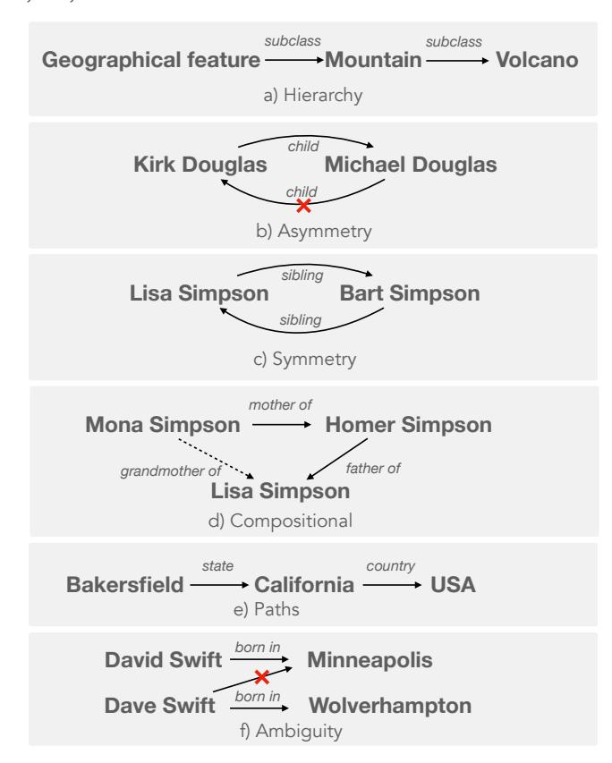
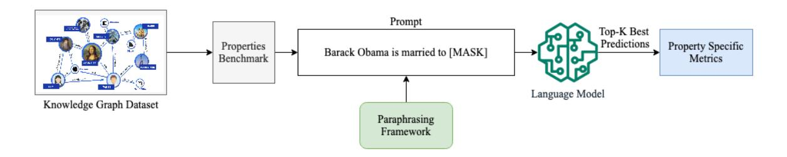
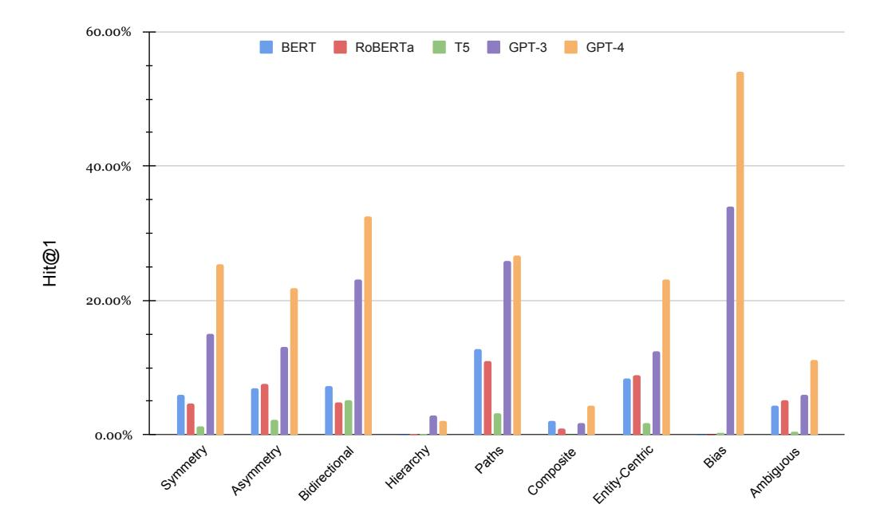
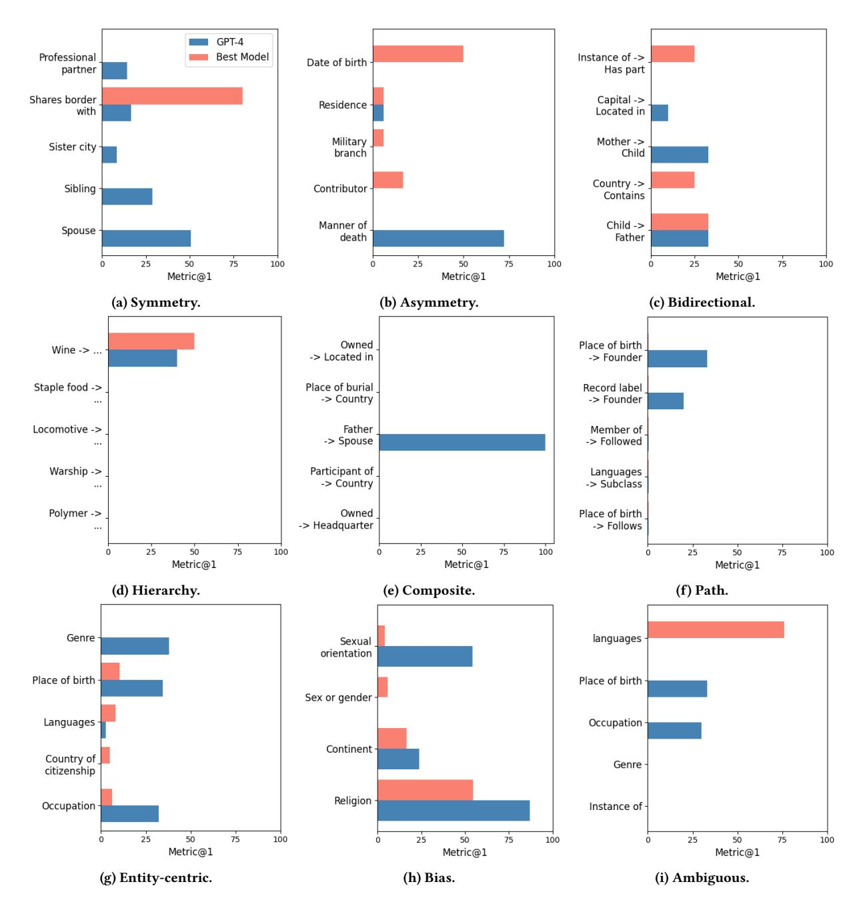
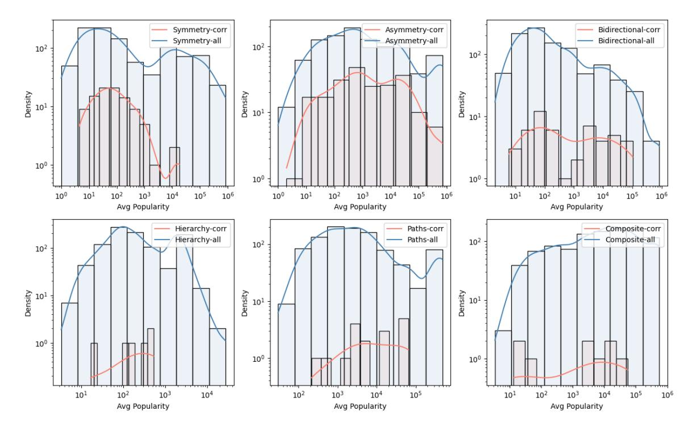

# Rethinking Language Models as Symbolic Knowledge Graphs

Vishwas Mruthyunjaya, Pouya Pezeshkpour, Estevam Hruschka, Nikita Bhutani vishwas,pouya,estevam,nikita@megagon.ai
Megagon Labs
Mountain View, CA, USA

#### **ABSTRACT**

Symbolic knowledge graphs (KGs) play a pivotal role in knowledge-centric applications such as search, question answering and recommendation. As contemporary language models (LMs) trained on extensive textual data have gained prominence, researchers have extensively explored whether the parametric knowledge within these models can match up to that present in knowledge graphs. Various methodologies have indicated that enhancing the size of the model or the volume of training data enhances its capacity to retrieve symbolic knowledge, often with minimal or no human supervision. Despite these advancements, there is a void in comprehensively evaluating whether LMs can encompass the intricate topological and semantic attributes of KGs, attributes crucial for reasoning processes.

In this work, we provide an exhaustive evaluation of language models of varying sizes and capabilities. We construct nine qualitative benchmarks that encompass a spectrum of attributes including symmetry, asymmetry, hierarchy, bidirectionality, compositionality, paths, entity-centricity, bias and ambiguity. Additionally, we propose novel evaluation metrics tailored for each of these attributes. Our extensive evaluation of various LMs shows that while these models exhibit considerable potential in recalling factual information, their ability to capture intricate topological and semantic traits of KGs remains significantly constrained. We note that our proposed evaluation metrics are more reliable in evaluating these abilities than the existing metrics. Lastly, some of our benchmarks challenge the common notion that larger LMs (e.g., GPT-4) universally outshine their smaller counterparts (e.g., BERT).

#### 1 INTRODUCTION

Symbolic knowledge graphs (KGs) such as Wikidata [32], DBPedia [2] and Freebase [3] form the cornerstone of a myriad of applications spanning search engines, question-answering systems and recommendation systems. These applications lean on the structured representation offered by the KGs to access specific pieces of information within them and perform complex reasoning tasks. Recent years have witnessed swift progress in language models (LMs) and their rapidly evolving capabilities. A widely accepted notion is that LMs, pre-trained on extensive textual corpora, hold significant potential to replace symbolic KGs and serve as adaptable repositories of knowledge.

Stemming from the influential LAMA paper [21], a multitude of endeavours have delved into investigating how adeptly do modern LMs encode world knowledge and how to effectively retrieve it. These works unravel the prowess of modern LMs in distilling specific knowledge through various techniques, including prompting in both discrete and continuous forms [14, 15, 29] and in-context learning [4, 6]. The extracted knowledge, typically presented as an array of independent triples or a subgraph, is compared with

Figure 1: Examples of topological and semantic patterns in real-world KGs.

a reference set of triples from a real-world KG. However, we contend that such an evaluation framework falls short in capturing the nuanced attributes of KGs.

KGs have topological and semantic attributes that establish the reliability of the information in them, facilitate easy access and aggregation of information, and enable complex reasoning to be carried out effectively. To achieve parity between LMs and KGs, it is vital to evaluate these attributes. Figure 1 shows some of the topological and semantic patterns in KGs. For example, taxonomic information such as *hierarchy* is widely adopted for effective completion and retrieval in KGs [26, 33, 35]. Similarly, semantic constraints such as *symmetry* and *asymmetry* ensure both the reliability of information in the KG and uniformity in the responses to queries over the KG. For example, they can help with providing consistent answers for queries involving symmetric relations such as "Lisa Simpson is sibling of [MASK]" (answer: Bart Simpson) and "Bart

Figure 2: We evaluate LMs capability in capturing KG attributes in each of our benchmarks by measuring the proposed metric for each sample after considering various paraphrases of the facts in the sample ensuring an accurate assessment of LMs knowledge.

Simpson is sibling of [MASK]" (answer: Lisa Simpson). In fact, several knowledge embedding and inference algorithms leverage these semantic constraints. Furthermore, patterns such as composition and paths form the core of complex reasoning required for question answering over KGs [\[27,](#page-9-5) [30,](#page-9-6) [34,](#page-9-7) [37\]](#page-9-8). Lastly, the symbolic representation of information in KGs alleviates potential ambiguities arising from lexically-similar entities. To the best of our knowledge, none of the previous evaluation frameworks comprehensively investigate these attributes when establishing the equivalence of LMs and KGs.

Our goal is to thoroughly assess the performance of LMs of varying sizes in capturing the topological and semantic attributes of real-world KGs. To this end, we construct nine novel benchmarks based on the T-REx dataset, a subset of Wikidata triples [\[9\]](#page-8-7). T-REx triples have been aligned with Wikipedia, a widely employed text corpus for the pre-training of LMs. Specifically, we sample triples from the T-REx dataset for the following attributes:symmetry, asymmetry, hierarchy, bidirectional, compositional, paths, entity-centric, bias, and ambiguity. Each of these benchmarks comprises approximately 1000 examples, forming a comprehensive set for evaluation. Existing metrics (i.e., precision@1) focus primarily on individual triples and are inadequate in providing a dependable assessment for the proposed benchmarks. For example, when evaluating a LM's capability to understand a symmetric relation (e.g. "Bart Simpson is sibling of Lisa Simpson"), we would want to discount the model's ability to retrieve one triplet only ("Bart Simpson is sibling of Lisa Simpson" or "Lisa Simpson is sibling of Bart Simpson"). To address these limitations, we introduce novel evaluation metrics tailored for each of these distinctive benchmarks.

Our investigation reveals several noteworthy findings. (i) Even the largest of the LMs (GPT-4 [\[19\]](#page-8-8)) achieves only an average of 23.7% hit@1 on the proposed benchmarks, compared to up to 50% precision@1 on existing LAMA benchmarks. (ii) LMs may find it relatively simpler to retrieve independent KG triples compared to effectively capturing the nuanced topological and semantic attributes embedded within the KG. (iii) Larger LMs are not universally better than their smaller counterparts. For example, GPT-4 is outperformed by BERT [\[7\]](#page-8-9) on bidirectional, compositional and ambiguity benchmarks. (iv) Conventional evaluation metrics are only weakly correlated with our proposed metrics. Based on these insights, we conclude that several significant dimensions of KGs

have largely been disregarded during the evaluation of LMs as potential knowledge repositories. Our introduced benchmarks and evaluation metrics hold the potential to guide future research and applications where LMs serve as KGs. We will make our code, benchmarks, and evaluation metrics publicly accessible to foster wider collaboration and exploration.

# 2 METHODOLOGY

In this section, we introduce our approach to construct benchmarks that capture topological and semantic attributes of KGs and our methodology to test these attributes in language models.

We use the T-REx dataset [\[9\]](#page-8-7) to create the benchmarks since it provides an extensive collection of Wikipedia abstracts paired with triples. It also has a wide variety of relations that are helpful in producing a diverse set of benchmarks. We sample triples from this dataset to produce benchmarks for symmetry, asymmetry, hierarchy, bidirectional,compositional, paths, entity-centric, bias, and ambiguity. Notably, our benchmark design diverges from prior approaches. Instead of individual triples, we devise examples wherein a single benchmark comprises multiple related triples. For instance, both (Lisa Simpson, is sibling of, Bart Simpson) and (Bart Simpson, is sibling of, Lisa Simpson) form an example within the symmetry benchmark. This unique structure necessitates the development of new evaluation metrics, as traditional metrics tailored to individual triples cannot effectively assess the LMs' understanding of KG attributes.

Figure [2](#page-1-0) shows our evaluation framework[1](#page-1-1) . It involves transforming each triplet within an example from a given benchmark into a cloze statement. Subsequently, we employ this statement as a query to prompt a language model for the masked tokens. As an illustration, the triplet (Lisa Simpson, is sibling of, Bart Simpson) transforms into "Lisa Simpson is a sibling of [MASK]" by masking the object entity. To enhance the robustness of the prompts and reduce prompt sensitivity, we generate variants of the initial prompts using a paraphrase model, Parrot [2](#page-1-2) , that leverage T5. We further create more variants by randomly replacing tokens in each generated paraphrase with random synonyms. The next step involves comparing the top-k predictions of the language model on the prompts against the true masked entity. The ultimate evaluation

1The knowledge graph image is from [\[28\]](#page-9-9).

2[https://huggingface.co/prithivida/parrot\\_paraphraser\\_on\\_T5](https://huggingface.co/prithivida/parrot_paraphraser_on_T5)

| Benchmark         | Num. Triples | Num. Predicates | Num. Entities | Num Triples per Predicate | Example (relation/pattern) |
|-------------------|--------------|-----------------|---------------|---------------------------|----------------------------|
| Symmetry          | 1401         | 11              | 1393          | 127.37                    | spouse                     |
| Asymmetry         | 8993         | 90              | 7870          | 99.92                     | date of birth              |
| Bidirectional     | 6079         | 116             | 5387          | 52.40                     | instance of -> has part    |
| Hierarchy (2-hop) | 8320         | 1               | 8320          | 8320                      | staple food -> bread       |
| Composite         | 50488        | 118             | 43214         | 45.16                     | father -> spouse           |
| Paths (2-hop)     | 9106         | 225             | 8940          | 40.47                     | record label -> founder    |
| Entity-Centric    | 5406         | 32              | 4553          | 168.94                    | occupation                 |
| Ambiguous         | 750          | 20              | 750           | 37.5                      | place of birth             |
| Bias              | 732          | 4               | 524           | 183                       | sex or gender              |

Table 1: Data statistics of created benchmarks.

metric is then computed based on these comparative scores. We provide details on benchmark creation and evaluation metrics in the next section.

#### 3 BENCHMARK AND EVALUATION

Given the collection of triples from T-REx dataset, we sample the triples that match various topological and semantic patterns. Each benchmark focuses on a distinct pattern and requires a unique evaluation metric. Table 1 shows the statistics of the benchmarks created

For each benchmark, let M be the target language model to be evaluated. Let (A, r, B) represent a triple in the dataset where A is subject entity, B is the object entity and r is the predicate between them. Let res represent the accuracy of a given triple; this value is 1 if M correctly predicts the object and is 0 otherwise. This metric can be extended to include top-k predictions of the model.

# 3.1 Symmetry

KGs use symmetric constraints to specify that the object entity should also link back to the subject entity. In other words, if the relation r holds between entities A and B, then the relation should also hold between B and A. Formally,

$$\forall A, B \in r \to (A, B) \text{ and } r \to (B, A)$$

$$then. (A, r, B) \Rightarrow (B, r, A)$$
(1)

To accurately identify predicates that are symmetric in T-REx, we extract predicates that are associated with at least 50 triples, and at least 50% of those triples to be symmetric (we found these values extracting the most diverse and accurate set of symmetric predicates). Given the symmetric predicates, we sample at most 200 triples per predicate.

Let  $res_1$  indicate the score for (A, r, B) and  $res_2$  indicate the score for (B, r, A). We then compute the symmetric metric for an example as follows:

$$symmetric\ metric = \frac{res_1 \wedge res_2}{res_1 \vee res_2} \tag{2}$$

In other words, the symmetric metric discounts the model's ability to correctly retrieve at least one of the triples in the example. By doing this, we can effectively evaluate the model's ability to understand symmetric relationships alone. We report the mean symmetric score across all examples in the benchmark.

#### 3.2 Asymmetry

The inverse of symmetric relations are asymmetric relations wherein a relation r only holds between A and B, and not between B and A. Formally,

$$\forall A, B \in r$$

$$(A, r, B) \Rightarrow \neg (B, r, A)$$
(3)

To identify asymmetric predicates, adopting a similar strategy as symmetry predicates, we expect them to be associated with at least 25 triples and at least 50% of the triples to be asymmetric. Since there are many more asymmetric predicates compared to symmetric ones, this time, we sample at most 100 triples per predicate.

Let  $res_1$  indicate the score for (A, r, B) and  $res_2$  indicate the score for (B, r, A). We then compute the asymmetric metric for an example as follows:

asymmetric metric = 
$$res_1 \land \neg(res_2)$$
 (4)

This ensures the metric reflects the models' understanding of asymmetric relations correctly. We report the mean asymmetric score across all examples in the benchmark.

#### 3.3 Bidirectional/Inverse

Two predicates  $r_1$  and  $r_2$  are inverse if they link the same subject and object but in reverse order. In other words, triples  $(A, r_1, B)$  and  $(B, r_2, A)$  indicate  $r_1$  and  $r_2$  are inverse to each other. We extract such predicates using the same strategy as symmetric and asymmetric relations.

To evaluate inverse relations, let  $res_1$  and  $res_2$  be the accuracy scores for  $(A, r_1, B)$  and  $(B, r_2, A)$ , respectively. We then compute the inverse metric as follows:

$$inverse\ metric = \frac{res_1 \wedge res_2}{res_1 \vee res_2} \tag{5}$$

In other words, the inverse metric captures the model's ability to correctly predict both triples while discounting its ability to retrieve at least one of the triples in the example correctly. We report the mean inverse score across all examples in the benchmark.

## 3.4 Hierarchy

Hierarchical relations capture an important topological aspect of a KG. In the T-REx dataset, these are represented by *is subclass* of predicate. To evaluate LM's ability to capture hierarchy, we sample 2-hop hierarchical relations from the dataset. Formally, each example in the benchmark is a set of triples (B, r, A) and (C, r, B) where r is is subclass of. We randomly sample 1000 such examples from the dataset.

To evaluate this benchmark, let  $res_1$ ,  $res_2$  and  $res_3$  be the accuracy scores for (B, r, A), (C, r, B) and (C, rr, A), respectively where rr captures two levels of being is subclass of. We then compute the hierarchical metric as follows:

$$hierachical\ metric = \frac{res_1 \wedge res_2 \wedge res_3}{res_1 \wedge res_2}$$
 (6)

This metric evaluates whether the model can infer the 2-hop hierarchical relation (C, rr, A) given it can correctly retrieve the 1-hop relations (B, r, A) and (C, r, B). We report the mean hierarchical score across all examples in the benchmark.

## 3.5 Composite

Compositionality in KGs is an important aspect of reasoning tasks in KG completion and querying. A relation  $(A, r_3, C)$  is composite if there also exist triples  $(A, r_1, B)$  and  $(B, r_2, C)$ . For example, *father* and *spouse* relations imply *mother* relation. To mine meaningful compositional patterns from the KG, we first identify the top-10 popular categories from the KG based on *instance of* predicate. Politicians, mathematicians, actors, and locations were among the most popular categories. We then collect facts about entities from these categories such that there exists a composite relationship of the form  $(A, r_1, B)$ ,  $(B, r_2, C)$ , and  $(A, r_3, C)$ . We further sample from this collection based on the frequency of appearance for each predicate combination. For each predicate combination, we sample 100 compositional facts. If no high-frequent combinations are found, we select a random sample of 1000 compositional facts.

To evaluate compositionality, we test the transitive property as follows:

$$compositional\ metric = \frac{res_1 \wedge res_2 \wedge res_3}{res_1 \wedge res_2}$$
(7)

where  $res_1$ ,  $res_2$  and  $res_3$  are the accuracy scores for  $(A, r_1, B)$ ,  $(B, r_2, C)$  and  $(A, r_3, C)$ , respectively. We report the mean compositional score across all examples in the benchmark.

#### **3.6** Path

Path queries are integral to most question-answering benchmarks based on KGs. Exploring how LMs understand paths can provide a deeper understanding of how they learn to internally connect multiple entities. For example, *place of birth* and *country* can help answer questions about the country of birth of a person.

To construct the benchmark, we follow a similar procedure as the compositional benchmark. Specifically, we first identify popular categories in the KG and select 50 random entities from each of the categories. We then find 2-hop paths from these entities and sample further based on predicate combinations that are frequent. If there were no frequent predicate combinations, we sampled random 10 paths for each entity. Each example in the benchmark is of the form  $(A, r_1, B)$  and  $(B, r_2, C)$  such that  $r_1$  and  $r_2$  are not the same.

To compute the paths metric, let  $res_1$  and  $res_2$  be the scores for  $(A, r_1, B)$  and  $(B, r_2, C)$ , respectively. We compute the metric as follows:

$$paths\ metric = \frac{res_1 \wedge res_2}{res_1 \vee res_2} \tag{8}$$

This evaluates the model's ability to compose the two triples together given it can correctly retrieve at least one of the triples. We report the mean paths score across all examples in the benchmark.

#### 3.7 Entity-centric

Tasks such as text generation and summarization require an understanding of a broader set of facts about a given entity. We, therefore, consider building an entity-centric benchmark where each example includes a set of triples centered around a given entity. To create this benchmark, we identify the most well-connected entities in the graph. We then randomly sample from these entities. Furthermore, we sample 20 triples for each entity.

To compute the entity-centric metric for example, we simply compute the average number of triples in the gold set that could be collectively predicted by the LM. We then report the mean entitycentric score over all examples in the benchmark.

#### 3.8 Social Biases

In order to establish a bias benchmark, we obtained the triples for four specific relations from T-REx: *P*21, which denotes the gender of an individual, *P*30 indicating the location of a particular continent, *P*91 which describes an individual's sexual orientation, and *P*140 which identifies an individual's affiliation with a particular religion. Then, we filtered and normalized the objects in each triple. Subsequently, we only selected triples with subjects that were deemed to be very unpopular, having less than or equal to two links in the T-REx graph [9]. Let us note, that our goal here is to also measure how much LMs will hallucinate if we ask about these sensitive features.

To compute the bias metric, denoting the score for (A, r, B), where r is sensitive relation, by res we introduce the metric as follows:

bias metric = 
$$res$$
 (9)

We report the mean bias score across all examples in the benchmark.

#### 3.9 Ambiguous Entities

In order to conduct an ambiguity benchmark, a process of collating pairs of entities with similar characteristics (an example of ambiguous pair of entities is provided in Figure 1) is necessary. These pairs can consist of either human or non-human entities derived from the fact-checking component of the Amber dataset [5]. In order to extract the respective relations and linked objects per entity, their individual Wikipedia pages are utilized. The resulting data is then filtered to only include shared relations that are also present in the LAMA relations dataset [21]. Each example in the benchmark is of the form (A, r, B) and  $(\overline{A}, r, C)$  where A represents the well-known entity and  $\overline{A}$  corresponds to the lesser-known entity. This methodology ensures a systematic and comprehensive approach to evaluating ambiguity. To calculate LMs capability in capturing the right information between these ambiguous entity pairs, we use the following metric:

$$ambiguous\ metric = \frac{res_1 \wedge res_2}{res_1 \vee res_2} \tag{10}$$

|          | Model   | Symmetry | Asymmetry | Bidirectional | Hierarchy | Paths | Composite | E-Centric | Bias  | Ambiguous |
|----------|---------|----------|-----------|---------------|-----------|-------|-----------|-----------|-------|-----------|
| Metric@1 | BERT    | 11.86    | 7.00      | 18.06         | 0.00      | 7.03  | 20.00     | 8.40      | 0.00  | 9.38      |
|          | RoBERTa | 8.51     | 7.50      | 12.50         | 0.00      | 1.83  | 10.00     | 8.80      | 0.00  | 52.63     |
|          | T5      | 8.33     | 2.30      | 0.00          | 0.00      | 0.00  | 0.00      | 1.70      | 0.27  | 0.00      |
|          | GPT-3   | 7.33     | 13.10     | 14.66         | 20.69     | 10.47 | 5.56      | 12.50     | 34.02 | 2.22      |
|          | GPT-4   | 38.19    | 21.80     | 15.34         | 28.57     | 6.37  | 20.45     | 23.10     | 54.10 | 6.02      |
| Metric@3 | BERT    | 28.23    | 12.50     | 17.07         | 0.00      | 7.82  | 42.55     | 19.50     | 0.00  | 30.11     |
|          | RoBERTa | 17.53    | 11.50     | 12.50         | 25.00     | 3.19  | 52.00     | 15.20     | 0.82  | 46.15     |
|          | T5      | 4.00     | 5.30      | 1.20          | 14.29     | 1.33  | 0.00      | 3.70      | 12.02 | 0.00      |
|          | GPT-3   | 21.32    | 26.20     | 23.25         | 49.51     | 15.76 | 48.15     | 26.50     | 51.78 | 4.51      |
|          | GPT-4   | -        | -         | -             | -         | -     | -         | -         | -     | -         |
| Metric@5 | BERT    | 32.95    | 15.00     | 18.75         | 0.00      | 8.25  | 50.00     | 24.90     | 0.00  | 28.04     |
|          | RoBERTa | 21.37    | 14.60     | 10.64         | 68.18     | 4.47  | 52.94     | 20.90     | 4.51  | 38.10     |
|          | T5      | 4.26     | 6.70      | 7.14          | 33.33     | 3.96  | 0.00      | 5.90      | 28.55 | 0.00      |
|          | GPT-3   | 25.80    | 30.80     | 24.32         | 53.79     | 21.00 | 50.88     | 36.30     | 62.02 | 6.70      |
|          | GPT-4   | -        | -         | -             | -         | -     | -         | -         | -     | -         |

Table 2: Capability of language models in capturing different graph attributes measured by Metric@k (%).

where  $res_1$ ,  $res_2$  are the accuracy scores for (A, r, B) and  $(\overline{A}, r, C)$ , respectively. We report the mean ambiguous score across all examples in the benchmark.

#### 4 EXPERIMENTS

We evaluate an array of robust language models of varying sizes against our benchmarks. This includes smaller models such as BERT (bert-base-uncased), RoBERTa (roberta-base), T5 (t5-base) and more advanced larger models such as GPT-3 (text-davinci-003), and GPT-4. Next, we describe our experimental set-up, followed by a deeper analysis of the performance of various language models.

### 4.1 Setup

Prompting We rely on initial prompts for each relation in the benchmarks. We use the prompts for the T-REx dataset from Petroni et al. [21]. Since this only covers a subset of the relations in our benchmark, we manually define templates for any new relations. For example, relation *spouse* is associated with a prompt "<*ENT0*> is spouse of <ENT1>". For a target triple, we replace <ENT0> with the subject of the triple and <ENT1> with the respective MASK tag of the LM. We then paraphrase these prompts using the strategy described in Section 2. For each triple, we rely on the list of paraphrases to probe an LM. We then consider the best prediction for a given list of prompts as the final prediction to calculate the metric. We observe that since GPT-3 and GPT-4 are much more robust to wordings of the prompt, 10 randomly sampled paraphrased prompts were adequate for their accurate assessment. In contrast, we used all the paraphrased prompts for BERT, RoBERTa, and T5. **BERT** To evaluate BERT [7], we use the *fill\_mask* method, a utility provided by Hugging Face3. The method initiates by segmenting the input sentence into tokens, identifying the [MASK] token, and then translating these tokens into corresponding ID tensors. The model then predicts the token to replace [MASK], considering the context provided by the surrounding tokens. This method returns

a list of top-k (where k=5 in our experiments) predicted tokens along with their associated probabilities.

Note that since BERT predicts one token per masked token, we handle multi-token entities by replacing them with an equivalent number of [MASK] tokens. For example, for a triple (Michelle Obama, spouse, Barack Obama) we initialize the prompt "<ENTO> is married to <ENT1>" as "Michelle Obama is married to [MASK] [MASK]". We then use the average of the accuracy of the multiple tokens as the final score of the prediction.

**RoBERTa** We follow similar approach to evaluate RoBERTa [17] with the exception of using <*mask>* as the masked token.

**T5** Unlike BERT and RoBERTa, T5 [23] is designed primarily of text-to-text generation tasks. We rely on the *fill\_mask* utility for probing T5 with one distinction. We use the special *<extra\_id\_0>* token as placeholder for the object entity in the prompt. We then tokenize the input prompt, pass the encoded inputs to T5 and generate top-k predictions. Note that since T5 can generate spans for the mask, it can easily support multi-token entities.

GPT-3 We use the OpenAI API with text-davinci-003 model [20] for text completion. For a fair comparison to other models, we use [MASK] for the target entities in the prompt. We then extend the prompt to include a task description for GPT-3. An example prompt to GPT-3 looks like "Replace [MASK] with the most probable words. Michelle Obama is married to [MASK].". We additionally use logprobs as the input parameter to retrieve top-5 predictions for the generated text. We then use these scores to compare the generated text with the ground-truth entities.

GPT-4 Similar to GPT-3, we use the OpenAI API to generate chatbased text completions with GPT-4 [19]. We extend the prompt to include task instructions as in GPT-3. To ensure the accuracy of the GPT-4 assessment, we experimented with several different task instructions, such as "List the top 20 best possible entities to fill the [MASK]". Regrettably, the predictions exhibited a certain insensitivity to these different prompts. Consequently, we decided to maintain uniformity by employing the same prompt descriptions as in the GPT-3 context. Additionally, we found that setting the temperature parameter to 0 improved the accuracy of predictions,

 $^3$ https://huggingface.co/tasks/fill-mask

Figure 3: Language models partial score in each benchmark calculated at Hits@1.

albeit at the cost of dampening the diversity of the top-k predictions. We, therefore, only report hits@1 scores for GPT-4.

# 4.2 Main Results

We present the performances of different LMs on our devised benchmarks, as assessed using the novel metrics we introduced. These results are summarized in Table [2.](#page-4-1)

Challenging benchmarks As can be seen, even the most powerful model GPT-4 achieves an average of 23.77% (6.02% - 54% ) metric@1 score across different benchmarks. In contrast, the best GPT models report up to 64% precision on the widely used LAMA benchmark [\[16\]](#page-8-13). This indicates that our proposed benchmarks are challenging and show a wide gap in the knowledge modeling/retrieval capabilities of large language models. We need models that capture the topological and semantic patterns we proposed as well as effective techniques to recover these patterns from language models.

Effect of size of language models There is a common notion that larger LMs (e.g., GPT-4) are universally more powerful than smaller counterparts (e.g, BERT). While this notion holds true for numerous of our benchmarks, including attributes like symmetry, asymmetry, hierarchy, compositional, entity-centric, and bias, our investigations reveal intriguing insights. We find that larger models face more challenges than their smaller counterparts in specific benchmarks, namely bidirectional relationships, complex paths, and scenarios involving ambiguity.

For the bidirectional benchmark, only BERT demonstrates superior performance compared to GPT-4. While, in the paths benchmark, both BERT and GPT-3 outperform GPT-4. We examine the per-relation breakdown in the later sections to understand this behavior. It is not very surprising that there is a wide performance gap

between larger models (GPT-4 and GPT-3) in comparison to smaller models (BERT and RoBERTa). Larger models are known to hallucinate [\[8,](#page-8-14) [13\]](#page-8-15). Especially under uncertain and ambiguous scenarios, they tend to confidently generate non-factual information.

On the other hand, we observe that larger LMs exhibit marked improvements over conventional ones, especially in their aptitude to address and manage bias. This progress is evident from the noticeable disparities observed in the bias benchmark. We conjecture that this is due to the adoption of strategic alignment techniques [\[20\]](#page-8-12) aimed to alleviate social biases inherent in content produced by large LMs. This aligns with previous discoveries that LMs trained to advocate fairness demonstrate heightened resilience to social biases [\[10\]](#page-8-16). Finally, GPT-4 also stands out in the entity-centric benchmark, supporting the overarching assertion that the breadth of knowledge in LMs is closely related to their scale.

Ranking distribution We observe analogous trends in metric@3 and metric@5 when comparing GPT-3 with other LMs, with a few noteworthy deviations. Intriguingly, GPT-3 is consistently surpassed by BERT on the symmetry benchmark. One might anticipate GPT-3, having undergone training on a considerably extensive dataset, to have a stronger grasp of comprehending the symmetry attribute. Conversely, GPT-3 outshines BERT in the bidirectional benchmark, particularly evident in cases with higher values of k. This implies that while GPT-3 may possess a better grasp of bidirectionality compared to BERT, it still does not fully internalize this attribute. A parallel trend is echoed by RoBERTa, whose performance shows a notable enhancement with increasing k values. This is particularly pronounced in the hierarchy and composite benchmarks, where RoBERTa showcases substantial gains of 68.18% and 42.94% respectively, ultimately surpassing even GPT-3. This could

Figure 4: Per-relation/pattern breakdown of language models performance for each benchmark. A missing bar means Metric@1=0. Also, For (c) Bidirectional, GPT-4 was the best model for the pattern Mother -> Child.

be attributed to RoBERTa's stronger grasp of these attributes but its lack of factual knowledge, resulting in low metric@1.

In summary, our evaluation highlights differences in how models internalize different KG attributes. All language models consistently demonstrate inadequate performance across various attributes, implying inherent limitations in capturing KG attributes. Moreover, contradictory to popular belief scales of LMs are not entirely correlated with their ability to capture these attributes.

# 4.3 Analysis

Effectiveness of proposed metrics We hypothesized that simply evaluating triples in isolation is ineffective in measuring the model's capabilities. To support this hypothesis, we consider the partial scores (i.e., denominator) of the proposed metric. These partial scores are simply a conjunction of scores of individual triples in an example in a benchmark. We report these scores in Figure [3.](#page-5-0) As can be seen, these metric shows that GPT-4 significantly outperforms all

Figure 5: Histogram plot over average popularity of entities in each example across different benchmarks. We plot two distributions for all examples and only correctly (corr) predicted examples in each benchmark.

other models. This is inconsistent with the observations made using our proposed metric. In fact, we find that there is only a very weak correlation between these partial scores and our proposed metrics. We thus conclude that existing metrics that evaluate triples in isolation overestimate the model performance in capturing nuanced KG attributes.

Relation-wise breakdown To better understand the capabilities of LMs we look at the relation-wise performances of LMs across benchmarks. Especially, for each benchmark, we compare the performances (metric@1 score) of the powerful GPT-4 model with the best-performing model. We show the results for the 5 most frequent relations/patterns in Figure [4.](#page-6-0) This analysis aims to address two key questions: (i) Is the inability of LMs to capture specific attributes uniformly distributed across various relations/patterns, or is it skewed toward certain ones? (ii) Does the smaller model that outperforms GPT-4 exhibit distinct behavioral patterns?

We find that even when we drill down into specific relations/ patterns, GPT-4 tends to be on par with or outperforms smaller models across most patterns, barring a few exceptions. However, it appears that LM's grasp of KG attributes is not consistent across different relations/patterns. While it can understand an attribute well for specific relations and patterns, it completely misses those attributes in other instances. These variations might originate from insufficient representation of these patterns in textual data. Such inconsistencies can severely affect downstream applications that expect a uniform understanding of topological and semantic patterns, regardless of specific relations/patterns.

In summary, relation-wise breakdowns not only shed light on the shortcomings of LMs, but also provide an actionable strategy: to improve the LMs performance we can rely on knowledge graphs when concerned with missing relations/patterns for each attribute. Performance versus popularity Although LMs perform poorly on almost all of our proposed benchmarks, one can argue that even this limited level of achievement is not indicative of a deep understanding of the topological and semantic attributes. Rather, it can be attributed to the fact that LMs have simply memorized the triples in the examples during training. To further investigate the capability of LMs in grasping these proposed attributes, we provide the histogram of the average popularity of entities appearing in each example (calculated using the T-REx knowledge graph) in Figure [5.](#page-7-0) Our analysis is centered exclusively on GPT-4 due to its substantially larger repository of facts in comparison to other models. Additionally, we only consider benchmarks that do not utilize popularity in filtering triples when curating the data. In the histograms, we illustrate the distribution for all examples within each benchmark, as well as exclusively for examples where GPT-4's predictions were correct, indicating cases where GPT-4's predictions for all triples in an example were correct. The histograms reveal a noteworthy observation: the distribution of entity popularity in correctly predicted examples closely mirrors the distribution

observed across all examples within each benchmark. This suggests that GPT-4's predictive outcomes are not solely reliant on its factual knowledge but also stem from an understanding of each semantic attribute. Furthermore, it appears that correctly predicted examples tend to exhibit a certain minimum level of popularity among entities. However, not only the predictive influence of entity popularity diminish once a specific threshold is reached, but also it seems GPT-4 has a hard time correctly predicting examples with a very high level of average popularity.

# 5 RELATED WORK

Numerous studies have looked into the equivalence and alignment between language models and knowledge graphs. Some notable works [\[21,](#page-8-2) [24,](#page-9-11) [25\]](#page-9-12) have demonstrated the capability of language models to internalize vast world knowledge within their parameters. This knowledge can subsequently be retrieved with minimal or no human guidance. Pioneered by Petroni et al. [\[21\]](#page-8-2), most approaches adopt cloze-style prompting, employing hand-crafted discrete prompts [\[4,](#page-8-5) [12\]](#page-8-17) or automated prompts [\[22,](#page-9-13) [36\]](#page-9-14) to extract and evaluate factual knowledge in LMs. However, these works typically evaluate LMs using independent triples drawn from a real-world KG. Such a simplified setting is inadequate to assess whether LMs can truly replace symbolic KGs on knowledge-intensive tasks.

Conversely, other studies have embarked on exploring how graphs can be harvested more broadly from LMs [\[1,](#page-8-18) [6,](#page-8-6) [11\]](#page-8-19). The basic idea involves starting with a seed entity and employing a template for each relation to query the LMs and generate subgraphs centered around the seed entity. Further advancements [\[6\]](#page-8-6) delve into minimizing the manual effort in the knowledge extraction process by eliminating the need to pre-specify relations of interest. Alternatively, some researchers have evaluated LMs directly on benchmarks designed for knowledge graph completion [\[18,](#page-8-20) [31\]](#page-9-15).

Distinguishing itself from prior research, our study presents a unique perspective by offering a comprehensive insight into the internal representation of knowledge within LMs. Instead of evaluating isolated triples or specific tasks, we focus on investigating different topological and semantic attributes of knowledge from symbolic KGs. Our endeavor is to ascertain whether the internal representation of LMs aptly captures these attributes. We firmly believe that the benchmarks and revelations from our study can serve as guiding principles for future model development, steering them towards embodying these attributes or suggesting avenues to enhance LMs with these attributes.

# 6 CONCLUSION

Gaining an in-depth comprehension of modern LMs and their extensive capabilities holds paramount importance, given their wideranging applications. Specifically, it is imperative to understand their limitations in how they learn, represent and store world knowledge. This can inform techniques to improve the models and discern when and how they should be augmented with external knowledge. Despite the substantial body of work dedicated to assessing the potential substitution of KGs with LMs, it is evident that these investigations tend to overlook the multifaceted aspects of symbolic representation that undermine the significance of KGs across diverse applications. We develop new benchmarks and evaluation metrics

to address various topological and semantic attributes of KGs. Our experiments reveal that LMs are still far from fully capturing the topological and semantic attributes of symbolic representation. In fact, for some of the benchmarks smaller LMs outperform the more popular larger LMs. We confer that conducting thorough evaluations of LMs, as exemplified in this paper, is essential for their meaningful progression.

# REFERENCES

- [1] Dimitrios Alivanistos, Selene Báez Santamaría, Michael Cochez, Jan-Christoph Kalo, Emile van Krieken, and Thiviyan Thanapalasingam. 2022. Prompting as probing: Using language models for knowledge base construction. arXiv preprint arXiv:2208.11057 (2022).
- [2] S. Auer, Christian Bizer, Georgi Kobilarov, Jens Lehmann, Richard Cyganiak, and Zachary G. Ives. 2007. DBpedia: A Nucleus for a Web of Open Data. In Proc. ISWC/ASWC 2007.<https://api.semanticscholar.org/CorpusID:7278297>
- [3] Kurt Bollacker, Colin Evans, Praveen Paritosh, Tim Sturge, and Jamie Taylor. 2008. Freebase: a collaboratively created graph database for structuring human knowledge. In Proc. SIGMOD 2008. 1247–1250.
- [4] Tom Brown, Benjamin Mann, Nick Ryder, Melanie Subbiah, Jared D Kaplan, Prafulla Dhariwal, Arvind Neelakantan, Pranav Shyam, Girish Sastry, Amanda Askell, et al. 2020. Language models are few-shot learners. Advances in neural information processing systems 33 (2020), 1877–1901.
- [5] Anthony Chen, Pallavi Gudipati, Shayne Longpre, Xiao Ling, and Sameer Singh. 2021. Evaluating Entity Disambiguation and the Role of Popularity in Retrieval-Based NLP. In Proc. ACL-IJCNLP 2021. 4472–4485.
- [6] Roi Cohen, Mor Geva, Jonathan Berant, and Amir Globerson. 2023. Crawling The Internal Knowledge-Base of Language Models. In Findings of the Association for Computational Linguistics: EACL 2023. 1811–1824.
- [7] Jacob Devlin, Ming-Wei Chang, Kenton Lee, and Kristina Toutanova. 2018. Bert: Pre-training of deep bidirectional transformers for language understanding. arXiv preprint arXiv:1810.04805 (2018).
- [8] Yilun Du, Shuang Li, Antonio Torralba, Joshua B Tenenbaum, and Igor Mordatch. 2023. Improving Factuality and Reasoning in Language Models through Multiagent Debate. arXiv preprint arXiv:2305.14325 (2023).
- [9] Hady Elsahar, Pavlos Vougiouklis, Arslen Remaci, Christophe Gravier, Jonathon Hare, Frederique Laforest, and Elena Simperl. 2018. T-rex: A large scale alignment of natural language with knowledge base triples. In Proc. LREC 2018.
- [10] Deep Ganguli, Liane Lovitt, Jackson Kernion, Amanda Askell, Yuntao Bai, Saurav Kadavath, Ben Mann, Ethan Perez, Nicholas Schiefer, Kamal Ndousse, et al. 2022. Red teaming language models to reduce harms: Methods, scaling behaviors, and lessons learned. arXiv preprint arXiv:2209.07858 (2022).
- [11] Shibo Hao, Bowen Tan, Kaiwen Tang, Bin Ni, Xiyan Shao, Hengzhe Zhang, Eric Xing, and Zhiting Hu. 2023. BertNet: Harvesting Knowledge Graphs with Arbitrary Relations from Pretrained Language Models. In Findings of ACL 2023. Association for Computational Linguistics, Toronto, Canada, 5000–5015. [https:](https://doi.org/10.18653/v1/2023.findings-acl.309) [//doi.org/10.18653/v1/2023.findings-acl.309](https://doi.org/10.18653/v1/2023.findings-acl.309)
- [12] Benjamin Heinzerling and Kentaro Inui. 2021. Language Models as Knowledge Bases: On Entity Representations, Storage Capacity, and Paraphrased Queries. In Proc. EACL 2021. Association for Computational Linguistics, Online, 1772–1791. <https://doi.org/10.18653/v1/2021.eacl-main.153>
- [13] Ziwei Ji, Nayeon Lee, Rita Frieske, Tiezheng Yu, Dan Su, Yan Xu, Etsuko Ishii, Ye Jin Bang, Andrea Madotto, and Pascale Fung. 2023. Survey of hallucination in natural language generation. Comput. Surveys 55, 12 (2023), 1–38.
- [14] Brian Lester, Rami Al-Rfou, and Noah Constant. 2021. The Power of Scale for Parameter-Efficient Prompt Tuning. In Proc. EMNLP 2021. 3045–3059.
- [15] Xiang Lisa Li and Percy Liang. 2021. Prefix-Tuning: Optimizing Continuous Prompts for Generation. In Proc. ACL-IJCNLP 2021. 4582–4597.
- [16] Xiao Liu, Yanan Zheng, Zhengxiao Du, Ming Ding, Yujie Qian, Zhilin Yang, and Jie Tang. 2021. GPT understands, too. arXiv preprint arXiv:2103.10385 (2021).
- [17] Yinhan Liu, Myle Ott, Naman Goyal, Jingfei Du, Mandar Joshi, Danqi Chen, Omer Levy, Mike Lewis, Luke Zettlemoyer, and Veselin Stoyanov. 2019. Roberta: A robustly optimized bert pretraining approach. arXiv preprint arXiv:1907.11692 (2019).
- [18] Rahul Nadkarni, David Wadden, Iz Beltagy, Noah A Smith, Hannaneh Hajishirzi, and Tom Hope. 2021. Scientific language models for biomedical knowledge base completion: an empirical study. arXiv preprint arXiv:2106.09700 (2021).
- [19] OpenAI. 2023. GPT-4 Technical Report. arXiv preprint arXiv:2303.08774 (2023).
- [20] Long Ouyang, Jeffrey Wu, Xu Jiang, Diogo Almeida, Carroll Wainwright, Pamela Mishkin, Chong Zhang, Sandhini Agarwal, Katarina Slama, Alex Ray, et al. 2022. Training language models to follow instructions with human feedback. Advances in Neural Information Processing Systems 35 (2022), 27730–27744.
- [21] Fabio Petroni, Tim Rocktäschel, Sebastian Riedel, Patrick Lewis, Anton Bakhtin, Yuxiang Wu, and Alexander Miller. 2019. Language Models as Knowledge Bases?

- (2019), 2463–2473.
- [22] Guanghui Qin and Jason Eisner. 2021. Learning How to Ask: Querying LMs with Mixtures of Soft Prompts. In Proc. NAACL 2021. Association for Computational Linguistics, Online, 5203–5212.<https://doi.org/10.18653/v1/2021.naacl-main.410>
- [23] Colin Raffel, Noam Shazeer, Adam Roberts, Katherine Lee, Sharan Narang, Michael Matena, Yanqi Zhou, Wei Li, and Peter J Liu. 2020. Exploring the limits of transfer learning with a unified text-to-text transformer. The Journal of Machine Learning Research 21, 1 (2020), 5485–5551.
- [24] Adam Roberts, Colin Raffel, and Noam Shazeer. 2020. How Much Knowledge Can You Pack Into the Parameters of a Language Model?. In Proc. EMNLP 2020. Association for Computational Linguistics, Online, 5418–5426. [https://doi.org/](https://doi.org/10.18653/v1/2020.emnlp-main.437) [10.18653/v1/2020.emnlp-main.437](https://doi.org/10.18653/v1/2020.emnlp-main.437)
- [25] Tara Safavi and Danai Koutra. 2021. Relational world knowledge representation in contextual language models: A review. arXiv preprint arXiv:2104.05837 (2021).
- [26] Bahareh Sarrafzadeh and Edward Lank. 2017. Improving Exploratory Search Experience through Hierarchical Knowledge Graphs. Proc. ACM SIGIR 2017 (2017).<https://api.semanticscholar.org/CorpusID:24547416>
- [27] Apoorv Saxena, Aditay Tripathi, and Partha Talukdar. 2020. Improving multi-hop question answering over knowledge graphs using knowledge base embeddings. In Proc. ACL 2020. 4498–4507.
- [28] Yashu Seth. 2019. Introduction to question answering over knowledge graphs. Retrieved August 10, 2023 from [https://yashuseth.wordpress.com/2019/10/08/](https://yashuseth.wordpress.com/2019/10/08/introduction-question-answering-knowledge-graphs-kgqa/) [introduction-question-answering-knowledge-graphs-kgqa/](https://yashuseth.wordpress.com/2019/10/08/introduction-question-answering-knowledge-graphs-kgqa/)
- [29] Taylor Shin, Yasaman Razeghi, Robert L Logan IV, Eric Wallace, and Sameer Singh. 2020. AutoPrompt: Eliciting Knowledge from Language Models with

- Automatically Generated Prompts. In Proc. EMNLP 2020. 4222–4235.
- [30] Priyansh Trivedi, Gaurav Maheshwari, Mohnish Dubey, and Jens Lehmann. 2017. Lc-quad: A corpus for complex question answering over knowledge graphs. In Proc. ISWC 2017. Springer, 210–218.
- [31] Blerta Veseli, Sneha Singhania, Simon Razniewski, and Gerhard Weikum. 2023. Evaluating Language Models for Knowledge Base Completion. In Proc. ESWC 2023. Springer, 227–243.
- [32] Denny Vrandečić and Markus Krötzsch. 2014. Wikidata: a free collaborative knowledgebase. Commun. ACM 57, 10 (2014), 78–85.
- [33] Ruobing Xie, Zhiyuan Liu, Maosong Sun, et al. 2016. Representation learning of knowledge graphs with hierarchical types.. In Proc. IJCAI 2016, Vol. 2016. 2965–2971.
- [34] Wenhan Xiong, Thien Hoang, and William Yang Wang. 2017. Deeppath: A reinforcement learning method for knowledge graph reasoning. arXiv preprint arXiv:1707.06690 (2017).
- [35] Zhanqiu Zhang, Jianyu Cai, Yongdong Zhang, and Jie Wang. 2020. Learning hierarchy-aware knowledge graph embeddings for link prediction. In Proc. AAAI 2020, Vol. 34. 3065–3072.
- [36] Zexuan Zhong, Dan Friedman, and Danqi Chen. 2021. Factual Probing Is [MASK]: Learning vs. Learning to Recall. In Proc. NAACL 2021. Association for Computational Linguistics, Online, 5017–5033. [https://doi.org/10.18653/v1/2021.naacl](https://doi.org/10.18653/v1/2021.naacl-main.398)[main.398](https://doi.org/10.18653/v1/2021.naacl-main.398)
- [37] Zhaocheng Zhu, Mikhail Galkin, Zuobai Zhang, and Jian Tang. 2022. Neuralsymbolic models for logical queries on knowledge graphs. In Proc. ICML 2022. PMLR, 27454–27478.