# **KG-LLM-Bench:** A Scalable Benchmark for Evaluating LLM Reasoning on Textualized Knowledge Graphs

Elan Markowitz\*†<sup>1</sup> , Krupa Galiya\*‡<sup>2</sup> , Greg Ver Steeg1,3, and Aram Galstyan<sup>1</sup>

> <sup>1</sup>University of Southern California 2 Independent Researcher <sup>3</sup>University of California, Riverside

# Abstract

Knowledge graphs have emerged as a popular method for injecting up-to-date, factual knowledge into large language models (LLMs). This is typically achieved by converting the knowledge graph into text that the LLM can process in context. While multiple methods of encoding knowledge graphs have been proposed, the impact of this textualization process on LLM performance remains under-explored. We introduce KG-LLM-Bench, a comprehensive and extensible benchmark spanning five knowledge graph understanding tasks, and evaluate how different encoding strategies affect performance across various base models. Our extensive experiments with seven language models and five textualization strategies provide insights for optimizing LLM performance on KG reasoning tasks.

# 1 Introduction

The integration of knowledge graphs (KGs) with large language models (LLMs) has emerged as an important approach for enhancing contextual understanding in AI systems [\(Kau et al.,](#page-11-0) [2024\)](#page-11-0). Knowledge graphs are large structured databases of factual information that encode real world entities and their relationships. Recent surveys have highlighted the complementary nature of LLMs (static, unstructured, opaque, general) and KGs (dynamic, structured, interpretable, specific) [\(Pan et al.,](#page-11-1) [2023;](#page-11-1) [Zhu et al.,](#page-13-0) [2023;](#page-13-0) [Yang et al.,](#page-12-0) [2023;](#page-12-0) [Li et al.,](#page-11-2) [2024;](#page-11-2) [Pan et al.,](#page-12-1) [2024;](#page-12-1) [Fan et al.,](#page-10-0) [2024\)](#page-10-0). This synergy has driven research on specialized architectures and algorithms for their integration [Luo et al.](#page-11-3)

<span id="page-0-0"></span>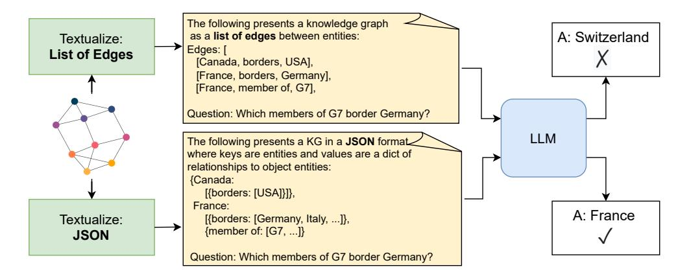

Figure 1: Different formats for graph textualization can result in highly varied performance on downstream tasks.

<sup>\*</sup>Denotes equal contribution

<sup>†</sup> esmarkow@usc.edu

<sup>‡</sup>krupagaliya@gmail.com

[\(2023\)](#page-11-3); [Wen et al.](#page-12-2) [\(2023\)](#page-12-2); [Markowitz et al.](#page-11-4) [\(2024\)](#page-11-4). Most of these approaches rely on converting the KG to a readable text format suitable for LLM processing.

However, many of these algorithms give little consideration to the specific method of KG textualization [\(Fatemi et al.,](#page-10-1) [2023;](#page-10-1) [Chen et al.,](#page-9-0) [2024;](#page-9-0) [Yu et al.,](#page-12-3) [2024\)](#page-12-3). The most common approach simply encodes the KG as a list of edges in the form (source entity label, relation, object entity label). It is assumed that any approach will be equally effective and that using the same format ensures fair model comparison [\(Guo et al.,](#page-10-2) [2023;](#page-10-2) [Wang et al.,](#page-12-4) [2024\)](#page-12-4).

In this work, we challenge these assumptions and demonstrate that textualization strategy significantly impacts performance. Our experiments show that choosing the right strategy can improve overall benchmark performance by up to 17.5% absolute difference, with even larger gains on specific tasks. Figure [1](#page-0-0) illustrates an example of the problem we are trying to analyze.

Our contributions are:

- 1. A scalable and extensible benchmark for analyzing how LLMs process and understand in-context knowledge graphs with five tasks covering important KG reasoning capabilities.
- 2. Experiments covering five different textualization strategies using seven different popular LLM models, resulting in new insights and best practices.
- 3. Experiments with pseuodnyms showing that LLMs do not heavily rely on memorized information when processing in-context knowledge graphs (overall difference of 0.2%).
- 4. A public release of the benchmark and framework so that it can be rapidly expanded.

# 2 Background

Knowledge Graphs are large structured databases that store factual associations as edges in a graph. They come in many varieties from general knowledge (Vrandeciˇ [c & Krötzsch](#page-12-5) ´ , [2014;](#page-12-5) [Lehmann et al.,](#page-11-5) [2015\)](#page-11-5) to domain-specific variants such as Finance, Geology, and Medicine [\(Liu et al.,](#page-11-6) [2019;](#page-11-6) [Zhu](#page-13-1) [et al.,](#page-13-1) [2017;](#page-13-1) [Choi & Lee,](#page-9-1) [2019;](#page-9-1) [Farazi et al.,](#page-10-3) [2020\)](#page-10-3). We formally define a source knowledge graph K = (E, R, T ) where E is the set of entities, R is the set of relation types, and T is the set of edges of the form (*s*,*r*, *o*) ∈ E × R × E e.g., ('Inception', 'director', 'Christopher Nolan').

We can define a subgraph of K as *G* = (*G*<sup>E</sup> , *G*R, *G*<sup>T</sup> ) where *G*<sup>E</sup> ⊆ E, *G*<sup>R</sup> ⊆ R, and *G*<sup>T</sup> ⊆ T .

Large Language Models can learn from information passed into their context window. This is used in retrieval augmented generation to produce more accurate LLM responses [Lewis et al.](#page-11-7) [\(2020\)](#page-11-7). We can define the generation process using LLM *π* that responds to a query *q* using context text *c*:

<span id="page-1-0"></span>
$$\hat{y} = \pi(c, q) \tag{1}$$

where *π* generates a response *y*ˆ. This context can include any text-format data, including various text encodings for knowledge graphs (Fig [1\)](#page-0-0).

# 3 Related Work

Benchmarks for Graphs Reasoning Recent work has extensively evaluated LLM understanding of graph-structured data. Many benchmarks focus on simple graphs rather than knowledge graphs [\(Guo](#page-10-2) [et al.,](#page-10-2) [2023;](#page-10-2) [Tang et al.,](#page-12-6) [2024;](#page-12-6) [Yuan et al.,](#page-12-7) [2024\)](#page-12-7). Other research has expanded to text-space graph foundation models [\(Chen et al.,](#page-9-0) [2024\)](#page-9-0) and hypergraphs [\(Feng et al.,](#page-10-4) [2024\)](#page-10-4). Particularly relevant to our work, [Fatemi et al.](#page-10-1) [\(2023\)](#page-10-1) evaluates how different natural language presentations affect graph understanding, and was later extended to learned graph encoders [\(Perozzi et al.,](#page-12-8) [2024\)](#page-12-8).

KG Question Answering (KGQA) Benchmarks The KGQA field has produced several key benchmarks, including QALD-10 [\(Usbeck et al.,](#page-12-9) [2023\)](#page-12-9), 2WikiMultiHop [\(Ho et al.,](#page-10-5) [2020\)](#page-10-5), and MetaQA [\(Zhang et al.,](#page-13-2) [2018\)](#page-13-2). While HotpotQA [\(Yang et al.,](#page-12-10) [2018\)](#page-12-10) is not KG-grounded, it is still often used for knowledge grounded evaluation. Recent work like CLR-Fact [\(Zheng et al.,](#page-13-3) [2024\)](#page-13-3) evaluates LLMs on complex logical query answering [\(Arakelyan et al.,](#page-9-2) [2020;](#page-9-2) [Galkin et al.,](#page-10-6) [2024\)](#page-10-6).

More focused studies have examined specific KG processing capabilities in LLMs, including KG completion [\(Yao et al.,](#page-12-11) [2023\)](#page-12-11), construction [\(Zhu et al.,](#page-13-4) [2024\)](#page-13-4), causal reasoning [\(Kim et al.,](#page-11-8) [2024\)](#page-11-8),

<span id="page-2-0"></span>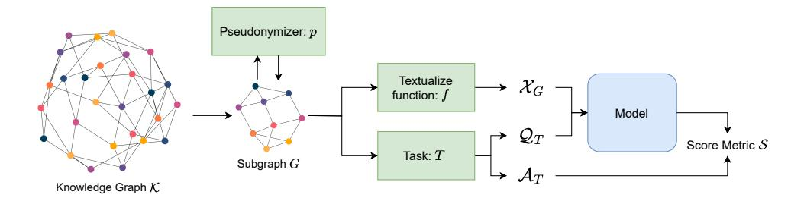

Figure 2: Framework for KG-LLM-Bench.

and trustworthiness enhancement (Sui et al., 2024). While some work has explored KG formatting, such as RDF Turtle parsing (Frey et al., 2023) and natural language presentations (Dai et al., 2024), our work presents the first comprehensive evaluation of textualization strategies.

**KG-Grounded Models and Algorithms** Recent approaches to grounding LLMs with knowledge graphs include Think-on-Graph (Sun et al., 2023) and MindMap (Wen et al., 2023). Tree-of-Traversals (Markowitz et al., 2024) enables test-time search over KG reasoning paths. Alternative approaches like graph-to-tree text encoding (Yu et al., 2024) focus on specialized encoding strategies.

**LLM Reasoning and Long Context Models** Two emerging research directions could significantly impact KG reasoning capabilities. Test-time reasoning models like OpenAI's o1/o3 and DeepSeek's R1 (DeepSeek-AI et al., 2025) enable using enhanced computational resources at inference-time. Meanwhile, advances in long context models (Chen et al., 2023; Lieber et al., 2024; Hooper et al., 2024; Munkhdalai et al., 2024) allow processing of larger knowledge graphs. Our benchmark is positioned to evaluate both these developments in the context of graph reasoning.

#### 4 KG-LLM-Bench Framework

This section details the methodology of KG-LLM-Bench, which evaluates LLMs on knowledge graph question answering tasks. In summary, the LLM answers task-specific questions based on a KG subgraph *G*, with responses evaluated against predefined scoring criteria. Figure 2 provides an overview of our framework.

#### 4.1 Text Representation of KG

We define a set of textualization functions  $\mathcal{F}$  that convert the structured knowledge graph G into a textual representation  $x_G \in \mathcal{W}^*$ , where  $\mathcal{W}^*$  represents the set of all possible text strings:

<span id="page-2-2"></span>
$$x_G = f(G) \tag{2}$$

where  $f \in \mathcal{F}$ . The specific textualization functions are detailed in Sec 6.2.

## <span id="page-2-1"></span>4.2 Query Construction

We design a set of tasks where each task T (e.g., triple retrieval, shortest path) can be used to generate queries q and answers a for graph G:

$$q = \mathcal{Q}_T(G) \tag{3}$$

$$a = \mathcal{A}_T(G, q) \tag{4}$$

where  $Q_T$  formulates the natural language query and  $A_T$  generates the corresponding answer. These are stochastic functions but are implemented with fixed seeds to ensure deterministic behavior.

#### 4.3 Model Generation and Evaluation

The LLM  $\pi$  generates an answer  $\hat{y} = \pi(x_G, q)$  using the textualized graph as context. We evaluate this against the ground truth a using a scoring function S:

<span id="page-2-3"></span>
$$s = \mathcal{S}(\hat{y}, a) \in \{0, 1\} \tag{5}$$

where s indicates correctness. While S is customizable, we use exact match in our experiments.

### 4.4 Optimizing for an LLM

We can consider optimizing the textualization choice for a given model as an optimization of the expected performance of the LLM over the distribution of tasks, possible graph contexts, and questions and answers:

$$\max_{f \in \mathcal{F}} \mathbb{E}_{T,G,\mathcal{Q},\mathcal{A}} \left[ \mathcal{S} \Big( \pi \big( f(G), \mathcal{Q}_T(G), \mathcal{A}_T(G, \mathcal{Q}_T(G)) \big) \Big) \right]$$
 (6)

#### <span id="page-3-1"></span>4.5 Sampling graphs

We sample graphs  $G \sim subgraph(\mathcal{K})$  using seed entities, sampling radius, and max edges parameters. For each seed entity, we first sample ego-graphs containing all edges within the specified radius. An ego-graph for entity e with radius r is defined as EgoGraph(e,r) =

$$\{t = (s, r, o) | d(e, s) \le r, d(e, o) \le r, t \in \mathcal{T}\}\tag{7}$$

where d is the graph distance function. After combining ego-graphs, we apply a low-degree filter to remove single-edge entities, then randomly prune edges to meet the size constraint.

#### 4.6 Pseudonymization

To ensure models rely solely on the provided knowledge graph rather than pre-trained knowledge, we introduce a pseudonymization function p that maps entities to synthetic labels. Given a set of pseudonymized entity labels  $\hat{\mathcal{E}}$ , we create:

<span id="page-3-2"></span>
$$\hat{G} = p(G, \hat{\mathcal{E}}) \tag{8}$$

where the pseudonymization creates the mapping  $\{e: \hat{e} | e \in G_{\mathcal{E}}, \hat{e} \in \hat{\mathcal{E}}\}$  and applies it to G.

For our experiments with historical country entities, we generate semantically appropriate pseudonyms using a combination of a name generator tool\* and LLM-generated names, filtering inappropriate or insulting samples.

#### 5 KG LLM Tasks

We present five fundamental tasks in our benchmark, each chosen to evaluate distinct aspects of KG reasoning: retrieval, path-based reasoning, local aggregation, multi-hop aggregation, and global analysis. Together, these tasks provide a comprehensive evaluation of an LLM's ability to reason over knowledge graphs.

#### 5.1 Triple Retrieval Task

The TripleRetrieval task tests an LLM's fundamental ability to verify the presence of relationships in graph *G*. This capability underlies all more complex graph reasoning tasks, as models must first accurately identify existing relationships before performing higher-order reasoning.

Questions are evenly split between positive and negative cases. Positive samples are drawn directly from edges  $(s,r,o) \sim G_{\mathcal{T}}$ . For negative samples, we create invalid edges by replacing either the source, relation, or object with alternatives  $(s',o' \sim G_{\mathcal{E}})$  or  $r' \sim G_{\mathcal{R}}$  such that the resulting edge does not exist in  $G_{\mathcal{T}}$ .

<span id="page-3-0"></span><sup>\*</sup>https://www.name-generator.org.uk/

## 5.2 Shortest Path Task

The ShortestPath task evaluates a model's ability to find the shortest path between two entities in *G*, considering edges in either direction. This task is relevant as the shortest path between two entities is likely to represent the strongest association between those two entities. For instance, "my brother's employer" is a more direct and informative association than "my mother's sister's nephew's employer". Detailed implementation is provided in Appendix [B.2.](#page-13-5)

#### 5.3 Aggregation By Relation

The AggByRelation task tests local aggregation from anchor nodes, a common requirement in real-world queries. For example, "How many diplomatic relations does Uruguay have?" requires aggregating connections from a specific entity.

Questions in this task take the form "How many {*incoming/outgoing*} relations of type {*relation type*} does {*anchor entity*} have?". Since randomly sampling a relation type and direction and anchor entity most likely results in an aggregation over a single edge, we modify the approach to ensure variety in both the questions and answers. Details of this can be found in Appendix [B.3.](#page-13-6)

### 5.4 Aggregation of Neighbor Properties

The AggNeighborProperty task extends aggregation to two-hop paths, requiring more complex reasoning. Models must answer questions of the form "How many of the directly connected entities to {*anchor entity*} have an outgoing property of type {*relation*} in the knowledge graph?". Many real questions combine aggregation on multi-hop edges. For instance "How many actors who starred in Inception have won Academy Awards?" or "How many universities that collaborate with Stanford University have research centers focused on artificial intelligence?".

The task uses similar sampling approaches to AggByRelation (Appendix [B.4\)](#page-15-0).

#### 5.5 Highest Degree Node by Direction

The HighestDegree task tests global graph reasoning by identifying the entity with the most (incoming/outgoing/total) edges in *G*. The distinction between edge directions is significant. Since many textualization functions group edges with the same source, counting outgoing degree is a more local problem than counting incoming degree.

While more difficult global tasks could be proposed (e.g. graph isomorphism or connectivity statistics), we note that at the scale of graph we use, this task already proves to be relatively difficult.

# 6 Experiments

The following section describes the setup for our experiments. Our benchmark consists of five tasks (100 instances each, plus pseudonymized versions) and five textualization strategies, and we evaluate on seven LLMs.

## 6.1 Data

Our experiments use the Countries knowledge graph from WikiDataSets [\(Boschin & Bonald,](#page-9-6) [2019\)](#page-9-6) as our source graph K. This knowledge graph is a subgraph related to historical countries derived from Wikidata (Vrandeciˇ [c & Krötzsch](#page-12-5) ´ , [2014\)](#page-12-5).

The graph contains diverse relationship types covering geographical relations (e.g., borders), political relations (e.g., diplomatic relations), and temporal relations (e.g., followed by). In addition to the 49 core relations there are 162 attribute relations that connect countries to other types of entities such as languages or significant events. Table [1](#page-5-1) summarizes the key statistics of the dataset.

When sampling subgraphs for our tasks, we follow the procedure outlined in Section [4.5.](#page-3-1) The specific parameters were chosen to ensure reasonable questions could be generated for each task and that the subgraph is reasonable in terms of context size. Each question is asked over a subgraph with 200

<span id="page-5-1"></span>

| Statistic           | Count  |
|---------------------|--------|
| Core Entities       | 3,552  |
| Attribute Entities  | 27,226 |
| Core Relations      | 49     |
| Attribute Relations | 162    |
| Core Facts          | 11,361 |
| Attribute Facts     | 51,952 |

Table 1: WikiDataSets Countries. Core entities are countries. Attribute entities are related concepts such as languages or significant events. Core relations/facts involve only country-to-country relationships, while attribute relations/facts connect countries to their attributes.

| Model                 | Best f          |
|-----------------------|-----------------|
| claude-3.5-sonnet-v2  | RDF Turtle      |
| gemini-1.5-flash      | List of Edges   |
| gpt-4o-mini           | List of Edges   |
| llama3.2-1b-instruct  | List of Edges   |
| llama3.3-70b-instruct | Structured JSON |
| nova-lite             | Structured JSON |
| nova-pro              | JSON-LD         |

Table 2: Best Textualization Strategy for Each Model

edges. Full details are available in the appendix. We generate 100 sets of subgraph, question, and answer for each task.

#### <span id="page-5-0"></span>6.2 Textualization Strategies

We evaluate five common textualization strategies for converting knowledge graphs into text:

- 1. List-of-Edges: A simple triple-based representation where each line contains a (subject, predicate, object) statement. Edges are presented in order by subject and relation.
- 2. Structured YAML: A hierarchical representation using YAML syntax, grouping relationships by subject entities.
- 3. Structured JSON: Similar to YAML but using JSON syntax.
- 4. RDF Turtle: A W3C standard format for representing RDF graphs, using prefixes and semicolons to group statements with the same subject. This format is commonly used in semantic web applications.
- 5. JSON-LD: A JSON-based format for linked data that provides both human-readable structure and semantic web compatibility through the inclusion of contexts and URIs.

Each format represents different tradeoffs between compactness, readability, and structure, allowing us to evaluate how these characteristics affect LLM performance. Details in Appendix [D.](#page-18-0)

### 6.3 Models

We evaluate seven different language models spanning different sizes and architectures. These models are Llama 3.3-70B [\(Meta,](#page-11-11) [2024b\)](#page-11-11), Llama 3.2-1B [\(Meta,](#page-11-12) [2024a\)](#page-11-12), GPT-4o-Mini [\(OpenAI,](#page-11-13) [2024\)](#page-11-13), Claude-3.5-Sonnet [\(Anthropic,](#page-9-7) [2024\)](#page-9-7), Amazon Nova Lite [\(Intelligence,](#page-11-14) [2024\)](#page-11-14), Amazon Nova Pro [\(Intelligence,](#page-11-14) [2024\)](#page-11-14), and Gemini-1.5-Flash [\(Gemini Team,](#page-10-9) [2024\)](#page-10-9) This selection allows us to evaluate the effect of textualization strategies across a broad range of models.

# 6.4 Evaluation Protocol

To construct the benchmark and run the experiments, we do the following steps for each task.

- 1. Sample 100 subgraphs from K (Sec [4.5\)](#page-3-1) and pseudonymize each subgraph (Eq. [8\)](#page-3-2).
- 2. Generate questions and answers following task-specific protocols (Sec [4.2\)](#page-2-1).
- 3. Apply textualization strategies *f* ∈ F (Eq. [2\)](#page-2-2)
- 4. For each dataset, use the model to generate responses (Eq. [1\)](#page-1-0)
- 5. Evaluate responses with exact match (Eq. [5\)](#page-2-3)

# 7 Results

The following section presents our results. Our main finding is the best overall textualization strategy is Structured JSON followed closely by List of Edges. However, there is a complex interplay between

<span id="page-6-0"></span>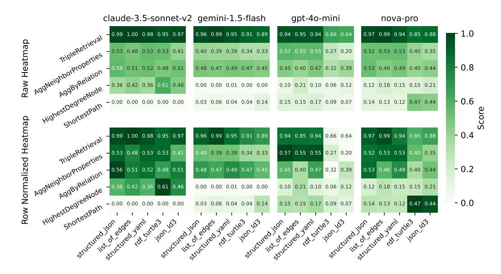

Figure 3: Heatmaps of the performance of various models. Each heatmap shows tasks as rows and textualize functions as columns. (**Top**) Heatmap colors as globally weighted from [0.0-1.0]. (**bottom**) heatmap colors normalized for each task [task minimum-task maximum]. The tasks are ordered from easiest overall to hardest. The textualization functions are ordered from best performing overall to worst. Additional models are in the appendix.

the textualization of the graph, the model and the task. This can be seen in the different performance patterns in Figure 3. Therefore, developers must optimize textualization choice for their specific use case and model. We will present analysis on the high-level effect of textualization choice, how the selected models compare to each other, the effect of pseudonymization on suppressing memorized information, and the token efficiency of the different textualization strategies.

The full results data is presented in Table 5 in the appendix due to space constraints, and more tailored results are presented in this section.

#### 7.1 Effect of Textualization Function

While not all global results on textualization hold true for every model, there are some global patterns that we see. Figure 4a gives a radar plot of performance by textualization function. Structured JSON performs best (0.42 average), followed by YAML and List-of-Edges, while RDF Turtle (0.35) and JSON-LD (0.34) perform worst. Part of the reason for this may be the more complex encoding strategies and use of URIs makes the format more difficult to parse. This may be further amplified by the fact that it dramatically increases the input token counts which may cause performance degradation on some of the models and tasks.

Across all tasks, List-of-Edges and Structured-JSON perform quite well. List-of-Edges is commonly used, and thus may be the most common encoding format in instruction tuning data. On the aggregation tasks Structured YAML and Structured JSON outperform. This makes sense as these structures naturally aggregate related edges together. List-of-Edges only seems better on the global task of Highest Degree Node. This, too, makes sense, as the highest degree node will appear the most times in the list of edges format, but that is not guaranteed nor likely to be the case in the structured formats.

#### 7.2 Model Performance

We can also use KG-LLM-Bench to compare the performance of various models. We plot the comparative performances of the seven models in Figure 4b. To enable a fair comparison, we use

<span id="page-7-0"></span>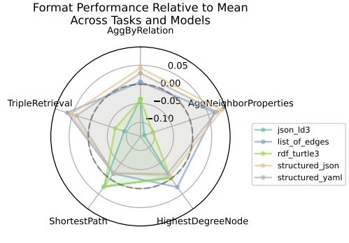

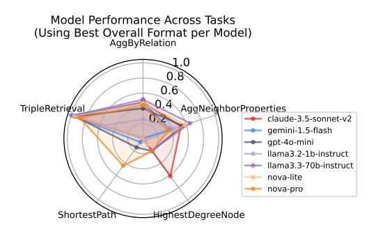

(a) Textualization strategies comparison.

(b) Model performance comparison.

Figure 4: Performance analysis across tasks: (a) comparison of textualization strategies and (b) performance by model. The metric for (a) shows absolute difference in accuracy for each strategy compared to the mean for that task. The mean is shown as the dashed circle.

<span id="page-7-1"></span>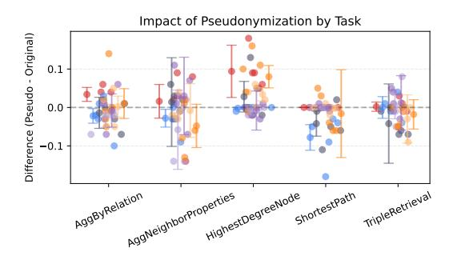

Figure 5: Impact of pseudonymization by task. Higher means that the model did better with pseudonymization. Each color represents a different model.

Table 3: Average Input Token Usage by Format

| Textualizer                      | Mean Input Tokens                         |
|----------------------------------|-------------------------------------------|
| List of Edges<br>Structured JSON | $2644.8 \pm 390.4$                        |
| Structured YAML                  | $4504.7 \pm 1123.2$<br>$2903.1 \pm 655.9$ |
| RDF Turtle                       | $8171.1 \pm 2284.6$                       |
| JSON-LD                          | $13503.4 \pm 3611.2$                      |
| Overall                          | $6345.4 \pm 1613.1$                       |

data from the best performing overall textualization strategy for each model (Table 2). We can see that the best performing approach is highly variable model to model.

Overall, task performance and model rankings align with expectations. The easiest task is Triple Retrieval and the hardest task is Shortest Path. Surprisingly, Highest Degree task appeared to be significantly harder (most models less than 20%) compared to the two aggregation tasks (most models scoring 40%-60%).

There were two notable outliers on performance. Nova-Pro scored by far the highest on the Shortest Path task, 47% with RDF Turtle and 44% with JSON-LD. The next best single Shortest Path result was gpt-4o-mini scoring 17% with Structured YAML. Further analysis of the Shortest Path task can be found in Appendix C. The other major outlier is Claude-3.5-Sonnet performance on the Highest Degree task. Sonnet received 61.5% with RDF-Turtle and averaged 44.3% over all formats. This is much better than the next best performer, Nova Pro at 16.2%. Partially helped by these outlier abilities, Claude-3.5-Sonnet and Nova-Pro were the top overall models.

#### 7.3 Pseudonymization

Pseudonymization shows minimal effect. This is likely because questions on sampled subgraphs of  $\mathcal K$  already prevent reliance on memorized information since there is low chance of the memorized information being present (e.g. knowing the number of countries France borders is not helpful if G only contains a subset of those edges). There is some limited evidence in Figure 5 that pseudonymization actually helped on the Highest Degree Task. It may be that the model would erroneously guess based on memorized knowledge when it saw familiar entity names.

<span id="page-8-0"></span>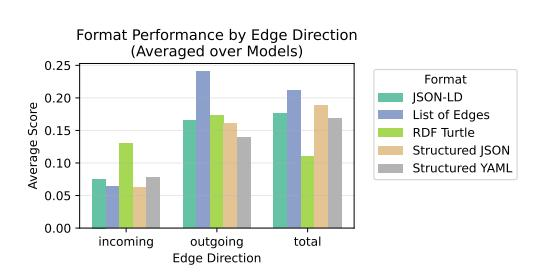

Figure 6: Performance on highest degree task by aggregation direction. Aggregation over outgoing edges is easier in all formats due to locality of outgoing edges to each other.

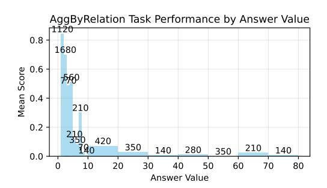

Figure 7: Effect of aggregation size on accuracy in AggByRelation task. Numbers show the count of results in each bin. We note that these do not represent completely i.i.d. samples as the same base question will be presented many times.

#### 7.4 Token Efficiency

Textualization strategies can vary a lot in terms of token efficiency. List-of-Edges and and Structured YAML are the most token efficient with below 3000 tokens per prompt. JSON-LD was the least token efficient, taking over 13,000 tokens per prompt followed by RDF Turtle at 8,000 tokens per prompt. Since RDF Turtle and JSON-LD are designed to be usable with semantic web technologies, they require complete and unambiguous specification of the schema. This results in many additional specifications like namespaces and URI encodings. We note that we even optimized some of these choices to reduce token usage. More naive encodings could use far more tokens.

#### 7.5 Aggregation Performance Depends on Direction and Degree

We find that aggregation performance significantly differs by aggregation direction. Figure 6 shows the effect of aggregation direction when performing the HighestDegree task. The models do significantly better when predicting highest degree by outgoing edges than by incoming. In all the textualization formats (including our implementation of List of Edges), outgoing edges are listed next to each other. This makes it much easier for the model to aggregate over outgoing edges than over incoming ones. This difference is least pronounced in RDF Turtle.

We also analyze how degree affects model performance on AggregationByRelation (Figure 7). For a single edge aggregation, the models answer correctly over 80% of the time and remains above 50% for aggregations up to degree 4. Beyond that, performance rapidly degrades to around 10%. The steep drop indicates the models have significant room for improvement in aggregation capability.

#### 8 Future Work

There are a many directions for future work based on KG-LLM-Bench. Our framework's modular design allows for easy extension to new tasks, graphs, models, and textualization strategies.

In terms of research, we see two major directions to extend KG-LLM-Bench: Scale and Reasoning. In terms of scale, KG-LLM-Bench can be easily scaled by modifying the subgraph sampling parameters, and the source graph can be easily swapped should that become an issue. This enables the study of long-context reasoning over KGs.

The other major direction would be to support studying of test-time reasoning on KGs. The generation of new queries is a bottleneck in developing reasoning models for LLMs. Since KG-LLM-Bench can continuously generate new queries, it could be a useful in training KG reasoning models.

# 9 Conclusion

In this work, we introduced KG-LLM-Bench, a comprehensive and extensible benchmark for evaluating how LLMs process and understand textualized knowledge graphs. Through extensive experiments across five distinct tasks, seven models, and five textualization strategies, we demonstrated that the choice of textualization strategy has a significant impact on model performance. While simpler formats like List-of-Edges and Structured JSON tend to perform well overall, the best performing format varies depending on model and task.

By understanding and improving how LLMs process structured knowledge, we can ultimately develop more reliable and effective knowledge-enhanced language models.

# 10 Ethical Statement

We see no immediate ethical issues with this work. The authors believe that more factual and trustworthy AI models are ethically desirable. However, this work can be used for enhancing AI capabilities, which could present other ethical ramifications. We encourage anyone using KG-LLM-Bench to consider the ethical impact of their work or applications.

# References

<span id="page-9-7"></span>Anthropic. Claude 3.5 sonnet model, 2024. URL [https://www.anthropic.com/claude/](https://www.anthropic.com/claude/sonnet) [sonnet](https://www.anthropic.com/claude/sonnet).

<span id="page-9-2"></span>Erik Arakelyan, Daniel Daza, Pasquale Minervini, and Michael Cochez. Complex query answering with neural link predictors. *ArXiv*, abs/2011.03459, 2020. URL [https://api.](https://api.semanticscholar.org/CorpusID:226278174) [semanticscholar.org/CorpusID:226278174](https://api.semanticscholar.org/CorpusID:226278174).

<span id="page-9-6"></span>Armand Boschin and Thomas Bonald. Wikidatasets: Standardized sub-graphs from wikidata, 2019. URL <https://arxiv.org/abs/1906.04536>.

<span id="page-9-5"></span>Shouyuan Chen, Sherman Wong, Liangjian Chen, and Yuandong Tian. Extending context window of large language models via positional interpolation. *ArXiv*, abs/2306.15595, 2023. URL <https://api.semanticscholar.org/CorpusID:259262376>.

<span id="page-9-0"></span>Zhikai Chen, Haitao Mao, Jingzhe Liu, Yu Song, Bingheng Li, Wei Jin, Bahare Fatemi, Anton Tsitsulin, Bryan Perozzi, Hui Liu, and Jiliang Tang. Text-space graph foundation models: Comprehensive benchmarks and new insights, 2024. URL <https://arxiv.org/abs/2406.10727>.

<span id="page-9-1"></span>Wonjun Choi and Hyunju Lee. Inference of biomedical relations among chemicals, genes, diseases, and symptoms using knowledge representation learning. *IEEE Access*, 7:179373–179384, 2019. URL <https://api.semanticscholar.org/CorpusID:209459645>.

<span id="page-9-3"></span>Xinnan Dai, Haohao Qu, Yifen Shen, Bohang Zhang, Qihao Wen, Wenqi Fan, Dongsheng Li, Jiliang Tang, and Caihua Shan. How do large language models understand graph patterns? a benchmark for graph pattern comprehension, 2024. URL <https://arxiv.org/abs/2410.05298>.

<span id="page-9-4"></span>DeepSeek-AI, Daya Guo, Dejian Yang, Haowei Zhang, Jun-Mei Song, Ruoyu Zhang, Runxin Xu, Qihao Zhu, Shirong Ma, Peiyi Wang, Xiaoling Bi, Xiaokang Zhang, Xingkai Yu, Yu Wu, Z. F. Wu, Zhibin Gou, Zhihong Shao, Zhuoshu Li, Ziyi Gao, Aixin Liu, Bing Xue, Bing-Li Wang, Bochao Wu, Bei Feng, Chengda Lu, Chenggang Zhao, Chengqi Deng, Chenyu Zhang, Chong Ruan, Damai Dai, Deli Chen, Dong-Li Ji, Erhang Li, Fangyun Lin, Fucong Dai, Fuli Luo, Guangbo Hao, Guanting Chen, Guowei Li, H. Zhang, Han Bao, Hanwei Xu, Haocheng Wang, Honghui Ding, Huajian Xin, Huazuo Gao, Hui Qu, Hui Li, Jianzhong Guo, Jiashi Li, Jiawei Wang, Jingchang Chen, Jingyang Yuan, Junjie Qiu, Junlong Li, Jiong Cai, Jiaqi Ni, Jian Liang, Jin Chen, Kai Dong, Kai Hu, Kaige Gao, Kang Guan, Kexin Huang, Kuai Yu, Lean Wang, Lecong Zhang, Liang Zhao, Litong Wang, Liyue Zhang, Lei Xu, Leyi Xia, Mingchuan Zhang, Minghua Zhang, M. Tang, Meng Li, Miaojun Wang, Mingming Li, Ning Tian, Panpan Huang, Peng Zhang, Qiancheng Wang, Qinyu Chen, Qiushi Du, Ruiqi Ge, Ruisong Zhang, Ruizhe Pan, Runji Wang, R. J. Chen, R. L. Jin, Ruyi Chen, Shanghao Lu, Shangyan Zhou, Shanhuang Chen, Shengfeng Ye, Shiyu Wang, Shuiping Yu, Shunfeng Zhou, Shuting Pan, S. S. Li, Shuang Zhou, Shao-Kang Wu, Tao Yun, Tian Pei, Tianyu Sun, T. Wang, Wangding Zeng, Wanjia Zhao, Wen Liu, Wenfeng Liang, Wenjun Gao, Wen-Xia Yu, Wentao Zhang, W. L. Xiao, Wei An, Xiaodong Liu, Xiaohan Wang, Xiaokang Chen, Xiaotao Nie, Xin Cheng, Xin Liu, Xin Xie, Xingchao Liu, Xinyu Yang, Xinyuan Li, Xuecheng Su, Xuheng Lin, X. Q. Li, Xiangyu Jin, Xi-Cheng Shen, Xiaosha Chen, Xiaowen Sun, Xiaoxiang Wang, Xinnan Song, Xinyi Zhou, Xianzu Wang, Xinxia Shan, Y. K. Li, Y. Q. Wang, Y. X. Wei, Yang Zhang, Yanhong Xu, Yao Li, Yao Zhao, Yaofeng Sun, Yaohui Wang, Yi Yu, Yichao Zhang, Yifan Shi, Yi Xiong, Ying He, Yishi Piao, Yisong Wang, Yixuan Tan, Yiyang Ma, Yiyuan Liu, Yongqiang Guo, Yuan Ou, Yuduan Wang, Yue Gong, Yu-Jing Zou, Yujia He, Yunfan Xiong, Yu-Wei Luo, Yu mei You, Yuxuan Liu, Yuyang Zhou, Y. X. Zhu, Yanping Huang, Yao Li, Yi Zheng, Yuchen Zhu, Yunxiang Ma, Ying Tang, Yukun Zha, Yuting Yan, Zehui Ren, Zehui Ren, Zhangli Sha, Zhe Fu, Zhean Xu, Zhenda Xie, Zhen guo Zhang, Zhewen Hao, Zhicheng Ma, Zhigang Yan, Zhiyu Wu, Zihui Gu, Zijia Zhu, Zijun Liu, Zi-An Li, Ziwei Xie, Ziyang Song, Zizheng Pan, Zhen Huang, Zhipeng Xu, Zhongyu Zhang, and Zhen Zhang. Deepseek-r1: Incentivizing reasoning capability in llms via reinforcement learning. 2025. URL <https://api.semanticscholar.org/CorpusID:275789950>.

- <span id="page-10-0"></span>Wenqi Fan, Shijie Wang, Jiani Huang, Zhikai Chen, Yu Song, Wenzhuo Tang, Haitao Mao, Hui Liu, Xiaorui Liu, Dawei Yin, and Qing Li. Graph machine learning in the era of large language models (llms), 2024. URL <https://arxiv.org/abs/2404.14928>.
- <span id="page-10-3"></span>Feroz Farazi, Maurin Salamanca, Sebastian Mosbach, Jethro Akroyd, Andreas Eibeck, Leonardus Kevin Aditya, Arkadiusz Chadzynski, Kang Pan, Xiaochi Zhou, Shaocong Zhang, Mei Qi Lim, and Markus Kraft. Knowledge graph approach to combustion chemistry and interoperability. *ACS Omega*, 5:18342 – 18348, 2020. URL [https://api.semanticscholar.org/](https://api.semanticscholar.org/CorpusID:220883899) [CorpusID:220883899](https://api.semanticscholar.org/CorpusID:220883899).
- <span id="page-10-1"></span>Bahare Fatemi, Jonathan Halcrow, and Bryan Perozzi. Talk like a graph: Encoding graphs for large language models, 2023. URL <https://arxiv.org/abs/2310.04560>.
- <span id="page-10-4"></span>Yifan Feng, Chengwu Yang, Xingliang Hou, Shaoyi Du, Shihui Ying, Zongze Wu, and Yue Gao. Beyond graphs: Can large language models comprehend hypergraphs?, 2024. URL [https:](https://arxiv.org/abs/2410.10083) [//arxiv.org/abs/2410.10083](https://arxiv.org/abs/2410.10083).
- <span id="page-10-7"></span>Johannes Frey, Lars-Peter Meyer, Natanael Arndt, Felix Brei, and Kirill Bulert. Benchmarking the abilities of large language models for rdf knowledge graph creation and comprehension: How well do llms speak turtle? *ArXiv*, abs/2309.17122, 2023. URL [https://api.semanticscholar.](https://api.semanticscholar.org/CorpusID:263310661) [org/CorpusID:263310661](https://api.semanticscholar.org/CorpusID:263310661).
- <span id="page-10-6"></span>Mikhail Galkin, Jincheng Zhou, Bruno Ribeiro, Jian Tang, and Zhaocheng Zhu. A foundation model for zero-shot logical query reasoning. In *Neural Information Processing Systems*, 2024. URL <https://api.semanticscholar.org/CorpusID:269033086>.
- <span id="page-10-9"></span>et al. Gemini Team. Gemini 1.5: Unlocking multimodal understanding across millions of tokens of context, 2024. URL <https://arxiv.org/abs/2403.05530>.
- <span id="page-10-2"></span>Jiayan Guo, Lun Du, Hengyu Liu, Mengyu Zhou, Xinyi He, and Shi Han. Gpt4graph: Can large language models understand graph structured data ? an empirical evaluation and benchmarking, 2023. URL <https://arxiv.org/abs/2305.15066>.
- <span id="page-10-5"></span>Xanh Ho, Anh-Khoa Duong Nguyen, Saku Sugawara, and Akiko Aizawa. Constructing a multi-hop qa dataset for comprehensive evaluation of reasoning steps. In *Proceedings of the 28th International Conference on Computational Linguistics*, pp. 6609–6625, Barcelona, Spain (Online), December 2020. International Committee on Computational Linguistics. URL [https://www.aclweb.](https://www.aclweb.org/anthology/2020.coling-main.580) [org/anthology/2020.coling-main.580](https://www.aclweb.org/anthology/2020.coling-main.580).
- <span id="page-10-8"></span>Coleman Hooper, Sehoon Kim, Hiva Mohammadzadeh, Michael W. Mahoney, Yakun Sophia Shao, Kurt Keutzer, and Amir Gholami. Kvquant: Towards 10 million context length llm inference with kv cache quantization. *ArXiv*, abs/2401.18079, 2024. URL [https://api.](https://api.semanticscholar.org/CorpusID:267335271) [semanticscholar.org/CorpusID:267335271](https://api.semanticscholar.org/CorpusID:267335271).

- <span id="page-11-14"></span>Amazon Artificial General Intelligence. The amazon nova family of models: Technical report and model card. *Amazon Technical Reports*, 2024. URL [https://www.amazon.science/publications/](https://www.amazon.science/publications/the-amazon-nova-family-of-models-technical-report-and-model-card) [the-amazon-nova-family-of-models-technical-report-and-model-card](https://www.amazon.science/publications/the-amazon-nova-family-of-models-technical-report-and-model-card).
- <span id="page-11-0"></span>Amanda Kau, Xuzeng He, Aishwarya Nambissan, Aland Astudillo, Hui Yin, and Amir Aryani. Combining knowledge graphs and large language models, 2024. URL [https://arxiv.org/](https://arxiv.org/abs/2407.06564) [abs/2407.06564](https://arxiv.org/abs/2407.06564).
- <span id="page-11-8"></span>Yejin Kim, Eojin Kang, Juae Kim, and H. Howie Huang. Causal reasoning in large language models: A knowledge graph approach, 2024. URL <https://arxiv.org/abs/2410.11588>.
- <span id="page-11-5"></span>Jens Lehmann, Robert Isele, Max Jakob, Anja Jentzsch, Dimitris Kontokostas, Pablo N. Mendes, Sebastian Hellmann, Mohamed Morsey, Patrick van Kleef, S. Auer, and Christian Bizer. Dbpedia a large-scale, multilingual knowledge base extracted from wikipedia. *Semantic Web*, 6:167–195, 2015. URL <https://api.semanticscholar.org/CorpusID:1181640>.
- <span id="page-11-7"></span>Patrick Lewis, Ethan Perez, Aleksandara Piktus, Fabio Petroni, Vladimir Karpukhin, Naman Goyal, Heinrich Kuttler, Mike Lewis, Wen tau Yih, Tim Rocktäschel, Sebastian Riedel, and Douwe Kiela. Retrieval-augmented generation for knowledge-intensive nlp tasks. *ArXiv*, abs/2005.11401, 2020. URL <https://api.semanticscholar.org/CorpusID:218869575>.
- <span id="page-11-2"></span>Yuhan Li, Zhixun Li, Peisong Wang, Jia Li, Xiangguo Sun, Hong Cheng, and Jeffrey Xu Yu. A survey of graph meets large language model: Progress and future directions, 2024. URL <https://arxiv.org/abs/2311.12399>.
- <span id="page-11-9"></span>Opher Lieber, Barak Lenz, Hofit Bata, Gal Cohen, Jhonathan Osin, Itay Dalmedigos, Erez Safahi, Shaked Haim Meirom, Yonatan Belinkov, Shai Shalev-Shwartz, Omri Abend, Raz Alon, Tomer Asida, Amir Bergman, Roman Glozman, Michael Gokhman, Avshalom Manevich, Nir Ratner, Noam Rozen, Erez Shwartz, Mor Zusman, and Yoav Shoham. Jamba: A hybrid transformer-mamba language model. *ArXiv*, abs/2403.19887, 2024. URL [https://api.semanticscholar.](https://api.semanticscholar.org/CorpusID:268793596) [org/CorpusID:268793596](https://api.semanticscholar.org/CorpusID:268793596).
- <span id="page-11-6"></span>Yang Liu, Qingguo Zeng, Joaquín B. Ordieres Meré, and Huanrui Yang. Anticipating stock market of the renowned companies: A knowledge graph approach. *Complex.*, 2019:9202457:1–9202457:15, 2019. URL <https://api.semanticscholar.org/CorpusID:201263701>.
- <span id="page-11-3"></span>Linhao Luo, Yuan-Fang Li, Gholamreza Haffari, and Shirui Pan. Reasoning on graphs: Faithful and interpretable large language model reasoning. *ArXiv*, abs/2310.01061, 2023. URL [https:](https://api.semanticscholar.org/CorpusID:263605944) [//api.semanticscholar.org/CorpusID:263605944](https://api.semanticscholar.org/CorpusID:263605944).
- <span id="page-11-4"></span>Elan Markowitz, Anil Ramakrishna, J. Dhamala, Ninareh Mehrabi, Charith Peris, Rahul Gupta, Kai-Wei Chang, and A. G. Galstyan. Tree-of-traversals: A zero-shot reasoning algorithm for augmenting black-box language models with knowledge graphs. In *Annual Meeting of the Association for Computational Linguistics*, 2024. URL [https://api.semanticscholar.](https://api.semanticscholar.org/CorpusID:271100225) [org/CorpusID:271100225](https://api.semanticscholar.org/CorpusID:271100225).
- <span id="page-11-12"></span>Meta. Llama 3.2 quantized models, 2024a. URL [https://www.llama.com/docs/](https://www.llama.com/docs/model-cards-and-prompt-formats/llama3_2/) [model-cards-and-prompt-formats/llama3\\_2/](https://www.llama.com/docs/model-cards-and-prompt-formats/llama3_2/).
- <span id="page-11-11"></span>Meta. Llama 3.3 text-only 70b instruction-tuned model, 2024b. URL [https://www.llama.](https://www.llama.com/docs/model-cards-and-prompt-formats/llama3_3/) [com/docs/model-cards-and-prompt-formats/llama3\\_3/](https://www.llama.com/docs/model-cards-and-prompt-formats/llama3_3/).
- <span id="page-11-10"></span>Tsendsuren Munkhdalai, Manaal Faruqui, and Siddharth Gopal. Leave no context behind: Efficient infinite context transformers with infini-attention. *ArXiv*, abs/2404.07143, 2024. URL [https:](https://api.semanticscholar.org/CorpusID:269033427) [//api.semanticscholar.org/CorpusID:269033427](https://api.semanticscholar.org/CorpusID:269033427).
- <span id="page-11-13"></span>OpenAI. Gpt-4o mini: Advancing cost-efficient intelligence, 2024. URL [https://openai.](https://openai.com/index/gpt-4o-mini-advancing-cost-efficient-intelligence/) [com/index/gpt-4o-mini-advancing-cost-efficient-intelligence/](https://openai.com/index/gpt-4o-mini-advancing-cost-efficient-intelligence/).
- <span id="page-11-1"></span>Jeff Z. Pan, Simon Razniewski, Jan-Christoph Kalo, Sneha Singhania, Jiaoyan Chen, Stefan Dietze, Hajira Jabeen, Janna Omeliyanenko, Wen Zhang, Matteo Lissandrini, Russa Biswas, Gerard de Melo, Angela Bonifati, Edlira Vakaj, Mauro Dragoni, and Damien Graux. Large language models and knowledge graphs: Opportunities and challenges. *ArXiv*, abs/2308.06374, 2023. URL <https://api.semanticscholar.org/CorpusID:260887174>.

- <span id="page-12-1"></span>Shirui Pan, Linhao Luo, Yufei Wang, Chen Chen, Jiapu Wang, and Xindong Wu. Unifying large language models and knowledge graphs: A roadmap. *IEEE Transactions on Knowledge and Data Engineering*, 36(7):3580–3599, July 2024. ISSN 2326-3865. doi: 10.1109/tkde.2024.3352100. URL <http://dx.doi.org/10.1109/TKDE.2024.3352100>.
- <span id="page-12-8"></span>Bryan Perozzi, Bahare Fatemi, Dustin Zelle, Anton Tsitsulin, Mehran Kazemi, Rami Al-Rfou, and Jonathan J. Halcrow. Let your graph do the talking: Encoding structured data for llms. *ArXiv*, abs/2402.05862, 2024. URL [https://api.semanticscholar.org/CorpusID:](https://api.semanticscholar.org/CorpusID:267547812) [267547812](https://api.semanticscholar.org/CorpusID:267547812).
- <span id="page-12-12"></span>Yuan Sui, Yufei He, Zifeng Ding, and Bryan Hooi. Can knowledge graphs make large language models more trustworthy? an empirical study over open-ended question answering, 2024. URL <https://arxiv.org/abs/2410.08085>.
- <span id="page-12-13"></span>Jiashuo Sun, Chengjin Xu, Lumingyuan Tang, Sai Wang, Chen Lin, Yeyun Gong, Heung yeung Shum, and Jian Guo. Think-on-graph: Deep and responsible reasoning of large language model with knowledge graph. *ArXiv*, abs/2307.07697, 2023. URL [https://api.semanticscholar.](https://api.semanticscholar.org/CorpusID:259936842) [org/CorpusID:259936842](https://api.semanticscholar.org/CorpusID:259936842).
- <span id="page-12-6"></span>Jianheng Tang, Qifan Zhang, Yuhan Li, and Jia Li. Grapharena: Benchmarking large language models on graph computational problems, 2024. URL <https://arxiv.org/abs/2407.00379>.
- <span id="page-12-9"></span>Ricardo Usbeck, Xi Yan, Aleksandr Perevalov, Longquan Jiang, Julius Schulz, Angelie Kraft, Cedric Möller, Junbo Huang, Jan Reineke, Axel-Cyrille Ngonga Ngomo, et al. Qald-10—the 10th challenge on question answering over linked data. *Semantic Web – Interoperability, Usability, Applicability an IOS Press Journal*, 2023. URL [https://www.semantic-web-journal.net/content/qald-10-%E2%80%](https://www.semantic-web-journal.net/content/qald-10-%E2%80%94-10th-challenge-question-answering-over-linked-data/) [94-10th-challenge-question-answering-over-linked-data/](https://www.semantic-web-journal.net/content/qald-10-%E2%80%94-10th-challenge-question-answering-over-linked-data/).
- <span id="page-12-5"></span>Denny Vrandeciˇ c and Markus Krötzsch. Wikidata: a free collaborative knowledgebase. ´ *Commun. ACM*, 57:78–85, 2014. URL [https://api.semanticscholar.org/CorpusID:](https://api.semanticscholar.org/CorpusID:14494942) [14494942](https://api.semanticscholar.org/CorpusID:14494942).
- <span id="page-12-4"></span>Heng Wang, Shangbin Feng, Tianxing He, Zhaoxuan Tan, Xiaochuang Han, and Yulia Tsvetkov. Can language models solve graph problems in natural language?, 2024. URL [https://arxiv.](https://arxiv.org/abs/2305.10037) [org/abs/2305.10037](https://arxiv.org/abs/2305.10037).
- <span id="page-12-2"></span>Yilin Wen, Zifeng Wang, and Jimeng Sun. Mindmap: Knowledge graph prompting sparks graph of thoughts in large language models. In *Annual Meeting of the Association for Computational Linguistics*, 2023. URL <https://api.semanticscholar.org/CorpusID:261048726>.
- <span id="page-12-0"></span>Lin F. Yang, Hongyang Chen, Zhao Li, Xiao Ding, and Xindong Wu. Chatgpt is not enough: Enhancing large language models with knowledge graphs for fact-aware language modeling. *ArXiv*, abs/2306.11489, 2023. URL [https://api.semanticscholar.org/CorpusID:](https://api.semanticscholar.org/CorpusID:259203671) [259203671](https://api.semanticscholar.org/CorpusID:259203671).
- <span id="page-12-10"></span>Zhilin Yang, Peng Qi, Saizheng Zhang, Yoshua Bengio, William W. Cohen, Ruslan Salakhutdinov, and Christopher D. Manning. Hotpotqa: A dataset for diverse, explainable multi-hop question answering. In *Conference on Empirical Methods in Natural Language Processing*, 2018. URL <https://api.semanticscholar.org/CorpusID:52822214>.
- <span id="page-12-11"></span>Liang Yao, Jiazhen Peng, Chengsheng Mao, and Yuan Luo. Exploring large language models for knowledge graph completion. *ArXiv*, abs/2308.13916, 2023. URL [https://api.](https://api.semanticscholar.org/CorpusID:261242758) [semanticscholar.org/CorpusID:261242758](https://api.semanticscholar.org/CorpusID:261242758).
- <span id="page-12-3"></span>Zhaoning Yu, Xiangyang Xu, and Hongyang Gao. G2t-llm: Graph-to-tree text encoding for molecule generation with fine-tuned large language models, 2024. URL [https://arxiv.org/abs/](https://arxiv.org/abs/2410.02198) [2410.02198](https://arxiv.org/abs/2410.02198).
- <span id="page-12-7"></span>Zike Yuan, Ming Liu, Hui Wang, and Bing Qin. Gracore: Benchmarking graph comprehension and complex reasoning in large language models, 2024. URL [https://arxiv.org/abs/2407.](https://arxiv.org/abs/2407.02936) [02936](https://arxiv.org/abs/2407.02936).

<span id="page-13-2"></span>Yuyu Zhang, Hanjun Dai, Zornitsa Kozareva, Alexander J Smola, and Le Song. Variational reasoning for question answering with knowledge graph. In *AAAI*, 2018.

<span id="page-13-3"></span>Tianshi Zheng, Jiaxin Bai, Yicheng Wang, Tianqing Fang, Yue Guo, Yauwai Yim, and Yangqiu Song. Clr-fact: Evaluating the complex logical reasoning capability of large language models over factual knowledge, 2024. URL https://arxiv.org/abs/2407.20564.

<span id="page-13-1"></span>Yueqin Zhu, Wenwen Zhou, Yang Xu, Ji Liu, and Yongjie Tan. Intelligent learning for knowledge graph towards geological data. *Sci. Program.*, 2017:5072427:1–5072427:13, 2017. URL https://api.semanticscholar.org/CorpusID:29772448.

<span id="page-13-0"></span>Yuqi Zhu, Xiaohan Wang, Jing Chen, Shuofei Qiao, Yixin Ou, Yunzhi Yao, Shumin Deng, Huajun Chen, and Ningyu Zhang. Llms for knowledge graph construction and reasoning: Recent capabilities and future opportunities. *ArXiv*, abs/2305.13168, 2023. URL https://api.semanticscholar.org/CorpusID:258833039.

<span id="page-13-4"></span>Yuqi Zhu, Xiaohan Wang, Jing Chen, Shuofei Qiao, Yixin Ou, Yunzhi Yao, Shumin Deng, Huajun Chen, and Ningyu Zhang. Llms for knowledge graph construction and reasoning: Recent capabilities and future opportunities, 2024. URL https://arxiv.org/abs/2305.13168.

#### **A** Limitations

Here we note some limitations of our experiments and framework. First, our evaluation uses only the WikiDataSets Countries knowledge graph. While this provides a controlled environment, the experiments should be expanded to other domains with different relationship types. Second, we use subgraphs of 200 edges to ensure reasonable context windows, which may not accurately reflect capabilities on smaller graphs, nor capture the challenges of reasoning over larger knowledge graphs. Finally, while we evaluate different textualization strategies, our experiments are conducted in English (though some entities are in other languages).

There are a few current limitations in our framework. It currently only handles knowledge graphs with the defined triple structure. It cannot handle literal values (numbers or dates), temporal knowledge graphs, or any form of hypergraph (e.g. Wikidata edges can have qualifier edges). These would make good areas for future expansion.

## **B** Additional Implementation Details

#### **B.1** Evaluation Algorithm

Algorithm 1 gives the formal algorithm for KG-LLM-Bench constructin and evaluation.

#### <span id="page-13-5"></span>**B.2** Shortest Path Implementation

We consider the shortest path between source entity  $e_s$  and destination entity  $e_d$  using edges in any direction. So for instance, we could use the edges  $(e_s, r_1, e_1)$  and  $(e_d, r_2, e_1)$  to form the path  $[e_s, e_1, e_d]$ . This makes the task potentially more difficult as it forces the model to rely on associations that appear in the reversed order from how they appear in the text representation  $x_G$ .

To construct these questions, we take two of the seed entities used to construct the subgraph  $G(e_s)$  and  $e_d$ ) and set them as the source and destination nodes for the question. We then collect the set of all shortest paths  $P = p_1, ..., p_k$  from  $e_s$  to  $e_d$  in K. We use the set of all entities in  $p_1$  as additional seed entities for subgraph(K) and further ensure that all edges in  $p_1$  become part of G. This ensures that at least  $p_1$  is present in the graph. Finally, we consider any answer in P to be a valid answer.

#### <span id="page-13-6"></span>**B.3** Aggregation by Relation Implementation

Here we present additional details on the construction of AggByRelation questions. In our work, we use COUNT aggregation as we do not consider edges with literal expressions (e.g. numbers or dates), only other entities.

#### <span id="page-14-0"></span>Algorithm 1: KG-LLM-Bench **Input** : $\mathcal{K} = (\mathcal{E}, \mathcal{R}, \mathcal{T})$ : Knowledge graph $\mathcal{F}$ : Textualization function set $\mathcal{T}$ : Task set $\pi$ : Language model $\hat{\mathcal{E}}$ : Pseudonym entity set *N*: Number of instances **Output:** $\{s_{ijk}\}$ : Evaluation scores where i, j, k index tasks, textualization, and question instance for $T \in \mathcal{T}$ do /\* Construct N instances \*/ for $i \leftarrow 1$ to N do /★ Sample subgraph from knowledge graph ⊳Sec 4.5 $G_i \sim subgraph(\mathcal{K})$ /\* Create anonymized version if requested \*/ ⊳Eq. 8 /\* Generate task-specific question and ground truth $q_i \leftarrow \mathcal{Q}_T(\hat{G}_i)$ $a_i \leftarrow \mathcal{A}_T(\hat{G}_i, q_i)$ ⊳Sec 4.2 /\* Evaluate each textualization strategy \*/ for $f \in \mathcal{F}$ do $\textbf{for } i \leftarrow 1 \textbf{ to } N \textbf{ do}$ /\* Convert graph to textual format \*/ ⊳Eq. $x_i \leftarrow f(\hat{G}_i)$ /\* Query LLM with context and question \*/ $\hat{y}_i \leftarrow \pi(x_i, q_i)$ ⊳Eq. /\* Evaluate response with exact match $s_i \leftarrow \mathcal{S}(\hat{y}_i, a_i)$ ⊳Eq. 5

We first compute the aggregation count for every possible question that could be constructed for *G* (every direction, relation type, and anchor entity). Specifically

$$Agg(s,r,dir) = \left| \begin{cases} t = \begin{cases} (s,r,e) & dir = 1 \\ (e,r,s) & dir = 0 \end{cases} \middle| e \in G_{\mathcal{E}}, t \in G_{\mathcal{T}} \right\} \right|$$
(9)

We then collect the set of possible answers  $A = \{Agg(s,r,dir)|s \in G_{\mathcal{E}}, r \in G_{\mathcal{R}}, dir \in [1,0]\}$  and randomly select an answer  $a \sim A$ . After selecting the desired answer, we finally sample the s, r, and dir that would give answer a:  $(s,r,dir) \sim \{(s,r,dir)|Agg(s,r,dir) = a\}$ .

#### <span id="page-15-0"></span>**B.4** Aggregation of Neighbor Properties Implementation

To construct these questions we follow the same procedure as the previous task but use a different aggregation formula.

$$Agg(s,r) = \left| \left\{ e_1 \in G_{\mathcal{E}} \middle| \exists t_1, t_2 \in G_{\mathcal{T}} : t_1 \in \{ (s,\_,e_1), (e_1,\_,s) \} \land t_2 = (e_1,r,\_) \right\} \right|$$
 (10)

"\_" indicates wildcards that could match any relation or entity that makes the edge valid in  $G_T$ 

#### **B.5** Sampling Parameters

Table 4 details the sampling parameters used for each task in our benchmark.

<span id="page-15-2"></span>

| Task                       | Instances | Seed Entities | Max Edges | Sample Radius | Min Degree |
|----------------------------|-----------|---------------|-----------|---------------|------------|
| Triple Retrieval           | 100       | 10            | 200       | 1             | 1          |
| Shortest Path              | 100       | 10            | 200       | 1             | 1          |
| Highest Degree Node        | 100       | 10            | 200       | 1             | 1          |
| Agg by Relation            | 100       | 1             | 200       | 2             | 2          |
| Agg of Neighbor Properties | 100       | 1             | 200       | 2             | 2          |

Table 4: Sampling parameters used for each task. Min degree filter is applied before the max edge constraint.

#### **B.6** Pseudonymization

For pseudonymization, we use a pre-defined set of country pseudonyms stored in csv file. These pseudonyms are designed to maintain the semantic naturalness of the graph while preventing the model from leveraging pre-trained knowledge about real countries.

We use a fake names generator to generate the first 100 fake country names and then use claude-3.5-sonnet to generate an additional 600 of a similar style.

### <span id="page-15-1"></span>C Shortest Path Task Additional Analysis

We provide here additional analysis for the shortest path task.

### C.1 Flexible Matching on Shortest Path

A few of the models had a tendency to ignore formatting instructions and used extensive chain-of-thought. As a result, we present an analysis of their output under "flexible" scoring criteria. This is presented in Figure 8. The models that followed formatting guidelines strictly have no difference in their scores. Models like Llama3.3-70b and Claude-3.5-Sonnet see improvement with the flexible scoring. Interestingly, Llama3.3-70b also has very high performance on the JSON-LD and RDF Turtle formats, just like Nova Pro. Under flexible scoring, Claude-3.5-Sonnet also does slightly better with theses formats. This shows that there may be a more fundamental reason why JSON-LD and RDF Turtle are better for this task.

<span id="page-16-0"></span>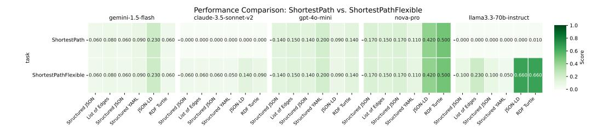

Figure 8: Heatmap of ShortestPath performance when allowing more flexible matching vs exact match. Models that ignored formatting instructions to output more chain-of-thought tokens get higher performance under this scoring approach.

#### <span id="page-16-1"></span>C.2 Path Length

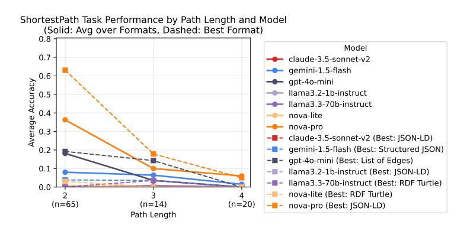

Figure 9: Accuracy by path length. Solid lines are mean performance. Dashed lines are for the best performing textualize format. Path length 5 has only a single question so was excluded from this analysis.

In terms of the effect of path length, we see a clear decrease in performance when path length increases. Figure 9 shows the performance for each model in terms of the true shortest path length. There is a clear decreasing trend in performance where the shorter the shortest path is, the easier it is for models to find it.

Figure 10 gives the distribution of predicted path lengths for each model. There are clear variations in model prediction patterns. For a large proportion of questions, Claude-3.5-Sonnet actually predicts that no path exists at all. Another common error is predicting an immediate path between the source and destination. This can often be caused by shared properties, but then the model skips the intermediary entity. Figure 11 shows a heatmap of predicted lengths vs actual lengths (excluding cases where no path is predicted). While predicted lengths trend upwards with increasing actual shortest paths, there is also a clear trend of under predicting. Most predicted lengths are less than the actual length. This means that the models are often outputting paths with hallucinated edges.

<span id="page-17-0"></span>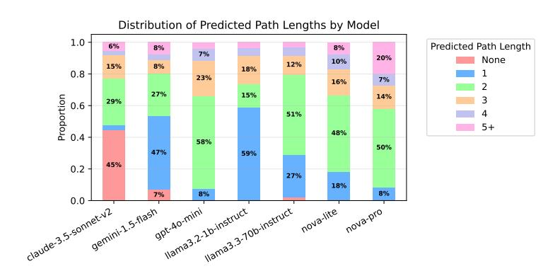

Figure 10: Distribution of predicted path lengths for each model. "None" indicates an empty path or refusal to generate a valid output path.

<span id="page-17-1"></span>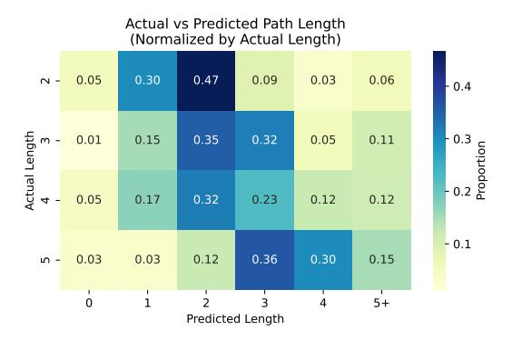

Figure 11: Heatmap of length of predicted paths vs the actual shortest path length. Cases where no path is predicted are excluded.

# <span id="page-18-0"></span>D Examples of Text Formats

### D.1 List of Edges

```
Your job is to answer questions using the following knowledge graph. The knowledge graph is
    presented as a structured JSON format. Each entity is a key, and the value is a
    dictionary of relations and objects.. You must rely exclusively on the information
    presented in the Knowledge Graph to answer questions. If the answer includes entities,
    always respond using the entity label rather than entity ID (if applicable).
Knowledge Graph:
Edges: [
(Andhra Pradesh, language used, Telugu),
(Andhra Pradesh, language used, Marathi),
(Andhra Pradesh, language used, Odia),
(Guatemala, capital of, Federal Republic of Central America),
(Guatemala, diplomatic relation, European Union),
(Brunei, member of, World Trade Organization),
(Brunei, member of, International Hydrographic Organization),
(South Korea, diplomatic relation, Ukraine),
(South Korea, diplomatic relation, Colombia),
(South Korea, member of, G20)
```

#### D.2 Structured JSON

```
Your job is to answer questions using the following knowledge graph. The knowledge graph is
    presented as a list of directed edges of the form (subject, relation, object). You must
    rely exclusively on the information presented in the Knowledge Graph to answer questions.
      If the answer includes entities, always respond using the entity label rather than
    entity ID (if applicable).
Knowledge Graph:
{
    "Andhra Pradesh": {
        "language used": [
            "Telugu",
            "Marathi",
            "Odia"
    },
    "Guatemala": {
        "capital of": [
            "Federal Republic of Central America"
        ],
        "diplomatic relation": [
            "European Union"
    },
    "Brunei": {
        "member of": [
            "World Trade Organization",
            "International Hydrographic Organization"
    },
    "South Korea": {
        "diplomatic relation": [
            "Ukraine",
            "Colombia"
        ],
        "member of": [
            "G20"
    }
}
```

#### D.3 Structured YAML

```
Your job is to answer questions using the following knowledge graph. The knowledge graph is
    presented as a structured YAML format. Each entity is a key, and the value is a
    dictionary of relations and objects.. You must rely exclusively on the information
    presented in the Knowledge Graph to answer questions. If the answer includes entities,
    always respond using the entity label rather than entity ID (if applicable).
Knowledge Graph:
```

```
Andhra Pradesh:
  language used:
    - Telugu
    - Marathi
    - Odia
Guatemala:
  capital of:
    - Federal Republic of Central America
  diplomatic relation:
    - European Union
Brunei:
  member of:
    - World Trade Organization
    - International Hydrographic Organization
South Korea:
  diplomatic relation:
    - Ukraine
    - Colombia
  member of:
    - G20
```

# D.4 RDF Turtle

```
Your job is to answer questions using the following knowledge graph. The knowledge graph is
    presented as RDF Turtle format using node IDs and relation IDs.. You must rely
    exclusively on the information presented in the Knowledge Graph to answer questions. If
    the answer includes entities, always respond using the entity label rather than entity ID
     (if applicable).
Knowledge Graph:
@prefix ex: <http://example.org/countries#> .
@prefix rdf: <http://www.w3.org/1999/02/22-rdf-syntax-ns#> .
@prefix rdfs: <http://www.w3.org/2000/01/rdf-schema#> .
ex:R1 a rdf:Property ;
    rdfs:label "language used" .
ex:R2 a rdf:Property ;
    rdfs:label "member of" .
ex:R3 a rdf:Property ;
    rdfs:label "diplomatic relation" .
ex:R4 a rdf:Property ;
    rdfs:label "capital of" .
ex:1 a ex:Country ;
    rdfs:label "Andhra Pradesh" ;
    ex:R1 ex:101, ex:102, ex:103 .
ex:101 a ex:Language ;
    rdfs:label "Telugu" .
ex:102 a ex:Language ;
    rdfs:label "Marathi" .
ex:103 a ex:Language ;
    rdfs:label "Odia" .
ex:2 a ex:Country ;
    rdfs:label "Guatemala" ;
    ex:R4 ex:201 ;
    ex:R3 ex:202 .
ex:201 a ex:Country ;
    rdfs:label "Federal Republic of Central America" .
ex:202 a ex:Organization ;
    rdfs:label "European Union" .
ex:3 a ex:Country ;
    rdfs:label "Brunei" ;
    ex:R2 ex:301, ex:302 .
ex:301 a ex:Organization ;
```

```
rdfs:label "World Trade Organization" .
ex:302 a ex:Organization ;
    rdfs:label "International Hydrographic Organization" .
ex:4 a ex:Country ;
    rdfs:label "South Korea" ;
    ex:R3 ex:401, ex:402 ;
    ex:R2 ex:403 .
ex:401 a ex:Country ;
    rdfs:label "Ukraine" .
ex:402 a ex:Country ;
    rdfs:label "Colombia" .
ex:403 a ex:Organization ;
    rdfs:label "G20" .
```

## D.5 JSON-LD

```
"Your job is to answer questions using the following knowledge graph. The knowledge graph is
     presented as JSON-LD format using node IDs and relation IDs.. You must rely exclusively
     on the information presented in the Knowledge Graph to answer questions. If the answer
     includes entities, always respond using the entity label rather than entity ID (if
     applicable).
Knowledge Graph:
{
  "@context": {
    "@context": {
      "ex": "http://example.org/countries#",
      "label": "rdfs:label",
      "rdf": "http://www.w3.org/1999/02/22-rdf-syntax-ns#",
      "rdfs": "http://www.w3.org/2000/01/rdf-schema#",
      "type": "@type"
    }
  },
  "@graph": [
    {
      "@id": "ex:R1",
      "label": "language used",
      "type": "rdf:Property"
    },
    {
      "@id": "ex:R3",
      "label": "diplomatic relation",
      "type": "rdf:Property"
    },
    {
      "@id": "ex:R4",
      "label": "capital of",
      "type": "rdf:Property"
    },
    {
      "@id": "ex:1",
      "type": "ex:Country",
      "label": "Andhra Pradesh",
      "ex:R1": [
        { "@id": "ex:101" },
        { "@id": "ex:102" },
        { "@id": "ex:103" }
    },
    {
      "@id": "ex:101",
      "type": "ex:Language",
      "label": "Telugu"
    },
    {
      "@id": "ex:102",
      "type": "ex:Language",
      "label": "Marathi"
    },
    {
      "@id": "ex:103",
      "type": "ex:Language",
      "label": "Odia"
```

```
},

{
    "@id": "ex:2",
    "type": "ex:Country",
    "label": "Guatemala",
    "ex:R4": { "@id": "ex:201" },
    "ex:R3": { "@id": "ex:202" }
},

{
    "@id": "ex:201",
    "type": "ex:Country",
    "label": "Federal Republic of Central America"
},

{
    "@id": "ex:202",
    "type": "ex:Organization",
    "label": "European Union"
}

}

}
```

## **E** Full Results

We present the full results and data over the following pages.

## **E.1** Heatmap Results

Figure 12 presents the heatmap data for all models.

<span id="page-21-0"></span>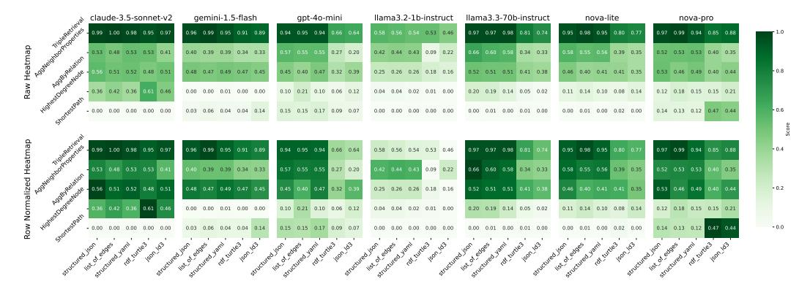

Figure 12: Heatmaps of the performance of various models. Each heatmap shows tasks as rows and textualize functions as columns. The top row of the grid shows the heatmap colors as globally weighted from [0.0-1.0]. The bottom grid shows heatmap colors normalized for each task [task minimum-task maximum].

Table 5: Full Results Summary by Format and Model

<span id="page-22-0"></span>

| Format     | Model                 | Agg by<br>Relation | Agg Neighbor<br>Properties | Highest<br>Degree | Shortest<br>Path | Triple<br>Retrieval | Overall |
|------------|-----------------------|--------------------|----------------------------|-------------------|------------------|---------------------|---------|
|            | claude-3.5-sonnet-v2  | 0.490              | 0.440                      | 0.370             | 0.000            | 1.000               | 0.460   |
| Edges      | +pseudo               | 0.530              | 0.530                      | 0.460             | 0.000            | 1.000               | 0.504   |
|            | gemini-1.5-flash      | 0.520              | 0.430                      | 0.000             | 0.080            | 1.000               | 0.406   |
| of         | +pseudo               | 0.420              | 0.340                      | 0.000             | 0.040            | 0.990               | 0.358   |
| List       | gpt-4o-mini           | 0.400              | 0.520                      | 0.140             | 0.150            | 0.980               | 0.438   |
|            | +pseudo               | 0.400              | 0.580                      | 0.270             | 0.140            | 0.910               | 0.460   |
|            | llama3.2-1b-instruct  | 0.250              | 0.430                      | 0.050             | 0.000            | 0.560               | 0.258   |
|            | +pseudo               | 0.260              | 0.450                      | 0.030             | 0.000            | 0.560               | 0.260   |
|            | llama3.3-70b-instruct | 0.540              | 0.590                      | 0.200             | 0.000            | 0.970               | 0.460   |
|            | +pseudo               | 0.470              | 0.620                      | 0.180             | 0.010            | 0.980               | 0.452   |
|            | nova-lite             | 0.390              | 0.560                      | 0.120             | 0.000            | 0.990               | 0.412   |
|            | +pseudo               | 0.410              | 0.540                      | 0.160             | 0.010            | 0.980               | 0.420   |
|            | nova-pro              | 0.460              | 0.520                      | 0.130             | 0.150            | 0.990               | 0.450   |
|            | +pseudo               | 0.450              | 0.530                      | 0.230             | 0.110            | 0.990               | 0.462   |
|            | Format Overall        | 0.436              | 0.499                      | 0.144             | 0.054            | 0.927               | 0.412   |
|            | +pseudo               | 0.420              | 0.513                      | 0.190             | 0.044            | 0.916               | 0.417   |
|            | claude-3.5-sonnet-v2  | 0.550              | 0.520                      | 0.330             | 0.000            | 0.990               | 0.478   |
| JSON       | +pseudo               | 0.560              | 0.540                      | 0.390             | 0.000            | 0.990               | 0.496   |
|            | gemini-1.5-flash      | 0.500              | 0.410                      | 0.000             | 0.060            | 0.960               | 0.386   |
| Structured | +pseudo               | 0.470              | 0.380                      | 0.000             | 0.010            | 0.970               | 0.366   |
|            | gpt-4o-mini           | 0.490              | 0.560                      | 0.100             | 0.140            | 0.950               | 0.448   |
|            | +pseudo               | 0.420              | 0.580                      | 0.100             | 0.160            | 0.940               | 0.440   |
|            | llama3.2-1b-instruct  | 0.260              | 0.440                      | 0.040             | 0.000            | 0.540               | 0.256   |
|            | +pseudo               | 0.240              | 0.410                      | 0.040             | 0.000            | 0.620               | 0.262   |
|            | llama3.3-70b-instruct | 0.530              | 0.600                      | 0.190             | 0.000            | 0.980               | 0.460   |
|            | +pseudo               | 0.500              | 0.710                      | 0.200             | 0.000            | 0.970               | 0.476   |
|            | nova-lite             | 0.490              | 0.590                      | 0.100             | 0.000            | 0.960               | 0.428   |
|            | +pseudo               | 0.440              | 0.580                      | 0.120             | 0.000            | 0.950               | 0.418   |
|            | nova-pro              | 0.550              | 0.580                      | 0.100             | 0.170            | 0.970               | 0.474   |
|            | +pseudo               | 0.500              | 0.450                      | 0.140             | 0.110            | 0.970               | 0.434   |
|            | Format Overall        | 0.481              | 0.529                      | 0.123             | 0.053            | 0.907               | 0.419   |
|            | +pseudo               | 0.447              | 0.521                      | 0.141             | 0.040            | 0.916               | 0.413   |
| ML         | claude-3.5-sonnet-v2  | 0.500              | 0.600                      | 0.320             | 0.000            | 0.990               | 0.482   |
|            | +pseudo               | 0.540              | 0.460                      | 0.410             | 0.000            | 0.980               | 0.478   |
| YA         | gemini-1.5-flash      | 0.490              | 0.400                      | 0.010             | 0.090            | 0.950               | 0.388   |
|            | +pseudo               | 0.500              | 0.370                      | 0.000             | 0.000            | 0.950               | 0.364   |
| Structured | gpt-4o-mini           | 0.490              | 0.540                      | 0.070             | 0.200            | 0.940               | 0.448   |
|            | +pseudo               | 0.460              | 0.570                      | 0.120             | 0.140            | 0.940               | 0.446   |
|            | llama3.2-1b-instruct  | 0.290              | 0.430                      | 0.030             | 0.000            | 0.560               | 0.262   |
|            | +pseudo               | 0.220              | 0.430                      | 0.010             | 0.000            | 0.510               | 0.234   |
|            | llama3.3-70b-instruct | 0.510              | 0.550                      | 0.150             | 0.000            | 0.960               | 0.434   |
|            | +pseudo               | 0.500              | 0.620                      | 0.120             | 0.000            | 1.000               | 0.448   |
|            | nova-lite             | 0.410              | 0.540                      | 0.100             | 0.000            | 0.950               | 0.400   |
|            | +pseudo               | 0.410              | 0.580                      | 0.100             | 0.000            | 0.950               | 0.408   |
|            | nova-pro              | 0.510              | 0.520                      | 0.070             | 0.110            | 0.930               | 0.428   |
|            | +pseudo               | 0.480              | 0.540                      | 0.230             | 0.140            | 0.940               | 0.466   |
|            | Format Overall        | 0.457              | 0.511                      | 0.107             | 0.057            | 0.897               | 0.406   |
|            | +pseudo               | 0.444              | 0.510                      | 0.141             | 0.040            | 0.896               | 0.406   |
|            | claude-3.5-sonnet-v2  | 0.450              | 0.510                      | 0.590             | 0.000            | 0.940               | 0.498   |
|            |                       |                    |                            |                   |                  |                     |         |

Continued on next page

Table 5 – Continued from previous page

| Format  | Model                 | Agg by<br>Relation | Agg Neighbor<br>Properties | Highest<br>Degree | Shortest<br>Path | Triple<br>Retrieval | Overall |
|---------|-----------------------|--------------------|----------------------------|-------------------|------------------|---------------------|---------|
|         | +pseudo               | 0.510              | 0.540                      | 0.640             | 0.000            | 0.970               | 0.532   |
|         | gemini-1.5-flash      | 0.460              | 0.330                      | 0.000             | 0.060            | 0.890               | 0.348   |
|         | +pseudo               | 0.490              | 0.340                      | 0.000             | 0.030            | 0.930               | 0.358   |
|         | gpt-4o-mini           | 0.310              | 0.270                      | 0.070             | 0.140            | 0.690               | 0.296   |
|         | +pseudo               | 0.330              | 0.260                      | 0.050             | 0.030            | 0.630               | 0.260   |
|         | llama3.2-1b-instruct  | 0.190              | 0.160                      | 0.010             | 0.000            | 0.530               | 0.178   |
|         | +pseudo               | 0.180              | 0.020                      | 0.010             | 0.000            | 0.530               | 0.148   |
|         | llama3.3-70b-instruct | 0.400              | 0.380                      | 0.050             | 0.010            | 0.790               | 0.326   |
|         | +pseudo               | 0.410              | 0.310                      | 0.050             | 0.000            | 0.840               | 0.322   |
|         | nova-lite             | 0.410              | 0.400                      | 0.060             | 0.030            | 0.820               | 0.344   |
|         | +pseudo               | 0.400              | 0.370                      | 0.110             | 0.010            | 0.780               | 0.334   |
|         | nova-pro              | 0.330              | 0.440                      | 0.100             | 0.500            | 0.880               | 0.450   |
|         | +pseudo               | 0.470              | 0.360                      | 0.210             | 0.440            | 0.830               | 0.462   |
|         | Format Overall        | 0.364              | 0.356                      | 0.126             | 0.106            | 0.791               | 0.349   |
|         | +pseudo               | 0.399              | 0.314                      | 0.153             | 0.073            | 0.787               | 0.345   |
|         | claude-3.5-sonnet-v2  | 0.500              | 0.370                      | 0.370             | 0.000            | 0.980               | 0.444   |
| JSON-LD | +pseudo               | 0.520              | 0.450                      | 0.550             | 0.000            | 0.970               | 0.498   |
|         | gemini-1.5-flash      | 0.460              | 0.330                      | 0.000             | 0.230            | 0.910               | 0.386   |
|         | +pseudo               | 0.440              | 0.330                      | 0.000             | 0.050            | 0.870               | 0.338   |
|         | gpt-4o-mini           | 0.380              | 0.210                      | 0.130             | 0.090            | 0.670               | 0.296   |
|         | +pseudo               | 0.390              | 0.180                      | 0.110             | 0.040            | 0.600               | 0.264   |
|         | llama3.2-1b-instruct  | 0.170              | 0.290                      | 0.000             | 0.000            | 0.460               | 0.184   |
|         | +pseudo               | 0.150              | 0.150                      | 0.000             | 0.000            | 0.450               | 0.150   |
|         | llama3.3-70b-instruct | 0.350              | 0.320                      | 0.020             | 0.000            | 0.760               | 0.290   |
|         | +pseudo               | 0.410              | 0.330                      | 0.020             | 0.000            | 0.730               | 0.298   |
|         | nova-lite             | 0.330              | 0.360                      | 0.110             | 0.000            | 0.820               | 0.324   |
|         | +pseudo               | 0.380              | 0.340                      | 0.170             | 0.000            | 0.730               | 0.324   |
|         | nova-pro              | 0.440              | 0.380                      | 0.210             | 0.420            | 0.900               | 0.470   |
|         | +pseudo               | 0.440              | 0.320                      | 0.200             | 0.470            | 0.850               | 0.456   |
|         | Format Overall        | 0.376              | 0.323                      | 0.120             | 0.106            | 0.786               | 0.342   |
|         | +pseudo               | 0.390              | 0.300                      | 0.150             | 0.080            | 0.743               | 0.333   |
|         | claude-3.5-sonnet-v2  |                    |                            |                   |                  |                     |         |
| Formats |                       | 0.498              | 0.488                      | 0.396             | 0.000            | 0.980               | 0.472   |
|         | +pseudo               | 0.532              | 0.504                      | 0.490             | 0.000            | 0.982               | 0.502   |
|         | gemini-1.5-flash      | 0.486              | 0.380                      | 0.002             | 0.104            | 0.942               | 0.383   |
| All     | +pseudo               | 0.464              | 0.352                      | 0.000             | 0.026            | 0.942               | 0.357   |
|         | gpt-4o-mini           | 0.414              | 0.420                      | 0.102             | 0.144            | 0.846               | 0.385   |
|         | +pseudo               | 0.400              | 0.434                      | 0.130             | 0.102            | 0.804               | 0.374   |
|         | llama3.2-1b-instruct  | 0.232              | 0.350                      | 0.026             | 0.000            | 0.530               | 0.228   |
|         | +pseudo               | 0.210              | 0.292                      | 0.018             | 0.000            | 0.534               | 0.211   |
|         | llama3.3-70b-instruct | 0.466              | 0.488                      | 0.122             | 0.002            | 0.892               | 0.394   |
|         | +pseudo               | 0.458              | 0.518                      | 0.114             | 0.002            | 0.904               | 0.399   |
|         | nova-lite             | 0.406              | 0.490                      | 0.098             | 0.006            | 0.908               | 0.382   |
|         | +pseudo               | 0.408              | 0.482                      | 0.132             | 0.004            | 0.878               | 0.381   |
|         | nova-pro              | 0.458              | 0.488                      | 0.122             | 0.270            | 0.934               | 0.454   |
|         | +pseudo               | 0.468              | 0.440                      | 0.202             | 0.254            | 0.916               | 0.456   |
|         | Overall Score         | 0.423              | 0.443                      | 0.124             | 0.075            | 0.862               | 0.385   |
|         | +pseudo               | 0.420              | 0.432                      | 0.155             | 0.055            | 0.851               | 0.383   |