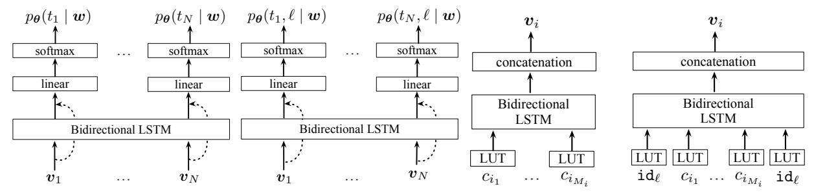
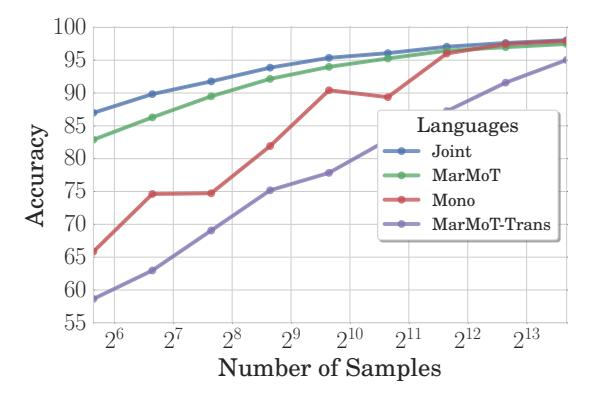

# Cross-lingual, Character-Level Neural Morphological Tagging

# Ryan Cotterell9 Georg HeigoldB

3Department of Computer Science, Johns Hopkins University, USA 8German Research Center for Artificial Intelligence, Saarbrücken, SL, GER ryan.cotterell@jhu.edu georg.heigold@gmail.com

#### **Abstract**

Even for common NLP tasks, sufficient supervision is not available in many languages—morphological tagging is no exception. In the work presented here, we explore a transfer learning scheme, whereby we train character-level recurrent neural taggers to predict morphological taggings for high-resource languages and low-resource languages together. Learning joint character representations among multiple related languages successfully enables knowledge transfer from the high-resource languages to the low-resource ones, improving accuracy by up to 30% over a monolingual model.

# 1 Introduction

State-of-the-art morphological taggers require thousands of annotated sentences to train. For the majority of the world's languages, however, sufficient, large-scale annotation is not available and obtaining it would often be infeasible. Accordingly, an important road forward in low-resource NLP is the development of methods that allow for the training of high-quality tools from smaller amounts of data. In this work, we focus on transfer learning—we train a recurrent neural tagger for a low-resource language jointly with a tagger for a related highresource language. Forcing the models to share character-level features among the languages allows large gains in accuracy when tagging the lowresource languages, while maintaining (or even improving) accuracy on the high-resource language.

Recurrent neural networks constitute the state of the art for a myriad of tasks in NLP, e.g., multilingual part-of-speech tagging (Plank et al., 2016), syntactic parsing (Dyer et al., 2015; Zeman et al., 2017), morphological paradigm completion (Cotterell et al., 2016, 2017) and language modeling (Sundermeyer et al., 2012; Melis et al., 2017); recently, such models have also improved morphological tagging (Heigold et al., 2016, 2017). In addition to increased performance over classical approaches, neural networks also offer a second advantage: they admit a clean paradigm for multitask learning. If the learned representations for all

of the tasks are embedded jointly into a shared representation space, the various tasks reap benefits from each other and often performance improves for all (Collobert et al., 2011b). We exploit this idea for language-to-language transfer to develop an approach for cross-lingual morphological tagging.

We experiment on 18 languages taken from four different language families. Using the Universal Dependencies treebanks, we emulate a low-resource setting for our experiments, e.g., we attempt to train a morphological tagger for Catalan using primarily data from a related language like Spanish. Our results demonstrate the successful transfer of morphological knowledge from the high-resource languages to the low-resource languages without relying on an externally acquired bilingual lexicon or bitext. We consider both the single- and multi-source transfer case and explore how similar two languages must be in order to enable high-quality transfer of morphological taggers. 1

### 2 Morphological Tagging

Many languages in the world exhibit rich inflectional morphology: the form of individual words mutates to reflect the syntactic function. For example, the Spanish verb *soñar* will appear as *sueño* in the first person present singular, but *soñáis* in the second person present plural, depending on the bundle of syntacto-semantic attributes associated with the given form (in a sentential context). For concreteness, we list a more complete table of Spanish verbal inflections in Table 1. Note that some languages, e.g., the Northeastern Caucasian language Archi, display a veritable cornucopia of potential forms with the size of the verbal paradigm exceeding 10,000 (Kibrik, 1998).

Standard NLP annotation, e.g., the scheme in Sylak-Glassman et al. (2015), marks forms in terms of *universal* key-attribute pairs, e.g., the first person present singular is represented as [pos=V, per=1, num=sG, tns=PRES]. This bundle of key-attribute

&lt;sup>1While we only experiment with languages in the same family, we show that closer languages within that family are better candidates for transfer. We remark that future work should consider the viability of more distant language pairs.

| POS=D CASE=NOM NUM=PL | POS=N CASE=NOM NUM=PL | POS=N CASE=NOM NUM=PL GEN=FEM | POS=A CASE=NOM NUM=PL | POS=N CASE=NOM NUM=SG | POS=P         | POS=N CASE=ACC NUM=SG |   |
|-----------------------------|-----------------------------|----------------------------------------|-----------------------------|-----------------------------|---------------|-----------------------------|---|
| Bce All                  | счастливые happy         | семьи families                         | похожи are similar          | друг r to e              | на ach oth | друга er                 | • |

Figure 1: Example of a morphologically tagged sentence in Russian using the annotation scheme provided in the UD dataset.

|     | PRESENT IN      | DICATIVE          | PAST INDICATIVE |                      |  |  |  |
|-----|-----------------|-------------------|-----------------|----------------------|--|--|--|
|     | SINGULAR        | PLURAL            | SINGULAR        | PLURAL               |  |  |  |
| 1 2 | sueño sueñas | soñamos soñáis | soñé soñaste | soñamos soñasteis |  |  |  |
| 3   | sueña           | sueñan            | soñó            | soñaron              |  |  |  |

Table 1: Partial inflection table for the Spanish verb soñar.

pairs is typically termed a morphological tag and we may view the goal of morphological tagging to label each word in its sentential context with the appropriate tag (Oflazer and Kuruöz, 1994; Hajič and Hladká, 1998). As the part of speech (POS) is a component of the tag, we may view morphological tagging as a strict generalization of POS tagging, where we have significantly refined the set of available tags. All of the experiments in this paper make use of the universal morphological tag set available in the Universal Dependencies (UD) (Nivre et al., 2016). As an example, we have provided a Russian sentence with its UD tagging in Figure 1.

Transferring Morphology. The transfer of morphology is arguably more dependent on the relatedness of the languages in question than other linguistic annotation in NLP such as POS and named entity recognition (NER). For example, POS lends itself nicely to a universal annotation scheme (Petrov et al., 2012) and traditional NER is limited to a small number of cross-linguistic compliant categories, e.g., PERSON and PLACE. Even universal dependency arc labels employ cross-lingual labels (Nivre et al., 2016). Morphology, on the other hand, typically requires more fine-grained annotation, e.g., grammatical case and tense. It is often the case that one language will make a syntacto-semantic distinction in the form (or at all) that another does not. For example, the Hungarian noun overtly marks 17 grammatical cases and Slavic verbs typically distinguish two aspects through morphology, while English marks none of these distinctions. If the word form in the source language does not overtly mark a grammatical category in the target language, it is nigh-impossible to expect a successful transfer. For this reason, much of our work focuses on the transfer of related languages—specifically exploring *how* close two languages must be for a successful transfer. Note that the language-specific nature of morphology does not contradict the universality of the annotation; each language may mark a different subset of categories, i.e., use a different set of the universal keys—attribute pairs, but nevertheless there is a single, universal set, from which the key—attribute pairs are drawn. See Newmeyer (2007) for a linguistic treatment of cross-lingual annotation.

**Notation.** We will discuss morphological tagging in terms of the following notation. We will consider two (related) languages: a high-resource source language  $\ell_s$  and a low-resource target language  $\ell_t$ . Each of these languages will have its own (potentially overlapping) set of morphological tags, denoted  $\mathcal{T}_s$  and  $\mathcal{T}_t$ , respectively. We will work with the union of both sets  $\mathcal{T} = \mathcal{T}_s \cup \mathcal{T}_t$ . An individual tag  $m_n = [k_1 = v_1, \dots, k_M = v_M] \in \mathcal{T}$  is comprised of universal keys and attributes, i.e., the pairs  $(k_m, v_n)$  are completely language-agnostic. In the case where a language does not mark a distinction, e.g., case on English nouns, the corresponding keys are excluded from the tag. Typically,  $|\mathcal{T}|$  is large (see Table 3). We denote the set of training sentences for the high-resource source language as  $\mathcal{D}_s$  and the set of training sentences for the lowresource target language as  $\mathcal{D}_t$ . In the experimental section, we will also consider a multi-source setting where we have multiple high-resource languages, but, for ease of explication, we stick to the singlesource case in the development of the model.

#### 3 Character-Level Neural Transfer

Our formulation of transfer learning builds on work in multi-task learning (Caruana, 1997; Collobert et al., 2011b). We treat each individual language as a task and train a joint model for all the tasks together. We first discuss the current state of the art in morphological tagging: a character-level recurrent neural network. After that, we explore three augmentations to the architecture that allow for

- (a) Vanilla architecture for neural morphological tagging.
- (b) Joint morphological tagging and language identification.
- (c) Character-level Bi-LSTM embedder.
- (d) Language-specific Bi-LSTM embedder.

Figure 2: We depict four subarchitectures used in the models we develop in this work. Combining (a) with the character representations in (c) gives the vanilla morphological tagging architecture of Heigold et al. (2017). Combining (a) with (d) yields the language-universal softmax architecture and (b) and (c) yields our joint model for language identification and tagging.

the transfer learning scenario. All of our proposals force the representation of the characters for both the source and the target language to share the same representation space, but involve different mechanisms, by which the model may learn language-specific features.

#### 3.1 Character-Level Neural Networks

Character-level neural networks currently constitute the state of the art in morphological tagging (Heigold et al., 2017). We draw on previous work in defining a conditional distribution over taggings  $\boldsymbol{t}$  for a sentence  $\boldsymbol{w}$  of length  $|\boldsymbol{w}| = N$  as

$$p_{\boldsymbol{\theta}}(\boldsymbol{t} \mid \boldsymbol{w}) = \prod_{n=1}^{N} p_{\boldsymbol{\theta}}(t_n \mid \boldsymbol{w}), \tag{1}$$

which may be seen as a 0th order conditional random field (CRF) (Lafferty et al., 2001) with parameter vector  $\boldsymbol{\theta}$ .2 Importantly, this factorization of the distribution  $p_{\boldsymbol{\theta}}(\boldsymbol{t} \mid \boldsymbol{w})$  also allows for efficient exact decoding and marginal inference in  $\mathcal{O}(N)$ -time, but at the cost of not admitting any explicit interactions in the output structure, i.e., between adjacent tags.3 We parameterize the distribution over tags at each time step as

$$p_{\theta}(t_n \mid \boldsymbol{w}) = \operatorname{softmax} (\mathbf{W} \mathbf{e}_n + \mathbf{b})_{t_n}, \quad (2)$$

where  $\mathbf{W} \in \mathbb{R}^{|\mathcal{T}| \times D}$  is a parameter matrix,  $\mathbf{b} \in \mathbb{R}^{|\mathcal{T}|}$  is a bias vector and positional representations  $\mathbf{e}_n \in \mathbb{R}^D$  are taken from a concatenation of the output of two long short-term memory recurrent neural networks (LSTMs) (Hochreiter and Schmidhuber, 1997), folded forward and backward, respectively, over a sequence of input vectors. The integer D is the dimensionality and a tunable hyperparameter. This constitutes a bidirectional LSTM (Graves and Schmidhuber, 2005). We define the positional representation vector as follows

$$\mathbf{e}_{n} = [\text{LSTM}(\langle \mathbf{v}_{1}, \dots, \mathbf{v}_{n} \rangle);$$

$$\text{LSTM}(\langle \mathbf{v}_{N}, \dots, \mathbf{v}_{n} \rangle)].$$
(3)

where each  $\mathbf{v}_n \in \mathbb{R}^n$  is, itself, a word representation. Note that the function LSTM returns the *last* hidden state representation of the network. This architecture is the *context* bidirectional recurrent neural network of Plank et al. (2016). Finally, we derive each word representation  $\mathbf{v}_n$  from a character-level bidirectional LSTM embedder. Namely, we define each word representation as the concatenation

$$\mathbf{v}_{n} = \left[ \text{LSTM} \left( \left\langle c_{n_{1}}, \dots, c_{n_{M_{n}}} \right\rangle \right);$$

$$\text{LSTM} \left( \left\langle c_{n_{M_{n}}}, \dots, c_{n_{1}} \right\rangle \right) \right].$$

$$(4)$$

In other words, we run a bidirectional LSTM over the character stream. This bidirectional LSTM is the *sequence* bidirectional recurrent neural network of Plank et al. (2016). Note a concatenation of the sequence of character symbols  $\langle c_{n_1}, \ldots, c_{n_{M_n}} \rangle$  results in the word  $w_n$ . Each of the  $M_n$  characters  $c_{n_k}$  is a member of an alphabet  $\Sigma$ , the union of sets of characters in the languages considered.

We direct the reader to Heigold et al. (2017) for a more in-depth discussion of this and various

&lt;sup>2The parameter vector  $\theta$  is a vectorization of all the parameters discussed below.

&lt;sup>3As an aside, it is quite interesting that a model with the factorization in Equation (1) outperforms the MARMOT model (Müller et al., 2013), which focused on modeling higher-order interactions between the morphological tags, e.g., they employ up to a (pruned) 3rd order CRF. That such a model achieves state-of-the-art performance indicates, however, that richer source-side features, e.g., those extracted by our character-level neural architecture, are more important for morphological tagging than higher-order tag interactions, which come with the added unpleasantness of exponential (in the order) decoding.

&lt;sup>4See §4.4 for the exact values used in the experimentation.

additional architectures for the computation of  $\mathbf{v}_n$ ; the architecture we have presented in Equation (5) is competitive with the best-performing setting in Heigold et al.'s (2017) study.

# 3.2 Cross-Lingual Morphological Transfer as Multi-Task Learning

Cross-lingual morphological tagging may be formulated as a multi-task learning problem. We seek to learn a set of shared character representations for taggers in both languages together through optimization of a joint loss function that combines the high-resource tagger and the low-resource one. The first loss function we consider is the following:

$$\mathcal{L}_{multi}(\boldsymbol{\theta}) = -\sum_{(\boldsymbol{t}, \boldsymbol{w}) \in \mathcal{D}_s} \log p_{\boldsymbol{\theta}}(\boldsymbol{t} \mid \boldsymbol{w}, \ell_s) \qquad (5)$$
$$-\sum_{(\boldsymbol{t}, \boldsymbol{w}) \in \mathcal{D}_t} \log p_{\boldsymbol{\theta}}(\boldsymbol{t} \mid \boldsymbol{w}, \ell_t).$$

Crucially, our cross-lingual objective forces both taggers to share part of the parameter vector  $\boldsymbol{\theta}$ , which allows it to represent morphological regularities between the two languages in a common representation space and, thus, enables transfer of knowledge. This is no different from monolingual multi-task settings, e.g., jointly training a chunker and a tagger for the transfer of syntactic information (Collobert et al., 2011b). We point out that, in contrast to our approach, almost all multi-task transfer learning, e.g., for dependency parsing (Guo et al., 2016), has shared word-level representations rather than character-level representations. See §6 for a more complete discussion.

We consider two parameterizations of this distribution  $p_{\theta}(t_n \mid \boldsymbol{w}, \ell)$ . First, we modify the initial character-level LSTM representation such that it also encodes the identity of the language. Second, we modify the softmax layer, creating a language-specific softmax.

Language-Universal Softmax. Our first architecture has one softmax, as in Equation (2), over all morphological tags in  $\mathcal{T}$  (shared among all the languages). To allow the architecture to encode morphological features specific to one language, e.g., the third person present plural ending in Spanish is -an, but  $-\tilde{ao}$  in Portuguese, we modify the creation of the character-level representations. Specifically, we augment the character alphabet  $\Sigma$  with a distinguished symbol that indicates the language:  $\mathrm{id}_{\ell}$ . We then pre- and postpend this symbol to the character stream for every word before feeding the characters into the bidirectional LSTM. Thus, we arrive

at the new *language-specific* word representations,

$$\mathbf{v}_{n}^{\ell} = \left[ \text{LSTM} \left( \langle \text{id}_{\ell}, c_{n_{1}}, \dots, c_{n_{M_{n}}}, \text{id}_{\ell} \rangle \right);$$

$$\text{LSTM} \left( \langle \text{id}_{\ell}, c_{n_{M_{n}}}, \dots, c_{n_{1}}, \text{id}_{\ell} \rangle \right) \right].$$
(6)

This model creates a language-specific representation  $\mathbf{v}_n$ , but the individual representations for a given character are shared among the languages jointly trained on. The remainder of the architecture is held constant.

**Language-Specific Softmax.** Next, inspired by the architecture of Heigold et al. (2013), we consider a language-specific softmax layer, i.e., we define a new output layer for every language:

$$p_{\theta}(t_n \mid \boldsymbol{w}, \ell) = \operatorname{softmax} (\mathbf{W}_{\ell} \mathbf{e}_n + \mathbf{b}_{\ell})_{t_n}, \quad (7)$$

where  $\mathbf{W}_{\ell} \in \mathbb{R}^{|\mathcal{T}| \times D}$  and  $\mathbf{b}_{\ell} \in \mathbb{R}^{|\mathcal{T}|}$  are now language-specific. In this architecture, the representations  $\mathbf{e}_n$  are the same for all languages—the model has to learn language-specific behavior exclusively through the output softmax of the tagging LSTM.

**Joint Morphological Tagging and Language Identification.** The third model we exhibit is a joint architecture for tagging and language identification. We consider the following loss function:

$$\mathcal{L}_{joint}(\boldsymbol{\theta}) = -\sum_{(\boldsymbol{t}, \boldsymbol{w}) \in \mathcal{D}_s} \log p_{\boldsymbol{\theta}}(\ell_s, \boldsymbol{t} \mid \boldsymbol{w}) \qquad (8)$$
$$-\sum_{(\boldsymbol{t}, \boldsymbol{w}) \in \mathcal{D}_t} \log p_{\boldsymbol{\theta}} (\ell_t, \boldsymbol{t} \mid \boldsymbol{w}),$$

where we factor the joint distribution as

$$p_{\theta}(\ell, t \mid w) = p_{\theta}(\ell \mid w) \cdot p_{\theta}(t \mid w, \ell).$$
 (9)

Just as before, we define  $p_{\theta}(t \mid w, \ell)$  above as in Equation (7) and we define

$$p_{\theta}(\ell \mid \boldsymbol{w}) = \operatorname{softmax} (\mathbf{U} \tanh(\mathbf{V}\mathbf{e}_n))_{\ell}, \quad (10)$$

which is a multi-layer perceptron with a binary softmax (over the two languages) as an output layer; we have added the additional parameters  $\mathbf{V} \in \mathbb{R}^{2 \times D}$ and  $\mathbf{U} \in \mathbb{R}^{2 \times 2}$ . In the case of multi-source transfer, this is a softmax over the *set* of languages.

Comparative Discussion. The first two architectures discussed in §3.2 represent two possibilities for a multi-task objective, where we condition on the language of the sentence. The first integrates this knowledge at a lower level and the second at a higher level. The third architecture discussed in

|              | Romai | nce  |      | Slavic        |            |      |       |  |  |  |
|--------------|-------|------|------|---------------|------------|------|-------|--|--|--|
| lang         | train | dev  | test | lang          | train      | dev  | test  |  |  |  |
| (ca)         | 13123 | 1709 | 1846 | (bg)          | 8907       | 1115 | 1116  |  |  |  |
| <b>e</b> s)  | 14187 | 1552 | 274  | (cs)          | 61677      | 9270 | 10148 |  |  |  |
| (fr)         | 14554 | 1596 | 298  | (pl)          | 6800       | 7000 | 727   |  |  |  |
| (it)         | 12837 | 489  | 489  | (ru)          | 4029       | 502  | 499   |  |  |  |
| <b>(</b> pt) | 8800  | 271  | 288  | <b>u</b> (sk) | 8483       | 1060 | 1061  |  |  |  |
| (ro)         | 7141  | 1191 | 1191 | (uk)          | 200        | 30   | 25    |  |  |  |
|              | Germa | nic  |      | Uralic        |            |      |       |  |  |  |
| lang         | train | dev  | test | lang          | train      | dev  | test  |  |  |  |
| (da)         | 4868  | 322  | 322  | et)           | 14510      | 1793 | 1806  |  |  |  |
| (no)         | 15696 | 2410 | 1939 | <b>H</b> (fi) | (fi) 12217 |      | 648   |  |  |  |
| (sv)         | _ ` ′ |      | 1219 | (hu)          | 1433       | 179  | 188   |  |  |  |

Table 2: Number of tokens in each of the train, development and test splits (organized by language family).

§3.2 takes a different tack—rather than conditioning on the language, it predicts it. The joint model offers one interesting advantage over the two architectures proposed. Namely, it allows us to perform a morphological analysis on a sentence where the language is unknown. This effectively alleviates an early step in the NLP pipeline, where language id is performed, and is useful in conditions where the language to be tagged may not be known apriori, e.g., when tagging social media data. While there are certainly more complex architectures one could engineer for the task, we believe we have found a relatively diverse sampling, enabling an interesting experimental comparison. Indeed, it is an important empirical question which architectures are most appropriate for transfer learning. Since transfer learning affords the opportunity to reduce the sample complexity of the "data-hungry" neural networks that currently dominate NLP research, finding a good solution for cross-lingual transfer in state-of-the-art neural models will likely be a boon for low-resource NLP in general.

## 4 Experiments

Empirically, we ask three questions of our architectures. i) How well can we transfer morphological tagging models from high-resource languages to low-resource languages in each architecture? (Does one of the three outperforms the others?) ii) How many annotated data in the low-resource language do we need? iii) How closely related do the languages need to be to get good transfer?

#### 4.1 Experimental Languages

We experiment with the language families: Romance (Indo-European), Northern Germanic (Indo-European), Slavic (Indo-European) and Uralic. In

| Romance       |                 | Slav                 | ic   | Germa | nic             | Uralic        |                 |  |
|---------------|-----------------|----------------------|------|-------|-----------------|---------------|-----------------|--|
| lang          | $ \mathcal{T} $ | lang $ \mathcal{T} $ |      | lang  | $ \mathcal{T} $ | lang          | $ \mathcal{T} $ |  |
| (ca)          | 172             | (bg)                 | 380  | (da)  | 124             | et)           | 654             |  |
| es)           | 232             | $\sim$ (cs)          | 2282 | mo)   | 169             | <b>H</b> (fi) | 1440            |  |
| (fr)          | 142             | <b>[</b> pl)         | 774  | sv)   | 155             | (hu)          | 634             |  |
| (it)          | 179             | (ru)                 | 520  |       |                 |               |                 |  |
| <b>9</b> (pt) | 375             | <b>≌</b> (sk)        | 597  |       |                 |               |                 |  |
| (ro)          | 367             | (uk)                 | 220  |       |                 |               |                 |  |

Table 3: Number of unique morphological tags for each of the experimental languages (organized by family).

the Romance sub-grouping of the wider Indo-European family, we experiment on Catalan (ca), French (fr), Italian (it), Portuguese (pt), Romanian (ro) and Spanish (es). In the Northern Germanic family, we experiment on Danish (da), Norwegian (no) and Swedish (sv). In the Slavic family, we experiment on Bulgarian (bg), Czech (bg), Polish (pl), Russian (ru), Slovak (sk) and Ukrainian (uk). Finally, in the Uralic family we experiment on Estonian (et), Finnish (fi) and Hungarian (hu).

#### 4.2 Datasets

We use the morphological tagging datasets provided by the Universal Dependencies (UD) treebanks (the concatenation of the 4th and 6th columns of the file format) (Nivre et al., 2016). We list the size of the training, development, and test splits of the UD treebanks we used in Table 2. Also, we list the number of unique morphological tags in each language in Table 3, which serves as an approximate measure of the morphological complexity each language exhibits. Crucially, the data are annotated in a cross-linguistically consistent manner, such that words in the different languages that have the same syntacto-semantic function have the same bundle of tags (see §2 for a discussion). Potentially, further gains would be possible by using a more universal scheme, e.g., the UNIMORPH scheme.

#### 4.3 Baselines

We consider two baselines in our work. First, we consider the MARMOT tagger (Müller et al., 2013), which is currently the best-performing non-neural model. The source code for MARMOT is freely available online,5 which allows us to perform fully controlled experiments with this model. Second, we consider the alignment-based projection approach of Buys and Botha (2016).6 We discuss each of the two baselines in turn.

5http://cistern.cis.lmu.de/marmot/

&lt;sup>6We do not have access to the code as the model was developed in industry, so we compare to the numbers reported in the

|          |              |                         |             |       |       |       | target la                | anguage |               |       |       |       |       |
|----------|--------------|-------------------------|-------------|-------|-------|-------|--------------------------|---------|---------------|-------|-------|-------|-------|
|          |              | $ \mathcal{D}_t  = 100$ |             |       |       |       | $ \mathcal{D}_t  = 1000$ |         |               |       |       |       |       |
|          |              | (ca)                    | <b>e</b> s) | (fr)  | (it)  | (pt)  | (ro)                     | (ca)    | <b>e</b> (es) | (fr)  | (it)  | (pt)  | (ro)  |
| - se     | (ca)         | _                       | 87.9%       | 84.2% | 84.6% | 81.1% | 67.4%                    | _       | 94.1%         | 93.5% | 93.1% | 89.0% | 89.8% |
| language | (es)         | 88.9%                   | _           | 85.5% | 85.6% | 81.8% | 69.5%                    | 95.5%   | _             | 93.5% | 93.5% | 88.9% | 89.7% |
| ang      | (fr)         | 88.3%                   | 87.0%       | _     | 83.6% | 79.5% | 69.9%                    | 95.4%   | 93.8%         | _     | 93.3% | 88.6% | 89.7% |
|          | (it)         | 88.4%                   | 87.8%       | 84.2% | _     | 80.6% | 69.1%                    | 95.4%   | 94.0%         | 93.3% | _     | 88.7% | 90.3% |
| source   | <b>pt</b> )  | 88.4%                   | 88.9%       | 85.1% | 84.7% | _     | 69.6%                    | 95.3%   | 94.2%         | 93.5% | 93.6% | _     | 89.8% |
| SC       | (ro)         | 87.6%                   | 87.2%       | 85.0% | 84.4% | 79.9% | _                        | 95.3%   | 93.6%         | 93.4% | 93.2% | 88.5% | _     |
|          | multi-source | 89.8%                   | 90.9%       | 86.6% | 86.8% | 83.4% | 67.5%                    | 95.4%   | 94.2%         | 93.4% | 93.8% | 88.7% | 88.9% |

(a) Results for the Romance languages.

|         |               | target la |                         |       |       |             |                          |       |       |       |       |             |       |
|---------|---------------|-----------|-------------------------|-------|-------|-------------|--------------------------|-------|-------|-------|-------|-------------|-------|
|         |               |           | $ \mathcal{D}_t  = 100$ |       |       |             | $ \mathcal{D}_t  = 1000$ |       |       |       |       |             |       |
|         |               | (bg)      | cs)                     | (pl)  | (ru)  | <b>(sk)</b> | (uk)                     | (bg)  | (cs)  | (pl)  | (ru)  | <b>(sk)</b> | (uk)  |
| ge      | (bg)          | _         | 47.4%                   | 44.7% | 67.3% | 39.7%       | 57.3%                    | _     | 73.7% | 75.0% | 84.1% | 70.9%       | 72.0% |
| în a    | (cs)          | 57.8%     | _                       | 56.5% | 62.6% | 62.6%       | 54.0%                    | 80.9% | _     | 80.0% | 84.1% | 78.1%       | 64.7% |
| anguage | <b>[</b> [pl) | 54.3%     | 54.0%                   | _     | 59.3% | 57.8%       | 48.0%                    | 78.3% | 74.9% | _     | 84.2% | 75.9%       | 57.3% |
| _       | (ru)          | 68.8%     | 48.6%                   | 47.4% | _     | 46.5%       | 60.7%                    | 83.1% | 73.6% | 76.0% | _     | 71.4%       | 72.7% |
| source  | <b>≌</b> (sk) | 55.2%     | 57.4%                   | 54.8% | 61.2% | _           | 49.3%                    | 77.6% | 76.3% | 78.4% | 83.9% | _           | 60.7% |
| SO      | (uk)          | 44.1%     | 36.0%                   | 34.4% | 43.2% | 30.0%       | _                        | 67.3% | 64.8% | 66.9% | 76.1% | 56.0%       | _     |
|         | multi-source  | 64.5%     | 57.9%                   | 57.0% | 64.4% | 64.8%       | 58.7%                    | 81.6% | 74.8% | 78.1% | 83.1% | 79.6%       | 69.3% |

(b) Results for the Slavic languages.

| target language |              |                         |       |       |                          |       |       |     |               | target language |                         |       |                          |               |       |
|-----------------|--------------|-------------------------|-------|-------|--------------------------|-------|-------|-----|---------------|-----------------|-------------------------|-------|--------------------------|---------------|-------|
|                 |              | $ \mathcal{D}_t  = 100$ |       |       | $ \mathcal{D}_t  = 1000$ |       |       |     |               |                 | $ \mathcal{D}_t  = 100$ |       | $ \mathcal{D}_t  = 1000$ |               | )0    |
|                 |              | (da)                    | mo)   | sv)   | (da)                     | (no)  | sv)   |     |               | et)             | <b>⊞</b> (fi)           | (hu)  | et)                      | <b>H</b> (fi) | (hu)  |
| -e              | (da)         | _                       | 77.6% | 73.1% | _                        | 90.1% | 90.0% | e   | et)           | _               | 60.9%                   | 60.4% | _                        | 85.1%         | 74.8% |
| ΔĬ              | (no)         | 83.1%                   | _     | 75.7% | 93.1%                    | _     | 90.5% | Ĕ   | <b>⊞</b> (fi) | 60.1%           | _                       | 60.3% | 82.3%                    | _             | 75.2% |
| SC              | sv)          | 81.4%                   | 76.5% | _     | 92.6%                    | 90.2% | _     | × × | (hu)          | 47.1%           | 48.3%                   | _     | 76.9%                    | 81.2%         |       |
|                 | multi-source | 87.8%                   | 82.3% | 77.2% | 93.9%                    | 91.2% | 90.9% |     | multi-source  | 54.7%           | 55.3%                   | 55.4% | 78.7%                    | 81.8%         | 73.3% |

(c) Results for the Northern Germanic languages.

(d) Results for the Uralic languages.

Table 4: Results under our joint model. The tables highlight that the best source languages are often genetically and typologically closest. Also, we see that multi-source often helps, albeit more often in the  $|\mathcal{D}_t| = 100$  case.

#### 4.3.1 Higher-Order CRF Tagger

The MARMOT tagger is the leading non-neural approach to morphological tagging. This baseline is important since non-neural, feature-based approaches have been found empirically to be more efficient, in the sense that their learning curves tend to be steeper. Thus, in the low-resource setting we would be remiss not to consider a feature-based approach. Note that this is not a transfer approach, but rather only uses the low-resource data.

#### 4.3.2 Alignment-based Projection

The projection approach of Buys and Botha (2016) provides an alternative method for transfer learning. The idea is to construct pseudo-annotations for bitext given an alignment (Och and Ney, 2003). Then, one trains a standard tagger using the projected annotations. The specific tagger employed is the WSABIE model of Weston et al. (2011), which—like our approach— is a 0th-order discriminative

original paper, as well as additional numbers provided to us by the first author in a personal communication. The numbers will not be, strictly speaking, comparable. However, we hope they provide insight into the relative performance of the tagger. neural model. In contrast to ours, however, their network is shallow. We compare the two methods in more detail in §6.

## 4.3.3 Architecture Study

Additionally, we perform a thorough study of the neural transfer learner, considering all three architectures. A primary goal of our experiments is to determine which of our three proposed neural transfer techniques is superior. Even though our experiments focus on morphological tagging, these architectures are more general in that they may be easily applied to other tasks, e.g., parsing or machine translation. We additionally explore the viability of multi-source transfer, i.e., the case where we have multiple source languages. All of our architectures generalize to the multi-source case without any complications.

#### 4.4 Experimental Details

We train our models with the following conditions.

**Evaluation Metrics.** We evaluate using average per-token accuracy, as is standard for both POS tagging and morphological tagging, and per-feature

|               |            |            |            | Accuracy |      |             |      |                  |             |              |             |                 |      |
|---------------|------------|------------|------------|----------|------|-------------|------|------------------|-------------|--------------|-------------|-----------------|------|
|               | B&B (2016) |            |            | MAR      | MoT  | Ours (Mono) |      | Ours (Universal) |             | Ours (Joint) |             | Ours (Specific) |      |
|               | en (int)   | best (non) | best (int) | 100      | 1000 | 100         | 1000 | 100              | 1000        | 100          | 1000        | 100             | 1000 |
| (bg)          | 36.3       | 38.2       | 50.0       | 56.5     | 78.8 | 40.2        | 66.6 | 57.8             | 80.9        | 64.5         | 81.6        | 63.5            | 80.8 |
| $\sim$ (cs)   | 24.4       | 49.3       | 53.4       | 49.2     | 69.2 | 32.1        | 66.1 | 57.4             | 77.6        | 57.9         | <b>74.8</b> | 56.1            | 74.2 |
| (da)          | 36.6       | 46.9       | 46.9       | 75.9     | 90.9 | 45.3        | 86.6 | 77.6             | 90.1        | 87.8         | 93.9        | 89.2            | 94.3 |
| <b>e</b> s)   | 39.9       | 75.3       | 75.5       | 85.9     | 93.1 | 64.7        | 92.5 | 85.1             | 60.9        | 90.9         | 94.2        | 90.7            | 94.2 |
| <b>⊞</b> (fi) | 27.4       | 51.8       | 56.0       | 50.0     | 77.5 | 28.0        | 74.2 | 48.3             | 81.2        | 55.3         | 81.8        | 55.4            | 80.7 |
| (it)          | 38.1       | 75.5       | 75.9       | 81.7     | 92.3 | 67.0        | 88.9 | 84.7             | 93.1        | 86.8         | 93.8        | 86.1            | 93.3 |
| (pl)          | 25.3       | 47.4       | 51.3       | 51.7     | 71.1 | 32.1        | 60.9 | 47.4             | <b>78.4</b> | 57.0         | 78.1        | 56.1            | 76.4 |
| <b>pt</b> )   | 36.6       | 71.9       | 72.2       | 77.0     | 86.3 | 61.7        | 85.6 | 80.6             | 88.7        | 83.4         | 88.7        | 82.4            | 89.1 |
| (sv)          | 29.3       | 44.5       | 44.5       | 69.5     | 88.3 | 46.1        | 84.2 | 75.7             | 90.0        | 77.2         | 90.9        | 78.3            | 90.7 |

Table 5: Comparison of our approach to various baselines for low-resource tagging under token-level accuracy. We compare on only those languages in Buys and Botha (2016). Note that tag-level accuracy was not reported in the original B&B paper, but was acquired through personal communication with the first author. All architectures presented in this work are used in their multi-source setting. The B&B and MARMOT models are single-source.

 $F_1$  as employed in Buys and Botha (2016). The per feature  $F_1$  calculates a key  $F_1^k$  for each key in the target language's tags by asking if the keyattribute pair  $k_n = v_n$  is in the predicted tag. Then, the key-specific  $F_1^k$  values are averaged equally. Note that  $F_1$  is a more flexible metric as it gives partial credit for getting some of the attributes in the bundle correct, whereas accuracy does not.

**Hyperparameters.** Our networks are four layers deep (two LSTM layers for the character embedder, i.e., to compute  $\mathbf{v}_n$  and two LSTM layers for the tagger, i.e., to compute  $e_n$ ) and we use a representation size of 128 for the character input vector size and hidden layers of 256 nodes in all other cases. All networks are trained with the stochastic gradient method RMSProp (Tieleman and Hinton, 2012), with a fixed initial learning rate and a learning rate decay that is adjusted for the other languages according to the amount of training data. The batch size is always 16. Furthermore, we use dropout (Srivastava et al., 2014). The dropout probability is set to 0.2. We used Torch 7 (Collobert et al., 2011a) to configure the computation graphs implementing the network architectures.

#### 5 Results and Discussion

We report our results in two tables. First, we report a detailed cross-lingual evaluation in Table 4. Secondly, we report a comparison against two baselines in Table 5 (accuracy) and Table 6  $(F_1)$ . We see two general trends of the data. First, we find that genetically closer languages yield better source languages. Second, we find that the multi-softmax architecture is the best in terms of transfer ability, as evinced by the results in Table 4. We find a wider gap between our model and the baselines under the accuracy than under  $F_1$ . We attribute this

Figure 3: A learning curve for Spanish and Catalan comparing our monolingual model, our joint model, and two MARMOT models. The first MARMOT model is identical to those trained in the rest of the paper and the second shows a multi-task approach, which failed so no further experimentation was performed with this model.

to the fact that  $F_1$  is a softer metric in that it assigns credit to partially correct guesses.

Source Language. As discussed in §2, the transfer of morphology is language-dependent. This intuition is borne out in the results from our study (see Table 4). We see that in the closer grouping of the Western Romance languages, i.e., Catalan, French, Italian, Portuguese, and Spanish, it is easier to transfer than with Romanian, an Eastern Romance language. Within the Western grouping, we see that the close pairs, e.g., Spanish and Portuguese, are amenable to transfer. We find a similar pattern in the other language families, e.g., Russian is the best source language for Ukrainian, Czech is the best language source for Slovak and Finnish is the best source language for Estonian.

**Multi-Source Transfer.** In many cases, we find that multiple sources noticeably improve the results over the single-source case. For instance, when we have multiple Romance languages as a source lan-

guage, we see gains of up to 2%. We also see gains in the Northern Germanic languages when using multiple source languages. From a linguistic point of view, this is logical as different source languages may be similar to the target language along different dimensions, e.g., when transferring among the Slavic languages, we note that Russian retains the complex nominal case system of Serbian, but south Slavic Bulgarian is lexically more similar.

Performance Against the Two Baselines. As shown in Table [5](#page-6-0) and Table [6,](#page-8-4) our model outperforms the projection tagger of [Buys and Botha](#page-8-2) [\(2016\)](#page-8-2) even though our approach does not utilize bitext, large-scale alignment or monolingual corpora—rather, all transfer between languages happens through the forced sharing of characterlevel features.[7](#page-7-1) Our model, does, however, require annotation of a small number of sentences in the target language for training. We note, however, that this does not necessitate a large number of human annotation hours [\(Garrette and Baldridge,](#page-9-10) [2013\)](#page-9-10).

Reducing Sample Complexity. Another interesting point about our model that is best evinced in Figure [3](#page-6-1) is the feature-based CRF approach seems to be a better choice for the low-resource setting, i.e., the neural model has greater sample complexity. However, in the multi-task scenario, we find that the neural tagger's learning curve is even steeper. In other words, if we have to train a tagger on very little data, we are better off using a neural multi-task approach than a feature-based approach; preliminary attempts to develop a multitask version of MARMOT failed (see Figure [3\)](#page-6-1).

# 6 Related Work

We divide the discussion of related work topically into three parts for ease of intellectual digestion.

## 6.1 Alignment-Based Distant Supervision

Most cross-lingual work in NLP—focusing on morphology or otherwise—has concentrated on indirect supervision, rather than transfer learning. The goal in such a scenario is to provide noisy labels for training the tagger in the low-resource language through annotations projected over aligned bitext with a high-resource language. This method of projection was first introduced by [Yarowsky and](#page-11-3) [Ngai](#page-11-3) [\(2001\)](#page-11-3) for the projection of POS annotation. While follow-up work [\(Fossum and Abney,](#page-9-11) [2005;](#page-9-11) [Das and Petrov,](#page-9-12) [2011;](#page-9-12) Tackstr ¨ [om et al.](#page-10-13) ¨ , [2012\)](#page-10-13) has continually demonstrated the efficacy of projecting simple part-of-speech annotations, [Buys and Botha](#page-8-2) [\(2016\)](#page-8-2) were the first to show the use of bitext-based projection for the training of a *morphological* tagger for low-resource languages.

As we also discuss the training of a morphological tagger, our work is most closely related to [Buys and Botha](#page-8-2) [\(2016\)](#page-8-2) in terms of the task itself. We contrast the approaches. The main difference lies therein, that our approach is not projectionbased and, thus, does not require the construction of a bilingual lexicon for projection-based on bitext. Rather, our method jointly learns multiple taggers and forces them to share features—a true transfer learning scenario. In contrast to projection-based methods, our procedure always requires a minimal amount of annotated data in the low-resource target language—in practice, however, this distinction is non-critical as projection-based methods without a small amount of seed target language data perform poorly [\(Buys and Botha,](#page-8-2) [2016\)](#page-8-2).

# 6.2 Character-level NLP

Our work also follows a recent trend in NLP, whereby traditional word-level neural representations are being replaced by character-level representations for a myriad tasks, e.g., POS tagging [dos Santos and Zadrozny](#page-10-14) [\(2014\)](#page-10-14), parsing [\(Ballesteros et al.,](#page-8-5) [2015\)](#page-8-5), language modeling [\(Ling et al.,](#page-10-15) [2015\)](#page-10-15), sentiment analysis [\(Zhang](#page-11-4) [et al.,](#page-11-4) [2015\)](#page-11-4) as well as the tagger of [Heigold et al.](#page-9-4) [\(2017\)](#page-9-4), whose work we build upon. Our work is also related to recent work on character-level morphological generation using neural architectures [\(Faruqui et al.,](#page-9-13) [2016;](#page-9-13) [Rastogi et al.,](#page-10-16) [2016\)](#page-10-16).

# 6.3 Neural Cross-lingual Transfer in NLP

In terms of methodology, however, our proposal bears similarity to recent work in speech and ma-

7We would like to highlight some issues of comparability with the results in [Buys and Botha](#page-8-2) [\(2016\)](#page-8-2). Strictly speaking, the results are not comparable and our improvement over their method should be taken with a grain of salt. As the source code is not publicly available and developed in industry, we resorted to numbers in their published work and additional numbers obtained through direct communication with the authors. First, we used a slightly newer version of UD to incorporate more languages: we used v2 whereas they used v1.2. There are minor differences in the morphological tagset used between these versions. Also, in the |Dt| = 1000 setting, we are training on significantly more data than the models in [Buys and](#page-8-2) [Botha](#page-8-2) [\(2016\)](#page-8-2). A much fairer comparison is to our models with |Dt| = 100. Also, we compare to their method using their standard (non) setup. This method is fair in so far as we evaluate in the same manner, but it disadvantages their approach, which cannot predict tags that are not in the source language.

|               | $F_1$      |            |            |        |      |             |      |                  |      |              |      |                 |      |
|---------------|------------|------------|------------|--------|------|-------------|------|------------------|------|--------------|------|-----------------|------|
|               | B&B (2016) |            |            | MARMOT |      | Ours (Mono) |      | Ours (Universal) |      | Ours (Joint) |      | Ours (Specific) |      |
|               | en (int)   | best (non) | best (int) | 100    | 1000 | 100         | 1000 | 100              | 1000 | 100          | 1000 | 100             | 1000 |
| (bg)          | 51.6       | 61.9       | 65.0       | 53.7   | 74.7 | 26.0        | 68.0 | 55.1             | 77.3 | 56.6         | 77.8 | 55.1            | 78.6 |
| $\sim$ (cs)   | 55.7       | 61.6       | 64.0       | 60.8   | 80.5 | 30.9        | 65.3 | 54.5             | 66.3 | 54.7         | 66.5 | 54.6            | 67.0 |
| (da)          | 65.4       | 70.7       | 73.1       | 69.7   | 92.9 | 35.3        | 90.1 | 85.9             | 93.2 | 86.9         | 93.5 | 83.2            | 93.2 |
| <b>e</b> s)   | 60.7       | 74.0       | 74.6       | 82.4   | 92.6 | 55.9        | 91.4 | 88.4             | 93.6 | 89.2         | 94.1 | 87.6            | 93.8 |
| <b>H</b> (fi) | 59.1       | 57.2       | 59.1       | 44.6   | 78.3 | 17.5        | 61.7 | 48.6             | 73.6 | 49.3         | 74.4 | 46.2            | 73.9 |
| (it)          | 66.1       | 74.4       | 75.3       | 78.7   | 90.0 | 56.4        | 87.0 | 83.1             | 90.5 | 83.3         | 91.9 | 82.7            | 91.7 |
| (pl)          | 47.3       | 56.8       | 60.4       | 57.8   | 81.8 | 31.6        | 69.7 | 61.9             | 83.9 | 62.5         | 84.7 | 62.6            | 83.2 |
| <b>pt</b> )   | 60.2       | 69.2       | 73.1       | 67.6   | 80.0 | 42.9        | 82.0 | 77.9             | 86.3 | 78.1         | 86.5 | 71.8            | 85.7 |
| (sv)          | 55.1       | 72.1       | 74.6       | 69.7   | 90.2 | 44.1        | 86.4 | 82.5             | 93.2 | 83.5         | 93.7 | 82.8            | 93.4 |

Table 6: Comparison of our approach to various baselines for low-resource tagging under  $F_1$  to allow for a more complete comparison to the model of Buys and Botha (2016). All architectures presented in this work are used in their multi-source setting. The B&B and MARMOT models are single-source. We only compare on those languages used in B&B.

chine translation—we discuss each in turn. In speech recognition, Heigold et al. (2013) train a cross-lingual neural acoustic model on five Romance languages. The architecture bears similarity to our multi-language softmax approach. Dependency parsing benefits from cross-lingual learning in a similar fashion (Guo et al., 2015, 2016).

In neural machine translation (Sutskever et al., 2014; Bahdanau et al., 2015), recent work (Firat et al., 2016; Zoph and Knight, 2016; Johnson et al., 2016) has explored the possibility of jointly train translation models for a wide variety of languages. Our work addresses a different task, but the undergirding philosophical motivation is similar, i.e., attack low-resource NLP through multi-task transfer learning. Kann et al. (2017) offer a similar method for cross-lingual transfer in morphological inflection generation.

#### 7 Conclusion

We have presented three character-level recurrent neural network architectures for multi-task crosslingual transfer of morphological taggers. We provided an empirical evaluation of the technique on 18 languages from four different language families, showing wide-spread applicability of the method. We found that the transfer of morphological taggers is an eminently viable endeavor among related language and, in general, the closer the languages, the easier the transfer of morphology becomes. Our technique outperforms two strong baselines proposed in previous work. Moreover, we define standard low-resource training splits in UD for future research in low-resource morphological tagging. Future work should focus on extending the neural morphological tagger to a joint lemmatizer (Müller et al., 2015) and evaluate its functionality in the

low-resource setting.

# Acknowledgements

RC acknowledges the support of an NDSEG fellowship. Also, we would like to thank Jan Buys and Jan Botha who helped us compare to the numbers reported in their paper. We would also like to thank Hinrich Schütze, Tim Vieira and Jason Naradowsky for reading early drafts.

#### References

Dzmitry Bahdanau, Kyunghyun Cho, and Yoshua Bengio. 2015. Neural machine translation by jointly learning to align and translate. In *International Conference on Learning Representations (ICLR)*.

Miguel Ballesteros, Chris Dyer, and Noah A. Smith. 2015. Improved transition-based parsing by modeling characters instead of words with LSTMs. In *Proceedings of the 2015 Conference on Empirical Methods in Natural Language Processing (EMNLP)*, pages 349–359, Lisbon, Portugal. Association for Computational Linguistics.

Jan Buys and Jan A. Botha. 2016. Cross-lingual morphological tagging for low-resource languages. In *Proceedings of the 54th Annual Meeting of the Association for Computational Linguistics (ACL)*, pages 1954–1964, Berlin, Germany. Association for Computational Linguistics.

Rich Caruana. 1997. Multitask learning. *Machine Learning*, 28(1):41–75.

Ronan Collobert, Koray Kavukcuoglu, and Clément Farabet. 2011a. Torch7: A Matlab-like environment for machine learning. In *BigLearn*, *NIPS Workshop*.

Ronan Collobert, Jason Weston, Léon Bottou, Michael Karlen, Koray Kavukcuoglu, and Pavel P. Kuksa. 2011b. Natural language processing (almost) from scratch. *Journal of Machine Learning Research*, 12:2493–2537.

- Ryan Cotterell, Christo Kirov, John Sylak-Glassman, Geraldine Walther, Ekaterina Vylomova, Patrick Xia, ´ Manaal Faruqui, Sandra Kubler, David Yarowsky, ¨ Jason Eisner, and Mans Hulden. 2017. [The CoNLL-](https://arxiv.org/abs/1706.09031)[SIGMORPHON 2017 shared task: Universal mor](https://arxiv.org/abs/1706.09031)[phological reinflection in 52 languages.](https://arxiv.org/abs/1706.09031) In *Proceedings of the CoNLL-SIGMORPHON 2017 Shared Task: Universal Morphological Reinflection*, Vancouver, Canada. Association for Computational Linguistics.
- Ryan Cotterell, Christo Kirov, John Sylak-Glassman, David Yarowsky, Jason Eisner, and Mans Hulden. 2016. [The SIGMORPHON 2016 shared task](http://anthology.aclweb.org/W16-2002) [morphological reinflection.](http://anthology.aclweb.org/W16-2002) In *Proceedings of the 14th SIGMORPHON Workshop on Computational Research in Phonetics, Phonology, and Morphology*, pages 10–22, Berlin, Germany. Association for Computational Linguistics.
- Dipanjan Das and Slav Petrov. 2011. [Unsupervised](http://www.aclweb.org/anthology/P11-1061) [part-of-speech tagging with bilingual graph-based](http://www.aclweb.org/anthology/P11-1061) [projections.](http://www.aclweb.org/anthology/P11-1061) In *Proceedings of the 49th Annual Meeting of the Association for Computational Linguistics: Human Language Technologies (ACL)*, pages 600–609, Portland, Oregon, USA. Association for Computational Linguistics.
- Chris Dyer, Miguel Ballesteros, Wang Ling, Austin Matthews, and Noah A. Smith. 2015. [Transition](http://www.aclweb.org/anthology/P15-1033)[based dependency parsing with stack long short-term](http://www.aclweb.org/anthology/P15-1033) [memory.](http://www.aclweb.org/anthology/P15-1033) In *Proceedings of the 53rd Annual Meeting of the Association for Computational Linguistics and the 7th International Joint Conference on Natural Language Processing (ACL)*, pages 334–343, Beijing, China. Association for Computational Linguistics.
- Manaal Faruqui, Yulia Tsvetkov, Graham Neubig, and Chris Dyer. 2016. [Morphological inflection genera](http://www.aclweb.org/anthology/N16-1077)[tion using character sequence to sequence learning.](http://www.aclweb.org/anthology/N16-1077) In *Proceedings of the 2016 Conference of the North American Chapter of the Association for Computational Linguistics: Human Language Technologies (NAACL)*, pages 634–643, San Diego, California. Association for Computational Linguistics.
- Orhan Firat, Kyunghyun Cho, and Yoshua Bengio. 2016. [Multi-way, multilingual neural machine translation](http://www.aclweb.org/anthology/N16-1101) [with a shared attention mechanism.](http://www.aclweb.org/anthology/N16-1101) In *Proceedings of the 2016 Conference of the North American Chapter of the Association for Computational Linguistics: Human Language Technologies (NAACL)*, pages 866– 875, San Diego, California. Association for Computational Linguistics.
- Victoria Fossum and Steven P. Abney. 2005. [Automati](http://aclweb.org/anthology/I/I05/I05-1075.pdf)[cally inducing a part-of-speech tagger by projecting](http://aclweb.org/anthology/I/I05/I05-1075.pdf) [from multiple source languages across aligned cor](http://aclweb.org/anthology/I/I05/I05-1075.pdf)[pora.](http://aclweb.org/anthology/I/I05/I05-1075.pdf) In *Second International Joint Conference on Natural Language Processing (IJCNLP)*, pages 862– 873.
- Dan Garrette and Jason Baldridge. 2013. [Learning a](http://www.aclweb.org/anthology/N13-1014) [part-of-speech tagger from two hours of annotation.](http://www.aclweb.org/anthology/N13-1014) In *Proceedings of the 2013 Conference of the North*

- *American Chapter of the Association for Computational Linguistics: Human Language Technologies (NAACL)*, pages 138–147, Atlanta, Georgia. Association for Computational Linguistics.
- Alex Graves and Jurgen Schmidhuber. 2005. ¨ [Framewise](http://ieeexplore.ieee.org/document/1556215/) [phoneme classification with bidirectional LSTM and](http://ieeexplore.ieee.org/document/1556215/) [other neural network architectures.](http://ieeexplore.ieee.org/document/1556215/) *Neural Networks*, 18(5-6):602–610.
- Jiang Guo, Wanxiang Che, David Yarowsky, Haifeng Wang, and Ting Liu. 2015. [Cross-lingual depen](http://www.aclweb.org/anthology/P15-1119)[dency parsing based on distributed representations.](http://www.aclweb.org/anthology/P15-1119) In *Proceedings of the 53rd Annual Meeting of the Association for Computational Linguistics and the 7th International Joint Conference on Natural Language Processing (ACL)*, pages 1234–1244, Beijing, China. Association for Computational Linguistics.
- Jiang Guo, Wanxiang Che, David Yarowsky, Haifeng Wang, and Ting Liu. 2016. [A representation learn](https://www.aaai.org/ocs/index.php/AAAI/AAAI16/paper/view/12236)[ing framework for multi-source transfer parsing.](https://www.aaai.org/ocs/index.php/AAAI/AAAI16/paper/view/12236) In *Proceedings of the Thirtieth AAAI Conference on Artificial Intelligence (AAAI)*, pages 2734–2740.
- Jan Hajic and Barbora Hladk ˇ a. 1998. ´ [Tagging inflective](https://doi.org/10.3115/980845.980927) [languages: Prediction of morphological categories](https://doi.org/10.3115/980845.980927) [for a rich structured tagset.](https://doi.org/10.3115/980845.980927) In *Proceedings of the 36th Annual Meeting of the Association for Computational Linguistics and 17th International Conference on Computational Linguistics (ACL-COLING)*, pages 483–490, Montreal, Quebec, Canada. Association for Computational Linguistics.
- Georg Heigold, Guenter Neumann, and Josef van Genabith. 2017. [An extensive empirical evaluation of](http://www.aclweb.org/anthology/E17-1048) [character-based morphological tagging for 14 lan](http://www.aclweb.org/anthology/E17-1048)[guages.](http://www.aclweb.org/anthology/E17-1048) In *Proceedings of the 15th Conference of the European Chapter of the Association for Computational Linguistics (EACL)*, pages 505–513, Valencia, Spain. Association for Computational Linguistics.
- Georg Heigold, Gunter Neumann, and Josef van Gen- ¨ abith. 2016. [Neural morphological tagging from char](https://arxiv.org/abs/1606.06640)[acters for morphologically rich languages.](https://arxiv.org/abs/1606.06640) *CoRR*, abs/1606.06640.
- Georg Heigold, Vincent Vanhoucke, Andrew Senior, Patrick Nguyen, Marc'Aurelio Ranzato, Matthieu Devin, and Jeffrey Dean. 2013. [Multilingual acoustic](http://ieeexplore.ieee.org/document/6639348/) [models using distributed deep neural networks.](http://ieeexplore.ieee.org/document/6639348/) In *IEEE International Conference on Acoustics, Speech and Signal Processing (ICASSP)*, pages 8619–8623. IEEE.
- Sepp Hochreiter and Jurgen Schmidhuber. 1997. ¨ [Long](http://www.mitpressjournals.org/doi/abs/10.1162/neco.1997.9.8.1735) [short-term memory.](http://www.mitpressjournals.org/doi/abs/10.1162/neco.1997.9.8.1735) *Neural Computation*, 9(8):1735– 1780.
- Melvin Johnson, Mike Schuster, Quoc V. Le, Maxim Krikun, Yonghui Wu, Zhifeng Chen, Nikhil Thorat, Fernanda B. Viegas, Martin Wattenberg, Greg ´ Corrado, Macduff Hughes, and Jeffrey Dean. 2016. [Google's multilingual neural machine translation](https://arxiv.org/abs/1611.04558) [system: Enabling zero-shot translation.](https://arxiv.org/abs/1611.04558) *CoRR*, abs/1611.04558.

- Katharina Kann, Ryan Cotterell, and Hinrich Schutze. ¨ 2017. [One-shot neural cross-lingual transfer for](https://arxiv.org/abs/1704.00052) [paradigm completion.](https://arxiv.org/abs/1704.00052) In *Proceedings of the 55th Annual Meeting of the Association for Computational Linguistics (ACL)*, Vancouver, Canada. Association for Computational Linguistics.
- Aleksandr E. Kibrik. 1998. Archi (Caucasian – Daghestanian). In *The Handbook of Morphology*, pages 455–476. Blackwell Oxford.
- John D. Lafferty, Andrew McCallum, and Fernando C. N. Pereira. 2001. [Conditional random fields:](http://repository.upenn.edu/cgi/viewcontent.cgi?article=1162&context=cis_papers) [Probabilistic models for segmenting and labeling se](http://repository.upenn.edu/cgi/viewcontent.cgi?article=1162&context=cis_papers)[quence data.](http://repository.upenn.edu/cgi/viewcontent.cgi?article=1162&context=cis_papers) In *Proceedings of the Eighteenth International Conference on Machine Learning (ICML)*, pages 282–289.
- Wang Ling, Chris Dyer, Alan W. Black, Isabel Trancoso, Ramon Fermandez, Silvio Amir, Luis Marujo, and Tiago Luis. 2015. [Finding function in form:](http://aclweb.org/anthology/D15-1176) [Compositional character models for open vocabulary](http://aclweb.org/anthology/D15-1176) [word representation.](http://aclweb.org/anthology/D15-1176) In *Proceedings of the 2015 Conference on Empirical Methods in Natural Language Processing (EMNLP)*, pages 1520–1530, Lisbon, Portugal. Association for Computational Linguistics.
- Gabor Melis, Chris Dyer, and Phil Blunsom. 2017. On ´ the state of the art of evaluation in neural language models. *arXiv preprint arXiv:1707.05589*.
- Thomas Muller, Ryan Cotterell, Alexander Fraser, and ¨ Hinrich Schutze. 2015. ¨ [Joint lemmatization and mor](http://aclweb.org/anthology/D15-1272)[phological tagging with Lemming.](http://aclweb.org/anthology/D15-1272) In *Proceedings of the 2015 Conference on Empirical Methods in Natural Language Processing (EMNLP)*, pages 2268– 2274, Lisbon, Portugal. Association for Computational Linguistics.
- Thomas Muller, Helmut Schmid, and Hinrich Sch ¨ utze. ¨ 2013. [Efficient higher-order CRFs for morphological](http://www.aclweb.org/anthology/D13-1032) [tagging.](http://www.aclweb.org/anthology/D13-1032) In *Proceedings of the 2013 Conference on Empirical Methods in Natural Language Processing (EMNLP)*, pages 322–332, Seattle, Washington, USA. Association for Computational Linguistics.
- Frederick J. Newmeyer. 2007. [Linguistic typology re](https://www.degruyter.com/view/j/lity.2007.11.issue-1/lingty.2007.012/lingty.2007.012.xml)[quires crosslinguistic formal categories.](https://www.degruyter.com/view/j/lity.2007.11.issue-1/lingty.2007.012/lingty.2007.012.xml) *Linguistic Typology*, 11(1):133–157.
- Joakim Nivre, Marie-Catherine de Marneffe, Filip Ginter, Yoav Goldberg, Jan Hajic, Christopher D. Man- ˇ ning, Ryan McDonald, Slav Petrov, Sampo Pyysalo, Natalia Silveira, et al. 2016. [Universal dependen](http://www.lrec-conf.org/proceedings/lrec2016/summaries/348.html)[cies v1: A multilingual treebank collection.](http://www.lrec-conf.org/proceedings/lrec2016/summaries/348.html) In *Proceedings of the 10th International Conference on Language Resources and Evaluation (LREC)*, pages 1659–1666.
- Franz Josef Och and Hermann Ney. 2003. [A systematic](http://www.mitpressjournals.org/doi/abs/10.1162/089120103321337421) [comparison of various statistical alignment models.](http://www.mitpressjournals.org/doi/abs/10.1162/089120103321337421) *Computational Linguistics*, 29(1):19–51.
- Kemal Oflazer and `Ilker Kuruoz. 1994. Tagging and ¨ morphological disambiguation of Turkish text. In

- *Proceedings of the Fourth Conference on Applied Natural Language Processing*, pages 144–149. Association for Computational Linguistics.
- Slav Petrov, Dipanjan Das, and Ryan T. McDonald. 2012. [A universal part-of-speech tagset.](http://www.lrec-conf.org/proceedings/lrec2012/summaries/274.html) In *Proceedings of the Eighth International Conference on Language Resources and Evaluation (LREC)*, pages 2089–2096.
- Barbara Plank, Anders Søgaard, and Yoav Goldberg. 2016. [Multilingual part-of-speech tagging with bidi](http://anthology.aclweb.org/P16-2067)[rectional long short-term memory models and auxil](http://anthology.aclweb.org/P16-2067)[iary loss.](http://anthology.aclweb.org/P16-2067) In *Proceedings of the 54th Annual Meeting of the Association for Computational Linguistics (ACL)*, pages 412–418, Berlin, Germany. Association for Computational Linguistics.
- Pushpendre Rastogi, Ryan Cotterell, and Jason Eisner. 2016. [Weighting finite-state transductions with neu](http://www.aclweb.org/anthology/N16-1076)[ral context.](http://www.aclweb.org/anthology/N16-1076) In *Proceedings of the 2016 Conference of the North American Chapter of the Association for Computational Linguistics: Human Language Technologies (NAACL)*, pages 623–633, San Diego, California. Association for Computational Linguistics.
- C´ıcero Nogueira dos Santos and Bianca Zadrozny. 2014. [Learning character-level representations for part-of](http://proceedings.mlr.press/v32/santos14.pdf)[speech tagging.](http://proceedings.mlr.press/v32/santos14.pdf) In *Proceedings of the 31th International Conference on Machine Learning (ICML)*, pages 1818–1826.
- Nitish Srivastava, Geoffrey E. Hinton, Alex Krizhevsky, Ilya Sutskever, and Ruslan Salakhutdinov. 2014. [Dropout: A simple way to prevent neural networks](http://www.jmlr.org/papers/volume15/srivastava14a.old/source/srivastava14a.pdf) [from overfitting.](http://www.jmlr.org/papers/volume15/srivastava14a.old/source/srivastava14a.pdf) *Journal of Machine Learning Research*, 15(1):1929–1958.
- Martin Sundermeyer, Ralf Schluter, and Hermann Ney. ¨ 2012. [LSTM neural networks for language mod](http://www-i6.informatik.rwth-aachen.de/publications/download/820/SundermeyerMartinSchl%7Bu%7DterRalfNeyHermann--LSTMNeuralNetworksforLanguageModeling--2012.pdf)[eling.](http://www-i6.informatik.rwth-aachen.de/publications/download/820/SundermeyerMartinSchl%7Bu%7DterRalfNeyHermann--LSTMNeuralNetworksforLanguageModeling--2012.pdf) In *13th Annual Conference of the International Speech Communication Association (INTER-SPEECH)*, pages 194–197.
- Ilya Sutskever, Oriol Vinyals, and Quoc V. Le. 2014. [Se](https://papers.nips.cc/paper/5346-sequence-to-sequence-learning-with-neural-networks.pdf)[quence to sequence learning with neural networks.](https://papers.nips.cc/paper/5346-sequence-to-sequence-learning-with-neural-networks.pdf) In *Advances in Neural Information Processing Systems (NIPS)*, pages 3104–3112.
- John Sylak-Glassman, Christo Kirov, David Yarowsky, and Roger Que. 2015. [A language-independent fea](http://www.aclweb.org/anthology/P15-2111)[ture schema for inflectional morphology.](http://www.aclweb.org/anthology/P15-2111) In *Proceedings of the 53rd Annual Meeting of the Association for Computational Linguistics and the 7th International Joint Conference on Natural Language Processing (ACL)*, pages 674–680, Beijing, China. Association for Computational Linguistics.
- Oscar Tackstr ¨ om, Ryan McDonald, and Jakob Uszkor- ¨ eit. 2012. [Cross-lingual word clusters for direct trans](http://www.aclweb.org/anthology/N12-1052)[fer of linguistic structure.](http://www.aclweb.org/anthology/N12-1052) In *Proceedings of the 2012 Conference of the North American Chapter of the Association for Computational Linguistics: Human Language Technologies (NAACL)*, pages 477–487,

- Montreal, Canada. Association for Computational ´ Linguistics.
- Tijmen Tieleman and Geoff Hinton. 2012. Lecture 6.5— RmsProp: Divide the gradient by a running average of its recent magnitude. COURSERA: Neural Networks for Machine Learning.
- Jason Weston, Samy Bengio, and Nicolas Usunier. 2011. [WSABIE: scaling up to large vocabulary image an](http://www.thespermwhale.com/jaseweston/papers/wsabie-ijcai.pdf)[notation.](http://www.thespermwhale.com/jaseweston/papers/wsabie-ijcai.pdf) In *Proceedings of the 22nd International Joint Conference on Artificial Intelligence (IJCAI)*, pages 2764–2770.
- David Yarowsky and Grace Ngai. 2001. [Inducing mul](https://aclweb.org/anthology/N/N01/N01-1026.pdf)[tilingual POS taggers and NP bracketers via robust](https://aclweb.org/anthology/N/N01/N01-1026.pdf) [projection across aligned corpora.](https://aclweb.org/anthology/N/N01/N01-1026.pdf) In *Language Technologies 2001: The Second Meeting of the North American Chapter of the Association for Computational Linguistics (NAACL)*.
- Daniel Zeman, Martin Popel, Milan Straka, Jan Hajic, Joakim Nivre, Filip Ginter, Juhani Luotolahti, Sampo Pyysalo, Slav Petrov, Martin Potthast, Francis Tyers, Elena Badmaeva, Memduh Gokirmak, Anna Nedoluzhko, Silvie Cinkova, Jan Hajic jr., Jaroslava Hlavacova, Vaclava Kettnerov ´ a, Zdenka ´ Uresova, Jenna Kanerva, Stina Ojala, Anna Missila,¨ Christopher D. Manning, Sebastian Schuster, Siva Reddy, Dima Taji, Nizar Habash, Herman Leung, Marie-Catherine de Marneffe, Manuela Sanguinetti, Maria Simi, Hiroshi Kanayama, Valeria dePaiva, Kira Droganova, Hector Mart ´ ´ınez Alonso, C¸ agrı ˘ C¸ oltekin, ¨ Umut Sulubacak, Hans Uszkoreit, Vivien Macketanz, Aljoscha Burchardt, Kim Harris, Katrin Marheinecke, Georg Rehm, Tolga Kayadelen, Mohammed Attia, Ali Elkahky, Zhuoran Yu, Emily Pitler, Saran Lertpradit, Michael Mandl, Jesse Kirchner, Hector Fernandez Alcalde, Jana Strnadova, Esha Banerjee, Ruli ´ Manurung, Antonio Stella, Atsuko Shimada, Sookyoung Kwak, Gustavo Mendonca, Tatiana Lando, Rattima Nitisaroj, and Josie Li. 2017. [Conll 2017 shared](http://www.aclweb.org/anthology/K/K17/K17-3001.pdf) [task: Multilingual parsing from raw text to universal](http://www.aclweb.org/anthology/K/K17/K17-3001.pdf) [dependencies.](http://www.aclweb.org/anthology/K/K17/K17-3001.pdf) In *Proceedings of the CoNLL 2017 Shared Task: Multilingual Parsing from Raw Text to Universal Dependencies*, pages 1–19, Vancouver, Canada. Association for Computational Linguistics.
- Xiang Zhang, Junbo Jake Zhao, and Yann LeCun. 2015. [Character-level convolutional networks for text clas](https://papers.nips.cc/paper/5782-character-level-convolutional-networks-for-text-classification.pdf)[sification.](https://papers.nips.cc/paper/5782-character-level-convolutional-networks-for-text-classification.pdf) In *Advances in Neural Information Processing Systems (NIPS)*, pages 649–657.
- Barret Zoph and Kevin Knight. 2016. [Multi-source](http://www.aclweb.org/anthology/N16-1004) [neural translation.](http://www.aclweb.org/anthology/N16-1004) In *Proceedings of the 2016 Conference of the North American Chapter of the Association for Computational Linguistics: Human Language Technologies (NAACL)*, pages 30–34, San Diego, California. Association for Computational Linguistics.