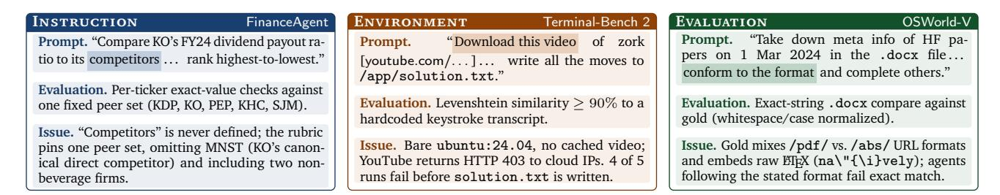
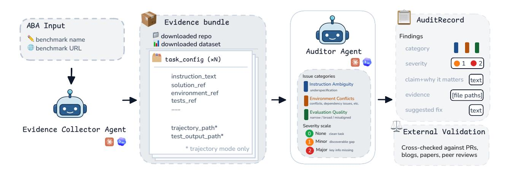
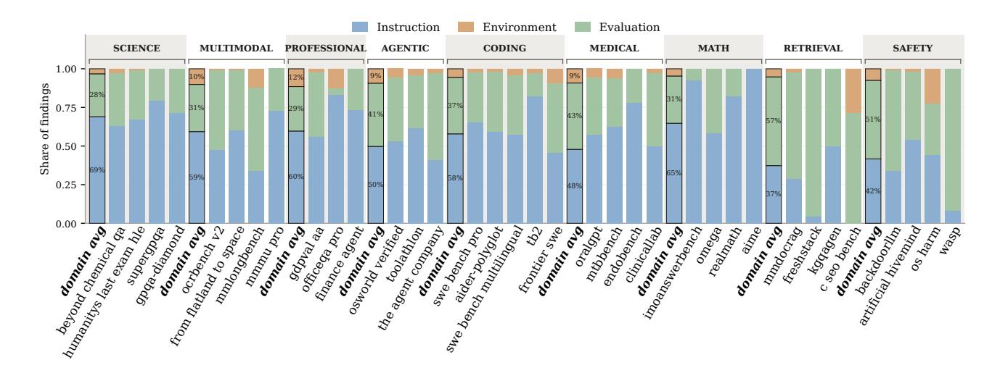
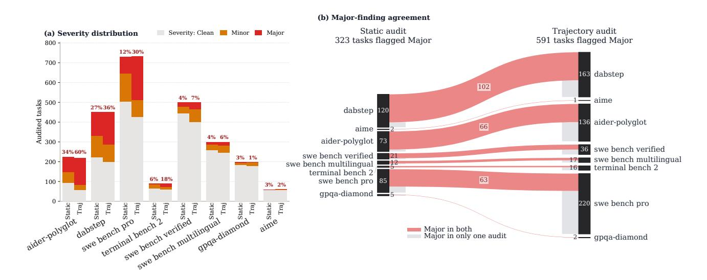
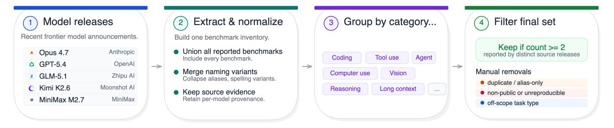
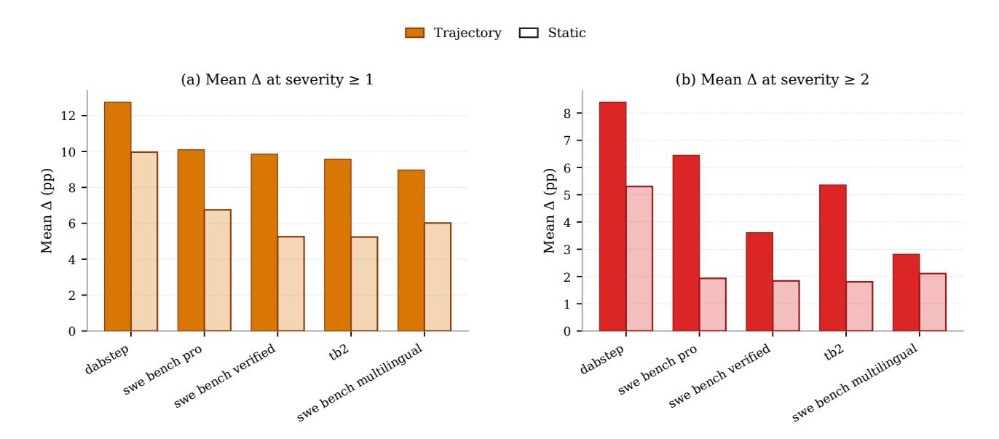
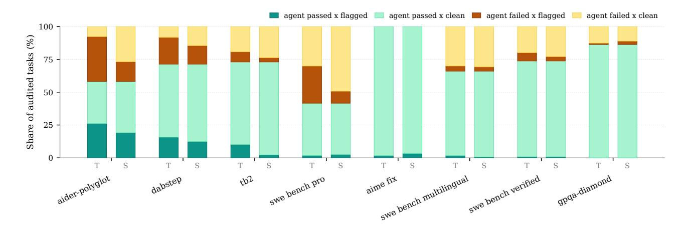

# **Automated Benchmark Auditing for AI Agents and Large Language Models**

**Junlin Wang**<sup>1</sup> **, Federico Bianchi**<sup>2</sup> **, Shang Zhu**<sup>2</sup> **, Fan Nie**<sup>3</sup> **, Yongchan Kwon**<sup>2</sup> **, Bhuwan Dhingra**<sup>1</sup> **, James Zou**2,<sup>3</sup> 1Duke University, 2Together AI, 3Stanford University

Modern AI benchmarks operate at a complexity that outpaces traditional verification methods. Tasks authored by domain experts often contain implicit assumptions, incomplete environment specifications, and brittle evaluation logic that human annotation cannot reliably catch. We introduce Auto Benchmark Audit (ABA), an agentic framework that systematically audits individual benchmark tasks, uncovering issues such as hidden environment dependencies, specification gaps, and limited grading logic. We run ABA on a collection of frontier LLM benchmarks and previous NeurIPS publications, totaling 168 benchmarks across nine domains. Across this corpus, ABA identifies critical issues including ambiguous task design, execution environment conflicts, and incorrect ground truths in over 25.7% of the evaluated tasks. The precision of these automated audits is validated by expert review and independent third-party reports such as upstream PRs. Crucially, we demonstrate that these problematic tasks severely distorts capability assessments for agents and LLMs: filtering out these tasks with issues shifts model rankings and increases average performance on SWE-bench Verified and Terminal-Bench 2 by 9.9% and 9.6%, respectively. We release the agentic tool and all task annotations to support the future development of frontier benchmarks.

**Website:** <https://www.autobenchaudit.com/>

Ð **Code:** <https://github.com/IsThatYou/autobenchaudit>

# **1. Introduction**

Scientific progress depends on the trustworthiness of its measurement instruments. In Artificial Intelligence, those instruments are benchmarks. If we cannot trust the methods we use to verify progress, our ability to define progress is undermined.

The AI community has long recognized the value of auditing benchmarks. Over the past decade, benchmark quality was maintained through sustained manual effort in different fields. Natural Language Inference is the canonical example: [Gururangan et al.](#page-11-0) [\[2018\]](#page-11-0) exposed systematic annotation artifacts introduced by crowd workers in the SNLI and MNLI benchmarks. The same pattern held in knowledge graph completion: [Akrami et al.](#page-10-0) [\[2020\]](#page-10-0) showed that data redundancy and test leakage in widely-used benchmarks caused accuracy to be largely overestimated. In each case, sustained manual effort was sufficient to identify and correct the problem, because the benchmarks themselves were within reach of generalist human effort.

Modern benchmarks like SWE-bench [\[Jimenez et al.,](#page-11-1) [2024\]](#page-11-1) and Terminal-Bench [\[Merrill et al.,](#page-11-2) [2026\]](#page-11-2) sit behind containerized environments, multi-stage evaluation harnesses, and grading logic that depends on runtime state. Tasks are contributed by domain experts who, paradoxically, are the least likely to make their assumptions explicit: they take critical context for granted, leaving setup requirements, environment specifications, and task constraints incomplete in ways invisible to them. Generalist annotation cannot fill this gap, and scaling up human effort does not solve a problem that is fundamentally one of expertise and coverage.

We introduce **Auto Benchmark Audit (ABA)**, an agentic framework for systematic issue detection in LLM benchmarks. Given a benchmark (i.e., its repository, dataset, and, when available, recorded agent trajectories), ABA provide structured findings under a single schema, each citing the file path from which it is drawn. A deterministic evidence collector resolves each benchmark's heterogeneous artifacts into a uniform manifest. The framework is

<span id="page-1-0"></span>

**Figure** 1: Examples of task-level issues identified by ABA. **Instruction**: the prompt underdetermines the answer the rubric demands. **Environment**: the container lacks the resources the prompt assumes. **Evaluation**: the grading harness rejects solutions that faithfully follow the prompt.

benchmark-agnostic and operates across agentic, patch-based, and static-QA benchmarks within a unified protocol. We apply ABA to nine benchmark domains spanning over thirty thousand tasks, validate findings through upstream pull requests and independent human review, and release the full audit record as a public artifact. Beyond rediscovering known issues, ABA discovers more problematic benchmark tasks that include hidden environment conflicts, implicit specification gaps, or brittle evaluation logic, examples of which can be seen in Figure 1.

Building a high-quality benchmark is hard, and the issues ABA identifies are not indictments of the teams who built them: they are the natural residue of the complexity of the current state of AI progress. We hope ABA can serve as a practical hardening tool: a way to catch what expert eyes miss, and to treat benchmarks as the living artifacts they need to be. In summary, our contributions are:

- 1. **An agentic auditing framework.** ABA combines static and trajectory auditing modes (analyzing benchmark artifacts directly vs. replaying recorded agent runs) with task-level audit scopes into a single benchmark-agnostic pipeline. The framework adapts to arbitrary evaluation harnesses and can suggest targeted fixes alongside each finding.
- 2. Large-scale benchmark auditing and artifact release. We apply ABA across 168 benchmarks across nine domains and over thirty thousand tasks, releasing all audit findings, per-task evidence, and rubric annotations as a public artifact.
- 3. **Empirical validation of ABA findings.** We confirm identified issues through upstream pull requests and meticulous manual reviews performed by domain experts. The framework presents task issues the even original authors had not previously identified, such as hidden environment dependencies, implicit specification gaps, and brittle grading logic.

#### 2. Auto Benchmark Audit Overview

Auto Benchmark Audit (ABA) takes a benchmark (its name and URLs to the dataset or repository) and outputs structured records of the benchmark issues. Figure 2 provides an overview of the pipeline, and the remainder of this section describes each component in detail.

Evidence Collector Agent The first challenge to develop an automated benchmark auditing pipeline is how to handle highly heterogeneous configurations of existing benchmark tasks. Task representations vary drastically across benchmarks: they may appear as a directory of files in Terminal-Bench 2, as a task\_patch embedded within a JSON in SWE-bench, or as simple (instruction, gold\_answer) pairs for static QA datasets like HLE [Center for AI Safety et al., 2026] and GPQA [Rein et al., 2024]. Furthermore, certain tasks require complex environmental dependencies, such as accompanying container images.

To handle this heterogeneity, ABA uses a deterministic manifest schema with an evidence collector agent shown in Figure 2. The agent first downloads required files like GitHub repositories or Huggingface datasets. Then for

<span id="page-2-0"></span>

**Figure** 2: The Auto Benchmark Audit pipeline. Given benchmark name and URL, an Evidence Collector Agent downloads necessary files and resolves each benchmark's heterogeneous artifacts into a uniform manifest of file paths. Then an Auditor Agent audits based on issue categories and severity scale. Then findings include specific evidences, reasoning and suggested fix.

each task, this agent maps heterogeneous benchmark artifacts into a unified representation. Lightweight data, such as instruction\_text, is inlined directly, while heavyweight assets and execution traces are isolated via filesystem references (e.g., solution\_ref, environment\_ref, and trajectory\_path). By abstracting away the underlying data structures, onboarding a new benchmark is reduced to providing a minimalist configuration containing the benchmark's name and repository URL. The collector automatically adapts this source into the standardized ABA schema for agentic inspection, allowing us to scale the evaluation suite to 168 distinct benchmarks without any per-benchmark modifications to prompts, rubrics, or output schemas. The evidence collector agent prompt can be found in Section C.2.

**Auditor Agent** After evidence collection, an auditor agent is initialized with the task configuration and file paths pointing to the relevant repositories and datasets. Using shell tools, the auditor inspects these artifacts and analyzes the task guided by a standardized rubric (full prompt templates are detailed in Appendix C.3). This auditing procedure remains uniform across all task types, from static QA to multi-step agent environments.

The protocol runs in one of two modes that differ in what evidence is gathered: (1) **Static mode**, where the auditor reads only the task definition — the instruction the agent would receive, the tests against which its solution would be graded, the evaluation configuration, etc., with no execution observed. (2) **Trajectory mode**, where the auditor additionally reads recorded agent traces (trajectory\_path) and the test output result (test\_output\_path), etc. enabling the auditor to identify runtime issues that static inspection cannot capture. In Section 5, we show that the trajectory mode finds more issues than the static mode by leveraging intermediate execution traces and runtime behavior.

**Audit Findings** As shown in Figure 2, each finding carries the following five fields. (1) category: every identified issue is categorized along three independent axes, Instruction, Environment, and Evaluation. Detailed category definitions are shown in Figure 3. (2) severity: a 3-class score [0, 1, 2], where 2 denotes a major issue that renders the task unsolvable (e.g., conflicting instruction constraints), 1 denotes a minor issue that can be resolved with sufficient domain expertise, and 0 indicates no issue. (3) evidence: the filesystem paths or artifacts supporting the claim; (4) claim & why it matters: a natural-language description of the identified issue plus the downstream failure mode induced by the issue in the evaluation. (5) suggested fix: a concrete change to the prompt, environment, or tests, in order to resolve the issue.

#### <span id="page-3-0"></span>Task-level issue categories Instruction Environment **Evaluation** The prompt is missing critical information, The runtime environment — container im-The test suite does not fairly and comis ambiguous, or is misleading in a way age, resources, installed tools, filesystem pletely evaluate correct solutions: too narthat drives failures. The reader cannot de- conflicts with what the task instructions row (rejects valid alternatives), too broad termine what passing-the-test means from (accepts trivially wrong outputs), or misassume or require, blocking the approach aligned with the stated objective. Or simthe prompt alone. the prompt instructs. ply, the ground-truth answer is not correct. *Example.* The prompt says "sort the records" *Example.* The prompt instructs the agent Example. The test checks the program's stdbut the test accepts only descending orto inspect git history with git log, but out against an exact-string fixture including git is not installed in the container and der by a secondary key the prompt never a trailing newline: a functionally correct sonames; two reasonable readers produce the repo ships as a flat snapshot, so the lution that prints the same content without two different solutions, only one of which prescribed approach is impossible. the trailing newline is marked failing. passes.

**Figure** 3: Task-level issue categories. The issues can be divided into three independent axes: Instruction, Environment, and Evaluation.

Finally, ABA findings are validated through cross-referencing with external evidence sources, including upstream pull requests, published papers and blogs, and expert manual review.

# 3. Auditing Benchmark Quality

#### <span id="page-3-1"></span>3.1. Experiment Setup

To test the effectiveness of ABA, we draw benchmarks from two complementary sources: (1) Frontier Benchmarks (Appendix B.1, Fig. 6): we take commonly used benchmarks from five recent frontier LLM releases.<sup>1</sup> (2) NeurIPS 2025 accepted benchmarks: we collect and filter NeurIPS 2025 Datasets & Benchmarks Track accepted papers, more details of which can be seen in Appendix B.2. In total, 168 benchmarks are collected from these two sources, where we maximize task coverage as much as possible allowed by feasible budget constraints. The details are provided in Table 4.

**Benchmark filtering** We select benchmarks based on two primary criteria. First, the system under consideration must be general-purpose LLMs or LLM agents. Therefore, we exclude specialized domains or modalities, such as audio, embodied AI, and remote sensing. Second, each task needs to carry a verifiable ground truth (e.g. test suite, gold answer, or deterministic grader) which the audit rubric can operate on. Therefore, we exclude those with inherently subjective evaluation. We also exclude meta-evaluation benchmarks which assess evaluation methodologies. More details can be found in Appendix B.2.

**Agent configuration** We run ABA through the Claude Code CLI with its default settings: Opus 4.7, default tool permissions (file read/write, bash, and search), and the default system prompt and agent loop. We fix the version at v2.1.96.

<span id="page-4-1"></span>Table 1: Overview of ABA results by domain (static-mode audit only). Each row reports the number of benchmarks and tasks. We report both the number of major issues and affected tasks as one task may contain multiple issues. Additionally, *Severity Share* column categorizes tasks by their highest-severity issues: the *Major* column indicates the percentage of tasks with at least one major finding, while the *Minor* column shows the percentage of tasks where the most severe finding is minor.

|                    |            |        | Major Issues |       | Severity Share |        |
|--------------------|------------|--------|--------------|-------|----------------|--------|
| Domain             | Benchmarks | Tasks  | Issues       | Tasks | Major          | Minor  |
| Science            | 15         | 3,233  | 1,120        | 831   | 25.7%          | 16.8 % |
| Multimodal         | 37         | 8,330  | 3,264        | 2,054 | 24.7%          | 13.3 % |
| Professional       | 8          | 1,160  | 602          | 445   | 38.4%          | 24.4%  |
| Agentic / Tool Use | 23         | 3,337  | 898          | 686   | 20.6%          | 20.3 % |
| Coding             | 24         | 5,041  | 877          | 713   | 14.1%          | 14.2%  |
| Medical            | 17         | 4,014  | 3,314        | 1,664 | 41.5 %         | 13.3%  |
| Math               | 14         | 3,060  | 490          | 403   | 13.2%          | 8.1 %  |
| Retrieval / RAG    | 8          | 2,210  | 495          | 377   | 17.1%          | 21.1%  |
| Safety / Alignment | 22         | 3,900  | 2,964        | 1,646 | 42.2 %         | 15.7%  |
| Total              | 168        | 34,285 | 14,024       | 8,819 | 25.7%          | 15.1 % |

#### 3.2. ABA Findings

According to Table 1, our static-mode audit of 168 benchmarks and 34,285 tasks reveals that 25.7 % of them carry major issues (severity 2) under the task-level rubric while 15.1% contain minor issues (severity 1) but no major issues, so less than 60% of the tasks remain clean (severity 0).

One task may have multiple issues, as reflected in Table 1, where the *Issues* column tallies the total number of major issues, while the *Tasks* column reports the number of unique tasks affected by at least one major issue.

Across benchmarks, the gap between the highest and lowest major severity percentage spans more than a factor of three. The Math domain sees the lowest major severity rate (13.2% Major, 78.7% Clean), where tasks usually specify numeric answers and deterministic graders, while no environments or test scripts are required. The Coding domain is the second lowest with only 14.1% Major. In contrast, the Safety / Alignment (42.2% Major), Medical (41.5% Major), and Professional (38.4% Major) domains display the highest major severity shares. Note that they account for 42.6% of tasks with major issues despite only 26.5% of all audited tasks. Qualitatively, the major issue shares associate strongly with the complexity of tasks' environments and evaluation setups. Domains requiring intricate environments or nuanced grading protocols are more prone to unstated assumptions.

#### 3.3. Issue Patterns across Domains

This subsection breaks down the major issue rate by issue types (instruction, environment, evaluation) and we discuss three main patterns across domains. Further, Figure 4 illustrates the percentage decomposition and displays a representative subset of benchmarks from each domain.

**Domains with deterministic evaluations are instruction-issue dominant.** When the evaluation method is based on deterministic checkers (e.g., a numeric answer, an exact-match string, or an option in multiple-choice questions), instruction ambiguity emerges as the primary failure source. The Math domain is a clear illustration, as 65% major issues are caused by instructions, with certain benchmarks exceeding 90% (e.g. IMOAnswerBench [Luong et al., 2025]). The Science domain follows a similar pattern, with instruction-issues accounting for 69% of total. In these two domains, over a quarter of the issues arise from evaluation setups such as incorrect gold

<span id="page-4-0"></span><sup>&</sup>lt;sup>1</sup>Anthropic Opus 4.7 [Anthropic, 2026], OpenAI GPT-5.4 [OpenAI, 2026], Zhipu GLM-5.1 [GLM-5 Team, 2026], Moonshot Kimi K2.6 [Moonshot AI, 2026], MiniMax M2.7 [MiniMax, 2026].

<span id="page-5-0"></span>

**Figure** 4: Issue categories per audited benchmark, grouped by domain, for all non-clean static-audit findings. Each finding is one of Instruction, Environment, or Evaluation issues. We present the domain average plus a few specific benchmarks for each domain.

references, while they exhibit the lowest rate of environment-issues, which is close to 0.

The Safety and retrieval domains are evaluation-issue dominant. The Safety and Retrieval domains are dominated by evaluation-based issues, which represent 51% and 57% of total, respectively. This can be attributed to the fact that tasks in these domains frequently require multi-faceted answers, so their evaluation suites necessitate complex grading mechanisms, such as LLM-as-a-judge and test rubrics. This introduces issues such as unreliable LLM judges and inadequate test coverage.

Complex runtimes introduce environment vulnerabilities. Environment-related errors associate with the complexity of execution requirements. While static-QA tasks naturally exhibit near-zero environment errors, domains requiring complex runtimes face severe vulnerabilities. Consequently, the Agentic, Professional, and Multimodal domains exhibit higher percentages of environment-based issues across all categories.

# <span id="page-5-1"></span>4. Validating ABA Results

Ground truth is extremely scarce in this domain, and it is a non-trivial task to find a clean test set for this type of problem. The experts who could produce one are typically the same people who authored the benchmarks, and the issues we care about are precisely those they might have overlooked. We therefore organize our validation around a hierarchy of evidence. At the top is what we call *fixes in the wild*: cases where practitioners independently decided an issue was serious enough to act on by issuing a fix PR or retiring a benchmark from evaluation entirely. These cases carry the strongest epistemic weight because the stakes are real and the motivation is not evaluative. Below them are two constructed ground-truth sources: the BenchGuard gold-issue sets for BixBench and ScienceAgentBench (Section 4.2), curated carefully but for auditing purposes, and an internal human-rater study on major issues found by ABA (Section 4.3).

#### 4.1. Fixes in the Wild

Our strongest validation comes from cases where practitioners independently acted on benchmark issues without sight of our findings. We draw on two instances.

<span id="page-6-3"></span>Table 2: External validation. Recall and precision (%) under strict (s, aligned) and partial (p, aligned + partial) match criteria for the three gold-issue sets from Terminal-Bench 2, BixBench, ScienceAgentBench. Redund. is the average number of aligned findings emitted per unique gold issue caught: a higher value indicates the auditor reports multiple findings against the same issue.

| Benchmark         | Auditor                  | Model                | Gold     | Find.    | Recall (s/p)                   | Precision (s/p)                | Redund.             |
|-------------------|--------------------------|----------------------|----------|----------|--------------------------------|--------------------------------|---------------------|
| Terminal-Bench 2  | ABA (ours)               | Opus 4.6             | 21       | 24       | 66.7 / 81.0                    | 58.3 / 70.8                    | 1.0×                |
| BixBench          | ABA (ours)<br>BenchGuard | Opus 4.6<br>Opus 4.6 | 24<br>24 | 28<br>31 | <b>62.5 / 79.2</b> 54.2 / 79.2 | <b>50.0 / 71.4</b> 38.7 / 67.7 | 1.05×<br>1.10×      |
| ScienceAgentBench | ABA (ours)<br>BenchGuard | Opus 4.6<br>Opus 4.6 | 12<br>12 | 27<br>31 | 83.3 / 91.7<br>83.3 / 91.7     | 40.7 / 51.9<br>- / <b>58.1</b> | <b>1.40</b> × 1.64× |

Maintainer fix PR (Terminal-Bench 2). The Terminal-Bench 2 maintainers proposed a fix PR<sup>2</sup> targeting 22 tasks. Four task fixes are simple due diligence fixes about task resources or oracle solutions (Section D.1). Of the remaining 18 we decompose 21 individual issues. Our trajectory audit independently recovered 14 of these 21 issues under strict matching and 17 under partial matching. This yields a strict recall of 66.7% (81.0% partial) against the maintainers' ground truth—a set of fixes they developed entirely independent of our findings (top row of Table 2). Precision measured only against PR #53 is 58.3% / 70.8%, but this is a lower bound because the PR is not exhaustive. ABA also flags 11 tasks outside the PR; on the seven Major tasks we review by hand, its 11 findings achieve 72.7% strict and 81.8% aligned-or-partial precision. The PR overlap therefore validates two contributions at once: ABA recovers many defects that maintainers independently fixed, and it surfaces additional real defects beyond the scope of that human review. Per-task lists for both sets are in Appendix D.1.

Research blog (SWE-bench Verified). A recent OpenAI post explaining their decision to retire SWE-bench Verified from internal evaluation<sup>3</sup> singles out two tasks – pylint-dev\_\_pylint-4551 and sympy\_\_sympy-18199 – as concrete examples of unreliable grading. Both present as major issues in our audit, flagged independently and without reading the blog post. This instance differs from the PR case in a consequential way: the action taken was not a patch but a retirement, meaning the practitioners judged the issues severe enough to abandon one of the field's most-reported coding benchmarks entirely. This study underscores the practical value of ABA in identifying critical benchmark issues. For both cases, our auditor never queried Git histories, never fetched the related PR, and never executed web searches.

#### <span id="page-6-0"></span>4.2. A Recent Study on Scientific Benchmarks (BenchGuard)

For a complementary check we turn to BenchGuard [Tu et al., 2026], which curates gold-issue sets for two execution-based benchmarks: ScienceAgentBench [Chen et al., 2025] and the BixBench Verified-50 subset [Mitchener et al., 2025]. We run ABA on the same two task sets and report alignment against the same gold issues using the same alignment judge, alongside the strongest single-model baseline BenchGuard reports (Claude Opus 4.6 in definition-only mode). We run ABA with Claude Opus 4.6 to ensure fair comparision to BenchGuard.

On ScienceAgentBench, ABA recovers 10/12 gold issues strictly and 11/12 with partial credit, matching the Opus 4.6 baseline at both bars. On BixBench, ABA's strict recall improves over the BenchGuard single-model baseline (62.5 % vs. 54.2 %) at matched partial recall (79.2 %), and its precision is higher under both match criteria (50.0 % / 71.4 % vs. 38.7 % / 67.7 %). The redundancy column tells the same story from a different angle: BenchGuard tends to emit multiple findings against the same gold issue (1.10 × on BixBench, 1.64 × on ScienceAgentBench), while ABA reduces redundancy from  $1.10 \times$  to  $1.05 \times$  on BixBench and from  $1.64 \times$  to  $1.40 \times$  on ScienceAgentBench.

<span id="page-6-2"></span><span id="page-6-1"></span><sup>&</sup>lt;sup>2</sup>https://github.com/harbor-framework/terminal-bench-2/pul1/53

<span id="page-6-4"></span><sup>3</sup>https://openai.com/index/why-we-no-longer-evaluate-swe-bench-verified/

<span id="page-7-2"></span>

**Figure** 5: Static-vs-trajectory audit comparison on the benchmarks audited in both modes. (a) Severity distribution per benchmark at task-level. Each task is counted as a Major task if it has at least one Major issue. It is a Minor task if most severe finding is Minor. (b) Agreement between the two modes on shared tasks.

#### 4.3. Manual Confirmation of Major Issues

To further validate the audit at the task level, we manually review a sample of 56 major issues and 30 minor issues in static mode. They span across 12 frontier benchmarks, where current capability claims are concentrated and a spurious finding would be most consequential (list of 12 benchmarks at Section D.3). We also sample 25 major issues in trajectory mode from SWE-Bench Verified, as shown in Table 3.

<span id="page-7-1"></span>Table 3: Manual confirmation of sampled issues (static mode) from 12 benchmarks and 25 major issues (trajectory mode) sampled from SWE-bench Verified. Precision under strict (s) and partial (p) match.

| Tier               | Find. | Prec. (s) | Prec. (p) |
|--------------------|-------|-----------|-----------|
| Major              | 56    | 73%       | 91%       |
| Minor              | 30    | 63%       | 83%       |
| SWE-bench Verified | 25    | 92%       | 96%       |

# <span id="page-7-0"></span>5. Trajectory Audit Analysis

Previous sections focused primarily on static-mode audits. We now examine the trajectory audit mode, which has access to richer information (e.g., runtime behavior and execution traces) and can therefore capture issues that are inaccessible from the static mode alone. This section compares the two audit modes and studies how trajectory-identified issues affect benchmark leaderboard rankings.

Trajectory mode identifies more major issues. Figure 5 compares the static and trajectory audit modes across eight benchmarks. Trajectory mode consistently finds more major issues than the static mode on nearly every benchmark, along with a slightly larger overall non-clean share. Specifically, the trajectory mode flags 8.5% more major tasks (tasks that have at least one major issue) and 2.4% less minor tasks than the static mode on average across the 8 benchmarks. That is +6.1% more tasks flagged overall. Most of the gap comes from the major issues, suggesting that the additional runtime evidence available to the trajectory mode exposes more consequential issues (e.g., silent failure modes and environmental drift) that are inaccessible to the static mode alone.

Static and trajectory modes yield the identical audit results for many tasks. Figure 5 also illustrates the degree of overlap between the two audit modes. We find the max-severity agreement<sup>4</sup> ranges from 29% to 63%, with the average of 53%. Here, we exclude aime due to its small sample size. The disagreement largely results from the available information difference: runtime contamination and environment drift emerge only in the trajectory mode, while metadata ambiguity and test-suite leakage are primarily visible from the static mode. Despite these differences, the substantial overlap suggests that static audits already capture many of the same high-severity issues identified by the trajectory mode, supporting the robustness of the static mode.

Audit results affect public leaderboard rankings. We next investigate how benchmark leaderboard rankings shift when audit-flagged issues are removed. We consider the five benchmarks, namely dabstep, swe\_bench\_pro, swe\_bench\_verified, tb2, swe\_bench\_multilingual, and evaluate the mean per-model ranking change. The overall mean lifts for trajectory audit is 10.5 percent when filtering both major and minor issues. In particular, mean lifts reach roughly 12.8 percentage points on Dabstep [Egg et al., 2025] when both major and minor issues are excluded, with several-point increases remaining even under the conservative major-only filter (see Figure 7). We also include an actual model ranking shift example in Section E.3. These shifts indicate that audit findings can significantly affect leaderboard rankings. We defer to Appendix E the full per-benchmark figure and a hypothesis test that the trajectory auditor's additional findings are not driven by agent failure.

### 6. Related Work

Our work intersects three lines of research: systematic critique of benchmark validity, benchmarks for LLM and agent capabilities, and LLM-based automated evaluation.

#### 6.1. Benchmark Quality, Validity, and Critique

A growing body of work audits individual benchmarks to expose issues that distort reported scores. Aleithan et al. [2024] report 32.7% solution leakage and order-of-magnitude inflation from weak tests in SWE-bench, Yu et al. [2025] find 5.2/7.7% of SWE-bench Verified/Lite tasks have insufficient tests, and Garg et al. [2025] show benchmark mutation reveals over-fitting that inflates measured capability. Beyond software engineering, Lange et al. [2025] identify grading flaws in KernelBench [Ouyang et al., 2025] that let agents bypass correctness checks, and Gema et al. [2024] re-annotate MMLU and find 6.49% of items contain errors. At the design level, Vendrow et al. [2025] motivate "platinum benchmarks" curated to minimise label noise, Reuel et al. [2024] aggregate 46 best-practice criteria for benchmark construction, and contamination-resistant suites such as LiveCodeBench [Jain et al., 2024] update problems continuously. Huang et al. [2026] similarly treat benchmarks as revisable artifacts, using an audit-then-score process to update DeepFact-Bench labels and rationales before scoring models. Most directly related, Zhu et al. [2025a] formalise the validity threats facing agentic benchmarks and propose an Agentic Benchmark Checklist of best practices spanning task validity, outcome validity, and benchmark reporting; their assessment, however, is performed manually by domain experts on a fixed set of benchmarks. These efforts proceed benchmark-by-benchmark, with critique encoded as expert prose rather than structured records. We instead define an executable audit protocol that emits a stable finding schema under a single rubric and applies uniformly across heterogeneous benchmark families, turning ad hoc critique into a reproducible measurement.

#### 6.2. Benchmarking of AI Agents and LLMs

Agentic and LLM benchmarks have proliferated across domains. In coding and software engineering, HumanEval [Chen et al., 2021] and SWE-bench [Jimenez et al., 2024] have been extended by repository- and project-scale successors and contamination-resistant variants [Aleithan et al., 2024, Deng et al., 2025, Miserendino et al., 2025, Ouyang et al., 2025, Li et al., 2023, Jain et al., 2024]. Interactive agent benchmarks exercise full execution environments and trajectories [Liu et al., 2024, Yao et al., 2025, Zhou et al., 2024, Merrill et al., 2026], while

<span id="page-8-0"></span><sup>&</sup>lt;sup>4</sup>We define max-severity agreement as the fraction of trajectory-identified major issues that are also flagged as major by the static mode.

multimodal agents extend this to GUI and visual browsing tasks [\[Xie et al.,](#page-12-10) [2024,](#page-12-10) [He et al.,](#page-11-11) [2024\]](#page-11-11). Safety and alignment benchmarks evaluate cyber capabilities, vulnerability exploitation, and safety risks [\[Zhang et al.,](#page-13-2) [2024,](#page-13-2) [Zhu et al.,](#page-13-3) [2025b,](#page-13-3) [Vidgen et al.,](#page-12-11) [2024\]](#page-12-11). Other suites target advanced math, ML engineering, and general-assistant tasks [\[Mialon et al.,](#page-11-12) [2023,](#page-11-12) [Glazer et al.,](#page-10-11) [2024,](#page-10-11) [Nie et al.,](#page-12-12) [2026\]](#page-12-12). Aggregate evaluation frameworks such as HELM [\[Liang et al.,](#page-11-13) [2023\]](#page-11-13) and BIG-bench [\[Srivastava et al.,](#page-12-13) [2023\]](#page-12-13) standardize scenarios across many benchmarks but treat the underlying benchmarks as trustworthy inputs.

Agent–environment interaction, dynamic evaluation, and stateful sandboxes expand the surface area for environment bugs, harness flakiness, and narrow tests. Our framework targets this multi-domain setting, producing audit-grade evidence per task under a single rubric.

### **6.3. From LLM-as-Judge to Agentic Audit**

Our auditor builds on the methodology of LLM-as-judge work but moves from a single-call judgment to an agentic process. [Zheng et al.](#page-13-4) [\[2023\]](#page-13-4) demonstrate that strong LLM judges agree with human raters above 80% on openended chat evaluation, and Chatbot Arena [\[Chiang et al.,](#page-10-12) [2024\]](#page-10-12) validates this against crowdsourced preferences at scale. [Feuer et al.](#page-10-13) [\[2025\]](#page-10-13) document systematic failure modes such as position, verbosity, and rubric-order biases that silently undermine validity. These methods score model outputs given a fixed benchmark via a single, stateless judgment. We instead score benchmarks themselves using an agentic audit: the auditor is given tools for filesystem inspection, code execution, container introspection, and targeted retrieval, and proceeds through multi-step investigation, the setting where harness leaks, environment drift, and contradictory ground truth typically first surface. Concurrent with our work, [Tu et al.](#page-12-3) [\[2026\]](#page-12-3) propose BenchGuard, which cross-verifies benchmark artifacts via structured LLM protocols and reports issues on two scientific benchmarks (ScienceAgentBench and a BixBench subset). Our framework differs in two respects: the audit pipeline is benchmark-agnostic and imposes no fixed preparation format on the benchmark under test, and we evaluate at substantially larger scale: 168 benchmarks spanning coding, agentic, multimodal, and safety domains, versus two in their work, yielding a cross-domain measurement of audit-grade evidence rather than a per-benchmark study.

# **7. Conclusion**

In this work, we have demonstrated that current frontier benchmarks contain a wide range of issues of major severity. This calls for cyclically improving benchmarks as part of the standard development process. In the opensource software community, the maturation of systems gave rise to systematic testing and continuous improvement infrastructure precisely because complexity at scale makes issues inevitable, independent of the expertise of the contributors. AI benchmarks now face a very similar condition. We hope ABA can represent a step toward the analogous paradigm where an automated auditing framework can surface ambiguities, environment conflicts, and evaluation problems that domain experts may miss. We release all findings and tooling publicly.

# **References**

- <span id="page-10-0"></span>Farahnaz Akrami, Mohammed Samiul Saeef, Qingheng Zhang, Wei Hu, and Chengkai Li. Realistic re-evaluation of knowledge graph completion methods: An experimental study. In *Proceedings of the 2020 ACM SIGMOD International Conference on Management of Data*, pages 1995–2010, 2020. doi: 10.1145/3318464.3380599.
- <span id="page-10-6"></span>Reem Aleithan, Haoran Xue, Mohammad Mahdi Mohajer, Elijah Nnorom, Gias Uddin, and Song Wang. SWE-Bench+: Enhanced coding benchmark for LLMs. *arXiv preprint arXiv:2410.06992*, 2024.
- <span id="page-10-2"></span>Anthropic. Introducing Claude Opus 4.7. <https://www.anthropic.com/news/claude-opus-4-7>, April 2026. Released April 16, 2026.
- <span id="page-10-15"></span>Victor Barres, Honghua Dong, Soham Ray, Xujie Si, and Karthik Narasimhan. 2 -bench: Evaluating conversational agents in a dual-control environment, 2025. URL <https://arxiv.org/abs/2506.07982>.
- <span id="page-10-14"></span>Antoine Bigeard, Langston Nashold, Rayan Krishnan, and Shirley Wu. Finance agent benchmark: Benchmarking LLMs on real-world financial research tasks. *arXiv preprint arXiv: 2508.00828*, 2025.
- <span id="page-10-1"></span>Center for AI Safety, Scale AI, and HLE Contributors Consortium. A benchmark of expert-level academic questions to assess AI capabilities. *Nature*, 649:1139–1146, 2026. doi: 10.1038/s41586-025-09962-4. URL [https://arxiv.org/abs/2501.](https://arxiv.org/abs/2501.14249) [14249](https://arxiv.org/abs/2501.14249).
- <span id="page-10-9"></span>Mark Chen, Jerry Tworek, Heewoo Jun, Qiming Yuan, Henrique Ponde de Oliveira Pinto, Jared Kaplan, Harri Edwards, Yuri Burda, Nicholas Joseph, Greg Brockman, et al. Evaluating large language models trained on code. *arXiv preprint arXiv:2107.03374*, 2021.
- <span id="page-10-4"></span>Ziru Chen, Shijie Chen, Yuting Ning, Qianheng Zhang, Boshi Wang, Botao Yu, Yifei Li, Zeyi Liao, Chen Wei, Zitong Lu, Vishal Dey, Mingyi Xue, Frazier N. Baker, Benjamin Burns, Daniel Adu-Ampratwum, Xuhui Huang, Xia Ning, Song Gao, Yu Su, and Huan Sun. ScienceAgentBench: Toward rigorous assessment of language agents for data-driven scientific discovery. In *The Thirteenth International Conference on Learning Representations (ICLR)*, 2025.
- <span id="page-10-12"></span>Wei-Lin Chiang, Lianmin Zheng, Ying Sheng, Anastasios N. Angelopoulos, Tianle Li, Dacheng Li, Hao Zhang, Banghua Zhu, Michael I. Jordan, Joseph E. Gonzalez, and Ion Stoica. Chatbot arena: An open platform for evaluating LLMs by human preference. In *Proceedings of the 41st International Conference on Machine Learning (ICML)*, 2024.
- <span id="page-10-10"></span>Xiang Deng, Jeff Da, Edwin Pan, Yannis Yiming He, Charles Ide, Kanak Garg, Niklas Lauffer, Andrew Park, Nitin Pasari, Chetan Rane, Karmini Sampath, Maya Krishnan, Srivatsa Kundurthy, Sean Hendryx, Zifan Wang, Vijay Bharadwaj, Jeff Holm, Raja Aluri, Chen Bo Calvin Zhang, Noah Jacobson, Bing Liu, and Brad Kenstler. SWE-Bench Pro: Can AI agents solve long-horizon software engineering tasks? *arXiv preprint arXiv:2509.16941*, 2025.
- <span id="page-10-5"></span>Alex Egg, Martin Iglesias Goyanes, Friso Kingma, Andreu Mora, Leandro von Werra, and Thomas Wolf. Dabstep: Data agent benchmark for multi-step reasoning. *arXiv preprint arXiv: 2506.23719*, 2025.
- <span id="page-10-13"></span>Benjamin Feuer, Chiung-Yi Tseng, Astitwa Sarthak Lathe, Oussama Elachqar, and John P. Dickerson. When judgment becomes noise: How design failures in LLM judge benchmarks silently undermine validity. *arXiv preprint arXiv:2509.20293*, 2025.
- <span id="page-10-7"></span>Spandan Garg, Benjamin Steenhoek, and Yufan Huang. Saving SWE-Bench: A benchmark mutation approach for realistic agent evaluation. *arXiv preprint arXiv:2510.08996*, 2025.
- <span id="page-10-8"></span>Aryo Pradipta Gema, Joshua Ong Jun Leang, Giwon Hong, Alessio Devoto, Alberto Carlo Maria Mancino, Rohit Saxena, Xuanli He, Yu Zhao, Xiaotang Du, Mohammad Reza Ghasemi Madani, Claire Barale, Robert McHardy, Joshua Harris, Jean Kaddour, Emile van Krieken, and Pasquale Minervini. Are we done with MMLU? *arXiv preprint arXiv:2406.04127*, 2024.
- <span id="page-10-11"></span>Elliot Glazer, Ege Erdil, Tamay Besiroglu, Diego Chicharro, Evan Chen, Alex Gunning, Caroline Falkman Olsson, Jean-Stanislas Denain, Anson Ho, Emily de Oliveira Santos, et al. FrontierMath: A benchmark for evaluating advanced mathematical reasoning in AI. *arXiv preprint arXiv:2411.04872*, 2024.
- <span id="page-10-3"></span>GLM-5 Team. GLM-5: from vibe coding to agentic engineering, 2026. GLM-5.1 released by Zhipu/Z.ai as an incremental post-training upgrade, March 27, 2026; <https://huggingface.co/zai-org/GLM-5.1>.

- <span id="page-11-0"></span>Suchin Gururangan, Swabha Swayamdipta, Omer Levy, Roy Schwartz, Samuel R. Bowman, and Noah A. Smith. Annotation artifacts in natural language inference data. In *Proceedings of the 2018 Conference of the North American Chapter of the Association for Computational Linguistics: Human Language Technologies (NAACL-HLT), Volume 2 (Short Papers)*, pages 107–112, 2018.
- <span id="page-11-11"></span>Hongliang He, Wenlin Yao, Kaixin Ma, Wenhao Yu, Yong Dai, Hongming Zhang, Zhenzhong Lan, and Dong Yu. WebVoyager: Building an end-to-end web agent with large multimodal models. *arXiv preprint arXiv:2401.13919*, 2024.
- <span id="page-11-7"></span>Yukun Huang, Leonardo F. R. Ribeiro, Momchil Hardalov, Bhuwan Dhingra, Markus Dreyer, and Venkatesh Saligrama. Deepfact: Co-evolving benchmarks and agents for deep research factuality, 2026. URL https://arxiv.org/abs/2603.05912.
- <span id="page-11-6"></span>Naman Jain, King Han, Alex Gu, Wen-Ding Li, Fanjia Yan, Tianjun Zhang, Sida Wang, Armando Solar-Lezama, Koushik Sen, and Ion Stoica. LiveCodeBench: Holistic and contamination free evaluation of large language models for code. *arXiv preprint arXiv:2403.07974*, 2024.
- <span id="page-11-1"></span>Carlos E. Jimenez, John Yang, Alexander Wettig, Shunyu Yao, Kexin Pei, Ofir Press, and Karthik R. Narasimhan. SWE-bench: Can language models resolve real-world GitHub issues? In *The Twelfth International Conference on Learning Representations (ICLR)*, 2024.
- <span id="page-11-5"></span>Robert Tjarko Lange, Aaditya Prasad, Qi Sun, Maxence Faldor, Yujin Tang, and David Ha. The AI CUDA engineer: Agentic CUDA kernel discovery, optimization and composition. 2025.
- <span id="page-11-9"></span>Jinyang Li, Binyuan Hui, Ge Qu, Jiaxi Yang, Binhua Li, Bowen Li, Bailin Wang, Bowen Qin, Ruiying Geng, Nan Huo, et al. Can llm already serve as a database interface? a big bench for large-scale database grounded text-to-sqls. *Advances in Neural Information Processing Systems*, 36:42330–42357, 2023.
- <span id="page-11-14"></span>Junlong Li, Wenshuo Zhao, Jian Zhao, Weihao Zeng, Haoze Wu, Xiaochen Wang, Rui Ge, Yuxuan Cao, Yuzhen Huang, Wei Liu, Junteng Liu, Zhaochen Su, Yiyang Guo, Fan Zhou, Lueyang Zhang, Juan Michelini, Xingyao Wang, Xiang Yue, Shuyan Zhou, Graham Neubig, and Junxian He. The tool decathlon: Benchmarking language agents for diverse, realistic, and long-horizon task execution. 2025. URL https://arxiv.org/abs/2510.25726.
- <span id="page-11-13"></span>Percy Liang, Rishi Bommasani, Tony Lee, Dimitris Tsipras, Dilara Soylu, Michihiro Yasunaga, Yian Zhang, Deepak Narayanan, Yuhuai Wu, Ananya Kumar, Benjamin Newman, Binhang Yuan, Bobby Yan, Ce Zhang, Christian Cosgrove, Christopher D. Manning, Christopher Ré, Diana Acosta-Navas, Drew A. Hudson, et al. Holistic evaluation of language models. *Transactions on Machine Learning Research*, 2023.
- <span id="page-11-10"></span>Xiao Liu, Hao Yu, Hanchen Zhang, Yifan Xu, Xuanyu Lei, Hanyu Lai, Yu Gu, Hangliang Ding, Kaiwen Men, Kejuan Yang, Shudan Zhang, Xiang Deng, Aohan Zeng, Zhengxiao Du, Chenhui Zhang, Sheng Shen, Tianjun Zhang, Yu Su, Huan Sun, Minlie Huang, Yuxiao Dong, and Jie Tang. AgentBench: Evaluating LLMs as agents. In *The Twelfth International Conference on Learning Representations (ICLR)*, 2024.
- <span id="page-11-3"></span>Thang Luong, Dawsen Hwang, Hoang H. Nguyen, Golnaz Ghiasi, Yuri Chervonyi, Insuk Seo, Junsu Kim, Garrett Bingham, Jonathan Lee, Swaroop Mishra, Alex Zhai, Clara Huiyi Hu, Henryk Michalewski, Jimin Kim, Jeonghyun Ahn, Junhwi Bae, Xingyou Song, Trieu H. Trinh, Quoc V. Le, and Junehyuk Jung. Towards robust mathematical reasoning. In *Proceedings of the 2025 Conference on Empirical Methods in Natural Language Processing*, 2025. URL https://aclanthology.org/2025.emnlp-main.1794/.
- <span id="page-11-2"></span>Mike A. Merrill, Alexander G. Shaw, Nicholas Carlini, Boxuan Li, Harsh Raj, Ivan Bercovich, Lin Shi, Jeong Yeon Shin, Thomas Walshe, E. Kelly Buchanan, Junhong Shen, Guanghao Ye, Haowei Lin, Jason Poulos, Maoyu Wang, Marianna Nezhurina, Jenia Jitsev, et al. Terminal-Bench: Benchmarking agents on hard, realistic tasks in command line interfaces. *arXiv preprint arXiv:2601.11868*, 2026.
- <span id="page-11-12"></span>Grégoire Mialon, Clémentine Fourrier, Craig Swift, Thomas Wolf, Yann LeCun, and Thomas Scialom. GAIA: A benchmark for general AI assistants. *arXiv preprint arXiv:2311.12983*, 2023.
- <span id="page-11-4"></span>MiniMax. MiniMax M2.7: Early echoes of self-evolution. https://www.minimax.io/news/minimax-m27-en, April 2026. Released April 12, 2026.
- <span id="page-11-8"></span>Samuel Miserendino, Michele Wang, Tejal Patwardhan, and Johannes Heidecke. SWE-Lancer: Can frontier LLMs earn \$1 million from real-world freelance software engineering? *arXiv* preprint arXiv:2502.12115, 2025.

- <span id="page-12-4"></span>Ludovico Mitchener, Jon M Laurent, Alex Andonian, Benjamin Tenmann, Siddharth Narayanan, Geemi P Wellawatte, Andrew White, Lorenzo Sani, and Samuel G Rodriques. Bixbench: a comprehensive benchmark for llm-based agents in computational biology. *arXiv preprint arXiv: 2503.00096*, 2025.
- <span id="page-12-2"></span>Moonshot AI. Kimi K2.6: Open agentic intelligence with long-horizon coding and agent swarms. https://huggingface.co/moonshotai/Kimi-K2.6, April 2026. Released April 20, 2026; technical lineage in Kimi K2 report, arXiv:2507.20534.
- <span id="page-12-12"></span>Fan Nie, Junlin Wang, Harper Hua, Federico Bianchi, Yongchan Kwon, Zhenting Qi, Owen Queen, Shang Zhu, and James Zou. Dsgym: A holistic framework for evaluating and training data science agents. *arXiv preprint arXiv: 2601.16344*, 2026.
- <span id="page-12-16"></span>OpenAI. Introducing SWE-bench Verified. https://openai.com/index/introducing-swe-bench-verified/, 2024.
- <span id="page-12-17"></span>OpenAI. BrowseComp: A simple yet challenging benchmark for browsing agents. https://openai.com/index/browsecomp/, 2025a.
- <span id="page-12-14"></span>OpenAI. GDPval: Evaluating AI model performance on real-world economically valuable tasks. https://huggingface.co/datasets/openai/gdpval, 2025b.
- <span id="page-12-1"></span>OpenAI. Introducing GPT-5.4. https://openai.com/index/introducing-gpt-5-4/, March 2026. Released March 5, 2026.
- <span id="page-12-6"></span>Anne Ouyang, Simon Guo, Simran Arora, Alex L. Zhang, William Hu, Christopher Ré, and Azalia Mirhoseini. Kernelbench: Can llms write efficient GPU kernels? In Aarti Singh, Maryam Fazel, Daniel Hsu, Simon Lacoste-Julien, Felix Berkenkamp, Tegan Maharaj, Kiri Wagstaff, and Jerry Zhu, editors, Forty-second International Conference on Machine Learning, ICML 2025, Vancouver, BC, Canada, July 13-19, 2025, Proceedings of Machine Learning Research. PMLR / OpenReview.net, 2025. URL https://proceedings.mlr.press/v267/ouyang25a.html.
- <span id="page-12-0"></span>David Rein, Betty Li Hou, Asa Cooper Stickland, Jackson Petty, Richard Yuanzhe Pang, Julien Dirani, Julian Michael, and Samuel R. Bowman. GPQA: A graduate-level google-proof q&a benchmark. In *First Conference on Language Modeling*, 2024. URL https://openreview.net/forum?id=Ti67584b98.
- <span id="page-12-8"></span>Anka Reuel, Amelia Hardy, Chandler Smith, Max Lamparth, Malcolm Hardy, and Mykel J. Kochenderfer. BetterBench: Assessing AI benchmarks, uncovering issues, and establishing best practices. In *Advances in Neural Information Processing Systems* (NeurIPS) Datasets and Benchmarks Track, 2024.
- <span id="page-12-13"></span>Aarohi Srivastava, Abhinav Rastogi, Abhishek Rao, Abu Awal Md Shoeb, Abubakar Abid, Adam Fisch, Adam R. Brown, et al. Beyond the imitation game: Quantifying and extrapolating the capabilities of language models. *Transactions on Machine Learning Research*, 2023.
- <span id="page-12-3"></span>Xinming Tu, Tianze Wang, Yingzhou Lu, Kexin Huang, Yuanhao Qu, and Sara Mostafavi. BenchGuard: Who guards the benchmarks? automated auditing of LLM agent benchmarks. *arXiv preprint arXiv:2604.24955*, 2026.
- <span id="page-12-7"></span>Joshua Vendrow, Edward Vendrow, Sara Beery, and Aleksander Madry. Do large language model benchmarks test reliability? *arXiv preprint arXiv:2502.03461*, 2025.
- <span id="page-12-11"></span>Bertie Vidgen, Adarsh Agrawal, Ahmed M. Ahmed, Victor Akinwande, Namir Al-Nuaimi, Najla Alfaraj, Elie Alhajjar, Lora Aroyo, Trupti Bavalatti, Max Bartolo, et al. Introducing v0.5 of the AI safety benchmark from MLCommons. *arXiv preprint arXiv:2404.12241*, 2024.
- <span id="page-12-10"></span>Tianbao Xie, Danyang Zhang, Jixuan Chen, Xiaochuan Li, Siheng Zhao, Ruisheng Cao, Toh Jing Hua, Zhoujun Cheng, Dongchan Shin, Fangyu Lei, Yitao Liu, Yiheng Xu, Shuyan Zhou, Silvio Savarese, Caiming Xiong, Victor Zhong, and Tao Yu. OSWorld: Benchmarking multimodal agents for open-ended tasks in real computer environments. In *Advances in Neural Information Processing Systems (NeurIPS) Datasets and Benchmarks Track*, 2024.
- <span id="page-12-15"></span>XLang Lab. OSWorld-Verified: A curated, reliability-improved subset of OSWorld. https://github.com/xlang-ai/OSWorld, 2025.
- <span id="page-12-9"></span>Shunyu Yao, Noah Shinn, Pedram Razavi, and Karthik R. Narasimhan.  $\tau$ -bench: A benchmark for tool-agent-user interaction in real-world domains. In *The Thirteenth International Conference on Learning Representations (ICLR)*, 2025.
- <span id="page-12-5"></span>Boxi Yu, Yuxuan Zhu, Pinjia He, and Daniel Kang. UTBoost: Rigorous evaluation of coding agents on SWE-Bench. In *Proceedings* of the 63rd Annual Meeting of the Association for Computational Linguistics (ACL), 2025.

- <span id="page-13-5"></span>Xiang Yue, Tianyu Zheng, Yuansheng Ni, Yubo Wang, Kai Zhang, Shengbang Tong, Yuxuan Sun, Botao Yu, Ge Zhang, Huan Sun, Yu Su, Wenhu Chen, and Graham Neubig. MMMU-Pro: A more robust multi-discipline multimodal understanding benchmark. *arXiv preprint arXiv:2409.02813*, 2024.
- <span id="page-13-2"></span>Andy K. Zhang, Neil Perry, Riya Dulepet, Joey Ji, Celeste Menders, Justin W. Lin, Eliot Jones, Gashon Hussein, Samantha Liu, Donovan Jasper, et al. Cybench: A framework for evaluating cybersecurity capabilities and risks of language models. *arXiv preprint arXiv:2408.08926*, 2024.
- <span id="page-13-4"></span>Lianmin Zheng, Wei-Lin Chiang, Ying Sheng, Siyuan Zhuang, Zhanghao Wu, Yonghao Zhuang, Zi Lin, Zhuohan Li, Dacheng Li, Eric P. Xing, Hao Zhang, Joseph E. Gonzalez, and Ion Stoica. Judging LLM-as-a-Judge with MT-Bench and Chatbot Arena. In *Advances in Neural Information Processing Systems (NeurIPS)*, 2023.
- <span id="page-13-1"></span>Shuyan Zhou, Frank F. Xu, Hao Zhu, Xuhui Zhou, Robert Lo, Abishek Sridhar, Xianyi Cheng, Tianyue Ou, Yonatan Bisk, Daniel Fried, et al. WebArena: A realistic web environment for building autonomous agents. In *The Twelfth International Conference on Learning Representations (ICLR)*, 2024.
- <span id="page-13-0"></span>Yuxuan Zhu, Tengjun Jin, Yada Pruksachatkun, Andy Zhang, Shu Liu, Sasha Cui, Sayash Kapoor, Shayne Longpre, Kevin Meng, Rebecca Weiss, Fazl Barez, Rahul Gupta, Jwala Dhamala, Jacob Merizian, Mario Giulianelli, Harry Coppock, Cozmin Ududec, Jasjeet Sekhon, Jacob Steinhardt, Antony Kellermann, Sarah Schwettmann, Matei Zaharia, Ion Stoica, Percy Liang, and Daniel Kang. Establishing best practices for building rigorous agentic benchmarks. *arXiv preprint arXiv:2507.02825*, 2025a.
- <span id="page-13-3"></span>Yuxuan Zhu, Antony Kellermann, Dylan Bowman, Philip Li, Akul Gupta, Adarsh Danda, Richard Fang, Conner Jensen, Eric Ihli, Jason Benn, et al. CVE-Bench: A benchmark for AI agents' ability to exploit real-world web application vulnerabilities. *arXiv preprint arXiv:2503.17332*, 2025b.

### A. More Details on Task Audits

#### <span id="page-14-2"></span>A.1. Severity scale and calibration

Severity is operationalised by a single thought experiment: the auditor imagines handing the prompt — and only the prompt — to five experienced developers in the task's domain, and asks whether most could reliably produce a solution the tests accept. The score on each axis answers that question:

| Level | Label | Meaning                                                                                                                                                                                                                                                                                                                                                                                                                                |
|-------|-------|----------------------------------------------------------------------------------------------------------------------------------------------------------------------------------------------------------------------------------------------------------------------------------------------------------------------------------------------------------------------------------------------------------------------------------------|
| 0     | None  | The prompt is clear and sufficient. The tests fairly evaluate what the prompt asks for. Any failure is attributable to the agent's own mistakes or skill gaps.                                                                                                                                                                                                                                                                         |
| 1     | Minor | A discoverable gap. Reading only the prompt, a competent developer in the relevant domain can reach the expected solution — but not immediately. The bridge requires deliberate work: consulting git history, a known API, reference docs, or reasoning through which of a few standard approaches the tests likely want. Some developers will cross it, others will pick a different reasonable interpretation that the tests reject. |
| 2     | Major | It is almost impossible to understand what you are being asked to do without further information. The prompt omits or obscures key details that no amount of domain expertise can compensate for. The tests are too narrow, too broad, or look for something different from what the task description asks. Information may be missing, contradictory, or actively misleading.                                                         |

**Ambiguity vs. intrinsic difficulty.** The calibration deliberately separates the two. Two corner cases both score 0, by design: (i) a well-designed but hard task — developers understand what is being asked but find the work itself difficult — because the failure mode is skill, time, or insight, not interpretation; and (ii) a vague prompt whose expected approach is domain-standard, because domain knowledge bridges the gap without deliberate effort. A non-zero severity therefore requires that the failure mode be *interpretive*: a competent reader, given the prompt alone, could not reliably determine what passing means.

# <span id="page-14-3"></span>B. Audited benchmark portfolio

This appendix details the two selection sources that produce the audited portfolio summarized in §3.1: (i) the *frontier release-report consensus* (Appendix B.1), which surfaces benchmarks that frontier model developers themselves treat as load-bearing evidence of capability, and (ii) the *NeurIPS-track sampling* pass (Appendix B.2), which classifies the most recent NeurIPS Datasets & Benchmarks Track papers and retains those that fall within the audit's nine in-scope domains. Appendix B.3 gives the full per-benchmark inventory.

#### <span id="page-14-0"></span>**B.1. Frontier Benchmarks**

We assemble the frontier portion of the portfolio from the benchmark tables published in five recent frontier model release reports: Anthropic Opus 4.7 [Anthropic, 2026], OpenAI GPT-5.4 [OpenAI, 2026], Zhipu GLM-5.1 [GLM-5 Team, 2026], Moonshot Kimi K2.6 [Moonshot AI, 2026], and MiniMax M2.7 [MiniMax, 2026]. The pipeline runs in four passes (Fig. 6). (1) Extraction. For each release report, we pull every benchmark named in the headline capability tables, retaining the cited subset (e.g. Verified, Hard) and the model-vs-baseline configuration where reported. (2) Alias normalization. We collapse aliases and suite variants – e.g. "SWE-bench Verified" and "SWEBench-V" to a single canonical entry, and the year-tagged AIME variants to a single AIME family – while preserving per-model provenance so we can audit which release surfaced each benchmark. (3)  $\geq$  2-report intersection. We retain only benchmarks cited by at least two distinct release reports. This operationalises the assumption that a benchmark which multiple frontier developers independently chose for their report card is load-bearing evidence of capability, not a one-off pick. (4) Manual scoping. We then drop entries that fall outside the audit's domain scope and consolidate residual duplicates surfaced during inspection. The surviving benchmarks form the frontier source set audited in this paper.

#### <span id="page-14-1"></span>B.2. NeurIPS 2025 Datasets & Benchmarks Track

We pair the frontier source with a sweep of the most recent NeurIPS Datasets & Benchmarks (D&B) Track. We start from every accepted NeurIPS 2025 D&B paper that introduces a benchmark (pure dataset releases without an evaluation protocol are

<span id="page-15-0"></span>



**Figure** 6: Frontier benchmark collection funnel. Five recent frontier model release reports (Opus 4.7, GPT-5.4, GLM-5.1, Kimi K2.6, MiniMax M2.7) are unioned, normalized, and filtered to the set of benchmarks cited by at least two releases, with manual removals for duplicates and off-scope task types.

excluded). We classify each paper into one of sixteen candidate domains using the paper's stated task, modality, and grader (LLM-assisted classification with manual spot checks on boundary cases). We then retain only papers whose domain falls within the nine in-scope domains used throughout the paper – science / expert reasoning, multimodal / vision reasoning, professional / economic work, interactive / agentic / tool use, coding / SWE / terminal, medical / clinical, math / formal reasoning, retrieval / RAG / search, and safety / alignment. No popularity- or citation-based ranking is applied: every accepted benchmark whose domain matches the scope is audited.

**Excluded candidate domains.** The remaining seven candidate domains are dropped by the scoping criterion of [§3.1.](#page-3-1) We list them explicitly so the boundary of the audit is transparent.

- **NLP / text.** Too broad and overlapping: "NLP" as labelled by D&B papers spans instruction following, summarisation, factual recall, classification, and translation, all of which fold into our science, reasoning, and retrieval buckets. Tracking it as a separate bucket would double-count tasks already audited elsewhere.
- **Creative generation.** Grading is inherently subjective and human-judgment-dominated; the audit rubric, which compares an instruction against a verifiable grader (test suite, gold answer, or deterministic check), has no meaningful operating point on benchmarks whose ground truth is "a panel of humans liked this output".
- **Evaluation methodology.** Auditing an evaluation-methodology benchmark with our auditor would be circular the artifact under test is itself an evaluation protocol, so the rubric would be measuring a property of the system that is supposed to instantiate the rubric.
- **Audio / speech.** The system under test is typically a specialized speech stack (ASR, TTS, audio classifiers) rather than a general-purpose LLM or LLM-driven agent; generalist audit findings do not transfer to that pipeline, and the rubric's grading-discipline items do not match the failure modes of speech evaluation.
- **Video understanding.** Same reason as audio/speech the system under test is a specialised video model and the relevant failure modes (temporal grounding, frame sampling, codec assumptions) lie outside the rubric's scope. Image-and-text multimodal evaluation is retained under multimodal / vision reasoning because those benchmarks target general-purpose multimodal LLMs.
- **Embodied 3D.** The system under test is an embodied agent operating against simulators or physical robots; the grading and environment-specification surface area is dominated by simulator parametrisation and physics, neither of which the audit rubric speaks to.
- **Remote sensing.** Specialised satellite/imagery stack with bespoke pre-processing pipelines and label conventions; like audio/speech, generalist audit findings do not transfer, and the system under test is rarely a frontier LLM.

#### <span id="page-15-1"></span>**B.3. Per-Benchmark Overview**

<span id="page-16-0"></span>Table 4: Per-benchmark overview across the full 168 benchmarks (static audit). **Tasks** is the total number of tasks discovered in the benchmark; **Audited** is the number of those tasks audited by the static pipeline; **Major** and **Minor** are the counts of audited tasks that received at least one finding at the corresponding severity. Rows are grouped by domain.

| Benchmark                     | Source         | Tasks  | Audited    | Major     | Minor |
|-------------------------------|----------------|--------|------------|-----------|-------|
| Science / expert reasoning    |                |        |            |           |       |
| astrovisbench                 | AstroVisBench  | 432    | 200        | 91        | 69    |
| atmossci_bench                | AtmosSci-Bench | 2,641  | 200        | 39        | 37    |
| beyond_chemical_qa            | ChemCoTBench   | 1,485  | 500        | 151       | 67    |
| cellverse                     | CellVerse      | 1,822  | 200        | 74        | 53    |
| chemx                         | ChemX          | 10     | 10         | 5         | 3     |
| fgbench                       | FGBench        | 7,146  | 100        | 9         | 7     |
| gpqa-diamond                  | gpqa           | 198    | 198        | 5         | 9     |
| humanitys_last_exam_hle       | hle            | 2,500  | 500        | 137       | 69    |
| phybench                      | phybench       | 500    | 200        | 38        | 36    |
| physgym                       | PhysGym        | 97     | 97         | 7         | 11    |
| physics                       | PHYSICS        | 2,000  | 200        | 64        | 27    |
| qcircuitbench                 | QCircuitBench  | 28     | 28         | 7         | 3     |
| scigym_neurips                | scigym-neurips | 350    | 200        | 9         | 48    |
| sfe                           | sfe            | 1,660  | 100        | 35        | 29    |
| supergpqa                     | SuperGPQA      | 26,529 | 500        | 142       | 75    |
| Multimodal / vision reasoning |                |        |            |           |       |
| agmmu                         | AgMMU          | 772    | 200        | 128       | 15    |
| anomalycot                    | AnomalyCoT     | 7,916  | 200        | 63        | 80    |
| blink twice                   | BLINK-Twice    | 899    | 200        | 69        | 35    |
| bmmr                          | BMMR           | 40,916 | 200        | 48        | 31    |
| capability                    | CAPability     | 11,631 | 200        | 1         | 12    |
| chartmuseum                   | ChartMuseum    | 1,162  | 200        | 3         | 14    |
| choice                        | CHOICE         | 10,507 | 200        | 27        | 17    |
| cmm                           | CMM            | 2,400  | 200        | 1         | 12    |
| colorbench                    | ColorBench     | 5,885  | 100        | 7         | 7     |
| coralvqa                      | CoralVQA       | 50,927 | 100        | 15        | 18    |
| disasterm3                    | disasterm3     | 30,042 | 500        | 203       | 56    |
| drive mllm                    | Drive-MLLM     | 4,666  | 100        | 17        | 25    |
| face_human_bench              | Face-Human-Ben | 3,600  | 200        | 0         | 5     |
| finegrain_eval                | FineGRAIN_Eval | 760    | 200        | 158       | 35    |
| fire360dataset                | fire360dataset | 5      | 5          | 5         | 0     |
| from_flatland_to_space        | SPAR.          | 7,211  | 500        | 26        | 160   |
| hyperphantasia                | Hyperphantasia | 1,200  | 200        | 0         | 0     |
| infochartqa                   | InfoChartQA    | 58,857 | 200        | 60        | 20    |
| ir3d_bench                    | IR3D-Bench     | 15,000 | 200        | 173       | 19    |
| mimeqa                        | MimeQA         | 806    | 200        | 1/3       | 4     |
| mllm_isu                      | MLLM-ISU       | 3,000  | 200        | 138       | 24    |
| mm_opera                      | MM-OPERA       | 11,497 | 200        | 37        | 52    |
| mmcsbench                     | MMCSBench      | 79,794 | 200        | 37<br>141 | 32    |
| mme                           | MME            | 2,374  | 200        | 6         | 6     |
|                               |                | 2,374  | 200        | 21        | 10    |
| mme_videoocr                  | MME-VideoOCR   | -      |            |           | 22    |
| mmla                          | MMLA           | 15,708 | 200        | 79<br>25  |       |
| mmlongbench                   | mmlongbench    | 7,801  | 500<br>501 | 25<br>62  | 64    |
| mmmu_pro                      | mmmu-pro       | 1,730  | 501        | 62        | 38    |
| mmpb                          | MMPB           | 10,017 | 200        | 16        | 35    |

continued on next page

Table 4 continued from previous page.

| Benchmark                        | Source                       | Tasks      | Audited   | Major   | Minor   |
|----------------------------------|------------------------------|------------|-----------|---------|---------|
| mmperspective                    | MMPerspective                | 5,083      | 200       | 4       | 7       |
| ocrbench_v2                      | MultimodalOCR                | 10,000     | 500       | 138     | 69      |
| pacbench                         | pacbench                     | 11,881     | 200       | 74      | 91      |
| robo2vlm                         | robo2VLM                     | 6,676      | 200       | 176     | 11      |
| seephys_project                  | seephys-project              | 2,000      | 200       | 32      | 23      |
| spuriverse                       | SpuriVerse                   | 124        | 124       | 21      | 39      |
| uve                              | UVE                          | 4,221      | 200       | 11      | 12      |
| vlmevalkit_rbench_v              | VLMEvalKit_RBe               | 803        | 200       | 45      | 7       |
| Professional / economic work     |                              |            |           |         |         |
| concordia                        | concordia                    | 18         | 18        | 11      | 1       |
| dabstep                          | DABstep                      | 450        | 450       | 120     | 107     |
| deepfund                         | DeepFund                     | 13         | 13        | 11      | 0       |
| finance_agent                    | finance-agent                | 50         | 50        | 7       | 9       |
| gdpval_aa                        | gdpval                       | 220        | 220       | 80      | 95      |
| multimodal_oil_gas_benchmark     | multimodal-oil               | 353        | 200       | 144     | 25      |
| officeqa_pro                     | officeqa                     | 133        | 133       | 42      | 38      |
| steer_me                         | steer_me                     | 76         | 76        | 25      | 8       |
| Interactive / agentic / tool-use |                              |            |           |         |         |
| agentic_benchmarks               | agentic-benchm               | 269        | 200       | 15      | 40      |
| agentif                          | AgentIF                      | 707        | 200       | 93      | 63      |
| agentrecbench                    | AgentRecBench                | 1,499      | 200       | 1       | 0       |
| ai_agent_privacy                 | ai-agent-priva               | 246        | 200       | 42      | 61      |
| ale_bench                        | ALE-Bench                    | 40         | 40        | 0       | 0       |
| factorio_learning_environment    | factorio-learn               | 30         | 30        | 2       | 0       |
| livevqa                          | LIVEVQA                      | 2,384      | 200       | 85      | 33      |
| llm_speedrunner                  | llm-speedrunner              | 20         | 20        | 2       | 5       |
| medagentboard                    | MedAgentBoard                | 2,279      | 200       | 20      | 38      |
| mineanybuild                     | MineAnyBuild                 | 4,616      | 200       | 71      | 55      |
| mle_dojo                         | MLE-Dojo                     | 202        | 200       | 47      | 42      |
| mlrbench                         | mlrbench                     | 201        | 200       | 9       | 40      |
| mlrc_bench                       | MLRC-Bench                   | 8          | 8         | 3       | 4       |
| opencaptchaworld                 | OpenCaptchaWor               | 463        | 200       | 54      | 25      |
| osworld_g                        | osworld-g                    | 564        | 200       | 20      | 33      |
| osworld_verified                 | OSWorld                      | 369        | 369       | 60      | 75      |
| real                             | REAL                         | 112        | 112       | 17      | 22      |
| recbench                         | RecBench                     | 112        | 15        | 4       | 7       |
| t.1                              | recbench<br>T1               | 9,000      | 200       | 54      | 53      |
| ~-                               |                              |            |           |         | 55<br>5 |
| tau2_bench_telecom               | tau2-bench The Agent Company | 114<br>175 | 114       | 0<br>34 |         |
| the_agent_company                | TheAgentCompany              | 175        | 100       | 34      | 27      |
| toolathlon                       | Toolathlon                   | 108<br>21  | 108<br>21 | 44<br>4 | 47      |
| wasp Coding / SWE / terminal     | wasp                         |            |           |         | 4       |
|                                  |                              | 225        | 225       | 77      | E.E.    |
| aider-polyglot                   | polyglot-bench               | 225        | 225       | 77      | 56      |
| algotune                         | AlgoTune                     | 154        | 154       | 21      | 36      |
| clever                           | clever                       | 161        | 161       | 66      | 16      |
| codeassistbench                  | CodeAssistBench              | 274        | 200       | 53      | 46      |
| core                             | CoRe                         | 23,955     | 200       | 4       | 30      |
| cpret                            | CPRet                        | 19,806     | 200       | 1       | 4       |
| effibench_x                      | EffiBench-X                  | 623        | 200       | 3       | 16      |
| frontier_swe                     | frontier-swe                 | 17         | 17        | 4       | 4       |

 $continued\ on\ next\ page$ 

Table 4 continued from previous page.

| Benchmark                         | Source                 | Tasks     | Audited | Major | Minor |
|-----------------------------------|------------------------|-----------|---------|-------|-------|
| gso                               | gso                    | 102       | 102     | 5     | 19    |
| icpc_eval                         | ICPC-Eval              | 118       | 118     | 32    | 8     |
| ir_optset                         | IR-OptSet              | 170,564   | 200     | 30    | 31    |
| livecodebench_pro                 | LiveCodeBench          | 864       | 191     | 3     | 4     |
| llm4decompile                     | LLM4Decompile          | 9,104     | 200     | 25    | 13    |
| multi_swe_bench                   | multi-swe-bench        | 1,632     | 200     | 42    | 34    |
| parrot                            | PARROT                 | 28,003    | 200     | 64    | 23    |
| researchcodebench                 | ${\tt ResearchCodeBe}$ | 212       | 200     | 14    | 19    |
| swe_bench                         | SWE-bench              | 500       | 500     | 21    | 36    |
| swe_bench_fork                    | SWE-bench-fork         | 750       | 200     | 49    | 38    |
| swe_bench_live                    | SWE-bench-Live         | 1,887     | 200     | 70    | 37    |
| <pre>swe_bench_multilingual</pre> | SWE-bench_Mult         | 300       | 300     | 12    | 30    |
| swe-bench-pro                     | SWE-bench_Pro          | 731       | 731     | 85    | 142   |
| tb2                               | terminal-bench         | 89        | 89      | 5     | 19    |
| tf_bench                          | TF-Bench               | 188       | 188     | 5     | 23    |
| webgen_bench                      | WebGen-Bench           | 101       | 65      | 16    | 32    |
| Medical / clinical                |                        |           |         |       |       |
| cgbench                           | cgbench                | 2,514     | 200     | 179   | 11    |
| clinbench                         | ClinBench              | 2,876     | 200     | 195   | 2     |
| clinicallab                       | ClinicalLab            | 16        | 16      | 13    | 3     |
| cxreasonbench                     | CXReasonBench          | 12        | 12      | 2     | 6     |
| drvd bench                        | DrVD-Bench             | 7,789     | 200     | 34    | 62    |
| endobench                         | EndoBench              | 6,832     | 500     | 17    | 35    |
| ltd bench                         | LTD-Bench              | 183       | 183     | 19    | 27    |
| medchain                          | MedChain               | 2,362     | 500     | 411   | 53    |
| medmax                            | medmax                 | 9,467     | 200     | 64    | 28    |
| medsg_bench                       | MedSG-Bench            | 9,630     | 200     | 65    | 44    |
| mtbbench                          | MTBBench               | 573       | 500     | 108   | 76    |
| oralgpt                           | OralGPT                | 1,069     | 500     | 100   | 118   |
| patientsim                        | PatientSim             | 3         | 3       | 0     | 0     |
| smmile                            | smmile                 | 1,149     | 200     | 12    | 21    |
| tcm_ladder                        | TCM-Ladder             | 29,262    | 200     | 115   | 18    |
| thousand_voices_trauma            | thousand-voice         | 500       | 200     | 119   | 0     |
|                                   |                        | 990       |         |       | 30    |
| vivabench                         | vivabench              | 990       | 200     | 113   | 30    |
| Math / formal reasoning           |                        |           |         |       |       |
| aime_fix                          | aime_2024              | 60        | 60      | 0     | 3     |
| connectomebench                   | ConnectomeBench        | 1,827     | 200     | 5     | 17    |
| hardmath2_eval                    | hardmath2_eval         | 215       | 200     | 68    | 34    |
| imoanswerbench                    | imobench               | 400       | 400     | 14    | 35    |
| ineqmath                          | ineqmath               | 300       | 300     | 21    | 24    |
| leanineqcomp                      | ${\tt LeanIneqComp}$   | 375       | 200     | 6     | 0     |
| lexicon_neurips                   | lexicon_neurips        | 666       | 200     | 77    | 49    |
| matharena                         | matharena              | 951       | 500     | 6     | 9     |
| natural_reasoning                 | natural_reason         | 1,145,824 | 200     | 118   | 27    |
| oeis_sequence_benchmark           | oeis-sequence          | 1,000     | 200     | 30    | 19    |
| omega                             | omega                  | 9,715     | 100     | 17    | 7     |
| realmath                          | RealMath               | 1,286     | 100     | 6     | 8     |
| reasoning_gym                     | reasoning-gym          | 5,000     | 200     | 6     | 11    |
| solidgeo                          | SolidGeo               | 3,113     | 200     | 13    | 8     |
| Retrieval / RAG / search          |                        |           |         |       |       |

continued on next page

*Table 4 continued from previous page.* 

| Benchmark                         | Source          | Tasks     | Audited | Major | Minor |
|-----------------------------------|-----------------|-----------|---------|-------|-------|
| c_seo_bench                       | c-seo-bench     | 1,921     | 500     | 1     | 11    |
| freshstack                        | freshstack      | 672       | 500     | 72    | 77    |
| hawkbench                         | HawkBench       | 1,600     | 200     | 56    | 65    |
| kgqagen                           | KGQAGen         | 10,787    | 100     | 11    | 20    |
| mind2web                          | Mind2Web-2      | 10        | 10      | 2     | 3     |
| mmdocrag                          | MMDocRAG        | 4,055     | 500     | 139   | 166   |
| ms_bench                          | MS-Bench        | 8,729     | 200     | 42    | 88    |
| raguard                           | RAGuard         | 2,648     | 200     | 54    | 36    |
| Safety / alignment                |                 |           |         |       |       |
| agent_red_teaming                 | agent-red-team  | 44        | 44      | 12    | 16    |
| artificial_hivemind               | artificial-hiv  | 1,350     | 500     | 255   | 28    |
| backdoorllm                       | BackdoorLLM     | 4,200     | 500     | 222   | 141   |
| benchmarkcards                    | BenchmarkCards  | 4,721     | 200     | 197   | 0     |
| benchrisk                         | BenchRisk       | 27        | 27      | 26    | 1     |
| chasm                             | CHASM           | 1,000     | 200     | 33    | 31    |
| datasir                           | DataSIR         | 1,647,501 | 200     | 92    | 71    |
| deceptionbench                    | DeceptionBench  | 150       | 150     | 12    | 83    |
| intermt                           | InterMT         | 1,948     | 200     | 139   | 47    |
| open_unlearning                   | open-unlearning | 48        | 48      | 1     | 4     |
| os_harm                           | os-harm         | 110       | 110     | 8     | 12    |
| panel_understanding_and_operation | Panel-Understa  | 7,711     | 200     | 43    | 42    |
| pasbench                          | PaSBench        | 416       | 200     | 21    | 25    |
| polyguard                         | PolyGuard       | 128,376   | 200     | 29    | 22    |
| prefcleanbench                    | PrefCleanBench  | 116       | 116     | 115   | 0     |
| safevideo                         | safevideo       | 1         | 1       | 0     | 0     |
| sage_eval                         | SAGE-Eval       | 1,105     | 200     | 6     | 15    |
| secodeplt                         | SeCodePLT       | 10,596    | 200     | 176   | 5     |
| submission_cares                  | Submission-CAR  | 18,477    | 200     | 53    | 6     |
| umu_bench                         | UMU-bench       | 653       | 200     | 142   | 37    |
| video_safetybench                 | Video-SafetyBe  | 4         | 4       | 2     | 0     |
| vmdt                              | VMDT            | 13,880    | 200     | 37    | 26    |

# C. Auditor implementation

This appendix documents the audit pipeline's output schema and the reproducibility artefacts released alongside the paper.

#### C.1. Output schema

Both audits emit findings under one record: {finding\_id, category, subtype, severity, claim, why\_it\_matters, evidence: [{path, note}], suggested\_fix}. Benchmark-level records carry the auditor-assigned subtype.

#### <span id="page-19-0"></span>C.2. Evidence collector prompts

Before any auditing happens, an evidence-collection agent is given the prompt template in Listing C.2 and asked to produce the structured per-task artifact bundles that the auditor later consumes (see §2). The template runs in two phases: Phase 1 ensures the benchmark materials are available locally (cloning the repository, fetching the paper, and populating the data directory), and Phase 2 writes and executes a Python collector script that emits an ArtifactManifest and per-task TaskConfig files. Tokens in square brackets (e.g. [BENCHMARK\_NAME], [BENCHMARK\_DATA\_DIR], [COLLECTOR\_PATH]) are substituted at render time from the EvidenceCollectionConfig; the rest of the prompt is fixed.

#### **Listing 1: Evidence collector prompt template**

```
You are an evidence collector for bench-audit.
## Phase 1: Ensure benchmark materials are available
Before collecting evidence, make sure the benchmark data is available locally.
The benchmark directory is organized as:
```
<benchmark_dir>/
|-- repo/ <- cloned repository (benchmark_repo_dir)
|-- data/ <- downloaded/processed dataset (benchmark_data_dir)
`-- paper.pdf <- benchmark paper (if available)
```
### Step 1a: Clone the repository (if needed)
If `benchmark_repo_dir` is provided and is empty or does not exist, and `code_url`
is available, clone the repository into `benchmark_repo_dir`.
### Step 1b: Download the paper (if needed)
If there is no paper PDF in the benchmark directory, try to find and download it.
Check the repo's README for an arXiv link or paper URL. If found, download the
PDF to the parent of benchmark_repo_dir (i.e. alongside the `repo/` and `data/`
directories) as `paper.pdf`. The paper helps downstream auditors understand the
benchmark's methodology and evaluation design.
### Step 1c: Populate the data directory (if needed)
If `benchmark_data_dir` is empty or does not exist, you MUST populate it with
the benchmark's evaluation dataset.
Read the cloned repo's README, paper references, and source code to understand
how this benchmark's data is structured and where it comes from. Then acquire
the data using whatever method is appropriate - download it, copy it from the
repo, extract it from source code, or generate it using the repo's own scripts.
The goal is to have the actual evaluation tasks/problems available as files in
`benchmark_data_dir` so the collector script in Phase 2 can parse them.
- If acquisition requires authentication, load credentials from a `.env` file
  at the working directory (e.g., HF_TOKEN, KAGGLE_KEY) before downloading.
- Extract any downloaded archives (zip/tar/gz) into `benchmark_data_dir`,
  organize the contents so each task's files live under a self-contained
  per-task location, and ensure each TaskConfig path (task_bundle_path,
  tests_ref, solution_ref) resolves to a real file.
If you cannot obtain the data after investigating the repo, document what you
tried and proceed - but note "insufficient_data" in any output.
### Step 1d: Benchmark-specific data acquisition (REQUIRED, when supplied)
The following instructions override the generic Step 1c guidance for
this benchmark. Follow them exactly to populate `benchmark_data_dir`:
[DATA_ACQUISITION_HINT]
## Phase 2: Collect evidence
The goal of this phase is to produce a structured inventory of every task in the
benchmark, with clear pointers back to the data you acquired in Phase 1.
The downstream per-task audit agent will rely on these pointers to inspect
individual tasks, their evaluation criteria, and their test/scoring logic.
1. Read the dataclass definitions in [MODELS_PATH] to understand ArtifactManifest,
   TaskEntry, and TaskConfig schemas.
2. Explore the benchmark data directory (and repo if available) to understand:
   - What constitutes a single "task" or "problem" in this benchmark
   - What the evaluation input (prompt, question, scenario) looks like
   - What the expected/reference answer or success criteria is
   - How tasks are evaluated - what scripts, test harnesses, or scoring
     functions determine correctness
3. Write a Python 3 collector script to: [COLLECTOR_PATH]
   - Accept --manifest-path and --task-config-dir CLI arguments
   - Load and parse the benchmark dataset from benchmark_data_dir
   - Discover all tasks/problems in the dataset
```

```
- For each task, extract the fields described below
   - Write a YAML ArtifactManifest to --manifest-path
   - Write per-task TaskConfig JSON files to --task-config-dir/<task_id>/task_config.json
   - Do NOT write EvalConfig files (there are no agent eval runs for this benchmark)
4. Run the collector script:
   python [COLLECTOR_PATH] --manifest-path [MANIFEST_PATH] --task-config-dir [TASK_CONFIG_DIR]
You are responsible for both writing AND executing the collector.
The runtime will only validate the outputs afterward.
Benchmark inputs:
- benchmark_name: [BENCHMARK_NAME]
- benchmark_type: [BENCHMARK_TYPE]
- job_type: [JOB_TYPE]
- benchmark_data_dir: [BENCHMARK_DATA_DIR]
- benchmark_repo_dir: [BENCHMARK_REPO_DIR]
- code_url: [CODE_URL]
- output_root: [OUTPUT_ROOT]
### TaskConfig field rules
These are the critical fields for downstream task auditing. The per-task audit
agent uses `task_bundle_path`, `tests_ref`, and `solution_ref` to navigate
directly to the relevant files - populate them carefully.
Identity & status (static benchmark - no eval runs):
- status: "unscored"
- n_evals: 0, n_passed: 0, n_failed: 0
- primary_eval_id: null
Task content - link these back to the actual files from Phase 1:
- task_bundle_path: path to the root directory or primary data file for this
  task (e.g. the task's subdirectory in benchmark_data_dir, or the source
  JSON/JSONL file that contains it). This is the entry point for the auditor.
- instruction_text: the full problem/question text for this task (inline it)
- instruction_path: path to the file containing the instruction (if it exists
  as a standalone file), null otherwise
- reference_answer: the gold/expected outcome for this task (inline the text).
  For standard benchmarks this is the correct answer or solution. For
  adversarial/security benchmarks, describe both what a successful attack
  looks like AND what a secure/correct agent response should be - make the
  ground-truth label clear (e.g. "attack succeeds" vs "agent resists"). For
  tasks with complex answers (code, structured output, multi-step reasoning),
  include enough to understand what correct behavior looks like and how it
  is scored.
- solution_ref: path to the reference answer or gold solution file on disk
  (null if the answer is only available inline or not on disk)
- tests_ref: path to the evaluation/test script, scoring function, or test
  harness that determines whether a response to this task is correct. Look in
  the repo for eval scripts, pytest files, grading functions, or judge prompts.
  This is critical - the task auditor needs to understand HOW correctness is
  determined, not just WHAT the answer is. Set to null only if no evaluation
  logic is discoverable.
- audit_notes: free-text guidance for the downstream task audit agent. Write
  this as a handoff note summarizing what you learned while exploring the
  benchmark. Include: how this specific task maps to source data (e.g. which
  file, array index, or key identifies it), where the eval logic for this
  task's eval_type lives in the codebase (file paths and class/function names),
  any benchmark-specific context the auditor needs (e.g. how scoring works,
  what the eval criteria actually check, which parameters are template-resolved
  at runtime). The auditor will read the actual files - your job is to tell
  them WHERE to look and WHAT to look for.
  If the task references external artifacts (images, audio, video, PDFs, or
  any other files the problem statement or reference answer depends on),
  resolve each artifact to its actual on-disk location and list the absolute
  paths under a "Referenced artifacts:" section. The auditor is required to
  read every path in audit_notes, so this is how you make those artifacts
  part of the audit. Do not trust paths stored inside upstream data files
  without verifying they exist - re-resolve against benchmark_data_dir.
ArtifactManifest rules:
- Each TaskEntry must have a task_id and an empty eval_ids list
- source_data_dir: set to benchmark_data_dir
Conventions:
```

```
- Emit absolute paths everywhere
- Use yaml.safe_dump(..., sort_keys=False) for the manifest
- Use json.dumps(..., indent=2, sort_keys=True) for TaskConfig
- Prefer deterministic ordering by task_id
- For missing optional fields, use null
- If the dataset is large (>5000 tasks), include all tasks - the downstream audit step handles sampling
```

#### <span id="page-22-0"></span>C.3. Audit prompts

The auditor agent receives a single rendered prompt per task. Two templates exist: a *trajectory-mode* template (Listing C.3) used when an agent run is available, and a *static-mode* template (Listing C.3) used when only the task definition is available. Both inline the audit-time rubric verbatim (Listing C.3); the rubric is the same single-dimension prompt-vs-tests instrument referenced in §2. Tokens in square brackets (e.g. [TASK\_ID], [INSTRUCTION\_TEXT], [RUBRIC\_TEXT]) are substituted at render time from the task configuration and the evidence-collector manifest; the rest of the prompt is fixed.

```
Listing 2: Trajectory-mode audit prompt template
You are auditing one benchmark task to determine whether failures (or even passes) reveal issues in the benchmark
    itself - not in the agent.
Your goal: decide whether the task's prompt, environment, and test suite are fair and well-specified. If they are,
     report no findings. If not, document each issue with evidence.
1. Read the rubric below. It defines what counts as a finding, how to distinguish agent error from genuine task
    issues, and the severity scale. Use its examples and criteria to guide your judgment.
2. Explore the eval artifacts further below. Open and read every path provided. Check them against the rubric and
    the prompt. Do not reason about file contents without reading them first.
3. Ground every claim in what you observed. Cite concrete file paths as evidence. If the evidence does not support
     a benchmark issue, return an empty findings list.
Return exactly one JSON object and nothing else.
Important contract:
- Artifacts are passed as filesystem paths, not inline content. You must open and read those files before making
    claims.
- Distinguish prompt/specification issues from agent issues.
- A finding is a benchmark issue, not an agent mistake. If the agent simply wrote wrong code and the task is fair,
    that is severity 0 with no findings.
## Per-task rubric
[RUBRIC_TEXT - see Listing 4]
## Evals artifacts field guide
- instruction_text: the exact prompt the agent received - this is what you audit for clarity and completeness.
     Check this against the reference solution, tests and agent evals to see if the prompt is underspecified or
Per-eval artifact paths (inside each selected_evals entry):
 metrics_path: structured test metrics - pass/fail counts and per-test details.
- test_output_path: raw stdout from the test harness run. Read this to see which tests passed/failed and why
     (assertion errors, tracebacks, etc.).
 prediction_path: the agent's final output (patch, code, or text).
- trajectory_path: the agent's full conversation/action log (JSON) - shows reasoning, tool calls, and decisions
    made during the attempt. Read this to understand why the agent succeeded or failed and whether confusion
    stemmed from benchmark issues.
Task-level paths (present when available):
- tests_ref: the test suite used to evaluate solutions - may be a directory of test files or a single eval script.
    Read these to check if tests are fair, narrow, or misaligned with the prompt.
- environment_ref: files placed in the container before the agent starts (starter code, data files, configs).
     Check for mismatches with what the prompt describes.
- solution_ref: the reference/gold solution. Compare against agent output to understand what was expected.
- task_bundle_path: JSON file containing the task definition (e.g. SWE-bench problem_statement, repo, patch, test_patch). Shown when tests_ref/environment_ref/solution_ref are not all available.
## Evals artifacts
  "task_id": "[TASK_ID]",
```

```
"instruction_text": "[INSTRUCTION_TEXT]",
  "selected_evals": [
    {
      "eval_id": "[EVAL_ID]",
      "status": "[passed|failed]",
      "metrics_path": "[METRICS_PATH]",
      "test_output_path": "[TEST_OUTPUT_PATH]",
      "prediction_path": "[PREDICTION_PATH]",
      "trajectory_path": "[TRAJECTORY_PATH]"
    }
  ],
  "tests_ref": "[TESTS_REF_PATH]",
  "environment_ref": "[ENVIRONMENT_REF_PATH]",
  "solution_ref": "[SOLUTION_REF_PATH]",
  "audit_notes": "[AUDIT_NOTES]"
}
Listing 3: Static-mode audit prompt template
```

```
You are auditing one benchmark task WITHOUT execution artifacts - no agent trajectories, test outputs, or eval run
    data. Your goal: determine whether the task's problem statement, reference answer, and evaluation logic are
    well-specified and fair.
If they are, report no findings. If not, document each issue with evidence.
## Workflow
1. Read the rubric below. It defines what counts as a finding, the severity scale, and the distinction between
    benchmark issues and expected difficulty.
2. Read the problem statement and reference answer provided below.
3. If a benchmark repository or eval code is available (paths below), open and inspect the evaluation scripts,
    test harness, and scoring logic for fairness and correctness.
4. Ground every claim in what you observed. Cite concrete file paths or inline content as evidence. If the
    evidence does not support a benchmark issue, return an empty findings list.
Return exactly one JSON object and nothing else.
Important contract:
- You are auditing the benchmark task itself, not any model's performance.
- A finding is an issue in the task's definition, reference answer, or evaluation logic - not normal difficulty or
    expected domain knowledge.
- If `audit_notes` contains any filesystem paths (e.g. reference inputs, gold deliverables, rubric files, eval
    scripts), those paths are a critical part of the audit. You MUST open and read through every such path before
    forming conclusions. Do not reason about their contents based on filenames, directory listings, or the notes
    alone - read the files. This applies to PDFs, ZIPs, code directories, and any other artifact referenced by
    path.
## Per-task rubric
[RUBRIC_TEXT - see Listing 4]
## Artifacts field guide
- instruction_text: the exact problem/question text - audit this for clarity and completeness.
- reference_answer: the gold/reference answer - check this for correctness, completeness, and whether alternative
    valid answers exist.
Task-level paths (present when available):
- solution_ref: path to reference solution file(s). Compare against reference_answer to check consistency.
- tests_ref: path to test/eval scripts. Inspect for fairness, narrowness, or misalignment with the problem
    statement.
- benchmark_repo_dir: root of the benchmark repository. Explore eval code, scoring scripts, and data loading logic.
- benchmark_data_dir: root of the dataset. Inspect data files if needed to verify task content.
- task_bundle_path: path to the source data file or directory for this task (e.g. the original JSON entry, task
    subdirectory). When solution_ref is null, this is the best place to find the raw task definition including
    structured eval criteria, scoring parameters, and the original reference answer.
- audit_notes: guidance from the evidence collector about how to navigate this task's data - where the eval logic
    lives, how the task maps to source data, and benchmark-specific context. Use this as a starting point, but
    verify claims by reading the actual files. If the notes list filesystem paths (reference inputs, gold
    deliverables, rubric files, etc.), treat those as required reading - open and read every one before drawing
    conclusions.
## Task artifacts
{
  "task_id": "[TASK_ID]",
  "instruction_text": "[INSTRUCTION_TEXT]",
```

```
"reference_answer": "[REFERENCE_ANSWER]",
  "solution_ref": "[SOLUTION_REF_PATH]",
  "tests_ref": "[TESTS_REF_PATH]",
  "task_bundle_path": "[TASK_BUNDLE_PATH]",
  "audit_notes": "[AUDIT_NOTES]",
  "benchmark_repo_dir": "[BENCHMARK_REPO_DIR]",
  "benchmark_data_dir": "[BENCHMARK_DATA_DIR]"
}
```

#### <span id="page-24-0"></span>**Listing 4: Audit-time per-task rubric (substituted into [RUBRIC\_TEXT])**

Per-task audit rubric for benchmarks. A finding is a gap between what the prompt tells the agent and what the tests actually require.

Findings fall into one of three categories: ambiguity\_underspecification (the prompt is unclear, vague, or missing information needed to pass), tests (the tests are too narrow, too broad, or check something other than what the prompt describes), or environment\_conflict (the provided environment, files, or dependencies contradict or block what the prompt asks for).

The agent cannot see the tests. Every piece of information needed to pass must be discoverable from the prompt, the provided files, or standard domain knowledge alone. If it is not, that is a task issue - regardless of whether the agent's implementation was also flawed.

Distinguishing agent error from task issues:

Before assigning any finding, ask: could a competent developer, reading only the prompt, reliably produce a passing solution?

This is agent error (not a finding):

- The prompt clearly states the requirement but the agent misreads, ignores, or forgets it.
- The agent makes an implementation mistake unrelated to prompt clarity.
- The agent runs out of time due to an inefficient strategy, not because the task is infeasible.
- The agent fails to use a standard technique the prompt reasonably assumes as domain knowledge.

This is a task issue (a finding):

- The information needed to pass the test is not present in the prompt, the provided files, or standard domain knowledge. The agent would have to guess or reverse-engineer the test.
- Two competent developers could reasonably disagree on what the prompt asks, and the tests only accept one interpretation.
- The prompt actively misleads: an example or instruction points toward a solution the tests reject.
- The tests enforce specific implementation details function names, internal structure, module organization that the prompt never specifies. A correct solution using different internals would fail.
- The test rejects a solution that correctly implements what the prompt describes.

Important: an incomplete implementation is not automatically agent error. Before reaching that conclusion, check whether the missing pieces are things the prompt told the agent to build, or things only the tests require. If the tests demand specific internal structure that the prompt never specifies, the incompleteness reflects a task issue, not a skill gap.

Litmus test: give the prompt to five competent developers in the relevant domain, without showing them the tests. If most would produce solutions the tests reject, the task has a finding.

Examples of hard judgment calls:

- The prompt references a live external resource at a historical point but provides no frozen snapshot. If the reference solution reveals a discoverable path via standard tools (git history, well-known APIs), severity is 1. If no standard path exists, severity is 2.
- The test silently replaces input data with a different version before evaluation, and the prompt gives no indication. This is a finding even if the agent's solution was also wrong for other reasons.
- The tests import specific helper functions by name from the reference solution's module. The agent would need to create those exact functions in those exact locations. This is a finding - the prompt describes the feature, not the internal API.
- The prompt is vague but the expected approach is domain-standard. A developer can infer it no problem. This is severity 0, not severity 1 - the gap exists, it is just small.

Severity scale and calibration:

Before assigning severity, cross-check the task instruction prompt against the reference solution and tests. Read the reference solution to identify its approach. Read the test suite and the prompt to check whether the prompt is underspecified or ambiguous, and whether the tests are too narrow (only accepting one approach) or too broad (accepting trivially wrong solutions). If the prompt leaves room for multiple reasonable interpretations and the test suite enforces just one, that gap is a finding - even if the reference solution makes the intended interpretation obvious. Then ask: could a competent developer, reading only the prompt, reasonably discover the expected approach using standard tools and practices? Use that answer to assign severity:

- 0 (None): The prompt is clear and sufficient. The tests fairly evaluate what the prompt asks for. Any failure is attributable to the agent's own mistakes or skill gaps.
- 1 (Minor): A discoverable gap. Reading only the prompt, a competent developer in the relevant domain can reach the expected solution but not immediately. The bridge requires deliberate work: consulting git history, a known API, reference docs, or reasoning through which of a few standard approaches the tests likely want. Some developers will cross it, others will pick a different reasonable interpretation that the tests reject.
- 2 (Major): It is almost impossible to understand what you are being asked to do without further information. The prompt omits or obscures key details that no amount of domain expertise can compensate for. The tests are too narrow, too broad, or look for something different from what the task description asks. Information may be missing, contradictory, or actively misleading.

Include this calibration reasoning in each finding's evidence.

#### <span id="page-25-2"></span>C.4. Auditor reproducibility

**Claude Code configuration.** We pin the auditor harness to the same Claude Code CLI configuration described in §3.1. Every audit in this paper was produced by the following stack:

- CLI: Claude Code, version v2.1.96 (claude -version; pinned for the duration of the study).
- Model: Anthropic Claude claude-opus-4-7, invoked via claude -model opus (alias resolves to Opus 4.7 at the pinned CLI version). Sampling, system prompt, and agent loop are left at the CLI defaults; we do not override temperature or max-tokens
- Tools: the default Claude Code tool set file read/write (Read, Write, Edit), shell (Bash), and search (Grep, Glob). We do not enable any MCP servers or custom tools, and we do not pass –allowed-tools or -disallowed-tools.
- **Permissions**: -permission-mode bypassPermissions so the harness runs non-interactively; audits run inside a sandbox that restricts the agent to the per-task evidence directory plus the read-only benchmark repository checkout.
- Invocation mode: headless / one-shot, via claude -p prompt> -output-format json; each task is a fresh session
  (no -resume, no -continue) so audits are independent and order-insensitive.

The exact prompts substituted into each session are reproduced verbatim in Listings C.3–C.3 above; the evidence-collector manifests and run scripts that assemble the per-task artifact bundles will be released with the code.

#### C.5. Auditor cost

To gauge the dollar cost of running our auditor, we sampled 10 task audits uniformly at random from each of six benchmark runs and computed per-conversation cost from the Claude Code result-line token usage (input\_tokens, output\_tokens, cache\_creation\_input\_tokens, cache\_read\_input\_tokens) using the published Anthropic API price list<sup>5</sup> for Claude Opus 4.7: \$5/MTok base input, \$25/MTok output, \$6.25/MTok 5-minute cache write, \$10/MTok 1-hour cache write, and \$0.50/MTok cache read. Across the six samples, the mean cost per static task audit was \$0.42 on SWE-bench Verified (n=500), \$0.73 on FinanceAgent (n=50), \$0.40 on MMMU-Pro (n=503), \$0.64 on Terminal-Bench 2 (n=89), \$0.80 on OSWorld-Verified (n=369), and \$0.61 on Humanity's Last Exam (n=498), for an unweighted average of roughly \$0.60 per task audit.

Two factors dominate this cost. First, prompt caching is heavily exploited: across the sampled conversations the average audit consumes on the order of  $1\text{-}6\times10^5$  cached input tokens at the 10% read rate, while only a few tens of thousands of tokens are paid at the higher cache-write rate; this is what keeps a multi-turn agentic audit at sub-dollar cost. Second, output token volume and turn count track task complexity — OSWorld-Verified and Terminal-Bench 2 audits average 10-15 turns and  $\sim 10\text{k}$  output tokens, while MMMU-Pro audits finish in  $\sim\!\!6$  turns, explaining most of the spread across benchmarks. At these unit costs, auditing an entire 500-task benchmark with our default static-context configuration costs on the order of \$200–\$400, well within the budget of any team that can afford to run the underlying benchmark itself.

#### D. Validation details

<span id="page-25-0"></span>This appendix backs the three validation strategies in §4 with the per-task lists and protocol details that did not fit in the body.

<span id="page-25-1"></span><sup>&</sup>lt;sup>5</sup>https://platform.claude.com/docs/en/about-claude/pricing (accessed May 2026).

#### D.1. Terminal-Bench 2 PR #53 overlap details

This subsection breaks down the Terminal-Bench 2 PR #53 overlap result. The task-by-task issue list is in Table 5, which lists each PR-flagged issue, a one-line summary, and whether our trajectory audit produced an aligned, partial, or no-finding match. PR #53 addresses 22 tasks in its body. Going through each task's PR diff, we extract 21 individual findings in total (Table 5): each finding corresponds to one issue fixed by the PR that could plausibly confuse an agent or LLM (e.g., a prompt-test contract mismatch, an unstated interface convention, or a brittle external dependency). We exclude PR changes that are due-diligence patches rather than agent-facing defects – resource bumps, oracle-only fixes, dependency rot, and minor cleanups – which together account for the four PR-touched tasks with no extracted finding (compile-compcert, make-doom-for-mips, rstan-to-pystan, torch-pipeline-parallelism).

Against this 21-finding pool, our trajectory audit on Terminal-Bench 2 strictly matches (same root cause as the PR fix) 14 findings and aligned-or-partial matches (same phenomenon observed, possibly framed differently or without a formal finding filed) 17 findings, giving strict recall 14/21 = 66.7% and aligned-or-partial recall 17/21 = 81.0%.

- (a) Audit findings on tasks PR #53 does not touch. The trajectory audit flagged 11 additional Terminal-Bench 2 tasks not addressed by PR #53 at all. Seven of these carry a Major-severity finding. For those seven tasks, we additionally reviewed each finding by hand and record the review outcome in the "Audit" column of Table 6. Across the 11 manually reviewed findings, 8 are strictly aligned and one is partially aligned, giving strict precision 8/11 = 72.7% and aligned-or-partial precision 9/11 = 81.8%. These ABA-only findings show that the PR-relative precision reported in the main text is conservative: PR #53 covers a specific maintainer patch set, while ABA surfaces additional valid issues outside that scope, complementing human review by expanding coverage without the accuracy loss that would make the extra findings unusable.
- (b) PR #53 tasks without a matching audit finding. Four PR #53 tasks have no trajectory-audit finding addressing any of their PR-extracted findings neither a strict nor an aligned-or-partial match. They are compile-compcert, make-doom-for-mips, rstan-to-pystan, torch-pipeline-parallelism.

#### D.2. BenchGuard match criteria

To make the BixBench and SAB rows of Table 2 strictly comparable to Tu et al. [2026], we adopt the BenchGuard evaluation protocol verbatim: same gold-issue sets, same alignment-judge prompt, same scoring scripts, and same judge model (gemini-3-flash-preview at temperature 0). Concretely, we feed our ABA findings on the SAB and BIXBench Verified-50 task sets into BenchGuard's released evaluation pipeline (eval/normalize.py  $\rightarrow$  eval/match.py  $\rightarrow$  eval/metrics.py) without modification or any prior candidate pruning. For each (gold issue, finding) pair the alignment judge emits one of ALIGNED (a single fix would resolve both), PARTIAL (correct functional area but a genuinely different problem), or UNRELATED. A gold issue is then counted as recovered at the strict bar (s) if any finding is judged ALIGNED against it, and at the partial bar (p) if any finding is at least PARTIAL; precision is computed analogously over findings on the revised-task subset, taking each finding's best verdict across gold issues. Strict and partial recall and precision in Table 2 are exactly BenchGuard's Recall<sub>A</sub>/Recall<sub>A+P</sub> and Precision<sub>A</sub>/Precision<sub>A+P</sub>. We refer the reader to Tu et al. [2026], in particular their Section 4.2 and Appendix J, for the full alignment-judge prompt, gold-issue construction, and ensemble metrics.

#### <span id="page-26-0"></span>D.3. Benchmarks covered by manual confirmation

<span id="page-26-1"></span>The 54 Major and 30 Minor static-mode findings reviewed in §4.3 are sampled across the following 12 frontier benchmarks, which together span coding, agentic tool use, computer use, browsing, expert reasoning, mathematics, multimodal understanding, and economically valuable professional work: Finance Agent v1.1 [Bigeard et al., 2025], GDPval [OpenAI, 2025b], Humanity's Last Exam [Center for AI Safety et al., 2026], IMO-AnswerBench [Luong et al., 2025], MMMU-Pro [Yue et al., 2024], OSWorld-Verified [Xie et al., 2024, XLang Lab, 2025],  $\tau^2$ -Bench (Telecom) [Yao et al., 2025, Barres et al., 2025], Toolathlon [Li et al., 2025], SWE-bench Multilingual [Jimenez et al., 2024], SWE-bench Verified [OpenAI, 2024], Terminal-Bench 2 [Merrill et al., 2026], and BrowseComp [OpenAI, 2025a]. The trajectory-mode set of 25 Major findings is sampled from SWE-bench Verified [OpenAI, 2024].

<span id="page-27-0"></span>

**Figure** 7: Mean per-model score change (in percentage points) after excluding audit-flagged tasks, on the five benchmarks for which per-instance leaderboard data are available. (a) removes tasks flagged at Minor or Major severity (severity  $\geq 1$ ); (b) removes only tasks flagged Major (severity  $\geq 2$ ). Bars average over all models reported on each benchmark.

# E. Leaderboard sensitivity

This section backs the leaderboard-sensitivity claims in §5 with the per-benchmark figure, and a check that the trajectory auditor's extra findings are not driven by agent failure. For each benchmark with a wired leaderboard, we record the snapshot source (date and URL or repository), the submitted-systems list, and the exact pre- and post-exclusion pass rates per system at severity thresholds  $s \in \{\geq 1, \geq 2, = 1\}$ , together with the top-k rankings on either side of the exclusion.

#### <span id="page-27-1"></span>E.1. Per-model score change after excluding flagged tasks

We select the five audited benchmarks for which per-instance leaderboard scores are publicly available — dabstep, swe bench pro, swe bench verified, tb2, and swe bench multilingual — and compute, for each model on each benchmark, the change in its reported pass rate when audit-flagged tasks are removed from the evaluation set. Figure 7 shows the mean change across models under two exclusion rules: panel (a) drops tasks flagged at Minor or Major severity, and panel (b) drops only Major-flagged tasks.

Across all five benchmarks, removing flagged tasks raises the average model score, and the broader exclusion rule in (a) produces a uniformly larger lift than the Major-only rule in (b). The effect is not marginal: under (a) the mean per-model gain reaches roughly 13 percentage points on dabstep and remains in the multi-percentage-point range on the swe\_bench family, while under (b) the same benchmarks still shift by several points. Two observations follow. First, even the conservative Major-only filter moves leaderboard numbers enough to matter for ranking decisions, which directly motivates our recommendation to publish audit-aware scores alongside raw pass rates. Second, the gap between (a) and (b) shows that Minor findings are not cosmetic: the share of measured performance attributable to ambiguous or partially-broken tasks is a non-trivial fraction of the headline score on every benchmark in this slice.

#### E.2. Trajectory audit independence from agent outcome

A natural objection to the leaderboard lifts in  $\S 5$  is that the trajectory auditor flags more (and more severely) than the static auditor only because it sees which tasks the agent failed – in which case its findings would be a re-skin of the score it is supposed to audit. We test this directly by conditioning on agent outcome. Figure 8 reports, on the paired-mode benchmarks, the share of audited tasks in each cell of the audit-flag  $\times$  agent-outcome matrix at the rubric's max severity, separately for the trajectory (T)

<span id="page-28-1"></span>

**Figure** 8: Audit flag  $\times$  agent outcome at max severity on the paired-mode benchmarks. For each benchmark we show two 100%-normalized stacked bars – trajectory (T) and static (S) – segmented into the four cells of the audit-flag  $\times$  agent-outcome matrix at the rubric's max severity: agent passed  $\times$  flagged, agent passed  $\times$  clean, agent failed  $\times$  flagged, and agent failed  $\times$  clean. If trajectory flags merely tracked agent failure, the dark (flagged) slices on the T bar would concentrate in the agent-failed half; in practice the T bar carries a comparable or larger agent passed  $\times$  flagged slice than the S bar on most paired benchmarks.

and static (S) audits. The bias-only hypothesis predicts that trajectory-flagged tasks collapse into the *agent-failed* half whenever trajectory's overall flag count exceeds static's. The pattern deviates from that prediction on most paired benchmarks: trajectory's *agent-passed*  $\times$  *flagged* slice is non-trivial and at times exceeds static's, indicating that trajectory's extra max-severity findings are not concentrated in agent-failed tasks alone.

#### <span id="page-28-0"></span>E.3. Leaderboard shifts

The mean per-model deltas in §E.1 aggregate across submissions, but individual models can move in different directions and by different amounts when flagged tasks are removed – so the headline lift does not, by itself, indicate how much published rankings reshuffle. To make the shifts concrete, we recompute the public leaderboards on two representative benchmarks, swe\_bench\_verified and Terminal-Bench 2, after excluding the audit-flagged tasks. All findings are taken from the trajectory audit, and all submissions shown are unchanged from their public entries; only the underlying task set differs. For each benchmark we present two snapshots: a strict variant that drops every Major and Minor flagged task, and a conservative variant that drops only Major flagged tasks. Each snapshot reports the original public score (ORIG %, computed as the matrix-mean over the unrevised task set), the recomputed score on the audited task set (NEW %), the per-model score change ( $\Delta$  %), and the rank change relative to the public ordering ( $\Delta$  Rank). Figures 9–12 show the top-15 entries on each combination.

<span id="page-29-0"></span>Table 5: Per-task breakdown of Terminal-Bench 2 PR #53. Each row corresponds to one PR-flagged issue, with the rubric category from the source JSON's issue\_category field (INS = Instruction, ENV = Environment, EVA = Evaluation) and a one-line summary. The "Audit" column records whether our trajectory audit produced an *aligned* finding (same root cause as the PR fix), a *partial* match (same phenomenon observed but framed differently or without a formal finding being filed), or *none* (no finding addressed this issue). Four PR-touched tasks have no in-rubric issue and are listed with the maintainer's reason for the patch (resource bump, oracle-only fix, etc.); these sit outside the task-level rubric and are not counted in the recall.

| Task ID                    | Cat. | Summary of issue                                                                                                       | Audit   |
|----------------------------|------|------------------------------------------------------------------------------------------------------------------------|---------|
| adaptive-rejection-sampler | INS  | Function signature unspecified in prompt.                                                                              | Aligned |
| build-pmars                | EVA  | Tests hardcode a Debian source-tree layout the prompt does not require.                                                | Partial |
| caffe-cifar-10             | EVA  | Solver config path ambiguous between prompt and test.                                                                  | Aligned |
| caffe-cifar-10             | EVA  | Test hardcoded to make, rejecting valid cmake Caffe builds.                                                            | None    |
| compile-compcert           | _    | No in-rubric issue: resource bump (nproc wrapper to avoid host-CPU OOMs).                                              | _       |
| configure-git-webserver    | INS  | Prompt vs. test contract mismatch on auth (prompt promised auth was handled; grader required password SSH).            | Aligned |
| extract-moves-from-video   | ENV  | Live YouTube URL is an unreliable external dependency (PR bundles the video into the image).                           | Aligned |
| filter-js-from-html        | INS  | Prompt vs. test contradiction on HTML formatting (prompt forbids reformatting; tests use BeautifulSoup normalization). | Aligned |
| filter-js-from-html        | ENV  | Tests fetch XSS vectors from GitHub at test time (network dependency; not addressed by PR).                            | Aligned |
| fix-git                    | ENV  | Installation patch files left in the container enabled cheating; grader switched to hardcoded MD5 hashes.              | None    |
| hf-model-inference         | EVA  | Test assumed save_pretrained layout only; HuggingFace cache layout silently rejected.                                  | Partial |
| install-windows-3.11       | INS  | QEMU monitor socket path hardcoded in test but unspecified in prompt.                                                  | Aligned |
| make-doom-for-mips         | _    | No in-rubric issue: oracle-only fix (prepend apt-get update to avoid stale-index 404s).                                | —       |
| mteb-leaderboard           | INS  | Prompt did not state the all-28-task coverage requirement the grader filters on.                                       | Aligned |
| mteb-leaderboard           | INS  | Canonical benchmark-version string MTEB(Scandinavian, v1) not named in prompt.                                         | Aligned |
| mteb-retrieve              | INS  | Prompt allowed bypassing the mteb encoding pipeline (skipping asymmetric PromptType prefixes).                         | Aligned |
| polyglot-c-py              | EVA  | Test enforced unstated "source-file only" constraint via strict os.listdir equality.                                   | Aligned |
| polyglot-rust-c            | EVA  | Same class as polyglot-c-py: strict os.listdir equality on the source directory.                                       | Aligned |
| protein-assembly           | ENV  | PDB data drift: chromophore residues now return X in FASTA, breaking the oracle's codon optimisation.                  | Partial |
| query-optimize             | INS  | Prompt did not forbid DB modification, but grader checks SHA256 of the database file.                                  | None    |
| rstan-to-pystan            | _    | No in-rubric issue: oracle-only fix (use /opt/py310 venv; pin setuptools<71).                                          | _       |
| sam-cell-seg               | INS  | Prompt vs. test argument-form mismatch (positional names in prompt; required –options in test).                        | Aligned |
| torch-pipeline-parallelism | _    | No in-rubric issue: resource bump (memory $4\rightarrow 8$ GB to avoid wheel-extraction OOMs).                         | _       |
| torch-tensor-parallelism   | INS  | RowParallelLinear.forward() input contract unstated; agents that scatter internally double-scatter.                    | Aligned |
| train-fasttext             | EVA  | Verifier used fasttext-wheel Python bindings that fail to load models the same library produced.                       | None    |

<span id="page-30-0"></span>Table 6: Audit tasks flagged on Terminal-Bench 2 outside the scope of PR #53. For the seven Major tasks reviewed by hand, unindented rows identify the task and indented rows identify each finding, with issue-level severity, category, and human review outcome. Categories are INS = Instruction, ENV = Environment, EVA = Evaluation. "—" indicates that the row was not part of this manual review.

| Task / finding                              | Issue sev.                                                                                                                                                                                                                                                                                                                                                                                                                                                                                                                                                                                                                                                                                                                                                                                                                                                                                                                                                                                                                                                                                                                                                                                                                                                                                                                                                                                                                                                                                                                                                                                                                                                                                                                                                                                                                                                                                                                                                                                                                                                                                                                     | Category | Audit   |
|---------------------------------------------|--------------------------------------------------------------------------------------------------------------------------------------------------------------------------------------------------------------------------------------------------------------------------------------------------------------------------------------------------------------------------------------------------------------------------------------------------------------------------------------------------------------------------------------------------------------------------------------------------------------------------------------------------------------------------------------------------------------------------------------------------------------------------------------------------------------------------------------------------------------------------------------------------------------------------------------------------------------------------------------------------------------------------------------------------------------------------------------------------------------------------------------------------------------------------------------------------------------------------------------------------------------------------------------------------------------------------------------------------------------------------------------------------------------------------------------------------------------------------------------------------------------------------------------------------------------------------------------------------------------------------------------------------------------------------------------------------------------------------------------------------------------------------------------------------------------------------------------------------------------------------------------------------------------------------------------------------------------------------------------------------------------------------------------------------------------------------------------------------------------------------------|----------|---------|
| count-dataset-tokens                        |                                                                                                                                                                                                                                                                                                                                                                                                                                                                                                                                                                                                                                                                                                                                                                                                                                                                                                                                                                                                                                                                                                                                                                                                                                                                                                                                                                                                                                                                                                                                                                                                                                                                                                                                                                                                                                                                                                                                                                                                                                                                                                                                |          |         |
| Issue 1: tokenization aggregation ambiguity | Major                                                                                                                                                                                                                                                                                                                                                                                                                                                                                                                                                                                                                                                                                                                                                                                                                                                                                                                                                                                                                                                                                                                                                                                                                                                                                                                                                                                                                                                                                                                                                                                                                                                                                                                                                                                                                                                                                                                                                                                                                                                                                                                          | INS      | Aligned |
| Issue 2: science-domain mapping overclaimed | Minor                                                                                                                                                                                                                                                                                                                                                                                                                                                                                                                                                                                                                                                                                                                                                                                                                                                                                                                                                                                                                                                                                                                                                                                                                                                                                                                                                                                                                                                                                                                                                                                                                                                                                                                                                                                                                                                                                                                                                                                                                                                                                                                          | INS      | Partial |
| db-wal-recovery                             |                                                                                                                                                                                                                                                                                                                                                                                                                                                                                                                                                                                                                                                                                                                                                                                                                                                                                                                                                                                                                                                                                                                                                                                                                                                                                                                                                                                                                                                                                                                                                                                                                                                                                                                                                                                                                                                                                                                                                                                                                                                                                                                                |          |         |
| Issue 1: destructive WAL access             | Major                                                                                                                                                                                                                                                                                                                                                                                                                                                                                                                                                                                                                                                                                                                                                                                                                                                                                                                                                                                                                                                                                                                                                                                                                                                                                                                                                                                                                                                                                                                                                                                                                                                                                                                                                                                                                                                                                                                                                                                                                                                                                                                          | ENV      | Aligned |
| largest-eigenval                            | -                                                                                                                                                                                                                                                                                                                                                                                                                                                                                                                                                                                                                                                                                                                                                                                                                                                                                                                                                                                                                                                                                                                                                                                                                                                                                                                                                                                                                                                                                                                                                                                                                                                                                                                                                                                                                                                                                                                                                                                                                                                                                                                              |          | =       |
| Issue 1: microsecond speed gate             | Major                                                                                                                                                                                                                                                                                                                                                                                                                                                                                                                                                                                                                                                                                                                                                                                                                                                                                                                                                                                                                                                                                                                                                                                                                                                                                                                                                                                                                                                                                                                                                                                                                                                                                                                                                                                                                                                                                                                                                                                                                                                                                                                          | EVA      | Aligned |
| Issue 2: public helper omits odd sizes      | Minor                                                                                                                                                                                                                                                                                                                                                                                                                                                                                                                                                                                                                                                                                                                                                                                                                                                                                                                                                                                                                                                                                                                                                                                                                                                                                                                                                                                                                                                                                                                                                                                                                                                                                                                                                                                                                                                                                                                                                                                                                                                                                                                          | INS      | Aligned |
| model-extraction-relu-logits                |                                                                                                                                                                                                                                                                                                                                                                                                                                                                                                                                                                                                                                                                                                                                                                                                                                                                                                                                                                                                                                                                                                                                                                                                                                                                                                                                                                                                                                                                                                                                                                                                                                                                                                                                                                                                                                                                                                                                                                                                                                                                                                                                |          | =       |
| Issue 1: hidden RNG side effect             | Major                                                                                                                                                                                                                                                                                                                                                                                                                                                                                                                                                                                                                                                                                                                                                                                                                                                                                                                                                                                                                                                                                                                                                                                                                                                                                                                                                                                                                                                                                                                                                                                                                                                                                                                                                                                                                                                                                                                                                                                                                                                                                                                          | ENV      | Aligned |
| pytorch-model-cli                           | -                                                                                                                                                                                                                                                                                                                                                                                                                                                                                                                                                                                                                                                                                                                                                                                                                                                                                                                                                                                                                                                                                                                                                                                                                                                                                                                                                                                                                                                                                                                                                                                                                                                                                                                                                                                                                                                                                                                                                                                                                                                                                                                              |          |         |
| Issue 1: unspecified image preprocessing    | Major                                                                                                                                                                                                                                                                                                                                                                                                                                                                                                                                                                                                                                                                                                                                                                                                                                                                                                                                                                                                                                                                                                                                                                                                                                                                                                                                                                                                                                                                                                                                                                                                                                                                                                                                                                                                                                                                                                                                                                                                                                                                                                                          | INS      | Aligned |
| raman-fitting                               | , and the second second second second second second second second second second second second second second second second second second second second second second second second second second second second second second second second second second second second second second second second second second second second second second second second second second second second second second second second second second second second second second second second second second second second second second second second second second second second second second second second second second second second second second second second second second second second second second second second second second second second second second second second second second second second second second second second second second second second second second second second second second second second second second second second second second second second second second second second second second second second second second second second second second second second second second second second second second second second second second second second second second second second second second second second second second second second second second second second second second second second second second second second second second second second second second second second second second second second second second second second second second second second second second second second second second second second second second second second second second second second second second second second second second second second second second second second second second second second second second second second second second second second second second second second second second second second second second second second second second second second second second second second second second second second second second second second second second second second second second second second second second second second second second second second second second second |          | =       |
| Issue 1: peak model and parameterization    | Major                                                                                                                                                                                                                                                                                                                                                                                                                                                                                                                                                                                                                                                                                                                                                                                                                                                                                                                                                                                                                                                                                                                                                                                                                                                                                                                                                                                                                                                                                                                                                                                                                                                                                                                                                                                                                                                                                                                                                                                                                                                                                                                          | INS      | Aligned |
| Issue 2: input format and x-axis units      | Major                                                                                                                                                                                                                                                                                                                                                                                                                                                                                                                                                                                                                                                                                                                                                                                                                                                                                                                                                                                                                                                                                                                                                                                                                                                                                                                                                                                                                                                                                                                                                                                                                                                                                                                                                                                                                                                                                                                                                                                                                                                                                                                          | INS      | Aligned |
| Issue 3: narrow parameter tests             | Minor                                                                                                                                                                                                                                                                                                                                                                                                                                                                                                                                                                                                                                                                                                                                                                                                                                                                                                                                                                                                                                                                                                                                                                                                                                                                                                                                                                                                                                                                                                                                                                                                                                                                                                                                                                                                                                                                                                                                                                                                                                                                                                                          | EVA      | None    |
| video-processing                            |                                                                                                                                                                                                                                                                                                                                                                                                                                                                                                                                                                                                                                                                                                                                                                                                                                                                                                                                                                                                                                                                                                                                                                                                                                                                                                                                                                                                                                                                                                                                                                                                                                                                                                                                                                                                                                                                                                                                                                                                                                                                                                                                |          |         |
| Issue 1: takeoff/landing frame definition   | Major                                                                                                                                                                                                                                                                                                                                                                                                                                                                                                                                                                                                                                                                                                                                                                                                                                                                                                                                                                                                                                                                                                                                                                                                                                                                                                                                                                                                                                                                                                                                                                                                                                                                                                                                                                                                                                                                                                                                                                                                                                                                                                                          | INS      | None    |
| gpt2-codegolf                               | Minor                                                                                                                                                                                                                                                                                                                                                                                                                                                                                                                                                                                                                                                                                                                                                                                                                                                                                                                                                                                                                                                                                                                                                                                                                                                                                                                                                                                                                                                                                                                                                                                                                                                                                                                                                                                                                                                                                                                                                                                                                                                                                                                          | ENV      | _       |
| mailman                                     | Minor                                                                                                                                                                                                                                                                                                                                                                                                                                                                                                                                                                                                                                                                                                                                                                                                                                                                                                                                                                                                                                                                                                                                                                                                                                                                                                                                                                                                                                                                                                                                                                                                                                                                                                                                                                                                                                                                                                                                                                                                                                                                                                                          | EVA      | _       |
| make-mips-interpreter                       | Minor                                                                                                                                                                                                                                                                                                                                                                                                                                                                                                                                                                                                                                                                                                                                                                                                                                                                                                                                                                                                                                                                                                                                                                                                                                                                                                                                                                                                                                                                                                                                                                                                                                                                                                                                                                                                                                                                                                                                                                                                                                                                                                                          | EVA      | _       |
| qemu-alpine-ssh                             | Minor                                                                                                                                                                                                                                                                                                                                                                                                                                                                                                                                                                                                                                                                                                                                                                                                                                                                                                                                                                                                                                                                                                                                                                                                                                                                                                                                                                                                                                                                                                                                                                                                                                                                                                                                                                                                                                                                                                                                                                                                                                                                                                                          | EVA      | _       |

<span id="page-31-0"></span>

| #  | Δ RANK     | SUBMISSION                                                                                                    | NEW % | ORIG %<br>(matrix-mean) | Δ %   |
|----|------------|---------------------------------------------------------------------------------------------------------------|-------|-------------------------|-------|
| 1  |            | Sonar Foundation Agent + Claude 4.5 Opus<br>2025-12-05 · 20251205_sonar-foundation-agent_claude-opus-4-5      | 90.8% | 79.2%                   | +11.6 |
| 2  |            | live-SWE-agent + Claude 4.5 Opus medium (20251101) 2025-12-15 · 20251215_livesweagent_claude-opus-4-5         | 90.8% | 79.2%                   | +11.6 |
| 3  |            | TRAE + Doubao-Seed-Code 2025-09-28 · 20250928_trae_doubao_seed_code                                           | 90.3% | 78.8%                   | +11.5 |
| 4  | <b>▲</b> 7 | <b>Warp</b> 2025-09-01 · 20250901_warp                                                                        | 88.3% | 75.6%                   | +12.7 |
| 5  | <b>A</b> 1 | Atlassian Rovo Dev (2025-09-02)<br>2025-09-02 · 20250902_atlassian-rovo-dev                                   | 88.3% | 76.8%                   | +11.5 |
| 6  | ▼ 2        | live-SWE-agent + Gemini 3 Pro Preview (2025-11-18)<br>2025-11-20 · 20251120_livesweagent_gemini-3-pro-preview | 88.3% | 77.4%                   | +10.9 |
| 7  | ▲8         | Sonar Foundation Agent + Claude 4.5 Sonnet<br>2025-11-03 · 20251103_sonar-foundation-agent_claude-sonnet-4-5  | 88.0% | 74.8%                   | +13.2 |
| 8  | <b>A</b> 2 | mini-SWE-agent + MiniMax M2.5 (high reasoning)<br>2026-02-17 · 20260217_mini-v2.0.0_minimax-2-5-high          | 88.0% | 75.8%                   | +12.2 |
| 9  | <b>4</b> 5 | Harness AI<br>2025-07-31 · 20250731_harness_ai                                                                | 87.8% | 74.8%                   | +13.0 |
| 10 | ▼ 3        | mini-SWE-agent + Claude 4.5 Opus (high reasoning)<br>2026-02-17 · 20260217_mini-v2.0.0_claude-4-5-opus-high   | 87.8% | 76.8%                   | +11.0 |
| 11 | ▼ 2        | mini-SWE-agent + Gemini 3 Flash (high reasoning)<br>2026-02-17 · 20260217_mini-v2.0.0_gemini-3-flash-high     | 87.8% | 75.8%                   | +12.0 |
| 12 | <b>A</b> 1 | TRAE + Claude Sonnet 4 + Opus 4 + Sonnet 3.7 + Gemini 2.5 Pro 2025-06-12 · 20250612_trae                      | 87.5% | 75.2%                   | +12.3 |
| 13 | ▼8         | EPAM Al/Run Developer Agent v20250719 + Claude 4 Sonnet 2025-08-04 · 20250804_epam-ai-run-claude-4-sonnet     | 87.5% | 76.8%                   | +10.7 |
| 14 | ▼ 6        | <b>ACoder</b><br>2025-08-19 · 20250819_ACoder                                                                 | 87.5% | 76.4%                   | +11.1 |
| 15 | ▼3         | mini-SWE-agent + Claude Opus 4.6<br>2026-02-17 · 20260217_mini-v2.0.0_claude-4-6-opus                         | 87.5% | 75.6%                   | +11.9 |
|    |            |                                                                                                               |       |                         |       |

**Figure** 9: Top-15 of swe\_bench\_verified after removing all Major and Minor trajectory-flagged tasks. ORIG % is the public matrix-mean score; NEW % is recomputed on the audited task set;  $\Delta$  % and  $\Delta$  Rank report the change relative to the public ordering. Even with the broader exclusion rule the top three slots are stable, but several middle-of-pack systems swing by up to eight places (e.g. Sonar Foundation Agent + Claude 4.5 Sonnet rises eight, EPAM AI/Run Developer Agent drops eight), with the largest score lifts exceeding +13 points.

| #  | Δ RANK     | SUBMISSION                                                                                                    | NEW % | ORIG % (matrix-mean) | Δ %  |
|----|------------|---------------------------------------------------------------------------------------------------------------|-------|----------------------|------|
| 1  |            | Sonar Foundation Agent + Claude 4.5 Opus<br>2025-12-05 · 20251205_sonar-foundation-agent_claude-opus-4-5      | 84.1% | 79.2%                | +4.9 |
| 2  |            | live-SWE-agent + Claude 4.5 Opus medium (20251101) 2025-12-15 · 20251215_livesweagent_claude-opus-4-5         | 84.1% | 79.2%                | +4.9 |
| 3  |            | TRAE + Doubao-Seed-Code 2025-09-28 · 20250928_trae_doubao_seed_code                                           | 83.6% | 78.8%                | +4.8 |
| 4  |            | live-SWE-agent + Gemini 3 Pro Preview (2025-11-18)<br>2025-11-20 · 20251120_livesweagent_gemini-3-pro-preview | 82.3% | 77.4%                | +4.9 |
| 5  | <b>A</b> 1 | Atlassian Rovo Dev (2025-09-02)<br>2025-09-02 · 20250902_atlassian-rovo-dev                                   | 81.9% | 76.8%                | +5.1 |
| 6  | <b>▲</b> 2 | <b>ACoder</b><br>2025-08-19 · 20250819_ACoder                                                                 | 81.7% | 76.4%                | +5.3 |
| 7  | ▼ 2        | EPAM Al/Run Developer Agent v20250719 + Claude 4 Sonnet 2025-08-04 · 20250804_epam-ai-run-claude-4-sonnet     | 81.3% | 76.8%                | +4.4 |
| 8  | ▼ 1        | mini-SWE-agent + Claude 4.5 Opus (high reasoning)<br>2026-02-17 · 20260217_mini-v2.0.0_claude-4-5-opus-high   | 81.3% | 76.8%                | +4.4 |
| 9  |            | mini-SWE-agent + Gemini 3 Flash (high reasoning)<br>2026-02-17 · 20260217_mini-v2.0.0_gemini-3-flash-high     | 81.0% | 75.8%                | +5.2 |
| 10 | <b>▲</b> 2 | mini-SWE-agent + Claude Opus 4.6<br>2026-02-17 · 20260217_mini-v2.0.0_claude-4-6-opus                         | 80.6% | 75.6%                | +5.0 |
| 11 | ▼ 1        | mini-SWE-agent + MiniMax M2.5 (high reasoning)<br>2026-02-17 · 20260217_mini-v2.0.0_minimax-2-5-high          | 80.4% | 75.8%                | +4.6 |
| 12 | <b>A</b> 1 | TRAE + Claude Sonnet 4 + Opus 4 + Sonnet 3.7 + Gemini 2.5 Pro 2025-06-12 · 20250612_trae                      | 80.0% | 75.2%                | +4.8 |
| 13 | <b>A</b> 1 | Harness AI<br>2025-07-31 · 20250731_harness_ai                                                                | 80.0% | 74.8%                | +5.2 |
| 14 | <b>A</b> 1 | Sonar Foundation Agent + Claude 4.5 Sonnet<br>2025-11-03 · 20251103_sonar-foundation-agent_claude-sonnet-4-5  | 80.0% | 74.8%                | +5.2 |
| 15 | ▼ 4        | <b>Warp</b><br>2025-09-01 · 20250901_warp                                                                     | 79.7% | 75.6%                | +4.1 |
|    |            |                                                                                                               |       |                      |      |

**Figure** 10: Top-15 of swe\_bench\_verified after removing only Major trajectory-flagged tasks (the conservative filter). The rank reshuffle is smaller than under the Major+Minor filter – most movements are within  $\pm 2$  – but the average per-model lift remains around five points, and the head of the leaderboard still re-orders around the 5th–14th slots.

| #  | Δ RANK     | SUBMISSION                                                                               | NEW % | ORIG % (matrix-<br>mean) | Δ %   |
|----|------------|------------------------------------------------------------------------------------------|-------|--------------------------|-------|
| 1  |            | Codex + GPT-5.5<br>2026-04-23 · codex_gpt-5.5                                            | 90.8% | 82.2%                    | +8.6  |
| 2  | <b>4</b> 5 | <b>Droid + GPT-5.3-Codex</b><br>2026-02-24 · droid_gpt-5.3-codex                         | 89.5% | 77.3%                    | +12.2 |
| 3  | <b>A</b> 3 | SageAgent + GPT-5.3-Codex<br>2026-03-13 · sageagent_gpt-5.3-codex                        | 89.2% | 78.4%                    | +10.8 |
| 4  | <b>A</b> 7 | Terminus-KIRA + Claude Opus 4.6<br>2026-02-22 · terminus-kira_claude_opus_4.6            | 88.4% | 74.7%                    | +13.6 |
| 5  | ▼3         | ForgeCode + Claude Opus 4.6<br>2026-03-12 · forgecode_claude_opus_4.6                    | 88.2% | <sup>≠</sup> 79.8% 81.8% | +6.4  |
| 6  | <b>A</b> 3 | Simple Codex + GPT-5.3-Codex<br>2026-02-06 · simple_codex_gpt-5.3-codex                  | 87.9% | 75.1%                    | +12.8 |
| 7  | ▼ 4        | ForgeCode + GPT-5.4<br>2026-03-12 · forgecode_gpt-5.4                                    | 87.5% | 81.8%                    | +5.7  |
| 8  | <b>A</b> 2 | Terminus-KIRA + Gemini 3.1 Pro<br>2026-02-23 · terminus-kira_gemini_3.1_pro              | 87.5% | 74.8%                    | +12.7 |
| 9  | <b>A</b> 3 | Mux + GPT-5.3-Codex<br>2026-03-06 · mux_gpt-5.3-codex                                    | 87.2% | 74.6%                    | +12.6 |
| 10 | ▼ 6        | TongAgents + Gemini 3.1 Pro<br>2026-03-13 · tongagentsgemini_3.1_pro                     | 86.9% | 80.2%                    | +6.7  |
| 11 | ▼ 3        | Capy + Claude Opus 4.6<br>2026-03-12 · capyclaude_opus_4.6                               | 86.6% | 75.3%                    | +11.3 |
| 12 | ▼ 7        | ForgeCode + Gemini 3.1 Pro<br>2026-03-02 · forgecode_gemini_3.1_pro                      | 85.9% | 78.4%                    | +7.5  |
| 13 | <b>A</b> 3 | CodeBrain-1 + GPT-5.3-Codex<br>2026-02-10 · codebrain-1_gpt-5.3-codex                    | 84.3% | 70.3%                    | +13.9 |
| 14 | <b>A</b> 5 | IndusAGI Coding Agent + GPT-5.3-Codex<br>2026-03-18 · indusagi_coding_agentgpt-5.3-codex | 83.9% | 69.1%                    | +14.8 |
| 15 | ▼ 2        | MAYA-V2 + Claude 4.6 Opus<br>2026-03-12 · maya-v2claude_4.6_opus                         | 83.7% | 72.1%                    | +11.6 |
|    |            |                                                                                          |       |                          |       |

**Figure** 11: Top-15 of Terminal-Bench 2 after removing all Major and Minor trajectory-flagged tasks. Terminal-Bench 2 reshuffles more aggressively than swe\_bench\_verified: a non-trivial share of the public task set is flagged, lifting per-model scores by several percentage points and moving multiple submissions by three or more rank positions.

<span id="page-34-0"></span>

| #  | Δ RANK     | SUBMISSION                                                                               | NEW % | ORIG % (matrix-<br>mean) | Δ %  |
|----|------------|------------------------------------------------------------------------------------------|-------|--------------------------|------|
| 1  |            | Codex + GPT-5.5<br>2026-04-23 · codex_gpt-5.5                                            | 87.7% | 82.2%                    | +5.4 |
| 2  |            | ForgeCode + Claude Opus 4.6<br>2026-03-12 · forgecodeclaude_opus_4.6                     | 84.9% | <sub>79.8%</sub> 81.8%   | +3.1 |
| 3  |            | ForgeCode + GPT-5.4<br>2026-03-12 · forgecode_gpt-5.4                                    | 84.9% | 81.8%                    | +3.1 |
| 4  | <b>▲</b> 2 | SageAgent + GPT-5.3-Codex<br>2026-03-13 · sageagent_gpt-5.3-codex                        | 84.9% | 78.4%                    | +6.5 |
| 5  | <b>▲</b> 2 | <b>Droid + GPT-5.3-Codex</b><br>2026-02-24 · droidgpt-5.3-codex                          | 83.8% | 77.3%                    | +6.5 |
| 6  | ▼ 2        | TongAgents + Gemini 3.1 Pro<br>2026-03-13 · tongagents_gemini_3.1_pro                    | 83.8% | 80.2%                    | +3.6 |
| 7  | ▼ 2        | ForgeCode + Gemini 3.1 Pro 2026-03-02 · forgecode_gemini_3.1_pro                         | 83.3% | 78.4%                    | +4.9 |
| 8  | <b>A</b> 1 | Simple Codex + GPT-5.3-Codex<br>2026-02-06 · simple_codexgpt-5.3-codex                   | 83.3% | 75.1%                    | +8.2 |
| 9  | <b>▲</b> 2 | Terminus-KIRA + Claude Opus 4.6<br>2026-02-22 · terminus-kira_claude_opus_4.6            | 83.2% | 74.7%                    | +8.4 |
| 10 |            | Terminus-KIRA + Gemini 3.1 Pro<br>2026-02-23 · terminus-kira_gemini_3.1_pro              | 82.2% | 74.8%                    | +7.4 |
| 11 | ▼ 3        | Capy + Claude Opus 4.6<br>2026-03-12 · capy_claude_opus_4.6                              | 81.6% | 75.3%                    | +6.4 |
| 12 |            | Mux + GPT-5.3-Codex<br>2026-03-06 · mux_gpt-5.3-codex                                    | 81.6% | 74.6%                    | +7.0 |
| 13 |            | MAYA-V2 + Claude 4.6 Opus<br>2026-03-12 · maya-v2_claude_4.6_opus                        | 79.9% | 72.1%                    | +7.9 |
| 14 | <b>▲</b> 5 | IndusAGI Coding Agent + GPT-5.3-Codex<br>2026-03-18 · indusagi_coding_agentgpt-5.3-codex | 78.5% | 69.1%                    | +9.3 |
| 15 | <b>▲</b> 2 | Droid + Claude Opus 4.6<br>2026-02-05 · droid_claude_opus_4.6                            | 78.4% | 69.9%                    | +8.5 |
|    |            |                                                                                          |       |                          |      |

**Figure** 12: Top-15 of Terminal-Bench 2 after removing only Major trajectory-flagged tasks. Even under this conservative filter, Terminal-Bench 2 sees more rank movement than swe\_bench\_verified under the same rule, indicating that a meaningful fraction of the public score is attributable to tasks the trajectory audit flags at the Major bar alone.

#### <span id="page-35-0"></span>F. Detailed audit case studies

Instruction

**EVALUATION** 

This appendix expands four findings from the audit into the same PROMPT / EVALUATION / FINDING layout used in Figure 1, with additional context: the rubric category, severity, benchmark domain, and the human reviewer's verdict at the consolidation step (§4.3). The four cases span all three rubric categories, three benchmarks, and the three reviewer outcomes (*Aligned*, *Partial*, *Disagree*); finding text is excerpted verbatim from the per-task audit JSON files released with the artifact.

#### F.1. Instruction, Major: install-windows-3.11 (Terminal-Bench 2)

#### Terminal-Bench 2 / install-windows-3.11

Category: Instruction Severity: Major Domain: Coding Human review: Aligned

**Prompt.** "Configure QEMU to accept keyboard input programmatically ... Set up QEMU with appropriate interfaces to allow external keyboard control." (instruction.md:10-12). The prompt specifies neither the monitor protocol (HMP vs. QMP), the transport (TCP, telnet, stdio, UNIX socket), nor any path.

Evaluation. tests/test\_outputs.py hardcodes monitor\_socket = "/tmp/qemu-monitor.sock" and runs socat - UNIX-CONNECT:{monitor\_socket} while piping HMP commands such as sendkey f1. Only a UNIX-socket HMP monitor at exactly this path passes test\_windows\_keys\_with\_visual\_feedback.

Finding. The visual-feedback keyboard test requires a QEMU HMP monitor exposed as a UNIX socket at /tmp/qemu-monitor.sock, but the prompt never discloses the path, transport, or protocol. QEMU satisfies the stated requirement with many valid configurations – HMP over TCP, telnet, stdio, a UNIX socket at a different path, or QMP over UNIX/TCP. The reference solution uses -monitor unix:/tmp/qemu-monitor.sock,server,nowait (solution/solve.sh:118), the exact path/protocol required by the test, but nothing in the prompt points an agent to this specific choice.

Why it matters. A competent sysadmin reading only the prompt has no basis to converge on this exact filename. The fix is either to disclose the contract ("the VM's HMP monitor must be exposed at /tmp/qemu-monitor.sock as a UNIX socket") or to relax the test to discover any QEMU monitor interface from the command line.

#### F.2. Evaluation, Major: validation\_Design\_15 (MMMU-Pro)

(Category: Evaluation)(Severity: Major)(Domain: Multimodal)(Human review: Aligned)


Reference image associated with the task (std\_image\_1.png).

MMMU-Pro / validation\_Design\_15

Prompt. "The work ((image 1)) on the left was made for a ... "Standard (4 options): A. royal palace, B. religious institution, C. private home, D. civic building. The 10-option and vision configs ask the same question with the answer text *royal palace* preserved across configs.

Evaluation. evaluate.py:14-31 (mmmu\_process\_results) parses the response with parse\_multi\_choice\_response() and compares the parsed letter against the gold answer field via exact string equality. The gold answer is "A" (4-option) / "C" (10-option, vision), all mapping to "royal palace". There is no allowance for alternative correct answers.

Finding. The gold answer "royal palace" is factually wrong for this image. The work depicted is Fra Angelico's *Annunciation* (San Marco corridor fresco, c. 1440–1445), commissioned for the Dominican Convent of San Marco in Florence – a religious institution. None of Fra Angelico's major *Annunciations* (San Marco, Cortona, Prado/Fiesole) were made for a royal palace; all were made for Dominican religious institutions. The same wrong key propagates across the 4-option, 10-option, and vision configs because they share the underlying answer key.

Why it matters. A test-taker who correctly identifies this canonical work would answer "religious institution" and be marked incorrect. The defect is not a discoverable gap; no standard tool or reasoning path bridges to "royal palace" for a Fra Angelico *Annunciation*. The test penalizes accurate art-historical knowledge – the inverse of its stated purpose.

#### F.3. Evaluation, Major: cvpr-research (Toolathlon)

### EVALUATION Toolathlon / cvpr-research

Category: Evaluation (Severity: Major) Domain: Interactive / Agent / Tool Use (Human review: Partial)

Prompt. List the three CVPR 2025 researchers who simultaneously (a) publish the most at the venue and (b) match the user's profile from personal\_info.md: a postdoc seeker in Hong Kong, working on visual generative models (diffusion / flow matching). The output must be three lines, one researcher per line.

Evaluation. evaluation/main.py:29-42 loops over the three lines and checks whether *any* line contains the normalized substring leizhang/zhanglei and whether *any* line contains hongshengli/lihongsheng; the third slot is never checked. Normalization (utils/general/helper.py:547-549) strips all non-word characters and lowercases.

Finding. The evaluation only verifies two of the three required names, and even those two checks use coarse substring matching on extremely common Chinese names. "Lei Zhang" at any institution matches; the prompt's affiliation (Hong Kong) and topic (visual generative models) constraints are not checked. The authors themselves acknowledge the third entry is unverifiable in a comment in main.py:29-31: "haochen is not detected, as the statistics from paper copilot may be inaccurate."

Why it matters. A solution that names two unrelated Lei Zhang / Hongsheng Li researchers plus a random third string passes, while a correct, semantically-aligned answer that uses different (but equally valid) surname spellings might not. The test does not evaluate what the prompt asks; tightening the eval to use affiliation-aware lookups and a frozen CVPR 2025 author table would resolve both halves of the defect.

#### F.4. Evaluation, Major: vlm-history-completer (Toolathlon)

**EVALUATION** 

Toolathlon / vlm-history-completer

(Category: Evaluation) (Severity: Major) (Domain: Interactive / Agent / Tool Use) (Human review: Disagree)

**Prompt.** Populate the Architecture and Sources columns of a Google Sheet for 20 vision—language models. **Order.txt** states an explicit priority rule for source URLs: official websites or releases or news or blogs > official GitHub repository > ArXiv paper, and "if higher priority sources are available, filling in the lower priority sources will not be accepted."

Evaluation. evaluation/main.py:172-190 scores Sources by checking whether any groundtruth URL (after stripping non-word characters) appears as a substring of the submitted cell. Lines 274-278 require an overall score  $\geq 1.0$  – a 100% pass threshold over a hand-picked URL whitelist, with no priority logic.

Finding. The Stable Diffusion 1.5 reference source in groundtruth.json:47-51 is https://github.com/Kameronski/stable-diffusion-1.5, a personal user fork. This is not an "official GitHub repository" as Order.txt requires. A compliant agent will instead find Stability AI's news/blog (highest priority) or an official repo (e.g., CompVis/stable-diffusion, runwayml/stable-diffusion-v1-5); none of these are accepted by the substring-whitelist eval.

**Why it matters.** An agent that correctly follows the stated priority rule cannot pass this entry, because the only accepted URL is a low-priority personal fork that violates that rule. The only way to pass is to know the specific arbitrary URL the benchmark picked – which is not discoverable from the prompt or standard domain knowledge. The human reviewer disagreed with this finding; we keep the case here as an example of a flagged item that did not survive consolidation.

# **G. Limitations**

ABA is a useful tool, not an oracle. The auditor is itself an LLM (Claude Opus 4.7) and inherits its failure modes, our validation covers only a sampled fraction of the 34,285 audited tasks ([§4\)](#page-5-1), and the severity rubric ([§A.1\)](#page-14-2) is interpretive rather than mechanical, so reasonable auditors will disagree on borderline cases. Findings also reflect a snapshot at fixed commits and exclude benchmark types outside our portfolio (e.g., audio, embodied 3D, subjective-evaluation tasks), so domain-level rates and any downstream ranking shifts should be read as ABA's estimates relative to the versions audited rather than as ground truth.

# **H. Ethics and data considerations**

**Code of ethics.** This work conforms to the NeurIPS Code of Ethics. The study audits the design of public benchmark artifacts (task prompts, environments, evaluation code, and metadata); it involves no human subjects, no crowdsourced labelling, and no collection of personal data. The auditor itself is an off-the-shelf LLM coding agent ([§C.4\)](#page-25-2), and all model invocations stay within the API provider's published usage policy. Audit findings are framed constructively: they identify task-level defects (specification gaps, environment fragility, brittle graders) and are intended to help benchmark authors fix issues, not to penalise individual benchmarks or the models evaluated on them. Where our findings reproduce small excerpts of benchmark prompts or grader code (e.g., the case studies in [§F\)](#page-35-0), we limit excerpts to what is needed to make the finding interpretable and cite the upstream source. The released artifacts include no pre-trained model, generative system, or scraped dataset, so they do not pose the misuse risks that typically motivate gated release; the residual risk specific to this work is that flagged tasks could be selectively excluded to inflate reported scores. We mitigate this by releasing every finding with its evidence pointers (task identifier, file/line spans, and rubric calibration) so any third party can independently verify or contest a finding, and by reporting leaderboard sensitivity under explicit exclusion rules ([§E.1\)](#page-27-1) rather than publishing a curated "cleaned" leaderboard.

**Data provenance.** The audited portfolio is assembled from two public sources documented in [§B:](#page-14-3) (i) benchmarks named in the headline capability tables of five public frontier model release reports, and (ii) accepted papers from the NeurIPS 2025 Datasets & Benchmarks Track. Each audited benchmark is cited to its upstream release and used under that release's published license and terms of use; we do not modify or redistribute the benchmark tasks themselves. Per-benchmark provenance – the canonical name, upstream citation, version or commit pin, and audited subset – is recorded in the per-benchmark inventory ([§B.3\)](#page-15-1). No benchmark in the portfolio is private, gated, or sourced from human subjects collected by us.

**Release plan.** The artifacts released with this paper cover the auditor and its outputs, not the upstream benchmark data. Concretely, we release: the evidence-collector manifests and run scripts, the auditor prompts and severity rubric ([§C.3\)](#page-22-0), the Claude Code CLI configuration ([§C.4\)](#page-25-2), the per-task audit findings with their evidence pointers, and the scoring and aggregation scripts used to produce every table and figure in the paper. Because the audited benchmarks span many different upstream licenses, we do not redistribute their task content under a single license; instead, the released metadata points back to each upstream release so downstream users can obtain the underlying tasks under the upstream terms.