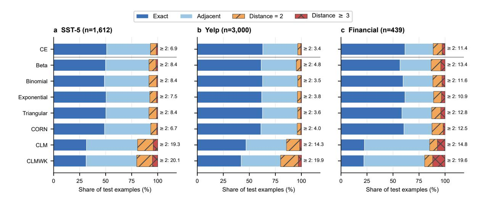
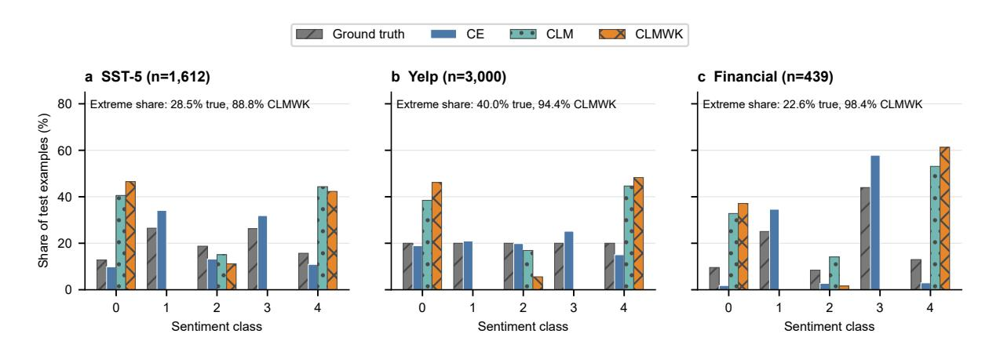

# Ordinal Objectives and Metric Disagreement in Fine-Grained Text Sentiment Classification

# Anonymous ACL submission

# **001** Abstract

 Fine-grained sentiment labels are ordered, but standard cross-entropy (CE) does not distin- guish an adjacent error from a polarity rever- sal. We compare CE, four ordinal soft-label objectives, CORN, a cumulative link model (CLM), and a kappa-tuned CLM on movie re- views, Yelp reviews, and financial sentiment. Results are descriptive means and standard de- viations over 20 predetermined seeds. Across the 12 soft-label-versus-CE comparisons, ob- served mean quadratic weighted kappa (QWK) is higher in eight, tied in one, and lower in three. Improvements transfer less often to exact-match Accuracy or mean absolute error (MAE), and leading objectives vary by met- ric and dataset. In the archived seed-42 di- agnostics, higher QWK can coincide with a larger share of errors spanning two or more classes. The CLM-family heads have lower ob- served aggregate performance; in the same di- agnostics, they also concentrate predictions at scale extremes. A finance-domain, sentiment- adapted checkpoint yields higher observed QWK than BERT for all eight objectives in one conditional comparison, but this compar- ison does not isolate domain pretraining or es- tablish a general encoder effect. Ordinal su- pervision therefore depends on the evaluation metric, dataset, and configuration rather than being a universally superior replacement for cross-entropy.

### **033** 1 Introduction

 Fine-grained sentiment scales encode category and distance. In the five-level settings stud- ied here, predicting *negative* for *very negative* is usually less severe than predicting *very posi- tive*. We use fine-grained sentiment classification for ordered prediction beyond conventional posi- tive/neutral/negative labels. All evaluated datasets instantiate this setting with five ordered sentiment labels. Yet a one-hot cross-entropy (CE) target gives both errors the same target geometry. This

motivates objectives that redistribute target mass, **044** decompose the scale into ordered decisions, or use **045** learned thresholds; such objectives may reduce se- **046** vere errors without improving exact match. **047**

The intuitive appeal of ordinality is not evi- **048** dence of reliable transfer to text. A pretrained **049** language encoder already represents semantic reg- **050** ularities, while five-way sentiment labels can be **051** noisy or ambiguous at adjacent boundaries. A **052** stronger ordinal head can also reduce output flex- **053** ibility: a cumulative link model (CLM), for ex- **054** ample, compresses the encoder representation to **055** one latent score before applying ordered thresh- **056** olds. Whether that constraint is helpful depends **057** on the task, the optimization protocol, and the er- **058** ror costs used for evaluation. **059**

Prior NLP work has compared explicit ordi- **060** nal losses with implicit label-semantic techniques **061** and shown that improvements in ordinal metrics **062** can coexist with weaker nominal performance **063** (Kasa et al., 2024). Soft targets have also im- **064** proved five-level customer-satisfaction prediction **065** (Manderscheid and Lee, 2023). The dlordinal **066** package collects several deep ordinal methods **067** [\(Bérchez-Mo](#page-9-0)r[eno e](#page-9-0)t al., 2025), but its reported ex- **068** periments concern image benchmarks. These stud- **069** [ies establish the relevan](#page-9-1)c[e of o](#page-9-1)rdinal supervision **070** across text and image settings, but they do not re- **071** [solve whether QWK, MAE, a](#page-8-0)nd exact-match Ac- **072** curacy identify the same leading objective under a **073** shared sentiment-classification evaluation. **074**

We ask three questions: **075**

RQ1: Overall performance. Across datasets **076** and configured training seeds, how do **077** ordinal objectives compare with CE in mean **078** performance and variability? **079**

RQ2: Metric disagreement. Do QWK, MAE, **080** and exact-match Accuracy rank methods dif- **081** ferently, and do QWK gains coincide with **082** changes in adjacent and severe errors? **083**  RQ3: Conditions and failures. What dataset conditions and prediction signatures ac- company success or failure, particularly for CLM-based heads?

 We make three contributions. First, we pro- vide a controlled comparison of eight existing objectives using common splits, encoders, and metrics. Second, building on prior evidence of ordinal–nominal trade-offs, we analyze metric dis- agreement as a metric-dependent evaluation and method-choice problem: under the observed ag- gregate test results, QWK, MAE, and exact-match Accuracy can identify different leading objectives, and QWK rankings need not track either exact matches or coarse tail-error rates. Third, we re- port negative results and bounded failure diagnos- tics for CLM-family heads, while separating ob- servations from untested mechanisms. This is a benchmark and evaluation study, not a new loss or a claim of universal ordinal advantage.

 The comparison spans SST-5, a balanced Yelp subset, and a financial composite constructed from records attributed to SemEval-2017 Task 5 and FiQA-2018 Task 1. The main study uses BERT on all three datasets. A rerun with the finance- domain, sentiment-adapted ProsusAI/finbert checkpoint (Araci, 2019) on the financial split provides a bounded checkpoint-condition check rather than a fourth task or a general encoder com-**113** parison.

# **114** 2 Related Work

#### **115** 2.1 Ordinal Classification

 Ordinal classification assumes labels 0*, . . . , K −* 1 have a meaningful order. Classical reductions transform the task into *K −* 1 binary problems (Frank and Hall, 2001). Modern neural variants differ in their output parameterization. CORN estimates conditional probabilities and combines them by the chain rule (Shi et al., 2023), whereas [CLMs learn a la](#page-9-2)t[ent sca](#page-9-2)lar and ordered cut-points (McCullagh, 1980; Vargas et al., 2020). These ap- proaches alter the output space, whereas distribu- tional targets preserve a *K*[-class head a](#page-9-3)nd change only the supervision.

[Soft-label obje](#page-9-4)[ctives encode ne](#page-9-5)ighborhood structure by assigning more target mass to classes near the gold label. We evaluate Beta (Vargas et al., 2022), Binomial (Liu et al., 2020), Exponential (Vargas et al., 2023a), and Triangular (Vargas et al., 2023b) variants. We also evaluate [a two-stage](#page-9-6)

CLM configuration whose second stage optimizes **134** a differentiable quadratic weighted-kappa objec- **135** tive (de la Torre et al., 2018). Together with CE, **136** CORN, and the standard CLM, these objectives **137** define the eight-method comparison used through- **138** out t[he paper.](#page-8-1) **139**

# 2.2 Ordinal Text and Sentiment **140** Classification **141**

Kasa et al. (2024) compare explicit ordinal losses **142** with implicit label-semantic approaches, includ- **143** ing entailment-style and generative formulations. **144** They propose a hybrid loss and evaluate weighted **145** [F1 together with](#page-9-0) MAE, MSE, and off-by-one **146** accuracy on SNLI, Amazon Reviews, and SST- **147** 5, including reduced-data settings. Their re- **148** sults already show that improvements in ordinal **149** metrics can coexist with weaker nominal perfor- **150** mance. Our study builds on, rather than redis- **151** covers, this trade-off. We focus on eight exist- **152** ing objectives—CE, four distributional soft-label **153** objectives, CORN, CLM, and CLMWK—under **154** shared dataset splits and evaluation metrics within **155** each encoder–dataset block. The central ques- **156** tion is whether QWK, MAE, and exact-match Ac- **157** curacy lead to different model choices, and how **158** those disagreements relate to QWK's marginal **159** normalization, error distance, and prediction dis- **160** tributions (Cohen, 1968). **161**

The image experiments reported with **162** dlordinal show that CLMWK is competi- **163** tive, and strongest among the package methods **164** on some [benchmarks](#page-8-2) (Bérchez-Moreno et al., **165** 2025). They involve different inputs, encoders, **166** and optimization regimes. Our comparison tests **167** whether these objective families transfer to text; **168** it cannot identify moda[lity as the cause of any](#page-8-0) **169** [differ](#page-8-0)ence, nor does it compare every package **170** method. **171**

#### 2.3 Evaluation Metrics **172**

Exact-match Accuracy treats every wrong class **173** equally. MAE distinguishes errors by absolute **174** label distance. QWK uses quadratic distance **175** weights and normalizes observed disagreement by **176** disagreement expected from the true and predicted **177** marginals (Cohen, 1968). Consequently, QWK **178** can reward reducing a small number of severe er- **179** rors while Accuracy falls, and two models with **180** similar error distances can differ when their predic- **181** tion distrib[utions differ.](#page-8-2) Reporting only one met- **182** ric can therefore change which objective appears **183** preferable. We make this disagreement an object of study rather than a reporting afterthought.

#### 3 Methods

184

185

189

193

194

197

206

210

211

212

213

215

216

217

218

219

223

#### 3.1 Task and Prediction Geometry

For an input text x, the task is to predict  $y \in \{0,\ldots,K-1\}$ , with K=5 from most negative to most positive. Let  $e=y-\hat{y}$ . Exact predictions have |e|=0; adjacent errors have |e|=1; we separately report |e|=2 and  $|e|\geq 3$ . This decomposition is useful because Accuracy depends only on the first category, MAE increases linearly with distance, and QWK uses squared distance inside a marginally normalized agreement statistic.

Table 1 summarizes the output and decision rule for every evaluated family. CE and all soft-label objectives use the same BERT pooled representation, dropout, and five-way linear head. CORN changes the head to four conditional logits. CLM and CLMWK reduce the pooled representation to a scalar and map it to class probabilities through ordered thresholds. Unless noted otherwise, the predicted label is the class with maximum reconstructed probability.

#### 3.2 CE and Distributional Targets

Let  $\mathbf{z} \in \mathbb{R}^K$  and  $p(k \mid x) = \operatorname{softmax}(\mathbf{z})_k$ . CE minimizes

$$\mathcal{L}_{CE}(x, y) = -\log p(y \mid x). \tag{1}$$

The four soft-label methods replace the one-hot target with a normalized distribution  $q_y(k;\eta)$  centered on the gold class:

$$\mathcal{L}_{\text{soft}}(x,y) = -\sum_{k=0}^{K-1} q_y(k;\eta) \log p(k \mid x). \quad (2)$$

Beta, Binomial, Exponential, and Triangular targets differ in shape and tail mass;  $\eta$  controls concentration in the implementation (Bérchez-Moreno et al., 2025). The loss makes confusing nearby classes less costly during training, but inference remains ordinary five-way argmax. This isolates the effect of target geometry from a change in head capacity.

#### 3.3 Conditional and Threshold Objectives

CORN outputs conditional logits for  $P(y > j \mid y > j - 1, x)$ . Writing their sigmoid values as  $p_j$ ,

the code reconstructs

$$P(y=0 \mid x) = 1 - p_0, \tag{3}$$

$$P(y = k \mid x) = \left(\prod_{j=0}^{k-1} p_j\right) (1 - p_k), \quad (4)$$

$$1 \le k \le K - 2,$$

226

231

232

234

235

239

240

241

242

243

245

246

247

249

250

251

252

253

255

256

257

259

260

261

262

263

264

265

267

$$P(y = K - 1 \mid x) = \prod_{j=0}^{K-2} p_j.$$
 (5)

Each conditional loss is trained only on examples that reach its decision, following CORN (Shi et al., 2023).

CLM maps the pooled encoder vector to a scalar s(x) and learns ordered thresholds  $\tau_1 < \cdots < \tau_{K-1}$ . With a logistic link,

$$P(y \le k \mid x) = \sigma(\tau_{k+1} - s(x)),$$
 (6) 237  
  $0 \le k \le K - 2,$  238

and class probabilities are differences of successive cumulative probabilities (Vargas et al., 2020). CLM minimizes their negative log-likelihood. CLMWK first fits the same likelihood and then fine-tunes with the differentiable weighted-kappa loss. The scalar bottleneck and threshold ordering impose more structure than the CE/soft-label head; this may regularize the task or restrict representations that are not well ordered along one axis.

#### 4 Experimental Setup

#### 4.1 Datasets and Splits

We use the five-class fine-grained task of the Stanford Sentiment Treebank (hereafter SST-5), which contains movie-review sentences labelled from very negative to very positive (Socher et al., 2013). The local CSV corresponds to the concatenated train and test partitions used by the SetFit/sst5 loader and does not retain an original split identifier or a separate development partition. Because the shared training protocol requires development data for QWK-based hyperparameter selection and early stopping, we apply the same deterministic stratified 70/15/15 splitting procedure used for the other datasets after duplicatetext grouping. Collapsing 12 duplicate rows leaves 10,742 examples. This is a custom within-study repartition and is not intended for direct comparison with results obtained using the standard SST-5 partitions.

|                   |                                 | Table 1: Alignment between each evaluated objective, output representation, target or loss, and prediction rule. |                                                                   |
|-------------------|---------------------------------|------------------------------------------------------------------------------------------------------------------|-------------------------------------------------------------------|
| Family            | Output                          | Training signal                                                                                                  | Prediction                                                        |
| CE Soft labels | K logits K logits            | One-hot negative log-likelihood Cross-entropy with Beta, Binomial, Ex                                         | Argmax of K-way softmax Argmax of K-way softmax                |
| CORN              | K − 1 conditional               | ponential, or Triangular target distribu tion Conditional binary losses on eligible ex                     | Argmax after chain-rule recon                                     |
| CLM               | logits One scalar plus | amples Negative log-likelihood of threshold                                                                   | struction of K probabilities Argmax of threshold-derived |

 Yelp Review Full contains five-star review la- bels (Zhang et al., 2015). To keep the eight- objective, 20-seed comparison computationally tractable, the loader reads a fixed 50,000-record candidate pool from the local CSV, removes du- plicat[e text groups,](#page-9-8) [and sa](#page-9-8)mples 4,000 examples per class with random state 42. This produces a class-balanced subset of 20,000 reviews. The equal class counts control label prevalence within the study, but the subset is not a uniform sample of the complete Yelp corpus.

 Financial composite. The financial compos- ite combines the released training portions of SemEval-2017 Task 5 (Cortis et al., 2017) and FiQA-2018 Task 1 (Maia et al., 2018). It con- tains 1,710 SemEval Subtask 1 microblog records, 1,156 SemEval Subtask 2 financial news state- ments and headlines, [and 1,111 FiQA Ta](#page-8-3)sk 1 records, comprising [675 posts and 436](#page-9-9) headlines. The heterogeneous source records were mapped to a common schema. For SemEval Subtask 1, the text field in the authors' internally archived in- put contains an annotated sentiment-bearing span; for SemEval Subtask 2 and FiQA, it contains the corresponding news statement, headline, or post sentence. The continuous sentiment annota- tion is retained in score; source identifies the medium as post or headline; and dataset iden- tifies the originating task and subtask. This inter- nally archived new\_code/merged\_all.csv con- tains 3,977 records and is not included in the ac-companying anonymous software artifact.

 Both source tasks provide continuous senti- ment scores between *−*1 and 1. During con- struction of the archived composite, these scores were discretized into five ordered labels using [*−*1*.*0*, −*0*.*5] *7→ −*2, (*−*0*.*5*, −*0*.*1] *7→ −*1, (*−*0*.*1*,* 0*.*1) *7→* 0, [0*.*1*,* 0*.*5) *7→* 1, and [0*.*5*,* 1*.*0] *7→*

2. The archived score–label pairs satisfy these **306** boundaries for every record. The preparation **307** script removes 20 SemEval Subtask 1 records **308** whose text field is empty, yielding 3,957 records: **309** 1,690 from SemEval Subtask 1, 1,156 from Sub- **310** task 2, and 1,111 from FiQA. No other record **311** is removed, reordered, balanced, or deduplicated **312** at this preparation stage. Because the training **313** objectives require zero-based class indices, new\_ **314** code/prepare\_merged\_5class.py subsequently **315** applies **316**

$$y_{\text{model}} = y_{\text{binned}} + 2, \tag{7}$$

mapping *−*2*, . . . ,* 2 to 0*, . . . ,* 4. This shift changes **318** only the numerical encoding and preserves the **319** five class boundaries, order, and sentiment mean- **320** ings. The script also adds a human-readable **321** label\_name field while preserving the surviving **322** text, score, source, and dataset fields. **323**

Before splitting, the runner converts text to **324** string, strips leading/trailing whitespace, and low- **325** ercases it; internal whitespace is not collapsed. **326** Duplicate rows sharing this exact key are merged; **327** a label conflict is resolved by its unique majority **328** label, while a group tied for highest frequency is **329** dropped. A stratified 70/15/15 split then uses ran- **330** dom state 42. For finance, the 3,957 model-ready **331** rows form 2,961 text groups (996 rows relative **332** to the unique-group count); 84 groups conflict, of **333** which 45 have a retained majority and 39 ties are **334** dropped, leaving 2,922 split examples. Table 2 **335** gives the realized totals and splits. **336**

The model-ready financial CSV is not a dedu- **337** plicated dataset; grouping, conflict handling, and **338** splitting are later runner operations. The a[u-](#page-4-0) **339** thors' local inputs and deterministic code ex- **340** actly reconstruct the SST-5 and Financial test **341** manifests and confirm zero grouping-key over- **342** lap across their train/development/test splits. The **343**

Table 2: Post-grouping dataset scale, realized splits, and label counts. Labels run from 0 (most negative) to 4 (most positive).

| Dataset   | Total  | Train  | Dev   | Test  | 0     | 1     | 2     | 3     | 4     |
|-----------|--------|--------|-------|-------|-------|-------|-------|-------|-------|
| SST-5     | 10,742 | 7,518  | 1,612 | 1,612 | 1,369 | 2,847 | 2,012 | 2,828 | 1,686 |
| Yelp      | 20,000 | 14,000 | 3,000 | 3,000 | 4,000 | 4,000 | 4,000 | 4,000 | 4,000 |
| Financial | 2,922  | 2,044  | 439   | 439   | 281   | 732   | 246   | 1,287 | 376   |

internally archived split JSON files store split sizes plus test texts and labels, not complete train/development/test indices. Because the local Yelp CSV is not packaged, its train/development partitions cannot be independently reconstructed here, although the internally archived test manifest aligns exactly with every corresponding prediction file.

347

354

361

362

368

371

374

377

379

384

#### 4.2 Encoder, Preprocessing, and Controls

main encoder is bert-base-uncased (Devlin et al., 2019). The financial condition uses the finance-domain, sentiment-adapted ProsusAI/finbert checkpoint (Araci, 2019).1 This checkpoint incorporates finance-domain adaptation and subsequent sentiment-task finetuning on Financial PhraseBank. We load its BERT encoder with AutoModel and initialize a new task-specific classification or ordinal head for each objective. Relative to bert-base-uncased, this checkpoint-condition comparison changes both domain and prior task adaptation. It therefore does not isolate the effect of domain pretraining. Tokenization truncates/pads to 256 tokens for SST-5 and Yelp and 128 for Financial. soft-label, and CORN models apply dropout 0.1 to the pooled output before their linear heads; CLM maps it directly to a scalar. Methods within an encoder-dataset block use the same split. CE-versus-soft-label comparisons hold the head fixed, whereas CORN and CLM change it.

Batch size is 128 and the optimizer is AdamW (Loshchilov and Hutter, 2019). CE, soft-label, and CORN runs use at most 15 epochs with early-stopping patience 3; CLM uses at most 50 with patience 5. CLMWK first fits likelihood for at most 50 epochs with patience 5, then fits weighted kappa for at most 10 epochs with patience 3 at one tenth of the selected Stage-1 learning rate. Candidate runs use at most 10 epochs with patience 3. Across candidate and final fits, including both CLMWK stages, early stopping monitors

development loss and restores the best-loss checkpoint; the final candidate configuration is selected by development QWK. Soft-label tuning jointly searches learning rate  $\{1,2,3,5\} \times 10^{-5}$  and  $\eta \in \{.3,.5,.7,.9\}$ . These unequal schedules make runtime comparisons non-equivalent; selected values are in Appendix A.

385

387

391

393

395

399

400

401

402

403

404

405

406

407

408

409

410

411

412

413

414

415

416

417

418

419

420

421

422

Final results are reported as mean±SD over 20 predetermined seeds. All comparisons are descriptive; "highest," "lowest," and "outperforms" refer only to observed aggregate means and do not imply statistical significance. Archived tuning records retain candidate validation QWK values and selections, but the code does not explicitly reset the RNG before every candidate. We therefore do not interpret candidate comparisons as matched stochastic trials or infer what MAE- or Accuracy-directed tuning would select.

Summing the archived mean runtime of all 32 configurations and multiplying by 20 seeds gives a 26.8 accelerator-hour lower bound for final runs. It excludes tuning, preliminary or aborted attempts, and extra analyses. Archived environment records identify two NVIDIA GeForce RTX 4090 D GPUs (about 23.5GB each), CUDA 12.4, and PyTorch 2.6.0+cu124; the remaining environment was not frozen. The seed list is in Appendix A.

#### 4.3 Metrics and Analyses

Let n be the test-set size. For test example i,  $y_i$  and  $\hat{y}_i$  are the gold and predicted labels, and  $\mathbf{1}\{\cdot\}$  is the indicator function. Accuracy is  $n^{-1}\sum_{i=1}^n \mathbf{1}\{y_i = \hat{y}_i\}$ , and MAE is  $n^{-1}\sum_{i=1}^n |y_i - \hat{y}_i|$ . For QWK,  $a,b \in \{0,\ldots,K-1\}$  index gold-label rows and predicted-label columns.  $O_{ab}$  is the observed number of examples with gold a and prediction b;  $E_{ab}$  is the corresponding expected count under the product of the two marginals. With  $w_{ab} = (a-b)^2/(K-1)^2$ ,

$$QWK = 1 - \frac{\sum_{a,b} w_{ab} O_{ab}}{\sum_{a,b} w_{ab} E_{ab}}.$$
 (8)

https://huggingface.co/ProsusAI/finbert

 Thus, *a* indexes the true-label row and *b* indexes the predicted-label column in both *O* and *E*. Higher Accuracy and QWK and lower MAE are better. The expected matrix makes QWK sensi- tive not only to error distance but also to predicted class prevalence.

 We report mean*±*SD aggregates for RQ1. For RQ2, we compare metric-dependent leading ob- jectives and CE-relative directions across the four soft-label objectives. We additionally recompute QWK and error-distance profiles from the same seed-42 prediction files, ensuring that each diag- nostic comparison is made at the level of one cap- tured run. These single-run diagnostics are de-scriptive and are not used to estimate uncertainty.

## **439** 5 Results

### **440** 5.1 RQ1: Overall Performance

 Table 3 reports the BERT aggregates. On SST-5, Beta, Binomial, and Exponential tie at the high- est archived three-decimal QWK (.769); Exponen- tial has the lowest MAE (.567), and Triangular the highe[st](#page-6-0) Accuracy (.518). On Yelp, Binomial has the highest QWK (.865), CE/Binomial/Triangular tie for lowest MAE (.427), and Triangular has the highest Accuracy (.623). Financial results sepa- rate the metrics most clearly: Binomial raises ob- served QWK from CE's .665 to .684, but MAE worsens from .537 to .560 and Accuracy falls from .604 to .580.

 Across 12 soft-label-versus-CE comparisons, mean QWK is higher in eight, tied in one, and lower in three. Accuracy is higher in only three, tied in one, and lower in eight; MAE is lower in two, tied in three, and higher in seven. Ties and directions use the archived three-decimal means. Thus, soft labels more often raise observed QWK, but those gains frequently do not transfer to the other metrics. These are descriptive aggregate dif-ferences, not significance-tested effects.

#### **463** 5.2 RQ2: Metric Disagreement

 The metric-dependent leader summary in Table 4 makes the evaluation disagreement explicit. Un- der the observed aggregate test results from the same trained models, SST-5 and Yelp have differ- ent leading objectives across metrics, while Fina[n-](#page-6-1) cial has Binomial leading by QWK and CE lead- ing by both MAE and Accuracy. Only ties at the archived three-decimal precision are shown.

Financial Binomial supplies a direct QWK– **472** MAE–Accuracy reversal: relative to CE, its ob- **473** served QWK is +*.*019, MAE is +*.*023 (worse), **474** and Accuracy is *−.*024. A higher QWK therefore **475** does not imply either more exact predictions or **476** lower absolute error. The metrics weight squared **477** ordinal disagreement with marginal normalization, **478** absolute distance, and exact matching differently; **479** disagreement is not evidence that any one metric **480** is intrinsically wrong. **481**

The seed-42 predictions allow a same-run com- **482** parison of QWK and error distance. Binomial ex- **483** ceeds CE in QWK on SST-5 (.780 versus .758) and **484** Financial (.692 versus .665), yet also has larger **485** shares of errors spanning two or more classes **486** (8.37% versus 6.95% and 11.62% versus 11.39%). **487** On Yelp, QWK is tied to three decimals (.864), **488** but those shares are 3.50% versus 3.43%. Thus, **489** QWK and the coarse tail-error rate need not move **490** together within a captured run. **491**

QWK also depends on the true and predicted la- **492** bel marginals through *Eab*. Reducing distant er- **493** rors can improve its numerator, while changing **494** predicted prevalence changes its normalization. **495** Candidate QWK values are logged, but all hy- **496** perparameters were selected by validation QWK; **497** we did not run MAE- or Accuracy-directed coun- **498** terfactual tuning. RQ2 therefore demonstrates **499** metric-dependent *evaluation*, not metric-specific **500** model selection. **501**

## 5.3 RQ3: Conditions and CLM-Family Head **502** Failures **503**

Both CLM-family heads have lower observed **504** QWK than CE on all three BERT datasets. **505** CLMWK reaches .683/.776/.628 on SST- **506** 5/Yelp/Financial versus CE's .759/.863/.665, and **507** it also has worse MAE and Accuracy. This pattern **508** persists in the FinBERT condition (.655 versus **509** .712 QWK), but it remains specific to these heads **510** and schedules. **511**

Figure 2 provides a more specific seed-42 di- **512** agnostic. CLMWK assigns 88.83%, 94.43%, and **513** 98.41% of SST-5, Yelp, and Financial predictions **514** to classes 0 or 4. Both CLM and CLMWK assign **515** no predict[io](#page-7-0)n to intermediate classes 1 or 3 on any **516** dataset. This coincides with their lower aggregate **517** Accuracy and higher MAE, but it is descriptive **518** single-run evidence, not proof that the scalar bot- **519** tleneck, thresholds, or kappa stage independently **520** causes the failure. **521**

Balance alone cannot explain the structured- **522**

Table 3: BERT test results as mean  $\pm$  SD over 20 predetermined seeds. Bold marks the highest archived three-decimal mean per dataset/metric (lowest for MAE), including ties; it does not denote statistical significance.

| Dataset   | Method                                                 | QWK↑                                                                                                                                                 | MAE↓                                                                                                           | Accuracy↑                                                                                                                                              |
|-----------|--------------------------------------------------------|------------------------------------------------------------------------------------------------------------------------------------------------------|----------------------------------------------------------------------------------------------------------------|--------------------------------------------------------------------------------------------------------------------------------------------------------|
| SST-5     | CE Beta Binomial Exponential Triangular CORN CLM CLMWK | $.759 \pm .010$ $.769 \pm .007$ $.769 \pm .008$ $.769 \pm .010$ $.768 \pm .008$ $.766 \pm .009$ $.697 \pm .012$ $.683 \pm .008$ | .573 ±.012 .590 ±.015 .573 ±.015 .567 ±.014 .572 ±.016 .569 ±.008 .926 ±.024 .985 ±.021   | $5.14 \pm .008$ $5.501 \pm .010$ $5.14 \pm .011$ $5.17 \pm .011$ $5.18 \pm .011$ $5.11 \pm .007$ $3.16 \pm .007$ $2.299 \pm .007$ |
| Yelp      | CE Beta Binomial Exponential Triangular CORN CLM CLMWK | .863 ±.002 .862 ±.004 .865 ±.004 .864 ±.003 .863 ±.002 .864 ±.005 .792 ±.010 .776 ±.012                                         | .427 ±.009 .441 ±.010 .427 ±.010 .434 ±.008 .427 ±.009 .431 ±.014 .717 ±.028 .776 ±.035   | .622 ±.005 .614 ±.006 .621 ±.006 .617 ±.005 .623 ±.005 .618 ±.008 .461 ±.011 .436 ±.014                                           |
| Financial | CE Beta Binomial Exponential Triangular CORN CLM CLMWK | .665 ±.029 .668 ±.037 .684 ±.033 .659 ±.048 .648 ±.034 .664 ±.036 .650 ±.023 .628 ±.017                                         | .537 ±.026 .554 ±.035 .560 ±.037 .551 ±.035 .563 ±.032 .545 ±.030 1.017 ±.035 1.092 ±.022 | .604 ±.014 .589 ±.016 .580 ±.021 .594 ±.018 .589 ±.016 .597 ±.014 .222 ±.008 .213 ±.004                                           |

Table 4: Metric-specific choices by observed aggregate mean.

| Dataset   | QWK            | MAE          | Acc. |
|-----------|----------------|--------------|------|
| SST-5     | Beta/Bin./Exp. | Exponential  |      |
| Yelp      | Binomial       | CE/Bin./Tri. |      |
| Financial | Binomial       | CE           |      |

head pattern: it occurs on the balanced Yelp subset and the skewed SST-5 and Financial datasets. Nor does the FinBERT checkpoint remove it. The packaged datasets do not contain repeated ratings or annotation distributions, however, so adjacent-label ambiguity remains an untested explanation rather than a measured property.

The FinBERT condition further illustrates configuration dependence. On Financial, Exponential has the best observed mean on all three metrics under the FinBERT checkpoint: .718±.025 OWK.  $.500\pm.020$  MAE, and  $.613\pm.013$  Accuracy, versus CE's  $.712\pm.025/.508\pm.022/.610\pm.012$ . All eight objectives have higher observed QWK under the FinBERT checkpoint than under BERT in this financial condition (CE +.047; Exponential +.059). Because the checkpoint differs in both domain and prior sentiment-task adaptation, this comparison cannot identify which component accounts for the observed differences. It is one datasetspecific checkpoint-condition comparison, not evidence that FinBERT is generally superior. Full results are in Appendix B.

The safest transfer claim is configurationspecific. CLMWK is reported as the strongest evaluated package method on some image benchmarks (Bérchez-Moreno et al., 2025); our BERT setup changes modality, encoder geometry, head capacity, and schedule. The present results show that a scalar ordered head and two-stage kappa training did not transfer reliably in these configurations. Isolating why would require controlled ablations of the scalar bottleneck, threshold parameterization, dropout, learning rate, and two-stage schedule.

#### 6 Discussion and Practical Guidance

The results favor a cost-sensitive view of method choice. If exact rating prediction matters most, an Accuracy-leading model may be preferable even when its QWK is lower. If ordinal distance matters, QWK or MAE may be preferable, but their rankings can also disagree. Each should be accompanied by Accuracy, an error-distance histogram, and predicted-label marginals.

Among the tested approaches, soft labels are the lowest-friction ordinal intervention because they preserve the five-way head. Their QWK directions are more often favorable than not across the three BERT datasets, but gains less often carry to MAE or Accuracy. Financial Binomial exhibits a three-metric conflict under BERT, whereas Exponential has the highest observed means for all three metrics in the FinBERT condition. Metric alignment therefore also depends on the checkpoint and broader configuration. The CLM-family heads require diagnostics and ablations before adoption.

Figure 1: Seed-42 composition of exact predictions, adjacent errors, errors spanning exactly two classes, and errors spanning three or more classes. Right-side labels give the share spanning two or more classes. Each method's predictions follow its formal training protocol and provide descriptive single-run evidence, not an uncertainty estimate.

Figure 2: Seed-42 true and predicted label distributions for BERT. CLM and CLMWK leave classes 1 and 3 unused and concentrate predictions at the extremes. This is descriptive single-run evidence, not an uncertainty estimate.

 The study also illustrates a reporting risk. Se- lecting hyperparameters by QWK and present- ing only QWK can hide an Accuracy decline; presenting only Accuracy can hide a reduction in severe errors. We recommend declaring er- ror costs before selection, using the primary met- ric that matches those costs, and retaining at least one complementary exact and one distance- sensitive measure. Where class prevalence mat- ters, prediction distributions should be reported be- cause QWK's expected-agreement term depends **590** on them.

 These recommendations are bounded by de- scriptive aggregate comparisons on three English fine-grained sentiment datasets with five ordered labels, one main encoder, and one financial check-

point. They establish neither paired effects, a uni- **595** versal best objective, nor causes of the structured- **596** head failures. **597**

### 7 Conclusion **598**

This controlled study finds no universal ordinal **599** winner here. Across three BERT datasets, soft la- **600** bels more often raise observed QWK than CE, but **601** not consistently MAE or Accuracy. Seed-42 anal- **602** yses show that QWK need not track the share of **603** errors spanning two or more classes and expose **604** extreme CLM-family predictions. The finance- **605** domain, sentiment-adapted checkpoint changes **606** the financial ordering. Objective choice therefore **607** depends on error costs, checkpoint, and prediction **608** behavior. **609**

# **610** Limitations

 Comparisons use aggregate mean*±*SD without paired inference. Candidate QWK values are re- tained, but candidate-wise RNG state was not explicitly reset, and MAE- or Accuracy-directed counterfactual selection was not run. The seed-42 analyses are descriptive single-run diagnostics, not uncertainty estimates.

 The local Yelp CSV and full train/development indices are not packaged: only the loaded- candidate process, split sizes, test texts, and test labels are internally archived, so the sampled train/development partitions cannot be indepen- dently rebuilt here. The internally archived split JSON files likewise do not retain full indices.

 Financial provenance boundary. The offi- cial task sources, applicable usage conditions, common field schema, label discretization, and repository-internal transformations are docu- mented in Appendix F. The authors retain an internal archived copy of merged\_all.csv from which the model-ready financial data and all subsequent grouping and splitting operations can be reproduced determ[in](#page-12-0)istically. The accompa- nying anonymous software artifact provides the preparation and training code, aggregate result summaries, field mappings, processing statis- tics, and reconstruction instructions. Restricted source text and text-bearing split or prediction derivatives are excluded under the source-data terms. The original one-off script that selected fields from the official downloads and constructed merged\_all.csv was not preserved, so the arti- fact cannot reconstruct that archived composite byte for byte from the official downloads. This is an upstream provenance and external repro- ducibility boundary rather than an uncertainty in the internally archived sample counts, labels, experimental splits, or reported results.

 Our empirical scope comprises three English fine-grained sentiment datasets, each represented with five ordered labels, BERT-base-scale en- coders, and eight evaluated objectives: CE, four soft-label objectives, CORN, CLM, and CLMWK. Larger encoders, multilingual data, and additional tasks are outside this scope. The ProsusAI/finbert condition jointly changes finance-domain adaptation and prior sentiment- task fine-tuning, so it does not isolate the effect of domain pretraining. Label-boundary ambiguity is not directly measured. CLM/CLMWK structure

and schedules were not ablated, so their failures **661** cannot be attributed causally. The 26.8 accelerator- **662** hour figure excludes tuning, aborted attempts, and **663** extra analyses, and the server's complete depen- **664** dency freeze is unavailable. **665**

### Ethical Considerations **666**

The work makes no deployment or safety claim. **667** Sentiment labels compress context and may en- **668** code annotator or domain biases. Financial sen- **669** timent outputs could be misused as trading ad- **670** vice and should not be presented as decision-ready **671** signals. Source text may contain offensive lan- **672** guage, personal references, or platform-specific **673** content. The accompanying anonymous software **674** artifact excludes restricted source text and text- **675** bearing derivatives under the source-data terms. **676** The manuscript and analysis were reorganized **677** with generative-AI assistance; the authors remain **678** responsible for source verification, code, results, **679** and disclosure under the venue policy. **680**

### References **681**

Dogu Araci. 2019. FinBERT: Financial sentiment **682** analysis with pre-trained language models. *arXiv* **683** *preprint arXiv:1908.10063*. **684**

Francisco Bérchez-Moreno, Rafael Ayllón-Gavilán, **685** Víctor M. Vargas, D[avid Guijo-Rubio, César Hervás-](https://arxiv.org/abs/1908.10063) **[686](https://arxiv.org/abs/1908.10063)** [Martínez, Juan C. Fernández, and Pedro A](https://arxiv.org/abs/1908.10063). Gutiér- **687** rez. 2025. dlordinal: A python package for deep or- **688** dinal classification. *Neurocomputing*, 622:129305. **689**

Jacob Cohen. 1968. Weighted kappa: Nominal scale **690** agreement with provision for scaled disagreement **691** [or partial credit.](https://doi.org/10.1016/j.neucom.2024.129305) *[Psychological Bulletin](https://doi.org/10.1016/j.neucom.2024.129305)*, 70(4):213– **[692](https://doi.org/10.1016/j.neucom.2024.129305)** 220. **693**

Keith Cortis, André [Freitas, Tobias Daudert, Manuela](https://doi.org/10.1037/h0026256) **[694](https://doi.org/10.1037/h0026256)** [Huerlimann, Manel Zarrouk, Siegfried Handschuh,](https://doi.org/10.1037/h0026256) **[695](https://doi.org/10.1037/h0026256)** [and Brian Davis](https://doi.org/10.1037/h0026256). 2017. SemEval-2017 task 5: Fine- **696** grained sentiment analysis on financial microblogs **697** and news. In *Proceedings of the 11th International* **698** *Workshop on Semantic Evaluation*, pages 519–535. **699** Association for Comput[ational Linguistics.](https://doi.org/10.18653/v1/S17-2089) **[700](https://doi.org/10.18653/v1/S17-2089)**

Jo[rdi de la Torre, Domènec Puig, and Aida Valls. 2018.](https://doi.org/10.18653/v1/S17-2089) **[701](https://doi.org/10.18653/v1/S17-2089)** [Weighted](https://doi.org/10.18653/v1/S17-2089) kappa loss function for multi-class clas- **702** sification of ordinal data in deep learning. *Pattern* **703** *Recognition Letters*, 105:144–154. **704**

Jacob Devlin, Ming-Wei Chang, Kenton Lee, and **705** [Kristina Toutanova. 2019.](https://doi.org/10.1016/j.patrec.2017.05.018) BERT: Pre-training of **[706](https://doi.org/10.1016/j.patrec.2017.05.018)** [deep bidirectional transformers for langua](https://doi.org/10.1016/j.patrec.2017.05.018)ge under- **707** standing. In *Proceedings of NAACL-HLT 2019*, **708** pages 4171–4186. Association for Computational **709** Linguistics. **[710](https://doi.org/10.18653/v1/N19-1423)**  Eibe Frank and Mark Hall. 2001. A simple approach to ordinal classification. In *Machine Learning: ECML 2001*, volume 2167 of *Lecture Notes in Computer Science*, pages 145–156. Springer. Siva Rajesh Kasa, Aniket Goel, [Karan Gupta, Sumegh](https://doi.org/10.1007/3-540-44795-4_13) [Roychowdhury, Anis](https://doi.org/10.1007/3-540-44795-4_13)h Bhanushali, Nikhil Pattisapu, and Prasanna Srinivasa Murthy. 2024. Exploring or- dinality in text classification: A comparative study of explicit and implicit techniques. In *Findings of the Association for Computational Linguistics: ACL*

**721** *2024*, pages 5390–5404. Association [for Computa-](https://doi.org/10.18653/v1/2024.findings-acl.320)

**[722](https://doi.org/10.18653/v1/2024.findings-acl.320)** [tional Linguistics.](https://doi.org/10.18653/v1/2024.findings-acl.320)

 Xi[aofeng Liu, Fangfang Fan, Lingshe](https://doi.org/10.18653/v1/2024.findings-acl.320)ng Kong, Zhihui Diao, Wanqing Xie, Jun Lu, and Jane You. 2020. Unimodal regularized neuron stick-breaking for or-dinal classification. *Neurocomputing*, 388:34–44.

**727** Ilya Loshchilov and Frank Hutter. 2019. Decoupled **728** weight decay regularization. In *International Con-***[729](https://doi.org/10.1016/j.neucom.2020.01.025)** *[ference on Learning Representations](https://doi.org/10.1016/j.neucom.2020.01.025)*.

 Macedo Maia, Siegfried Handschuh, André Freitas, Brian Davis, Ross McDermott, Manel Z[arrouk, and](https://openreview.net/forum?id=Bkg6RiCqY7) [Alexandra Balahur. 2018.](https://openreview.net/forum?id=Bkg6RiCqY7) WWW'18 Open Chal- lenge: Financial opinion mining and question an- swering. In *Companion Proceedings of the The Web Conference 2018*, pages 1941–1942.

 Etienne Manderscheid and M[atthias Lee. 2023.](https://doi.org/10.1145/3184558.3192301) Pre- [dicting customer satisfaction with soft labels for or-](https://doi.org/10.1145/3184558.3192301) [dinal cla](https://doi.org/10.1145/3184558.3192301)ssification. In *Proceedings of the 61st An- nual Meeting of the Association for Computational Linguistics (Volume 5: Industry Track)*, pages [652–](https://doi.org/10.18653/v1/2023.acl-industry.62) [659. Association for Computational Linguistics.](https://doi.org/10.18653/v1/2023.acl-industry.62)

**742** Pe[ter McCullagh. 198](https://doi.org/10.18653/v1/2023.acl-industry.62)0. Regression models for ordinal **743** data. *Journal of the Royal Statistical Society: Series* **744** *B (Methodological)*, 42(2):109–127.

 Adam Paszke, Sam Gross, Francisco Massa, Adam Lerer, James Bradb[ury, Gregory Chanan, Trevor](https://doi.org/10.1111/j.2517-6161.1980.tb01109.x) [Kille](https://doi.org/10.1111/j.2517-6161.1980.tb01109.x)en, Zeming Lin, Natalia Gimelshein, Luca Antiga, Alban Desmaison, Andreas Köpf, Edward Yang, Zachary DeVito, Martin Raison, Alykhan Te- jani, Sasank Chilamkurthy, Benoit Steiner, Lu Fang, and 2 others. 2019. PyTorch: An imperative style, high-performance deep learning library. In *Ad- vances in Neural Information Processing Systems*, volume 32, pages 8026–8037.

 Xintong Shi, Wenzhi [Cao, and Sebastian Raschka.](https://proceedings.neurips.cc/paper/2019/hash/bdbca288fee7f92f2bfa9f7012727740-Abstract.html) 2023. [Deep neural networks for rank-con](https://proceedings.neurips.cc/paper/2019/hash/bdbca288fee7f92f2bfa9f7012727740-Abstract.html)sistent or- dinal regression based on conditional probabilities. *Pattern Analysis and Applications*, 26(3):941–955.

 Richard Socher, Alex Perelygin, Jean Wu, Jason Chuan[g, Christopher D. Manning, Andrew Ng, and](https://doi.org/10.1007/s10044-023-01181-9) [Christopher Potts. 2013.](https://doi.org/10.1007/s10044-023-01181-9) Recursive deep models for semantic compositionality over a sentiment tree- bank. In *Proceedings of EMNLP 2013*, pages 1631– 1642. Association for Computational Linguistics.

**[765](https://aclanthology.org/D13-1170/)** Víctor M. Vargas, Pedro A[. Gutiérrez, and César](https://aclanthology.org/D13-1170/) **[766](https://aclanthology.org/D13-1170/)** [Herv](https://aclanthology.org/D13-1170/)ás-Martínez. 2022. [Unimodal regularisation](https://aclanthology.org/D13-1170/) based on Beta distribution for deep ordinal regres- **767** sion. *Pattern Recognition*, 122:108310. **768**

Víctor M. Vargas, Pedro A. Gutiérrez, Riccardo Rosati, **769** [Luca Romeo, Emanuele Frontoni, and César Hervás-](https://doi.org/10.1016/j.patcog.2021.108310) **[770](https://doi.org/10.1016/j.patcog.2021.108310)** [Mart](https://doi.org/10.1016/j.patcog.2021.108310)ínez. 2023a. Exponential loss regularisa- **771** tion for encouraging ordinal constraint to shotgun **772** stocks quality assessment. *Applied Soft Computing*, **773** 138:110191. **774**

Víctor Manuel Vargas, P[edro Antonio Gutiérrez, Javier](https://doi.org/10.1016/j.asoc.2023.110191) **[775](https://doi.org/10.1016/j.asoc.2023.110191)** [Barbero-Gómez, and César Hervás-Martínez. 2023b.](https://doi.org/10.1016/j.asoc.2023.110191) **776** [Soft labelling based on tr](https://doi.org/10.1016/j.asoc.2023.110191)iangular distributions for **777** ordinal classification. *Information Fusion*, 93:258– **778** 267. **779**

Ví[ctor-Manuel Vargas, Pedro-Antonio Gutiérrez, and](https://doi.org/10.1016/j.inffus.2023.01.003) **[780](https://doi.org/10.1016/j.inffus.2023.01.003)** [César Hervás-Martíne](https://doi.org/10.1016/j.inffus.2023.01.003)z. 2020. Cumulative link mod- **781** els for deep ordinal classification. *Neurocomputing*, **782** 401:48–58. **783**

Thomas Wolf, Lysandre Debut, [Victor Sanh, Julien](https://doi.org/10.1016/j.neucom.2020.03.034) **[784](https://doi.org/10.1016/j.neucom.2020.03.034)** Chaumond, Clement Delangue, Anthony Moi, Pier- **785** [ric Cistac, Tim Rault, Remi Louf](https://doi.org/10.1016/j.neucom.2020.03.034), Morgan Funtow- **786** icz, Joe Davison, Sam Shleifer, Patrick von Platen, **787** Clara Ma, Yacine Jernite, Julien Plu, Canwen Xu, **788** Teven Le Scao, Sylvain Gugger, and 3 others. 2020. **789** Transformers: State-of-the-art natural language pro- **790** cessing. In *Proceedings of EMNLP 2020: System* **791** *Demonstrations*, pages 38–45. Association for Com- **792** putational Linguistics. **793**

Xi[ang Zhang, Junbo Zhao, and Yann LeCun. 2015.](https://doi.org/10.18653/v1/2020.emnlp-demos.6) **[794](https://doi.org/10.18653/v1/2020.emnlp-demos.6)** [Charact](https://doi.org/10.18653/v1/2020.emnlp-demos.6)er-level convolutional networks for text clas- **795** sification. In *Advances in Neural Information Pro-* **796** *cessing Systems*, volume 28, pages 649–657. **797**

### A [Reproducibility Details](https://proceedings.neurips.cc/paper_files/paper/2015/hash/250cf8b51c773f3f8dc8b4be867a9a02-Abstract.html) **[798](https://proceedings.neurips.cc/paper_files/paper/2015/hash/250cf8b51c773f3f8dc8b4be867a9a02-Abstract.html)**

Seeds and schedules. The predetermined seeds **799** are 42, 123, 1024, 2026, 3407, 4096, 5150, 6024, **800** 7777, 8888, 101, 202, 303, 404, 505, 606, 707, **801** 808, 909, and 1111. Final CE, soft-label, and **802** CORN runs use at most 15 epochs with patience 3; **803** CLM uses at most 50 with patience 5. CLMWK **804** uses at most 50 Stage-1 likelihood epochs with pa- **805** tience 5 and then at most 10 Stage-2 weighted- **806** kappa epochs with patience 3; its second-stage **807** learning rate is 0.1 times the selected first-stage **808** rate. Candidate runs use at most 10 epochs with pa- **809** tience 3. Across candidate and final fits, including **810** both CLMWK stages, early stopping monitors val- **811** idation loss and restores the best-loss checkpoint; **812** the final candidate configuration is selected by val- **813** idation QWK. Batch size is 128. Maximum token **814** length is 256 for SST-5/Yelp and 128 for Financial. **815** Seed-42 predictions are captured within the formal **816** 20-seed loop and are used only for descriptive er- **817** ror analysis. **818**

Table 5: Selected BERT learning rate (LR) and soft-target concentration  $\eta$ . Dashes denote objectives without an  $\eta$  search.

|             | SST-5  |        | Yelp   |        | Financial |        |
|-------------|--------|--------|--------|--------|-----------|--------|
| Method      | LR     | $\eta$ | LR     | $\eta$ | LR        | $\eta$ |
| CE          | 2e - 5 | _      | 2e - 5 | _      | $5e{-5}$  | _      |
| Beta        | 1e-5   | .9     | 1e-5   | .9     | 2e-5      | .9     |
| Binomial    | 5e-5   | .5     | 3e-5   | .5     | 3e-5      | .7     |
| Exponential | 3e-5   | .7     | 1e-5   | .9     | 3e-5      | .5     |
| Triangular  | 3e-5   | .5     | 2e-5   | .5     | 3e-5      | .3     |
| CORN        | 1e-5   | _      | 2e-5   | _      | 5e-5      | _      |
| CLM         | 5e-5   | _      | 5e-5   | _      | 5e-5      | _      |
| CLMWK       | 1e-4   | _      | 1e-4   | _      | 5e-5      | _      |

Table 6: Selected FinBERT hyperparameters on Financial.

| Method      | LR   | $\eta$ |
|-------------|------|--------|
| CE          | 5e-5 | _      |
| Beta        | 3e-5 | .5     |
| Binomial    | 5e-5 | .3     |
| Exponential | 3e-5 | .5     |
| Triangular  | 2e-5 | .9     |
| CORN        | 2e-5 | _      |
| CLM         | 5e-5 | _      |
| CLMWK       | 1e-4 | _      |

 Software, hardware, and compute. The final-run logs record two NVIDIA GeForce RTX 4090 D GPUs with about 23.5GB each, CUDA 12.4, and PyTorch 2.6.0+cu124. The repository lock file describes a different environment and is not treated as a freeze of this server run; other exact dependency versions were not archived. The study uses PyTorch (Paszke et al., 2019) and Transformers (Wolf et al., 2020). Summing mean runtime for the 32 configurations and multiplying by 20 gives a 26.8 accelerator-hour lower bound, excluding tuning, preliminary or aborted attempts, and additional analyses.

**Seed-42 decomposition.** Table 7 reports the complete BERT diagnostic used by the figures and main-text severe-error comparison.

Table 7: BERT seed-42 outcomes as percentages of each test set (SST-5 n=1,612; Yelp n=3,000; Financial n=439). Categories are mutually exclusive and sum to 100%. These single-run diagnostics are not uncertainty estimates.

| Dataset   | Method      | Exact | Adjacent | Distance=2 | $\text{Distance} \geq 3$ |
|-----------|-------------|-------|----------|------------|--------------------------|
| SST-5     | CE          | 50.99 | 42.06    | 5.65       | 1.30                     |
|           | Beta        | 50.00 | 41.63    | 6.82       | 1.55                     |
|           | Binomial    | 48.88 | 42.74    | 7.32       | 1.05                     |
|           | Exponential | 50.50 | 42.00    | 6.33       | 1.18                     |
|           | Triangular  | 50.25 | 41.32    | 7.38       | 1.05                     |
|           | CORN        | 49.01 | 44.29    | 5.77       | 0.93                     |
|           | CLM         | 31.51 | 49.19    | 15.01      | 4.28                     |
|           | CLMWK       | 31.27 | 48.64    | 15.01      | 5.09                     |
| Yelp      | CE          | 63.00 | 33.57    | 2.83       | 0.60                     |
|           | Beta        | 61.37 | 33.83    | 4.07       | 0.73                     |
|           | Binomial    | 62.73 | 33.77    | 2.93       | 0.57                     |
|           | Exponential | 61.93 | 34.27    | 3.33       | 0.47                     |
|           | Triangular  | 62.70 | 33.67    | 2.83       | 0.80                     |
|           | CORN        | 61.20 | 34.77    | 3.43       | 0.60                     |
|           | CLM         | 46.90 | 38.80    | 12.73      | 1.57                     |
|           | CLMWK       | 42.20 | 37.90    | 17.03      | 2.87                     |
| Financial | CE          | 61.50 | 27.11    | 8.66       | 2.73                     |
|           | Beta        | 56.72 | 29.84    | 9.34       | 4.10                     |
|           | Binomial    | 59.68 | 28.70    | 8.66       | 2.96                     |
|           | Exponential | 61.50 | 27.56    | 7.52       | 3.42                     |
|           | Triangular  | 58.54 | 28.70    | 8.66       | 4.10                     |
|           | CORN        | 60.59 | 26.88    | 10.71      | 1.82                     |
|           | CLM         | 22.55 | 62.64    | 7.52       | 7.29                     |
|           | CLMWK       | 22.10 | 58.31    | 7.74       | 11.85                    |

Table 8 reports the FinBERT financial condition under the same aggregate reporting protocol.

Table 8: FinBERT Financial test results as mean  $\pm$  SD over 20 predetermined seeds. Bold follows the archived three-decimal observed means and does not denote statistical significance.

| Method      | QWK↑                              | MAE↓                     | Accuracy †             |
|-------------|-----------------------------------|--------------------------|-----------------------------------|
| CE          | .712 ±.025                        | .508 ±.022               | .610 ±.012                        |
| Beta        | $.715 \pm .024$                   | $.506 \pm .022$          | $.610 \pm .017$                   |
| Binomial    | $.707 \pm .033$                   | $.517 \pm .027$          | $.604 \pm .015$                   |
| Exponential | $\textbf{.718} \pm \textbf{.025}$ | $\textbf{.500} \pm .020$ | $\textbf{.613} \pm \textbf{.013}$ |
| Triangular  | $.710 \pm .020$                   | $.512 \pm .017$          | $.607 \pm .012$                   |
| CORN        | $.703 \pm .017$                   | $.509 \pm .020$          | $.608 \pm .012$                   |
| CLM         | $.675 \pm .017$                   | $.983 \pm .025$          | $.230 \pm .006$                   |
| CLMWK       | $.655 \pm .023$                   | $1.054 \pm .030$         | $.215 \pm .004$                   |

#### C Financial Data, Split, and Rerun Audit

The public academic sources are SemEval-2017 Task 5 (Cortis et al., 2017) and FiQA-2018 Task 1 (Maia et al., 2018). The authors' internally archived input, new\_code/merged\_all.csv, contains 3,977 rows: 1,710 from SemEval Subtask 1, 1,156 from Subtask 2, and 1,111 from FiQA. It is not part of the accompanying anonymous software artifact. Removing 20 missing-text rows from Subtask 1 yields 3,957 rows (1,690/1,156/1,111). No other row is removed, reordered, balanced, or deduplicated. The surviving text, score, source, and dataset fields are unchanged.

Source labels  $-2,\ldots,2$  are shifted by two to model indices  $0,\ldots,4$ ; the score boundaries, ordinal categories, and meanings are unchanged. The preparation also adds label\_name. Running prepare\_merged\_5class.py reproduces the internally archived model-ready file byte for byte in the authors' verification.

The runner's lowercase-plus-strip key turns 3,957 rows into 2,961 text groups, leaving 996 duplicate rows relative to the group count. Of 84 conflicting-label groups, 45 have a unique majority label and are retained; 39 highest-frequency ties are dropped. The resulting 2,922 examples have label counts 281/732/246/1,287/376 and split into 2,044/439/439 train/development/test examples. Deterministic reconstruction within the authors' internal archive matches the archived test texts and labels exactly and finds zero grouping-key overlap across splits. The internal output iden-

tifier FiQA denotes this full composite, not a FiQA-only dataset.

The formal experiment package contains 32 unique aggregate configurations: BERT on three datasets with eight methods and FinBERT on Financial with eight methods. It has no missing metric cells or duplicate keys. The 32 internally archived text-bearing prediction files contain 43,920 rows in total, agree with the internally combined prediction file as a row multiset, and align exactly with their split test arrays. These prediction and split files are internal verification evidence rather than contents of the accompanying anonymous software artifact. Completion records show that the formal run finished without a final-run failure.

The internally archived split JSON files contain split sizes, test texts, and test labels, but not complete train/development/test indices. The available code also does not reconstruct merged\_all.csv byte for byte from the official SemEval/FiQA downloads; the original field-selection and merge script remains the upstream provenance boundary.

#### D Data and Evidence Audit

Runner-compatible reconstruction reduces SST-5 from 10,754 rows to 10,742 grouping keys by collapsing 12 duplicate rows. It finds no conflicting-label groups, exactly reproduces the 7,518/1,612/1,612 split and test manifest, and finds zero grouping-key overlap across splits.

For Yelp, logs record 50,000 loaded candidate rows and 49,995 candidate text groups before balanced sampling to 20,000 examples. The 14,000/3,000/3,000 split sizes and test array are archived and predictions align with that test array. Because the local raw CSV and full indices are not packaged, the exact sampled train/development partitions cannot be independently reconstructed from this repository.

All manuscript result rows, winner ties, errordistance summaries, prediction marginals, hyperparameters, and the runtime lower bound were regenerated from the archived formal-run outputs.

#### E Reproducibility Boundaries

The authors' internal evidence package supports the reported aggregate results, archived predictions, test-set alignment, and documented downstream data reconstruction. The accompanying anonymous software artifact provides the prepara tion and training code, aggregate result summaries, field mappings, processing statistics, and recon- struction instructions. Restricted source text and text-bearing split or prediction derivatives are ex- cluded under the source-data terms. Alternative hyperparameter studies optimizing MAE or Ac- curacy are outside the evaluation protocol. Com- plete Yelp source-reconstruction metadata and train/development indices, a byte-identical recon- struction of merged\_all.csv from the original task files, and a complete dependency freeze from the run server are not available in the accompany-ing anonymous software artifact.

 Direct measurements of annotation uncertainty and matched CLM/CLMWK ablations are also outside the available evidence. Accordingly, the paper does not make causal claims about anno- tation ambiguity or about which component of the CLM-family configurations produced their ob- served behavior. These boundaries limit upstream reconstruction and causal interpretation where ex- plicitly stated; they do not change the archived pre- dictions or descriptive results reported in the pa-per.

### F Data and Code Availability

 Data access and licensing. SemEval-2017 Task 5 was distributed through the official task data page and requires acceptance of its academic data-release agreement. The agreement licenses the task annotations under CC BY-NC-SA 4.0 and specifies that Twitter and Stock[Twits content](https://alt.qcri.org/semeval2017/task5/index.php?id=data-and-tools) [remains s](https://alt.qcri.org/semeval2017/task5/index.php?id=data-and-tools)ubject to the corresponding [platform](https://alt.qcri.org/semeval2017/task5/data/uploads/gsdatareleaseagreement-semeval-task5.pdf) [terms. FiQA-2018 Task](https://alt.qcri.org/semeval2017/task5/data/uploads/gsdatareleaseagreement-semeval-task5.pdf) 1 was distributed through the official FiQA challenge page, which desig- nates its training and test data for non-commercial use. To respect these conditions, source texts should be obtained through the official task dist[ributions rather than redistribute](https://sites.google.com/view/fiqa/home)d. The accom- panying anonymous software artifact provides the preparation and training code, aggregate result summaries, field mappings, processing statistics, and reconstruction instructions. Restricted source text and text-bearing split or prediction derivatives are excluded under the source-data terms.

 SST-5 and Yelp Review Full should likewise be obtained from their public distributions under their respective licenses.