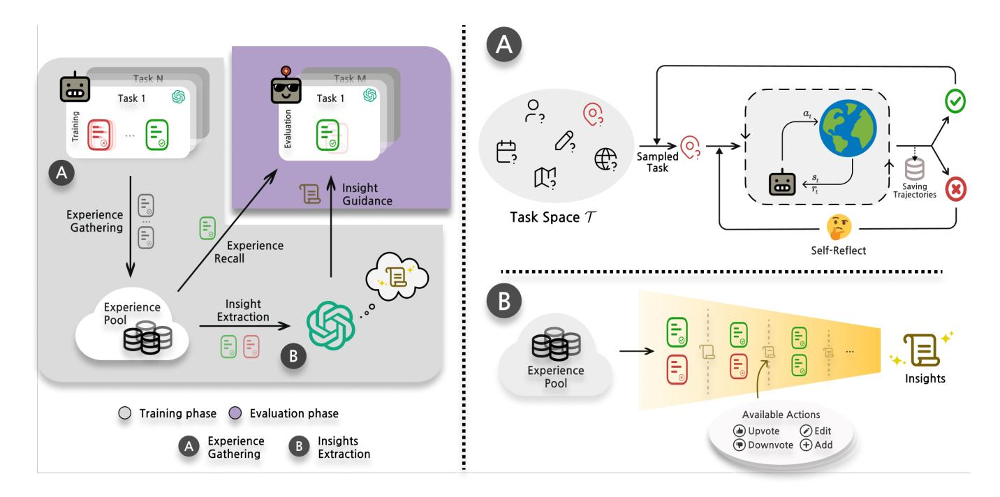
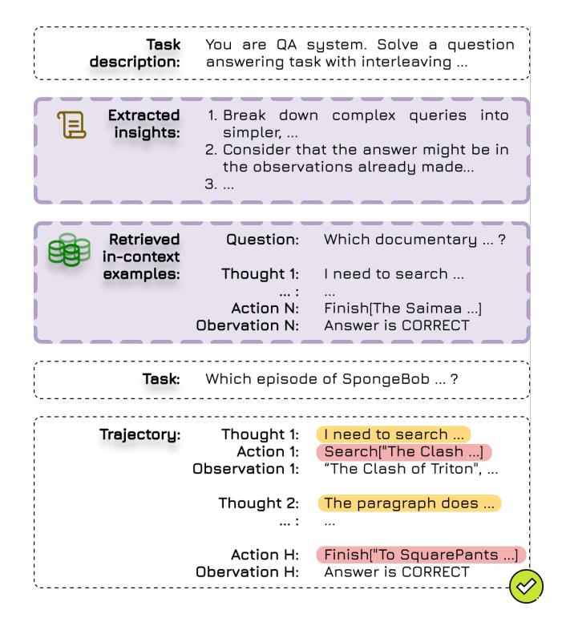
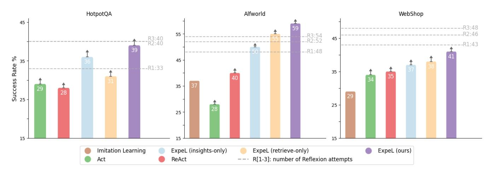
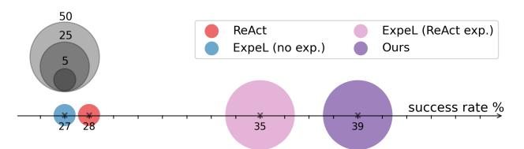
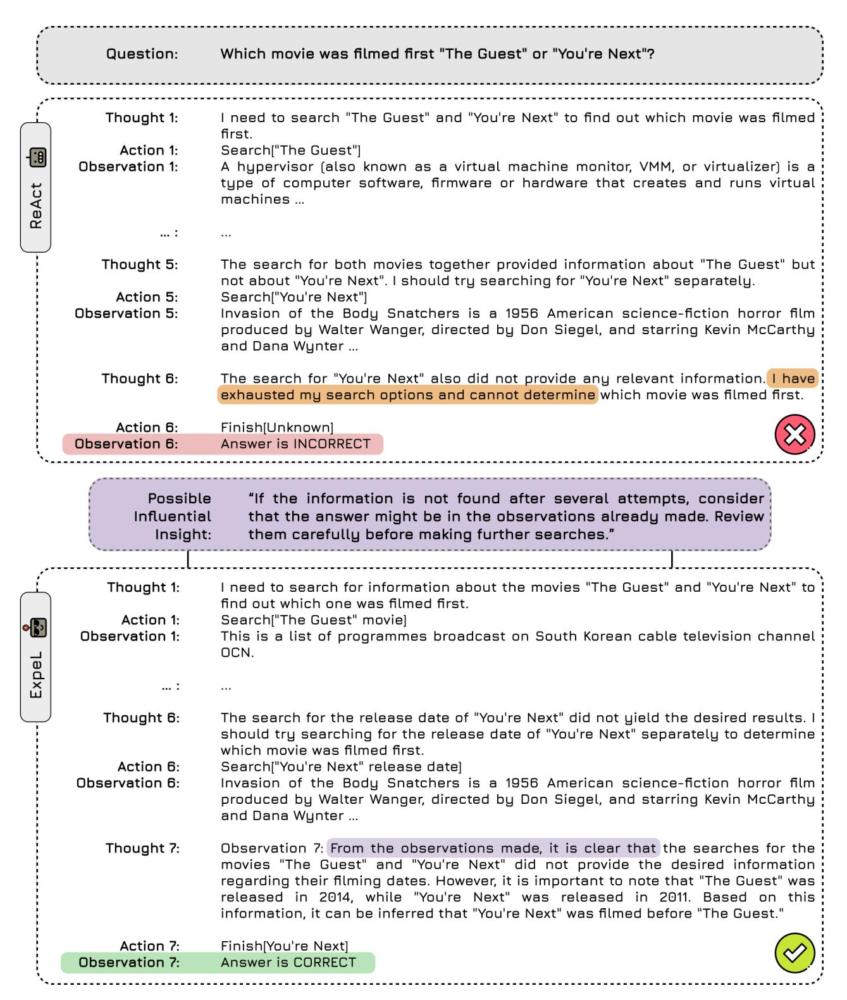
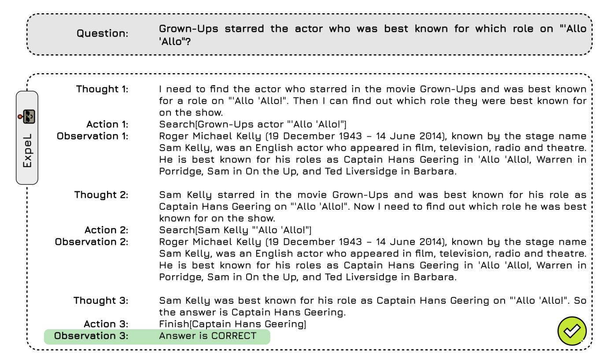
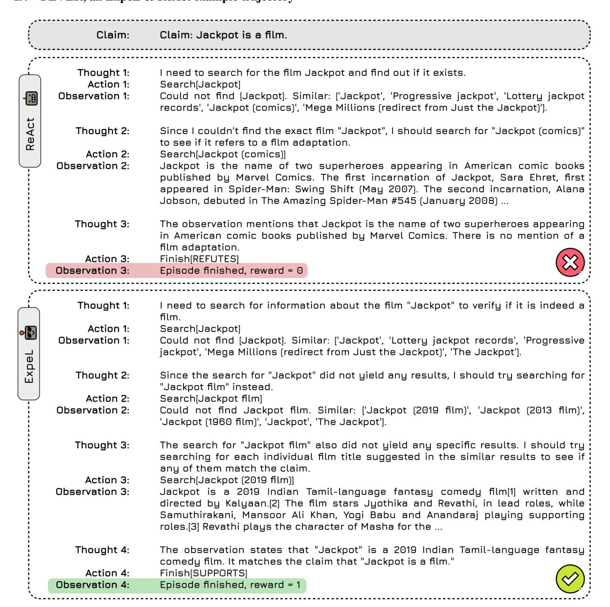
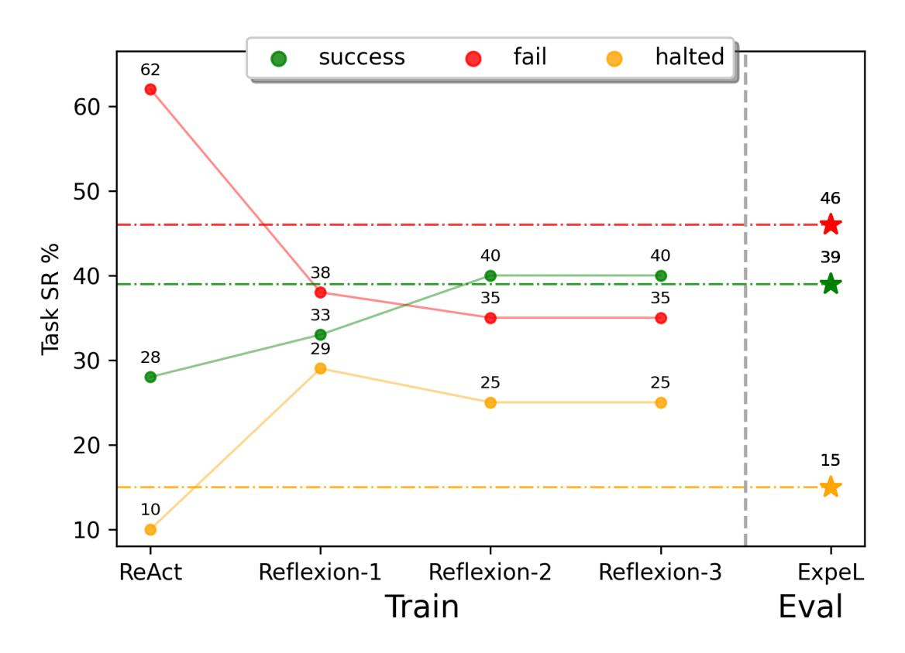
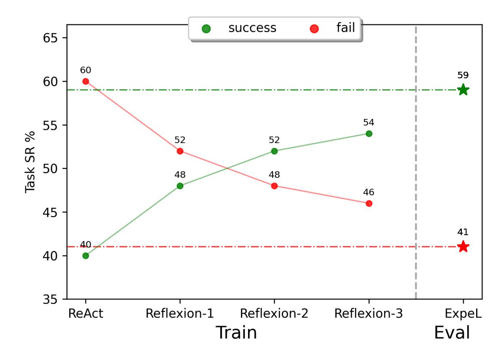
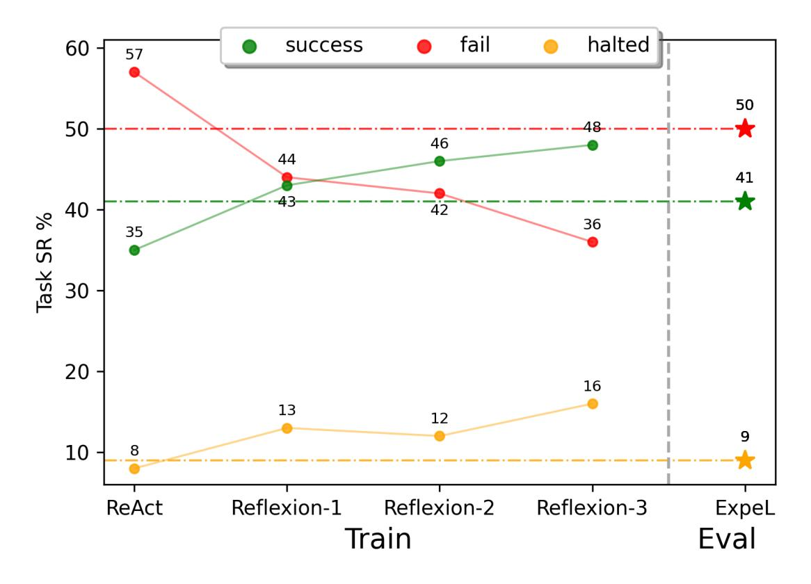

# ExpeL: LLM Agents Are Experiential Learners

Andrew Zhao,♠ Daniel Huang, ♣ Quentin Xu, ♣ Matthieu Lin, ♣ Yong-Jin Liu, ♣ Gao Huang ♠\*

♠ Department of Automation, BNRist, Tsinghua University ♣ Department of Computer Science, BNRist, Tsinghua University

{zqc21,huang-jy22,xgd22,lyh21}@mails.tsinghua.edu.cn, {liuyongjin,gaohuang}@tsinghua.edu.cn


#### Abstract

The recent surge in research interest in applying large language models (LLMs) to decision-making tasks has flourished by leveraging the extensive world knowledge embedded in LLMs. While there is a growing demand to tailor LLMs for custom decision-making tasks, finetuning them for specific tasks is resource-intensive and may diminish the model's generalization capabilities. Moreover, state-of-the-art language models like GPT-4 and Claude are primarily accessible through API calls, with their parametric weights remaining proprietary and unavailable to the public. This scenario emphasizes the growing need for new methodologies that allow learning from agent experiences without requiring parametric updates. To address these problems, we introduce the Experiential Learning (ExpeL) agent. Our agent autonomously gathers experiences and extracts knowledge using natural language from a collection of training tasks. At inference, the agent recalls its extracted insights and past experiences to make informed decisions. Our empirical results highlight the robust learning efficacy of the ExpeL agent, indicating a consistent enhancement in its performance as it accumulates experiences. We further explore the emerging capabilities and transfer learning potential of the ExpeL agent through qualitative observations and additional experiments.[1](#page-0-0)

> A computer program is said to learn from experience E with respect to some class of tasks T and performance measure P, if its performance at tasks in T, as measured by P, improves with experience E.

> > *Tom Mitchell*

<sup>\*</sup>Corresponding author.

Copyright © 2024, Association for the Advancement of Artificial Intelligence (www.aaai.org). All rights reserved.

<span id="page-0-0"></span><sup>1</sup>Visit <https://andrewzh112.github.io/expel> for project page, and <https://github.com/LeapLabTHU/ExpeL> for code.

# 1 Introduction

Machine learning research has long been captivated by the potential of autonomous agents and their capabilities. In recent times, incorporating large language models into these agents [\(Wang et al.](#page-11-0) [2023b;](#page-11-0) [Xi et al.](#page-11-1) [2023\)](#page-11-1) has unveiled a broad spectrum of applications, even extending beyond academia [\(Yang et al.](#page-11-2) [2023a;](#page-11-2) [Nakajima](#page-10-0) [2023;](#page-10-0) [Significant-](#page-10-1)[Gravitas](#page-10-1) [2023\)](#page-10-1). One of the significant advantages of LLMs lies in their world knowledge, allowing them to be inherently versatile across various scenarios [\(Zhao et al.](#page-11-3) [2023b\)](#page-11-3).

On the one hand, previous works investigated finetuning LLMs with a large number of environment interactions [\(Yao et al.](#page-11-4) [2023c\)](#page-11-4) or with a large amount of human-labeled datasets [\(Nakano et al.](#page-10-2) [2021;](#page-10-2) [Shaw et al.](#page-10-3) [2023\)](#page-10-3). This class of methods incurs high computational costs and needs access to the LLM's parametric weights. Furthermore, finetuning an LLM restricts its functionalities and can hurt its generalization abilities [\(Du et al.](#page-9-0) [2022\)](#page-9-0). On the other hand, prompting methods can augment an LLM with better sequential decision-making planning abilities with only a few in-context examples [\(Hao et al.](#page-9-1) [2023;](#page-9-1) [Lin et al.](#page-10-4) [2023b;](#page-10-4) [Sun](#page-10-5) [et al.](#page-10-5) [2023\)](#page-10-5). However, since current LLMs are bounded by context window size [\(Tworkowski et al.](#page-11-5) [2023\)](#page-11-5), these agents have no recollections of what they have seen, and therefore no learning can be done outside of a few demonstrations. *So, how can we strike a balance between these paradigms?*

We present the Experiential Learning (ExpeL) agent as a solution. Our agent autonomously gathers experiences from a collection of training tasks through trial and error. From these experiences, it derives natural language insights and employs its own successful experiences as in-context examples during test time. Our agent's learning process is analogous to a student studying for an exam and then taking it on a single attempt, reflecting many real-world situations. Unlike self-improvement methods like Reflexion [\(Shinn et al.](#page-10-6) [2023\)](#page-10-6), our approach emphasizes the importance of retaining experiences across multiple tasks to enhance agent performance. Moreover, ExpeL learns without parameter updates, making it compatible with powerful closed-source models like GPT-4 or Claude. Lastly, the experience-gathering step does not require a large amount of data or human labels.

We evaluated ExpeL on three vastly different domains and consistently outperformed strong baselines. Additionally, we showcased a transfer learning scenario where our agent that accumulated knowledge from source tasks showed positive forward transfer to target tasks. Finally, we highlighted some unexpected emerged abilities the ExpeL agent gained.

In summary, our key contributions are as follows: (1) we introduced ExpeL, a novel LLM agent that autonomously learns from experience *without gradient updates*; (2) We evaluated ExpeL on a diverse set of tasks to showcase its learning abilities and improvement on top of existing planning methods; (3) we showed a novel setting of transfer learning for our LLM agent and demonstrated forward transferability from source tasks to target tasks. Lastly, we believe that as planning algorithms and foundational models continue to improve, ExpeL's paradigm stands to gain significant benefits from their enhanced performances.

# 2 Related Work

We discuss the most relevant related works in this section. See Appendix [A](#page-12-0) for detailed discussions on related works.

Prompt-based Learning: Prompt-based learning refines label prediction tasks by modifying the input context, facilitating swift adaptation to new tasks with minimal data [\(Liu](#page-10-7) [et al.](#page-10-7) [2023a\)](#page-10-7). This approach capitalizes on LLMs for answers without parameter tuning as they can be augmented using in-context learning [\(Brown et al.](#page-9-2) [2020\)](#page-9-2). LAMA [\(Petroni et al.](#page-10-8) [2019\)](#page-10-8) and GPT-3 [\(Brown et al.](#page-9-2) [2020\)](#page-9-2) are early works that promoted this formulation. Efforts to reduce the intricacies of prompt design include automatic reasoning chains for NLP [\(Kojima et al.](#page-10-9) [2022;](#page-10-9) [Zhang et al.](#page-11-6) [2023\)](#page-11-6). Similarly, the ExpeL agent also autonomously learns from experiences using extracted insights and self-generated incontext trajectories by altering the execution prompt.

Retrieval Augmented Generation (RAG): Retrieval allows LLMs to access databases, mitigating hallucinations [\(Li et al.](#page-10-10) [2022;](#page-10-10) [Wang, Yang, and Wei](#page-11-7) [2023;](#page-11-7) [Rubin, Herzig,](#page-10-11) [and Berant](#page-10-11) [2022;](#page-10-11) [Liu et al.](#page-10-12) [2022\)](#page-10-12). Retrieval has also been used to enhance the capabilities of decision-making agents [\(Humphreys et al.](#page-10-13) [2022;](#page-10-13) [Zhao et al.](#page-11-8) [2023a\)](#page-11-8). In contrast to these works, we focus on retrieving the ExpeL agent's self-generated experiences, thus reducing the dependency on gold examples and leveraging domain-specific corpus.

Planning for LLM Agents: Application of LLM agents in fields like robotics, natural sciences, game-playing, and workflows has surged, with emphasis on their world knowledge in fewshot settings [\(Ha, Florence, and Song](#page-9-3) [2023;](#page-9-3) [Mu et al.](#page-10-14) [2023;](#page-10-14) [Bran et al.](#page-9-4) [2023;](#page-9-4) [Boiko, MacKnight, and](#page-9-5) [Gomes](#page-9-5) [2023;](#page-9-5) [Yang et al.](#page-11-9) [2023b;](#page-11-9) [Lin et al.](#page-10-15) [2023a;](#page-10-15) [Nakano](#page-10-2) [et al.](#page-10-2) [2021;](#page-10-2) [Wang et al.](#page-11-10) [2023c;](#page-11-10) [Liu et al.](#page-10-16) [2023b\)](#page-10-16). Moreover, LLMs have demonstrated promising zero/few-shot planning and reasoning capabilities in various configurations [\(Sumers](#page-10-17) [et al.](#page-10-17) [2023\)](#page-10-17), including embodied environments and reasoning tasks [\(Huang et al.](#page-10-18) [2022;](#page-10-18) [Yao et al.](#page-11-11) [2023a;](#page-11-11) [Wei et al.](#page-11-12) [2022b;](#page-11-12) [Yao et al.](#page-11-13) [2023b;](#page-11-13) [Gong et al.](#page-9-6) [2023\)](#page-9-6).

Self-improvement and Memory for LLM Agents: Agents like Reflexion showcase feedback-based improvement, yet often lack cross-task memory [\(Shinn et al.](#page-10-6) [2023\)](#page-10-6). Other agents exhibit potential in persistent memory within multiagent contexts [\(Park et al.](#page-10-19) [2023;](#page-10-19) [Maas et al.](#page-10-20) [2023\)](#page-10-20). Our ExpeL agent combines these approaches, focusing on tasksolving while benefiting from self-generated in-context examples and abstracted insights from memory.

# 3 Preliminaries

Complex Interactive Tasks We work with complex interactive tasks where at each time step i ∈ {0, . . . , H}, the agent receives an observation o ∈ O, and from its observation history H<sup>t</sup> decides to perform action a ∈ A. The objective of the agent is to achieve some goal g ∈ G. We only deal with deterministic environments in this work.

Large Language Models A large language model is a statistical model of the natural language, typically a neural network. In our setting, we use an autoregressive language model [\(OpenAI](#page-10-21) [2023;](#page-10-21) [Brown et al.](#page-9-2) [2020;](#page-9-2) [Touvron](#page-11-14)

<span id="page-2-0"></span>

Figure 1: ExpeL Agent Overview. *Left:* ExpeL operates in three stages: (1) Collection of success and failure experiences into a pool. (2) Extraction/abstraction of cross-task knowledge from these experiences. (3) Application of the gained insights and recall of past successes in evaluation tasks. *Right:* (A) Illustrates the experience gathering process via Reflexion [\(Shinn et al.](#page-10-6) [2023\)](#page-10-6), enabling task reattempt after self-reflection on failures. (B) Illustrates the insight extraction step. When presented with success/failure pairs or a list of L successes, the agent dynamically modifies an existing list of insights ˆι using operations ADD, UPVOTE, DOWNVOTE, and EDIT. This process has an emphasis on extracting prevalent failure patterns or best practices.

[et al.](#page-11-14) [2023b,](#page-11-14)[a;](#page-11-15) [Chowdhery et al.](#page-9-7) [2023\)](#page-9-7), which given an ordered list of existing tokens x = {x1, x2, ..., xl−1}, outputs the probability of the next token p(x<sup>l</sup> | x<l). An instructionfollowing LLM [\(Thoppilan et al.](#page-10-22) [2022;](#page-10-22) [Chung et al.](#page-9-8) [2022;](#page-9-8) [Wei et al.](#page-11-16) [2022a\)](#page-11-16) is typically finetuned on various NLP tasks that are formatted into instruction, input, response tuples [\(Taori et al.](#page-10-23) [2023\)](#page-10-23). Instruction-tuned models are better at following natural language instructions which alleviates the need for heavy prompt engineering [\(Wei et al.](#page-11-16) [2022a\)](#page-11-16).

ReAct and Reflexion ReAct [\(Yao et al.](#page-11-13) [2023b\)](#page-11-13) and Reflexion [\(Shinn et al.](#page-10-6) [2023\)](#page-10-6) are promising frameworks enabling the aforementioned proficiency of LLMs in reasoning and self-improvement. ReAct explicitly intertwines observations, actions, and thoughts, providing a foundation for robust planning and reasoning capabilities. Building upon it, Reflexion introduces an additional reflective step before reattempting the subsequent trial of the same task, enhancing the model's adaptive learning process.

# 4 ExpeL: An Experiential Learning Agent

Recent advancements in generative LLMs suggest an intriguing approach. Rather than altering the LLM parameters, adjusting the prompts may be more beneficial: this strategy ensures that the LLM's inherent common sense knowledge remains intact, allowing for superior generalization [\(Liu et al.](#page-10-7) [2023a\)](#page-10-7). Furthermore, some of the most potent language models are proprietary [\(OpenAI](#page-10-21) [2023;](#page-10-21) [An-](#page-9-9) [thropic](#page-9-9) [2023\)](#page-9-9). Thus, focusing on prompt-based methods seems promising as a way to harness the strengths of these advanced LLMs. Additionally, previous works on learning in LLM agents have primarily been trained on extensive human-labeled datasets [\(Lin et al.](#page-10-15) [2023a;](#page-10-15) [Shaw et al.](#page-10-3) [2023\)](#page-10-3) or improved via iterative retries [\(Shinn et al.](#page-10-6) [2023\)](#page-10-6) on a single task. A relatively less explored area is facilitating agents to learn autonomously from their own experiences, similar to a student gaining insights from practicing for an exam. The student tackles practice problems multiple times to derive insights. At the exam, the student rely solely on these insights and draw memories of similar problems to answer the questions with one attempt. With this in mind, we wish to design an LLM agent that autonomously gathers experiences and extracts insights, then uses these cross-task insights and memories of similar tasks to aid its decision-making.

We aim to enhance a planning LLM agent, such as Re-Act, with learning abilities that allow it to improve through inter-task experiences without any parameter updates. Inspired by the cognitive abilities inherent in human learning, as well as the benefits observed in self-learning autonomous agents and the progress made in prompt-based methods, we developed the Experiential Learning (ExpeL) agent. During the training stage, the agent interacts with the environment, gathering experiences via trial and error. These experiences are stored in an experience pool [\(Lin](#page-10-24) [1992\)](#page-10-24). From this pool, the agent later extracts insights, similar to off-policy learning [\(Watkins and Dayan](#page-11-17) [1992\)](#page-11-17), in which the agent can learn from experiences of a behavior policy. During the evaluation stage, the agent attempts unseen tasks with a single try, augmented with extracted insights and successful trajectories in its experience pool gathered from the training stage. Refer to Fig. [1](#page-2-0) for detailed information on our agent framework.

#### 4.1 Gathering Experiences

To gather diverse experiences that can be useful to extract information from, we leverage Reflexion [\(Shinn et al.](#page-10-6) [2023\)](#page-10-6) to continuously retry the training task at most Z times. In particular, the agent will be given a training task t<sup>n</sup> at the z-th trial, fewshot examples Fmanual and past reflections νn,z (initially, νn,<sup>0</sup> is the empty string). At first, the agent will attempt the task with fewshot examples concatenated with its current trajectory τn,<sup>0</sup> as the context, and use ReAct [\(Yao et al.](#page-11-13) [2023b\)](#page-11-13) as the base planning algorithm, LLMReAct(· | τn,0, Fmanual, νn,0). On the z-th trial, when the agent finishes the task or the maximum number of steps H is reached, the ExpeL agent's experience pool B ingests the trajectory τn,z. Then, if the agent succeeds, it moves on to the next task. However, if the agent fails, it will look at its failed trajectory and self-reflect to produce νn,z+1 = concat(νn,z, LLMreflect(τn,z)) to see where it can do better on the next retry, concatenated with the previous reflections. In the next retry, the agent will augment its context with reflection νn,z+1, the input to the LLM policy, LLMReAct(· | τn,z+1, Fmanual, νn,z+1).

To highlight, this trial and error way of gathering experiences not only improves the chances of getting more positive examples for experience recall during evaluation but also allows for collecting valuable success/failure pairs used for comparisons during insight extraction (Sec. [4.2\)](#page-3-0). The pseudo-code can be found in Alg. [1.](#page-5-0)

#### 4.2 Learning from Experiences

Human learning occurs mainly either by storing successful trajectories in memory, which can be later recalled as specific examples, or by extracting high-level insights from experiences, enabling generalization to novel situations. ExpeL considers both of these learning modes to boost task performance. Concretely, an instruction I given to an LLM agent can be broken down into task specifications and fewshot examples. We can augment task specifications with an agent's extracted insights from past experiences, where an instruction-following LLM can be leveraged [\(OpenAI](#page-10-21) [2023\)](#page-10-21) to follow them closely. For fewshot examples, we can allow the agent to retrieve from its experience pool with top-k relevant examples to aid its decisions. Next, we detail our experience recall and insight extraction mechanisms.

Similar Experiences as Demonstrations Works have shown that using in-context examples that are semantically similar to the task at hand results in better performance [\(Liu](#page-10-12) [et al.](#page-10-12) [2022\)](#page-10-12). Moreover, when involved in a novel situation, humans also recall from their memory similar tasks they've solved as references when attempting the task [\(Kahneman](#page-10-25) [2011\)](#page-10-25). Motivated by these observations, we propose experience recall to retrieve successful trajectories from the experience pool gathered during training based on task similarity.

Concretely, we used the Faiss vectorstore [\(Johnson,](#page-10-26) [Douze, and Jegou](#page-10-26) ´ [2019\)](#page-10-26) as the experience pool, kNN retriever and all-mpnet-base-v2 [\(Song et al.](#page-10-27) [2020\)](#page-10-27) embedder to obtain top-k successful trajectories that have the maximum inner-product task similarity with the evaluation task. The advantage of using task similarity as the retrieval rank is that if the agent repeats a task or does a task similar to an existing successful trajectory from the experience pool, the agent only needs to closely imitate the successful trajectory and have less burden on ability extrapolation.

<span id="page-3-0"></span>Learning from Successes and Failures To leverage the diverse outcomes gathered during the experience collection phase, we believe the agent should analyze experiences in two distinct ways. First, we let the agent compare a failed trajectory with a successful trajectory for the *same* task. This comparison offers a concrete understanding of the agent's shortcomings, highlighting the correct and incorrect actions. Second, we let the agent identify patterns within a set of successful trajectories from *different* tasks. This approach sheds light on common "good practices" that the agent can adopt to ensure success in evaluation tasks.

For the implementation, we give the agent's instructionfollowing LLMinsights several operators to apply on an existing set of insights ˆι. We initialize the set of insights to an empty set ˆι = ∅ and iteratively provide the LLM with fail/success pairs or lists of L successes (created by sampling without replacement) from the experience pool. The operations the LLM can perform are: ADD a new insight, EDIT the content of an existing insight, DOWNVOTE to disagree with an existing insight, or UPVOTE to agree with an existing insight. A newly added insight will have an initial importance count of two associated with it, and the count will increment if subsequent operators UPVOTE or EDIT are applied to it and will decrement when DOWNVOTE is applied to it. If an insight's importance count reaches zero, it will be removed. This particular design choice robustifies the process since even successful trajectories can be suboptimal and mislead the generated insights. The prompt template we used can be found in Fig. [2.](#page-4-0) We kept the maximum size for a list of successes to L and used gpt-4-0613 as the default LLMinsights. We *empirically* found that gpt-4-0613 is better than gpt-3.5-turbo-0613 at following instructions on how to use the insight extraction operators and hallucinated less. Pseudo-code for this process can be found in Alg. [2.](#page-5-1) Finally, ExpeL utilizes these generated insights ˆι in the task inference phase, described next.

#### 4.3 Task Inference

After the agent gathers experiences, extracts insights from them, and sets up a vectorstore of successful trajectories, it can proceed to the evaluation. For each task, the task specifications will be augmented with the concatenation of the full list of extracted insights ˆι = concat(ι1, ι2, ι3, ...), and the top-k trajectories with the highest task similarity will be retrieved and used as fewshot in-context examples, Fsimilar tasks. Fig. [3](#page-4-1) shows an example prompt template structure, and a

<span id="page-4-0"></span>

Figure 2: Insight Extraction Prompt Template. The prompt template ExpeL agents used for insight extraction. The same template is used both for success/fail pairs (A, in yellow) and L-sized successes (B, in green).

pseudo-code for this step can be found in Alg. [3.](#page-5-2) We believe as the list of extracted insights grows, retrieval could be a feasible solution to manage the context window size.

<span id="page-4-1"></span>

Figure 3: Task Inference Prompt Template. We illustrate ExpeL's prompt template during evaluation. The areas with a white background are identical to the base ReAct agent's inputs. We differ by (purple areas) having additional *extracted insights* from past experience, and dynamically retrieved successful *in-context examples*from past experiences based on task similarity.

#### 4.4 Transfer Learning

After demonstrating how learning by using experiences from a training set can benefit an LLM agent in solving an unseen task in the same task distribution, we investigate another interesting setting where knowledge accumulated from a source task distribution could be useful for a target task distribution with minimal target task examples for the ExpeL agent. Like most transfer learning settings, we assume that the source and target tasks exhibit common knowledge. Therefore, experiences accumulated from source tasks can benefit the agent in solving a new set of target tasks.

Similar to pretraining on source task and finetuning on target task in transfer learning literature [\(Zhuang et al.](#page-11-18) [2020\)](#page-11-18), we propose to use the extracted insights ˆι from the source task and fewshot examples from the target task to "finetune" the insights so that they are more applicable in the target task. We hypothesize that using target task fewshot examples can better ground the insights into the target task and mitigate hallucinations. An example prompt template to "finetune" extracted insights from a source domain to tailor them

#### Algorithm 1: ExpeL - Experience Gathering

```
Initialize:
Policy LLM<sub>ReAct</sub>
Self-reflection model LLM<sub>reflect</sub>
Collection of tasks \mathcal{T}_{train}
Fewshot examples F_{\text{manual}}
Experience pool \mathcal{B} \leftarrow F_{\text{manual}}
Number of training tasks N
Maximum retry number Z
Maximum step number H
Current task index n \leftarrow 1
while task n \leq N do
    t_n \leftarrow \mathcal{T}_{\text{train}}[n]
    Reflection \nu_{n,0} \leftarrow ""
    for trial z = 0 to Z do
       o_0 \leftarrow \text{env.reset}(t_n)
       Initialize trajectory \tau_{n,z} \leftarrow o_0
       for timestep i = 0 to H do
            a_i \leftarrow \text{LLM}_{\text{ReAct}}(a_i \mid \tau_{n,z}, F_{\text{manual}}, \nu_{n,z})
           o_{i+1}, r_{i+1}, \texttt{done} \leftarrow \texttt{env.step}(a_i)
            \tau_{n,z} \leftarrow \tau_{n,z} \cup \{(o_i, a_i, o_{i+1}, r_{i+1})\}
           if done then
               break
           end if
       end for
       \mathcal{B} \leftarrow \mathcal{B} \cup \tau_{n,z}
       if done or z = Z then
           n \leftarrow n + 1
           break
       else
            \nu_{n,z+1} \leftarrow \operatorname{concat}(\nu_{n,z} + \operatorname{LLM}_{\operatorname{reflect}}(\tau_{n,z}))
       end if
    end for
end while
return \mathcal{B}
```

#### <span id="page-5-0"></span>Algorithm 2: ExpeL - Insight Extraction

```
Initialize: Experience pool \mathcal{B} (from Alg. 1) Insight extraction model LLM<sub>insights</sub> Set of insights \hat{\iota} \leftarrow \emptyset Divide the successes in \mathcal{B} into L-sized chunks: C_{\text{success}} = \{\{\tau_1^{\text{success}}, \tau_2^{\text{success}}, ..., \tau_L^{\text{success}}\}, \{\tau_{L+1}^{\text{success}}, \tau_{L+2}^{\text{success}}, ..., \tau_{2L}^{\text{success}}\}, ...\} Construct fail/success tuples of the same tasks in \mathcal{B}: C_{\text{compare}} = \{(\tau_1^{\text{success}}, \tau_{1,0}^{\text{fail}}), (\tau_1^{\text{success}}, \tau_{1,1}^{\text{fail}}), ..., (\tau_2^{\text{success}}, \tau_{2,0}^{\text{fail}}), ...\} for each c_{\text{compare}} in C_{\text{compare}} do \hat{\iota} \leftarrow \text{LLM}_{\text{insights}}(c_{\text{compare}}, \hat{\iota}) end for for each c_{\text{success}} in C_{\text{success}}, \hat{\iota} end for return \hat{\iota}
```

#### Algorithm 3: ExpeL - Evaluation

```
Initialize:
ExpeL agent LLM<sub>ExpeL</sub>
Text Embedder \mathcal{E}
Experience pool \mathcal{B} (from Alg. 1)
Set of insights \hat{\iota} (from Alg. 2)
Collection of evaluation tasks \mathcal{T}_{evaluation}
Number of evaluation tasks M
Number of fewshots k
Number of successes S \leftarrow 0
for task m = 1 to M do
   t_m \leftarrow \mathcal{T}_{\text{evaluation}}[m]
   o_0 \leftarrow \text{env.reset}(t_m)
   Initialize trajectory \tau_m \leftarrow o_0
   F_{\text{similar tasks}} \leftarrow \text{Faiss}(t_m, \mathcal{B}, \mathcal{E}, k)
   for timestep i = 1 to H do
       a_i \leftarrow \text{LLM}_{\text{ExpeL}}(a_i \mid \tau_m, F_{\text{similar tasks}}, \hat{\iota})
       o_{i+1}, r_{i+1}, \mathtt{done} \leftarrow \mathtt{env.step}(a_i)
       \tau_m \leftarrow \tau_m \cup \{(o_i, a_i, o_{i+1}, r_{i+1})\}
       if done then
           break
       end if
   end for
   if r_{i+1} = 1 then
       S \leftarrow S + 1
   end if
end for
return \frac{S}{M}
```

<span id="page-5-2"></span>to a target domain is illustrated in Fig. 4.

### 4.5 ExpeL's Strengths

In this section, we outline the key strengths of our framework. First and foremost, ExpeL offers inherent interpretability, as both the extracted experiences and successful trajectories are presented in natural language. This design allows users to easily inspect, modify, or remove potentially harmful trajectories/insights — a challenge in finetuned models. Moreover, users can seamlessly add expert insights or trajectories to an ExpeL agent. Additionally, our learning approach is highly accessible; it demands less data, reduces computational resources, and is straightforward to implement. Furthermore, self-improvement methods like Reflexion (Shinn et al. 2023) facilitate intra-task improvements, but ExpeL enables inter-task learning. ExpeL does not rely on retries during deployment, which certain domains require. On the flexibility front, the ExpeL agent boasts a significant level of versatility. It is not restricted to specific language models and complements existing strategies aimed at enhancing LLM agent planning capabilities. Moreover, when applied in conjunction with them, ExpeL might even improve the capabilities of finetuned agents. Another strength lies in continuous improvement. Our method stands to benefit from the ongoing enhancements in foundational models. As an illustration, our experiments show that using gpt-4 to extract insights outperforms gpt-3.5-turbo (refer to Sec. 5.6). Lastly, we introduced a method for trans-

<span id="page-6-0"></span>


Figure 4: Transfer Learning Finetuning Prompt Template. The prompt template used to finetune knowledge from source to target domain. Highlighted in grey should be formatted with concise descriptions of the tasks.

ferring extracted insights across domains using only a small amount of finetuning examples, demonstrating the advantage of our approach in diverse settings with limited data.

# 5 Experiments

#### 5.1 Experimental Setup

In line with ReAct [\(Yao et al.](#page-11-13) [2023b\)](#page-11-13), the experiments are designed based on four text-based benchmarks: HotpotQA [\(Yang et al.](#page-11-19) [2018\)](#page-11-19), a knowledge-intensive dataset that challenges an agent to perform reasoning and question answering using the search tool Wikipedia Docstore API, ALFWorld and WebShop [\(Shridhar et al.](#page-10-28) [2021;](#page-10-28) [Yao et al.](#page-11-20) [2022\)](#page-11-20) that require the agent to perform interactive multi-step decision-making tasks in respectively a household and an online shopping website environments, and FEVER [\(Thorne](#page-11-21) [et al.](#page-11-21) [2018\)](#page-11-21), that focuses on fact verification tasks using the same API as HotpotQA which makes it suitable for knowledge transfer (Sec. [5.4\)](#page-7-0). All experiments use four-fold validation, and we report the mean and standard error over the folds. Following ReAct, for all environments, we use success rate as the evaluation metric: exact matching for HotpotQA and FEVER, completing the task in time for ALF-World, and purchasing the item that matches all attributes for WebShop. Some additional metrics are introduced when the environment offers them: mean reward (calculated using Eq. 1 in Appendix) score r ∈ [0, 1] for WebShop and a score breakdown per task type for ALFWorld.

We use ReAct and Act as main baselines planning LLM agents [\(Yao et al.](#page-11-13) [2023b\)](#page-11-13), where Act does not have the reasoning steps like ReAct. All agents, including ExpeL, used gpt-3.5-turbo-0613 when performing actions during evaluation. All text generations were done with temperature 0 and greedy decoding. Imitation learning (IL) results were taken from the ReAct paper [\(Yao et al.](#page-11-13) [2023b\)](#page-11-13). More details about the experimental setup can be found in Appendix [D.](#page-13-0)

#### 5.2 Main Results

The primary findings of this study are presented in Fig. [5.](#page-7-1) IL-based method struggles to efficiently perform in Web-Shop and ALFWorld, possibly due to their demand for more substantial prior and reasoning abilities, which conventional trainings from scratch fail to provide. This limitation shows the promise of leveraging knowledge-based language models to address these challenges. The following claims were made based on (1) a deep understanding of each environment; (2) extracted insights and retrievable in-context examples; and (3) statistics (e.g. number of invalid actions per trial) of the runs.

Experiential learning Augmenting agents with abstracted insights and the ability to recall successful trajectories improve performance across all environments compared to baseline agents. When restricting the ExpeL agent to only one mode of learning (insights-only or retrieval-only), HotpotQA and ALFWorld environments demonstrate contrasting quantitative distinctions (36%/31% and 50%/55% for HotpotQA and ALFWorld, respectively). The prominent influence of insights on HotpotQA can be due to its reliance on analysing (Wikipedia results) abilities. This highlights the need for general guidelines across various question types. Conversely, ALFWorld's task completion, dependent on specific action sets, is better derived from past experiential trajectories. Furthermore, WebShop presents a unique challenge, requiring both website-based reasoning (price comparisons, query reformulation, etc.) and precise execution of actions (searching, clicking, option selection, etc.). Consequently, the performance across these tasks shows a near equilibrium, as reflected in both the success rate and score (37%/38% and 0.675/0.67 for insights/retrieve-only respectively, see Tab. [5](#page-35-0) in Appendix for scores). These observations highlight the *synergistic* interplay between *abstraction* and *recollection* in experiential learning, with ExpeL showing a quantitative advantage over baseline/restricted learning mode agents.

Cross-task learning Another important finding we observe is the comparison with the Reflexion agent [\(Shinn](#page-10-6) [et al.](#page-10-6) [2023\)](#page-10-6). ExpeL matches Reflexion's performance (40% at R3 vs. 39%) for HotpotQA and even outperforms it for

<span id="page-7-1"></span>

Figure 5: Main Results. Average task success rates (std. error in gray arrows) across three different domains: HotpotQA, ALFWorld, and WebShop. ReAct and Act are used as baselines. ExpeL consistently outperforms the baselines on all domains, highlighting the importance of learning from experience. Additionally, we compare ExpeL with ExpeL (retrieve-only) and ExpeL (insights-only) to highlight that both insight extraction and task similarity retrieval are *essential* and *synergistic*.

ALFWorld (54% at R3 vs. 59%) *without repeated attempts*. While Reflexion improves results by iteratively refining insights through repeated task execution (R1, R2, R3...), our ExpeL agent leverages cross-task learning by accumulating task experience. However, it is noteworthy that there remains room for improvement in the context of WebShop tasks, approaching the lower side of Reflexion's success rates.

### <span id="page-7-2"></span>5.3 Agent Behavioral Analysis

In this section, we highlight some observations made by manually inspecting the trajectories of ReAct agents and ExpeL agents, and by pinpointing possible causes of how some unexpected behaviors might have emerged. Please visit the paper's webpage, [https://andrewzh112.github.io/expel,](https://andrewzh112.github.io/expel) for full trajectory demos illustrating the following findings.

Hypothesis Formulation & Constraints Adaptation After extracting the insights from experiences gathered in the training set, we noticed the agent subsequently gained the ability to *reassess* its whole trajectory in the *last steps* and conclusively end the task rather than expressing its ineptitude in providing a solution. This ability was particularly observed in HotpotQA (Fig. [16,](#page-22-0) [17](#page-23-0) in Appendix) where a likely influential insight was stating that the agent should "consider the answer might be in the observations already made". Therefore the agent would finish by proposing the most probable answer given its past observations rather than concluding with "Unknown" or "Information not available".

World Model Belief Update We noticed our ExpeL agent updated its beliefs through the insights and over its gained experience. This belief thereby update enables the agent to avoid unnecessary actions and increase efficiency in solving a given task. For example, in ALFWorld, the agent completely changed the priors it had in ReAct on the likely locations of a pan (from drawers/countertops/cabinets to stoveburners). This behavior emerged from the extracted insight claiming that "when searching for an item" it needs to "consider its nature and its typical usage" (Fig. [18](#page-24-0) in Appendix), leading the agent to promptly and accurately find the correct item at the first step while the ReAct agent could not find it in time.

Self-correction Although ReAct was sometimes not able to reassess its situation when attempting to solve a task, ExpeL demonstrated its proficiency in identifying and rectifying missteps. Notably, when incorrectly taking an object in ALFWorld, the agent has shown its ability to put it back and resume the task by searching for the proper object (Fig. [19](#page-25-0) in Appendix). This highlights ExpeL's capacity to recover from errors and stay on course without hallucinating when completing tasks. This behavior is possibly encouraged by the generated insight "reassess the situation and consider alternative actions" if "an attempt does not progress the task".

#### <span id="page-7-0"></span>5.4 Transfer Learning

In this experiment, we use the HotpotQA dataset [\(Yang](#page-11-19) [et al.](#page-11-19) [2018\)](#page-11-19) as source tasks and the FEVER dataset [\(Thorne](#page-11-21) [et al.](#page-11-21) [2018\)](#page-11-21) as target tasks. Like the HotpotQA dataset, we equip the agent with the ability to navigate on Wikipedia using a Docstore API; therefore, we hypothesize that some of the knowledge obtained from HotpotQA tasks should also be beneficial when transferred to the FEVER tasks. We use gpt-4-0613 for adapting the HotpotQA insights into FEVER insights. We use the same fewshot examples to finetune the insights as the ones that will be used during task execution. We compare our ExpeL Transfer agent's transfer learning ability with (1) ReAct; (2) Act; and (3) an agent that "finetunes" insights without task demonstrations. Notice that since source and target tasks are inherently different, we do not have an experience pool to retrieve from; thus, the ExpeL Transfer agents use the existing fixed fewshot examples as in-context examples.

Tab. [1](#page-8-1) showcases the transfer learning results. Both agents

<span id="page-8-1"></span>

|                               | FEVER (SR %) |
|-------------------------------|--------------|
| Act                           | 58 ± 0.0     |
| ReAct                         | 63 ± 0.4     |
| ExpeL Transfer w/o Task Demos | 65 ± 1.7     |
| ExpeL Transfer                | 70 ± 0.7     |

Table 1: Transfer Results. We transfer insights extracted from HotpotQA to FEVER. *Act* and *ReAct* are baseline agents, *ExpeL w/o Task Demos* does not utilize fewshot examples when altering the insights for the target task.

<span id="page-8-2"></span>

|                     | R0    | R1    | R2    | R3    |
|---------------------|-------|-------|-------|-------|
| ReAct+Reflexion     | 40.3% | 47.8% | 52.2% | 54.4% |
| ExpeL retrieve only | 54.5% | 57.5% | 59.7% | 60.4% |
| ExpeL+Reflexion     | 59.0% | 60.4% | 63.4% | 64.2% |

Table 2: Success Rate on ALFWorld with Reflexion Rounds. ExpeL and Reflexion appear to be synergistic in the ALFWorld environment (Highlight = ExpeL with one attempt). R1-R3 were obtained from failed R0 checkpoints.

that transferred knowledge from the source domain saw performance gains. Notably, the agent with a few in-context examples had a more significant improvement than the one without, indicating the effectiveness of the proposed "finetuning" method in transfer learning scenarios.

## 5.5 ExpeL with Task Reattempts

While not being the central focus of our study, we present preliminary findings on the effectiveness of incorporating task reattempts into the evaluation phase using ExpeL by resuming the failed checkpoints from R0. The performance of ExpeL combined with Reflexion, alongside two baselines: ReAct/Reflexion and ExpeL without insights (ExpeL retrieve only), is detailed in Table [2.](#page-8-2) The results demonstrate a notable improvement in the success rate when ExpeL is paired with Reflexion, with the success rate increasing as the number of task reattempts grows.

#### <span id="page-8-0"></span>5.6 Ablation Studies

One main component of ExpeL is the agent's ability to autonomously gather valuable experiences benefiting its own learning. Therefore, we wish to investigate if the number of *useful* experiences impacts the downstream performance of ExpeL. We designed two different agents to compare our agent with. The first one only has access to initial fewshot examples and extracts insights from them. The second gathers experience using ReAct where the agent has no retries. Thus, the agent will not only get less successful trajectories but will also not have any success/failure comparison pairs during insights extraction. We conducted experiments in the HotpotQA environment and presented the results in Fig. [6.](#page-8-3) As we can see, the agent that extracts insights from the existing fewshots has no advantage compared to the Re-Act agent, illustrating that experience is essential for ExpeL to learn from. This was reflected in a significantly better performance for the two other agents having access to more experience. Furthermore, the ExpeL agent with access to a *di-* *verse* set of experiences (failure and success pairs obtained using Reflexion) performs better than the agent using only ReAct during experience gathering.

<span id="page-8-3"></span>

Figure 6: Effects of Experience on Performance. We highlight the correlation between the number of *diverse* experience samples and the final performance. Concretely, we compare ExpeL with (1) ReAct, (2) ExpeL that only has access to fewshot examples, and (3) ExpeL that only uses ReAct during the experience gathering step. It is evident that extra autonomously collected experiences are essential to ExpeL's success and that diversity of success/failure data gathered using Reflexion was superior to using ReAct only.

Next, we will scrutinize the efficacy of the insight extraction step of ExpeL. Since insights had the most significant impact on the HotpotQA environment (Fig. [5\)](#page-7-1), we performed the ablations on insights in this environment. We use three dimensions to ablate the design choices for insight extraction by creating the following variants of ExpeL agents: (1) human-crafted insights (Fig. [12](#page-18-0) in Appendix), which were manually engineered by carefully studying the agent's mistakes during the experience gathering step; (2) adding reflections ν into the insights construction step in addition to using fail/success pairs and lists of successes; (3) using gpt-3.5-turbo-0613 as the LLMinsights. Results in Tab. [3](#page-9-10) show several significant findings: (1) learned insights by the agent are more advantageous than handcrafted ones; (2) using reflections in addition to success/ failure pairs and lists of successes is disadvantageous, possibly due to reflections sometimes outputting hallucinations, therefore misleading the insight extraction stage; and (3) a better LLM is more advantageous at improving ExpeL's performance, suggesting our agent will enjoy free performance boosts with the ever-improving nature of base foundation models.

Lastly, we investigated the design choice of using task similarity as the ranking score for retrieving successful incontext examples in ALFWorld. In particular, we use (1) reason similarity by retrieving top-k trajectories with the most similar reasoning step as the latest reasoning step in the current trajectory, and (2) randomly sampling successful trajectories from the experience pool. We clearly observe in Tab. [3](#page-9-10) that retrieving with task similarity (ExpeL) performs the best. Reason similarity is still advantageous but slightly drops in performance, possibly due to dynamically changing fewshots during a single trajectory, causing instabilities. Lastly, random sampling has a significant drop in performance, suggesting that our design choice of selecting the most pertinent in-context example is advantageous.

<span id="page-9-10"></span>

|                                        | HotpotQA (SR %)          |
|----------------------------------------|--------------------------|
| ReAct                                  | 28.0 ± 1.4               |
| Hand-crafted insights                  | 32.0 ± 1.1               |
| Insights with reflections              | 29.0 ± 0.4               |
| gpt-3.5-turbo<br>insights              | 32.0 ± 0.4               |
| ExpeL (ours)                           | 39.0 ± 1.7               |
|                                        |                          |
|                                        | ALFWorld (SR %)          |
|                                        |                          |
| ReAct                                  | 40.0 ± 0.3               |
| Reasoning similarity<br>Random sampled | 48.5 ± 2.1<br>42.5 ± 0.8 |

Table 3: Ablations Results. *Upper:* Ablations on insight extraction. Hand-crafted insights enjoyed a performance boost over ReAct but were less effective than LLM-generated ones. Furthermore, adding reflections to the insight-generating process hurt performance. Lastly, better LLM base models give better insights. *Lower:* Ablations on in-context examples selection strategy. Randomly selected baseline has a significant drop in performance while ranking using reason similarity also has a noticeable dip.

# 6 Conclusion and Limitations

Limitations In this work, we investigated tasks with textual observation, which is limiting in real-world scenarios. Thus, incorporating image observations will make our method more generally applicable. Using Vision-Language Models or captioning models to supplement the LLM to enable image observations could be an interesting new avenue of research. Additionally, we investigated the efficacy of our method by using closed-source API LLMs, which can be off-limits in some applications. Exploring LLM agents using open-source LLMs should be another promising future work [\(Zeng et al.](#page-11-22) [2023\)](#page-11-22). Furthermore, since our extracted insights do not exceed the current LLM's token limit, we can fit them into the agent's context window. However, extra retrieval steps for insights might be needed for truly lifelong learning agents to ensure a manageable context window size. Lastly, unlike reinforcement learning methods, prompting techniques lack theoretical underpinnings that could potentially impact the efficiency of the resulting policies. Future research should explore the integration of these approaches to yield more effective and optimal solutions.

In summary, we introduced ExpeL, a novel learning LLM agent that autonomously gathers experience from a set of training tasks to improve its abilities in solving evaluation tasks without access to model parameters. We demonstrated its learning abilities by showing its performance gain compared to vanilla ReAct and Act agents. Furthermore, we investigated a transfer learning scenario where extracting insights from a set of source tasks can benefit the ExpeL agent in solving a target task. Lastly, we presented several unexpected emerged abilities our agent developed at the end of its training. We believe that autonomously learning from experience is essential for developing human-like intelligent agents, and our ExpeL agent is a step toward that goal.

# Acknowledgement

This work is supported in part by the National Key R&D Program of China (2022ZD0114900), the National Natural Science Foundation of China under Grants 62022048, U2336214, and 62332019, and the Guoqiang Institute of Tsinghua University.

# References

<span id="page-9-9"></span>Anthropic. 2023. Introducing Claude.

<span id="page-9-5"></span>Boiko, D. A.; MacKnight, R.; and Gomes, G. 2023. Emergent Autonomous Scientific Research Capabilities of Large Language Models. *arXiv preprint*.

<span id="page-9-4"></span>Bran, A. M.; Cox, S.; White, A. D.; and Schwaller, P. 2023. ChemCrow: Augmenting Large-Language Models with Chemistry Tools. *arXiv preprint*.

<span id="page-9-2"></span>Brown, T.; Mann, B.; Ryder, N.; Subbiah, M.; Kaplan, J. D.; Dhariwal, P.; Neelakantan, A.; Shyam, P.; Sastry, G.; Askell, A.; et al. 2020. Language Models are Few-Shot Learners. *NeurIPS*.

<span id="page-9-12"></span>Chase, H. 2023. Langchain.

<span id="page-9-7"></span>Chowdhery, A.; Narang, S.; Devlin, J.; Bosma, M.; Mishra, G.; Roberts, A.; Barham, P.; Chung, H. W.; Sutton, C.; Gehrmann, S.; Schuh, P.; Shi, K.; Tsvyashchenko, S.; Maynez, J.; Rao, A.; Barnes, P.; Tay, Y.; Shazeer, N.; Prabhakaran, V.; Reif, E.; Du, N.; Hutchinson, B.; Pope, R.; Bradbury, J.; Austin, J.; Isard, M.; Gur-Ari, G.; Yin, P.; Duke, T.; Levskaya, A.; Ghemawat, S.; Dev, S.; Michalewski, H.; Garcia, X.; Misra, V.; Robinson, K.; Fedus, L.; Zhou, D.; Ippolito, D.; Luan, D.; Lim, H.; Zoph, B.; Spiridonov, A.; Sepassi, R.; Dohan, D.; Agrawal, S.; Omernick, M.; Dai, A. M.; Pillai, T. S.; Pellat, M.; Lewkowycz, A.; Moreira, E.; Child, R.; Polozov, O.; Lee, K.; Zhou, Z.; Wang, X.; Saeta, B.; Diaz, M.; Firat, O.; Catasta, M.; Wei, J.; Meier-Hellstern, K.; Eck, D.; Dean, J.; Petrov, S.; and Fiedel, N. 2023. PaLM: Scaling Language Modeling with Pathways. *JMLR*.

<span id="page-9-8"></span>Chung, H. W.; Hou, L.; Longpre, S.; Zoph, B.; Tay, Y.; Fedus, W.; Li, E.; Wang, X.; Dehghani, M.; Brahma, S.; et al. 2022. Scaling Instruction-Finetuned Language Models. *arXiv preprint*.

<span id="page-9-0"></span>Du, M.; He, F.; Zou, N.; Tao, D.; and Hu, X. 2022. Shortcut Learning of Large Language Models in Natural Language Understanding: A Survey. *arXiv preprint*.

<span id="page-9-6"></span>Gong, R.; Huang, Q.; Ma, X.; Vo, H.; Durante, Z.; Noda, Y.; Zheng, Z.; Zhu, S.-C.; Terzopoulos, D.; Fei-Fei, L.; et al. 2023. MindAgent: Emergent Gaming Interaction. *arXiv preprint*.

<span id="page-9-11"></span>Gur, I.; Furuta, H.; Huang, A.; Safdari, M.; Matsuo, Y.; Eck, D.; and Faust, A. 2023. A Real-World WebAgent with Planning, Long Context Understanding, and Program Synthesis. *arXiv preprint*.

<span id="page-9-3"></span>Ha, H.; Florence, P.; and Song, S. 2023. Scaling Up and Distilling Down: Language-Guided Robot Skill Acquisition. In *CoRL*. PMLR.

<span id="page-9-1"></span>Hao, S.; Gu, Y.; Ma, H.; Hong, J. J.; Wang, Z.; Wang, D. Z.; and Hu, Z. 2023. Reasoning with Language Model is Planning with World Model. *arXiv preprint*.

- <span id="page-10-18"></span>Huang, W.; Abbeel, P.; Pathak, D.; and Mordatch, I. 2022. Language Models as Zero-Shot Planners: Extracting Actionable Knowledge for Embodied Agents. In *ICML*. PMLR.
- <span id="page-10-13"></span>Humphreys, P.; Guez, A.; Tieleman, O.; Sifre, L.; Weber, T.; and Lillicrap, T. 2022. Large-scale Retrieval for Reinforcement Learning. *NeurIPS*.
- <span id="page-10-26"></span>Johnson, J.; Douze, M.; and Jegou, H. 2019. Billion-scale ´ Similarity Search with GPUs. *IEEE Transactions on Big Data*.
- <span id="page-10-25"></span>Kahneman, D. 2011. *Thinking, Fast and Slow*. Farrar, Straus and Giroux.
- <span id="page-10-9"></span>Kojima, T.; Gu, S. S.; Reid, M.; Matsuo, Y.; and Iwasawa, Y. 2022. Large Language Models are Zero-Shot Reasoners. *NeurIPS*.
- <span id="page-10-10"></span>Li, H.; Su, Y.; Cai, D.; Wang, Y.; and Liu, L. 2022. A Survey on Retrieval-Augmented Text Generation. *arXiv preprint*.
- <span id="page-10-15"></span>Lin, B. Y.; Fu, Y.; Yang, K.; Ammanabrolu, P.; Brahman, F.; Huang, S.; Bhagavatula, C.; Choi, Y.; and Ren, X. 2023a. SwiftSage: A Generative Agent with Fast and Slow Thinking for Complex Interactive Tasks. *NeurIPS*.
- <span id="page-10-4"></span>Lin, K.; Agia, C.; Migimatsu, T.; Pavone, M.; and Bohg, J. 2023b. Text2Motion: From Natural Language Instructions to Feasible Plans. *Autonomous Robots*.
- <span id="page-10-24"></span>Lin, L.-J. 1992. Self-Improving Reactive Agents Based on Reinforcement Learning, Planning and Teaching. *Machine learning*.
- <span id="page-10-12"></span>Liu, J.; Shen, D.; Zhang, Y.; Dolan, B.; Carin, L.; and Chen, W. 2022. What Makes Good In-Context Examples for GPT-3? In *DeeLIO*. Association for Computational Linguistics.
- <span id="page-10-7"></span>Liu, P.; Yuan, W.; Fu, J.; Jiang, Z.; Hayashi, H.; and Neubig, G. 2023a. Pre-train, Prompt, and Predict: A Systematic Survey of Prompting Methods in Natural Language Processing. *ACM Computing Surveys*.
- <span id="page-10-16"></span>Liu, X.; Yu, H.; Zhang, H.; Xu, Y.; Lei, X.; Lai, H.; Gu, Y.; Ding, H.; Men, K.; Yang, K.; et al. 2023b. AgentBench: Evaluating LLMs as Agents. *arXiv preprint*.
- <span id="page-10-30"></span>Liu, Z.; Bahety, A.; and Song, S. 2023. REFLECT: Summarizing Robot Experiences for Failure Explanation and Correction. In *CoRL*. PMLR.
- <span id="page-10-20"></span>Maas; Carey; Wheeler; Saatchi; Billington; and Shamash. 2023. To Infinity and Beyond: SHOW-1 and Showrunner Agents in Multi-Agent Simulations. *arXiv preprint*.
- <span id="page-10-29"></span>Mirchandani, S.; Xia, F.; Florence, P.; Ichter, B.; Driess, D.; Arenas, M. G.; Rao, K.; Sadigh, D.; and Zeng, A. 2023. Large Language Models as General Pattern Machines. In *CoRL*. PMLR.
- <span id="page-10-14"></span>Mu, Y.; Zhang, Q.; Hu, M.; Wang, W.; Ding, M.; Jin, J.; Wang, B.; Dai, J.; Qiao, Y.; and Luo, P. 2023. EmbodiedGPT: Vision-Language Pre-Training via Embodied Chain of Thought. *NeurIPS*.
- <span id="page-10-0"></span>Nakajima, Y. 2023. BabyAGI. [https://github.com/](https://github.com/yoheinakajima/babyagi) [yoheinakajima/babyagi.](https://github.com/yoheinakajima/babyagi)
- <span id="page-10-2"></span>Nakano, R.; Hilton, J.; Balaji, S. A.; Wu, J.; Ouyang, L.; Kim, C.; Hesse, C.; Jain, S.; Kosaraju, V.; Saunders, W.; Jiang, X.; Cobbe, K.; Eloundou, T.; Krueger, G.; Button, K.;

- Knight, M.; Chess, B.; and Schulman, J. 2021. WebGPT: Browser-Assisted Question-Answering with Human Feedback. *arXiv preprint*.
- <span id="page-10-21"></span>OpenAI. 2023. GPT-4 Technical Report.
- <span id="page-10-34"></span>Ouyang, L.; Wu, J.; Jiang, X.; Almeida, D.; Wainwright, C.; Mishkin, P.; Zhang, C.; Agarwal, S.; Slama, K.; Ray, A.; Schulman, J.; Hilton, J.; Kelton, F.; Miller, L.; Simens, M.; Askell, A.; Welinder, P.; Christiano, P. F.; Leike, J.; and Lowe, R. 2022. Training Language Models to Follow Instructions with Human Feedback. In *NeurIPS*.
- <span id="page-10-19"></span>Park, J. S.; O'Brien, J.; Cai, C. J.; Morris, M. R.; Liang, P.; and Bernstein, M. S. 2023. Generative Agents: Interactive Simulacra of Human Behavior. In *ACM Symposium on User Interface Software and Technology*.
- <span id="page-10-8"></span>Petroni, F.; Rocktaschel, T.; Riedel, S.; Lewis, P.; Bakhtin, ¨ A.; Wu, Y.; and Miller, A. 2019. Language Models as Knowledge Bases? In *EMNLP-IJCNLP*. Association for Computational Linguistics.
- <span id="page-10-31"></span>Qian, C.; Cong, X.; Yang, C.; Chen, W.; Su, Y.; Xu, J.; Liu, Z.; and Sun, M. 2023. Communicative Agents for Software Development. arXiv:2307.07924.
- <span id="page-10-11"></span>Rubin, O.; Herzig, J.; and Berant, J. 2022. Learning To Retrieve Prompts for In-Context Learning. In *NAACL*. Association for Computational Linguistics.
- <span id="page-10-33"></span>Schaul, T.; Quan, J.; Antonoglou, I.; and Silver, D. 2015. Prioritized Experience Replay. In *ICLR*.
- <span id="page-10-3"></span>Shaw, P.; Joshi, M.; Cohan, J.; Berant, J.; Pasupat, P.; Hu, H.; Khandelwal, U.; Lee, K.; and Toutanova, K. 2023. From Pixels to UI Actions: Learning to Follow Instructions via Graphical User Interfaces. *NeurIPS*.
- <span id="page-10-6"></span>Shinn, N.; Cassano, F.; Gopinath, A.; Narasimhan, K. R.; and Yao, S. 2023. Reflexion: Language Agents with Verbal Reinforcement Learning. In *NeurIPS*.
- <span id="page-10-28"></span>Shridhar, M.; Yuan, X.; Cotˆ e, M.-A.; Bisk, Y.; Trischler, A.; ´ and Hausknecht, M. 2021. ALFWorld: Aligning Text and Embodied Environments for Interactive Learning. In *ICLR*.
- <span id="page-10-1"></span>Significant-Gravitas. 2023. AutoGPT. [https://github.com/](https://github.com/Significant-Gravitas/Auto-GPT) [Significant-Gravitas/Auto-GPT.](https://github.com/Significant-Gravitas/Auto-GPT)
- <span id="page-10-27"></span>Song, K.; Tan, X.; Qin, T.; Lu, J.; and Liu, T.-Y. 2020. MP-Net: Masked and Permuted Pre-training for Language Understanding. *NeurIPS*.
- <span id="page-10-17"></span>Sumers, T. R.; Yao, S.; Narasimhan, K.; and Griffiths, T. L. 2023. Cognitive Architectures for Language Agents. *arXiv preprint*.
- <span id="page-10-5"></span>Sun, H.; Zhuang, Y.; Kong, L.; Dai, B.; and Zhang, C. 2023. AdaPlanner: Adaptive Planning from Feedback with Language Models. *NeurIPS*.
- <span id="page-10-32"></span>Sutton, R. S.; and Barto, A. G. 2018. *Reinforcement Learning: An Introduction*. MIT press.
- <span id="page-10-23"></span>Taori, R.; Gulrajani, I.; Zhang, T.; Dubois, Y.; Li, X.; Guestrin, C.; Liang, P.; and Hashimoto, T. B. 2023. Stanford Alpaca: An Instruction-Following LLaMA Model. [https:](https://github.com/tatsu-lab/stanford_alpaca) [//github.com/tatsu-lab/stanford](https://github.com/tatsu-lab/stanford_alpaca) alpaca.
- <span id="page-10-22"></span>Thoppilan, R.; De Freitas, D.; Hall, J.; Shazeer, N.; Kulshreshtha, A.; Cheng, H.-T.; Jin, A.; Bos, T.; Baker, L.; Du,

- Y.; et al. 2022. LaMDA: Language Models for Dialog Applications. *arXiv preprint*.
- <span id="page-11-21"></span>Thorne, J.; Vlachos, A.; Christodoulopoulos, C.; and Mittal, A. 2018. FEVER: a Large-scale Dataset for Fact Extraction and VERification. In *NAACL*.
- <span id="page-11-15"></span>Touvron, H.; Lavril, T.; Izacard, G.; Martinet, X.; Lachaux, M.-A.; Lacroix, T.; Roziere, B.; Goyal, N.; Hambro, E.; ` Azhar, F.; et al. 2023a. LLaMA: Open and Efficient Foundation Language Models. *arXiv preprint*.
- <span id="page-11-14"></span>Touvron, H.; Martin, L.; Stone, K.; Albert, P.; Almahairi, A.; Babaei, Y.; Bashlykov, N.; Batra, S.; Bhargava, P.; Bhosale, S.; et al. 2023b. Llama 2: Open Foundation and Fine-Tuned Chat Models. *arXiv preprint*.
- <span id="page-11-5"></span>Tworkowski, S.; Staniszewski, K.; Pacek, M.; Wu, Y.; Michalewski, H.; and Miłos, P. 2023. Focused Transformer: ´ Contrastive Training for Context Scaling. In *NeurIPS*.
- <span id="page-11-25"></span>Wang, G.; Xie, Y.; Jiang, Y.; Mandlekar, A.; Xiao, C.; Zhu, Y.; Fan, L.; and Anandkumar, A. 2023a. Voyager: An Openended Embodied Agent with Large Language Models. *arXiv preprint*.
- <span id="page-11-0"></span>Wang, L.; Ma, C.; Feng, X.; Zhang, Z.; Yang, H.; Zhang, J.; Chen, Z.; Tang, J.; Chen, X.; Lin, Y.; et al. 2023b. A Survey on Large Language Model Based Autonomous Agents. *arXiv preprint*.
- <span id="page-11-7"></span>Wang, L.; Yang, N.; and Wei, F. 2023. Learning to Retrieve In-Context Examples for Large Language Models. *arXiv preprint*.
- <span id="page-11-10"></span>Wang, S.; Liu, C.; Zheng, Z.; Qi, S.; Chen, S.; Yang, Q.; Zhao, A.; Wang, C.; Song, S.; and Huang, G. 2023c. Avalon's Game of Thoughts: Battle Against Deception through Recursive Contemplation. *arXiv preprint*.
- <span id="page-11-17"></span>Watkins, C. J.; and Dayan, P. 1992. Q-learning. *Machine learning*.
- <span id="page-11-16"></span>Wei, J.; Bosma, M.; Zhao, V.; Guu, K.; Yu, A. W.; Lester, B.; Du, N.; Dai, A. M.; and Le, Q. V. 2022a. Finetuned Language Models are Zero-Shot Learners. In *ICLR*.
- <span id="page-11-12"></span>Wei, J.; Wang, X.; Schuurmans, D.; Bosma, M.; Xia, F.; Chi, E.; Le, Q. V.; Zhou, D.; et al. 2022b. Chain-of-Thought Prompting Elicits Reasoning in Large Language Models. *NeurIPS*.
- <span id="page-11-24"></span>Wu, J.; Antonova, R.; Kan, A.; Lepert, M.; Zeng, A.; Song, S.; Bohg, J.; Rusinkiewicz, S.; and Funkhouser, T. 2023. TidyBot: Personalized Robot Assistance with Large Language Models. *Autonomous Robots*.
- <span id="page-11-1"></span>Xi, Z.; Chen, W.; Guo, X.; He, W.; Ding, Y.; Hong, B.; Zhang, M.; Wang, J.; Jin, S.; Zhou, E.; et al. 2023. The Rise and Potential of Large Language Model Based Agents: A Survey. *arXiv preprint*.
- <span id="page-11-2"></span>Yang, S.; Nachum, O.; Du, Y.; Wei, J.; Abbeel, P.; and Schuurmans, D. 2023a. Foundation Models for Decision Making: Problems, Methods, and Opportunities. *arXiv preprint*.
- <span id="page-11-9"></span>Yang, Z.; Li, L.; Wang, J.; Lin, K.; Azarnasab, E.; Ahmed, F.; Liu, Z.; Liu, C.; Zeng, M.; and Wang, L. 2023b. MM-REACT: Prompting ChatGPT for Multimodal Reasoning and Action. *arXiv preprint*.

- <span id="page-11-19"></span>Yang, Z.; Qi, P.; Zhang, S.; Bengio, Y.; Cohen, W.; Salakhutdinov, R.; and Manning, C. D. 2018. HotpotQA: A Dataset for Diverse, Explainable Multi-hop Question Answering. In *EMNLP*. Association for Computational Linguistics.
- <span id="page-11-20"></span>Yao, S.; Chen, H.; Yang, J.; and Narasimhan, K. 2022. Web-Shop: Towards Scalable Real-World Web Interaction with Grounded Language Agents. In *NeurIPS*.
- <span id="page-11-11"></span>Yao, S.; Yu, D.; Zhao, J.; Shafran, I.; Griffiths, T. L.; Cao, Y.; and Narasimhan, K. 2023a. Tree of Thoughts: Deliberate Problem Solving with Large Language Models. *NeurIPS*.
- <span id="page-11-13"></span>Yao, S.; Zhao, J.; Yu, D.; Du, N.; Shafran, I.; Narasimhan, K.; and Cao, Y. 2023b. ReAct: Synergizing Reasoning and Acting in Language Models. In *ICLR*.
- <span id="page-11-4"></span>Yao, W.; Heinecke, S.; Niebles, J. C.; Liu, Z.; Feng, Y.; Xue, L.; Murthy, R.; Chen, Z.; Zhang, J.; Arpit, D.; Xu, R.; Mui, P.; Wang, H.; Xiong, C.; and Savarese, S. 2023c. Retroformer: Retrospective Large Language Agents with Policy Gradient Optimization.
- <span id="page-11-26"></span><span id="page-11-22"></span>Yue, Y.; Kang, B.; Ma, X.; Huang, G.; Song, S.; and Yan, S. 2023. Offline Prioritized Experience Replay. *arXiv preprint*. Zeng, A.; Liu, M.; Lu, R.; Wang, B.; Liu, X.; Dong, Y.; and Tang, J. 2023. AgentTuning: Enabling Generalized Agent Abilities for LLMs. *arXiv preprint*.
- <span id="page-11-6"></span>Zhang, Z.; Zhang, A.; Li, M.; and Smola, A. 2023. Automatic Chain of Thought Prompting in Large Language Models. In *ICLR*.
- <span id="page-11-8"></span>Zhao, A.; Zhu, E.; Lu, R.; Lin, M.; Liu, Y.-J.; and Huang, G. 2023a. Augmenting Unsupervised Reinforcement Learning with Self-Reference. *arXiv preprint*.
- <span id="page-11-3"></span>Zhao, W. X.; Zhou, K.; Li, J.; Tang, T.; Wang, X.; Hou, Y.; Min, Y.; Zhang, B.; Zhang, J.; Dong, Z.; et al. 2023b. A Survey of Large Language Models. *arXiv preprint*.
- <span id="page-11-18"></span>Zhuang, F.; Qi, Z.; Duan, K.; Xi, D.; Zhu, Y.; Zhu, H.; Xiong, H.; and He, Q. 2020. A Comprehensive Survey on Transfer Learning. *Proceedings of the IEEE*.
- <span id="page-11-23"></span>Zitkovich, B.; Yu, T.; Xu, S.; Xu, P.; Xiao, T.; Xia, F.; Wu, J.; Wohlhart, P.; Welker, S.; Wahid, A.; et al. 2023. RT-2: Vision-Language-Action Models Transfer Web Knowledge to Robotic Control. In *CoRL*. PMLR.

# Appendix

# A Detailed Related Works

#### <span id="page-12-0"></span>A.1 Prompt-based Learning

Prompt-based learning is a paradigm where the language model that originally outputs the label y from context c improves on the label prediction task with a modified context cˆ [\(Liu et al.](#page-10-7) [2023a\)](#page-10-7). This framework is compelling as it enables the usage of pre-trained LLMs trained on vast text volumes. Furthermore, a new prompting function supports fewshot or zero-shot learning, thereby adapting swiftly to tasks with minimal or no labeled data. Specifically, tuning-free prompting directly produces answers using a pre-trained language model's prompt without altering its parameters. This method can be enhanced with answered prompts, a strategy termed in-context learning [\(Brown et al.](#page-9-2) [2020\)](#page-9-2). Examples include LAMA [\(Petroni et al.](#page-10-8) [2019\)](#page-10-8), GPT-3 [\(Brown et al.](#page-9-2) [2020\)](#page-9-2) and CoT [\(Wei et al.](#page-11-12) [2022b\)](#page-11-12). Its benefits include efficiency, no parameter updates, avoidance of catastrophic forgetting, and zero/fewshot setting applicability. However, it demands intricate prompt engineering and domain knowledge expertise to increase accuracy. Works like AutoPrompt and Zero-shot-CoT [\(Kojima et al.](#page-10-9) [2022;](#page-10-9) [Zhang et al.](#page-11-6) [2023\)](#page-11-6) alleviate the burden on the engineer by automatically generating reasoning chains for NLP reasoning tasks. Likewise, ExpeL agent automatically gathers experiences in sequential decision-making tasks, generates its own insights, and uses these insights alongside successful in-context examples to inform its decisions, taking the burdens away from heavy manual prompt engineering and the requirement of expert domain knowledge.

# A.2 Retrieval Augmented Generation

Retrieval augmented generation has gained popularity, which is helpful to reduce hallucination and give LLMs access to internal databases [\(Li et al.](#page-10-10) [2022\)](#page-10-10). Several works in the field of NLP demonstrated the efficacy of retrieving in-context examples [\(Wang,](#page-11-7) [Yang, and Wei](#page-11-7) [2023;](#page-11-7) [Rubin, Herzig, and Berant](#page-10-11) [2022\)](#page-10-11) from a database of gold demonstrations. On the contrary, our work explores LLM agents retrieving from their own generated experiences, which lessens the burden of the user's engineering efforts and domain expertise.

## A.3 LLM Agents

Research involving using LLMs as the "brain" of an agent has surged in recent years. LLM agents have been instantiated in many areas such as robotics [\(Ha, Florence, and Song](#page-9-3) [2023;](#page-9-3) [Zitkovich et al.](#page-11-23) [2023;](#page-11-23) [Mu et al.](#page-10-14) [2023;](#page-10-14) [Mirchandani et al.](#page-10-29) [2023;](#page-10-29) [Wu](#page-11-24) [et al.](#page-11-24) [2023\)](#page-11-24), natural sciences [\(Bran et al.](#page-9-4) [2023;](#page-9-4) [Boiko, MacKnight, and Gomes](#page-9-5) [2023\)](#page-9-5) and automated workflows [\(Yang et al.](#page-11-9) [2023b;](#page-11-9) [Gur et al.](#page-9-11) [2023\)](#page-9-11). Most of these works leverage LLMs' strong common sense knowledge to achieve downstream tasks in a zero or fewshot manner to keep the LLM's strong world knowledge priors. Our ExpeL agent also leverages the powerful world knowledge of LLMs. Concretely, we use LLMs during gathering experience, extracting insights, and downstream execution steps.

Planning LLMs have demonstrated the ability to plan in embodied environments in a zero-shot manner [\(Huang et al.](#page-10-18) [2022\)](#page-10-18). However, many works show that LLMs' planning ability can be further enhanced by improving their reasoning capabilities [\(Yao et al.](#page-11-11) [2023a;](#page-11-11) [Wei et al.](#page-11-12) [2022b\)](#page-11-12). The ReAct agent [\(Yao et al.](#page-11-13) [2023b\)](#page-11-13) demonstrates a combination of reasoning and acting. This approach has not only been proven to be superior to agents that only output actions in various scenarios, but also provides insight into what the agent is thinking while acting. Because of its simplicity and effectiveness, we used ReAct as our base planning algorithm.

Self-improvement A class of methods that leverages LLMs' ability to self-reflect based on feedback from the environment has shown their superiority compared to algorithms that do not have an awareness of doing the task a second time [\(Shinn](#page-10-6) [et al.](#page-10-6) [2023;](#page-10-6) [Liu, Bahety, and Song](#page-10-30) [2023\)](#page-10-30). In particular, the Reflexion agent [\(Shinn et al.](#page-10-6) [2023\)](#page-10-6) provides a verbal hypothesis on why a task failed based on the failed trajectory/environment feedback and improved if given a second chance. However, self-reflecting methods assume the tasks are repeatable, and environment feedback is available at test time. Furthermore, selfreflection methods are stateless and cannot learn cross-task insights. Instead, our approach leverages the strengths of Reflexion and uses it to gather more failed/successful trajectories to extract insights from them and perform better at test time. Works like Voyager [\(Wang et al.](#page-11-25) [2023a\)](#page-11-25) explored skill learning in specific environments like Minecraft.

Memory Mechanisms Agents with persistent long-term memory have demonstrated exciting results in multi-agent settings [\(Park et al.](#page-10-19) [2023;](#page-10-19) [Maas et al.](#page-10-20) [2023;](#page-10-20) [Qian et al.](#page-10-31) [2023\)](#page-10-31). These works usually have multiple instantiations of generative agents that interact with each other and simulate human societies or fictional settings. In generative agents [\(Park et al.](#page-10-19) [2023\)](#page-10-19), agents have a memory mechanism where they can retrieve information based on recency, relevance, and importance, much like how humans sometimes refer to and associate with different memories during their day. These lines of work usually are open-ended, while ExpeL agents are task-solving. Like generative agents, our work also uses memory: successful in-context examples and extracted insights as condensed memory which were both gathered from the agent's own experience.

# A.4 Reinforcement Learning

Our agent gathers experience autonomously, reminiscent of online reinforcement learning methods [\(Sutton and Barto](#page-10-32) [2018\)](#page-10-32). Especially, our method uses off-policy learning [\(Watkins and Dayan](#page-11-17) [1992\)](#page-11-17), where the policy uses Reflexion during experience gathering and performs policy improvement via insight extraction and retrieval of similar tasks as in-context examples. Specifically, the retrieval step is similar to experience replay [\(Lin](#page-10-24) [1992\)](#page-10-24), where research has been done to select which examples to give the agent for training [\(Schaul et al.](#page-10-33) [2015;](#page-10-33) [Yue et al.](#page-11-26) [2023\)](#page-11-26). However, unlike these existing methods, ExpeL doesn't require access to model parameters, the design of complicated reward or loss functions, or a large number of environment interactions.

# B Broader Impacts

Our research focuses on LLM agents. If these autonomous programs are given internet access, there's a risk they might cause unexpected harm. However, techniques such as RLHF could potentially mitigate these adverse effects [\(Nakano et al.](#page-10-2) [2021;](#page-10-2) [Ouyang et al.](#page-10-34) [2022\)](#page-10-34).

# C Computational Resources

All experiments were performed on a desktop: Intel(R) Core(TM) i9-9900K CPU @ 3.60GHz with 16 cores, 64GB RAM, and a single NVIDIA GeForce RTX 2080 Ti.

# D Environment Details

#### <span id="page-13-0"></span>D.1 Evaluation Task Set

We employ four-fold validation for all experiments. We train on one half of the dataset and evaluate on the other half, and vice versa. All results include the mean and standard error of the results across the folds. For HotpotQA, we assess performance using 100 validation tasks from the distractor dev split of the HotPotQA dataset [\(Yang et al.](#page-11-19) [2018\)](#page-11-19), which were also used by ReAct and Reflexion. In the case of ALFWorld [\(Shridhar et al.](#page-10-28) [2021\)](#page-10-28), we utilized the 134 solvable tasks that ReAct and Reflexion used. Similarly, for WebShop tasks, we evaluated using the same 100 tasks used by ReAct and Reflexion.

## D.2 Prompts/Fewshot Examples

We used the same fewshot examples/prompts from ReAct and Reflexion [\(Yao et al.](#page-11-13) [2023b;](#page-11-13) [Shinn et al.](#page-10-6) [2023\)](#page-10-6) during appropriate stages. For WebShop, we added one additional fewshot to make the environment have two fewshot examples. We show our prompt templates in Appendix [F](#page-14-0) and will make the code publicly available.

#### D.3 WebShop Environment Specific Detail

We slightly modified WebShop environment found at [https://github.com/princeton-nlp/WebShop.](https://github.com/princeton-nlp/WebShop) Our goal was to ensure each experiment instantiation was deterministic. In the original version, item prices and price constraints in instructions were generated by sampling from a uniform range. Instead, we used the average value. While this should produce a result similar to the original implementation on average, it ensures consistency across different instantiations for easier reproducibility. Lastly, we extend the items per page from 3 to 10 since recent LLMs saw an increase in context window size that can accommodate more observations.

### <span id="page-13-1"></span>D.4 WebShop Reward Function

Another metric introduced in the WebShop [\(Yao et al.](#page-11-20) [2022\)](#page-11-20) is their reward function, which converts the similarity between expected product attributes and the attributes of the purchased product into a value ranging from 0 to 1:

$$r = \frac{|U_{\text{att}} \cap Y_{\text{att}}| + |U_{\text{opt}} \cap Y_{\text{opt}}| + \mathbb{I}[y_{\text{price}} \le u_{\text{price}}]}{|U_{\text{att}}| + |U_{\text{opt}}| + 1} \cdot r_{\text{type}},\tag{1}$$

where,

$$r_{type} = \begin{cases} 0, & \text{if TextMatch} = 0 \\ 0.1, & \text{if TextMatch} < 0.1 \\ 0.5, & \text{if TextMatch} \leq 0.2 \text{ and query not match and category not match} \\ 1, & \text{otherwise.} \end{cases} \tag{2}$$

Since a single query could yield multiple appropriate items, WebShop utilizes a matching reward for assessment. The term "TextMatch" denotes the textual overlap of pronouns, nouns, and proper nouns between the selected product's title and the target product's title [\(Liu et al.](#page-10-16) [2023b\)](#page-10-16).

# D.5 Base Language Model

All experiments were conducted using Langchain [\(Chase](#page-9-12) [2023\)](#page-9-12), making API calls to the OpenAI API. For Reflexion during experience gathering, we used gpt-3.5-turbo-0613 and gpt-3.5-turbo-16k-0613 when it is over the context window limit. For insight extraction, we used gpt-4-0613. We used gpt-3.5-turbo-0613 for all evaluation stage agents. All experiments were conducted from July 10, 2023, to August 10, 2023.

# E Environment, Agent, Retrieval Parameters

| Retrieval Parameters                                   |                    |
|--------------------------------------------------------|--------------------|
| Vectorstore                                            | Faiss              |
| Retriever type                                         | kNN                |
| Embedder                                               | all-mpnet-base-v2  |
| Agent Hyperparameters                                  |                    |
| Max Reflection Retries                                 | 3                  |
| Reflection LLM                                         | gpt-3.5-turbo-0613 |
| Policy LLM                                             | gpt-3.5-turbo-0613 |
| Insight Extraction LLM                                 | gpt-4-0613         |
| Decoding Temperature                                   | 0                  |
| Decoding Strategy                                      | greedy             |
| HotpotQA-specific Parameters                           |                    |
| Number of Success Examples in Insight Extraction L     | 8                  |
| Max Number of Environment Steps H                      | 7                  |
| Max Number of Fewshot Examples k                       | 6                  |
| Max Number of Reflection Fewshot Examples kreflections | 2                  |
| WebShop-specific Parameters                            |                    |
| Number of Success Examples in Insight Extraction L     | 4                  |
| Max Number of Environment Steps H                      | 15                 |
| Max Number of Fewshot Examples k                       | 2                  |
| Max Number of Reflection Fewshot Examples kreflections | 2                  |
| Searched items per page                                | 10                 |
| ALFWorld-specific Parameters                           |                    |
| Number of Success Examples in Insight Extraction L     | 8                  |
| Max Number of Environment Steps H                      | 20                 |
| Max Number of Fewshot Examples k                       | 2                  |
| Max Number of Reflection Fewshot Examples kreflections | 2                  |
| FEVER-specific Parameters                              |                    |
| Max Number of Environment Steps H                      | 7                  |
| Max Number of Fewshot Examples k                       | 3                  |
|                                                        |                    |

Table 4: Environment, Retrieval and Agent Parameters.

# F Prompt Templates

#### <span id="page-14-0"></span>F.1 Policy/Actor Prompt Templates

Policy/actor prompt templates were taken from ReAct [\(Yao et al.](#page-11-13) [2023b\)](#page-11-13) [\(https://github.com/ysymyth/ReAct\)](https://github.com/ysymyth/ReAct) with minimal alterations to fit extracted insights for our ExpeL agents.

HotpotQA ?

You are QA system. Solve a question answering task with interleaving Thought, Action, Observation steps. Thought can reason about the current situation, and Action can be three types:

- (1) Search[entity], which searches the exact entity on Wikipedia and returns the first paragraph if it exists. If not, it will return some similar entities to search.
- (2) Lookup(keyword), which returns the next sentence containing keyword in the last passage successfully found by Search.
- (3) Finish[answer], which returns the answer and finishes the task.

The following are some experience you gather on a similar task of question answering using Wikipedia API. Use these as references to help you perform this task:

#### [Extracted insights]

You may take maximum of 7 steps.

Here are some examples:

#### [Retrieved successful trajectories]

(END OF EXAMPLES)

Now it's your turn!

Question: .

...: ... Action H: Finish[...]

Observation H: Answer is ...

Figure 7: ExpeL HotpotQA Acting Template.


You are Alfred. Follow the syntax of the examples closely when taking actions.

The following are some experience you gather on a similar task of completing a household task by interacting in a household environment. Use these as references to help you perform this task:

#### [Extracted insights]

You may take maximum of 20 steps.

Here are some examples:

#### [Retrieved successful trajectories]

(END OF EXAMPLES)

Now it's your turn!

You are in the middle of a room. Looking quickly around you, you see a ...

Your task is to: .. ..

> ... Task is ...

Figure 8: ExpeL ALFWorld Acting Template.

WebShop 🔀

You are Webshop. Follow the syntax of the examples closely when taking actions.

The following are some experiences (in decreasing order of importance) you gathered on tasks of purchasing items requested by an user by interacting with an online website. Use these experiences as useful references to help you perform better on this task:

#### [Extracted insights]

You may take maximum of 15 steps.

Here are two examples:

#### [Retrieved successful trajectories]

(END OF EXAMPLES)

Now it's your turn!

Instruction: ..

Action: Click[Buy Now]

Observation: Your score (min 0.0, max 1.0): ...

Figure 9: ExpeL WebShop Acting Template.


You are fact verifier. Solve a question answering task with interleaving Thought, Action, Observation steps. Thought can reason about the current situation, and Action can be three types:

- (1) Search[entity], which searches the exact entity on Wikipedia and returns the first paragraph if it exists. If not, it will return some similar entities to search.
- (2) Lookup[keyword], which returns the next sentence containing keyword in the last passage successfully found by Search.
- (3) Finish[answer], which returns the answer and finishes the task, answer should be one of REFUTES, SUPPORTS or NOT ENOUGH INFO.

The following paragraph are insights a teacher agent provided to you. It is MANDATORY for you to follow these insights as CLOSELY as possible as they will help you perform the fact verification tasks efficiently:

#### [Transfered insights]

You may take maximum of 7 steps.

Here are some examples:

[Fixed fewshot examples]

(END OF EXAMPLES)

Now it's your turn!

Claim: ...

Action H: Finish[...]

Observation H: Episode finished, reward = ...

Figure 10: ExpeL FEVER Acting Template.

# F.2 Transfer Learning Prompt Template

# G Example Insights

Below are some example insights extracted by gpt-4-0613 or humans by examining the failed and successful trajectories. Some interesting insights are highlighted in purple (including the emergent ones demonstrated in Sec. [5.3\)](#page-7-2).

### <span id="page-17-0"></span>G.1 HotpotQA insights

Figure 11: An example of Extracted Insights for HotpotQA. One component resulting to the improved performance of ExpeL on HotpotQA can be traced to several pivotal insights extracted from its past experiences. A special emphasis is placed on insights 2 and 4, which suggest breaking down complex questions into simpler queries, reminiscent of the mechanism of Auto-GPT [\(Significant-Gravitas](#page-10-1) [2023\)](#page-10-1). Besides, as mentioned, the emergent abilities arising from insight 8 were discussed in Sec. [5.3](#page-7-2) and illustrated in Fig. [16,](#page-22-0) [17.](#page-23-0)

# <span id="page-18-0"></span>Hand-crafted 🎾

- 1. Do single searches on the same step and not multiple actions on the same line.
- There are only Search(<topic>), Lookup(<topic>), Finish(<answer>) actions, do not invent your own actions.
- 3. Do the given task until the very end.
- 4. When encountering "Could not find" or "Similar[...]", look at the results closely where some might be helpful searches.
- 5. Use Search[topic (category]] to narrow down search when the initial search is too broad.
- 6. Do not use the same query as previous steps when doing Search.
- 7. Do not call for/interact with user or experts.
- 8. Do not think you can access other resources, you only have access to Wikipedia API.
- 9. Do not finish the task without providing an answer.
- 10. When you successfully find a page with search, you can follow up with Lookup[<topic>] to find specific information.

Figure 12: **Hand-crafted insights for the HotpotQA environment.** This figure summarizes insights derived through a manual examination of both successful and unsuccessful Reflexion (Shinn et al. 2023) trajectories. These insights have been carefully crafted to address the most prevalent mistakes. On a related note, we observe that GPT-4 is able to extract a variety of insights (Fig. 11) in common with these hand-crafted ones, as depicted in this figure. For instance, insights 3 and 6 underscore the importance of exhausting all steps before conceding and diversifying search keywords to achieve better results if initial attempts are inconclusive. This illustrates that our proposed method accompanied by powerful gpt-4-0613 LLM, shows traces of human-like abstraction capabilities.

#### **G.2** ALFWorld insights

# ALFWorld 🏠

- 1. Always confirm the presence of an item before attempting to interact with it.
- 2. Before using an appliance or storage, ensure it is ready for use. If not, take necessary actions to prepare it. Once an item is found and prepared (if necessary), it should be placed in the designated location immediately to avoid confusion.
- 3. If an item is not found in one location, systematically check the next likely location based on the nature of the item and common household organization, without assuming its presence.
- 4. Prioritize checking locations that are most likely to contain the item you are looking for, based on the nature of the item, common household organization, and the task at hand.
- 5. If an attempt to interact with an item fails or does not progress the task, reassess the situation and consider alternative actions or locations before repeating the same action.
- 6. Limit the number of consecutive thoughts without actions to ensure progress in task completion and avoid reaching the maximum allowed number of steps.
- 7. When an item is found, ensure to specify the item's number and location when interacting with it.
- 8. Always ensure to check all possible locations before concluding that an item is not present.
- 9. Keep track of the locations already checked to avoid unnecessary repetition and to save time.
- 10. When a task involves multiple items of the same type, do not assume that all items will be found in different locations. Some may be found in the same location.
- 11. When multiple items are involved in a task, ensure to interact with each item in the correct order as per the task requirement.
- 12. When a task requires examining an item, ensure to physically interact with the item rather than just thinking about examining it.
- 13. If a task requires cooling an item, consider using appliances that are specifically designed for cooling, such as a fridge or a freezer.
- 14. When a task requires the use of a specific item, ensure to correctly identify and use the exact item as per the task requirement. Do not confuse it with similar items.
- 15. When searching for an item, consider the nature of the item and its typical usage. For example, a pan is more likely to be found on a stoveburner or countertop rather than in a cabinet or drawer.
- 16. When a task requires placing an item in a specific location, ensure the location is suitable and has enough space for the item. If the location is not suitable, find an alternative location that fulfills the task requirement.
- 17. When a task requires cleaning an item, consider using a sinkbasin or other suitable cleaning tools or appliances.
- 18. When a task requires moving an item, ensure to check the destination location's capacity before placing the item to avoid cluttering.
- 19. When a task involves multiple items of the same type, ensure to keep track of the number of items already found and interacted with to avoid confusion and ensure task completion.
- 20. When a task requires heating or cooling an item, ensure to use the appropriate appliance such as a microwave for heating or a fridge for cooling.

Figure 13: **An example of Extracted Insights for ALFWorld.** We showcase insights extracted by our agent in the ALFWorld Environment. Some particularly interesting insights are highlighted in purple.

#### **G.3** WebShop insights

# WebShop 🔀

- 1. Before purchasing, verify that the product meets all the specific requirements mentioned in the task instruction.
- 2. Always ensure to understand the product attributes (like color, size, etc.) mentioned in the product description, and select them if they are selectable options to ensure the product matches the task instruction.
- 3. Use precise search terms to get relevant results, but avoid being overly specific which might limit the search results.
- 4. Always think and validate the product details before making a purchase.
- 5. Always include the price range in the search query to narrow down the search results to the most relevant products within the specified budget.
- 6. Always consider the product's price before purchasing to ensure it falls within the budget specified in the task instruction.
- 7. Always double-check the product type before purchasing. Do not rely solely on the product attributes, but also consider the product's main category to ensure it matches the task instruction.
- 8. Always include all the task requirements in the search query, including the price range, to get the most relevant results.
- 9. Always ensure to check the product's style if it is mentioned in the task instruction. If the style is a selectable option, make sure to select the correct style before purchasing.
- 10. Always ensure the product selected is exactly what is requested in the task instruction. If the product has multiple variations, make sure to select the correct one.
- 11. Always read the product description and reviews if available, to gain more information about the product and ensure it meets the task requirements.
- 12. If the product has multiple pack options (like pack of 2, pack of 3, etc.), ensure to select the correct pack that matches the task instruction before purchasing.
- 13. If the product has multiple variations, ensure to select the correct one that matches the task instruction. If the correct variation is not available, consider other products from the search results.
- 14. If the first product selection attempt is unsuccessful, do not repeat the same search query. Instead, consider other products from the initial search results or modify the search query to get more relevant results.
- 15. If the product has selectable options, ensure to select the correct options that match the task instruction before purchasing.

Figure 14: **An example of Extracted Insights for WebShop.** We showcase insights extracted by our agent in the WebShop Environment. Some particularly interesting insights are highlighted in purple.

#### **G.4 FEVER** insights


Figure 15: An example of Transferred Insights for FEVER. We showcase insights extracted by our agent in the FEVER Environment. Some particularly interesting insights are highlighted in purple.

# H Emergent Abilities Showcase

In this section, we showcase examples of ExpeL's emergent abilities in different environments. Irrelevant or non-representative steps are omitted for clarity and conciseness.

#### H.1 HotpotQA, Forming Analytical Deduction & Awareness of Environment Constraints

<span id="page-22-0"></span>

Figure 16: ExpeL Emergent Abilities in HotpotQA, Example 1. ExpeL demonstrates its adaptation to its environment, in particular, by reevaluating its trajectory to formulate an educated guess and successfully answer the question, rather than conceding, as observed with the vanilla ReAct agent. We provide a possible influencing insight for this trajectory, shown in the purple box.

<span id="page-23-0"></span>

Figure 17: ExpeL Emergent Abilities in HotpotQA, Example 2. ExpeL is going over the observation made during its trajectory to make an educated guess. We provide a possible influencing insight for this trajectory, shown in the purple box.

<span id="page-24-0"></span>You are in the middle of a room. Looking quickly around you, you see a cabinet 6, a cabinet 5, a cabinet 4, a cabinet 3, a cabinet 2, a cabinet 1, a coffeemachine 1, a countertop 3, a countertop 2, a countertop 1, a drawer 3, a drawer 2, a drawer 1, a fridge 1, a garbagecan 1, a microwave 1, a shelf 3, a shelf 2, a shelf 1, a sinkbasin 1, a stoveburner 4, a stoveburner 3, a stoveburner 2, a stoveburner 1, and a toaster 1.

#### Your task is to: cool some pan and put it in countertop.

- > think: To solve the task, I need to find and take a pan, then cool it with the fridge, and finally put it on the countertop.
- > think: First, I need to find a pan. A pan is more likely to appear in the countertop (1-3), cabinet (1-6), or drawer (1-3). I can check one by one, starting with the countertop 1.
- > go to countertop 1 On the countertop 1, you see a mug 1.
- > go to countertop 2 On the countertop 2.
- > think: On the countertop 2, you see a plate 1, a knife 1, and a spoon 1.
- > ...
- > go to cabinet 1 On the cabinet 1, you see a bowl 1, and a plate 1.
- > go to cabinet 2The cabinet 2 is closed.
- > ...
- > go to drawer 1
  The drawer 1 is closed.
- > ...
- > open drawer 3

You open the drawer 3. The drawer 3 is open. In it, you see a dishsponge 2.

- > think: Now I find a pan. Next, I need to take it.
- > take pan from countertop 1 Nothing happens.
- > take pan 1 from countertop 1 Nothing happens. Task FAILED.


- > think: To solve the task, I need to find and take a pan, then cool it with the fridge, and finally put it on the countertop.
- > think: First, I need to find a pan. A pan is more likely to appear in the stoveburner (1-4), sinkbasin (1), countertop (1-3), cabinet (1-6), or drawer (1-3). I will start by checking the stoveburner 1.
- > go to stoveburner 1 On the stoveburner 1, you see a pot 1.
- > go to stoveburner 2 On the stoveburner 2, you see a pan 1.
- > take pan 1 from stoveburner 2 You pick up the pan 1 from the stoveburner 2.
- > think: Now that I have the pan, I need to cool it with the fridge.
- > go to fridge 1 The fridge 1 is closed.
- > open fridge 1 You open the fridge 1. The fridge 1 is open.
- > cool pan 1 with fridge 1 You cool the pan 1 using the fridge 1.
- > think: Now that I have cooled the pan, I need to put it on the countertop.
- > go to countertop 1 On the countertop 1, you see a mug 1.
- > put pan 1 on countertop 1 Task is SOLVED.


#### Possible Influential Insight:

"When searching for an item, consider the nature of the item and its typical usage. For example, a pan is more likely to be found on a stoveburner or countertop rather than in a cabinet or drawer."


<span id="page-25-0"></span>You are in the middle of a room. Looking quickly around you, you see a cabinet 6, a cabinet 5, a cabinet 4, a cabinet 3, a cabinet 2, a cabinet 1, a coffeemachine 1, a countertop 3, a countertop 2, a countertop 1, a drawer 3, a drawer 2, a drawer 1, a fridge 1, a garbagecan 1, a microwave 1, a shelf 3, a shelf 2, a shelf 1, a sinkbasin 1, a stoveburner 4, a stoveburner 3, a stoveburner 2, a stoveburner 1, and a toaster 1.

#### Your task is to: heat some potato and put it in garbagecan.

- > think: To solve the task, I need to find and take a potato, then heat it with the microwave, and finally put it in the garbage can.
- > think: A potato is more likely to appear in the cabinet (1-6), countertop (1-3), drawer (1-3), fridge (1), and shelf (1-3). I can check one by one, starting with the cabinet 1.
- > ...

Expel

> take vase 2 from cabinet 2

You pick up the vase 2 from the cabinet 2.

- > think: Oops, I mistakenly took the vase instead of the potato. I need to be more careful and pay attention to the item I'm looking for. I should put the vase back in the cabinet and continue searching for the potato.
- > put vase 2 in cabinet 2

You put the vase 2 in/on the cabinet 2.

- >..
- ...
- > take potato 1 from countertop 1

You pick up the potato 1 from the countertop 1.

- >..
- > open microwave 1

You open the microwave 1. The microwave 1 is open. In it, you see a apple 1, and a cup 1.

> heat potato 1 with microwave 1

You heat the potato 1 using the microwave 1.

> go to garbagecan 1

On the garbagecan 1. you see a apple 2, a dishsponge 2, and a egg 2.

> put potato 1 in/on garbagecan 1 Task is SOLVED.


#### Possible Influential Insight:

"If an attempt to interact with an item fails or does not progress the task, reassess the situation and consider alternative actions or locations before repeating the same action."

Figure 19: **ExpeL Emergent Abilities in ALFWorld, Self-Correction.** ExpeL developed the ability to self-correct by rectifying errors, as illustrated by putting back a vase that had been mistakenly taken. We provide a possible influencing insight for this trajectory, shown in the purple box. In our experiments, while the ReAct agent occasionally recognized its errors by taking the wrong items, it never remedied them by discarding the incorrect item. As a result, the ReAct agent consistently failed to rectify its mistakes, leading to task failure.

# I Example Trajectories

We provide some example trajectories for the different environments. In each of them, both ExpeL and ReAct were assigned an identical task for comparison.

# I.1 HotpotQA, an ExpeL & ReAct example trajectory



Figure 20: An ExpeL example trajectory in HotpotQA. Effective querying strategy leads to task success in HotpotQA.

Question: Grown-Ups starred the actor who was best known for which role on "'Allo 'Allo"?

Thought 1: I need to find the actor who starred in the movie "Grown-Ups" and was best known for a role on "'Allo 'Allo!".

Action 1: Search[Grown-Ups]

-[1]

ReAct

Observation 1: Could not find [Grown-Ups]. Similar: ['Grown Ups 2', 'Grown Ups (film)', 'Grown-Ups',

'Alexys Nycole Sanchez', 'The Grown-Ups (Mad Men)', 'Adam Sandler', 'Kevin

James', 'Jake Goldberg', 'Carl Hart', 'Nadji Jeter']

**Thought 2:** I couldn't find the movie "Grown-Ups", but I can try searching for alternative movies or TV shows that the actor may have been a part of. Maybe I can find the

actor's best-known role on "'Allo 'Allo!" through another source.

Action 2: Search[Adam Sandler movies]

Observation 2: Could not find [Adam Sandler movies]. Similar: ['Adam Sandler filmography', 'Grown

Ups 2', 'Adam Sandler', 'Billy Madison', 'Happy Gilmore', 'You Are So Not Invited To My Bat Mitzvah', 'The Wedding Singer', 'List of awards and nominations received by

Adam Sandler', 'Click (2006 film)', 'Punch-Drunk Love']

Thought 3: I couldn't find the actor's best-known role on "'Allo 'Allo!" through searching for

Adam Sandler movies. I should try searching for alternative sources of

information, such as actor biographies, interviews, or fan forums.

Action 3: Search[Adam Sandler biography]

Observation 3: Adam Richard Sandler (born September 9, 1966) is an American actor, comedian,

singer, screenwriter and producer. Primarily a comedic leading actor in film and television, his accolades include nominations for three Grammy Awards, five Primetime Emmy Awards, a Golden Globe Award, and a Screen Actors Guild Award.

In 2023, Sandler was awarded the Mark Twain Prize for American Humor ...

Thought 4: I found a biography of Adam Sandler, but it doesn't mention his role on "'Allo

'Allo!". I should try searching for fan forums or interviews where I might find the

answer.

Action 4: Search["'Allo 'Allo!" Adam Sandler role]

Observation 4: Could not find ["'Allo 'Allo!" Adam Sandler role]. Similar: []

Thought 5: I couldn't find the answer through searching for "'Allo 'Allo!" Adam Sandler role. I

should try searching for alternative sources of information, such as interviews or fan forums specifically about "'Allo 'Allo!" or Adam Sandler's involvement in the

show.

Action 5: Search["'Allo 'Allo!" fan forums Adam Sandler]

Observation 5: Could not find ["'Allo 'Allo!" fan forums Adam Sandler]. Similar: []

Thought 6: I couldn't find any relevant information through searching for "'Allo!" fan

forums or interviews about Adam Sandler's involvement in the show. I should try

searching for alternative keywords or sources of information.

Action 6: Search["'Allo 'Allo!" cast members]

Observation 6: 'Allo 'Allo! is a British sitcom television series, created by David Croft and Jeremy

Lloyd, starring Gorden Kaye, Carmen Silvera, Guy Siner and Richard Gibson. Originally broadcast on BBC1, the series focuses on the life of a French café owner in the town of Nouvion, during the German occupation of France in the Second

World War, in which he deals with problems from a dishonest ...

Thought 7: I couldn't find any specific information about Adam Sandler's role on "'Allo!" through searching for fan forums, interviews, or general information about the

show. It seems that the actor may not have been involved in "'Allo 'Allo!" or his involvement is not well-documented. Therefore, I cannot determine the actor's

best-known role on "'Allo 'Allo!".

Action 7: Finish[Unknown]
Observation 7: Answer is INCORRECT


You are in the middle of a room. Looking quickly around you, you see a bed 1, a desk 2, a desk 1, a drawer 6, a drawer 5, a drawer 4, a drawer 3, a drawer 2, a drawer 1, a garbagecan 1, a laundryhamper 1, a safe 1, a shelf 6, a shelf 5, a shelf 4, a shelf 3, a shelf 2, and a shelf 1.

#### Your task is to: examine the mug with the desklamp.


> think: To solve the task, I need to find and examine a mug, then find and use a desklamp. First, I need to find a mug. A mug is more likely to appear on a shelf (1-6), desk (1-2), drawer (1-6), garbagecan (1), or laundryhamper (1). I can check one by one, starting with shelf 1.

> go to shelf 1 On the shelf 1, you see a alarmclock 1.

> go to shelf 2 On the shelf 2, you see a mug 1, and a pencil 1.

- > think: Now I find a mug (1). Next, I need to examine it.
- > examine mug 1 Nothing happens.
- > think: Since examining the mug didn't yield any results, I should try using a desklamp. I need to find a desklamp, which is more likely to appear on a desk (1-2), shelf (1-6), drawer (1-6), garbagecan (1), or laundryhamper (1). I can check one by one, starting with desk 1.
- > go to desk 1 On the desk 1, you see a bowl 1, a desklamp 1, a laptop 1, and a pen 1.
- > use desklamp 1 You turn on the desklamp 1.
- > think: The room is now illuminated by the light from the desklamp.
- > examine mug 1 Nothing happens.
- > think: Since examining the mug with the desklamp didn't yield any results, I should try a different approach. Maybe there is something hidden inside the mug. I should try to open it.
- > open mug 1 Nothing happens.

- > think: To solve the task, I need to find and take a mug, then find and use a desklamp. First, I need to find a mug. A mug is more likely to appear on a shelf (1-6), desk (1-2), drawer (1-6), garbagecan (1), or laundryhamper (1). I can check one by one, starting with shelf 1.
- > go to shelf 1 On the shelf 1, you see a alarmclock 1.
- > go to shelf 2 On the shelf 2, you see a mug 1, and a pencil 1.
- > think: I found the mug (1) on shelf 2. Now, I need to take it.
- > take mug 1 from shelf 2 You pick up the mug 1 from the shelf 2.
- > think: Now I have the mug (1). Next, I need to find a desklamp. A desklamp is more likely to appear on a shelf (1-6), desk (1-2), drawer (1-6), garbagecan (1), or laundryhamper (1). I can check one by one, starting with shelf 1.
- > go to shelf 1 On the shelf 1, you see a alarmclock 1.
- > go to shelf 2 On the shelf 2, you see a pencil 1.
- > go to shelf 3 On the shelf 3, you see a bowl 1, and a desklamp 1.
- > think: Now I find a desklamp (1). Next, I need to use it.
- > use desklamp 1 Task is SOLVED.


1/3

- > think: Opening the mug didn't reveal anything. I should try looking inside the mug instead.
- > look inside mug 1 Nothing happens.
- > think: It seems that there is nothing inside the mug. I should try a different approach. Maybe there is something hidden underneath the mug. I should try lifting it.
- > lift mug 1 Nothing happens.
- > think: Lifting the mug didn't reveal anything either. I should try examining the mug from a different angle.
- > examine mug 1 from a different angle Nothing happens.
- > think: It seems that examining the mug from a different angle didn't yield any results either. I should try a different approach. Maybe there is something hidden behind the mug. I should try moving it.
- > move mug 1 Nothing happens.
- > think: Moving the mug didn't reveal anything either. I should try examining the mug with a different tool or object. I need to find another item that could help me examine the mug. A magnifying glass or a flashlight might be useful. I should search for these items in the room.
- > think: A magnifying glass or a flashlight is more likely to appear on a shelf (1-6), desk (1-2), drawer (1-6), garbagecan (1), or laundryhamper (1). I can check one by one, starting with shelf 1.
- > go to shelf 1 On the shelf 1, you see a alarmclock 1.
- > go to shelf 2 On the shelf 2, you see a mug 1, and a pencil

> go to shelf 3 On the shelf 3, you see a bowl 1, and a desklamp 1.

> think: On the shelf 3, you see a bowl 1, and a desklamp 1.

> take desklamp 1 from shelf 3 Nothing happens.

ReAct

- > think: It seems that I cannot take the desklamp from the shelf. I should try looking for a different item that could help me examine the mug. A magnifying glass or a flashlight might be useful. I should search for these items in the room.
- > think: A magnifying glass or a flashlight is more likely to appear on a shelf (1-6), desk (1-2), drawer (1-6), garbagecan (1), or laundryhamper (1). I can check one by one, starting with desk 1.
- > go to desk 1 On the desk 1, you see a bowl 1, a desklamp 1, a laptop 1, and a pen 1.
- > go to desk 2 On the desk 2, you see a alarmclock 3, a bowl 2, a keychain 2, a keychain 1, a mug 3, and a mug
- > think: On the desk 2, I see multiple mugs (2 and 3). I should try examining one of them.
- > examine mug 2 Nothing happens.
- > examine mug 3 Nothing happens.
- > think: It seems that examining the mugs on the desk didn't yield any results either. I should try a different approach. Maybe there is something hidden inside the mug. I should try opening it.
- open mug 2Nothing happens.Task FAILED


3/3

Figure 22: An ExpeL & ReAct example trajectory in ALFWorld. ExpeL's efficient task execution in ALFWorld.

# I.3 WebShop, an ExpeL & ReAct example trajectory

Instruction: i am looking for a x- large casual dresses with long sleeves, and price lower than 30.00 dollars

| - /·               |                                                                                                                                                                                                                                                                                                                                                                                                                                                                                                                                                                                                        | \ /          | · · · · · · · · · · · · · · · · · · ·                                                                                                                                                                                                                                                                                                                                                                                                                                                                                                                                                                  |
|--------------------|--------------------------------------------------------------------------------------------------------------------------------------------------------------------------------------------------------------------------------------------------------------------------------------------------------------------------------------------------------------------------------------------------------------------------------------------------------------------------------------------------------------------------------------------------------------------------------------------------------|--------------|--------------------------------------------------------------------------------------------------------------------------------------------------------------------------------------------------------------------------------------------------------------------------------------------------------------------------------------------------------------------------------------------------------------------------------------------------------------------------------------------------------------------------------------------------------------------------------------------------------|
|                    | search[x-large casual dresses long sleeves]                                                                                                                                                                                                                                                                                                                                                                                                                                                                                                                                                            |              | search(x-large casual dresses<br>long sleeves)                                                                                                                                                                                                                                                                                                                                                                                                                                                                                                                                                         |
| ReAct Observation: | i am looking for a x- large casual dresses with long sleeves, and price lower than 30.00 dollars [Back to Search] Page 1 (Total results: 50) [Next >] [B083S8VGP7] KYLEON Women's Long Sleeve Floral Print Midi Dress Bodycon Pencil Sheath Tunics Elegant Casual Summer Party Work Dresses \$0.89 to \$1.89 [B09SQ6XVMK] felwors Dresses for Women Loose Casual Tank Dresses Sleeveless Beach Vacation Dress Swing Pleated U Neck Fashion Soft \$2.05 to \$12.58 [B09MYJGBZY] Abstract Art Face Print T Shirt for Women Casual Comfy Pullover Loose Fit Soft Tops Crewneck Long Sleeve Blouse \$16.99 | Expel        | i am looking for a x- large casual dresses with long sleeves, and price lower than 30.00 dollars [Back to Search] Page 1 (Total results: 50) [Next >] [B083S8VGP7] KYLEON Women's Long Sleeve Floral Print Midi Dress Bodycon Pencil Sheath Tunics Elegant Casual Summer Party Work Dresses \$0.89 to \$1.89 [B09SQ6XVMK] felwors Dresses for Women Loose Casual Tank Dresses Sleeveless Beach Vacation Dress Swing Pleated U Neck Fashion Soft \$2.05 to \$12.58 [B09MYJGBZY] Abstract Art Face Print T Shirt for Women Casual Comfy Pullover Loose Fit Soft Tops Crewneck Long Sleeve Blouse \$16.99 |
| Thought:           | There are several options on the first page, but none of them mention long sleeves. I should check the next page.                                                                                                                                                                                                                                                                                                                                                                                                                                                                                      |              | : KYLEON Women's Long Sleeve<br>Floral Print Midi Dress Bodycor<br>Pencil Sheath Tunics Elegan                                                                                                                                                                                                                                                                                                                                                                                                                                                                                                         |
| Observation:       | OK.                                                                                                                                                                                                                                                                                                                                                                                                                                                                                                                                                                                                    |              | Casual Summer Party Work                                                                                                                                                                                                                                                                                                                                                                                                                                                                                                                                                                               |
|                    | click[Next >]                                                                                                                                                                                                                                                                                                                                                                                                                                                                                                                                                                                          |              | Dresses seems to be a goo match. It is under 30.00 dollars has long sleeves, and is x-large.                                                                                                                                                                                                                                                                                                                                                                                                                                                                                                           |
| Ubservation:       | [Back to Search] Page 2 (Total results: 50)                                                                                                                                                                                                                                                                                                                                                                                                                                                                                                                                                            |              | will check it first.                                                                                                                                                                                                                                                                                                                                                                                                                                                                                                                                                                                   |
|                    | [< Prev]<br>[Next >]                                                                                                                                                                                                                                                                                                                                                                                                                                                                                                                                                                                   | Observation: | 4                                                                                                                                                                                                                                                                                                                                                                                                                                                                                                                                                                                                      |
|                    | [B09NCZ4L2P] Holiday Dresses for Women, Womens Dresses Lace Plus Size Long Sleeve Dress Vintage Cocktail Dress Wedding Engagement \$100.0 [B09ND1SVR9] Holiday Dresses for Women, Womens Dresses Vintage Lace Long Sleeve Dress Plus Size Club Wedding Engagement Party Dress \$100.0                                                                                                                                                                                                                                                                                                                  | Action:      | click[B083S8VGP7]                                                                                                                                                                                                                                                                                                                                                                                                                                                                                                                                                                                      |
|                    |                                                                                                                                                                                                                                                                                                                                                                                                                                                                                                                                                                                                        |              | 1/2                                                                                                                                                                                                                                                                                                                                                                                                                                                                                                                                                                                                    |

| ReAct |              | [B09CGY1WRR] Womens Short Dresses Sexy Crewneck Sun Dresses Long Sleeve Summer Fall Dress Fashion Print Dress Loose Fit \$9.19 to \$9.59                                                                                                                                                                                                                                                                  | Expel 🐣 |
|-------|--------------|-----------------------------------------------------------------------------------------------------------------------------------------------------------------------------------------------------------------------------------------------------------------------------------------------------------------------------------------------------------------------------------------------------------|---------|
|       | Thought:     | On the second page, there are some options that mention long sleeves. I will check the first one, which is BO9NCZ4L2P.                                                                                                                                                                                                                                                                                    |         |
| 1     | Observation: | ОК.                                                                                                                                                                                                                                                                                                                                                                                                       |         |
| - 1   | Action:      | click[B09NCZ4L2P]                                                                                                                                                                                                                                                                                                                                                                                         |         |
|       |              | i am looking for a x- large casual dresses with long sleeves, and price lower than 30.00 dollars [Back to Search] [< Prev] color [black][blue][red] size [x-large][xx-large][3x-large] [4x-large][5x-large] Holiday Dresses for Women, Womens Dresses Lace Plus Size Long Sleeve Dress Vintage Cocktail Dress Wedding Engagement Price: \$100.0 Rating: N.A. [Description] [Features] [Reviews] [Buy Now] | OI      |
|       | Thought:     | The item B09NCZ4L2P seems to be a good match. It is an x-large casual dress with long sleeves. However, the price is higher than \$30.00. I will go back and continue searching.                                                                                                                                                                                                                          | OI<br>\ |
|       | Observation: | ок.                                                                                                                                                                                                                                                                                                                                                                                                       |         |
|       | Action:      | click[Back to Search]                                                                                                                                                                                                                                                                                                                                                                                     |         |
|       | Observation: | i am looking for a x- large casual<br>dresses with long sleeves, and price<br>lower than 30.00 dollars<br>[Search]                                                                                                                                                                                                                                                                                        |         |
|       | Action:      | search(x-large casual dresses long<br>sleeves price<30.00]                                                                                                                                                                                                                                                                                                                                                |         |
|       | Observation: | i am looking for a x- large casual<br>dresses with long sleeves, and price<br>lower than 30.00 dollars<br>[Back to Search]<br>Page 1 (Total results: 50)<br>[Next >]                                                                                                                                                                                                                                      |         |

i am looking for a x- large casual dresses with long sleeves, and price lower than 30.00 dollars [Back to Search] [< Prev] size [small][medium][large] [x-large][xx-large][3x-large] [4x-large][5x-large] KYLEON Women's Long Sleeve Floral Print Midi Dress Bodycon Pencil Sheath Tunics Elegant Casual Summer Party Work Dresses Price: \$0.89 to \$1.89 Rating: N.A. [Description] [Features] [Reviews] [Buy Now] Thought: There is an option for size. I need to select x-large. Observation: OK. Action: click[x-large] **Observation:** You have clicked x-large. ...... Thought: All options are properly selected. I can now buy it. Observation: OK. \_\_\_\_\_\_ Action: click[Buy Now] -----Observation: Your score (min 0.0, max 1.0): 1.0

| ReAct Thought: | [B082RQH4TF] vermers Womens Lace Up Tartan Plaid Print Asymmetrical Mini Dress Casual O Neck A-Line Party Dresses \$21.95 to \$21.99 [B07X7F9TNX] Paul Jones Casual Long-Sleeve Plaid Dress Shirt Checkered Button Down Shirt \$19.99 to \$29.99 On the first page, there are some options that mention long sleeves. I will check the first one, which is B082RQH4TF.                                                                                                                                                                                                       |  |  |  |  |  |
|----------------|------------------------------------------------------------------------------------------------------------------------------------------------------------------------------------------------------------------------------------------------------------------------------------------------------------------------------------------------------------------------------------------------------------------------------------------------------------------------------------------------------------------------------------------------------------------------------|--|--|--|--|--|
| Observation:   |                                                                                                                                                                                                                                                                                                                                                                                                                                                                                                                                                                              |  |  |  |  |  |
| Action:        | click[B082RQH4TF]                                                                                                                                                                                                                                                                                                                                                                                                                                                                                                                                                            |  |  |  |  |  |
| Observation:   | i am looking for a x- large casual dresses with long sleeves, and price lower than 30.00 dollars [Back to Search] [< Prev] size [small][medium][large][x-large] [xx-large][3x-large][4x-large][5x-large] color [a#half sleeve blue][a#half sleeve gray][a#half sleeve green] [a#half sleeve red][a#long sleeve blue] [a#long sleeve gray][a#long sleeve green][a#long sleeve green] vermers Womens Lace Up Tartan Plaid Print Asymmetrical Mini Dress Casual O Neck A-Line Party Dresses Price: \$21.95 to \$21.99 Rating: N.A. [Description] [Features] [Reviews] [Buy Now] |  |  |  |  |  |
| Thought:       | The item B082RQH4TF seems to be a good match. It is an x-large casual dress with long sleeves. The price is within the desired range. I can proceed to buy it.                                                                                                                                                                                                                                                                                                                                                                                                               |  |  |  |  |  |
| Observation:   | OK.                                                                                                                                                                                                                                                                                                                                                                                                                                                                                                                                                                          |  |  |  |  |  |
| Action:        | click(Buy Now)                                                                                                                                                                                                                                                                                                                                                                                                                                                                                                                                                               |  |  |  |  |  |
| Observation:   | Your score (min 0.0, max 1.0): 0.33                                                                                                                                                                                                                                                                                                                                                                                                                                                                                                                                          |  |  |  |  |  |

Figure 23: An ExpeL & ReAct example trajectory in WebShop. Possible candidate item identification and correct option selection by our ExpeL agent.

# I.4 FEVER, an ExpeL & ReAct example trajectory



Figure 24: An ExpeL & ReAct example trajectory in FEVER. ExpeL agent showcasing query refinement.

# J Additional Quantitative Results

We share additional quantitative results in this section. A breakdown of average success rate per environment for ALFWorld and environment-specific average reward for WebShop is presented in Tab. [5.](#page-35-0) Breakdown of task outcomes (success, failed, halt) is illustrated in Fig. [25,](#page-35-1) [26,](#page-36-0) and [27,](#page-36-1) for HotpotQA, ALFWorld, and WebShop, respectively. Finally, we share some additional metrics regarding step statistics and used tokens in Tab. [6.](#page-37-0)

<span id="page-35-0"></span>

| Benchmark         |           | Gradient-based<br>Imitation Learning | Prompt-based |       |                  |                  |              |  |
|-------------------|-----------|--------------------------------------|--------------|-------|------------------|------------------|--------------|--|
|                   | Env. Name |                                      | Act          | ReAct | ExpeL (insights) | ExpeL (retrieve) | ExpeL (ours) |  |
| ALFWorld (SR %)   | put       | 46                                   | 46           | 50    | 61               | 73               | 83           |  |
|                   | clean     | 39                                   | 39           | 61    | 87               | 74               | 74           |  |
|                   | heat      | 74                                   | 4            | 13    | 12               | 43               | 43           |  |
|                   | cool      | 100                                  | 48           | 71    | 76               | 71               | 67           |  |
|                   | look      | 22                                   | 11           | 0     | 0                | 17               | 39           |  |
|                   | puttwo    | 24                                   | 6            | 0     | 29               | 29               | 29           |  |
| WebShop (r score) | shop      | 0.599                                | 0.666        | 0.665 | 0.675            | 0.67             | 0.701        |  |

Table 5: Environment-Specific Scores. We present the decomposed ALFWorld success rate per environment name and the WebShop mean environment average reward (See Appendix [D.4](#page-13-1) for the reward function).

<span id="page-35-1"></span>

Figure 25: Training & Evaluation outcomes breakdown, HotpotQA.

<span id="page-36-0"></span>

Figure 26: Training & Evaluation outcomes breakdown, ALFWorld.

<span id="page-36-1"></span>

Figure 27: Training & Evaluation outcomes breakdown, WebShop.

<span id="page-37-0"></span>

| Additional Metrics (avg. per traj.) |               | HotpotQA | ALFWorld | WebShop |
|-------------------------------------|---------------|----------|----------|---------|
|                                     | Act           | 0.0      | 0.0      | 0.0     |
|                                     | ReAct         | 5.19     | 8.96     | 3.08    |
| Number of thoughts                  | Insights-only | 5.28     | 7.57     | 3.26    |
|                                     | Retrieve-only | 4.65     | 7.9      | 2.91    |
|                                     | ExpeL         | 5.02     | 8.16     | 3.2     |
|                                     | Act           | 5.08     | 11.13    | 4.32    |
|                                     | ReAct         | 5.18     | 14.82    | 4.47    |
| Number of actions                   | Insights-only | 5.04     | 14.0     | 4.72    |
|                                     | Retrieve-only | 4.63     | 13.08    | 4.24    |
|                                     | ExpeL         | 4.8      | 14.3     | 4.33    |
|                                     | Act           | 5.08     | 23.37    | 4.37    |
|                                     | ReAct         | 5.19     | 20.01    | 7.68    |
| Number of observations              | Insights-only | 5.12     | 18.1     | 8.05    |
|                                     | Retrieve-only | 4.63     | 17.22    | 7.55    |
|                                     | ExpeL         | 4.87     | 18.32    | 7.56    |
|                                     | Act           | 0.0      | 6.25     | 0.16    |
|                                     | ReAct         | 0.0      | 2.84     | 0.42    |
| Number of invalid actions           | Insights-only | 0.01     | 2.34     | 0.26    |
|                                     | Retrieve-only | 0.01     | 1.95     | 0.61    |
|                                     | ExpeL         | 0.03     | 2.32     | 0.35    |
|                                     | Act           | 1920.48  | 1498.63  | 2191.57 |
|                                     | ReAct         | 1319.75  | 2051.49  | 2575.41 |
| Tokens                              | Insights-only | 3525.7   | 2790.05  | 3224.95 |
|                                     | Retrieve-only | 3609.43  | 2190.35  | 2889.57 |
|                                     | ExpeL         | 4310.06  | 2856.7   | 3291.31 |
|                                     | Act           | 0.0      | 0.0      | 0.0     |
|                                     | ReAct         | 192.51   | 282.28   | 116.41  |
| Thought tokens                      | Insights-only | 231.48   | 241.62   | 118.8   |
|                                     | Retrieve-only | 176.71   | 260.27   | 103.52  |
|                                     | ExpeL         | 212.13   | 262.66   | 111.51  |
|                                     | Act           | 58.79    | 81.19    | 43.8    |
|                                     | ReAct         | 68.07    | 104.14   | 45.33   |
| Action tokens                       | Insights-only | 71.4     | 98.98    | 50.39   |
|                                     | Retrieve-only | 60.34    | 93.75    | 44.35   |
|                                     | ExpeL         | 66.41    | 100.78   | 44.99   |
|                                     | Act           | 445.72   | 416.46   | 41.52   |
|                                     | ReAct         | 625.46   | 393.16   | 58.27   |
| Observation tokens                  | Insights-only | 560.42   | 384.54   | 58.97   |
|                                     | Retrieve-only | 496.69   | 376.1    | 56.66   |
|                                     | ExpeL         | 547.23   | 393.19   | 57.23   |

Table 6: Additional Statistical Metrics. Average counts per trajectory for each benchmark. All strings were tokenized using tiktoken [\(https://github.com/openai/tiktoken\)](https://github.com/openai/tiktoken).