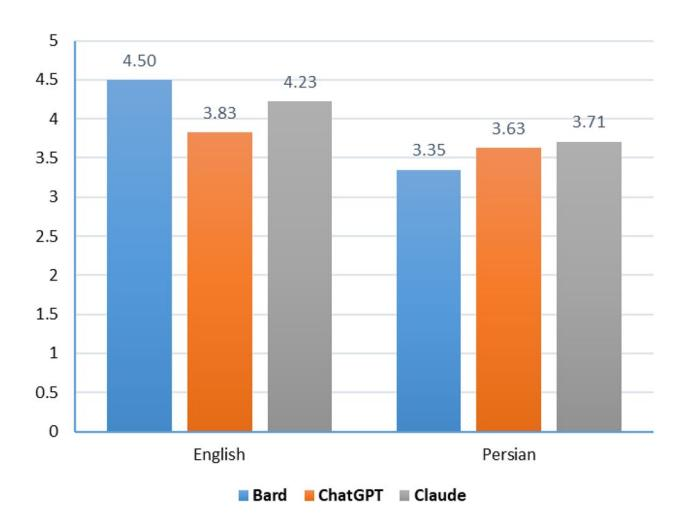
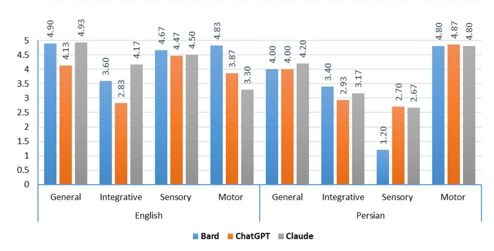
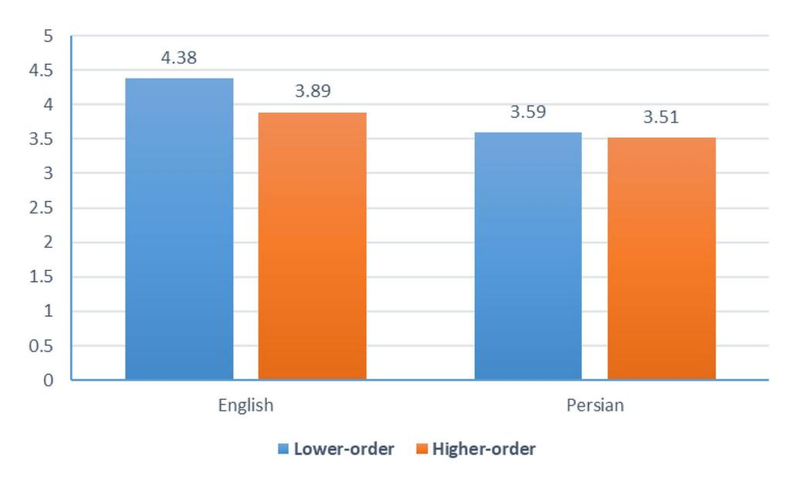
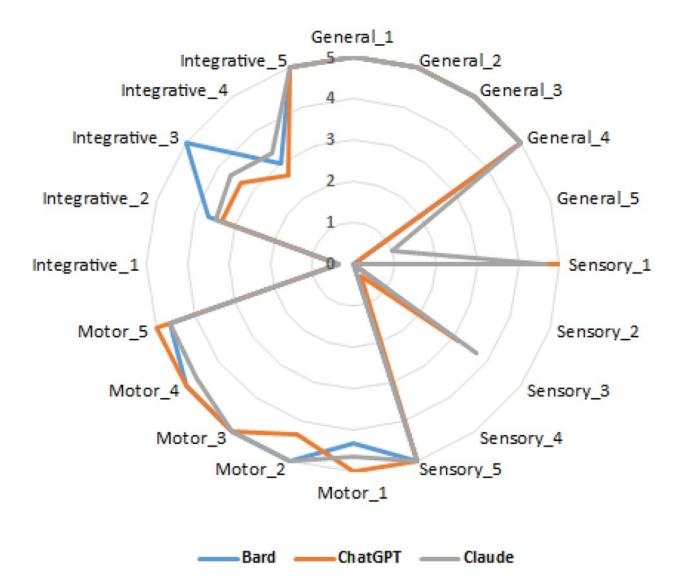
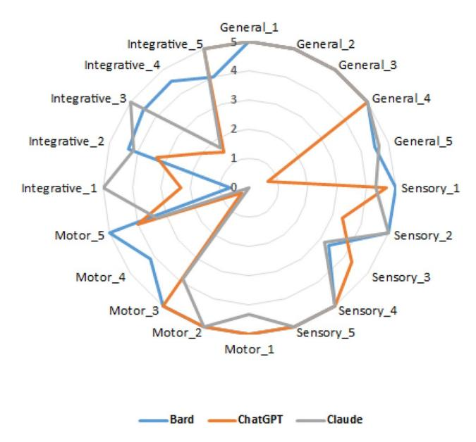

## **OPEN**

# **Evaluating the strengths and weaknesses of large language models in answering neurophysiology questions**

**Hassan Shojaee‑Mend1 , Reza Mohebbati2 , MostafaAmiri1,3 & AlirezaAtarodi4**\*

**Large language models (LLMs), like ChatGPT, Google's Bard, and Anthropic's Claude, showcase remarkable natural language processing capabilities. Evaluating their profciency in specialized domains such as neurophysiology is crucial in understanding their utility in research, education, and clinical applications. This study aims to assess and compare the efectiveness of Large Language Models (LLMs) in answering neurophysiology questions in both English and Persian (Farsi) covering a range of topics and cognitive levels. Twenty questions covering four topics (general, sensory system, motor system, and integrative) and two cognitive levels (lower-order and higher-order) were posed to the LLMs. Physiologists scored the essay-style answers on a scale of 0–5 points. Statistical analysis compared the scores across diferent levels such as model, language, topic, and cognitive levels. Performing qualitative analysis identifed reasoning gaps. In general, the models demonstrated good performance (mean score= 3.87/5), with no signifcant diference between language or cognitive levels. The performance was the strongest in the motor system (mean= 4.41) while the weakest was observed in integrative topics (mean= 3.35). Detailed qualitative analysis uncovered defciencies in reasoning, discerning priorities, and knowledge integrating. This study ofers valuable insights into LLMs' capabilities and limitations in the feld of neurophysiology. The models demonstrate profciency in general questions but face challenges in advanced reasoning and knowledge integration. Targeted training could address gaps in knowledge and causal reasoning. As LLMs evolve, rigorous domainspecifc assessments will be crucial for evaluating advancements in their performance.**

**Keywords** Large language models, Neurophysiology, Evaluation, Bloom's taxonomy

Te world is currently experiencing signifcant transformations as new tools and technology permeating every corner and aspect of our lives. People are shocked, contemplating the pros, cons and wondering how these advancements will impact us. Can we rely on these innovations? To fnd answers, researchers are delving into various approaches. Tey enter artifcial intelligence (AI), a captivating and signifcant phenomenon of our time, with versatile capabilities applicable to a wide range of tasks. Recently, there have been remarkable advancements in natural language processing (NLP). Tis progress has given rise to sophisticated large language models (LLMs) that can engage with humans in a remarkably human-like manner. Specifcally, chatbot platforms have made strides, providing accurate and contextually appropriate responses to users' queries[1](#page-8-0) . With this ongoing progress, there is a growing demand for reliable and efcient question-answering systems in specialized domains like neurophysiology.

Te rapid advancements in conversational AI have given rise to advanced language models capable of generating humanlike writing. With their wide range of functionalities, including generating human-like responses, profciency in professional exams, complex problem-solving, and more, these models have captivated interes[t2](#page-8-1) . Large language models (LLMs) are becoming increasingly popular in both academia and industry owing to their unprecedented performance in various applications. As LLMs continue to play a vital role in both research

Department of General Courses, Faculty of Medicine, Gonabad University of Medical Sciences, Gonabad, Iran. 2 Department of Physiology, Faculty of Medicine, Gonabad University of Medical Sciences, Gonabad, Iran. 3 Department of English Language and General Courses, School of Medicine, Mashhad University of Medical Sciences, Mashhad, Iran. 4 Department of Knowledge and Information Science, Paramedical College and Social Development & Health Promotion Research Center, Gonabad University of Medical Sciences, Gonabad, Iran. \*email: aratarodi1387@yahoo.com

and everyday activities, their evaluation becomes increasingly critical, not only at the task level but also at the society level to better comprehend their potential risks. In recent years, substantial eforts have been devoted to examine LLMs from diverse perspective[s3](#page-8-2) .

With the popularization of sofware like OpenAI's ChatGPT, Google's Bard and Anthropic's Claude, LLMs have permeated various aspects of life and work. Tey are used to provide customized recipes, suggesting substitutions for missing ingredients. It can be used to draf research proposals, write working code in many programming languages, translate text between languages, assist in policy making, and more. Users interact with LLMs through "prompts" or natural language instructions. Carefully designed prompts can signifcantly enhance the quality of better outputs[4](#page-8-3) . Tese models, designed to emulate human intelligence, employ statistical analyses to understand patterns and connections among words and phrases[1](#page-8-0) .

Neurophysiology, a key branch of neuroscience, is dedicated to unraveling the complex mechanisms governing the nervous system's operations. Investigating neurophysiological phenomena necessitates a deep grasp of diverse concepts, theories, and experimental approaches. Consequently, having a highly competent questionanswering system capable of addressing neurophysiology inquiries is of utmost importance to researchers, clinicians, and students in this feld. Questions in the system can be categorized into two categories, lower-order and higher-order questions, aligned with Bloom's taxonomy, enabling the assessment of language models' ability to respond to queries in each category. Bloom's taxonomy, a widely utilized framework in educational contexts, classifes cognitive levels into six domains: knowledge, comprehension, application, analysis, synthesis, and evaluation[5](#page-8-4) . By applying Bloom's taxonomy to evaluate LLMs, their efcacy in answering questions spanning various cognitive levels, including those in neurophysiology, can be gauged[6](#page-8-5) . By considering how well ChatGPT, Bard, and Claude perform at diferent topics and diferent levels of Bloom's taxonomy, their abilities to comprehensively and accurately address neurophysiology questions.

Previous publications evaluating LLMs across various disciplines have covered fields such as, gastroenterology[7](#page-8-6) , patholog[y8](#page-8-7) , neurology[9](#page-8-8) , physiolog[y6](#page-8-5)[,10,](#page-8-9) and solving case vignettes in physiolog[y11.](#page-8-10) In a crosssectional study, the performance of LLMs on neurology board–style examinations were assessed using a question bank approved by the American Board of Psychiatry and Neurology. Te questions were categorized into lower-order and higher-order based on the Bloom taxonomy for learning and assessmen[t9](#page-8-8) . To the best of our knowledge there was no study specifcally on evaluating LLMs in the feld of neurophysiology. Additionally, in studies within similar domains, most studies have investigated the ability of LLMs to provide accurate answers for multiple-choice questions[12](#page-8-11)[–14](#page-8-12). To comprehensively understand the strengths and weaknesses of these models in a sophisticated feld like neurophysiology, it is essential to evaluate the capabilities of these models in responding to essay questions, across all cognitive levels. Neurophysiology presents a diverse range of questions levels, making it a valuable area for assessing the strengths and limitations of LLMs.

Tis study compares the performance of three language models, namely, ChatGPT, Bard, and Claude, in answering neurophysiology questions in both the Persian and English languages. It focuses on various cognitive levels based on Bloom's Taxonomy and evaluates the models' reasoning process by asking for the rationale behind their responses. Te study aims to evaluate the performance of the LLMs in addressing neurophysiology questions in diferent cognitive levels, along with determining whether the models rely on memorization or demonstrate analytical reasoning and logical explanations. Moreover, it ofers insights into the capabilities of the LLMs by identifying potential reasons for incorrect answers to determine their weaknesses in responding to neurophysiology questions.

#### **Methodology**

Tis exploratory, applicational and cross-sectional study was carried out using AI-driven chat applications, including ChatGPT (chat.openai.com), Claude (claude.ai), and Bard (bard.google.com), which ofer free services for researchers. Te researchers aimed to assess the strengths and weaknesses of the selected LLMs in their ability to answer neurophysiology questions.

#### **Questions**

A total of 20 questions were chosen from four topics in neurophysiology, including general, sensory, motor, and integrative systems, with each topic comprising 5 questions. Te LLMs were asked to provide explanations for their selected answers for all questions, which encompassed true/false, multiple-choice, and essay formats. Terefore, all the questions were efectively essay questions allowing for a scoring range of 0–5 points for the responses. Furthermore, the questions were categorized based on cognitive skills into lower-order and higherorder categories, with each topic included 3 lower-order and 2 higher-order questions.

It is worth noting that, according to Bloom's taxonomy, memorization and recall are categorized as lowerlevel cognitive skills, necessitating only a minimal degree of comprehension. In contrast, the application of knowledge and critical thinking fall under the category of higher-level cognitive skills, requiring deep conceptual understating[15.](#page-8-13) A panel of three skilled physiologists was chosen to validate the questions and evaluate the answers of the LLMs to the questions. Tey were university lecturers who had at least 2 years of teaching experience in neurophysiology to medical students. Te questions, topics, and cognitive skills are listed in Table 1 of Supplementary 1.

#### **Data collection**

Te latest versions of ChatGPT 3.5 (November 21, 2023), Claude 2 (December 5, 2023), and Bard (November 21, 2023) were prompted with questions in both Persian and English languages. Tese versions are undergoing public testing for academic research. Te Persian and English questions, along with the answers generated by the three selected LLMs, were stored in separate fles for evaluation by the physiologists.

Notably, prompt engineering is essential to improve the efciency of LLMs. It includes strategies such as chain-of-thought (CoT) prompting and structured promptin[g16.](#page-8-14) Te CoT prompting has achieved the state-ofthe-art performances in arithmetic and symbolic reasoning[17,](#page-8-15)[18.](#page-8-16) Te model is instructed in the CoT prompting to provide step-by-step reasoning in generating a fnal answer, which could be few-shot or zero-shot[19](#page-8-17). Utilizing structured prompting, which includes important components such as context, the expected behavior, and the format of the output, is another strategy for achieving optimal outcomes. In this study, zero-shot CoT was employed by adding "let's think step by step" into the questions. Also, the following structured prompt was used for all the questions: "Imagine you are an expert physiologist with a specializing in neurophysiology. Answer the following question. {question…}. Explain the steps and reasons that lead you to the answer. write your fnal answer. Let's think step by step".

Te panel of three physiologists was asked to score each question on a scale of 0 to 5 points, where a score of 5 indicated a full and comprehensive response to the question. All data were recorded in an Excel fle for further analysis.

#### **Statistical analysis**

Te statistical analysis employed mean, median and standard deviation to provide a comprehensive overview of the data. Te Friedman test was used to assess if there were statistically signifcant variations in the scores of LLMs between Persian and English languages, with each group comprising 20 questions. Furthermore, the Kruskal‒Wallis's test was carried out to assess the signifcance of score diferences across four topics and two levels of cognitive skills. Te intraclass correlation coefcient (ICC), a two-way random model with absolute agreement,[20](#page-8-18) was used to evaluate the level of agreement among the physiologists' scores. Furthermore, the Wilcoxon signed rank test was applied to ascertain the signifcant diference between the scores of LLMs in Persian and English. A p value of below 0.05 was considered statistically signifcant. All statistical analyses were performed using SPSS sofware, version 22.

#### **Results**

Te responses from three LLMs, ChatGPT, Bard, and Claude, were collected for both Persian and English languages questions. Tree experienced physiologists evaluated the responses. Each question was given to the LLMs only once, simulating a student answering neurophysiology questions in an exam setting. As a result, the ambiguity of the questions or the LLMs lack of understanding of the question content or the unimportant content that should not be mentioned in the responses could afect the scores that the LLMs received from each question. Te Persian questions along with the answers of LLMs to these questions are shown in Supplementary 2, while the English questions along with the answers of LLMs are shown in Supplementary 3 and the evaluation results from the experts, including the average scores they assigned, are summarized in Supplementary 1 Table [2](#page-2-0).

Te evaluation results using by ICC, showed good agreement among the physiologists in scoring. Te ICC values for various topics ranged from 0.935 to 0.993. Te ICC value for all questions was 0.978 (F= 51.217, p < 0.001). Tis high level of agreement in the physiologists' scores signifes the reliability of expert opinions. Te results of the ICC test among the physiologists are shown in Table [1.](#page-2-1)

|                |     |                        | 95% Confdence interval |             |        |
|----------------|-----|------------------------|------------------------|-------------|--------|
| Topic          | N   | Intraclass correlation | Lower bound            | Upper bound | Sig    |
| General        | 30  | 0.992                  | 0.984                  | 0.996       | <0.001 |
| Sensory system | 30  | 0.985                  | 0.970                  | 0.992       | <0.001 |
| Motor system   | 30  | 0.962                  | 0.931                  | 0.981       | <0.001 |
| Integrative    | 30  | 0.957                  | 0.886                  | 0.982       | <0.001 |
| Total          | 120 | 0.978                  | 0.969                  | 0.985       | <0.001 |

**Table 1.** Interrater agreement among physiologists.

|         |         | General       | Sensory system   | Motor system    | Integrative      | Total            |
|---------|---------|---------------|------------------|-----------------|------------------|------------------|
| English | Bard    | 4.9±0.22 (5)  | 4.67±0.75 (5)    | 4.83±0.37 (5)   | 3.6±1.65 (4.33)  | 4.5±1.01 (5)     |
|         | ChatGPT | 4.13±1.94 (5) | 4.47±0.69 (4.67) | 3.87±2.02 (5)   | 2.83±1.38 (2.33) | 3.83±1.6 (4.83)  |
|         | Claude  | 4.93±0.15 (5) | 4.5±0.8 (5)      | 3.3±1.95 (3.83) | 4.17±1.44 (5)    | 4.23±1.32 (5)    |
| Persian | Bard    | 4±2.24 (5)    | 1.2±2.17 (0)     | 4.8±0.3 (5)     | 3.4±1.92 (3.67)  | 3.35±2.17 (4.83) |
|         | ChatGPT | 4±2.24 (5)    | 2.7±2.43 (3.17)  | 4.87±0.3 (5)    | 2.93±1.69 (3.33) | 3.63±1.93 (5)    |
|         | Claude  | 4.2±1.79 (5)  | 2.67±2.48 (3.67) | 4.8±0.18 (4.67) | 3.17±1.72 (3.5)  | 3.71±1.83 (4.67) |
| Total   |         | 4.36±1.59 (5) | 3.37±2.06 (4.5)  | 4.41±1.23 (5)   | 3.35±1.56 (3.58) | 3.87±1.7 (5)     |

**Table 2.** Mean±SD (Median) of scores by language, topic, and LLM.

Given the good agreement between the raters, the mean of their scores was used as the score for each question in the subsequent analysis. Te evaluation results from the physiologists showed that the overall performance of selected LLMs in responding to the questions, as well as the performance of each of LLMs in both English and Persian languages, were deemed satisfactory (Table [2\)](#page-2-0). Te overall mean score obtained for the questions was 3.87±1.7. As illustrated in Fig. [1](#page-3-0), the mean scores for various LLMs in the Persian and English languages ranged from 3.35 (Bard in Persian) to 4.50 (Bard in English). Nevertheless, the results of the Friedman test did not reveal any statistically signifcant diference in LLMs scores between Persian (p=0.794) and English (p=0.281). Overall, the average scores in English (Mean = 4.18, Median = 4.64) surpassed those in Persian (Mean = 3.56, Median=4.72). However, the Wilcoxon signed rank test showed that this diference was not statistically signifcant (p=0.222).

Regarding diferent topics, the highest scores were associated with the motor system topic, while the lowest score was obtained for the integrative topic (Table [2](#page-2-0)). Based on the results, the performance of LLMs can be generally evaluated as excellent for general and motor system topics, good for sensory system and integrative topics. Te best scores for the English questions were attributed to the general topic, whereas the weakest scores for the Persian questions were linked to the sensory topic (Fig. [2](#page-3-1)). Te results of the Kruskal‒Wallis's test revealed a signifcant diference in the scores for the integrative topic compared to other topics (p<0.001).

Moreover, regarding the cognitive level of the questions, the results of the Kruskal‒Wallis's test indicated that there was no signifcant diference between the scores (p=0.613). Te lowest score of 3.51 was recorded for higher-order questions in Persian, while the highest score of 4.38 was achieved for lower-order questions in English (Fig. [3](#page-4-0)).

Figures [4](#page-4-1) and [5](#page-5-0) show the mean scores for diferent questions in the Persian and English languages. Te proximity of the curves indicates the similarity in scores in diferent LLMs, while the closer the curves are to the

**Figure 1.** Mean scores for all LLMs in Persian and English.

**Figure 2.** Mean scores for LLMs in each topic and language.

**Figure 3.** Mean scores for cognitive skills in Persian and English.

**Figure 4.** Scores of LLMs to Persian questions.

outer edge of the diagram signifes higher scores for those question. Te diagrams suggest that for most questions, there is a comparable performance level among diferent LLMs. However, this consistency is not observed for certain questions. For instance, in the Persian questions, for the Sensory\_1 question, ChatGPT and Claude were provided nearly complete answers, but Bard received a score of zero. In addition, for Sensory\_3, the scores of ChatGPT and Claude achieved fairly scores, while Bard was unable to answer the question. In contrast, for Integrative\_3, both ChatGPT and Claude were unable to provide an answer, but Bard managed to receive a perfect score for the question (Fig. [4\)](#page-4-1).

For English questions, there are also questions where there is no similarity in performance among LLMs. For example, both Bard and Claude received almost full scores for General\_5, but ChatGPT struggled to provide correct answers to these questions. Moreover, for Motor\_4, both ChatGPT and Claude were unable to ofer a satisfactory response, whereas Bard's answer was almost complete. In contrast, for Integrative\_4, both ChatGPT and Claude fell short in providing a good answer, but Bard managed to achieve a perfect score for the question (Fig. [5](#page-5-0)).

In addition to the inconsistency in responses, in some questions, almost none of the LLMs were able to adequately respond to the question. For further analysis, the questions to which LLMs couldn't respond adequately were identifed. Te total possible scores of the three language models for each question in Persian and English were 15. Questions with a mean score of 3 or less for each LLM were selected based on the criterion. Terefore,

**Figure 5.** Scores of LLMs to English questions.

questions for which the total score of all LLMs were equal or less than 9 were chosen. In Persian, the selected questions included General\_5, Sensory\_2, Sensory\_3, Sensory\_4, Integrative\_1 and Integrative\_4 questions. Additionally, for the English questions, the total score was below 9 for Motor\_4, Integrative\_1 and Integrative\_4.

#### **General\_5 question: Is myelination of postganglionic sympathetic fbers done by Schwann cells?**

Te correct answer to this question is that postganglionic sympathetic fbers lack myelin. Te use of the phrase "by Schwann cells" in the question stem is a misleading phrase. In the Persian language, none of the language models could provide the correct answer even afer removing the misleading phrase from the question. Trough further questions, it became clear that in Persian, postganglionic sympathetic fbers were incorrectly categorized as type A instead of type C. Also, none of the models had sufcient information regarding which types of fbers are myelinated. Hence, the cause of the wrong answer in the Persian language can be considered as "having inaccurate information" in the LLMs, but by removing the misleading phrase from the question, all LLMs were able to provide the correct answer in the English language. Terefore, the cause of the initial incorrect answer in English in the ChatGPT can be attributed to the presence of a "misleading phrase in the question".

# **Sensory\_2 question: Are sexual sensations mostly transmitted through the posterior col‑ umn—medial lemniscus?**

Te correct answer to this question is "No". In Persian, Bard did not provide a response to the question and instead wrote: "I am a language model and do not have the capacity to understand or respond to this query". Probably the Persian equivalent of the phrase "sexual sensations" has led to this response. Two other LLMs also failed to provide a correct response. By changing the question and using the English phrase equivalent to the 'posterior column-medial lemniscus' in Persian all LLMs were able to provide the correct answer in Persian. Terefore, the reason for the wrong answer to this question in Persian can be expressed as "incorrect translation for phrases in Persian".

#### **Sensory\_3 question: State key components, including nuclei and neurotransmitters, in the central nervous system analgesic pathway?**

Te correct answer is "the PAG projects enkephalinergic neurons to the Raphe, and afer stimulation, the serotonergic projections go to the spine and stimulate the enkephalinergic neurons that cause pain inhibition". In response to this essay question, the LLMs failed to mention some important nuclei or mentioned nuclei that were of lesser importance. Tis means that the most important phrase in the question was not considered. Tis lack of attention to importance was present in both the Persian and English languages responses, with a more pronounced efect in Persian. Tus, the reason for the incorrect response to this question can be stated as "not considering the importance and priority" and providing "insignifcant additional explanation" compared to a knowledgeable individual in this feld.

#### **Sensory\_4 question: Which sensation is NOT transmitted through the anterolateral pathway? A) Chronic pain B) Cold sensation C) Touch sensation from Meissner receptor D) Touch sensa‑ tion from Rufni receptors.**

Te sensation that is not transmitted through the anterolateral pathway is (C) Touch sensation from Meissner receptors. LLMs in English provided the correct answer to this question, whereas LLMs in Persian answered it incorrectly. Claude stated that Meissner receptors transmit the sensation of pressure to the brain, while Rufni receptors transmit the sensations of contact and vibration. However, the opposite of this statement is correct. Moreover, ChatGPT and Bard ofered general rather than specialized information with details regards to this question. Hence, the reason for the incorrect response in the Persian language can be attributed to as "inaccurate information" and "insufcient specialized knowledge" in Persian language concerning this question.

#### **Motor\_4 question: Does microinjection of glutamate into the medullary reticular nucleus cause relaxation of axial muscles?**

Te correct answer is "Yes". ChatGPT and Claude failed to provide the accurate response to this question. Research indicates that neural projections can exhibit both excitatory and inhibitory functions. So, these two LLMs focused on the excitatory aspect. However, stronger evidence from textbooks supports the idea that neural projections can indeed be inhibitory. Terefore, the reason for the incorrect response can be attributed to "neglecting the signifcance of available evidence".

#### **Integrative\_1 question: In medical science and neurophysiology, is knowing "my birthday is January 10, 1998" an example of semantic explicit memory?**

Te correct answer is "No". Because stating my birthday date is only a claim about a past event, which can be considered a verifed fact if supported by evidence confrming that event. None of the LLMs, except for Claude, managed to provide the correct response in either Persian or English. Tey mistakenly treated this statement as a fact.

Most likely, the reason for that is the absence of a similar sentence in the training texts used for the LLMs. Terefore, the reason for the incorrect answer to this question can be considered "using non-existent example" and "lack of reasoning ability" for questions that require reasoning based on prior knowledge and applying that knowledge to the current context.

**Integrative\_4 question: In medical science and neurophysiology, which of the following rep‑ resents explicit memory? A) The Shahnameh is the masterpiece of the great Iranian poet named Ferdowsi B) Today I arrived about 7 minutes late to physiology class. I'm usually late for classes. C) In 2010 my house had a major fre D) One of my elementary school friends' last names ended in "Abadi" or "Abadian"**

Te correct answers are A and C. ChatGPT correctly identifed that option A is a fact and pertains to semantic memory. Also, it initially stated that the explicit memory consists of semantic and episodic types. However, in the fnal summary, despite initially identifying it as semantic, it failed to categorize it as explicit memory.

Regarding option B, it also correctly mentioned that it does not pertain to long-term memory and therefore, cannot be explicit memory. Yet in the fnal summary, it categorized it as explicit memory. For option D, the lack of accurate recollection of the past, a complete memory has not formed and therefore it is not explicit, which most LLMs failed to identify. Terefore, the reason for the incorrect answer can be considered as "insufcient specialized information" and "lack of reasoning ability". Te facts are correctly stated step-by-step, but combining these facts and deducing conclusions from them is not executed efectively.

#### **Discussion**

Tree LLMs, ChatGPT, Bard, and Claude, were used to assess their capacity in providing comprehensive and logical answers to neurophysiology essay prompts in both Persian and English languages. Tese LLMs can respond to complex commands by analyzing and comprehending the supplied text, utilizing their highly advanced natural language processing capabilities and their vast training dataset[s8](#page-8-7) . Te results showed that, overall, the models demonstrated commendable profciency in addressing neurophysiology queries. However, certain variations among the models were observed depending upon the specifc topic of the inquiries.

Across the various topics analyzed, the LLMs performed the best on queries concerning to the motor system and general neurophysiology, indicating their strength in addressing fundamental principles. In terms of sensory system topics, the performance was moderately solid, suggesting that the models can comprehend and explain sensory neurophysiology to a certain degree. However, when faced with integrative questions, the scores signifcantly dropped. Tis underscores a present constraint of the models in tackling complex, multi-step reasoning requiring integration of knowledge across neurophysiology topics. Tailored training focusing on integrative concepts could help improve LLMs' capabilities in this realm [17.](#page-8-15)

Interestingly, although there were no signifcant disparities in the performance of the models in Persian and English or between lower-order and higher-order questions, a detailed analysis revealed some inconsistencies. A qualitative analysis of the responses unveiled defciencies in reasoning capabilities, particularly evident in unfamiliar question scenarios that necessitate adaptable application of knowledge. For certain questions, one model excelled, while others faltered, without a discernible pattern. Tis lack of uniformity implies knowledge gaps and variances in the training of the distinct model[s21.](#page-8-19) Additionally, all three models struggled with several complex questions in both languages, yielding subpar scores. Tis further underscore the limitations of these models in advanced reasoning and handling ambiguous and multifaceted questions.

When comparing languages, the scores were mostly comparable for all the LLMs. Te models appeared to have acquired sufcient linguistic knowledge profciency to comprehend and provide accurate responses in both languages. Nonetheless, a few incorrect answers unique to Persian emphasized defciencies in the information encoded in the models for that language. Overall, the outcomes confrm the efectiveness of LLMs for addressing neurophysiology inquiries in various languages.

An in-depth review of the incorrect responses shed light on the specifc limitations of the LLMs. Providing fawed information and the inability to discern key aspects of questions emerged as some of the defciencies. However, some studies have reported a satisfactory reasoning level in LLMs[22,](#page-8-20) and a defciency in reasoning for unfamiliar scenarios has been identifed as one of the defciencies in providing correct answers in various questions. Tese gaps need to be addressed through more extensive training of the models utilizing high-quality data encompassing diverse neurophysiology topics, contexts, and linguistic nuances. Te subpar performance on integrative questions can be attributed to the models' reliance on memorization and pattern recognition from the training data rather than a profound comprehension of the concepts.

Although large datasets help them to remember facts and terminology, it is still difcult for LLMs to integrate knowledge across topics to solve new problems. Although previous studies demonstrating that CoT prompting improves the reasoning abilities of the LLM[s16–](#page-8-14)[18](#page-8-16), in this study, the utilization of zero-shot CoT prompting resulted in instances where the steps to arrive at an answer were correctly outlined, but the fnal conclusion based on these steps was inaccurate for certain neurophysiology questions. Terefore, it seems that in the feld of neurophysiology, one of the main weaknesses of the LLMs lies in their reasoning capabilities. Further training focused on constructing causal models of physiology could address this issue more efectively than relying solely on statistical associations.

Te results of Mahowald et al[.23](#page-8-21) and Tuckute et al[.24](#page-8-22) align with the results we found in our study, indicating that LLMs excel in formal language abilities but exhibit limitations in real-world language understanding and cognitive skills. Te Models lack reasoning skills, world knowledge, situation modeling, and social cognition[23](#page-8-21),[24](#page-8-22). Moreover, Schubert et al. concluded that higher-order cognitive tasks posed signifcant challenging for both GPT-4 and GPT-3.5[25.](#page-8-23) While some researchers express cautious optimism in these cases and express their opinions such as Puchert et al., LLMs have transformed natural language processing and their impressive capabilities, concerns are raised regarding their tendency to generate hallucinations, providing inaccurate information in their responses.

It is emphasized that rigorous evaluation methods are essential to ensure accurate assessment of LLM performance. Evaluations of LLM performance in specifc knowledge domains, based on question-and-answer datasets, ofen rely on a single accuracy metric for the entire feld, which hampers transparency and model enhancement[26](#page-8-24). Loconte et al. claimed that while ChatGPT was well known to exhibit outstanding performance in generative linguistic tasks, its performance on prefrontal tests exhibited variability, as they reached the results, with some tests yielding results well above average, others falling in the lower range, and some showing signifcant impairment[27](#page-8-25). Tese diverse perspectives underscore the need for a nuanced understanding of LLMs capabilities and limitations across diferent cognitive tasks and domains.

Overall, the study fndings demonstrate that LLMs like ChatGPT, Bard, and Claude have achieved impressive profciency in responding neurophysiology questions, however, they still face challenges in some aspects of knowledge application, reasoning, and integration. It is evident that there is room for improvement in how these models operate, particularly in answering complex and ambiguous questions that require multistep reasoning and integration of knowledge across diverse topics. Te variability observed among diferent models also highlights the need for ongoing evaluation. As LLMs continue to evolve, rigorous assessment across various knowledge domains will be essential for their continued enhancement and efectiveness.

#### **Conclusion**

Tis study provides insights into the capabilities of LLMs in answering neurophysiology questions. Te results indicate that ChatGPT, Bard, and Claude can successfully address numerous fundamental concepts but face challenges when it comes to more complex reasoning and integration and synthesizing information of knowledge across diferent topics.

Overall, the models demonstrated relatively strong performance on general neurophysiology and motor system questions with moderate profciency in sensory neurophysiology. However, they struggled with integrative questions requiring multistep inference. Tere was no signifcant diference between languages or cognitive levels. Nevertheless, qualitative analysis revealed inconsistencies and defciencies, indicating that the models rely heavily on memorization rather than a profound conceptual grasp.

Te incorrect responses underscore shortcomings in reasoning, discerning key information, considering the level of importance and priority levels, lack of sufcient information specially in Persian and handling unfamiliar questions. Tailored training focusing on causal physiologic models instead of statistical associations and utilizing reliable sources in various languages could help overcome these limitations. As LLMs advance, rigorous multidisciplinary assessments will be essential to gauge progress and measure advancements.

Tis study provides a robust evaluation methodology and benchmark for future research aimed at enhancing the neurophysiology knowledge and reasoning competence of these models. Te insights can inform eforts to refne LLMs through advanced training techniques and the evaluation of complex integrative tasks. By focusing on targeted improvements, these models hold immense promise in advancing neurophysiology education, research, and clinical practice. Te study's fndings pave the way for further advancements in LLM technology, ultimately benefting the feld of neurophysiology and beyond.

#### **Data availability**

Te authors declare that there is no relevant data available for this study. All data used in the analysis and preparation of this manuscript have been included in the manuscript.

Received: 12 September 2023; Accepted: 23 April 2024

#### **References**

- 1. Tirunavukarasu, A. J. *et al.* Large language models in medicine. *Nat. Med.* **2023**, 1–11 (2023).
- 2. Ahmed, I., Roy, A. & Kajol, M. *et al*. ChatGPT vs. Bard: A comparative study (Authorea, 2023).
- 3. Tang, L. *et al.* Evaluating large language models on medical evidence summarization. *NPJ Digital Med.* **6**, 158 (2023).
- 4. Lim, S. & Schmälzle, R. Artifcial intelligence for health message generation: An empirical study using a large language model (LLM) and prompt engineering. *Front. Commun.* **8**, 1129082 (2023).
- 5. Rakhmonova, S. & Rakhmatov, B. Bloom's taxionomy and didactic signifcance of critical thinking method in the educational process. *Innov. Dev. Educ. Activit.* **2**, 94–98 (2023).
- 6. Agarwal, M., Sharma, P. & Goswami, A. Analysing the applicability of ChatGPT, Bard, and Bing to generate reasoning-based multiple-choice questions in medical physiology. *Cureus* **2023**, 15 (2023).
- 7. Lahat, A. *et al.* Evaluating the use of large language model in identifying top research questions in gastroenterology. *Sci. Rep.* **13**, 4164.<https://doi.org/10.1038/s41598-023-31412-2> (2023).
- 8. Sinha, R. K., Deb Roy, A., Kumar, N. & Mondal, H. Applicability of ChatGPT in assisting to solve higher order problems in pathology. *Cureus* **15**, e35237. <https://doi.org/10.7759/cureus.35237>(2023).
- 9. Schubert, M. C., Wick, W. & Venkataramani, V. Performance of large language models on a neurology board-style examination. *JAMA Netw. Open* **6**, e2346721–e2346721.<https://doi.org/10.1001/jamanetworkopen.2023.46721> (2023).
- 10. Banerjee, A., Ahmad, A., Bhalla, P. & Goyal, K. Assessing the efcacy of ChatGPT in solving questions based on the core concepts in physiology. *Cureus* **2023**, 15 (2023).
- 11. Dhanvijay, A. K. D. *et al.* Performance of large language models (ChatGPT, Bing Search, and Google Bard) in solving case vignettes
- in physiology. *Cureus* **2023**, 15 (2023). 12. Duong, D. & Solomon, B. D. Analysis of large-language model versus human performance for genetics questions. *Eur. J. Hum.*
- *Genet.* <https://doi.org/10.1038/s41431-023-01396-8> (2023). 13. Gilson, A. *et al.* How Does ChatGPT perform on the United States medical licensing examination? Te implications of large language models for medical education and knowledge assessment. *JMIR Med. Educ.* **9**, e45312.<https://doi.org/10.2196/45312>
- (2023). 14. Khorshidi, H. *et al.* Application of ChatGPT in multilingual medical education: How does ChatGPT fare in 2023's Iranian residency entrance examination. *Inf. Med. Unlocked* **41**, 101314 (2023).
- 15. Crowe, A., Dirks, C. & Wenderoth, M. P. Biology in bloom: implementing Bloom's taxonomy to enhance student learning in biology. *CBE Life Sci. Educ.* **7**, 368–381 (2008).
- 16. Heston, T. F. & Khun, C. Prompt engineering in medical education. *Int. Med. Educ.* **2**, 198–205 (2023).
- 17. Kojima, T., Gu, S. S., Reid, M., Matsuo, Y. & Iwasawa, Y. Large language models are zero-shot reasoners. *Adv. Neural. Inf. Process. Syst.* **35**, 22199–22213 (2022).
- 18. Wei, J. *et al.* Chain-of-thought prompting elicits reasoning in large language models. *Adv. Neural. Inf. Process. Syst.* **35**, 24824–24837 (2022).
- 19. Tan, T. F. *et al.* Generative artifcial intelligence through ChatGPT and other large language models in ophthalmology: Clinical applications and challenges. *Ophthalmol. Sci.* **3**, 100394.<https://doi.org/10.1016/j.xops.2023.100394> (2023).
- 20. Koo, T. K. & Li, M. Y. A guideline of selecting and reporting intraclass correlation coefcients for reliability research. *J. Chiropr. Med.* **15**, 155–163.<https://doi.org/10.1016/j.jcm.2016.02.012> (2016).
- 21. Singhal, K. *et al.* Large language models encode clinical knowledge. *Nature* **620**, 172–180. [https://doi.org/10.1038/s41586-023-](https://doi.org/10.1038/s41586-023-06291-2) [06291-2](https://doi.org/10.1038/s41586-023-06291-2) (2023).
- 22. Webb, T., Holyoak, K. J. & Lu, H. Emergent analogical reasoning in large language models. *Nat. Hum. Behav.* [https://doi.org/10.](https://doi.org/10.1038/s41562-023-01659-w) [1038/s41562-023-01659-w](https://doi.org/10.1038/s41562-023-01659-w) (2023).
- 23. Mahowald, K. *et al.* Dissociating language and thought in large language models: A cognitive perspective. [arXiv:2301.06627](http://arxiv.org/abs/2301.06627) (2023).
- 24. Tuckute, G. *et al.* Driving and suppressing the human language network using large language models. *BioRxiv* **2016**, 537080 (2023).
- 25. Schubert, M. C., Wick, W. & Venkataramani, V. Evaluating the performance of large language models on a neurology board-style examination. *MedRxiv* **42**, 39 (2023).
- 26. Puchert, P., Poonam, P., van Onzenoodt, C. & Ropinski, T. LLMMaps—a visual metaphor for stratifed evaluation of large language models. [arXiv:2304.00457](http://arxiv.org/abs/2304.00457) (2023).
- 27. Loconte, R., Orrù, G., Tribastone, M., Pietrini, P. & Sartori, G. Challenging ChatGPT'Intelligence'with human tools: A neuropsychological investigation on prefrontal functioning of a large language model. *Intelligence* **2023**, 145 (2023).

#### **Author contributions**

H.S. and R.M. designed and performed the research and wrote the paper; H.S., R.M., M.A., and A.A. contributed to the analysis and revised the paper critically. All authors approved the version to be published.

#### **Competing interests**

Te authors declare no competing interests.

### **Additional information**

**Supplementary Information** Te online version contains supplementary material available at [https://doi.org/](https://doi.org/10.1038/s41598-024-60405-y) [10.1038/s41598-024-60405-y](https://doi.org/10.1038/s41598-024-60405-y).

**Correspondence** and requests for materials should be addressed to A.A.

**Reprints and permissions information** is available at [www.nature.com/reprints.](www.nature.com/reprints)

**Publisher's note** Springer Nature remains neutral with regard to jurisdictional claims in published maps and institutional afliations.

**Open Access** Tis article is licensed under a Creative Commons Attribution 4.0 International License, which permits use, sharing, adaptation, distribution and reproduction in any medium or format, as long as you give appropriate credit to the original author(s) and the source, provide a link to the Creative Commons licence, and indicate if changes were made. Te images or other third party material in this article are included in the article's Creative Commons licence, unless indicated otherwise in a credit line to the material. If material is not included in the article's Creative Commons licence and your intended use is not permitted by statutory regulation or exceeds the permitted use, you will need to obtain permission directly from the copyright holder. To view a copy of this licence, visit<http://creativecommons.org/licenses/by/4.0/>.

© Te Author(s) 2024