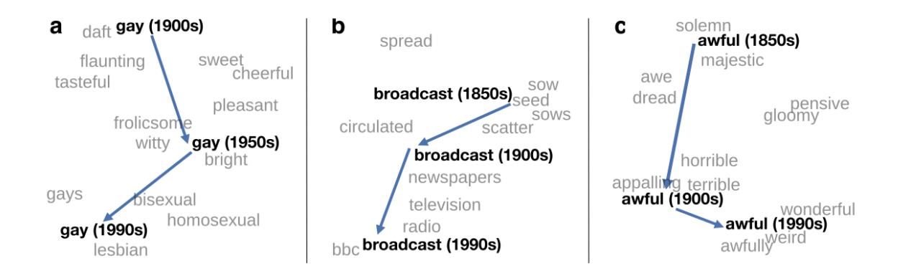
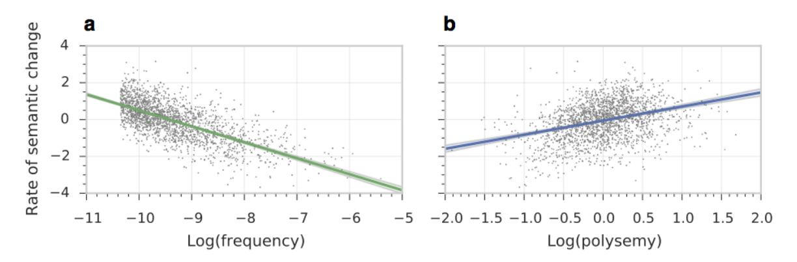
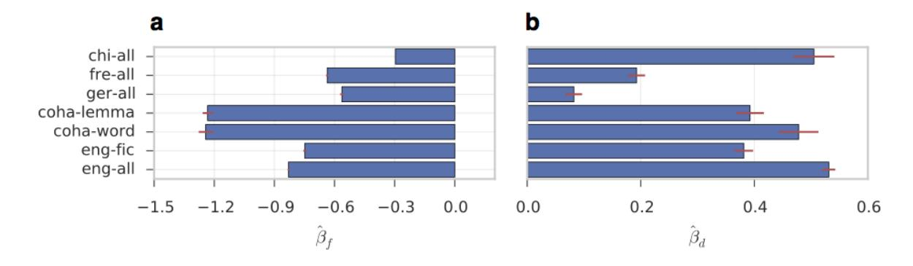

# Diachronic Word Embeddings Reveal Statistical Laws of Semantic Change

## William L. Hamilton, Jure Leskovec, Dan Jurafsky

Department of Computer Science, Stanford University, Stanford CA, 94305 wleif,jure,jurafsky@stanford.edu

# Abstract

Understanding how words change their meanings over time is key to models of language and cultural evolution, but historical data on meaning is scarce, making theories hard to develop and test. Word embeddings show promise as a diachronic tool, but have not been carefully evaluated. We develop a robust methodology for quantifying semantic change by evaluating word embeddings (PPMI, SVD, word2vec) against known historical changes. We then use this methodology to reveal statistical laws of semantic evolution. Using six historical corpora spanning four languages and two centuries, we propose two quantitative laws of semantic change: (i) the *law of conformity*—the rate of semantic change scales with an inverse power-law of word frequency; (ii) the *law of innovation*—independent of frequency, words that are more polysemous have higher rates of semantic change.

## 1 Introduction

Shifts in word meaning exhibit systematic regularities (Breal, 1897; Ullmann, 1962). The rate ´ of semantic change, for example, is higher in some words than others (Blank, 1999) — compare the stable semantic history of *cat* (from Proto-Germanic *kattuz*, "cat") to the varied meanings of English *cast*: "to mould", "a collection of actors', "a hardened bandage", etc. (all from Old Norse *kasta*, "to throw", Simpson et al., 1989).

Various hypotheses have been offered about such regularities in semantic change, such as an increasing subjectification of meaning, or the grammaticalization of inferences (e.g., Geeraerts, 1997; Blank, 1999; Traugott and Dasher, 2001).

But many core questions about semantic change remain unanswered. One is the role of *frequency*. Frequency plays a key role in other linguistic changes, associated sometimes with faster change—sound changes like lenition occur in more frequent words—and sometimes with slower change—high frequency words are more resistant to morphological regularization (Bybee, 2007; Pagel et al., 2007; Lieberman et al., 2007). What is the role of word frequency in meaning change?

Another unanswered question is the relationship between semantic change and *polysemy*. Words gain senses over time as they semantically drift (Breal, 1897; Wilkins, 1993; Hopper and Trau- ´ gott, 2003), and polysemous words1 occur in more diverse contexts, affecting lexical access speed (Adelman et al., 2006) and rates of L2 learning (Crossley et al., 2010). But we don't know whether the diverse contextual use of polysemous words makes them more or less likely to undergo change (Geeraerts, 1997; Winter et al., 2014; Xu et al., 2015). Furthermore, polysemy is strongly correlated with frequency—high frequency words have more senses (Zipf, 1945; ˙Ilgen and Karaoglan, 2007)—so understanding how polysemy relates to semantic change requires controling for word frequency.

Answering these questions requires new methods that can go beyond the case-studies of a few words (often followed over widely different timeperiods) that are our most common diachronic data (Breal, 1897; Ullmann, 1962; Blank, 1999; ´ Hopper and Traugott, 2003; Traugott and Dasher, 2001). One promising avenue is the use of distributional semantics, in which words are embedded in vector spaces according to their co-occurrence relationships (Bullinaria and Levy, 2007; Turney and Pantel, 2010), and the embeddings of words

1We use 'polysemy' here to refer to related senses as well as rarer cases of accidental homonymy.

Figure 1: Two-dimensional visualization of semantic change in English using SGNS vectors.2 a, The word *gay* shifted from meaning "cheerful" or "frolicsome" to referring to homosexuality. b, In the early 20th century *broadcast* referred to "casting out seeds"; with the rise of television and radio its meaning shifted to "transmitting signals". c, *Awful* underwent a process of pejoration, as it shifted from meaning "full of awe" to meaning "terrible or appalling" (Simpson et al., 1989).

are then compared across time-periods. This new direction has been effectively demonstrated in a number of case-studies (Sagi et al., 2011; Wijaya and Yeniterzi, 2011; Gulordava and Baroni, 2011; Jatowt and Duh, 2014) and used to perform largescale linguistic change-point detection (Kulkarni et al., 2014) as well as to test a few specific hypotheses, such as whether English synonyms tend to change meaning in similar ways (Xu and Kemp, 2015). However, these works employ widely different embedding approaches and test their approaches only on English.

In this work, we develop a robust methodology for quantifying semantic change using embeddings by comparing state-of-the-art approaches (PPMI, SVD, word2vec) on novel benchmarks.

We then apply this methodology in a large-scale cross-linguistic analysis using 6 corpora spanning 200 years and 4 languages (English, German, French, and Chinese). Based on this analysis, we propose two statistical laws relating frequency and polysemy to semantic change:

- The law of conformity: Rates of semantic change scale with a negative power of word frequency.
- The law of innovation: After controlling for frequency, polysemous words have significantly higher rates of semantic change.

## 2 Diachronic embedding methods

The following sections outline how we construct diachronic (historical) word embeddings, by first constructing embeddings in each time-period and then aligning them over time, and the metrics that we use to quantify semantic change. All of the learned embeddings and the code we used to analyze them are made publicly available.3

#### 2.1 Embedding algorithms

We use three methods to construct word embeddings within each time-period: PPMI, SVD, and SGNS (i.e., word2vec).4 These distributional methods represent each word wi by a vector wi that captures information about its co-occurrence statistics. These methods operationalize the 'distributional hypothesis' that word semantics are implicit in co-occurrence relationships (Harris, 1954; Firth, 1957). The semantic similarity/distance between two words is approximated by the cosine similarity/distance between their vectors (Turney and Pantel, 2010).

## 2.1.1 PPMI

In the PPMI representations, the vector embedding for word wi ∈ V contains the positive point-wise mutual information (PPMI) values between wi and a large set of pre-specified 'context' words. The word vectors correspond to the rows of the matrix MPPMI ∈ R |V|×|VC | with entries given by

$$\mathbf{M}_{i,j}^{\text{PPMI}} = \max \left\{ \log \left( \frac{\hat{p}(w_i, c_j)}{\hat{p}(w)\hat{p}(c_j)} \right) - \alpha, 0 \right\},$$
(1)

where cj ∈ VC is a context word and α > 0 is a negative prior, which provides a smoothing bias (Levy et al., 2015). The pˆ correspond to the smoothed empirical probabilities of word

2Appendix B details the visualization method.

3 http://nlp.stanford.edu/projects/histwords

4 Synchronic applications of these three methods are reviewed in detail in Levy et al. (2015).

| Name   | Language | Description               | Tokens           | Years     |
|--------|----------|---------------------------|------------------|-----------|
| ENGALL | English  | Google books (all genres) | 1011 8.5 × | 1800-1999 |
| ENGFIC | English  | Fiction from Google books | 1010 7.5 × | 1800-1999 |
| COHA   | English  | Genre-balanced sample     | 108 4.1 ×  | 1810-2009 |
| FREALL | French   | Google books (all genres) | 1011 1.9 × | 1800-1999 |
| GERALL | German   | Google books (all genres) | 1010 4.3 × | 1800-1999 |
| CHIALL | Chinese  | Google books (all genres) | 1010 × 6.0 | 1950-1999 |

Table 1: Six large historical datasets from various languages and sources are used.

(co-)occurrences within fixed-size sliding windows of text. Clipping the PPMI values above zero ensures they remain finite and has been shown to dramatically improve results (Bullinaria and Levy, 2007; Levy et al., 2015); intuitively, this clipping ensures that the representations emphasize positive word-word correlations over negative ones.

#### 2.1.2 SVD

SVD embeddings correspond to low-dimensional approximations of the PPMI embeddings learned via singular value decomposition (Levy et al., 2015). The vector embedding for word wi is given by

$$\mathbf{w}_i^{\text{SVD}} = (\mathbf{U}\mathbf{\Sigma}^{\gamma})_i, \qquad (2)$$

where MPPMI = UΣV&gt; is the truncated singular value decomposition of MPPMI and γ ∈ [0, 1] is an eigenvalue weighting parameter. Setting γ < 1 has been shown to dramatically improve embedding qualities (Turney and Pantel, 2010; Bullinaria and Levy, 2012). This SVD approach can be viewed as a generalization of Latent Semantic Analysis (Landauer and Dumais, 1997), where the term-document matrix is replaced with MPPMI . Compared to PPMI, SVD representations can be more robust, as the dimensionality reduction acts as a form of regularization.

#### 2.1.3 Skip-gram with negative sampling

SGNS 'word2vec' embeddings are optimized to predict co-occurrence relationships using an approximate objective known as 'skip-gram with negative sampling' (Mikolov et al., 2013). In SGNS, each word wi is represented by two dense, low-dimensional vectors: a word vector (wSGNS i ) and context vector (c SGNS i ). These embeddings are optimized via stochastic gradient descent so that

$$\hat{p}(c_i|w_i) \propto \exp(\mathbf{w}_i^{\text{SGNS}} \cdot \mathbf{c}_j^{\text{SGNS}}),$$
 (3)

where p(ci |wi) is the empirical probability of seeing context word ci within a fixed-length window of text, given that this window contains wi . The SGNS optimization avoids computing the normalizing constant in (3) by randomly drawing 'negative' context words, cn, for each target word and ensuring that exp(wSGNS i ·c SGNS n ) is small for these examples.

SGNS has the benefit of allowing incremental initialization during learning, where the embeddings for time t are initialized with the embeddings from time t − ∆ (Kim et al., 2014).

# 2.2 Datasets, pre-processing, and hyperparameters

We trained models on the 6 datasets described in Table 1, taken from Google N-Grams (Lin et al., 2012) and the COHA corpus (Davies, 2010). The Google N-Gram datasets are extremely large (comprising ≈6% of all books ever published), but they also contain many corpus artifacts due, e.g., to shifting sampling biases over time (Pechenick et al., 2015). In contrast, the COHA corpus was carefully selected to be genre-balanced and representative of American English over the last 200 years, though as a result it is two orders of magnitude smaller. The COHA corpus also contains pre-extracted word lemmas, which we used to validate that our results hold at both the lemma and raw token levels. All the datasets were aggregated to the granularity of decades.5

We follow the recommendations of Levy et al. (2015) in setting the hyperparameters for the embedding methods, though preliminary experiments were used to tune key settings. For all methods, we used symmetric context windows of size 4 (on each side). For SGNS and SVD, we use embeddings of size 300. See Appendix A for further implementation and pre-processing details.

5The 2000s decade of the Google data was discarded due to shifts in the sampling methodology (Michel et al., 2011).

## 2.3 Aligning historical embeddings

In order to compare word vectors from different time-periods we must ensure that the vectors are aligned to the same coordinate axes. Explicit PPMI vectors are naturally aligned, as each column simply corresponds to a context word. Low-dimensional embeddings will not be naturally aligned due to the non-unique nature of the SVD and the stochastic nature of SGNS. In particular, both these methods may result in arbitrary orthogonal transformations, which do not affect pairwise cosine-similarities within-years but will preclude comparison of the same word across time. Previous work circumvented this problem by either avoiding low-dimensional embeddings (e.g., Gulordava and Baroni, 2011; Jatowt and Duh, 2014) or by performing heuristic local alignments per word (Kulkarni et al., 2014).

We use orthogonal Procrustes to align the learned low-dimensional embeddings. Defining W(t) ∈ R d×|V| as the matrix of word embeddings learned at year t, we align across time-periods while preserving cosine similarities by optimizing:

$$\mathbf{R}^{(t)} = \arg\min_{\mathbf{Q}^{\top}\mathbf{Q} = \mathbf{I}} \|\mathbf{Q}\mathbf{W}^{(t)} - \mathbf{W}^{(t+1)}\|_{F}, \quad (4)$$

with R(t) ∈ R d×d . The solution corresponds to the best rotational alignment and can be obtained efficiently using an application of SVD (Schonemann, 1966). ¨

#### 2.4 Time-series from historical embeddings

Diachronic word embeddings can be used in two ways to quantify semantic change: (i) we can measure changes in pair-wise word similarities over time, or (ii) we can measure how an individual word's embedding shifts over time.

Pair-wise similarity time-series Measuring how the cosine-similarity between pairs of words changes over time allows us to test hypotheses about specific linguistic or cultural shifts in a controlled manner. We quantify shifts by computing the similarity time-series

$$s^{(t)}(w_i, w_j) = \operatorname{cos-sim}(\mathbf{w}_i^{(t)}, \mathbf{w}_j^{(t)})$$
 (5)

between two words wi and wj over a time-period (t, ..., t + ∆). We then measure the Spearman correlation (ρ) of this series against time, which allows us to assess the magnitude and significance of pairwise similarity shifts; since the Spearman correlation is non-parametric, this measure essentially detects whether the similarity series increased/decreased over time in a significant manner, regardless of the 'shape' of this curve.6

Measuring semantic displacement After aligning the embeddings for individual timeperiods, we can use the aligned word vectors to compute the semantic displacement that a word has undergone during a certain time-period. In particular, we can directly compute the cosinedistance between a word's representation for different time-periods, i.e. cos-dist(wt , wt+∆), as a measure of semantic change. We can also use this measure to quantify 'rates' of semantic change for different words by looking at the displacement between consecutive time-points.

## 3 Comparison of different approaches

We compare the different distributional approaches on a set of benchmarks designed to test their scientific utility. We evaluate both their *synchronic* accuracy (i.e., ability to capture word similarity within individual time-periods) and their *diachronic* validity (i.e., ability to quantify semantic changes over time).

#### 3.1 Synchronic Accuracy

We evaluated the synchronic (within-time-period) accuracy of the methods using a standard modern benchmark and the 1990s portion of the ENGALL data. On Bruni et al. (2012)'s MEN similarity task of matching human judgments of word similarities, SVD performed best (ρ = 0.739), followed by PPMI (ρ = 0.687) and SGNS (ρ = 0.649). These results echo the findings of Levy et al. (2015), who found SVD to perform best on similarity tasks while SGNS performed best on analogy tasks (which are not the focus of this work).

#### 3.2 Diachronic Validity

We evaluate the diachronic validity of the methods on two historical semantic tasks: detecting known shifts and discovering shifts from data. For both these tasks, we performed detailed evaluations on a small set of examples (28 known shifts and the top-10 "discovered" shifts by each method). Using these reasonably-sized evaluation sets allowed the authors to evaluate each case rigorously using existing literature and historical corpora.

6Other metrics or change-point detection approaches, e.g. mean shifts (Kulkarni et al., 2014) could also be used.

| Word                                                                           | Moving towards                                                                                                                                                       | Moving away                                                                       | Shift start                                                                                 | Source                                                                                                                                                                                                                            |
|--------------------------------------------------------------------------------|----------------------------------------------------------------------------------------------------------------------------------------------------------------------|-----------------------------------------------------------------------------------|---------------------------------------------------------------------------------------------|-----------------------------------------------------------------------------------------------------------------------------------------------------------------------------------------------------------------------------------|
| gay fatal awful nice broadcast monitor record guy call | homosexual, lesbian illness, lethal disgusting, mess pleasant, lovely transmit, radio display, screen tape, album fellow, man phone, message | happy, showy fate, inevitable\nimpressive, majestic refined, dainty scatter, seed | ca 1950 <1800 <1800 ca 1890 ca 1920 ca 1930 ca 1920 ca 1850 ca 1890 | (Kulkarni et al., 2014) (Jatowt and Duh, 2014) (Simpson et al., 1989) (Wijaya and Yeniterzi, 2011) (Jeffers and Lehiste, 1979) (Simpson et al., 1989) (Kulkarni et al., 2014) (Wijaya and Yeniterzi, 2011) (Simpson et al., 1989) |

**Table 2:** Set of attested historical shifts used to evaluate the methods. The examples are taken from previous works on semantic change and from the Oxford English Dictionary (OED), e.g. using 'obsolete' tags. The shift start points were estimated using attestation dates in the OED. The first six examples are words that shifted dramatically in meaning while the remaining four are words that acquired new meanings (while potentially also keeping their old ones).

**Detecting known shifts.** First, whether the methods capture known historical shifts in meaning. The goal in this task is for the methods to correctly capture whether pairs of words moved closer or further apart in semantic space during a pre-determined time-period. We use a set of independently attested shifts as an evaluation set (Table 2). For comparison, we evaluated the methods on both the large (but messy) ENGALL data and the smaller (but clean) COHA data. On this task, all the methods performed almost perfectly in terms of capturing the correct directionality of the shifts (i.e., the pairwise similarity series have the correct sign on their Spearman correlation with time), but there were some differences in whether the methods deemed the shifts statistically significant at the p < 0.05level.7 Overall, SGNS performed the best on the full English data, but its performance dropped significantly on the smaller COHA dataset, where SVD performed best. PPMI was noticeably worse than the other two approaches (Table 3).

**Discovering shifts from data.** We tested whether the methods discover reasonable shifts by examining the top-10 words that changed the most from the 1900s to the 1990s according to the semantic displacement metric introduced in Section 2.4 (limiting our analysis to words with relative frequencies above  $10^{-5}$  in both decades). We used the ENGFIC data as the most-changed list for ENGALL was dominated by scientific terms due to changes in the corpus sample. Table 4 shows the top-10 words discovered by each method. These shifts were judged by the authors as being either clearly genuine, borderline, or clearly corpus artifacts. SGNS performed by

| Method | Corpus | % Correct | %Sig. |
|--------|--------|-----------|-------|
| PPMI   | EngAll | 77.1      | 51.9  |
|        | COHA   | 85.7      | 52.4  |
| SVD    | EngAll | 92.6      | 81.5  |
|        | COHA   | 95.8      | 62.5  |
| SGNS   | ENGALL | 100.0     | 88.9  |
|        | COHA   | 87.5      | 50.0  |

**Table 3:** Performance on detection task, i.e. ability to capture the attested shifts from Table 2. SGNS performs the best on the ENGALL corpus, whereas SVD performs the best on COHA. **Note:** These results use an improved and corrected experimental protocol compared to earlier versions of this work. The general trends are consistent, but the absolute numbers for all methods are lower. See the Appendix for details, and please use these revised numbers for future comparisons.

far the best on this task, with 70% of its top-10 list corresponding to genuine semantic shifts, followed by 40% for SVD, and 10% for PPMI. However, a large portion of the discovered words for PPMI (and less so SVD) correspond to borderline cases, e.g. know, that have not necessarily shifted significantly in meaning but that occur in different contexts due to global genre/discourse shifts. The poor quality of the nearest neighbors generated by the PPMI algorithm—which are skewed by PPMI's sensitivity to rare events—also made it difficult to assess the quality of its discovered shifts. SVD was the most sensitive to corpus artifacts (e.g., co-occurrences due to cover pages and advertisements), but it still captured a number of genuine semantic shifts.

We opted for this small evaluation set and relied on detailed expert judgments to minimize ambiguity; each potential shift was analyzed in detail by consulting consulting existing literature (especially the OED; Simpson et al., 1989) and all disagreements were discussed.

Table 5 details representative example shifts in

&lt;sup>7All subsequent significance tests are at p < 0.05.

| Method | Top-10 words that changed from 1900s to 1990s                                    |
|--------|----------------------------------------------------------------------------------|
| PPMI   | know, got, would, decided, think, stop, remember, started, must, wanted          |
| SVD    | harry, headed, calls, gay, wherever, male, actually, special, cover, naturally   |
| SGNS   | wanting, gay, check, starting, major, actually, touching, harry, headed, romance |

Table 4: Top-10 English words with the highest semantic displacement values between the 1900s and 1990s. Bolded entries correspond to real semantic shifts, as deemed by examining the literature and their nearest neighbors; for example, *headed* shifted from primarily referring to the "top of a body/entity" to referring to "a direction of travel." Underlined entries are borderline cases that are largely due to global genre/discourse shifts; for example, *male* has not changed in meaning, but its usage in discussions of "gender equality" is relatively new. Finally, unmarked entries are clear corpus artifacts; for example, *special*, *cover*, and *romance* are artifacts from the covers of fiction books occasionally including advertisements etc.

| Word       | Language | Nearest-neighbors in 1900s                                       | Nearest-neighbors in 1990s                                                             |
|------------|----------|------------------------------------------------------------------|----------------------------------------------------------------------------------------|
| wanting    | English  | lacking, deficient, lacked, lack, needed                         | wanted, something, wishing, anything, anybody                              |
| asile      | French   | refuge, asiles, hospice, vieillards, in firmerie              | demandeurs, refuge, hospice, visas, ad mission                                      |
| widerstand | German   | scheiterte, volt, stromstarke, ¨ leisten, brechen | opposition, verfolgung, nationalsozialis tische, nationalsozialismus, kollaboration |

Table 5: Example words that changed dramatically in meaning in three languages, discovered using SGNS embeddings. The examples were selected from the top-10 most-changed lists between 1900s and 1990s as in Table 4. In English, *wanting* underwent subjectification and shifted from meaning "lacking" to referring to subjective "desire", as in "the education system is wanting" (1900s) vs. "I've been wanting to tell you" (1990s). In French *asile* ("asylum") shifted from primarily referring to "hospitals, or infirmaries" to also referring to "asylum seekers, or refugees". Finally, in German *Widerstand* ("resistance") gained a formal meaning as referring to the local German resistance to Nazism during World War II.

English, French, and German. Chinese lacks sufficient historical data for this task, as only years 1950-1999 are usable; however, we do still see some significant changes for Chinese in this short time-period, such as 病毒 ("virus") moving closer to 电脑 ("computer", ρ = 0.89).

#### 3.3 Methodological recommendations

PPMI is clearly worse than the other two methods; it performs poorly on all the benchmark tasks, is extremely sensitive to rare events, and is prone to false discoveries from global genre shifts. Between SVD and SGNS the results are somewhat equivocal, as both perform best on two out of the four tasks (synchronic accuracy, ENGALL detection, COHA detection, discovery). Overall, SVD performs best on the synchronic accuracy task and has higher average accuracy on the 'detection' task, while SGNS performs best on the 'discovery' task. These results suggest that both these methods are reasonable choices for studies of semantic change but that they each have their own tradeoffs: SVD is more sensitive, as it performs well on detection tasks even when using a small dataset, but this sensitivity also results in false discoveries due to corpus artifacts. In contrast, SGNS is robust to corpus artifacts in the discovery task, but it is not sensitive enough to perform well on the detection task with a small dataset. Qualitatively, we found SGNS to be most useful for discovering new shifts and visualizing changes (e.g., Figure 1), while SVD was most effective for detecting subtle shifts in usage.

## 4 Statistical laws of semantic change

We now show how diachronic embeddings can be used in a large-scale cross-linguistic analysis to reveal statistical laws that relate frequency and polysemy to semantic change. In particular, we analyze how a word's rate of semantic change,

$$\Delta^{(t)}(w_i) = \operatorname{cos-dist}(\mathbf{w}_i^{(t)}, \mathbf{w}_i^{(t+1)}) \qquad (6)$$

depends on its frequency, f (t) (wi) and a measure of its polysemy, d (t) (wi) (defined in Section 4.4).

#### 4.1 Setup

We present results using SGNS embeddings. Using all four languages and all four conditions for English (ENGALL, ENGFIC, and COHA with and without lemmatization), we performed regression analysis on rates of semantic change, ∆(t) (wi); thus, we examined one data-point per word for each pair of consecutive decades and analyzed how a word's frequency and polysemy at time t correlate with its degree of semantic displacement over the next decade. To ensure the robustness of

| Top-10 most polysemous  | yet, always, even, little, called, also, sometimes, great, still, quite |
|-------------------------|-------------------------------------------------------------------------|
| Top-10 least polysemous | photocopying, retrieval, thirties, mom, sweater, forties, seventeenth,  |
|                         | fifteenth, holster, postage                                             |

**Table 6:** The top-10 most and least polysemous words in the ENGFIC data. Words like *yet*, *even*, and *still* are used in many diverse ways and are highly polysemous. In contrast, words like *photocopying*, *postage*, and *holster* tend to be used in very specific well-clustered contexts, corresponding to a single sense; for example, *mail* and *letter* are both very likely to occur in the context of *postage* and are also likely to co-occur with each other, independent of *postage*.

**Figure 2:** Higher frequency words have lower rates of change (**a**), while polysemous words have higher rates of change (**b**). The plots show robust linear regression fits (Huber, 2011) with 95% CIs on the 2000s decade of the COHA lemma data.

our results, we analyzed only non-stop words that occurred more than 500 times in both decades contributing to a change (lower-frequency words tend to lack sufficient co-occurrence data across years). We also log-transformed the semantic displacement scores and normalized the scores to have zero mean and unit variance; we denote these normalized scores by  $\tilde{\Delta}^{(t)}(w_i)$ .

Though SGNS and SVD embeddings performed similarly in our evaluation tasks, we opted to use the SGNS embeddings since they provide a better estimate of the relationship between frequency and semantic change. With SVD embeddings the effect of frequency is confounded by the fact that high frequency words have less finite-sample variance in their co-occurrence estimates, which makes the word vectors of high frequency words appear more stable between corpora, regardless of any real semantic change. The SGNS embeddings do not suffer from this issue because they are initialized with the embeddings of the previous decade.8

We performed our analysis using a linear mixed model with random intercepts per word and fixed effects per decade; i.e., we fit  $\beta_f$ ,  $\beta_d$ , and  $\beta_t$  s.t.

$$\tilde{\Delta}^{(t)}(w_i) = \beta_f \log \left( f^{(t)}(w_i) \right) + \beta_d \log \left( d^{(t)}(w_i) \right)$$

$$+ \beta_t + z_{w_i} + \epsilon_{w_i}^{(t)} \ \forall w_i \in \mathcal{V}, t \in \{t_0, ..., t_n\}, \quad (7)$$

where  $z_{w_i} \sim \mathcal{N}(0, \sigma_{w_i})$  is the random intercept for word  $w_i$  and  $\epsilon_{w_i}^{(t)} \in \mathcal{N}(0, \sigma)$  is an error term.  $\beta_f, \beta_d$  and  $\beta_t$  correspond to the fixed effects for frequency, polysemy and the decade t, respectively9. Intuitively, this model estimates the effects of frequency and polysemy on semantic change, while controlling for temporal trends and correcting for the fact that measurements on same word will be correlated across time. We fit (7) using the standard restricted maximum likelihood algorithm (McCulloch and Neuhaus, 2001; Appendix C).

#### 4.2 Overview of results

We find that, across languages, rates of semantic change obey a scaling relation of the form

$$\Delta(w_i) \propto f(w_i)^{\beta_f} \times d(w_i)^{\beta_d},$$
 (8)

with  $\beta_f < 0$  and  $\beta_d > 0$ . This finding implies that frequent words change at slower rates while polysemous words change faster, and that both these relations scale as power laws.

&lt;sup>8In fact, the SGNS embeddings may even be biased in the other direction, since higher frequency words undergo more SGD updates "away" from this initialization.

&lt;sup>9Note that time is treated as a categorical variable, as each decade has its own fixed effect.

# 4.3 Law of conformity: Frequently used words change at slower rates

Using the model in equation (7), we found that the logarithm of a word's frequency,  $\log(f(w_i))$ , has a significant and substantial negative effect on rates of semantic change in all settings (Figures 2a and 3a). Given the use of log-transforms in preprocessing the data this implies rates of semantic change are proportional to a negative power  $(\beta_f)$  of frequency, i.e.

$$\Delta(w_i) \propto f(w_i)^{\beta_f},$$
 (9)

with  $\beta_f \in [-1.24, -0.30]$  across languages/datasets.

# 4.4 Law of innovation: Polysemous words change at faster rates

There is a common hypothesis in the linguistic literature that "words become semantically extended by being used in diverse contexts" (Winter et al., 2014), an idea that dates back to the writings of Bréal (1897). We tested this notion by examining the relationship between polysemy and semantic change in our data.

#### Quantifying polysemy

Measuring word polysemy is a difficult and fraught task, as even "ground truth" dictionaries differ in the number of senses they assign to words (Simpson et al., 1989; Fellbaum, 1998). We circumvent this issue by measuring a word's *contextual diversity* as a proxy for its polysemousness. The intuition behind our measure is that words that occur in many distinct, unrelated contexts will tend to be highly polysemous. This view of polysemy also fits with previous work on semantic change, which emphasizes the role of contextual diversity (Bréal, 1897; Winter et al., 2014).

We measure a word's contextual diversity, and thus polysemy, by examining its neighborhood in an empirical co-occurrence network. We construct empirical co-occurrence networks for the top-10,000 non-stop words of each language using the PPMI measure defined in Section 2. In these networks words are connected to each other if they co-occur more than one would expect by chance (after smoothing). The polysemy of a word is then measured as its local clustering coefficient within

this network (Watts and Strogatz, 1998):

$$d(w_i) = -\frac{\sum_{c_i, c_j \in N_{\text{PPMI}}(w_i)} \mathbb{I} \left\{ \text{PPMI}(c_i, c_j) > 0 \right\}}{|N_{\text{PPMI}}(w_i)| (|N_{\text{PPMI}}(w_i)| - 1)},$$
(10)

where  $N_{\rm PPMI}(w_i) = \{w_j: {\rm PPMI}(w_i,w_j) > 0\}$ . This measure counts the proportion of  $w_i$ 's neighbors that are also neighbors of each other. According to this measure, a word will have a high clustering coefficient (and thus a low polysemy score) if the words that it co-occurs with also tend to co-occur with each other. Polysemous words that are contextually diverse will have low clustering coefficients, since they appear in disjointed or unrelated contexts.

Variants of this measure are often used in word-sense discrimination and correlate with, e.g., number of senses in WordNet (Dorow and Widdows, 2003; Ferret, 2004). However, we found that it was slightly biased towards rating contextually diverse discourse function words (e.g., *also*) as highly polysemous, which needs to be taken into account when interpreting our results. We opted to use this measure, despite this bias, because it has the strong benefit of being clearly interpretable: it simply measures the extent to which a word appears in diverse textual contexts. Table 6 gives examples of the least and most polysemous words in the ENGFIC data, according to this score.

As expected, this measure has significant intrinsic positive correlation with frequency. Across datasets, we found Pearson correlations in the range 0.45 < r < 0.8 (all p < 0.05), confirming frequent words tend to be used in a greater diversity of contexts. As a consequence of this high correlation, we interpret the effect of this measure only after controlling for frequency (this control is naturally captured in equation (7)).

#### Polysemy and semantic change

After fitting the model in equation (7), we found that the logarithm of the polysemy score exhibits a strong positive effect on rates of semantic change, throughout all four languages (Figure 3b). As with frequency, the relation takes the form of a power law

$$\Delta(w_i) \propto d(w_i)^{\beta_d},$$
 (11)

with a language/corpus dependent scaling constant in  $\beta_d \in [0.08, 0.53]$ . The distribution of polysemy scores varies substantially across languages, so the

Figure 3: a, The estimated linear effect of log-frequency (βˆf ) is significantly negative across all languages. From the COHA data, we also see that the result holds regardless of whether lemmatization is used. b, Analogous trends hold for the linear effect of the polysemy score (βˆd), which is significantly positive across all conditions. The magnitudes of βˆf and βˆd vary significantly across languages, indicating language-specific variation within the general scaling trends. 95% CIs are shown.

large range for this constant is not surprising.10

Note that this relationship between polysemy and semantic change is a complete reversal from what one would expect according to d(wi)'s positive correlation with frequency; i.e., since frequency and polysemy are highly positively correlated, one would expect them to have similar effects on semantic change, but we found that the effect of polysemy completely reversed after controlling for frequency. Figure 2b shows the relationship of polysemy with rates of semantic change in the COHA lemma data after regressing out effect of frequency (using the method of Graham, 2003).

## 5 Discussion

We show how distributional methods can reveal statistical laws of semantic change and offer a robust methodology for future work in this area.

Our work builds upon a wealth of previous research on quantitative approaches to semantic change, including prior work with distributional methods (Sagi et al., 2011; Wijaya and Yeniterzi, 2011; Gulordava and Baroni, 2011; Jatowt and Duh, 2014; Kulkarni et al., 2014; Xu and Kemp, 2015), as well as recent work on detecting the emergence of novel word senses (Lau et al., 2012; Mitra et al., 2014; Cook et al., 2014; Mitra et al., 2015; Frermann and Lapata, 2016). We extend these lines of work by rigorously comparing different approaches to quantifying semantic change and by using these methods to propose new statistical laws of semantic change.

The two statistical laws we propose have strong implications for future work in historical semantics. The *law of conformity*—frequent words change more slowly—clarifies frequency's role in semantic change. Future studies of semantic change must account for frequency's conforming effect: when examining the interaction between some linguistic process and semantic change, the *law of conformity* should serve as a null model in which the interaction is driven primarily by underlying frequency effects.

The *law of innovation*—polysemous words change more quickly—quantifies the central role polysemy plays in semantic change, an issue that has concerned linguists for more than 100 years (Breal, 1897). Previous works argued that seman- ´ tic change leads to polysemy (Wilkins, 1993; Hopper and Traugott, 2003). However, our results show that polysemous words change faster, which suggests that polysemy may actually lead to semantic change.

These empirical statistical laws also lend themselves to various causal mechanisms. The *law of conformity* might be a consequence of learning: perhaps people are more likely to use rare words mistakenly in novel ways, a mechanism formalizable by Bayesian models of word learning and corresponding to the biological notion of genetic drift (Reali and Griffiths, 2010). Or perhaps a sociocultural conformity bias makes people less likely to accept novel innovations of common words, a mechanism analogous to the biological process of purifying selection (Boyd and Richerson, 1988; Pagel et al., 2007). Moreover, such mechanisms may also be partially responsible for the *law of innovation*. Highly polysemous words tend to have more rare senses (Kilgarriff, 2004), and rare senses may be unstable by the *law of conformity*. While our results cannot confirm such

10For example, the ENGALL polysemy scores have an excess kurtosis that is 25% larger than GERALL.

causal links, they nonetheless highlight a new role for frequency and polysemy in language change and the importance of distributional models in historical research.

## Acknowledgments

The authors thank D. Friedman, R. Sosic, C. Manning, V. Prabhakaran, and S. Todd for their helpful comments and discussions. We also thank S. Tsutsui for catching a typo in equation (4), which is present in previous versions, and Astrid van Aggelen for catching transcription errors in previous versions of Tables 2 and 3. We are also indebted to our anonymous reviewers. W.H. was supported by an NSERC PGS-D grant and the SAP Stanford Graduate Fellowship. W.H., D.J., and J.L. were supported by the Stanford Data Science Initiative, and NSF Awards IIS-1514268, IIS-1149837, and IIS-1159679.

# References

- James S. Adelman, Gordon D. A. Brown, and Jose F. ´ Quesada. 2006. Contextual diversity, not word frequency, determines word-naming and lexical decision times. *Psychol. Sci.*, 17(9):814–823.
- Steven Bird, Ewan Klein, and Edward Loper. 2009. *Natural language processing with Python*. O'Reilly Media, Inc.
- Andreas Blank. 1999. Why do new meanings occur? A cognitive typology of the motivations for lexical semantic change. In Peter Koch and Andreas Blank, editors, *Historical Semantics and Cognition*. Walter de Gruyter, Berlin, Germany.
- Robert Boyd and Peter J Richerson. 1988. *Culture and the Evolutionary Process*. University of Chicago Press, Chicago, IL.
- Elia Bruni, Gemma Boleda, Marco Baroni, and Nam-Khanh Tran. 2012. Distributional semantics in technicolor. In *Proc. ACL*, pages 136–145.
- Michel Breal. 1897. ´ *Essai de Semantique: Science des ´ significations*. Hachette, Paris, France.
- John A. Bullinaria and Joseph P. Levy. 2007. Extracting semantic representations from word cooccurrence statistics: A computational study. *Behav. Res. Methods*, 39(3):510–526.
- John A. Bullinaria and Joseph P. Levy. 2012. Extracting semantic representations from word cooccurrence statistics: stop-lists, stemming, and SVD. *Behav. Res. Methods*, 44(3):890–907.
- J.L. Bybee. 2007. *Frequency of Use And the Organization of Language*. Oxford University Press, New York City, NY.

- Paul Cook, Jey Han Lau, Diana McCarthy, and Timothy Baldwin. 2014. Novel Word-sense Identification. In *Proc. COLING*, pages 1624–1635.
- Scott Crossley, Tom Salsbury, and Danielle McNamara. 2010. The development of polysemy and frequency use in english second language speakers. *Language Learning*, 60(3):573–605.
- Mark Davies. 2010. The Corpus of Historical American English: 400 million words, 1810-2009. http://corpus.byu.edu/coha/.
- Beate Dorow and Dominic Widdows. 2003. Discovering corpus-specific word senses. In *Proc. EACL*, pages 79–82.
- Christiane Fellbaum. 1998. *WordNet*. Wiley Online Library.
- Olivier Ferret. 2004. Discovering word senses from a network of lexical cooccurrences. In *Proc. COL-ING*, page 1326.
- J.R. Firth. 1957. A Synopsis of Linguistic Theory, 1930-1955. In *Studies in Linguistic Analysis. Special volume of the Philological Society*. Basil Blackwell, Oxford, UK.
- Lea Frermann and Mirella Lapata. 2016. A Bayesian Model of Diachronic Meaning Change. *Trans. ACL*, 4:31–45.
- Dirk Geeraerts. 1997. *Diachronic Prototype Semantics: A Contribution to Historical Lexicology*. Clarendon Press, Oxford, UK.
- Michael H. Graham. 2003. Confronting multicollinearity in ecological multiple regression. *Ecology*, 84(11):2809–2815.
- Kristina Gulordava and Marco Baroni. 2011. A distributional similarity approach to the detection of semantic change in the Google Books Ngram corpus. In *Proc. GEMS 2011 Workshop on Geometrical Models of Natural Language Semantics*, pages 67–71. Association for Computational Linguistics.
- Zellig S. Harris. 1954. Distributional structure. *Word*, 10:146–162.
- Paul J. Hopper and Elizabeth Closs Traugott. 2003. *Grammaticalization*. Cambridge University Press, Cambridge, UK.
- Peter J Huber. 2011. *Robust statistics*. Springer.
- Adam Jatowt and Kevin Duh. 2014. A framework for analyzing semantic change of words across time. In *Proc. ACM/IEEE-CS Conf. on Digital Libraries*, pages 229–238. IEEE Press.
- R. Jeffers and Ilse Lehiste. 1979. *Principles and Methods for Historical Linguistics*. MIT Press, Cambridge, MA.

- Adam Kilgarriff. 2004. How dominant is the commonest sense of a word? In *Text, Speech and Dialogue*, pages 103–111. Springer.
- Yoon Kim, Yi-I. Chiu, Kentaro Hanaki, Darshan Hegde, and Slav Petrov. 2014. Temporal analysis of language through neural language models. *arXiv preprint arXiv:1405.3515*.
- Vivek Kulkarni, Rami Al-Rfou, Bryan Perozzi, and Steven Skiena. 2014. Statistically significant detection of linguistic change. In *Proc. WWW*, pages 625–635.
- Thomas K. Landauer and Susan T. Dumais. 1997. A solution to Plato's problem: The latent semantic analysis theory of acquisition, induction, and representation of knowledge. *Psychol. Rev.*, 104(2):211.
- Jey Han Lau, Paul Cook, Diana McCarthy, David Newman, and Timothy Baldwin. 2012. Word sense induction for novel sense detection. In *Proc. EACL*, pages 591–601.
- Omer Levy, Yoav Goldberg, and Ido Dagan. 2015. Improving distributional similarity with lessons learned from word embeddings. *Trans. ACL*, 3.
- Erez Lieberman, Jean-Baptiste Michel, Joe Jackson, Tina Tang, and Martin A. Nowak. 2007. Quantifying the evolutionary dynamics of language. *Nature*, 449(7163):713–716.
- Yuri Lin, Jean-Baptiste Michel, Erez Lieberman Aiden, Jon Orwant, Will Brockman, and Slav Petrov. 2012. Syntactic annotations for the google books ngram corpus. In *Proc. ACL, System Demonstrations*, pages 169–174.
- Charles E McCulloch and John M Neuhaus. 2001. *Generalized linear mixed models*. Wiley-Interscience, Hoboken, NJ.
- Jean-Baptiste Michel, Yuan Kui Shen, Aviva Presser Aiden, Adrian Veres, Matthew K. Gray, Joseph P. Pickett, Dale Hoiberg, Dan Clancy, Peter Norvig, Jon Orwant, and others. 2011. Quantitative analysis of culture using millions of digitized books. *Science*, 331(6014):176–182.
- Tomas Mikolov, Ilya Sutskever, Kai Chen, Greg S. Corrado, and Jeff Dean. 2013. Distributed representations of words and phrases and their compositionality. In *Advances in Neural Information Processing Systems*, pages 3111–3119.
- Sunny Mitra, Ritwik Mitra, Martin Riedl, Chris Biemann, Animesh Mukherjee, and Pawan Goyal. 2014. That's sick dude!: Automatic identification of word sense change across different timescales. In *Proc. ACL*.
- Sunny Mitra, Ritwik Mitra, Suman Kalyan Maity, Martin Riedl, Chris Biemann, Pawan Goyal, and Animesh Mukherjee. 2015. An automatic approach to identify word sense changes in text media

- across timescales. *Natural Language Engineering*, 21(05):773–798.
- Mark Pagel, Quentin D. Atkinson, and Andrew Meade. 2007. Frequency of word-use predicts rates of lexical evolution throughout Indo-European history. *Nature*, 449(7163):717–720.
- Eitan Adam Pechenick, Christopher M. Danforth, and Peter Sheridan Dodds. 2015. Characterizing the Google Books corpus: Strong limits to inferences of socio-cultural and linguistic evolution. *PLoS ONE*, 10(10).
- F. Reali and T. L. Griffiths. 2010. Words as alleles: connecting language evolution with Bayesian learners to models of genetic drift. *Proc. R. Soc. B*, 277(1680):429–436.
- Eyal Sagi, Stefan Kaufmann, and Brady Clark. 2011. Tracing semantic change with latent semantic analysis. In Kathryn Allan and Justyna A. Robinson, editors, *Current Methods in Historical Semantics*, page 161. De Gruyter Mouton, Berlin, Germany.
- Peter H Schonemann. 1966. A generalized solution of ¨ the orthogonal Procrustes problem. *Psychometrika*, 31(1):1–10.
- J.S. Seabold and J. Perktold. 2010. Statsmodels: Econometric and statistical modeling with python. In *Proc. 9th Python in Science Conference*.
- John Andrew Simpson, Edmund SC Weiner, et al. 1989. *The Oxford English Dictionary*, volume 2. Clarendon Press Oxford, Oxford, UK.
- Elizabeth Closs Traugott and Richard B Dasher. 2001. *Regularity in Semantic Change*. Cambridge University Press, Cambridge, UK.
- Peter D. Turney and Patrick Pantel. 2010. From frequency to meaning: Vector space models of semantics. *J. Artif. Intell. Res.*, 37(1):141–188.
- S. Ullmann. 1962. *Semantics: An Introduction to the Science of Meaning*. Barnes & Noble, New York City, NY.
- Laurens Van der Maaten and Geoffrey Hinton. 2008. Visualizing data using t-SNE. *Journal of Machine Learning Research*, 9(2579-2605):85.
- Duncan J Watts and Steven H Strogatz. 1998. Collective dynamics of 'small-world'networks. *Nature*, 393(6684):440–442.
- Derry Tanti Wijaya and Reyyan Yeniterzi. 2011. Understanding semantic change of words over centuries. In *Proc. Workshop on Detecting and Exploiting Cultural Diversity on the Social Web*, pages 35– 40. ACM.
- David P Wilkins. 1993. *From part to person: Natural tendencies of semantic change and the search for cognates*. Cognitive Anthropology Research Group at the Max Planck Institute for Psycholinguistics.

B. Winter, Graham Thompson, and Matthias Urban. 2014. Cognitive Factors Motivating The Evolution Of Word Meanings: Evidence From Corpora, Behavioral Data And Encyclopedic Network Structure. In *Proc. EVOLANG*, pages 353–360.

Yang Xu and Charles Kemp. 2015. A computational evaluation of two laws of semantic change. In *Proc. Annual Conf. of the Cognitive Science Society*.

Yang Xu, Terry Regier, and Barbara C. Malt. 2015. Historical Semantic Chaining and Efficient Communication: The Case of Container Names. *Cognitive Science*.

George Kingsley Zipf. 1945. The meaning-frequency relationship of words. *J. Gen. Psychol.*, 33(2):251– 256.

Bahar ˙Ilgen and Bahar Karaoglan. 2007. Investigation of Zipf's 'law-of-meaning'on Turkish corpora. In *International Symposium on Computer and Information Sciences*, pages 1–6. IEEE.

# A Hyperparameter and pre-processing details

For all datasets, words were lowercased and stripped of punctuation. For the Google datasets we built models using the top-100000 words by their average frequency over the entire historical time-periods, and we used the top-50000 for COHA. During model learning we also discarded all words within a year that occurred below a certain threshold (500 for the Google data, 100 for the COHA data).

For all methods, we used the hyperparameters recommended in Levy et al. (2015). For the context word distributions in all methods, we used context distribution smoothing with a smoothing parameter of 0.75. Note that for SGNS this corresponds to smoothing the unigram negative sampling distribution. For both, SGNS and PPMI, we set the negative sample prior α = log(5), while we set this value to α = 0 for SVD, as this improved results. When using SGNS on the Google data, we also subsampled, with words being random removed with probability pr(wi) = 1 − q 10−5 f(wi) , as recommended by Levy et al. (2015) and Mikolov et al. (2013). Furthermore, to improve the computational efficiency of SGNS (which works with text streams and not co-occurrence counts), we downsampled the larger years in the Google N-Gram data to have at most 109 tokens. No such subsampling was performed on the COHA data.

For all methods, we defined the context set to simply be the same vocabulary as the target words, as is standard in most word vector applications (Levy et al., 2015). However, we found that the PPMI method benefited substantially from larger contexts (similar results were found in Bullinaria and Levy, 2007), so we did not remove any lowfrequency words per year from the context for that method. The other embedding approaches did not appear to benefit from the inclusion of these lowfrequency terms, so they were dropped for computational efficiency.

For SGNS, we used the implementation provided in Levy et al. (2015). The implementations for PPMI and SVD are released with the code package associated with this work.

## B Visualization algorithm

To visualize semantic change for a word wi in two dimensions we employed the following procedure, which relies on the t-SNE embedding method (Van der Maaten and Hinton, 2008) as a subroutine:

- 1. Find the union of the word wi's k nearest neighbors over all necessary time-points.
- 2. Compute the t-SNE embedding of these words on the most recent (i.e., the modern) time-point.
- 3. For each of the previous time-points, hold all embeddings fixed, except for the target word's (i.e., the embedding for wi), and optimize a new t-SNE embedding only for the target word. We found that initializing the embedding for the target word to be the centroid of its k 0 -nearest neighbors in a timepoint was highly effective.

Thus, in this procedure the background words are always shown in their "modern" positions, which makes sense given that these are the current meanings of these words. This approximation is necessary, since in reality all words are moving.

## C Regression analysis details

In addition to the pre-processing mentioned in the main text, we also normalized the contextual diversity scores d(wi) within years by subtracting the yearly median. This was necessary because there was substantial changes in the median contextual diversity scores over years due to changes in corpus sample sizes etc. We removed stop words using the available lists in Python's NLTK package (Bird et al., 2009). We follow Kim et al. (2014) and allow a buffer period for the historical word vectors to initialize; we use a buffer period of four decades from the first usable decade and only measure changes after this period.

When analyzing the effects of frequency and contextual diversity, the model contained fixed effects for these features and for time along with random effects for word identity. We opted not to control for POS tags in the presented results, as contextual diversity is co-linear with these tags (e.g., adverbs are more contextual diverse than nouns), and the goal was to demonstrate the main effect of contextual diversity across all word types.

To fit the linear mixed models, we used the Python statsmodels package with restricted maximum likelihood estimation (REML) (Seabold and Perktold, 2010). All mentioned significance scores were computed according to Wald's z-tests.

# D Revisions to the methodology for "detecting known shifts" (Table 3)

The methodology for "detecting known shifts" has been improved to correct for certain issues, most prominently:

- In earlier versions, the inclusion/exclusion of word pairs in particular time points based on frequency cutoffs was unnecessarily strict and not properly detailed. In the previous versions, we used the same cutoffs as for the analysis in Section 4 (i.e., frequencies had to be above 10−5 ), but this was not clear in the text. In this revised version, we compute cosine similarities for pairs of words in a time period if both are above the minimum count for the embedding construction (100 occurrences for COHA and 500 for the ENGALL corpus). This results in lower scores overall but is more reflective of how downstream users make use of our embeddings and reflects the exact results one obtains by running our off-the-shelf embeddings (available on the project website) through the evaluation. For time points where one of the words in a pair is below the threshold, we simply discard these time points from the Spearman correlation.
- In earlier versions, Spearman correlations were computed for pairs with less than 5 time

- points. However, we now require at least 5 time points to have a minimum amount of robustness.
- In earlier versions, the SGNS model used the incorrect date for the start of the shift for the word *gay*.

A script for replicating the numbers in Table 3, using this revised methodology, is now available in the Github repo associated with this work. Note also that not all pairs in Table 2 are actually used for evaluation in all settings (e.g., for COHA, due to not having enough samples).