# Monitoring AI-Modified Content at Scale: A Case Study on the Impact of ChatGPT on AI Conference Peer Reviews

Weixin Liang  $^{1*}$  Zachary Izzo  $^{2*}$  Yaohui Zhang  $^{3*}$  Haley Lepp  $^4$  Hancheng Cao  $^{15}$  Xuandong Zhao  $^6$  Lingjiao Chen  $^1$  Haotian Ye  $^1$  Sheng Liu  $^7$  Zhi Huang  $^7$  Daniel A. McFarland  $^{489}$  James Y. Zou  $^{137}$ 

#### **Abstract**

We present an approach for estimating the fraction of text in a large corpus which is likely to be substantially modified or produced by a large language model (LLM). Our maximum likelihood model leverages expert-written and AI-generated reference texts to accurately and efficiently examine real-world LLM-use at the corpus level. We apply this approach to a case study of scientific peer review in AI conferences that took place after the release of ChatGPT: ICLR 2024, NeurIPS 2023, CoRL 2023 and EMNLP 2023. Our results suggest that between 6.5% and 16.9% of text submitted as peer reviews to these conferences could have been substantially modified by LLMs, i.e. beyond spell-checking or minor writing updates. The circumstances in which generated text occurs offer insight into user behavior: the estimated fraction of LLM-generated text is higher in reviews which report lower confidence, were submitted close to the deadline, and from reviewers who are less likely to respond to author rebuttals. We also observe corpus-level trends in generated text which may be too subtle to detect at the individual level, and discuss the implications of such trends on peer review. We call for future interdisciplinary work to examine how LLM use is changing our information and knowledge practices.

Proceedings of the 41<sup>st</sup> International Conference on Machine Learning, Vienna, Austria. PMLR 235, 2024. Copyright 2024 by the author(s).

<span id="page-0-0"></span>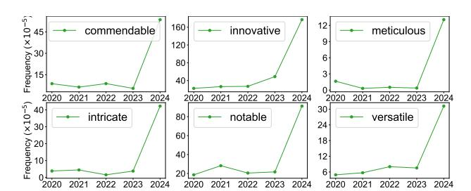

Figure 1: **Shift in Adjective Frequency in** *ICLR* **2024 Peer Reviews.** We find a significant shift in the frequency of certain tokens in *ICLR* 2024, with adjectives such as "commendable", "meticulous", and "intricate" showing 9.8, 34.7, and 11.2-fold increases in probability of occurring in a sentence. We find a similar trend in *NeurIPS* but not in *Nature Portfolio* journals. Supp. Table 2 and Supp. Figure 12 in the Appendix provide a visualization of the top 100 adjectives produced disproportionately by AI.

#### 1. Introduction

While the last year has brought extensive discourse and speculation about the widespread use of large language models (LLM) in sectors as diverse as education (Bearman et al., 2023), the sciences (Van Noorden & Perkel, 2023; Messeri & Crockett, 2024), and global media (Kreps et al., 2022), as of yet it has been impossible to precisely measure the scale of such use or evaluate the ways that the introduction of generated text may be affecting information ecosystems. To complicate the matter, it is increasingly difficult to distinguish examples of LLM-generated texts from human-written content (Gao et al., 2022; Clark et al., 2021). Human capability to discern AI-generated text from human-written content barely exceeds that of a random classifier (Gehrmann et al., 2019; Else, 2023; Clark et al., 2021), heightening the risk that unsubstantiated generated text can masquerade as authoritative, evidence-based writing. In scientific research, for example, studies have found that ChatGPT-generated medical abstracts may frequently bypass AI-detectors and experts (Else, 2023; Gao et al., 2022). In media, one study identified over 700 unreliable AI-generated news sites across 15 languages which could mislead consumers (NewsGuard, 2023; Cantor, 2023).

<sup>\*</sup>Equal contribution <sup>1</sup>Department of Computer Science, Stanford University <sup>2</sup>Machine Learning Department, NEC Labs America <sup>3</sup>Department of Electrical Engineering, Stanford University <sup>4</sup>Graduate School of Education, Stanford University <sup>5</sup>Department of Management Science and Engineering, Stanford University <sup>6</sup>Department of Computer Science, UC Santa Barbara <sup>7</sup>Department of Biomedical Data Science, Stanford University <sup>8</sup>Department of Sociology, Stanford University <sup>9</sup>Graduate School of Business, Stanford University. Correspondence to: Weixin Liang <mxliang@stanford.edu>.

Despite the fact that generated text may be indistinguishable on a case-by-case basis from content written by humans, studies of LLM-use at scale find corpus-level trends which contrast with at-scale human behavior. For example, the increased consistency of LLM output can amplify biases at the corpus-level in a way that is too subtle to grasp by examining individual cases of use. [Bommasani et al.](#page-10-2) find that the "monocultural" use of a single algorithm for hiring decisions can lead to "outcome homogenization" of who gets hired—an effect which could not be detected by evaluating hiring decisions one-by-one. [Cao et al.](#page-11-4) find that prompts to ChatGPT in certain languages can reduce the variance in model responses, "flattening out cultural differences and biasing them towards American culture"; a subtle yet persistent effect that would be impossible to detect at an individual level. These studies rely on experiments and simulations to demonstrate the importance of analyzing and evaluating LLM output at an aggregate level. As LLM-generated content spreads to increasingly highstakes information ecosystems, there is an urgent need for efficient methods which allow for comparable evaluations on *real-world datasets* which contain uncertain amounts of AI-generated text.

We propose a new framework to efficiently monitor AImodified content in an information ecosystem: *distributional GPT quantification* (Figure [2\)](#page-4-0). In contrast with *instance*-level detection, this framework focuses on *population*-level estimates (Section § [3.1\)](#page-3-0). We demonstrate how to estimate the proportion of content in a given corpus that has been generated or significantly modified by AI, without the need to perform inference on any *individual* instance (Section § [3.2\)](#page-3-1). Framing the challenge as a parametric inference problem, we combine reference text which is known to be human-written or AI-generated with a maximum likelihood estimation (MLE) of text from uncertain origins (Section § [3.3\)](#page-3-2). Our approach is more than 10 million times (i.e., 7 orders of magnitude) more computationally efficient than state-of-the-art AI text detection methods (Table [20\)](#page-32-0), while still outperforming them by reducing the in-distribution estimation error by a factor of 3.4, and the out-of-distribution estimation error by a factor of 4.6 (Section § [4.2,](#page-5-0)[4.3\)](#page-5-1).

Inspired by empirical evidence that the usage frequency of these specific adjectives like "commendable" suddenly spikes in the most recent *ICLR* reviews (Figure [1\)](#page-0-0), we run systematic validation experiments to show that these adjectives occur disproportionately more frequently in AIgenerated texts than in human-written reviews (Supp. Table [2](#page-15-0)[,3,](#page-16-0) Supp. Figure [12](#page-15-1)[,13\)](#page-16-1). These adjectives allow us to parameterize our compound probability distribution framework (Section § [3.5\)](#page-4-1), thereby producing more empirically stable and pronounced results (Section § [4.2,](#page-5-0) Figure [3\)](#page-5-2). However, we also demonstrate that similar results can be achieved with adverbs, verbs, and non-technical nouns (Appendix [D.5,](#page-24-0) [D.6,](#page-26-0) [D.7\)](#page-28-0).

We demonstrate this approach through an in-depth case study of texts submitted as reviews to several top AI conferences, including *ICLR*, *NeurIPS*, *EMNLP*, and *CoRL* (Section § [4.1,](#page-5-3) Table [1\)](#page-5-4) as well as through reviews submitted to the *Nature* family journals (Section § [4.4\)](#page-6-0). We find evidence that a small but significant fraction of reviews written for AI conferences after the release of ChatGPT could be substantially modified by AI beyond simple grammar and spell checking (Section § [4.5](#page-6-1)[,4.6,](#page-6-2) Figure [4](#page-6-3)[,5,](#page-6-4)[6\)](#page-7-0). In contrast, we do not detect this change in reviews in *Nature* family journals (Figure [4\)](#page-6-3), and we did not observe a similar trend of Figure [1](#page-0-0) (Section § [4.4\)](#page-6-0). Finally, we show several ways to measure the implications of generated text in this information ecosystem (Section § [4.7\)](#page-7-1). First, we explore the circumstances in AI-generated text appears more frequently, and second, we demonstrate how AI-generated text appears to differ from expert-written reviews *at the corpus level* (See summary in Box 1).

Throughout this paper, we refer to texts written by human experts as "peer reviews" and texts produced by LLMs as "generated texts". We do not intend to make an ontological claim as to whether generated texts constitute peer reviews; any such implication through our word choice is unintended.

In summary, our contributions are as follows:

- 1. We propose a simple and effective method for estimating the fraction of text in a large corpus that has been substantially modified or generated by AI (Section § [3\)](#page-3-3). The method uses historical data known to be human expert or AI-generated (Section § [3.4\)](#page-3-4), and leverages this data to compute an estimate for the fraction of AI-generated text in the target corpus via a maximum likelihood approach (Section § [3.5\)](#page-4-1).
- 2. We conduct a case study on reviews submitted to several top ML and scientific venues, including recent *ICLR*, *NeurIPS*, *EMNLP*, *CoRL* conferences, as well as papers published at *Nature portfolio* journals (Section § [4\)](#page-5-5). Our method allows us to uncover trends in AI usage since the release of ChatGPT and corpus-level changes that occur when generated texts appear in an information ecosystem (Section § [4.7\)](#page-7-1).

# 2. Related Work

Zero-shot LLM detection. Many approaches to LLM detection aim to detect AI-generated text at the level of individual documents. Zero-shot detection or "model selfdetection" represents a major approach family, utilizing the heuristic that text generated by an LLM will exhibit distinctive probabilistic or geometric characteristics within the very model that produced it. Early methods for LLM detec-

#### Box 1: Summary of Main Findings

- 1. Main Estimates: Our estimates suggest that 10.6% of *ICLR* 2024 review sentences and 16.9% for *EMNLP* have been substantially modified by ChatGPT, with no significant evidence of ChatGPT usage in *Nature portfolio* reviews (Section § [4.4,](#page-6-0) Figure [4\)](#page-6-3).
- 2. Deadline Effect: Estimated ChatGPT usage in reviews spikes significantly within 3 days of review deadlines (Section § [4.7,](#page-7-1) Figure [7\)](#page-7-2).
- 3. Reference Effect: Reviews containing scholarly citations are less likely to be AI modified or generated than those lacking such citations (Section § [4.7,](#page-7-1) Figure [8\)](#page-7-3).
- 4. Lower Reply Rate Effect: Reviewers who do not respond to *ICLR*/*NeurIPS* author rebuttals show a higher estimated usage of ChatGPT (Section § [4.7,](#page-7-1) Figure [9\)](#page-8-0).
- 5. Homogenization Correlation: Higher estimated AI modifications are correlated with homogenization of review content in the text embedding space (Section § [4.7,](#page-7-1) Figure [10\)](#page-8-1).
- 6. Low Confidence Correlation: Low self-reported confidence in reviews are associated with an increase of ChatGPT usage (Section § [4.7,](#page-7-1) Figure [11\)](#page-9-0).

tion relied on metrics like entropy [\(Lavergne et al.,](#page-12-2) [2008\)](#page-12-2), log-probability scores [\(Solaiman et al.,](#page-13-2) [2019b\)](#page-13-2), perplexity [\(Beresneva,](#page-10-3) [2016\)](#page-10-3), and uncommon n-gram frequencies [\(Badaskar et al.,](#page-10-4) [2008\)](#page-10-4) from language models to distinguish between human and machine text. More recently, Detect-GPT [\(Mitchell et al.,](#page-12-3) [2023a\)](#page-12-3) suggests that AI-generated text typically occupies regions with negative log probability curvature. DNA-GPT [\(Yang et al.,](#page-14-0) [2023a\)](#page-14-0) improves performance by analyzing n-gram divergence between reprompted and original texts. Fast-DetectGPT [\(Bao et al.,](#page-10-5) [2023\)](#page-10-5) enhances efficiency by leveraging conditional probability curvature over raw probability. [Tulchinskii et al.](#page-13-3) [\(2023\)](#page-13-3) show that machine text has lower intrinsic dimensionality than human writing, as measured by persistent homology for dimension estimation. However, these methods are most effective when there is direct access to the internals of the specific LLM that generated the text. Since many commercial LLMs, including OpenAI's GPT-4, are not open-sourced, these approaches often rely on *a proxy LLM* assumed to be mechanistically similar to the closedsource LLM. This reliance introduces compromises that, as studies by [\(Sadasivan et al.,](#page-13-4) [2023;](#page-13-4) [Shi et al.,](#page-13-5) [2023;](#page-13-5) [Yang](#page-14-1) [et al.,](#page-14-1) [2023b;](#page-14-1) [Zhang et al.,](#page-14-2) [2023\)](#page-14-2) demonstrate, limit the robustness of zero-shot detection methods across different scenarios.

Training-based LLM detection. An alternative LLM detection approach is to fine-tune a pretrained model on datasets with both human and AI-generated text examples in order to distinguish between the two types of text, bypassing the need for original model access. Earlier studies have used classifiers to detect synthetic text in peer review corpora [\(Bhagat & Hovy,](#page-10-6) [2013\)](#page-10-6), media outlets [\(Zellers et al.,](#page-14-3) [2019\)](#page-14-3), and other contexts [\(Bakhtin et al.,](#page-10-7) [2019;](#page-10-7) [Uchendu](#page-13-6) [et al.,](#page-13-6) [2020\)](#page-13-6). More recently, GPT-Sentinel [\(Chen et al.,](#page-11-5) [2023\)](#page-11-5) train the RoBERTa [\(Liu et al.,](#page-12-4) [2019\)](#page-12-4) and T5 [\(Raffel](#page-13-7) [et al.,](#page-13-7) [2020\)](#page-13-7) classifiers on the constructed dataset OpenGPT-Text. GPT-Pat [\(Yu et al.,](#page-14-4) [2023\)](#page-14-4) train a twin neural network to compute the similarity between original and re-decoded texts. [Li et al.](#page-12-5) [\(2023\)](#page-12-5) build a wild testbed by gathering texts from various human writings and deepfake texts generated by different LLMs. Notably, the application of contrastive and adversarial learning techniques has enhanced classifier robustness [\(Liu et al.,](#page-12-6) [2022;](#page-12-6) [Bhattacharjee et al.,](#page-10-8) [2023;](#page-10-8) [Hu et al.,](#page-11-6) [2023a\)](#page-11-6). However, the recent development of several publicly available tools aimed at mitigating the risks associated with AI-generated content has sparked a debate about their effectiveness and reliability [\(OpenAI,](#page-13-8) [2019;](#page-13-8) [Jawahar et al.,](#page-12-7) [2020;](#page-12-7) [Fagni et al.,](#page-11-7) [2021;](#page-11-7) [Ippolito et al.,](#page-12-8) [2019;](#page-12-8) [Mitchell et al.,](#page-13-9) [2023b;](#page-13-9) [Gehrmann et al.,](#page-11-2) [2019;](#page-11-2) [Heikkila¨,](#page-11-8) [2022;](#page-11-8) [Crothers et al.,](#page-11-9) [2022;](#page-11-9) [Solaiman et al.,](#page-13-10) [2019a\)](#page-13-10). This discussion gained further attention with OpenAI's 2023 decision to discontinue its AI-generated text classifier due to its "low rate of accuracy" [\(Kirchner et al.,](#page-12-9) [2023;](#page-12-9) [Kelly,](#page-12-10) [2023\)](#page-12-10).

A major empirical challenge for training-based methods is their tendency to overfit to both training data and language models. Therefore, many classifiers show vulnerability to adversarial attacks [\(Wolff,](#page-14-5) [2020\)](#page-14-5) and display bias towards writers of non-dominant language varieties [\(Liang](#page-12-11) [et al.,](#page-12-11) [2023a\)](#page-12-11). The theoretical possibility of achieving accurate *instance*-level detection has also been questioned by researchers, with debates exploring whether reliably distinguishing AI-generated content from human-created text on an individual basis is fundamentally impossible [\(Weber-](#page-13-11)[Wulff et al.,](#page-13-11) [2023;](#page-13-11) [Sadasivan et al.,](#page-13-4) [2023;](#page-13-4) [Chakraborty et al.,](#page-11-10) [2023\)](#page-11-10). Unlike these approaches to detecting AI-generated text at the document, paragraph, or sentence level, our method estimates the fraction of an entire text corpus which is substantially AI-generated. Our extensive experiments demonstrate that by sidestepping the intermediate step of classifying individual documents or sentences, this method improves upon the stability, accuracy, and computational efficiency of existing approaches.

LLM watermarking. Text watermarking introduces a method to detect AI-generated text by embedding unique, algorithmically-detectable signals -known as watermarksdirectly into the text. Early watermarking approaches modify pre-existing text by leveraging synonym substitution [\(Chiang et al.,](#page-11-11) [2003;](#page-11-11) [Topkara et al.,](#page-13-12) [2006b\)](#page-13-12), syntactic structure restructuring [\(Atallah et al.,](#page-10-9) [2001;](#page-10-9) [Topkara et al.,](#page-13-13) [2006a\)](#page-13-13), or paraphrasing [\(Atallah et al.,](#page-10-10) [2002\)](#page-10-10). Increasingly,

scholars have focused on integrating a watermark directly into an LLM's decoding process. [Kirchenbauer et al.](#page-12-12) [\(2023\)](#page-12-12) split the vocabulary into red-green lists based on hash values of previous n-grams and then increase the logits of green tokens to embed the watermark. [Zhao et al.](#page-14-6) [\(2023\)](#page-14-6) use a global red-green list to enhance robustness. [Hu et al.](#page-12-13) [\(2023b\)](#page-12-13); [Ku](#page-12-14)[ditipudi et al.](#page-12-14) [\(2023\)](#page-12-14); [Wu et al.](#page-14-7) [\(2023\)](#page-14-7) study watermarks that preserve the original token probability distributions. Meanwhile, semantic watermarks [\(Hou et al.,](#page-11-12) [2023;](#page-11-12) [Fu et al.,](#page-11-13) [2023;](#page-11-13) [Liu et al.,](#page-12-15) [2023\)](#page-12-15) using input sequences to find semantically related tokens and multi-bit watermarks [\(Yoo et al.,](#page-14-8) [2023;](#page-14-8) [Fernandez et al.,](#page-11-14) [2023\)](#page-11-14) to embed more complex information have been proposed to improve certain conditional generation tasks. However, watermarking requires the involvement of the model or service owner, such as OpenAI, to implant the watermark. Concerns have also been raised regarding the potential for watermarking to degrade text generation quality and to compromise the coherence and depth of LLM responses [\(Singh & Zou,](#page-13-14) [2023\)](#page-13-14). In contrast, our framework operates *independently* of the model or service owner's intervention, allowing for the monitoring of AI-modified content without requiring their adoption.

# <span id="page-3-3"></span><span id="page-3-0"></span>3. Method

#### 3.1. Notation & Problem Statement

Let x represent a document or sentence, and let t be a token. We write t ∈ x if the token t occurs in the document x. We will use the notation X to refer to a corpus (i.e., a collection of individual documents or sentences x) and V to refer to a vocabulary (i.e., a collection of tokens t). In all of our experiments in the main body of the paper, we take the vocabulary V to be the set of all adjectives. Experiments comparing against these other possibilities such as adverbs, verbs, nouns can be found in the Appendix [D.5,](#page-24-0)[D.6,](#page-26-0)[D.7.](#page-28-0) That is, all of our calculations depend only on the adjectives contained in each document. We found this vocabulary choice to exhibit greater stability than using other parts of speech such as adverbs, verbs, nouns, or all possible tokens. We removed technical terms by excluding the set of all technical keywords as self-reported by the authors during abstract submission on OpenReview.

Let P and Q denote the probability distribution of documents written by scientists and generated by AI, respectively. Given a document x, we will use P(x) (resp. Q(x)) to denote the likelihood of x under P (resp. Q). We assume that the documents in the target corpus are generated from the mixture distribution

<span id="page-3-5"></span>
$$(1 - \alpha)P + \alpha Q \tag{1}$$

and the goal is to estimate the fraction α which are AIgenerated.

#### <span id="page-3-1"></span>3.2. Overview of Our Statistical Estimation Approach

LLM detectors are known to have unstable performance (Section § [4.3\)](#page-5-1). Thus, rather than trying to classify each document in the corpus and directly count the number of occurrences in this manner, we take a maximum likelihood approach. Our method has three components: training data generation, document probability distribution estimation, and computing the final estimate of the fraction of text that has been substantially modified or generated by AI. The method is summarized graphically in Figure [2.](#page-4-0) A nongraphical summary is as follows:

- 1. Collect the writing instructions given to (human) authors for the original corpus- in our case, peer review instructions. Give these instructions as prompts into an LLM to generate a corresponding corpus of AIgenerated documents (Section § [3.4\)](#page-3-4).
- 2. Using the human and AI document corpora, estimate the reference token usage distributions P and Q (Section § [3.5\)](#page-4-1).
- 3. Verify the method's performance on synthetic target corpora where the correct proportion of AI-generated documents is known (Section § [3.6\)](#page-4-2).
- 4. Based on these estimates for P and Q, use MLE to estimate the fraction α of AI-generated or modified documents in the target corpus (Section § [3.3\)](#page-3-2).

The following sections present each of these steps in more detail.

### <span id="page-3-2"></span>3.3. MLE Framework

Given a collection of n documents {xi} n <sup>i</sup>=1 drawn independently from the mixture [\(1\)](#page-3-5), the log-likelihood of the corpus is given by

<span id="page-3-6"></span>
$$\mathcal{L}(\alpha) = \sum_{i=1}^{n} \log \left( (1 - \alpha) P(x_i) + \alpha Q(x_i) \right). \tag{2}$$

If P and Q are known, we can then estimate α via maximum likelihood estimation (MLE) on [\(2\)](#page-3-6). This is the final step in our method. It remains to construct accurate estimates for P and Q.

#### <span id="page-3-4"></span>3.4. Generating the Training Data

We require access to historical data for estimating P and Q. Specifically, we assume that we have access to a collection of reviews which are known to contain only human-authored text, along with the associated review questions and the reviewed papers. We refer to the collection of such documents as the human corpus.

To generate the AI corpus, we prompt the LLM to generate a review given a paper. The texts output by the LLM are then collected into the AI corpus. Empirically, we found that our

<span id="page-4-0"></span>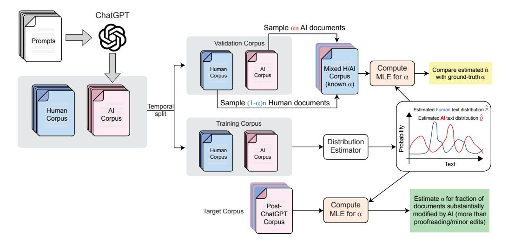

Figure 2: An overview of the method. We begin by generating a corpus of documents with known scientist or AI authorship. Using this historical data, we can estimate the scientist-written and AI text distributions P and Q and validate our method's performance on held-out data. Finally, we can use the estimated P and Q to estimate the fraction of AI-generated text in a target corpus.

framework exhibits moderate robustness to the distribution shift of LLM prompts. As discussed in Appendix [D.3,](#page-21-0) training with one prompt and testing with a different prompt still yield accurate validation results (see Supp. Figure [15\)](#page-21-1).

#### <span id="page-4-1"></span>3.5. Estimating P and Q from Data

The space of all possible documents is too large to estimate P(x), Q(x) directly. Thus, we make some simplifying assumptions on the document generation process to make the estimation tractable.

We represent each document x<sup>i</sup> as a list of occurrences (i.e., a set) of tokens rather than a list of token counts. While longer documents will tend to have more unique tokens (and thus a lower likelihood in this model), the number of additional unique tokens is likely sublinear in the document length, leading to a less exaggerated down-weighting of longer documents.[1](#page-4-3)

The occurrence probabilities for the human document distri-

bution can be estimated by

$$\hat{p}(t) = \frac{\text{\# documents in which token } t \text{ appears}}{\text{total \# documents in the corpus}}$$

$$= \frac{\sum_{x \in X} \mathbb{1}\{t \in x\}}{|X|},$$

where X is the corpus of human-written documents. The estimate qˆ(t) can be defined similarly for the AI distribution. Using the notation t ∈ x to denote that token t occurs in document x, we can then estimate P via

$$P(x_i) = \prod_{t \in x} \hat{p}(t) \times \prod_{t \notin x} (1 - \hat{p}(t))$$
 (3)

and similarly for Q. Recall that our token vocabulary V (defined in Section § [3.1\)](#page-3-0) consists of all adjectives, so the product over t ̸∈ x means the product only over all adjectives t which were not in the document or sentence x.

We validated both approaches using either a document or a sentence as the unit of x, and both performed well (Appendix [D.8\)](#page-29-0). We used a sentence as our main unit for estimates, as sentences perform slightly better.

#### <span id="page-4-2"></span>3.6. Validating the Method

The steps described above are sufficient for estimating the fraction α of documents in a target corpus which are AIgenerated. We also provide a method for validating the system's performance.

We use the training partitions of the human and AI corpora to estimate P and Q as described above. To validate the system's performance, we do the following:

<span id="page-4-3"></span><sup>1</sup> For the intuition behind this claim, one can consider the extreme case where the entire token vocabulary has been used in the first part of a document. As more text is added to the document, there will be no new token occurrences, so the number of unique tokens will remain constant regardless of how much length is added to the document. In general, even if the entire vocabulary of unique tokens has not been exhausted, as the document length increases, it is more likely that previously seen tokens will be re-used rather than introducing new ones. This can be seen as analogous to the [coupon collector problem](https://en.wikipedia.org/wiki/Coupon_collector%27s_problem) [\(Newman,](#page-13-15) [1960\)](#page-13-15).

- 1. Choose a range of feasible values for  $\alpha$ , e.g.  $\alpha \in \{0, 0.05, 0.1, 0.15, 0.2, 0.25\}$ .
- 2. Let n be the size of the target corpus. For each of the selected  $\alpha$  values, sample (with replacement)  $\alpha n$  documents from the AI validation corpus and  $(1-\alpha)n$  documents from the human validation corpus to create a target corpus.
- 3. Compute the MLE estimate  $\hat{\alpha}$  on the target corpus. If  $\hat{\alpha} \approx \alpha$  for each of the feasible  $\alpha$  values, this provides evidence that the system is working correctly and the estimate can be trusted.

Step 2 can also be repeated multiple times to generate confidence intervals for the estimate  $\hat{\alpha}$ .

#### <span id="page-5-5"></span>4. Experiments

In this section, we apply our method to a case study of peer reviews of academic machine learning (ML) and scientific papers. We report our results graphically; numerical results and the results for additional experiments can be found in Appendix D.

#### <span id="page-5-3"></span>4.1. Data

We collect review data for all major ML conferences available on OpenReview, including *ICLR*, *NeurIPS*, *CoRL*, and *EMNLP*, as detailed in Table 1. The Nature portfolio dataset encompasses 15 journals within the Nature portfolio, such as Nature, Nature Biomedical Engineering, Nature Human Behaviour, and Nature Communications. Additional information on the datasets can be found in Appendix G.

#### <span id="page-5-0"></span>4.2. Validation on Semi-Synthetic data

Next, we validate the efficacy of our method as described in Section 3.6. We find that our algorithm accurately estimates the proportion of LLM-generated texts in these mixed validation sets with a prediction error of less than 1.8% at the population level across various ground truth  $\alpha$  on *ICLR* '23 (Figure 3, Supp. Table 5).

Furthermore, despite being trained exclusively on *ICLR* data from 2018 to 2022, our model displays robustness to moderate topic shifts observed in *NeurIPS* and *CoRL* papers. The prediction error remains below 1.8% across various ground truth  $\alpha$  for *NeurIPS* '22 and under 2.4% for *CoRL* '22 (Figure 3, Supp. Table 5). This resilience against variation in paper content suggests that our model can reliably identify LLM alterations across different research areas and conference formats, underscoring its potential applicability in maintaining the integrity of the peer review process in the presence of continuously updated generative models.

<span id="page-5-4"></span>Table 1: Academic Peer Reviews Data from Major ML Conferences. All listed conferences except *ICLR* '24, *NeurIPS* '23, *CoRL* '23, and *EMNLP* '23 underwent peer review before the launch of ChatGPT on November 30, 2022. We use the *ICLR* '23 conference data for in-distribution validation, and the *NeurIPS* ('17–'22) and *CoRL* ('21–'22) for out-of-distribution (OOD) validation.

| Conference   | Post ChatGPT | Data Split            | # of Official Reviews |
|--------------|--------------|-----------------------|-----------------------|
| ICLR 2018    | Before       | Training              | 2,930                 |
| ICLR 2019    | Before       | Training              | 4,764                 |
| ICLR 2020    | Before       | Training              | 7,772                 |
| ICLR 2021    | Before       | Training              | 11,505                |
| ICLR 2022    | Before       | Training              | 13,161                |
| ICLR 2023    | Before       | Validation            | 18,564                |
| ICLR 2024    | After        | Inference             | 27,992                |
| NeurIPS 2017 | Before       | OOD Validation        | 1,976                 |
| NeurIPS 2018 | Before       | OOD Validation        | 3,096                 |
| NeurIPS 2019 | Before       | OOD Validation        | 4,396                 |
| NeurIPS 2020 | Before       | <b>OOD Validation</b> | 7,271                 |
| NeurIPS 2021 | Before       | OOD Validation        | 10,217                |
| NeurIPS 2022 | Before       | <b>OOD Validation</b> | 9,780                 |
| NeurIPS 2023 | After        | Inference             | 14,389                |
| CoRL 2021    | Before       | OOD Validation        | 558                   |
| CoRL 2022    | Before       | <b>OOD Validation</b> | 756                   |
| CoRL 2023    | After        | Inference             | 759                   |
| EMNLP 2023   | After        | Inference             | 6,419                 |

<span id="page-5-2"></span>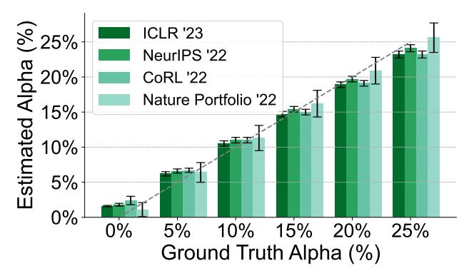

Figure 3: **Performance validation of our MLE estimator** across *ICLR* '23, *NeurIPS* '22, and *CoRL* '22 reviews (all predating ChatGPT's launch) via the method described in Section 3.6. Our algorithm demonstrates high accuracy with less than 2.4% prediction error in identifying the proportion of LLM-generated feedback within the validation set. See Supp. Table 5,6 for full results.

#### <span id="page-5-1"></span>**4.3.** Comparison to Instance-Based Detection Methods

We compare our approach to a BERT classifier baseline, which we fine-tuned on identical training data, and two recently published, state-of-the-art AI text detection methods, all evaluated using the same protocol (Appendix D.9). Our method reduces the in-distribution estimation error by 3.4 times compared to the best-performing baseline (from 6.2% to 1.8%, Supp. Table 19), and the out-of-distribution

estimation error by 4.6 times (from 11.2% to 2.4%, Supp. Table 19). Additionally, our method is more than 10 million times (i.e., 7 orders of magnitude) more computationally efficient during inference time (68.09 FLOPS vs. 2.721  $\times 10^9$  FLOPS amortized per sentence, Supp. Table 20), and the training cost is also negligible compared to any backpropagation-based algorithms as we are only counting word frequencies in the training corpora.

#### <span id="page-6-0"></span>4.4. Estimates on Real Reviews

Next, we address the main question of our case study: what fraction of conference review text was substantially modified by LLMs, beyond simple grammar and spell checking? We find that there was a significant increase in AI-generated sentences after the release of ChatGPT for the ML venues, but not for *Nature*(Appendix D.2). The results are demonstrated in Figure 4, with error bars showing 95% confidence intervals over 30,000 bootstrap samples.

Across all major ML conferences (*NeurIPS*, *CoRL*, and *ICLR*), there was a sharp increase in the estimated  $\alpha$  following the release of ChatGPT in late November 2022 (Figure 4). For instance, among the conferences with pre- and post-ChatGPT data, *ICLR* experienced the most significant increase in estimated  $\alpha$ , from 1.6% to 10.6% (Figure 4, purple curve). *NeurIPS* had a slightly lesser increase, from 1.9% to 9.1% (Figure 4, green curve), while *CoRL*'s increase was the smallest, from 2.4% to 6.5% (Figure 4, red curve). Although data for *EMNLP* reviews prior to ChatGPT's release are unavailable, this conference exhibited the highest estimated  $\alpha$ , at approximately 16.9% (Figure 4, orange dot). This is perhaps unsurprising: NLP specialists may have had more exposure and knowledge of LLMs in the early days of its release.

It should be noted that all of the post-ChatGPT  $\alpha$  levels are significantly higher than the  $\alpha$  estimated in the validation experiments with ground truth  $\alpha=0$ , and for *ICLR* and *NeurIPS*, the estimates are significantly higher than the validation estimates with ground truth  $\alpha=5\%$ . This suggests a modest yet noteworthy use of AI text-generation tools in conference review corpora.

Results on *Nature Portfolio* journals We also train a separate model for *Nature Portfolio* journals and validated its accuracy (Figure 3, *Nature Portfolio* '22, Supp. Table 6). Contrary to the ML conferences, the *Nature Portfolio* journals do not exhibit a significant increase in the estimated  $\alpha$  values following ChatGPT's release, with pre- and post-release  $\alpha$  estimates remaining within the margin of error for the  $\alpha=0$  validation experiment (Figure 4). This consistency indicates a different response to AI tools within the broader scientific disciplines when compared to the specialized field of machine learning.

<span id="page-6-3"></span>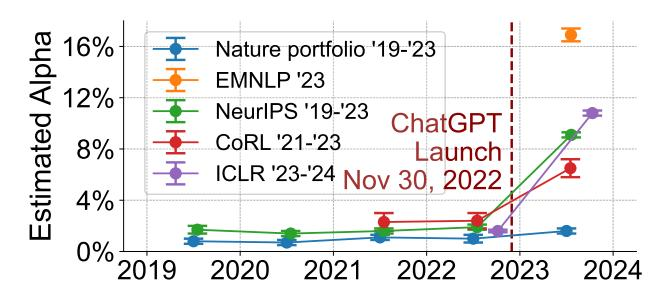

Figure 4: Temporal changes in the estimated  $\alpha$  for several ML conferences and Nature Portfolio journals. The estimated  $\alpha$  for all ML conferences increases sharply after the release of ChatGPT (denoted by the dotted vertical line), indicating that LLMs are being used in a small but significant way. Conversely, the  $\alpha$  estimates for Nature Portfolio reviews do not exhibit a significant increase or rise above the margin of error in our validation experiments for  $\alpha=0$ . See Supp. Table 7,8 for full results.

#### <span id="page-6-1"></span>4.5. Robustness to Proofreading

To verify that our method is detecting text which has been substantially modified by AI beyond simple grammatical edits, we conduct a robustness check by applying the method to peer reviews which were simply edited by ChatGPT for typos and grammar. The results are shown in Figure 5. While there is a slight increase in the estimated  $\hat{\alpha}$ , it is much smaller than the effect size seen in the real review corpus in the previous section (denoted with dashed lines in the figure).

<span id="page-6-4"></span>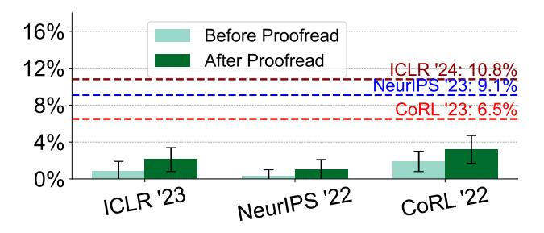

Figure 5: Robustness of the estimations to proofreading. Evaluating  $\alpha$  after using LLMs for "proof-reading" (non-substantial editing) of peer reviews shows a minor, non-significant increase across conferences, confirming our method's sensitivity to text which was generated in significant part by LLMs, beyond simple proofreading. See Supp. Table 21 for full results.

# <span id="page-6-2"></span>4.6. Using LLMs to Substantially Expand Review Outline

A reviewer might draft their review in two distinct stages: initially creating a brief outline of the review while reading the paper, followed by using LLMs to expand this outline into a detailed, comprehensive review. Consequently, we conduct an analysis to assess our algorithm's ability to detect such LLM usage.

To simulate this two-stage process retrospectively, we first condense a complete peer review into a structured, concise skeleton (outline) of key points (see Supp. Table 29). Subsequently, rather than directly querying an LLM to generate feedback from papers, we instruct it to expand the skeleton into detailed, complete review feedback (see Supp. Table 30). This mimics the two-stage scenario above.

We mix human peer reviews with the LLM-expanded feedback at various ground truth levels of  $\alpha$ , using our algorithm to predict these  $\alpha$  values (Section § 3.6). The results are presented in Figure 6. The  $\alpha$  estimated by our algorithm closely matches the ground truth  $\alpha$ . This suggests that our algorithm is sufficiently sensitive to detect the LLM use case of substantially expanding human-provided review outlines. The estimated  $\alpha$  from our approach is consistent with reviewers using LLM to substantially expand their bullet points into full reviews.

<span id="page-7-0"></span>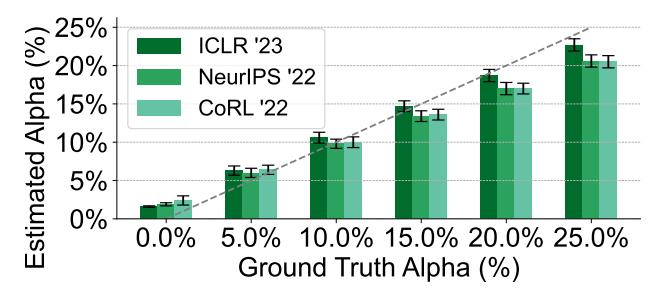

Figure 6: Substantial modification and expansion of incomplete sentences using LLMs can largely account for the observed trend. Rather than directly using LLMs to generate feedback, we expand a bullet-pointed skeleton of incomplete sentences into a full review using LLMs (see Supp. Table 29 and 30 for prompts). The detected  $\alpha$  may largely be attributed to this expansion. See Supp. Table 22 for full results.

#### <span id="page-7-1"></span>4.7. Factors that Correlate With Estimated LLM Usage

**Deadline Effect** We see a small but consistent increase in the estimated  $\alpha$  for reviews submitted 3 or fewer days before a deadline (Figure 7). As reviewers get closer to a looming deadline, they may try to save time by relying on LLMs. The following paragraphs explore some implications of this increased reliance.

**Reference Effect** Recognizing that LLMs often fail to accurately generate content and are less likely to include scholarly citations, as highlighted by recent studies (Liang et al., 2023b; Walters & Wilder, 2023), we hypothesize that reviews containing scholarly citations might indicate lower

<span id="page-7-2"></span>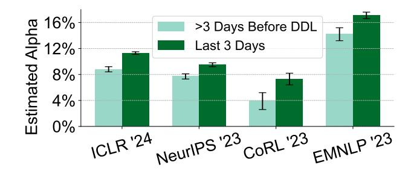

Figure 7: **The deadline effect.** Reviews submitted within 3 days of the review deadline tended to have a higher estimated  $\alpha$ . See Supp. Table 23 for full results.

LLM usage. To test this, we use the occurrence of the string "et al." as a proxy for scholarly citations in reviews. We find that reviews featuring "et al." consistently showed a lower estimated  $\alpha$  than those lacking such references (see Figure 8). The lack of scholarly citations demonstrates one way that generated text does not include content that expert reviewers otherwise might. However, we lack a counterfactualit could be that people who were more likely to use Chat-GPT may also have been less likely to cite sources were ChatGPT not available. Future studies should examine the causal structure of this relationship.

<span id="page-7-3"></span>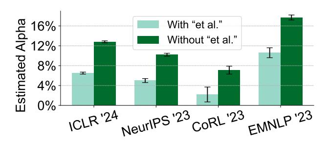

Figure 8: The reference effect. Our analysis demonstrates that reviews containing the term "et al.", indicative of scholarly citations, are associated with a significantly lower estimated  $\alpha$ . See Supp. Table 24 for full results.

Lower Reply Rate Effect We find a negative correlation between the number of author replies and estimated Chat-GPT usage  $(\alpha)$ , suggesting that authors who participated more actively in the discussion period were less likely to use ChatGPT to generate their reviews. There are a number of possible explanations, but we cannot make a causal claim. Reviewers may use LLMs as a quick-fix to avoid extra engagement, but if the role of the reviewer is to be a co-producer of better science, then this fix hinders that role. Alternatively, as AI conferences face a desperate shortage of reviewers, scholars may agree to participate in more reviews and rely on the tool to support the increased workload. Editors and conference organizers should carefully consider the relationship between ChatGPT-use and reply rate to ensure

each paper receives an adequate level of feedback.

<span id="page-8-0"></span>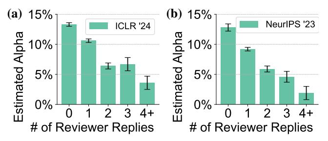

Figure 9: The lower reply rate effect. We observe a negative correlation between number of reviewer replies in the review discussion period and the estimated  $\alpha$  on these reviews. See Supp. Table 25 for full results.

Homogenization Effect There is growing evidence that the introduction of LLM content in information ecosystems can contribute to to *output homogenization* (Liu et al., 2024; Bommasani et al., 2022; Kleinberg & Raghavan, 2021). We examine this phenomenon in the context of text as a decrease in variation of linguistic features and epistemic content than would be expected in an unpolluted corpus (Christin, 2020). While it might be intuitive to expect that a standardization of text in peer reviews could be useful, empirical social studies of peer review demonstrate the important role of feedback variation from reviewers (Teplitskiy et al., 2018; Lamont, 2009; 2012; Longino, 1990; Sulik et al., 2023).

Here, we explore whether the presence of generated texts in a peer review corpus led to homogenization of feedback, using a new method to classify texts as "convergent" (similar to the other reviews) or "divergent" (dissimilar to the other reviews). For each paper, we obtained the OpenAI's textembeddings for all reviews, followed by the calculation of their centroid (average). Among the assigned reviews, the one with its embedding closest to the centroid is labeled as convergent, and the one farthest as divergent. This process is repeated for each paper, generating a corpus of convergent and divergent reviews, to which we then apply our analysis method.

The results, as shown in Figure 10, suggest that convergent reviews, which align more closely with the centroid of review embeddings, tend to have a higher estimated  $\alpha$ . This finding aligns with previous observations that LLM-generated text often focuses on specific, recurring topics, such as research implications or suggestions for additional experiments, more consistently than expert peer reviewers do (Liang et al., 2023b).

This corpus-level homogenization is potentially concerning for several reasons. First, if paper authors receive synthetically-generated text in place of an expert-written review, the scholars lose an opportunity to receive feedback

from multiple, independent, diverse experts in their field. Instead, authors must contend with formulaic responses which may not capture the unique and creative ideas that a peer might present. Second, based on studies of representational harms in language model output, it is likely that this homogenization does not trend toward random, representative ways of knowing and producing language, but instead converges toward the practices of certain groups (Naous et al., 2024; Cao et al., 2023; Papadimitriou et al., 2023; Arora et al., 2022; Hofmann et al., 2024).

<span id="page-8-1"></span>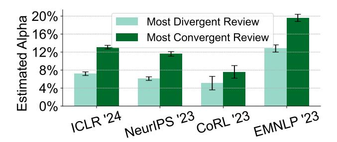

Figure 10: **The homogenization effect.** "Convergent" reviews (those most similar to other reviews of the same paper in the embedding space) tend to have a higher estimated  $\alpha$  as compared to "divergent" reviews (those most dissimilar to other reviews). See Supp. Table 26 for full results.

Low Confidence Effect The correlation between reviewer confidence tends to be negatively correlated with ChatGPT usage -that is, the estimate for  $\alpha$  (Figure 11). One possible interpretation of this phenomenon is that the integration of LMs into the review process introduces a layer of detachment for the reviewer from the generated content, which might make reviewers feel less personally invested or assured in the content's accuracy or relevance.

#### 5. Discussion

In this work, we propose a method for estimating the fraction of documents in a large corpus which were generated primarily using AI tools. The method makes use of historical documents. The prompts from this historical corpus are then fed into an LLM (or LLMs) to produce a corresponding corpus of AI-generated texts. The written and AI-generated corpora are then used to estimate the distributions of AI-generated vs. written texts in a mixed corpus. Next, these estimated document distributions are used to compute the likelihood of the target corpus, and the estimate for  $\alpha$  is produced by maximizing the likelihood. We also provide specific methods for estimating the text distributions by token frequency and occurrence, as well as a method for validating the performance of the system.

Applying this method to conference and journal reviews written before and after the release of ChatGPT shows evi-

<span id="page-9-0"></span>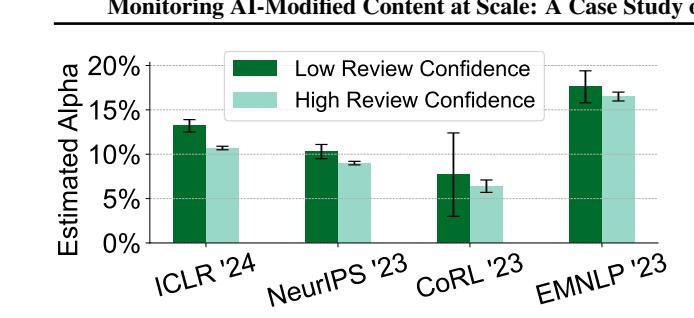

Figure 11: **The low confidence effect.** Reviews with low confidence, defined as self-rated confidence of 2 or lower on a 5-point scale, are correlated with higher alpha values than those with 3 or above, and are mostly identical across these major ML conferences. See the descriptions of the confidence rating scales in Supp. Table 4 and full results in Supp. Table 27.

dence that roughly 7-15% of sentences in ML conference reviews were substantially modified by AI beyond a simple grammar check, while there does not appear to be significant evidence of AI usage in reviews for *Nature*. Finally, we demonstrate several ways this method can support social analysis. First, we show that reviewers are more likely to submit generated text for last-minute reviews, and that people who submit generated text offer fewer author replies than those who submit written reviews. Second, we show that generated texts include less specific feedback or citations of other work, in comparison to written reviews. Generated reviews also are associated with lower confidence ratings. Third, we show how corpora with generated text appear to compress the linguistic variation and epistemic diversity that would be expected in unpolluted corpora. We should also note that other social concerns with ChatGPT presence in peer reviews extend beyond our scope, including the potential privacy and anonymity risks of providing unpublished work to a privately owned language model.

Limitations While our study focused on ChatGPT, which dominates the generative AI market with 76% of global internet traffic in the category (Van Rossum, 2024), we acknowledge that there are other diverse LLMs used for generating or rephrasing text. However, recent studies have found that ChatGPT substantially outperforms other LLMs, including Bard, in the reviewing of scientific papers or proposals (Liang et al., 2023c; Liu & Shah, 2023). We also found that our results are robust on the use of alternative LLMs such as GPT-3.5. For example, the model trained with only GPT-3.5 data provides consistent estimation results and findings, and demonstrates the ability to generalize, accurately detecting GPT-4 as well (see Supp. Table 28 and 29). However, we acknowledge that our framework's effectiveness may vary depending on the specific LLM used, and future practitioners should select the LLM that most closely mirrors the language model likely used to generate their target corpus, reflecting actual usage patterns at the time of creation.

Our findings are primarily based on datasets from major ML conferences (ICLR, NeurIPS, CoRL, EMNLP) and Nature Family Journals spanning 15 distinct journals across different disciplines such as medicine, biology, chemistry, and environmental sciences. While this demonstrates the applicability of our framework beyond these domains, further experimentation may be required to fully establish its generalizability to an even wider range of fields and publication venues. Factors such as field-specific writing styles and the prevalence of AI use could influence the effectiveness of our approach.

Moreover, the prompting techniques used in our study to simulate the process of revising, expanding, paraphrasing, and proofreading review texts (Section § 4.5) have limitations. The prompts we employed were designed based on our understanding of common practices, but they may not capture the full range of techniques used by reviewers or AI assistants. We emphasize that these techniques should be interpreted as a best-effort approximation rather than a definitive representation of how AI is used for review text modifications.

Although our validation experiments used real reviews from prior years, which included a significant fraction of non-native speaker-written texts, and our results remained accurate, we recognize that substantial shifts in the non-native speaker population over time could still impact the accuracy of our estimates (Liang et al., 2023a). Future research should investigate the impact of evolving non-native speaker populations on the robustness of our framework.

In addition, the approximations made to the review generating process in Section § 3 in order to make estimation of the review likelihood tractable introduce an additional source of error, as does the temporal distribution shift in token frequencies due to, e.g., changes in topics, reviewers, etc.

We emphasize here that we do not wish to pass a value judgement or claim that the use of AI tools for review papers is necessarily bad or good. We also do not claim (nor do we believe) that many reviewers are using ChatGPT to write entire reviews outright. Our method does not constitute direct evidence that reviewers are using ChatGPT to write reviews from scratch. For example, it is possible that a reviewer may sketch out several bullet points related to the paper and uses ChatGPT to formulate these bullet points into paragraphs. In this case, it is possible for the estimated  $\alpha$  to be high; indeed our results in Appendix 4.6 is consistent with this mode of using LLM to substantially modify and flesh out reviews.

To enhance transparency and accountability, future work should focus on applying and extending our framework to estimate the extent of AI-generated text across various domains, including but not limited to peer review. We believe that our data and analyses can serve as a foundation for constructive discussions and further research by the community, ultimately contributing to the development of robust guidelines and best practices for the ethical use of generative AI.

# Code Availability

The code can be accessed at [https://github.com/](https://github.com/Weixin-Liang/Mapping-the-Increasing-Use-of-LLMs-in-Scientific-Papers) [Weixin-Liang/Mapping-the-Increasing-Use](https://github.com/Weixin-Liang/Mapping-the-Increasing-Use-of-LLMs-in-Scientific-Papers) [-of-LLMs-in-Scientific-Papers](https://github.com/Weixin-Liang/Mapping-the-Increasing-Use-of-LLMs-in-Scientific-Papers) .

# Impact Statement

This work offers a method for the study of LLM use at scale. We apply this method on several corpora of peer reviews, demonstrating the potential ramifications of such use to scientific publishing. While our study has several limitations that we acknowledge throughout the manuscript, we believe that there is still value in providing transparent analysis of LLM use in the scientific community. We hope that our statistical analysis will inspire further social analysis, productive community reflection, and informed policy decisions about the extent and effects of LLM use in information ecosystems.

#### ACKNOWLEDGMENTS

We thank Christopher D. Manning, Dan Jurafsky, Diyi Yang, Yongchan Kwon, Federico Bianchi, and Mert Yuksekgonul for their helpful comments and discussions. J.Z. is supported by the National Science Foundation (CAREER 1942926) and grants from the Chan-Zuckerberg Initiative and Stanford HAI. D.M. and H.L. are supported by the National Science Foundation (2244804 and 2022435) and the Stanford Institute for Human-Centered Artificial Intelligence (HAI).

# References

- <span id="page-10-11"></span>Arora, A., Kaffee, L.-A., and Augenstein, I. Probing pretrained language models for cross-cultural differences in values. arXiv preprint arXiv:2203.13722, 2022.
- <span id="page-10-9"></span>Atallah, M. J., Raskin, V., Crogan, M., Hempelmann, C. F., Kerschbaum, F., Mohamed, D., and Naik, S. Natural Language Watermarking: Design, Analysis, and a Proof-of-Concept Implementation. In Information Hiding, 2001.
- <span id="page-10-10"></span>Atallah, M. J., Raskin, V., Hempelmann, C. F., Topkara, M., Sion, R., Topkara, U., and Triezenberg, K. E. Nat-

- ural Language Watermarking and Tamperproofing. In Information Hiding, 2002.
- <span id="page-10-4"></span>Badaskar, S., Agarwal, S., and Arora, S. Identifying Real or Fake Articles: Towards better Language Modeling. In International Joint Conference on Natural Language Processing, 2008. URL [https://api.](https://api.semanticscholar.org/CorpusID:4324753) [semanticscholar.org/CorpusID:4324753](https://api.semanticscholar.org/CorpusID:4324753).
- <span id="page-10-7"></span>Bakhtin, A., Gross, S., Ott, M., Deng, Y., Ranzato, M., and Szlam, A. Real or Fake? Learning to Discriminate Machine from Human Generated Text. ArXiv, abs/1906.03351, 2019. URL [https:](https://api.semanticscholar.org/CorpusID:182952342) [//api.semanticscholar.org/CorpusID:](https://api.semanticscholar.org/CorpusID:182952342) [182952342](https://api.semanticscholar.org/CorpusID:182952342).
- <span id="page-10-5"></span>Bao, G., Zhao, Y., Teng, Z., Yang, L., and Zhang, Y. Fast-DetectGPT: Efficient Zero-Shot Detection of Machine-Generated Text via Conditional Probability Curvature. ArXiv, abs/2310.05130, 2023. URL [https://api.semanticscholar.](https://api.semanticscholar.org/CorpusID:263831345) [org/CorpusID:263831345](https://api.semanticscholar.org/CorpusID:263831345).
- <span id="page-10-0"></span>Bearman, M., Ryan, J., and Ajjawi, R. Discourses of artificial intelligence in higher education: A critical literature review. Higher Education, 86(2):369–385, 2023.
- <span id="page-10-3"></span>Beresneva, D. Computer-Generated Text Detection Using Machine Learning: A Systematic Review. In International Conference on Applications of Natural Language to Data Bases, 2016. URL [https://api.](https://api.semanticscholar.org/CorpusID:1175726) [semanticscholar.org/CorpusID:1175726](https://api.semanticscholar.org/CorpusID:1175726).
- <span id="page-10-6"></span>Bhagat, R. and Hovy, E. H. Squibs: What Is a Paraphrase? Computational Linguistics, 39:463–472, 2013. URL [https://api.semanticscholar.](https://api.semanticscholar.org/CorpusID:32452685) [org/CorpusID:32452685](https://api.semanticscholar.org/CorpusID:32452685).
- <span id="page-10-8"></span>Bhattacharjee, A., Kumarage, T., Moraffah, R., and Liu, H. ConDA: Contrastive Domain Adaptation for AIgenerated Text Detection. ArXiv, abs/2309.03992, 2023. URL [https://api.semanticscholar.](https://api.semanticscholar.org/CorpusID:261660497) [org/CorpusID:261660497](https://api.semanticscholar.org/CorpusID:261660497).
- <span id="page-10-2"></span>Bommasani, R., Creel, K. A., Kumar, A., Jurafsky, D., and Liang, P. S. Picking on the same person: Does algorithmic monoculture lead to outcome homogenization? Advances in Neural Information Processing Systems, 35: 3663–3678, 2022.
- <span id="page-10-1"></span>Cantor, M. Nearly 50 news websites are 'AI-generated', a study says. Would I be able to tell?, 2023. URL [https://www.](https://www.theguardian.com/technology/2023/may/08/ai-generated-news-websites-study) [theguardian.com/technology/2023/may/](https://www.theguardian.com/technology/2023/may/08/ai-generated-news-websites-study) [08/ai-generated-news-websites-study](https://www.theguardian.com/technology/2023/may/08/ai-generated-news-websites-study). Accessed: 2024-02-24.

- <span id="page-11-4"></span>Cao, Y., Zhou, L., Lee, S., Cabello, L., Chen, M., and Hershcovich, D. Assessing cross-cultural alignment between chatgpt and human societies: An empirical study, 2023.
- <span id="page-11-10"></span>Chakraborty, S., Bedi, A. S., Zhu, S., An, B., Manocha, D., and Huang, F. On the possibilities of ai-generated text detection. arXiv preprint arXiv:2304.04736, 2023.
- <span id="page-11-5"></span>Chen, Y., Kang, H., Zhai, V., Li, L., Singh, R., and Ramakrishnan, B. GPT-Sentinel: Distinguishing Human and ChatGPT Generated Content. ArXiv, abs/2305.07969, 2023. URL [https://api.semanticscholar.](https://api.semanticscholar.org/CorpusID:258686680) [org/CorpusID:258686680](https://api.semanticscholar.org/CorpusID:258686680).
- <span id="page-11-11"></span>Chiang, Y.-L., Chang, L.-P., Hsieh, W.-T., and Chen, W.- C. Natural Language Watermarking Using Semantic Substitution for Chinese Text. In International Workshop on Digital Watermarking, 2003. URL [https://api.](https://api.semanticscholar.org/CorpusID:40971354) [semanticscholar.org/CorpusID:40971354](https://api.semanticscholar.org/CorpusID:40971354).
- <span id="page-11-15"></span>Christin, A. What data can do: A typology of mechanisms. International Journal of Communication, 14:20, 2020.
- <span id="page-11-1"></span>Clark, E., August, T., Serrano, S., Haduong, N., Gururangan, S., and Smith, N. A. All That's 'Human'Is Not Gold: Evaluating Human Evaluation of Generated Text. In Proceedings of the 59th Annual Meeting of the Association for Computational Linguistics and the 11th International Joint Conference on Natural Language Processing (Volume 1: Long Papers), pp. 7282–7296, 2021.
- <span id="page-11-9"></span>Crothers, E., Japkowicz, N., and Viktor, H. Machine Generated Text: A Comprehensive Survey of Threat Models and Detection Methods. arXiv preprint arXiv:2210.07321, 2022.
- <span id="page-11-18"></span>Dycke, N., Kuznetsov, I., and Gurevych, I. Yes-yes-yes: Proactive data collection for ACL rolling review and beyond. In Goldberg, Y., Kozareva, Z., and Zhang, Y. (eds.), Findings of the Association for Computational Linguistics: EMNLP 2022, pp. 300–318, Abu Dhabi, United Arab Emirates, December 2022. Association for Computational Linguistics. doi: 10.18653/v1/2022. findings-emnlp.23. URL [https://aclanthology.](https://aclanthology.org/2022.findings-emnlp.23) [org/2022.findings-emnlp.23](https://aclanthology.org/2022.findings-emnlp.23).
- <span id="page-11-17"></span>Dycke, N., Kuznetsov, I., and Gurevych, I. NLPeer: A unified resource for the computational study of peer review. In Rogers, A., Boyd-Graber, J., and Okazaki, N. (eds.), Proceedings of the 61st Annual Meeting of the Association for Computational Linguistics (Volume 1: Long Papers), pp. 5049–5073, Toronto, Canada, July 2023. Association for Computational Linguistics. doi: 10.18653/v1/2023.acl-long.277. URL [https:](https://aclanthology.org/2023.acl-long.277) [//aclanthology.org/2023.acl-long.277](https://aclanthology.org/2023.acl-long.277).

- <span id="page-11-3"></span>Else, H. Abstracts written by ChatGPT fool scientists. Nature, Jan 2023. URL [https://www.nature.](https://www.nature.com/articles/d41586-023-00056-7) [com/articles/d41586-023-00056-7](https://www.nature.com/articles/d41586-023-00056-7).
- <span id="page-11-7"></span>Fagni, T., Falchi, F., Gambini, M., Martella, A., and Tesconi, M. TweepFake: About detecting deepfake tweets. Plos one, 16(5):e0251415, 2021.
- <span id="page-11-14"></span>Fernandez, P., Chaffin, A., Tit, K., Chappelier, V., and Furon, T. Three Bricks to Consolidate Watermarks for Large Language Models. 2023 IEEE International Workshop on Information Forensics and Security (WIFS), pp. 1– 6, 2023. URL [https://api.semanticscholar.](https://api.semanticscholar.org/CorpusID:260351507) [org/CorpusID:260351507](https://api.semanticscholar.org/CorpusID:260351507).
- <span id="page-11-13"></span>Fu, Y., Xiong, D., and Dong, Y. Watermarking Conditional Text Generation for AI Detection: Unveiling Challenges and a Semantic-Aware Watermark Remedy. ArXiv, abs/2307.13808, 2023. URL [https:](https://api.semanticscholar.org/CorpusID:260164516) [//api.semanticscholar.org/CorpusID:](https://api.semanticscholar.org/CorpusID:260164516) [260164516](https://api.semanticscholar.org/CorpusID:260164516).
- <span id="page-11-0"></span>Gao, C. A., Howard, F. M., Markov, N. S., Dyer, E. C., Ramesh, S., Luo, Y., and Pearson, A. T. Comparing scientific abstracts generated by ChatGPT to original abstracts using an artificial intelligence output detector, plagiarism detector, and blinded human reviewers. bioRxiv, pp. 2022–12, 2022.
- <span id="page-11-2"></span>Gehrmann, S., Strobelt, H., and Rush, A. M. GLTR: Statistical Detection and Visualization of Generated Text. In Proceedings of the 57th Annual Meeting of the Association for Computational Linguistics: System Demonstrations, pp. 111–116, 2019.
- <span id="page-11-8"></span>Heikkila, M. How to spot ai-generated text. ¨ MIT Technology Review, Dec 2022. URL [https://www.technologyreview.](https://www.technologyreview.com/2022/12/19/1065596/how-to-spot-ai-generated-text/) [com/2022/12/19/1065596/](https://www.technologyreview.com/2022/12/19/1065596/how-to-spot-ai-generated-text/) [how-to-spot-ai-generated-text/](https://www.technologyreview.com/2022/12/19/1065596/how-to-spot-ai-generated-text/).
- <span id="page-11-16"></span>Hofmann, V., Kalluri, P. R., Jurafsky, D., and King, S. Dialect prejudice predicts AI decisions about people's character, employability, and criminality, 2024.
- <span id="page-11-12"></span>Hou, A. B., Zhang, J., He, T., Wang, Y., Chuang, Y.-S., Wang, H., Shen, L., Durme, B. V., Khashabi, D., and Tsvetkov, Y. SemStamp: A Semantic Watermark with Paraphrastic Robustness for Text Generation. ArXiv, abs/2310.03991, 2023. URL [https:](https://api.semanticscholar.org/CorpusID:263831179) [//api.semanticscholar.org/CorpusID:](https://api.semanticscholar.org/CorpusID:263831179) [263831179](https://api.semanticscholar.org/CorpusID:263831179).
- <span id="page-11-6"></span>Hu, X., Chen, P.-Y., and Ho, T.-Y. RADAR: Robust AI-Text Detection via Adversarial Learning. ArXiv, abs/2307.03838, 2023a. URL [https:](https://api.semanticscholar.org/CorpusID:259501842) [//api.semanticscholar.org/CorpusID:](https://api.semanticscholar.org/CorpusID:259501842) [259501842](https://api.semanticscholar.org/CorpusID:259501842).

- <span id="page-12-13"></span>Hu, Z., Chen, L., Wu, X., Wu, Y., Zhang, H., and Huang, H. Unbiased Watermark for Large Language Models. ArXiv, abs/2310.10669, 2023b. URL [https://api.semanticscholar.org/](https://api.semanticscholar.org/CorpusID:264172471) [CorpusID:264172471](https://api.semanticscholar.org/CorpusID:264172471).
- <span id="page-12-8"></span>Ippolito, D., Duckworth, D., Callison-Burch, C., and Eck, D. Automatic detection of generated text is easiest when humans are fooled. arXiv preprint arXiv:1911.00650, 2019.
- <span id="page-12-7"></span>Jawahar, G., Abdul-Mageed, M., and Lakshmanan, L. V. Automatic detection of machine generated text: A critical survey. arXiv preprint arXiv:2011.01314, 2020.
- <span id="page-12-10"></span>Kelly, S. M. ChatGPT creator pulls AI detection tool due to 'low rate of accuracy'. CNN Business, Jul 2023. URL [https://www.cnn.com/2023/07/25/tech/](https://www.cnn.com/2023/07/25/tech/openai-ai-detection-tool/index.html) [openai-ai-detection-tool/index.html](https://www.cnn.com/2023/07/25/tech/openai-ai-detection-tool/index.html).
- <span id="page-12-12"></span>Kirchenbauer, J., Geiping, J., Wen, Y., Katz, J., Miers, I., and Goldstein, T. A watermark for large language models. International Conference on Machine Learning, 2023.
- <span id="page-12-9"></span>Kirchner, J. H., Ahmad, L., Aaronson, S., and Leike, J. New AI classifier for indicating AI-written text, 2023. OpenAI.
- <span id="page-12-18"></span>Kleinberg, J. and Raghavan, M. Algorithmic monoculture and social welfare. Proceedings of the National Academy of Sciences, 118(22):e2018340118, 2021.
- <span id="page-12-1"></span>Kreps, S., McCain, R., and Brundage, M. All the news that's fit to fabricate: Ai-generated text as a tool of media misinformation. Journal of Experimental Political Science, 9(1):104–117, 2022. doi: 10.1017/XPS.2020.37.
- <span id="page-12-14"></span>Kuditipudi, R., Thickstun, J., Hashimoto, T., and Liang, P. Robust Distortion-free Watermarks for Language Models. ArXiv, abs/2307.15593, 2023. URL [https://api.semanticscholar.](https://api.semanticscholar.org/CorpusID:260315804) [org/CorpusID:260315804](https://api.semanticscholar.org/CorpusID:260315804).
- <span id="page-12-19"></span>Lamont, M. How professors think: Inside the curious world of academic judgment. Harvard University Press, 2009.
- <span id="page-12-20"></span>Lamont, M. Toward a comparative sociology of valuation and evaluation. Annual review of sociology, 38:201–221, 2012.
- <span id="page-12-2"></span>Lavergne, T., Urvoy, T., and Yvon, F. Detecting Fake Content with Relative Entropy Scoring. 2008. URL [https://api.semanticscholar.](https://api.semanticscholar.org/CorpusID:12098535) [org/CorpusID:12098535](https://api.semanticscholar.org/CorpusID:12098535).
- <span id="page-12-5"></span>Li, Y., Li, Q., Cui, L., Bi, W., Wang, L., Yang, L., Shi, S., and Zhang, Y. Deepfake Text Detection in the Wild. ArXiv, abs/2305.13242, 2023. URL [https://api.semanticscholar.](https://api.semanticscholar.org/CorpusID:258832454) [org/CorpusID:258832454](https://api.semanticscholar.org/CorpusID:258832454).

- <span id="page-12-11"></span>Liang, W., Yuksekgonul, M., Mao, Y., Wu, E., and Zou, J. Y. GPT detectors are biased against non-native English writers. ArXiv, abs/2304.02819, 2023a.
- <span id="page-12-16"></span>Liang, W., Zhang, Y., Cao, H., Wang, B., Ding, D., Yang, X., Vodrahalli, K., He, S., Smith, D., Yin, Y., McFarland, D., and Zou, J. Can large language models provide useful feedback on research papers? A large-scale empirical analysis. In arXiv preprint arXiv:2310.01783, 2023b.
- <span id="page-12-22"></span>Liang, W., Zhang, Y., Cao, H., Wang, B., Ding, D., Yang, X., Vodrahalli, K., He, S., Smith, D., Yin, Y., et al. Can large language models provide useful feedback on research papers? A large-scale empirical analysis. arXiv preprint arXiv:2310.01783, 2023c.
- <span id="page-12-24"></span>Lin, B. Y., Ravichander, A., Lu, X., Dziri, N., Sclar, M., Chandu, K., Bhagavatula, C., and Choi, Y. The unlocking spell on base llms: Rethinking alignment via in-context learning. arXiv preprint arXiv:2312.01552, 2023.
- <span id="page-12-15"></span>Liu, A., Pan, L., Hu, X., Meng, S., and Wen, L. A Semantic Invariant Robust Watermark for Large Language Models. ArXiv, abs/2310.06356, 2023. URL [https://api.semanticscholar.](https://api.semanticscholar.org/CorpusID:263830310) [org/CorpusID:263830310](https://api.semanticscholar.org/CorpusID:263830310).
- <span id="page-12-17"></span>Liu, Q., Zhou, Y., Huang, J., and Li, G. When chatgpt is gone: Creativity reverts and homogeneity persists, 2024.
- <span id="page-12-23"></span>Liu, R. and Shah, N. B. Reviewergpt? an exploratory study on using large language models for paper reviewing. arXiv preprint arXiv:2306.00622, 2023.
- <span id="page-12-6"></span>Liu, X., Zhang, Z., Wang, Y., Lan, Y., and Shen, C. CoCo: Coherence-Enhanced Machine-Generated Text Detection Under Data Limitation With Contrastive Learning. ArXiv, abs/2212.10341, 2022. URL [https://api.semanticscholar.](https://api.semanticscholar.org/CorpusID:254877728) [org/CorpusID:254877728](https://api.semanticscholar.org/CorpusID:254877728).
- <span id="page-12-4"></span>Liu, Y., Ott, M., Goyal, N., Du, J., Joshi, M., Chen, D., Levy, O., Lewis, M., Zettlemoyer, L., and Stoyanov, V. RoBERTa: A Robustly Optimized BERT Pretraining Approach. ArXiv, abs/1907.11692, 2019.
- <span id="page-12-21"></span>Longino, H. E. Science as social knowledge: Values and objectivity in scientific inquiry. Princeton university press, 1990.
- <span id="page-12-0"></span>Messeri, L. and Crockett, M. J. Artificial intelligence and illusions ofunderstanding in scientific research. Nature, 627:49–58, 2024.
- <span id="page-12-3"></span>Mitchell, E., Lee, Y., Khazatsky, A., Manning, C. D., and Finn, C. DetectGPT: Zero-Shot Machine-Generated Text Detection using Probability Curvature. ArXiv, abs/2301.11305, 2023a.

- <span id="page-13-9"></span>Mitchell, E., Lee, Y., Khazatsky, A., Manning, C. D., and Finn, C. DetectGPT: Zero-shot machine-generated text detection using probability curvature. arXiv preprint arXiv:2301.11305, 2023b.
- <span id="page-13-19"></span>Naous, T., Ryan, M. J., Ritter, A., and Xu, W. Having beer after prayer? measuring cultural bias in large language models, 2024.
- <span id="page-13-15"></span>Newman, D. J. The double dixie cup problem. The American Mathematical Monthly, 67(1):58–61, 1960.
- <span id="page-13-1"></span>NewsGuard. Tracking AI-enabled Misinformation: 713 'Unreliable AI-Generated News' Websites (and Counting), Plus the Top False Narratives Generated by Artificial Intelligence Tools, 2023. URL [https://www.newsguardtech.com/](https://www.newsguardtech.com/special-reports/ai-tracking-center/) [special-reports/ai-tracking-center/](https://www.newsguardtech.com/special-reports/ai-tracking-center/). Accessed: 2024-02-24.
- <span id="page-13-8"></span>OpenAI. GPT-2: 1.5B release. [https://openai.com/](https://openai.com/research/gpt-2-1-5b-release) [research/gpt-2-1-5b-release](https://openai.com/research/gpt-2-1-5b-release), 2019. Accessed: 2019-11-05.
- <span id="page-13-20"></span>Papadimitriou, I., Lopez, K., and Jurafsky, D. Multilingual bert has an accent: Evaluating english influences on fluency in multilingual models, 2023.
- <span id="page-13-7"></span>Raffel, C., Shazeer, N., Roberts, A., Lee, K., Narang, S., Matena, M., Zhou, Y., Li, W., and Liu, P. J. Exploring the limits of transfer learning with a unified text-to-text transformer. The Journal of Machine Learning Research, 21(1):5485–5551, 2020.
- <span id="page-13-4"></span>Sadasivan, V. S., Kumar, A., Balasubramanian, S., Wang, W., and Feizi, S. Can AI-Generated Text be Reliably Detected? ArXiv, abs/2303.11156, 2023.
- <span id="page-13-5"></span>Shi, Z., Wang, Y., Yin, F., Chen, X., Chang, K.-W., and Hsieh, C.-J. Red Teaming Language Model Detectors with Language Models. ArXiv, abs/2305.19713, 2023. URL [https://api.semanticscholar.](https://api.semanticscholar.org/CorpusID:258987266) [org/CorpusID:258987266](https://api.semanticscholar.org/CorpusID:258987266).
- <span id="page-13-14"></span>Singh, K. and Zou, J. New Evaluation Metrics Capture Quality Degradation due to LLM Watermarking. arXiv preprint arXiv:2312.02382, 2023.
- <span id="page-13-10"></span>Solaiman, I., Brundage, M., Clark, J., Askell, A., Herbert-Voss, A., Wu, J., Radford, A., Krueger, G., Kim, J. W., Kreps, S., et al. Release strategies and the social impacts of language models. arXiv preprint arXiv:1908.09203, 2019a.
- <span id="page-13-2"></span>Solaiman, I., Brundage, M., Clark, J., Askell, A., Herbert-Voss, A., Wu, J., Radford, A., and Wang, J. Release Strategies and the Social Impacts of Language Models. ArXiv, abs/1908.09203,

- 2019b. URL [https://api.semanticscholar.](https://api.semanticscholar.org/CorpusID:201666234) [org/CorpusID:201666234](https://api.semanticscholar.org/CorpusID:201666234).
- <span id="page-13-18"></span>Sulik, J., Rim, N., Pontikes, E., Evans, J., and Lupyan, G. Why do scientists disagree? 2023.
- <span id="page-13-17"></span>Teplitskiy, M., Acuna, D., Elamrani-Raoult, A., Kording, K., ¨ and Evans, J. The sociology of scientific validity: How professional networks shape judgement in peer review. Research Policy, 47(9):1825–1841, 2018.
- <span id="page-13-13"></span>Topkara, M., Riccardi, G., Hakkani-Tur, D. Z., and Atal- ¨ lah, M. J. Natural language watermarking: challenges in building a practical system. In Electronic imaging, 2006a. URL [https://api.semanticscholar.](https://api.semanticscholar.org/CorpusID:16650373) [org/CorpusID:16650373](https://api.semanticscholar.org/CorpusID:16650373).
- <span id="page-13-12"></span>Topkara, U., Topkara, M., and Atallah, M. J. The hiding virtues of ambiguity: quantifiably resilient watermarking of natural language text through synonym substitutions. In Workshop on Multimedia & Security, 2006b.
- <span id="page-13-3"></span>Tulchinskii, E., Kuznetsov, K., Kushnareva, L., Cherniavskii, D., Barannikov, S., Piontkovskaya, I., Nikolenko, S. I., and Burnaev, E. Intrinsic Dimension Estimation for Robust Detection of AI-Generated Texts. ArXiv, abs/2306.04723, 2023. URL [https:](https://api.semanticscholar.org/CorpusID:259108779) [//api.semanticscholar.org/CorpusID:](https://api.semanticscholar.org/CorpusID:259108779) [259108779](https://api.semanticscholar.org/CorpusID:259108779).
- <span id="page-13-6"></span>Uchendu, A., Le, T., Shu, K., and Lee, D. Authorship Attribution for Neural Text Generation. In Conference on Empirical Methods in Natural Language Processing, 2020. URL [https://api.semanticscholar.](https://api.semanticscholar.org/CorpusID:221835708) [org/CorpusID:221835708](https://api.semanticscholar.org/CorpusID:221835708).
- <span id="page-13-0"></span>Van Noorden, R. and Perkel, J. M. Ai and science: what 1,600 researchers think. Nature, 621(7980):672–675, 2023.
- <span id="page-13-21"></span>Van Rossum, D. Generative AI Top 150: The World's Most Used AI Tools. [https://www.flexos.](https://www.flexos.work/learn/generative-ai-top-150) [work/learn/generative-ai-top-150](https://www.flexos.work/learn/generative-ai-top-150), February 2024.
- <span id="page-13-16"></span>Walters, W. H. and Wilder, E. I. Fabrication and errors in the bibliographic citations generated by ChatGPT. Scientific Reports, 13(1):14045, 2023.
- <span id="page-13-11"></span>Weber-Wulff, D., Anohina-Naumeca, A., Bjelobaba, S., Foltynek, T., Guerrero-Dib, J., Popoola, O., ´ Sigut, P., ˇ and Waddington, L. Testing of detection tools for AIgenerated text. International Journal for Educational Integrity, 19(1):26, 2023. ISSN 1833-2595. doi: 10.1007/ s40979-023-00146-z. URL [https://doi.org/10.](https://doi.org/10.1007/s40979-023-00146-z) [1007/s40979-023-00146-z](https://doi.org/10.1007/s40979-023-00146-z).

- <span id="page-14-5"></span>Wolff, M. Attacking Neural Text Detectors. ArXiv, abs/2002.11768, 2020.
- <span id="page-14-7"></span>Wu, Y., Hu, Z., Zhang, H., and Huang, H. DiPmark: A Stealthy, Efficient and Resilient Watermark for Large Language Models. ArXiv, abs/2310.07710, 2023. URL [https://api.semanticscholar.](https://api.semanticscholar.org/CorpusID:263834753) [org/CorpusID:263834753](https://api.semanticscholar.org/CorpusID:263834753).
- <span id="page-14-0"></span>Yang, X., Cheng, W., Petzold, L., Wang, W. Y., and Chen, H. DNA-GPT: Divergent N-Gram Analysis for Training-Free Detection of GPT-Generated Text. ArXiv, abs/2305.17359, 2023a. URL [https:](https://api.semanticscholar.org/CorpusID:258960101) [//api.semanticscholar.org/CorpusID:](https://api.semanticscholar.org/CorpusID:258960101) [258960101](https://api.semanticscholar.org/CorpusID:258960101).
- <span id="page-14-1"></span>Yang, X., Pan, L., Zhao, X., Chen, H., Petzold, L. R., Wang, W. Y., and Cheng, W. A Survey on Detection of LLMs-Generated Content. ArXiv, abs/2310.15654, 2023b. URL [https://api.semanticscholar.](https://api.semanticscholar.org/CorpusID:264439179) [org/CorpusID:264439179](https://api.semanticscholar.org/CorpusID:264439179).
- <span id="page-14-8"></span>Yoo, K., Ahn, W., Jang, J., and Kwak, N. J. Robust Multi-bit Natural Language Watermarking through Invariant Features. In Annual Meeting of the Association for Computational Linguistics, 2023. URL [https://api.semanticscholar.](https://api.semanticscholar.org/CorpusID:259129912) [org/CorpusID:259129912](https://api.semanticscholar.org/CorpusID:259129912).
- <span id="page-14-4"></span>Yu, X., Qi, Y., Chen, K., Chen, G., Yang, X., Zhu, P., Zhang, W., and Yu, N. H. GPT Paternity Test: GPT Generated Text Detection with GPT Genetic Inheritance. ArXiv, abs/2305.12519, 2023. URL [https://api.semanticscholar.](https://api.semanticscholar.org/CorpusID:258833423) [org/CorpusID:258833423](https://api.semanticscholar.org/CorpusID:258833423).
- <span id="page-14-3"></span>Zellers, R., Holtzman, A., Rashkin, H., Bisk, Y., Farhadi, A., Roesner, F., and Choi, Y. Defending Against Neural Fake News. ArXiv, abs/1905.12616, 2019. URL [https://api.semanticscholar.](https://api.semanticscholar.org/CorpusID:168169824) [org/CorpusID:168169824](https://api.semanticscholar.org/CorpusID:168169824).
- <span id="page-14-2"></span>Zhang, Y.-F., Zhang, Z., Wang, L., Tan, T.-P., and Jin, R. Assaying on the Robustness of Zero-Shot Machine-Generated Text Detectors. ArXiv, abs/2312.12918, 2023. URL [https://api.semanticscholar.](https://api.semanticscholar.org/CorpusID:266375086) [org/CorpusID:266375086](https://api.semanticscholar.org/CorpusID:266375086).
- <span id="page-14-6"></span>Zhao, X., Ananth, P. V., Li, L., and Wang, Y.-X. Provable Robust Watermarking for AI-Generated Text. ArXiv, abs/2306.17439, 2023. URL [https:](https://api.semanticscholar.org/CorpusID:259308864) [//api.semanticscholar.org/CorpusID:](https://api.semanticscholar.org/CorpusID:259308864) [259308864](https://api.semanticscholar.org/CorpusID:259308864).

#### <span id="page-15-0"></span>A. Top 100 adjectives that are disproportionately used more frequently by AI

Table 2: Top 100 adjectives disproportionately used more frequently by AI.

| commendable  | innovative        | meticulous     | intricate    | notable       |
|--------------|-------------------|----------------|--------------|---------------|
| versatile    | noteworthy        | invaluable     | pivotal      | potent        |
| fresh        | ingenious         | cogent         | ongoing      | tangible      |
| profound     | methodical        | laudable       | lucid        | appreciable   |
| fascinating  | adaptable         | admirable      | refreshing   | proficient    |
| intriguing   | thoughtful        | credible       | exceptional  | digestible    |
| prevalent    | interpretative    | remarkable     | seamless     | economical    |
| proactive    | interdisciplinary | sustainable    | optimizable  | comprehensive |
| vital        | pragmatic         | comprehensible | unique       | fuller        |
| authentic    | foundational      | distinctive    | pertinent    | valuable      |
| invasive     | speedy            | inherent       | considerable | holistic      |
| insightful   | operational       | substantial    | compelling   | technological |
| beneficial   | excellent         | keen           | cultural     | unauthorized  |
| strategic    | expansive         | prospective    | vivid        | consequential |
| manageable   | unprecedented     | inclusive      | asymmetrical | cohesive      |
| replicable   | quicker           | defensive      | wider        | imaginative   |
| traditional  | competent         | contentious    | widespread   | environmental |
| instrumental | substantive       | creative       | academic     | sizeable      |
|              | demonstrable      |                |              |               |
| extant       |                   | prudent        | practicable  | signatory     |
| continental  | unnoticed         | automotive     | minimalistic | intelligent   |

<span id="page-15-1"></span>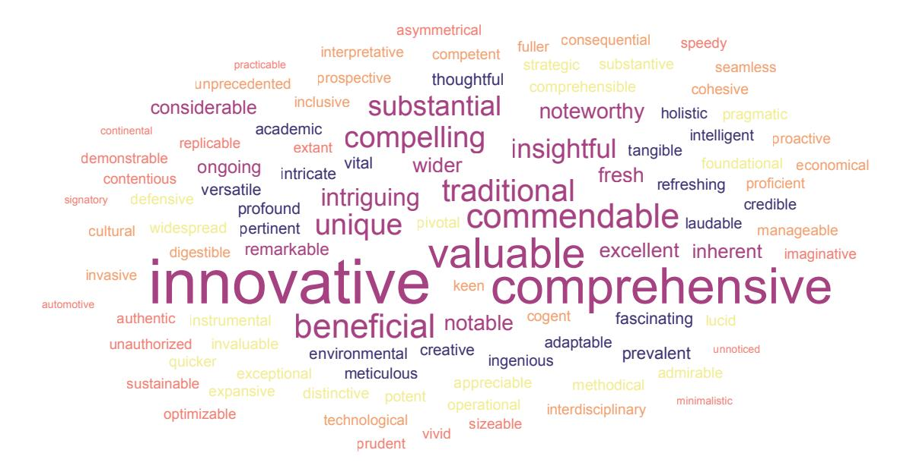

Figure 12: Word cloud of top 100 adjectives in LLM feedback, with font size indicating frequency.

#### <span id="page-16-0"></span>B. Top 100 adverbs that are disproportionately used more frequently by AI

Table 3: Top 100 adverbs disproportionately used more frequently by AI.

| meticulously   | reportedly      | lucidly          | innovatively     | aptly          |
|----------------|-----------------|------------------|------------------|----------------|
| methodically   | excellently     | compellingly     | impressively     | undoubtedly    |
| scholarly      | strategically   | intriguingly     | competently      | intelligently  |
| hitherto       | thoughtfully    | profoundly       | undeniably       | admirably      |
| creatively     | logically       | markedly         | thereby          | contextually   |
| distinctly     | judiciously     | cleverly         | invariably       | successfully   |
| chiefly        | refreshingly    | constructively   | inadvertently    | effectively    |
| intellectually | rightly         | convincingly     | comprehensively  | seamlessly     |
| predominantly  | coherently      | evidently        | notably          | professionally |
| subtly         | synergistically | productively     | purportedly      | remarkably     |
| traditionally  | starkly         | promptly         | richly           | nonetheless    |
| elegantly      | smartly         | solidly          | inadequately     | effortlessly   |
| forth          | firmly          | autonomously     | duly             | critically     |
| immensely      | beautifully     | maliciously      | finely           | succinctly     |
| further        | robustly        | decidedly        | conclusively     | diversely      |
| exceptionally  | concurrently    | appreciably      | methodologically | universally    |
| thoroughly     | soundly         | particularly     | elaborately      | uniquely       |
| neatly         | definitively    | substantively    | usefully         | adversely      |
| primarily      | principally     | discriminatively | efficiently      | scientifically |
| alike          | herein          | additionally     | subsequently     | potentially    |
|                |                 | <b>-</b>         |                  | <u> </u>       |

<span id="page-16-1"></span>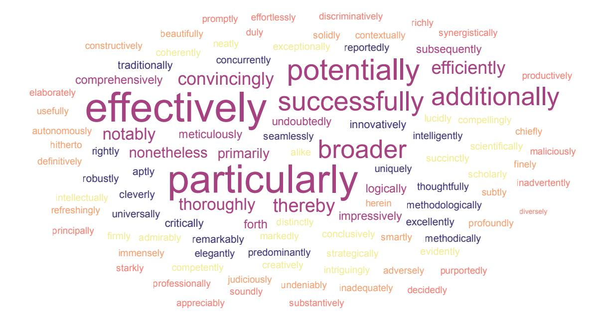

Figure 13: Word cloud of top 100 adverbs in LLM feedback, with font size indicating frequency.

# C. Additional Details on Major ML Conferences Reviewer Confidence Scale

<span id="page-17-0"></span>Here we include additional details on the datasets used for our experiments. Table [4](#page-17-0) includes the descriptions of the reviewer confidence scales for each conference.

|              | Table 4: Confidence Scale Description for Major ML Conferences                                                                                                                                                                                                                                                                                                                                                                                                                                                                                                                                                                                                                                                                                                                                                                                                                                                                                                                                                                                                                   |
|--------------|----------------------------------------------------------------------------------------------------------------------------------------------------------------------------------------------------------------------------------------------------------------------------------------------------------------------------------------------------------------------------------------------------------------------------------------------------------------------------------------------------------------------------------------------------------------------------------------------------------------------------------------------------------------------------------------------------------------------------------------------------------------------------------------------------------------------------------------------------------------------------------------------------------------------------------------------------------------------------------------------------------------------------------------------------------------------------------|
| Conference   | Confidence Scale Description                                                                                                                                                                                                                                                                                                                                                                                                                                                                                                                                                                                                                                                                                                                                                                                                                                                                                                                                                                                                                                                     |
| ICLR 2024    | 1: You are unable to assess this paper and have alerted the ACs to seek an opinion from<br>different reviewers.<br>2: You are willing to defend your assessment, but it is quite likely that you did not<br>understand the central parts of the submission or that you are unfamiliar with some<br>pieces of related work. Math/other details were not carefully checked.<br>3: You are fairly confident in your assessment. It is possible that you did not understand<br>some parts of the submission or that you are unfamiliar with some pieces of related<br>work. Math/other details were not carefully checked.<br>4: You are confident in your assessment, but not absolutely certain. It is unlikely, but<br>not impossible, that you did not understand some parts of the submission or that you<br>are unfamiliar with some pieces of related work.<br>5: You are absolutely certain about your assessment. You are very familiar with the<br>related work and checked the math/other details carefully.                                                              |
| NeurIPS 2023 | 1: Your assessment is an educated guess. The submission is not in your area or the<br>submission was difficult to understand. Math/other details were not carefully checked.<br>2: You are willing to defend your assessment, but it is quite likely that you did not<br>understand the central parts of the submission or that you are unfamiliar with some<br>pieces of related work. Math/other details were not carefully checked.<br>3: You are fairly confident in your assessment. It is possible that you did not understand<br>some parts of the submission or that you are unfamiliar with some pieces of related<br>work. Math/other details were not carefully checked.<br>4: You are confident in your assessment, but not absolutely certain. It is unlikely, but<br>not impossible, that you did not understand some parts of the submission or that you<br>are unfamiliar with some pieces of related work.<br>5: You are absolutely certain about your assessment. You are very familiar with the<br>related work and checked the math/other details carefully. |
| CoRL 2023    | 1: The reviewer's evaluation is an educated guess<br>2: The reviewer is willing to defend the evaluation, but it is quite likely that the reviewer<br>did not understand central parts of the paper<br>3: The reviewer is fairly confident that the evaluation is correct<br>4: The reviewer is confident but not absolutely certain that the evaluation is correct<br>5: The reviewer is absolutely certain that the evaluation is correct and very familiar<br>with the relevant literature                                                                                                                                                                                                                                                                                                                                                                                                                                                                                                                                                                                    |
| EMNLP 2023   | 1: Not my area, or paper was hard for me to understand. My evaluation is just an<br>educated guess.<br>2: Willing to defend my evaluation, but it is fairly likely that I missed some details,<br>didn't understand some central points, or can't be sure about the novelty of the work.<br>3: Pretty sure, but there's a chance I missed something. Although I have a good feel<br>for this area in general, I did not carefully check the paper's details, e.g., the math,<br>experimental design, or novelty.<br>4: Quite sure. I tried to check the important points carefully. It's unlikely, though                                                                                                                                                                                                                                                                                                                                                                                                                                                                        |

conceivable, that I missed something that should affect my ratings.

familiar with related work.

5: Positive that my evaluation is correct. I read the paper very carefully and I am very

#### <span id="page-18-0"></span>**D.** Additional Results

In this appendix, we collect additional experimental results. This includes tables of the exact numbers used to produce the figures in the main text, as well as results for additional experiments not reported in the main text.

#### **D.1. Validation Accuracy Tables**

Here we present the numerical results for validating our method in Section 3.6. Table 5, 6 shows the numerical values used in Figure 3.

We also trained a separate model for *Nature* family journals using official review data for papers accepted between 2021-09-13 and 2022-08-03. We validated the model's accuracy on reviews for papers accepted between 2022-08-04 and 2022-11-29 (Figure 3, *Nature Portfolio* '22, Table 6).

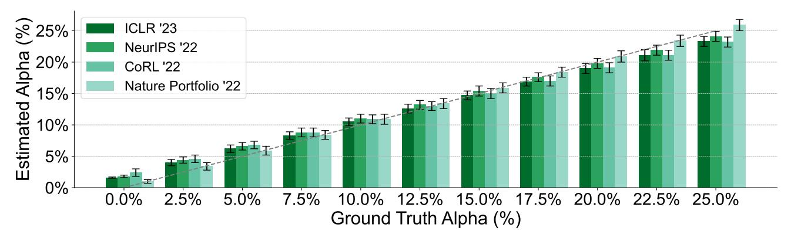

Figure 14: Full Results of the validation procedure from Section 3.6 using adjectives.

<span id="page-19-0"></span>Table 5: Performance validation of our model across *ICLR* '23, *NeurIPS* '22, and *CoRL* '22 reviews (all predating ChatGPT's launch), using a blend of official human and LLM-generated reviews. Our algorithm demonstrates high accuracy with less than 2.4% prediction error in identifying the proportion of LLM reviews within the validation set. This table presents the results data for Figure [3.](#page-5-2)

| Validation<br>Data Source | Ground<br>Truth α                                                                                                                                                                                                                                                                                                                                                                                |                                                                                                                                                                                                                                                 |                                                                                                                                                                                                                                                 | Prediction<br>Error                                                                                                                                                                                                                       |
|---------------------------|--------------------------------------------------------------------------------------------------------------------------------------------------------------------------------------------------------------------------------------------------------------------------------------------------------------------------------------------------------------------------------------------------|-------------------------------------------------------------------------------------------------------------------------------------------------------------------------------------------------------------------------------------------------|-------------------------------------------------------------------------------------------------------------------------------------------------------------------------------------------------------------------------------------------------|-------------------------------------------------------------------------------------------------------------------------------------------------------------------------------------------------------------------------------------------|
|                           |                                                                                                                                                                                                                                                                                                                                                                                                  | α                                                                                                                                                                                                                                               | CI (±)                                                                                                                                                                                                                                          |                                                                                                                                                                                                                                           |
|                           |                                                                                                                                                                                                                                                                                                                                                                                                  |                                                                                                                                                                                                                                                 |                                                                                                                                                                                                                                                 | 1.6%                                                                                                                                                                                                                                      |
|                           |                                                                                                                                                                                                                                                                                                                                                                                                  |                                                                                                                                                                                                                                                 |                                                                                                                                                                                                                                                 | 1.5%                                                                                                                                                                                                                                      |
|                           |                                                                                                                                                                                                                                                                                                                                                                                                  |                                                                                                                                                                                                                                                 |                                                                                                                                                                                                                                                 | 1.2%                                                                                                                                                                                                                                      |
|                           |                                                                                                                                                                                                                                                                                                                                                                                                  |                                                                                                                                                                                                                                                 |                                                                                                                                                                                                                                                 | 0.8%                                                                                                                                                                                                                                      |
|                           |                                                                                                                                                                                                                                                                                                                                                                                                  |                                                                                                                                                                                                                                                 |                                                                                                                                                                                                                                                 | 0.5%                                                                                                                                                                                                                                      |
|                           |                                                                                                                                                                                                                                                                                                                                                                                                  |                                                                                                                                                                                                                                                 |                                                                                                                                                                                                                                                 | 0.1%                                                                                                                                                                                                                                      |
|                           |                                                                                                                                                                                                                                                                                                                                                                                                  |                                                                                                                                                                                                                                                 |                                                                                                                                                                                                                                                 | 0.3%                                                                                                                                                                                                                                      |
|                           |                                                                                                                                                                                                                                                                                                                                                                                                  |                                                                                                                                                                                                                                                 |                                                                                                                                                                                                                                                 | 0.6%                                                                                                                                                                                                                                      |
|                           |                                                                                                                                                                                                                                                                                                                                                                                                  |                                                                                                                                                                                                                                                 |                                                                                                                                                                                                                                                 | 1.0%                                                                                                                                                                                                                                      |
|                           |                                                                                                                                                                                                                                                                                                                                                                                                  |                                                                                                                                                                                                                                                 |                                                                                                                                                                                                                                                 | 1.4%                                                                                                                                                                                                                                      |
| ICLR 2023                 | 25.0%                                                                                                                                                                                                                                                                                                                                                                                            | 23.3%                                                                                                                                                                                                                                           | 0.8%                                                                                                                                                                                                                                            | 1.7%                                                                                                                                                                                                                                      |
| NeurIPS 2022              | 0.0%                                                                                                                                                                                                                                                                                                                                                                                             | 1.8%                                                                                                                                                                                                                                            | 0.2%                                                                                                                                                                                                                                            | 1.8%                                                                                                                                                                                                                                      |
| NeurIPS 2022              | 2.5%                                                                                                                                                                                                                                                                                                                                                                                             | 4.4%                                                                                                                                                                                                                                            | 0.5%                                                                                                                                                                                                                                            | 1.9%                                                                                                                                                                                                                                      |
|                           |                                                                                                                                                                                                                                                                                                                                                                                                  |                                                                                                                                                                                                                                                 |                                                                                                                                                                                                                                                 | 1.6%                                                                                                                                                                                                                                      |
|                           |                                                                                                                                                                                                                                                                                                                                                                                                  |                                                                                                                                                                                                                                                 |                                                                                                                                                                                                                                                 | 1.3%                                                                                                                                                                                                                                      |
|                           |                                                                                                                                                                                                                                                                                                                                                                                                  |                                                                                                                                                                                                                                                 |                                                                                                                                                                                                                                                 | 1.0%                                                                                                                                                                                                                                      |
|                           |                                                                                                                                                                                                                                                                                                                                                                                                  |                                                                                                                                                                                                                                                 |                                                                                                                                                                                                                                                 | 0.7%                                                                                                                                                                                                                                      |
|                           |                                                                                                                                                                                                                                                                                                                                                                                                  |                                                                                                                                                                                                                                                 |                                                                                                                                                                                                                                                 | 0.4%                                                                                                                                                                                                                                      |
|                           |                                                                                                                                                                                                                                                                                                                                                                                                  |                                                                                                                                                                                                                                                 |                                                                                                                                                                                                                                                 | 0.1%                                                                                                                                                                                                                                      |
|                           |                                                                                                                                                                                                                                                                                                                                                                                                  |                                                                                                                                                                                                                                                 |                                                                                                                                                                                                                                                 | 0.2%                                                                                                                                                                                                                                      |
|                           |                                                                                                                                                                                                                                                                                                                                                                                                  |                                                                                                                                                                                                                                                 |                                                                                                                                                                                                                                                 | 0.6%                                                                                                                                                                                                                                      |
| NeurIPS 2022              | 25.0%                                                                                                                                                                                                                                                                                                                                                                                            | 24.1%                                                                                                                                                                                                                                           | 0.8%                                                                                                                                                                                                                                            | 0.9%                                                                                                                                                                                                                                      |
| CoRL 2022                 | 0.0%                                                                                                                                                                                                                                                                                                                                                                                             | 2.4%                                                                                                                                                                                                                                            | 0.6%                                                                                                                                                                                                                                            | 2.4%                                                                                                                                                                                                                                      |
|                           |                                                                                                                                                                                                                                                                                                                                                                                                  |                                                                                                                                                                                                                                                 |                                                                                                                                                                                                                                                 | 2.1%                                                                                                                                                                                                                                      |
|                           |                                                                                                                                                                                                                                                                                                                                                                                                  |                                                                                                                                                                                                                                                 |                                                                                                                                                                                                                                                 | 1.8%                                                                                                                                                                                                                                      |
|                           |                                                                                                                                                                                                                                                                                                                                                                                                  |                                                                                                                                                                                                                                                 |                                                                                                                                                                                                                                                 | 1.3%                                                                                                                                                                                                                                      |
|                           |                                                                                                                                                                                                                                                                                                                                                                                                  |                                                                                                                                                                                                                                                 |                                                                                                                                                                                                                                                 | 0.9%                                                                                                                                                                                                                                      |
|                           |                                                                                                                                                                                                                                                                                                                                                                                                  |                                                                                                                                                                                                                                                 |                                                                                                                                                                                                                                                 | 0.5%                                                                                                                                                                                                                                      |
|                           |                                                                                                                                                                                                                                                                                                                                                                                                  |                                                                                                                                                                                                                                                 |                                                                                                                                                                                                                                                 | 0.0%                                                                                                                                                                                                                                      |
|                           |                                                                                                                                                                                                                                                                                                                                                                                                  |                                                                                                                                                                                                                                                 |                                                                                                                                                                                                                                                 | 0.5%                                                                                                                                                                                                                                      |
|                           |                                                                                                                                                                                                                                                                                                                                                                                                  |                                                                                                                                                                                                                                                 |                                                                                                                                                                                                                                                 | 0.9%                                                                                                                                                                                                                                      |
|                           |                                                                                                                                                                                                                                                                                                                                                                                                  |                                                                                                                                                                                                                                                 |                                                                                                                                                                                                                                                 | 1.4%                                                                                                                                                                                                                                      |
|                           |                                                                                                                                                                                                                                                                                                                                                                                                  |                                                                                                                                                                                                                                                 |                                                                                                                                                                                                                                                 | 1.8%                                                                                                                                                                                                                                      |
|                           | ICLR 2023<br>ICLR 2023<br>ICLR 2023<br>ICLR 2023<br>ICLR 2023<br>ICLR 2023<br>ICLR 2023<br>ICLR 2023<br>ICLR 2023<br>ICLR 2023<br>NeurIPS 2022<br>NeurIPS 2022<br>NeurIPS 2022<br>NeurIPS 2022<br>NeurIPS 2022<br>NeurIPS 2022<br>NeurIPS 2022<br>NeurIPS 2022<br>CoRL 2022<br>CoRL 2022<br>CoRL 2022<br>CoRL 2022<br>CoRL 2022<br>CoRL 2022<br>CoRL 2022<br>CoRL 2022<br>CoRL 2022<br>CoRL 2022 | 0.0%<br>2.5%<br>5.0%<br>7.5%<br>10.0%<br>12.5%<br>15.0%<br>17.5%<br>20.0%<br>22.5%<br>5.0%<br>7.5%<br>10.0%<br>12.5%<br>15.0%<br>17.5%<br>20.0%<br>22.5%<br>2.5%<br>5.0%<br>7.5%<br>10.0%<br>12.5%<br>15.0%<br>17.5%<br>20.0%<br>22.5%<br>25.0% | 1.6%<br>4.0%<br>6.2%<br>8.3%<br>10.5%<br>12.6%<br>14.7%<br>16.9%<br>19.0%<br>21.1%<br>6.6%<br>8.8%<br>11.0%<br>13.2%<br>15.4%<br>17.6%<br>19.8%<br>21.9%<br>4.6%<br>6.8%<br>8.8%<br>10.9%<br>13.0%<br>15.0%<br>17.0%<br>19.1%<br>21.1%<br>23.2% | Estimated<br>0.1%<br>0.5%<br>0.6%<br>0.6%<br>0.6%<br>0.7%<br>0.7%<br>0.7%<br>0.8%<br>0.9%<br>0.6%<br>0.7%<br>0.7%<br>0.7%<br>0.8%<br>0.7%<br>0.8%<br>0.8%<br>0.6%<br>0.6%<br>0.7%<br>0.7%<br>0.7%<br>0.8%<br>0.8%<br>0.8%<br>0.8%<br>0.8% |

<span id="page-19-1"></span>Table 6: Performance validation of our model across *Nature* family journals (all predating ChatGPT's launch), using a blend of official human and LLM-generated reviews. This table presents the results data for Figure [3.](#page-5-2)

<span id="page-19-2"></span>

| No.  | Validation            | Ground<br>Truth α | Estimated |        | Prediction |
|------|-----------------------|-------------------|-----------|--------|------------|
|      | Data Source           |                   | α         | CI (±) | Error      |
| (1)  | Nature Portfolio 2022 | 0.0%              | 1.0%      | 0.3%   | 1.0%       |
| (2)  | Nature Portfolio 2022 | 2.5%              | 3.4%      | 0.6%   | 0.9%       |
| (3)  | Nature Portfolio 2022 | 5.0%              | 5.9%      | 0.7%   | 0.9%       |
| (4)  | Nature Portfolio 2022 | 7.5%              | 8.4%      | 0.7%   | 0.9%       |
| (5)  | Nature Portfolio 2022 | 10.0%             | 10.9%     | 0.8%   | 0.9%       |
| (6)  | Nature Portfolio 2022 | 12.5%             | 13.4%     | 0.8%   | 0.9%       |
| (7)  | Nature Portfolio 2022 | 15.0%             | 15.9%     | 0.8%   | 0.9%       |
| (8)  | Nature Portfolio 2022 | 17.5%             | 18.4%     | 0.8%   | 0.9%       |
| (9)  | Nature Portfolio 2022 | 20.0%             | 20.9%     | 0.9%   | 0.9%       |
| (10) | Nature Portfolio 2022 | 22.5%             | 23.4%     | 0.9%   | 0.9%       |
| (11) | Nature Portfolio 2022 | 25.0%             | 25.9%     | 0.9%   | 0.9%       |

#### D.2. Main Results Tables

Here we present the numerical results for estimating on real reviews in Section [4.4.](#page-6-0) Table [7,](#page-20-0) [8](#page-20-1) shows the numerical values used in Figure [4.](#page-6-3) We still use our separately trained model for *Nature* family journals in main results estimation.

<span id="page-20-0"></span>Table 7: Temporal trends of ML conferences in the α estimate on official reviews using adjectives. α estimates pre-ChatGPT are close to 0, and there is a sharp increase after the release of ChatGPT. This table presents the results data for Figure [4.](#page-6-3)

| No.  | Validation   | Estimated |        |  |
|------|--------------|-----------|--------|--|
|      | Data Source  | α         | CI (±) |  |
| (1)  | NeurIPS 2019 | 1.7%      | 0.3%   |  |
| (2)  | NeurIPS 2020 | 1.4%      | 0.1%   |  |
| (3)  | NeurIPS 2021 | 1.6%      | 0.2%   |  |
| (4)  | NeurIPS 2022 | 1.9%      | 0.2%   |  |
| (5)  | NeurIPS 2023 | 9.1%      | 0.2%   |  |
| (6)  | ICLR 2023    | 1.6%      | 0.1%   |  |
| (7)  | ICLR 2024    | 10.6%     | 0.2%   |  |
| (8)  | CoRL 2021    | 2.4%      | 0.7%   |  |
| (9)  | CoRL 2022    | 2.4%      | 0.6%   |  |
| (10) | CoRL 2023    | 6.5%      | 0.7%   |  |
| (11) | EMNLP 2023   | 16.9%     | 0.5%   |  |

<span id="page-20-1"></span>Table 8: Temporal trends of the *Nature* family journals in the α estimate on official reviews using adjectives. Contrary to the ML conferences, the *Nature* family journals did not exhibit a significant increase in the estimated α values following ChatGPT's release, with pre- and post-release α estimates remaining within the margin of error for the α = 0 validation experiment. This table presents the results data for Figure [4.](#page-6-3)

| No. | Validation            | Estimated |        |  |
|-----|-----------------------|-----------|--------|--|
|     | Data Source           | α         | CI (±) |  |
| (1) | Nature portfolio 2019 | 0.8%      | 0.2%   |  |
| (2) | Nature portfolio 2020 | 0.7%      | 0.2%   |  |
| (3) | Nature portfolio 2021 | 1.1%      | 0.2%   |  |
| (4) | Nature portfolio 2022 | 1.0%      | 0.3%   |  |
| (5) | Nature portfolio 2023 | 1.6%      | 0.2%   |  |

#### <span id="page-21-0"></span>**D.3.** Sensitivity to LLM Prompt

Empirically, we found that our framework exhibits moderate robustness to the distribution shift of LLM prompts. Training with one prompt and testing on a different prompt still yields accurate validation results (Supp. Figure 15). Figure 27 shows the prompt for generating training data with GPT-4 June. Figure 28 shows the prompt for generating validation data on prompt shift.

Table 9 shows the results using a different prompt than that in the main text.

<span id="page-21-1"></span>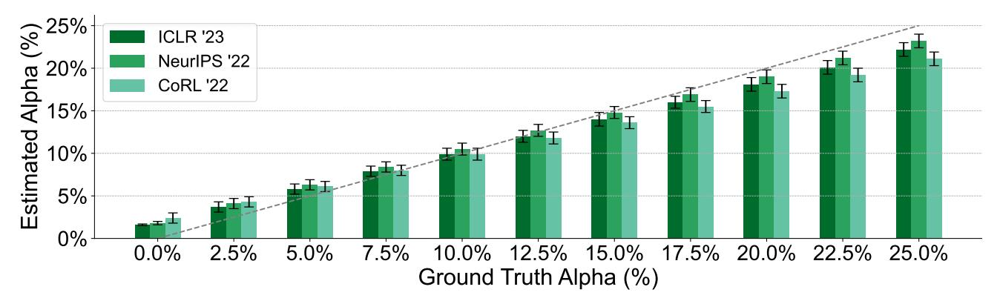

Figure 15: Results of the validation procedure from Section 3.6 using a different prompt.

<span id="page-22-0"></span>Table 9: Validation accuracy for our method using a different prompt. The model was trained using data from *ICLR* 2018-2022, and OOD verification was performed on *NeurIPS* and *CoRL* (moderate distribution shift). The method is robust to changes in the prompt and still exhibits accurate and stable performance.

| No.  | Validation<br>Data Source | Ground<br>Truth α | Estimated |        | Prediction |  |
|------|---------------------------|-------------------|-----------|--------|------------|--|
|      |                           |                   | α         | CI (±) | Error      |  |
| (1)  | ICLR 2023                 | 0.0%              | 1.6%      | 0.1%   | 1.6%       |  |
| (2)  | ICLR 2023                 | 2.5%              | 3.7%      | 0.6%   | 1.2%       |  |
| (3)  | ICLR 2023                 | 5.0%              | 5.8%      | 0.6%   | 0.8%       |  |
| (4)  | ICLR 2023                 | 7.5%              | 7.9%      | 0.6%   | 0.4%       |  |
| (5)  | ICLR 2023                 | 10.0%             | 9.9%      | 0.7%   | 0.1%       |  |
| (6)  | ICLR 2023                 | 12.5%             | 12.0%     | 0.7%   | 0.5%       |  |
| (7)  | ICLR 2023                 | 15.0%             | 14.0%     | 0.8%   | 1.0%       |  |
| (8)  | ICLR 2023                 | 17.5%             | 16.0%     | 0.7%   | 1.5%       |  |
| (9)  | ICLR 2023                 | 20.0%             | 18.1%     | 0.8%   | 1.9%       |  |
| (10) | ICLR 2023                 | 22.5%             | 20.1%     | 0.8%   | 2.4%       |  |
| (11) | ICLR 2023                 | 25.0%             | 22.2%     | 0.8%   | 2.8%       |  |
| (12) | NeurIPS 2022              | 0.0%              | 1.8%      | 0.2%   | 1.8%       |  |
| (13) | NeurIPS 2022              | 2.5%              | 4.1%      | 0.6%   | 1.6%       |  |
| (14) | NeurIPS 2022              | 5.0%              | 6.3%      | 0.6%   | 1.3%       |  |
| (15) | NeurIPS 2022              | 7.5%              | 8.4%      | 0.6%   | 0.9%       |  |
| (16) | NeurIPS 2022              | 10.0%             | 10.5%     | 0.7%   | 0.5%       |  |
| (17) | NeurIPS 2022              | 12.5%             | 12.7%     | 0.7%   | 0.2%       |  |
| (18) | NeurIPS 2022              | 15.0%             | 14.8%     | 0.7%   | 0.2%       |  |
| (19) | NeurIPS 2022              | 17.5%             | 16.9%     | 0.8%   | 0.6%       |  |
| (20) | NeurIPS 2022              | 20.0%             | 19.0%     | 0.8%   | 1.0%       |  |
| (21) | NeurIPS 2022              | 22.5%             | 21.2%     | 0.8%   | 1.3%       |  |
| (22) | NeurIPS 2022              | 25.0%             | 23.2%     | 0.8%   | 1.8%       |  |
| (23) | CoRL 2022                 | 0.0%              | 2.4%      | 0.6%   | 2.4%       |  |
| (24) | CoRL 2022                 | 2.5%              | 4.3%      | 0.6%   | 1.8%       |  |
| (25) | CoRL 2022                 | 5.0%              | 6.1%      | 0.6%   | 1.1%       |  |
| (26) | CoRL 2022                 | 7.5%              | 8.0%      | 0.6%   | 0.5%       |  |
| (27) | CoRL 2022                 | 10.0%             | 9.9%      | 0.7%   | 0.1%       |  |
| (28) | CoRL 2022                 | 12.5%             | 11.8%     | 0.7%   | 0.7%       |  |
| (29) | CoRL 2022                 | 15.0%             | 13.6%     | 0.7%   | 1.4%       |  |
| (30) | CoRL 2022                 | 17.5%             | 15.5%     | 0.7%   | 2.0%       |  |
| (31) | CoRL 2022                 | 20.0%             | 17.3%     | 0.8%   | 2.7%       |  |
| (32) | CoRL 2022                 | 22.5%             | 19.2%     | 0.8%   | 3.3%       |  |
| (33) | CoRL 2022                 | 25.0%             | 21.1%     | 0.8%   | 3.9%       |  |

#### D.4. Tables for Stratification by Paper Topic (*ICLR*)

Here, we provide the numerical results for various fields in the *ICLR* 2024 conference. The results are shown in Table [10.](#page-23-0)

<span id="page-23-0"></span>Table 10: Changes in the estimated α for different fields of ML (sorted according to a paper's designated primary area in *ICLR* 2024).

| No.  | ICLR 2024 Primary Area                                                                 | # of<br>Papers | Estimated |        |
|------|----------------------------------------------------------------------------------------|----------------|-----------|--------|
|      |                                                                                        |                | α         | CI (±) |
| (1)  | Datasets and Benchmarks                                                                | 271            | 20.9%     | 1.0%   |
| (2)  | Transfer Learning, Meta Learning, and Lifelong Learning                                | 375            | 14.0%     | 0.8%   |
| (3)  | Learning on Graphs and Other Geometries & Topologies                                   | 189            | 12.6%     | 1.0%   |
| (4)  | Applications to Physical Sciences (Physics, Chemistry, Biology, etc.)                  | 312            | 12.4%     | 0.8%   |
| (5)  | Representation Learning for Computer Vision, Audio, Language, and Other Modalities     | 1037           | 12.3%     | 0.5%   |
| (6)  | Unsupervised, Self-supervised, Semi-supervised, and Supervised Representation Learning | 856            | 11.9%     | 0.5%   |
| (7)  | Infrastructure, Software Libraries, Hardware, etc.                                     | 47             | 11.5%     | 2.0%   |
| (8)  | Societal Considerations including Fairness, Safety, Privacy                            | 535            | 11.4%     | 0.6%   |
| (9)  | General Machine Learning (i.e., None of the Above)                                     | 786            | 11.3%     | 0.5%   |
| (10) | Applications to Neuroscience & Cognitive Science                                       | 133            | 10.9%     | 1.1%   |
| (11) | Generative Models                                                                      | 777            | 10.4%     | 0.5%   |
| (12) | Applications to Robotics, Autonomy, Planning                                           | 177            | 10.0%     | 0.9%   |
| (13) | Visualization or Interpretation of Learned Representations                             | 212            | 8.4%      | 0.8%   |
| (14) | Reinforcement Learning                                                                 | 654            | 8.2%      | 0.4%   |
| (15) | Neurosymbolic & Hybrid AI Systems (Physics-informed, Logic & Formal Reasoning, etc.)   | 101            | 7.7%      | 1.3%   |
| (16) | Learning Theory                                                                        | 211            | 7.3%      | 0.8%   |
| (17) | Metric learning, Kernel learning, and Sparse coding                                    | 36             | 7.2%      | 2.1%   |
| (18) | Probabilistic Methods (Bayesian Methods, Variational Inference, Sampling, UQ, etc.)    | 184            | 6.0%      | 0.8%   |
| (19) | Optimization                                                                           | 312            | 5.8%      | 0.6%   |
| (20) | Causal Reasoning                                                                       | 99             | 5.0%      | 1.0%   |

#### <span id="page-24-0"></span>D.5. Results with Adverbs

For our results in the main paper, we only considered adjectives for the space of all possible tokens. We found this vocabulary choice to exhibit greater stability than using other parts of speech such as adverbs, verbs, nouns, or all possible tokens. This remotely aligns with the findings in the literature (Lin et al., 2023), which indicate that *stylistic* words are the most impacted during alignment fine-tuning.

Here, we conducted experiments using adverbs. The results for adverbs are shown in Table 11.

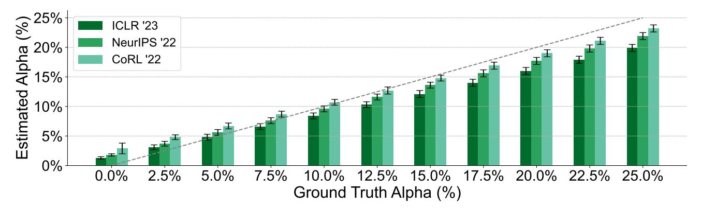

Figure 16: Results of the validation procedure from Section 3.6 using adverbs (instead of adjectives).

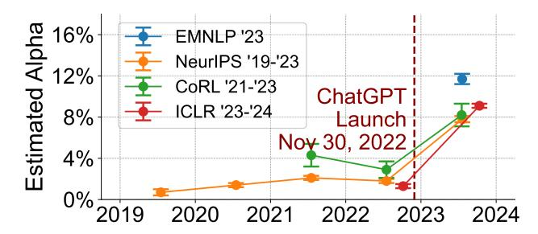

Figure 17: Temporal changes in the estimated  $\alpha$  for several ML conferences using adverbs.

<span id="page-25-0"></span>Table 11: Validation results when adverbs are used. The performance degrades compared to using adjectives.

| No.  | Validation   | Ground<br>Truth α | Estimated |        | Prediction |  |
|------|--------------|-------------------|-----------|--------|------------|--|
|      | Data Source  |                   | α         | CI (±) | Error      |  |
| (1)  | ICLR 2023    | 0.0%              | 1.3%      | 0.2%   | 1.3%       |  |
| (2)  | ICLR 2023    | 2.5%              | 3.1%      | 0.4%   | 0.6%       |  |
| (3)  | ICLR 2023    | 5.0%              | 4.8%      | 0.5%   | 0.2%       |  |
| (4)  | ICLR 2023    | 7.5%              | 6.6%      | 0.5%   | 0.9%       |  |
| (5)  | ICLR 2023    | 10.0%             | 8.4%      | 0.5%   | 1.6%       |  |
| (6)  | ICLR 2023    | 12.5%             | 10.3%     | 0.5%   | 2.2%       |  |
| (7)  | ICLR 2023    | 15.0%             | 12.1%     | 0.6%   | 2.9%       |  |
| (8)  | ICLR 2023    | 17.5%             | 14.0%     | 0.6%   | 3.5%       |  |
| (9)  | ICLR 2023    | 20.0%             | 16.0%     | 0.6%   | 4.0%       |  |
| (10) | ICLR 2023    | 22.5%             | 17.9%     | 0.6%   | 4.6%       |  |
| (11) | ICLR 2023    | 25.0%             | 19.9%     | 0.6%   | 5.1%       |  |
| (12) | NeurIPS 2022 | 0.0%              | 1.8%      | 0.2%   | 1.8%       |  |
| (13) | NeurIPS 2022 | 2.5%              | 3.7%      | 0.4%   | 1.2%       |  |
| (14) | NeurIPS 2022 | 5.0%              | 5.6%      | 0.5%   | 0.6%       |  |
| (15) | NeurIPS 2022 | 7.5%              | 7.6%      | 0.5%   | 0.1%       |  |
| (16) | NeurIPS 2022 | 10.0%             | 9.6%      | 0.5%   | 0.4%       |  |
| (17) | NeurIPS 2022 | 12.5%             | 11.6%     | 0.5%   | 0.9%       |  |
| (18) | NeurIPS 2022 | 15.0%             | 13.6%     | 0.5%   | 1.4%       |  |
| (19) | NeurIPS 2022 | 17.5%             | 15.6%     | 0.6%   | 1.9%       |  |
| (20) | NeurIPS 2022 | 20.0%             | 17.7%     | 0.6%   | 2.3%       |  |
| (21) | NeurIPS 2022 | 22.5%             | 19.8%     | 0.6%   | 2.7%       |  |
| (22) | NeurIPS 2022 | 25.0%             | 21.9%     | 0.6%   | 3.1%       |  |
| (23) | CoRL 2022    | 0.0%              | 2.9%      | 0.9%   | 2.9%       |  |
| (24) | CoRL 2022    | 2.5%              | 4.8%      | 0.4%   | 2.3%       |  |
| (25) | CoRL 2022    | 5.0%              | 6.7%      | 0.5%   | 1.7%       |  |
| (26) | CoRL 2022    | 7.5%              | 8.7%      | 0.5%   | 1.2%       |  |
| (27) | CoRL 2022    | 10.0%             | 10.7%     | 0.5%   | 0.7%       |  |
| (28) | CoRL 2022    | 12.5%             | 12.7%     | 0.6%   | 0.2%       |  |
| (29) | CoRL 2022    | 15.0%             | 14.8%     | 0.5%   | 0.2%       |  |
| (30) | CoRL 2022    | 17.5%             | 16.9%     | 0.6%   | 0.6%       |  |
| (31) | CoRL 2022    | 20.0%             | 19.0%     | 0.6%   | 1.0%       |  |
| (32) | CoRL 2022    | 22.5%             | 21.1%     | 0.6%   | 1.4%       |  |
| (33) | CoRL 2022    | 25.0%             | 23.2%     | 0.6%   | 1.8%       |  |

Table 12: Temporal trends in the α estimate on official reviews using adverbs. The same qualitative trend is observed: α estimates pre-ChatGPT are close to 0, and there is a sharp increase after the release of ChatGPT.

| No.  | Validation   | Estimated |        |  |
|------|--------------|-----------|--------|--|
|      | Data Source  | α         | CI (±) |  |
| (1)  | NeurIPS 2019 | 0.7%      | 0.3%   |  |
| (2)  | NeurIPS 2020 | 1.4%      | 0.2%   |  |
| (3)  | NeurIPS 2021 | 2.1%      | 0.2%   |  |
| (4)  | NeurIPS 2022 | 1.8%      | 0.2%   |  |
| (5)  | NeurIPS 2023 | 7.8%      | 0.3%   |  |
| (6)  | ICLR 2023    | 1.3%      | 0.2%   |  |
| (7)  | ICLR 2024    | 9.1%      | 0.2%   |  |
| (8)  | CoRL 2021    | 4.3%      | 1.1%   |  |
| (9)  | CoRL 2022    | 2.9%      | 0.8%   |  |
| (10) | CoRL 2023    | 8.2%      | 1.1%   |  |
| (11) | EMNLP 2023   | 11.7%     | 0.5%   |  |

# <span id="page-26-0"></span>D.6. Results with Verbs

Here, we conducted experiments using verbs. The results for verbs are shown in Table 13.

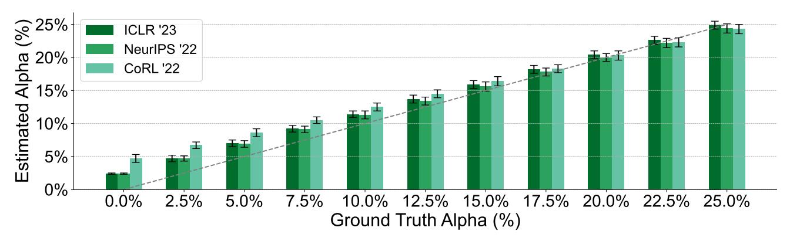

Figure 18: Results of the validation procedure from Section 3.6 using verbs (instead of adjectives).

<span id="page-26-1"></span>Table 13: Validation accuracy when verbs are used. The performance degrades slightly as compared to using adjectives.

| No.  | Validation<br>Data Source | $\begin{array}{c} \textbf{Ground} \\ \textbf{Truth} \ \alpha \end{array}$ | Estimated |           | Prediction |
|------|---------------------------|---------------------------------------------------------------------------|-----------|-----------|------------|
| 110. |                           |                                                                           | $\alpha$  | $CI(\pm)$ | Error      |
| (1)  | ICLR 2023                 | 0.0%                                                                      | 2.4%      | 0.1%      | 2.4%       |
| (2)  | <b>ICLR</b> 2023          | 2.5%                                                                      | 4.7%      | 0.5%      | 2.2%       |
| (3)  | <b>ICLR</b> 2023          | 5.0%                                                                      | 7.0%      | 0.5%      | 2.0%       |
| (4)  | <b>ICLR</b> 2023          | 7.5%                                                                      | 9.2%      | 0.5%      | 1.7%       |
| (5)  | <b>ICLR</b> 2023          | 10.0%                                                                     | 11.4%     | 0.5%      | 1.4%       |
| (6)  | <b>ICLR</b> 2023          | 12.5%                                                                     | 13.7%     | 0.6%      | 1.2%       |
| (7)  | <b>ICLR</b> 2023          | 15.0%                                                                     | 15.9%     | 0.6%      | 0.9%       |
| (8)  | <b>ICLR</b> 2023          | 17.5%                                                                     | 18.2%     | 0.6%      | 0.7%       |
| (9)  | <b>ICLR</b> 2023          | 20.0%                                                                     | 20.4%     | 0.6%      | 0.4%       |
| (10) | <b>ICLR</b> 2023          | 22.5%                                                                     | 22.6%     | 0.6%      | 0.1%       |
| (11) | <u>ICLR</u> 2023          | 25.0%                                                                     | 24.9%     | 0.6%      | 0.1%       |
| (12) | NeurIPS 2022              | 0.0%                                                                      | 2.4%      | 0.1%      | 2.4%       |
| (13) | NeurIPS 2022              | 2.5%                                                                      | 4.7%      | 0.4%      | 2.2%       |
| (14) | NeurIPS 2022              | 5.0%                                                                      | 6.9%      | 0.5%      | 1.9%       |
| (15) | NeurIPS 2022              | 7.5%                                                                      | 9.1%      | 0.5%      | 1.6%       |
| (16) | NeurIPS 2022              | 10.0%                                                                     | 11.3%     | 0.6%      | 1.3%       |
| (17) | NeurIPS 2022              | 12.5%                                                                     | 13.4%     | 0.6%      | 0.9%       |
| (18) | NeurIPS 2022              | 15.0%                                                                     | 15.6%     | 0.7%      | 0.6%       |
| (19) | NeurIPS 2022              | 17.5%                                                                     | 17.8%     | 0.6%      | 0.3%       |
| (20) | NeurIPS 2022              | 20.0%                                                                     | 20.0%     | 0.6%      | 0.0%       |
| (21) | NeurIPS 2022              | 22.5%                                                                     | 22.2%     | 0.7%      | 0.3%       |
| (22) | NeurIPS 2022              | 25.0%                                                                     | 24.4%     | 0.7%      | 0.6%       |
| (23) | CoRL 2022                 | 0.0%                                                                      | 4.7%      | 0.6%      | 4.7%       |
| (24) | <u>CoRL</u> 2022          | 2.5%                                                                      | 6.7%      | 0.5%      | 4.2%       |
| (25) | <b>CoRL</b> 2022          | 5.0%                                                                      | 8.6%      | 0.6%      | 3.6%       |
| (26) | <b>CoRL</b> 2022          | 7.5%                                                                      | 10.5%     | 0.5%      | 3.0%       |
| (27) | <u>CoRL</u> 2022          | 10.0%                                                                     | 12.5%     | 0.6%      | 2.5%       |
| (28) | <b>CoRL</b> 2022          | 12.5%                                                                     | 14.5%     | 0.6%      | 2.0%       |
| (29) | <u>CoRL</u> 2022          | 15.0%                                                                     | 16.4%     | 0.7%      | 1.4%       |
| (30) | CoRL 2022                 | 17.5%                                                                     | 18.3%     | 0.6%      | 0.8%       |
| (31) | CoRL 2022                 | 20.0%                                                                     | 20.3%     | 0.7%      | 0.3%       |
| (32) | CoRL 2022                 | 22.5%                                                                     | 22.3%     | 0.7%      | 0.2%       |
| (33) | CoRL 2022                 | 25.0%                                                                     | 24.3%     | 0.7%      | 0.7%       |

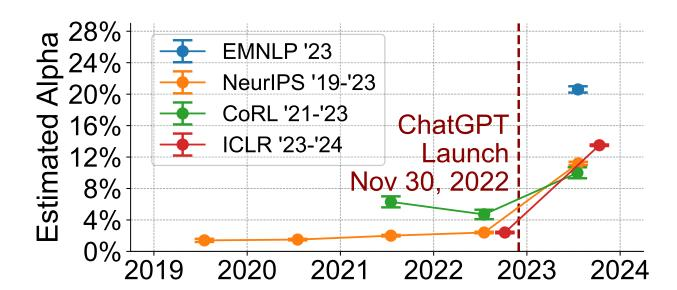

Figure 19: Temporal changes in the estimated  $\alpha$  for several ML conferences using verbs.

Table 14: Temporal trends in the  $\alpha$  estimate on official reviews using verbs. The same qualitative trend is observed:  $\alpha$  estimates pre-ChatGPT are close to 0, and there is a sharp increase after the release of ChatGPT.

| No.  | Validation        | Estimated |           |  |
|------|-------------------|-----------|-----------|--|
|      | Data Source       | $\alpha$  | $CI(\pm)$ |  |
| (1)  | NeurIPS 2019      | 1.4%      | 0.2%      |  |
| (2)  | NeurIPS 2020      | 1.5%      | 0.1%      |  |
| (3)  | NeurIPS 2021      | 2.0%      | 0.1%      |  |
| (4)  | NeurIPS 2022      | 2.4%      | 0.1%      |  |
| (5)  | NeurIPS 2023      | 11.2%     | 0.2%      |  |
| (6)  | ICLR 2023         | 2.4%      | 0.1%      |  |
| (7)  | <u>ICLR</u> 2024  | 13.5%     | 0.1%      |  |
| (8)  | CoRL 2021         | 6.3%      | 0.7%      |  |
| (9)  | <u>CoRL</u> 2022  | 4.7%      | 0.6%      |  |
| (10) | <u>CoRL</u> 2023  | 10.0%     | 0.7%      |  |
| (11) | <u>EMNLP</u> 2023 | 20.6%     | 0.4%      |  |

#### <span id="page-28-0"></span>**D.7. Results with Nouns**

Here, we conducted experiments using nouns. The results for nouns in Table 15.

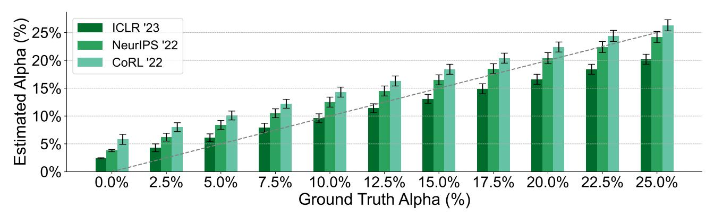

Figure 20: Results of the validation procedure from Section 3.6 using nouns (instead of adjectives).

<span id="page-28-1"></span>Table 15: Validation accuracy when nouns are used. The performance degrades as compared to using adjectives.

| No.  | Validation<br>Data Source | $\begin{array}{c} \textbf{Ground} \\ \textbf{Truth} \ \alpha \end{array}$ | Estimated |           | Prediction |
|------|---------------------------|---------------------------------------------------------------------------|-----------|-----------|------------|
| 110. |                           |                                                                           | $\alpha$  | $CI(\pm)$ | Error      |
| (1)  | ICLR 2023                 | 0.0%                                                                      | 2.4%      | 0.1%      | 2.4%       |
| (2)  | <b>ICLR</b> 2023          | 2.5%                                                                      | 4.3%      | 0.7%      | 1.8%       |
| (3)  | <b>ICLR</b> 2023          | 5.0%                                                                      | 6.1%      | 0.7%      | 1.1%       |
| (4)  | <b>ICLR</b> 2023          | 7.5%                                                                      | 7.9%      | 0.8%      | 0.4%       |
| (5)  | <b>ICLR</b> 2023          | 10.0%                                                                     | 9.6%      | 0.8%      | 0.4%       |
| (6)  | <b>ICLR</b> 2023          | 12.5%                                                                     | 11.4%     | 0.8%      | 1.1%       |
| (7)  | <b>ICLR</b> 2023          | 15.0%                                                                     | 13.1%     | 0.8%      | 1.9%       |
| (8)  | <b>ICLR</b> 2023          | 17.5%                                                                     | 14.9%     | 0.9%      | 2.6%       |
| (9)  | <b>ICLR</b> 2023          | 20.0%                                                                     | 16.6%     | 0.9%      | 3.4%       |
| (10) | <b>ICLR</b> 2023          | 22.5%                                                                     | 18.4%     | 0.9%      | 4.1%       |
| (11) | <u>ICLR</u> 2023          | 25.0%                                                                     | 20.2%     | 0.9%      | 4.8%       |
| (12) | NeurIPS 2022              | 0.0%                                                                      | 3.8%      | 0.2%      | 3.8%       |
| (13) | NeurIPS 2022              | 2.5%                                                                      | 6.2%      | 0.7%      | 3.7%       |
| (14) | NeurIPS 2022              | 5.0%                                                                      | 8.4%      | 0.8%      | 3.4%       |
| (15) | NeurIPS 2022              | 7.5%                                                                      | 10.5%     | 0.8%      | 3.0%       |
| (16) | NeurIPS 2022              | 10.0%                                                                     | 12.5%     | 0.9%      | 2.5%       |
| (17) | NeurIPS 2022              | 12.5%                                                                     | 14.5%     | 0.9%      | 2.0%       |
| (18) | NeurIPS 2022              | 15.0%                                                                     | 16.5%     | 0.9%      | 1.5%       |
| (19) | NeurIPS 2022              | 17.5%                                                                     | 18.5%     | 0.9%      | 1.0%       |
| (20) | NeurIPS 2022              | 20.0%                                                                     | 20.4%     | 1.0%      | 0.4%       |
| (21) | NeurIPS 2022              | 22.5%                                                                     | 22.4%     | 1.0%      | 0.1%       |
| (22) | NeurIPS 2022              | 25.0%                                                                     | 24.2%     | 1.0%      | 0.8%       |
| (23) | CoRL 2022                 | 0.0%                                                                      | 5.8%      | 0.9%      | 5.8%       |
| (24) | <b>CoRL</b> 2022          | 2.5%                                                                      | 8.0%      | 0.8%      | 5.5%       |
| (25) | <u>CoRL</u> 2022          | 5.0%                                                                      | 10.1%     | 0.8%      | 5.1%       |
| (26) | <u>CoRL</u> 2022          | 7.5%                                                                      | 12.2%     | 0.8%      | 4.7%       |
| (27) | CoRL 2022                 | 10.0%                                                                     | 14.3%     | 0.9%      | 4.3%       |
| (28) | CoRL 2022                 | 12.5%                                                                     | 16.3%     | 0.9%      | 3.8%       |
| (29) | CoRL 2022                 | 15.0%                                                                     | 18.4%     | 0.9%      | 3.4%       |
| (30) | CoRL 2022                 | 17.5%                                                                     | 20.4%     | 0.9%      | 2.9%       |
| (31) | CoRL 2022                 | 20.0%                                                                     | 22.4%     | 0.9%      | 2.4%       |
| (32) | CoRL 2022                 | 22.5%                                                                     | 24.4%     | 1.0%      | 1.9%       |
| (33) | CoRL 2022                 | 25.0%                                                                     | 26.3%     | 1.0%      | 1.3%       |

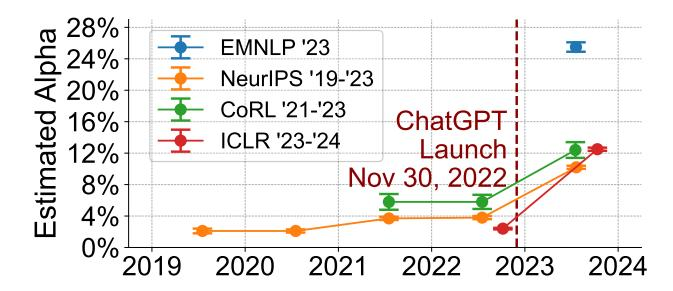

Figure 21: Temporal changes in the estimated  $\alpha$  for several ML conferences using nouns.

Table 16: Temporal trends in the  $\alpha$  estimate on official reviews using nouns. The same qualitative trend is observed:  $\alpha$  estimates pre-ChatGPT are close to 0, and there is a sharp increase after the release of ChatGPT.

| No.  | Validation        | Estimated |           |  |
|------|-------------------|-----------|-----------|--|
|      | Data Source       | $\alpha$  | $CI(\pm)$ |  |
| (1)  | NeurIPS 2019      | 2.1%      | 0.3%      |  |
| (2)  | NeurIPS 2020      | 2.1%      | 0.2%      |  |
| (3)  | NeurIPS 2021      | 3.7%      | 0.2%      |  |
| (4)  | NeurIPS 2022      | 3.8%      | 0.2%      |  |
| (5)  | NeurIPS 2023      | 10.2%     | 0.2%      |  |
| (6)  | ICLR 2023         | 2.4%      | 0.1%      |  |
| (7)  | <u>ICLR</u> 2024  | 12.5%     | 0.2%      |  |
| (8)  | CoRL 2021         | 5.8%      | 1.0%      |  |
| (9)  | <u>CoRL</u> 2022  | 5.8%      | 0.9%      |  |
| (10) | <u>CoRL</u> 2023  | 12.4%     | 1.0%      |  |
| (11) | <u>EMNLP</u> 2023 | 25.5%     | 0.6%      |  |

#### <span id="page-29-0"></span>D.8. Results on Document-Level Analysis

Our results in the main paper analyzed the data at a sentence level. That is, we assumed that each sentence in a review was drawn from the mixture model (1), and estimated the fraction  $\alpha$  of sentences which were AI generated. We can perform the same analysis on entire <u>documents</u> (i.e., complete reviews) to check the robustness of our method to this design choice. Here, P should be interpreted as the distribution of reviews generated without AI assistance, while Q should be interpreted as reviews for which a significant fraction of the content is AI generated. (We do not expect any reviews to be 100% AI-generated, so this distinction is important.)

The results of the document-level analysis are similar to that at the sentence level. Table 17 shows the validation results corresponding to Section 3.6.

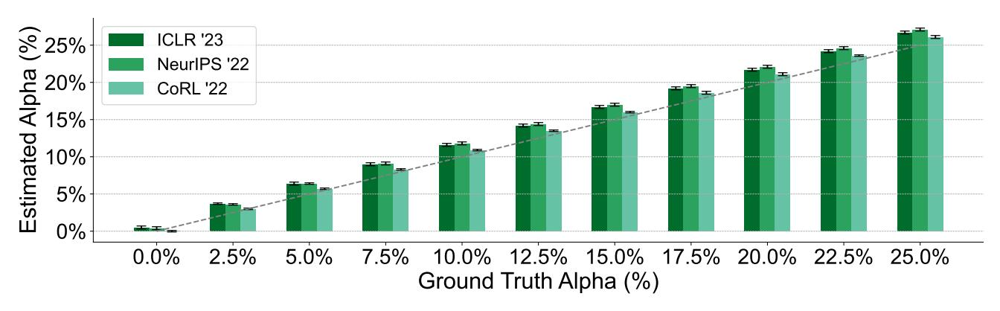

Figure 22: Results of the validation procedure from Section 3.6 at a document (rather than sentence) level.

<span id="page-30-0"></span>Table 17: Validation accuracy applying the method at a document (rather than sentence) level. There is a slight degradation in performance compared to the sentence-level approach, and the method tends to slightly over-estimate the true  $\alpha$ . We prefer the sentence-level method since it is unlikely that any reviewer will generate an entire review using ChatGPT, as opposed to generating individual sentences or parts of the review using AI.

| No.  | Validation       | Ground         | Estimated |           | Prediction |
|------|------------------|----------------|-----------|-----------|------------|
| 110. | Data Source      | Truth $\alpha$ | $\alpha$  | $CI(\pm)$ | Error      |
| (1)  | ICLR 2023        | 0.0%           | 0.5%      | 0.2%      | 0.5%       |
| (2)  | ICLR 2023        | 2.5%           | 3.7%      | 0.1%      | 1.2%       |
| (3)  | <u>ICLR</u> 2023 | 5.0%           | 6.4%      | 0.2%      | 1.4%       |
| (4)  | <u>ICLR</u> 2023 | 7.5%           | 9.0%      | 0.2%      | 1.5%       |
| (5)  | ICLR 2023        | 10.0%          | 11.6%     | 0.2%      | 1.6%       |
| (6)  | <u>ICLR</u> 2023 | 12.5%          | 14.2%     | 0.2%      | 1.7%       |
| (7)  | ICLR 2023        | 15.0%          | 16.7%     | 0.2%      | 1.7%       |
| (8)  | <u>ICLR</u> 2023 | 17.5%          | 19.2%     | 0.2%      | 1.7%       |
| (9)  | <b>ICLR</b> 2023 | 20.0%          | 21.7%     | 0.2%      | 1.7%       |
| (10) | ICLR 2023        | 22.5%          | 24.2%     | 0.2%      | 1.7%       |
| (11) | <u>ICLR</u> 2023 | 25.0%          | 26.7%     | 0.2%      | 1.7%       |
| (12) | NeurIPS 2022     | 0.0%           | 0.4%      | 0.2%      | 0.4%       |
| (13) | NeurIPS 2022     | 2.5%           | 3.6%      | 0.1%      | 1.1%       |
| (14) | NeurIPS 2022     | 5.0%           | 6.4%      | 0.1%      | 1.4%       |
| (15) | NeurIPS 2022     | 7.5%           | 9.1%      | 0.2%      | 1.6%       |
| (16) | NeurIPS 2022     | 10.0%          | 11.8%     | 0.2%      | 1.8%       |
| (17) | NeurIPS 2022     | 12.5%          | 14.4%     | 0.2%      | 1.9%       |
| (18) | NeurIPS 2022     | 15.0%          | 17.0%     | 0.2%      | 2.0%       |
| (19) | NeurIPS 2022     | 17.5%          | 19.5%     | 0.2%      | 2.0%       |
| (20) | NeurIPS 2022     | 20.0%          | 22.1%     | 0.2%      | 2.1%       |
| (21) | NeurIPS 2022     | 22.5%          | 24.6%     | 0.2%      | 2.1%       |
| (22) | NeurIPS 2022     | 25.0%          | 27.1%     | 0.2%      | 2.1%       |
| (23) | CoRL 2022        | 0.0%           | 0.0%      | 0.1%      | 0.0%       |
| (24) | <b>CoRL</b> 2022 | 2.5%           | 3.0%      | 0.1%      | 0.5%       |
| (25) | <u>CoRL</u> 2022 | 5.0%           | 5.7%      | 0.1%      | 0.7%       |
| (26) | <b>CoRL</b> 2022 | 7.5%           | 8.3%      | 0.1%      | 0.8%       |
| (27) | <b>CoRL</b> 2022 | 10.0%          | 10.9%     | 0.1%      | 0.9%       |
| (28) | <b>CoRL</b> 2022 | 12.5%          | 13.5%     | 0.1%      | 1.0%       |
| (29) | <b>CoRL</b> 2022 | 15.0%          | 16.0%     | 0.1%      | 1.0%       |
| (30) | <u>CoRL</u> 2022 | 17.5%          | 18.6%     | 0.2%      | 1.1%       |
| (31) | CoRL 2022        | 20.0%          | 21.1%     | 0.2%      | 1.1%       |
| (32) | CoRL 2022        | 22.5%          | 23.6%     | 0.1%      | 1.1%       |
| (33) | CoRL 2022        | 25.0%          | 26.1%     | 0.2%      | 1.1%       |

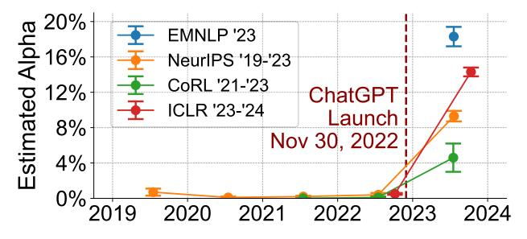

Figure 23: Temporal changes in the estimated  $\alpha$  for several ML conferences at the document level.

Table 18: Temporal trends in the α estimate on official reviews using the model trained at the document level. The same qualitative trend is observed: α estimates pre-ChatGPT are close to 0, and there is a sharp increase after the release of ChatGPT.

| No.  | Validation   | Estimated |        |  |
|------|--------------|-----------|--------|--|
|      | Data Source  | α         | CI (±) |  |
| (1)  | NeurIPS 2019 | 0.3%      | 0.3%   |  |
| (2)  | NeurIPS 2020 | 1.1%      | 0.3%   |  |
| (3)  | NeurIPS 2021 | 2.1%      | 0.2%   |  |
| (4)  | NeurIPS 2022 | 3.7%      | 0.3%   |  |
| (5)  | NeurIPS 2023 | 13.7%     | 0.3%   |  |
| (6)  | ICLR 2023    | 3.6%      | 0.2%   |  |
| (7)  | ICLR 2024    | 16.3%     | 0.2%   |  |
| (8)  | CoRL 2021    | 2.8%      | 1.1%   |  |
| (9)  | CoRL 2022    | 2.9%      | 1.0%   |  |
| (10) | CoRL 2023    | 8.5%      | 1.1%   |  |
| (11) | EMNLP 2023   | 24.0%     | 0.6%   |  |

#### <span id="page-32-1"></span>D.9. Comparison to State-of-the-art GPT Detection Methods

We conducted experiments using the traditional classification approach to AI text detection. That is, we used two off-the-shelf AI text detectors (RADAR and Deepfake Text Detect) to classify each sentence as AI- or human-generated. Our estimate for α is the fraction of sentences which the classifier believes are AI-generated. We used the same validation procedure as in Section [3.6.](#page-4-2) The results are shown in Table [19.](#page-32-2) Two off-the-shelf classifiers predict that either almost all (RADAR) or none (Deepfake) of the text are AI-generated, regardless of the true α level. With the exception of the BERT-based method, the predictions made by all of the classifiers remain nearly constant across all α levels, leading to poor performance for all of them. This may be due to a distribution shift between the data used to train the classifier (likely general text scraped from the internet) vs. text found in conference reviews. While BERT's estimates for α seem at least positively correlated with the correct α value, the error in the estimate is still large compared to the high accuracy obtained by our method (see Figure [3](#page-5-2) and Table [5\)](#page-19-0).

<span id="page-32-2"></span>Table 19: Validation accuracy for classifier-based methods. RADAR, Deepfake, and DetectGPT all produce estimates which remain almost constant, independent of the true α. The BERT estimates are correlated with the true α, but the estimates are still far off.

|      |              | Validation<br>Ground |             | RADAR<br>Deepfake |                               | BERT        |                 |
|------|--------------|----------------------|-------------|-------------------|-------------------------------|-------------|-----------------|
| No.  | Data Source  | Truth α              | Estimated α | Estimated α       | Fast-DetectGPT<br>Estimated α | Estimated α | Predictor Error |
| (1)  | ICLR 2023    | 0.0%                 | 99.3%       | 0.2%              | 11.3%                         | 1.1%        | 1.1%            |
| (2)  | ICLR 2023    | 2.5%                 | 99.4%       | 0.2%              | 11.2%                         | 2.9%        | 0.4%            |
| (3)  | ICLR 2023    | 5.0%                 | 99.4%       | 0.3%              | 11.2%                         | 4.7%        | 0.3%            |
| (4)  | ICLR 2023    | 7.5%                 | 99.4%       | 0.2%              | 11.4%                         | 6.4%        | 1.1%            |
| (5)  | ICLR 2023    | 10.0%                | 99.4%       | 0.2%              | 11.6%                         | 8.0%        | 2.0%            |
| (6)  | ICLR 2023    | 12.5%                | 99.4%       | 0.3%              | 11.6%                         | 9.9%        | 2.6%            |
| (7)  | ICLR 2023    | 15.0%                | 99.4%       | 0.3%              | 11.8%                         | 11.6%       | 3.4%            |
| (8)  | ICLR 2023    | 17.5%                | 99.4%       | 0.2%              | 11.9%                         | 13.4%       | 4.1%            |
| (9)  | ICLR 2023    | 20.0%                | 99.4%       | 0.3%              | 12.2%                         | 15.3%       | 4.7%            |
| (10) | ICLR 2023    | 22.5%                | 99.4%       | 0.2%              | 12.0%                         | 17.0%       | 5.5%            |
| (11) | ICLR 2023    | 25.0%                | 99.4%       | 0.3%              | 12.1%                         | 18.8%       | 6.2%            |
| (12) | NeurIPS 2022 | 0.0%                 | 99.2%       | 0.2%              | 10.5%                         | 1.1%        | 1.1%            |
| (13) | NeurIPS 2022 | 2.5%                 | 99.2%       | 0.2%              | 10.5%                         | 2.3%        | 0.2%            |
| (14) | NeurIPS 2022 | 5.0%                 | 99.2%       | 0.3%              | 10.7%                         | 3.6%        | 1.4%            |
| (15) | NeurIPS 2022 | 7.5%                 | 99.2%       | 0.2%              | 10.9%                         | 5.0%        | 2.5%            |
| (16) | NeurIPS 2022 | 10.0%                | 99.2%       | 0.2%              | 10.9%                         | 6.1%        | 3.9%            |
| (17) | NeurIPS 2022 | 12.5%                | 99.2%       | 0.3%              | 11.1%                         | 7.2%        | 5.3%            |
| (18) | NeurIPS 2022 | 15.0%                | 99.2%       | 0.3%              | 11.0%                         | 8.6%        | 6.4%            |
| (19) | NeurIPS 2022 | 17.5%                | 99.3%       | 0.2%              | 11.0%                         | 9.9%        | 7.6%            |
| (20) | NeurIPS 2022 | 20.0%                | 99.2%       | 0.3%              | 11.3%                         | 11.3%       | 8.7%            |
| (21) | NeurIPS 2022 | 22.5%                | 99.3%       | 0.2%              | 11.4%                         | 12.5%       | 10.0%           |
| (22) | NeurIPS 2022 | 25.0%                | 99.2%       | 0.3%              | 11.5%                         | 13.8%       | 11.2%           |
| (23) | CoRL 2022    | 0.0%                 | 99.5%       | 0.2%              | 10.2%                         | 1.5%        | 1.5%            |
| (24) | CoRL 2022    | 2.5%                 | 99.5%       | 0.2%              | 10.4%                         | 3.3%        | 0.8%            |
| (25) | CoRL 2022    | 5.0%                 | 99.5%       | 0.2%              | 10.4%                         | 5.0%        | 0.0%            |
| (26) | CoRL 2022    | 7.5%                 | 99.5%       | 0.3%              | 10.8%                         | 6.8%        | 0.7%            |
| (27) | CoRL 2022    | 10.0%                | 99.5%       | 0.3%              | 11.0%                         | 8.4%        | 1.6%            |
| (28) | CoRL 2022    | 12.5%                | 99.5%       | 0.3%              | 10.9%                         | 10.2%       | 2.3%            |
| (29) | CoRL 2022    | 15.0%                | 99.5%       | 0.3%              | 11.1%                         | 11.8%       | 3.2%            |
| (30) | CoRL 2022    | 17.5%                | 99.5%       | 0.3%              | 11.1%                         | 13.8%       | 3.7%            |
| (31) | CoRL 2022    | 20.0%                | 99.5%       | 0.3%              | 11.4%                         | 15.5%       | 4.5%            |
| (32) | CoRL 2022    | 22.5%                | 99.5%       | 0.2%              | 11.6%                         | 17.4%       | 5.1%            |
| (33) | CoRL 2022    | 25.0%                | 99.5%       | 0.3%              | 11.7%                         | 18.9%       | 6.1%            |

<span id="page-32-0"></span>Table 20: Amortized inference computation cost per 32-token sentence in GFLOPs (total number of floating point operations; 1 GFLOPs = 10<sup>9</sup> FLOPs).

| Ours<br>RADAR(RoBERTa) |       | Deepfake(Longformer) | Fast-DetectGPT(Zero-shot) | BERT  |
|------------------------|-------|----------------------|---------------------------|-------|
| 6.809 ×10−8            | 9.671 | 50.781               | 84.669                    | 2.721 |

#### <span id="page-33-0"></span>D.10. Robustness to Proofreading

Table 21: Proofreading with ChatGPT alone cannot explain the increase.

| Conferences |      | Before Proofread | After Proofread |           |
|-------------|------|------------------|-----------------|-----------|
|             | α    | (±)<br>CI        | α               | (±)<br>CI |
| ICLR2023    | 1.5% | 0.7%             | 2.2%            | 0.8%      |
| NeurIPS2022 | 0.9% | 0.6%             | 1.5%            | 0.7%      |
| CoRL2022    | 2.3% | 0.7%             | 3.0%            | 0.8%      |

#### <span id="page-33-1"></span>D.11. Using LLMs to Substantially Expand Incomplete Sentences

Table 22: Validation accuracy using a blend of official human and LLM-expanded review.

| No.  | Validation   | Ground  | Estimated |        | Prediction |
|------|--------------|---------|-----------|--------|------------|
|      | Data Source  | Truth α | α         | CI (±) | Error      |
| (1)  | ICLR 2023    | 0.0%    | 1.6%      | 0.1%   | 1.6%       |
| (2)  | ICLR 2023    | 2.5%    | 4.1%      | 0.5%   | 1.6%       |
| (3)  | ICLR 2023    | 5.0%    | 6.3%      | 0.6%   | 1.3%       |
| (4)  | ICLR 2023    | 7.5%    | 8.5%      | 0.6%   | 1.0%       |
| (5)  | ICLR 2023    | 10.0%   | 10.6%     | 0.7%   | 0.6%       |
| (6)  | ICLR 2023    | 12.5%   | 12.6%     | 0.7%   | 0.1%       |
| (7)  | ICLR 2023    | 15.0%   | 14.7%     | 0.7%   | 0.3%       |
| (8)  | ICLR 2023    | 17.5%   | 16.7%     | 0.7%   | 0.8%       |
| (9)  | ICLR 2023    | 20.0%   | 18.7%     | 0.8%   | 1.3%       |
| (10) | ICLR 2023    | 22.5%   | 20.7%     | 0.8%   | 1.8%       |
| (11) | ICLR 2023    | 25.0%   | 22.7%     | 0.8%   | 2.3%       |
| (12) | NeurIPS 2022 | 0.0%    | 1.9%      | 0.2%   | 1.9%       |
| (13) | NeurIPS 2022 | 2.5%    | 4.0%      | 0.6%   | 1.5%       |
| (14) | NeurIPS 2022 | 5.0%    | 6.0%      | 0.6%   | 1.0%       |
| (15) | NeurIPS 2022 | 7.5%    | 7.9%      | 0.6%   | 0.4%       |
| (16) | NeurIPS 2022 | 10.0%   | 9.8%      | 0.6%   | 0.2%       |
| (17) | NeurIPS 2022 | 12.5%   | 11.6%     | 0.7%   | 0.9%       |
| (18) | NeurIPS 2022 | 15.0%   | 13.4%     | 0.7%   | 1.6%       |
| (19) | NeurIPS 2022 | 17.5%   | 15.2%     | 0.8%   | 2.3%       |
| (20) | NeurIPS 2022 | 20.0%   | 17.0%     | 0.8%   | 3.0%       |
| (21) | NeurIPS 2022 | 22.5%   | 18.8%     | 0.8%   | 3.7%       |
| (22) | NeurIPS 2022 | 25.0%   | 20.6%     | 0.8%   | 4.4%       |
| (23) | CoRL 2022    | 0.0%    | 2.4%      | 0.6%   | 2.4%       |
| (24) | CoRL 2022    | 2.5%    | 4.5%      | 0.5%   | 2.0%       |
| (25) | CoRL 2022    | 5.0%    | 6.4%      | 0.6%   | 1.4%       |
| (26) | CoRL 2022    | 7.5%    | 8.2%      | 0.6%   | 0.7%       |
| (27) | CoRL 2022    | 10.0%   | 10.0%     | 0.7%   | 0.0%       |
| (28) | CoRL 2022    | 12.5%   | 11.8%     | 0.7%   | 0.7%       |
| (29) | CoRL 2022    | 15.0%   | 13.6%     | 0.7%   | 1.4%       |
| (30) | CoRL 2022    | 17.5%   | 15.3%     | 0.7%   | 2.2%       |
| (31) | CoRL 2022    | 20.0%   | 17.0%     | 0.7%   | 3.0%       |
| (32) | CoRL 2022    | 22.5%   | 18.7%     | 0.8%   | 3.8%       |
| (33) | CoRL 2022    | 25.0%   | 20.5%     | 0.8%   | 4.5%       |

#### <span id="page-34-0"></span>D.12. Factors that Correlate With Estimated LLM Usage

Table 23: Numerical results for the deadline effect (Figure [7\)](#page-7-2).

| Conferences |       | More than 3 Days<br>Before Review Deadline | Within 3 Days<br>of Review Deadline |        |  |
|-------------|-------|--------------------------------------------|-------------------------------------|--------|--|
|             | α     | CI (±)                                     | α                                   | CI (±) |  |
| ICLR2024    | 8.8%  | 0.4%                                       | 11.3%                               | 0.2%   |  |
| NeurIPS2023 | 7.7%  | 0.4%                                       | 9.5%                                | 0.3%   |  |
| CoRL2023    | 3.9%  | 1.3%                                       | 7.3%                                | 0.9%   |  |
| EMNLP2023   | 14.2% | 1.0%                                       | 17.1%                               | 0.5%   |  |

<span id="page-34-1"></span>Table 24: Numerical results for the reference effect (Figure [8\)](#page-7-3)

| Conferences | With Reference |           | No Reference |           |
|-------------|----------------|-----------|--------------|-----------|
|             | α              | CI<br>(±) | α            | CI<br>(±) |
| ICLR2024    | 6.5%           | 0.2%      | 12.8%        | 0.2%      |
| NeurIPS2023 | 5.0%           | 0.4%      | 10.2%        | 0.3%      |
| CoRL2023    | 2.2%           | 1.5%      | 7.1%         | 0.8%      |
| EMNLP2023   | 10.6%          | 1.0%      | 17.7%        | 0.5%      |

<span id="page-34-2"></span>Table 25: Numerical results for the low reply effect (Figure [9\)](#page-8-0).

| # of Replies | ICLR 2024 |        | NeurIPS 2023 |        |
|--------------|-----------|--------|--------------|--------|
|              | α         | CI (±) | α            | CI (±) |
| 0            | 13.3%     | 0.3%   | 12.8%        | 0.6%   |
| 1            | 10.6%     | 0.3%   | 9.2%         | 0.3%   |
| 2            | 6.4%      | 0.5%   | 5.9%         | 0.5%   |
| 3            | 6.7%      | 1.1%   | 4.6%         | 0.9%   |
| 4+           | 3.6%      | 1.1%   | 1.9%         | 1.1%   |

<span id="page-34-3"></span>Table 26: Numerical results for the homogenization effect (Figure [10\)](#page-8-1).

| Conferences | Heterogeneous Reviews |        | Homogeneous Reviews |        |
|-------------|-----------------------|--------|---------------------|--------|
|             | α                     | CI (±) | α                   | CI (±) |
| ICLR2024    | 7.2%                  | 0.4%   | 13.1%               | 0.4%   |
| NeurIPS2023 | 6.1%                  | 0.4%   | 11.6%               | 0.5%   |
| CoRL2023    | 5.1%                  | 1.5%   | 7.6%                | 1.4%   |
| EMNLP2023   | 12.8%                 | 0.8%   | 19.6%               | 0.8%   |

Table 27: Numerical results for the low confidence effect (Figure [11\)](#page-9-0).

<span id="page-35-0"></span>

| Conferences | Reviews with Low Confidence |        | Reviews with High Confidence |        |
|-------------|-----------------------------|--------|------------------------------|--------|
|             | α                           | CI (±) | α                            | CI (±) |
| ICLR2024    | 13.2%                       | 0.7%   | 10.7%                        | 0.2%   |
| NeurIPS2023 | 10.3%                       | 0.8%   | 8.9%                         | 0.2%   |
| CoRL2023    | 7.8%                        | 4.8%   | 6.5%                         | 0.7%   |
| EMNLP2023   | 17.6%                       | 1.8%   | 16.6%                        | 0.5%   |

#### D.13. Additional Results on GPT-3.5

Here we chose to focus on ChatGPT because it is by far the most popular in general usage. According to a comprehensive analysis by FlexOS in early 2024, ChatGPT dominates the generative AI market, with 76% of global internet traffic in the category. Bing AI follows with 16%, Bard with 7%, and Claude with 1% (Van Rossum, 2024). Recent studies have also found that GPT-4 substantially outperforms other LLMs, including Bard, in the reviewing of scientific papers or proposals (Liu & Shah, 2023).

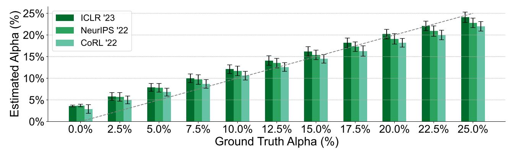

Figure 24: Results of the validation procedure from Section 3.6(model trained on reviews generated by GPT-3.5 and tested on reviews generated by GPT-3.5).

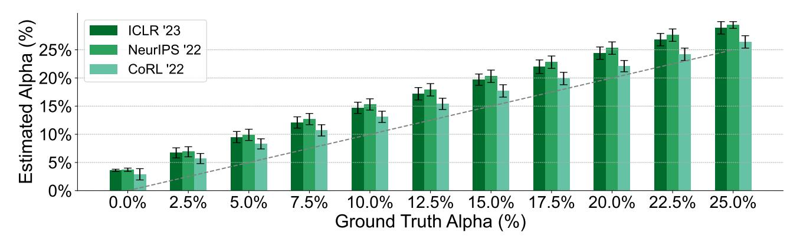

Figure 25: Results of the validation procedure from Section 3.6(model trained on reviews generated by GPT-3.5 and tested on reviews generated by GPT-4).

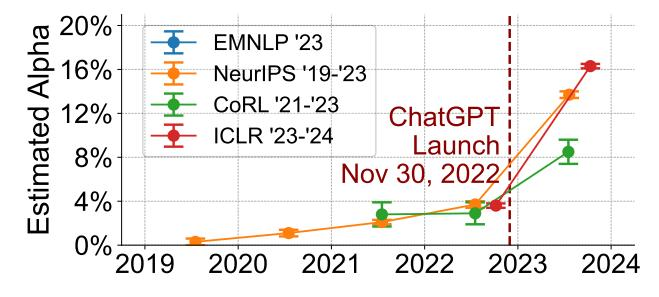

Figure 26: Temporal changes in the estimated  $\alpha$  for several ML conferences using the model trained on reviews generated by GPT-3.5.

<span id="page-37-0"></span>Table 28: Performance validation of the model trained on reviews generated by GPT-3.5.

| No.  | Validation   | Ground  | Estimated |        | Prediction |
|------|--------------|---------|-----------|--------|------------|
|      | Data Source  | Truth α | α         | CI (±) | Error      |
| (1)  | ICLR 2023    | 0.0%    | 3.6%      | 0.2%   | 3.6%       |
| (2)  | ICLR 2023    | 2.5%    | 5.8%      | 0.9%   | 3.3%       |
| (3)  | ICLR 2023    | 5.0%    | 7.9%      | 0.9%   | 2.9%       |
| (4)  | ICLR 2023    | 7.5%    | 10.0%     | 1.0%   | 2.5%       |
| (5)  | ICLR 2023    | 10.0%   | 12.1%     | 1.0%   | 2.1%       |
| (6)  | ICLR 2023    | 12.5%   | 14.1%     | 1.1%   | 1.6%       |
| (7)  | ICLR 2023    | 15.0%   | 16.2%     | 1.1%   | 1.2%       |
| (8)  | ICLR 2023    | 17.5%   | 18.2%     | 1.1%   | 0.7%       |
| (9)  | ICLR 2023    | 20.0%   | 20.2%     | 1.1%   | 0.2%       |
| (10) | ICLR 2023    | 22.5%   | 22.1%     | 1.1%   | 0.4%       |
| (11) | ICLR 2023    | 25.0%   | 24.1%     | 1.2%   | 0.9%       |
| (12) | NeurIPS 2022 | 0.0%    | 3.7%      | 0.3%   | 3.7%       |
| (13) | NeurIPS 2022 | 2.5%    | 5.7%      | 1.0%   | 3.2%       |
| (14) | NeurIPS 2022 | 5.0%    | 7.8%      | 1.0%   | 2.8%       |
| (15) | NeurIPS 2022 | 7.5%    | 9.7%      | 1.1%   | 2.2%       |
| (16) | NeurIPS 2022 | 10.0%   | 11.7%     | 1.1%   | 1.7%       |
| (17) | NeurIPS 2022 | 12.5%   | 13.5%     | 1.1%   | 1.0%       |
| (18) | NeurIPS 2022 | 15.0%   | 15.4%     | 1.1%   | 0.4%       |
| (19) | NeurIPS 2022 | 17.5%   | 17.3%     | 1.1%   | 0.2%       |
| (20) | NeurIPS 2022 | 20.0%   | 19.1%     | 1.2%   | 0.9%       |
| (21) | NeurIPS 2022 | 22.5%   | 20.9%     | 1.2%   | 1.6%       |
| (22) | NeurIPS 2022 | 25.0%   | 22.8%     | 1.1%   | 2.2%       |
| (23) | CoRL 2022    | 0.0%    | 2.9%      | 1.0%   | 2.9%       |
| (24) | CoRL 2022    | 2.5%    | 5.0%      | 0.9%   | 2.5%       |
| (25) | CoRL 2022    | 5.0%    | 6.8%      | 0.9%   | 1.8%       |
| (26) | CoRL 2022    | 7.5%    | 8.7%      | 1.0%   | 1.2%       |
| (27) | CoRL 2022    | 10.0%   | 10.6%     | 1.0%   | 0.6%       |
| (28) | CoRL 2022    | 12.5%   | 12.6%     | 1.0%   | 0.1%       |
| (29) | CoRL 2022    | 15.0%   | 14.5%     | 1.0%   | 0.5%       |
| (30) | CoRL 2022    | 17.5%   | 16.3%     | 1.2%   | 1.2%       |
| (31) | CoRL 2022    | 20.0%   | 18.2%     | 1.0%   | 1.8%       |
| (32) | CoRL 2022    | 22.5%   | 20.0%     | 1.1%   | 2.5%       |
| (33) | CoRL 2022    | 25.0%   | 22.0%     | 1.1%   | 3.0%       |

<span id="page-38-0"></span>Table 29: Performance validation of GPT-4 AI reviews trained on reviews generated by GPT-3.5.

| No.  | Validation   | Ground  | Estimated |        | Prediction |
|------|--------------|---------|-----------|--------|------------|
|      | Data Source  | Truth α | α         | CI (±) | Error      |
| (1)  | ICLR 2023    | 0.0%    | 3.6%      | 0.2%   | 3.6%       |
| (2)  | ICLR 2023    | 2.5%    | 6.7%      | 0.9%   | 4.2%       |
| (3)  | ICLR 2023    | 5.0%    | 9.5%      | 1.0%   | 4.5%       |
| (4)  | ICLR 2023    | 7.5%    | 12.1%     | 1.0%   | 4.6%       |
| (5)  | ICLR 2023    | 10.0%   | 14.7%     | 1.0%   | 4.7%       |
| (6)  | ICLR 2023    | 12.5%   | 17.2%     | 1.1%   | 4.7%       |
| (7)  | ICLR 2023    | 15.0%   | 19.7%     | 1.0%   | 4.7%       |
| (8)  | ICLR 2023    | 17.5%   | 22.0%     | 1.2%   | 4.5%       |
| (9)  | ICLR 2023    | 20.0%   | 24.4%     | 1.1%   | 4.4%       |
| (10) | ICLR 2023    | 22.5%   | 26.8%     | 1.1%   | 4.3%       |
| (11) | ICLR 2023    | 25.0%   | 28.9%     | 1.1%   | 3.9%       |
| (12) | NeurIPS 2022 | 0.0%    | 3.7%      | 0.3%   | 3.7%       |
| (13) | NeurIPS 2022 | 2.5%    | 6.9%      | 0.9%   | 4.4%       |
| (14) | NeurIPS 2022 | 5.0%    | 9.9%      | 1.0%   | 4.9%       |
| (15) | NeurIPS 2022 | 7.5%    | 12.7%     | 1.0%   | 5.2%       |
| (16) | NeurIPS 2022 | 10.0%   | 15.3%     | 1.0%   | 5.3%       |
| (17) | NeurIPS 2022 | 12.5%   | 17.9%     | 1.1%   | 5.4%       |
| (18) | NeurIPS 2022 | 15.0%   | 20.3%     | 1.1%   | 5.3%       |
| (19) | NeurIPS 2022 | 17.5%   | 22.8%     | 1.1%   | 5.3%       |
| (20) | NeurIPS 2022 | 20.0%   | 25.3%     | 1.1%   | 5.3%       |
| (21) | NeurIPS 2022 | 22.5%   | 27.6%     | 1.1%   | 5.1%       |
| (22) | NeurIPS 2022 | 25.0%   | 29.4%     | 0.6%   | 4.4%       |
| (23) | CoRL 2022    | 0.0%    | 2.9%      | 1.0%   | 2.9%       |
| (24) | CoRL 2022    | 2.5%    | 5.7%      | 0.9%   | 3.2%       |
| (25) | CoRL 2022    | 5.0%    | 8.3%      | 0.9%   | 3.3%       |
| (26) | CoRL 2022    | 7.5%    | 10.7%     | 1.0%   | 3.2%       |
| (27) | CoRL 2022    | 10.0%   | 13.1%     | 1.0%   | 3.1%       |
| (28) | CoRL 2022    | 12.5%   | 15.4%     | 1.0%   | 2.9%       |
| (29) | CoRL 2022    | 15.0%   | 17.7%     | 1.1%   | 2.7%       |
| (30) | CoRL 2022    | 17.5%   | 19.9%     | 1.1%   | 2.4%       |
| (31) | CoRL 2022    | 20.0%   | 22.1%     | 1.0%   | 2.1%       |
| (32) | CoRL 2022    | 22.5%   | 24.2%     | 1.1%   | 1.7%       |
| (33) | CoRL 2022    | 25.0%   | 26.4%     | 1.1%   | 1.4%       |

Table 30: Temporal trends in the α estimate on official reviews using the model trained on reviews generated by GPT-3.5. The same qualitative trend is observed: α estimates pre-ChatGPT are close to 0, and there is a sharp increase after the release of ChatGPT.

| No.  | Validation   | Estimated |        |  |
|------|--------------|-----------|--------|--|
|      | Data Source  | α         | CI (±) |  |
| (1)  | NeurIPS 2019 | 0.3%      | 0.3%   |  |
| (2)  | NeurIPS 2020 | 1.1%      | 0.3%   |  |
| (3)  | NeurIPS 2021 | 2.1%      | 0.2%   |  |
| (4)  | NeurIPS 2022 | 3.7%      | 0.3%   |  |
| (5)  | NeurIPS 2023 | 13.7%     | 0.3%   |  |
| (6)  | ICLR 2023    | 3.6%      | 0.2%   |  |
| (7)  | ICLR 2024    | 16.3%     | 0.2%   |  |
| (8)  | CoRL 2021    | 2.8%      | 1.1%   |  |
| (9)  | CoRL 2022    | 2.9%      | 1.0%   |  |
| (10) | CoRL 2023    | 8.5%      | 1.1%   |  |
| (11) | EMNLP 2023   | 24.0%     | 0.6%   |  |

# E. LLM prompts used in the study

```
Your task is to write a review given some text of a paper. Your output should be like the
   following format:
Summary:
Strengths And Weaknesses:
Summary Of The Review:
```

Figure 27: Example system prompt for generating training data. Paper contents are provided as the user message.

```
Your task now is to draft a high-quality review for CoRL on OpenReview for a submission
   titled <Title>:
'''
<Paper_content>
'''
======
Your task:
Compose a high-quality peer review of a paper submitted to CoRL on OpenReview.
Start by "Review outline:".
And then:
"1. Summary", Briefly summarize the paper and its contributions. This is not the place to
   critique the paper; the authors should generally agree with a well-written summary. DO
    NOT repeat the paper title.
"2. Strengths", A substantive assessment of the strengths of the paper, touching on each
   of the following dimensions: originality, quality, clarity, and significance. We
   encourage reviewers to be broad in their definitions of originality and significance.
   For example, originality may arise from a new definition or problem formulation,
   creative combinations of existing ideas, application to a new domain, or removing
   limitations from prior results. You can incorporate Markdown and Latex into your
   review. See https://openreview.net/faq.
"3. Weaknesses", A substantive assessment of the weaknesses of the paper. Focus on
   constructive and actionable insights on how the work could improve towards its stated
   goals. Be specific, avoid generic remarks. For example, if you believe the
   contribution lacks novelty, provide references and an explanation as evidence; if you
   believe experiments are insufficient, explain why and exactly what is missing, etc.
"4. Suggestions", Please list up and carefully describe any suggestions for the authors.
   Think of the things where a response from the author can change your opinion, clarify
   a confusion or address a limitation. This is important for a productive rebuttal and
   discussion phase with the authors.
```

Figure 28: Example prompt for generating validation data with prompt shift. Note that although this validation prompt is written in a significantly different style than the prompt for generating the training data, our algorithm still predicts the alpha accurately.

<span id="page-40-0"></span>The aim here is to reverse-engineer the reviewer's writing process into two distinct phases: drafting a skeleton (outline) of the review and then expanding this outline into a detailed, complete review. The process simulates how a reviewer might first organize their thoughts and key points in a structured, concise form before elaborating on each point to provide a comprehensive evaluation of the paper. Now as a first step, given a complete peer review, reverse-engineer it into a concise

skeleton.

Figure 29: Example prompt for reverse-engineering a given official review into a skeleton (outline) to simulate how a human reviewer might first organize their thoughts and key points in a structured, concise form before elaborating on each point to provide a comprehensive evaluation of the paper.

```
Expand the skeleton of the review into a official review as the following format:
Summary:
Strengths:
Weaknesses:
Questions:
```

Figure 30: Example prompt for elaborating the skeleton (outline) into the full review. The format of a review varies depending on the conference. The goal is to simulate how a human reviewer might first organize their thoughts and key points in a structured, concise form, and then elaborate on each point to provide a comprehensive evaluation of the paper.

Your task is to proofread the provided sentence for grammatical accuracy. Ensure that the corrections introduce minimal distortion to the original content.

Figure 31: Example prompt for proofreading.

# F. Additional Information on LLM Parameter Settings

We used the snapshot of GPT-4 from June 13th, 2023 (gpt-4-0613), for our experiments because this is the exact version of ChatGPT that was available during the peer review process of ICLR 2024, NeurIPS 2023, EMNLP 2023, and CoRL 2023.

Regarding the parameter settings, during our experiments, we set the decoding temperature to 1.0 and the maximum decoding length to 2048. We set the Top P hyperparameter to 1.0 and both frequency penalty and presence penalty to 0.0. Additionally, we did not configure any stop sequences during decoding.

# <span id="page-41-0"></span>G. Additional Dataset Information

All the data are publicly available. For the machine learning conferences, we accessed peer review data through the official OpenReview API (<https://docs.openreview.net/reference/api-v2>), specifically the </notes> endpoint. Each review contains an average of 25.94 sentences. For the Nature portfolio dataset, we developed a custom web scraper using python to access the article pages of 15 journals from the Nature portfolio, extracting peer reviews from papers accepted between 2019 and 2023. Each review in the Nature dataset comprises an average of 37.03 sentences.

The Nature portfolio dataset encompasses the following 15 Nature journals: Nature, Nature Communications, Nature Ecology & Evolution, Nature Structural & Molecular Biology, Nature Cell Biology, Nature Human Behaviour, Nature Immunology, Nature Microbiology, Nature Biomedical Engineering, Communications Earth & Environment, Communications Biology, Communications Physics, Communications Chemistry, Communications Materials, and Communications Medicine. To create this dataset, we systematically accessed the web pages of the selected Nature portfolio journals, extracting peer reviews from papers accepted between 2019 and 2023. In total, our dataset comprises 25,382 peer reviews from 10,242 papers. We chose to focus on the Nature family journals for our baseline dataset due to their reputation for publishing high-quality, impactful research across multiple disciplines.

Our framework breaks reviews down into a list of sentences, and the parameterization operates at the sentence level. We consider all sentences with 2 or more words and did not set a maximum limit for the number of words in a sentence. If reviewers leave a section blank, no sentences from that section are added to the corpus.

| Journal                                     | Post ChatGPT | Data Split | # of Papers | # of Official Reviews |
|---------------------------------------------|--------------|------------|-------------|-----------------------|
| Nature Portfolio 2022 (random split subset) | Before       | Training   | 1,189       | 3,341                 |
| Nature Portfolio 2019                       | Before       | Validation | 2,141       | 4,394                 |
| Nature Portfolio 2020                       | Before       | Validation | 2,083       | 4,736                 |
| Nature Portfolio 2021                       | Before       | Validation | 2,129       | 5,264                 |
| Nature Portfolio 2022                       | Before       | Validation | 511         | 1,447                 |
| Nature Portfolio 2022-2023                  | After        | Inference  | 2,189       | 6,200                 |

Table 31: Human Peer Reviews Data from Nature Family Journals.

Ethics Considerations About LLM Analysis for Public Conferences The use of peer review data for research purposes raises important ethical considerations around reviewer consent, data licensing, and responsible use [\(Dycke et al.,](#page-11-17) [2023\)](#page-11-17). While early datasets have enabled valuable research, going forward, it is critical that the community establishes clear best practices for the ethical collection and use of peer review data.

OpenReview is a science communication initiative which aims to make the scientific process more transparent. Authors and peer reviewers agree to make their reviews public upon submission. In our work, we accessed this publicly available, anonymous peer review data through the public OpenReview API and confirm that we have complied with their terms of use.

Efforts such as the data donation initiative at ACL Rolling Review (ARR), which requires explicit consent from authors and reviewers and provides clear data licenses [\(Dycke et al.,](#page-11-18) [2022\)](#page-11-18), provide a promising model for the future. A key strength of our proposed framework is that it operates at the population level and only outputs aggregate statistics, without the need to perform inference on individual reviews. This helps protect the anonymity of reviewers and mitigates the risk of de-anonymization based on writing style, which is an important consideration when working with peer review data.

We have aimed to use the available data responsibly and ethically in our work. We also recognize the importance of

developing robust community norms around the appropriate collection, licensing, sharing, and use of peer review datasets.

# H. Additional Results on LLaMA-2 Chat (70B), and Claude 2.1

We have added additional validation experiments to test two additional models other than GPT-4: LLaMA-2 Chat (70B) and Claude-2.1. We used the same training and validation setup as our paper. We trained the estimator on ICLR 2018-2022 data, and performed the validation of different alphas on ICLR 2023 data. In the first experiment, we trained an estimator using data generated by LLaMA-2 Chat (70B). In the second experiment, we trained an estimator using data generated by Claude 2.1. As shown in the two results tables, our framework predicts the proportion of AI data (i.e., alpha) very well.

Table 32: Validation Data Source Performance Comparison for LLaMA-2 Chat (70B).

| No.  | Validation                     | Ground  | Estimated |        |
|------|--------------------------------|---------|-----------|--------|
|      | Data Source                    | Truth α | α         | CI (±) |
| (1)  | ICLR 2023 (LLaMA-2 Chat (70B)) | 0%      | 2.8%      | 0.5%   |
| (2)  | ICLR 2023 (LLaMA-2 Chat (70B)) | 2.5%    | 5.3%      | 0.5%   |
| (3)  | ICLR 2023 (LLaMA-2 Chat (70B)) | 5%      | 7.6%      | 0.5%   |
| (4)  | ICLR 2023 (LLaMA-2 Chat (70B)) | 7.5%    | 9.9%      | 0.5%   |
| (5)  | ICLR 2023 (LLaMA-2 Chat (70B)) | 10%     | 12.2%     | 0.6%   |
| (6)  | ICLR 2023 (LLaMA-2 Chat (70B)) | 12.5%   | 14.6%     | 0.6%   |
| (7)  | ICLR 2023 (LLaMA-2 Chat (70B)) | 15%     | 17%       | 0.6%   |
| (8)  | ICLR 2023 (LLaMA-2 Chat (70B)) | 17.5%   | 19.2%     | 0.6%   |
| (9)  | ICLR 2023 (LLaMA-2 Chat (70B)) | 20%     | 21.6%     | 0.7%   |
| (10) | ICLR 2023 (LLaMA-2 Chat (70B)) | 22.5%   | 24%       | 0.7%   |
| (11) | ICLR 2023 (LLaMA-2 Chat (70B)) | 25%     | 26.3%     | 0.7%   |

Table 33: Validation Data Source Performance Comparison for Claude-2.1.

| No.  | Validation             | Ground  | Estimated |        |
|------|------------------------|---------|-----------|--------|
|      | Data Source            | Truth α | α         | CI (±) |
| (1)  | ICLR 2023 (Claude-2.1) | 0%      | 4.2%      | 0.7%   |
| (2)  | ICLR 2023 (Claude-2.1) | 2.5%    | 6.5%      | 0.8%   |
| (3)  | ICLR 2023 (Claude-2.1) | 5%      | 8.7%      | 0.8%   |
| (4)  | ICLR 2023 (Claude-2.1) | 7.5%    | 10.9%     | 0.8%   |
| (5)  | ICLR 2023 (Claude-2.1) | 10%     | 13.2%     | 0.9%   |
| (6)  | ICLR 2023 (Claude-2.1) | 12.5%   | 15.4%     | 0.9%   |
| (7)  | ICLR 2023 (Claude-2.1) | 15%     | 17.6%     | 0.9%   |
| (8)  | ICLR 2023 (Claude-2.1) | 17.5%   | 19.9%     | 0.9%   |
| (9)  | ICLR 2023 (Claude-2.1) | 20%     | 22.1%     | 0.9%   |
| (10) | ICLR 2023 (Claude-2.1) | 22.5%   | 24.4%     | 0.9%   |
| (11) | ICLR 2023 (Claude-2.1) | 25%     | 26.5%     | 0.9%   |

# I. Theoretical Analysis on the Sample Size

Theorem I.1. *Suppose that there exists a constant* κ > 0*, such that* <sup>|</sup><sup>P</sup> (x)−Q(x)<sup>|</sup> max{<sup>P</sup> <sup>2</sup>(x),Q2(x)} ≥ κ*. Furthermore, suppose we have* n *papers from the mixture, and the estimation of* P *and* Q *is perfect. Then the estimated solution* αˆ *on the finite samples is not too far away from the ground truth* α <sup>∗</sup> *with high probability, i.e.,*

$$|\alpha^* - \hat{\alpha}| \le O(\sqrt{\frac{\log^{1/2} 1/\delta}{n^{1/2}\kappa}})$$

*with probability at least* 1 − δ*.*

*Proof.* L(·) is differentiable, and thus we can take its derivative

$$\mathcal{L}'(\alpha) = \frac{Q(x) - P(x)}{(1 - \alpha)P(x) + \alpha Q(x)}$$

The second derivative is

$$\mathcal{L}''(\alpha) = -\frac{[Q(x) - P(x)]^2}{[(1 - \alpha)P(x) + \alpha Q(x)]^2}$$

Note that (1 − α)P(x) + αQ(x) is non-negative and linear in α. Thus, the denominator must lie in the interval [min{P 2 (x), Q<sup>2</sup> (x)}, max{P 2 (x), Q<sup>2</sup> (x)}]. Therefore, the second derivative must be bounded by

$$|\mathcal{L}''(\alpha)| = -|\frac{Q(x) - P(x)}{(1 - \alpha)P(x) + \alpha Q(x)}|^2 \le -\frac{|Q(x) - P(x)|^2}{\max\{P^2(x), Q^2(x)\}} \le -\kappa$$

where the last inequality is due to the assumption. That is to say, the function L(·) is strongly concave. Thus, we have

$$-\mathcal{L}(a) + \mathcal{L}(b) \ge -\mathcal{L}'(b) \cdot (a-b) + \frac{\kappa}{2} |a-b|^2$$

Let b = α ∗ and a = ˆα and note that α ∗ is the optimal solution and thus f ′ (α ∗ ) = 0. Thus, we have

$$\mathcal{L}(\alpha^*) - \mathcal{L}(\alpha) \ge \frac{\kappa}{2} |\hat{\alpha} - \alpha^*|^2$$

And thus

$$|\alpha^* - \hat{\alpha}| \le \sqrt{\frac{2[\mathcal{L}(\alpha^*) - \mathcal{L}(\alpha)]}{\kappa}}$$

By Lemma [I.2,](#page-44-0) we have |L(ˆα) − L(α ∗ )| ≤ O( p log(1/δ)/n) with probability 1 − δ. Thus, we have

$$|\alpha^* - \hat{\alpha}| \leq O(\sqrt{\frac{\log^{1/2} 1/\delta}{n^{1/2}\kappa}})$$

<span id="page-44-0"></span>with probability 1 − δ, which completes the proof.

$$\mathcal{L}(\alpha) = \sum_{i=1}^{n} \frac{1}{n} \log \left( (1 - \alpha) P(x_i) + \alpha Q(x_i) \right).$$

Lemma I.2. *Suppose we have collected* n *i.i.d samples to solve the MLE problem. Furthermore, assume that the estimation of the human and AI distribution* P, Q *is perfect. Also assume that* maxx{| log P(x)|, | log Q(x)|} ≤ c*. Then we have with probability* 1 − δ*,*

$$|\mathcal{L}(\alpha^*) - \mathcal{L}(\hat{\alpha})| \le 2\sqrt{2c^2 \log(2/\epsilon)/n} = O(\sqrt{\log(1/\delta)/n})$$

*Proof.* Let Z<sup>i</sup> ≜ log ((1 − α)P(xi) + αQ(xi)). Let us first note that |Z<sup>i</sup> | ≤ c and all Z<sup>i</sup> are i.i.d. Thus, we can apply Hoeffding's inequality to obtain that

$$\Pr[|E[Z_1] - \frac{1}{n} \sum_{i=1}^n Z_i| \ge t] \le 2 \exp(-\frac{2nt^2}{4c^2})$$

Let ϵ = 2 exp(− 2nt<sup>2</sup> 4c <sup>2</sup> ). We have t = p 2c <sup>2</sup> log(2/ϵ)/n. That is, with probability 1 − ϵ, we have

$$|EZ_i - \frac{1}{n} \sum_{i=1}^n Z_i| \le \sqrt{2c^2 \log(2/\epsilon)/n}$$

Now note that L(α) = EZ<sup>i</sup> and Lˆ(α) = <sup>1</sup> n P<sup>n</sup> <sup>i</sup>=1 Z<sup>i</sup> . We can apply Lemma [I.3](#page-45-0) to obtain that with probability 1 − ϵ,

$$|\mathcal{L}(\alpha^*) - \mathcal{L}(\hat{\alpha})| \le 2\sqrt{2c^2 \log(2/\epsilon)/n} = O(\sqrt{\log(1/\epsilon)/n})$$

which completes the proof.

<span id="page-45-0"></span>Lemma I.3. *Suppose two functions* |f(x) − g(x)| ≤ ϵ, ∀x ∈ S*. Then* | max<sup>x</sup> f(x) − max<sup>x</sup> g(x)| ≤ 2ϵ*.*

*Proof.* This is simple enough to skip.