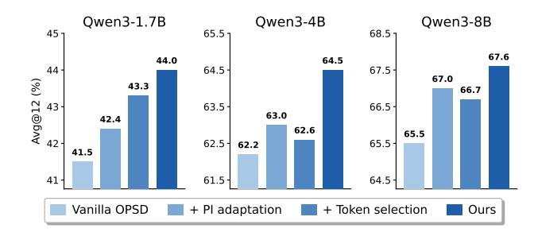
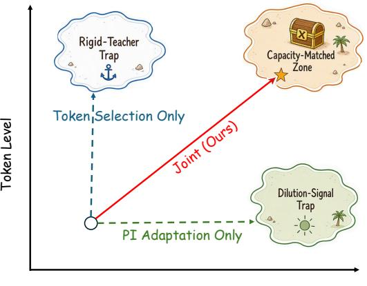
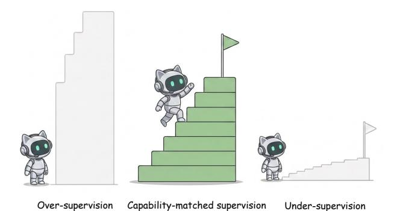
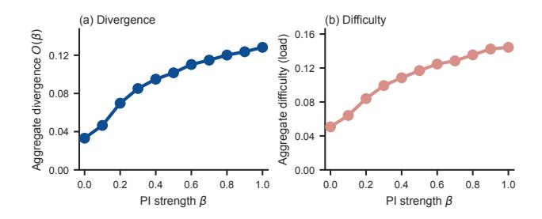
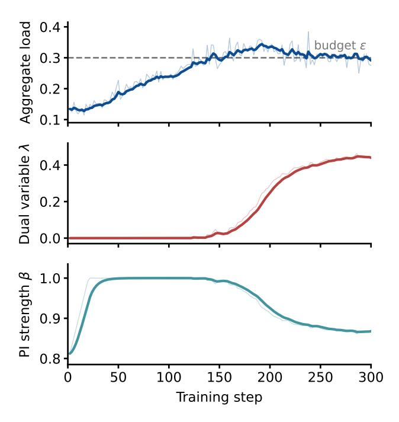

# **Matching Supervision to the Student's Learning Capacity: A Unified Framework for On-Policy Self-Distillation**

**Yongkang Yang1**∗ **, Zhezheng Hao2**∗ **, Hong Zhang3 , Yi Liu1 , Xiankun Lin1 , Wence Ji1 , Fanjunduo Wei2 , Jiarui Yu1 , Qiang Lin1 , Xiaoyun Liang1**† **, Hande Dong1**†

**Emails:** eoncanyang@tencent.com**,** donghd66@gmail.com

1Tencent, Workbuddy Team 2Zhejiang University 3 Independent Researcher

#### **Abstract**

On-policy self-distillation (OPSD) improves the reasoning abilities of LLMs by internalizing privileged context into model parameters through self-distillation. Two recent research lines promote vanilla OPSD by choosing *which tokens to learn from* and by controlling *how much privileged information* the teacher receives, respectively. However, we show that each line optimizes one variable while holding the other fixed, which leads to a suboptimal solution. We argue that the two variables are coupled through the student's learning capacity: the privileged information sets the per-token divergence the teacher prescribes, while token weighting selects which of these the student must absorb. We formalize the two lines of work into a unified optimization framework, which maximizes the aggregate teacher–student divergence, subject to a budget on the aggregate learning difficulty the student can absorb. Under this modelling, we propose **U**nified on-policy **S**elf-**D**istillation, called **USD**, a lightweight online algorithm to solve the Lagrangian. USD reveals that a single dual variable governs both decisions: at one price for learning difficulty, it simultaneously sets the token-selection threshold and the direction of privileged-information adjustment, keeping supervision matched to the student's evolving capacity. Through extensive experiments, USD consistently demonstrates superior performance over OPSD and tokenand PI-side baselines across various model scales on various reasoning benchmarks1 .

### **1 Introduction**

Post-training has become a key technique for improving the reasoning capability of large language models (OpenAI 2025; Google 2025; Anthropic 2025). Among the emerging paradigms, on-policy self-distillation (OPSD) (Zhao et al. 2026) is particularly appealing because it requires neither curated reasoning trajectories (like SFT (Yuan et al. 2023; Yu et al. 2023)), an interactive environment (like RL (Cobbe et al. 2021; Ouyang et al. 2022; Yu et al. 2026)), nor an externally stronger teacher (like distillation (Hinton, Vinyals, and Dean 2015; Kim and Rush 2016; Gu et al. 2024)); instead, it trains a model with only a piece of *privileged information (PI)*—additional context that is available at training time but not at deployment, such as verified reference solutions, environment feedback, ground-truth reasoning chains, or logged experience. Within a single model, OPSD assigns two roles: a student generates its own rollouts from the ordinary problem prompt, and a *privileged teacher*—the same base model conditioned on the PI—scores each generated token to produce fine-grained supervision. Since the student learns from the states it actually visits and the teacher shares its parameters, this signal is both distribution-consistent and free of the capacity gap that plagues cross-model distillation (Agarwal et al. 2024; Furlanello et al. 2018). OPSD brings substantial gains on competition math reasoning, code and agentic benchmarks (Zhao et al. 2026; Tan and Hong 2026; Zhong et al. 2026), exceeding reinforcement learning with a much smaller compute budget.

Despite its success, recent work reveals that the two default settings of vanilla OPSD can limit its performance: uniform token weighting and full-context PI exposure. At the *token level*, uniform weighting is inefficient: the gradient signal is concentrated in a small fraction of positions, with the top 20% carrying roughly 80% of the mass (Wang et al. 2026c; Xiao et al. 2026). High-divergence positions further compound the issue, since many of them reflect *incompatible* rather than learnable disagreement—teacher mass that lies outside the student's support and thus yields no useful gradient. At the *PI level*, conditioning the teacher on a piece of over-privileged context pushes its distribution too far from the student's, where the teacher–student divergence cannot be closed by a single gradient step (Han et al. 2026; Tan and Hong 2026). When the privileged context also contains the target answer explicitly, full exposure leaks it into the supervision signal. Two lines of work address these limitations respectively: *token selection* methods measure each token position and re-weight the loss accordingly (Wang et al. 2026c; Liu et al. 2026b; Xu et al. 2026; Li et al. 2026b; Xie et al. 2026), while *PI control* methods adapt how much of the privileged context is revealed at training time (Tan and Hong 2026; Han et al. 2026; Zhang 2026; Shen et al. 2026).

We argue that the two variables are not independent: PI shapes the per-token teacher–student divergence, while token weighting selects which of these divergences enter the loss. Each variable's optimal setting depends on the other. Lowering PI reduces per-token learning difficulty across the board, admitting positions the student previously could not absorb;

1Code is available at https://github.com/lauvlalala/USD

∗These authors contributed equally.

†Corresponding authors.

Figure 1: Performance comparison (Avg@12, %) on math reasoning tasks across three Qwen3 scales. Each single-axis variant improves over vanilla OPSD, and the joint variant is uniformly best across scales.

conversely, filtering the hardest-to-absorb tokens lowers the aggregate difficulty, admitting a PI level that would otherwise have overwhelmed the student. *Optimizing either variable under a fixed setting of the other reaches only a conditional optimum, not the joint one.* 

Motivated by the coupling between token selection and PI, we formulate OPSD as an optimization problem of matching supervision to the student's current learning capacity. Each correction the teacher prescribes both opens a divergence, the amount the student stands to learn, and incurs a learning difficulty, the distance between the correction and what the student currently believes. A student can productively absorb only a limited amount of such difficulty at a given stage of training. We therefore jointly choose the token weights and the amount of privileged information to maximize the total divergence while keeping the aggregate learning difficulty within the student's capacity. We refer to the best divergence attainable at each capacity level as the Learnability Frontier. Token-selection and PI-control methods optimize this trade-off along only one dimension, whereas our formulation searches for the capacity-matched point by adapting both dimensions together.

We solve this joint optimization problem by introducing a single capacity budget as a Lagrangian constraint. The resulting dual variable coordinates both decisions in either direction: when the aggregate difficulty exceeds the budget, it tightens token selection and lowers PI; when the budget has slack, it relaxes selection and raises PI so the student is not under-supervised. In this way, we propose Unified on-policy Self-Distillation, called USD, a lightweight online algorithm that solves this Lagrangian during training. It measures the aggregate difficulty the student is absorbing and uses it to update two scalars, the dual variable  $\lambda$  and the PI strength  $\beta$ , from which the token weights follow in closed form. Empirically, USD consistently outperforms vanilla OPSD across model scales and datasets. Ablations show that each axis helps on its own and that the two are complementary (Figure 1). Training dynamics further show that the two decisions co-evolve to keep the aggregate learning difficulty near the target budget.

Overall, our contributions can be summarized as follows:

1. We identify the coupling between token-level supervision

- and teacher-level privileged information in OPSD: optimizing either one under a fixed setting of the other yields only a suboptimal solution (§3.1).
- 2. We formulate capacity-matched OPSD as a joint optimization of token weights and PI level, and introduce the *Learnability Frontier* to characterize the best divergence attainable under a bounded aggregate difficulty (§3.2).
- 3. We propose USD, a lightweight online algorithm that coordinates soft token weighting and PI adaptation through a single dual variable, raising the mean accuracy from 56.4 to 58.7 over vanilla OPSD on mathematical reasoning benchmarks (§3.4 and §4).

#### 2 Related Work

On-Policy Self-Distillation. On-policy distillation (OPD) trains a student on its own rollouts under dense supervision from a teacher (Agarwal et al. 2024; Hou et al. 2026), and has become a widely adopted post-training paradigm for LLM reasoning (Song and Zheng 2026; Wei et al. 2022). A prominent line within OPD is *self-distillation*, which repurposes a single base model as both teacher and student under different context conditions (Shenfeld et al. 2026; Hübotter et al. 2026; Zhao et al. 2026; Penaloza et al. 2026; Yang et al. 2026a; Stein, Huang, and Goldstein 2026; Kim and Lee 2026; Ke et al. 2026; Li et al. 2026a). However, recent work identifies a persistent mismatch between the teacher's supervision and the student's current learning capacity (Kim et al. 2026; Wang et al. 2026b; Li et al. 2026c; Zhang et al. 2026b), which our joint formulation is designed to address.

Token Selection for On-Policy Distillation. Vanilla OPD treats every token equally, but recent studies observe two limitations of this uniform treatment: task-bearing supervision is concentrated in a small fraction of positions (Xu et al. 2026; Wang et al. 2026c), while the remaining bulk of the loss is spent on stylistic or format-driven tokens that can even induce privilege-induced style drift (Pan et al. 2026; Yang, Wang, and Zhang 2026). To sharpen the signal, a growing body of work reweights or gates the token-level loss according to signals such as student entropy, teacher-student divergence, sequence position, local teachability, and trustregion support (Xu et al. 2026; Wang et al. 2026c; Liu et al. 2026b; Xie et al. 2026; Liu et al. 2026a; Li et al. 2026b; Jin et al. 2026; Hao et al. 2026; Xing et al. 2026; Yang et al. 2026b; Zhang et al. 2026a; Ziheng et al. 2026; Wang et al. 2026a). Across these proposals, PI is treated as a fixed input and token weights are optimized conditional on the teacher signal; our framework instead adapts token weighting and PI strength jointly under a shared learning-capacity budget.

### Privileged Information Control in On-Policy Distillation.

A parallel line of work observes that full privileged exposure creates too large a teacher–student divergence for the student to absorb in one step and can leak answer-dependent shortcuts into the supervision signal, and reduces the effective PI reach through mechanisms such as adaptive solution masking, learned exposure schedules, anchored residual application, and reference-signal subtraction (Tan and Hong 2026; Han et al. 2026; Zhang 2026; Shen et al. 2026). These

PI Level

Figure 2: Two design axes of OPSD. Existing methods adapt either token weighting or PI exposure alone, whereas USD jointly adapts both axes.

OPD-specific instantiations echo classical exposure-control ideas from scheduled sampling (Bengio et al. 2015) and DAgger (Ross, Gordon, and Bagnell 2011). Most of these schedules adjust PI without measuring its effect: the exposure level follows a predetermined rule or a heuristic signal, rather than the difficulty the student is currently absorbing. Across these proposals, PI is adapted while token-level supervision is applied uniformly across positions; our framework instead adapts token weighting and PI strength jointly under a shared learning-capacity budget.

### 3 Methodology

#### 3.1 Two Design Axes of OPSD

In on-policy self-distillation, the student  $p_S$  generates a rollout  $\hat{y}$  conditioned on the problem x, while the teacher  $p_T^\beta$ —the same base model conditioned on privileged information—provides token-level supervision. The scalar  $\beta \in [0,1]$  controls the PI exposure, from none at  $\beta=0$  to full at  $\beta=1$ . We further introduce per-token weights  $w_t \in [0,1]$ , giving the general weighted objective

$$J(\mathbf{w}, \beta) = \frac{1}{\sum_{t} w_{t}} \sum_{t=1}^{|\hat{y}|} w_{t} \cdot D_{KL} \left( p_{T}^{\beta}(\cdot \mid x, \hat{y}_{< t}) \parallel p_{S}(\cdot \mid x, \hat{y}_{< t}) \right).$$

Vanilla OPSD (Zhao et al. 2026) corresponds to  $\beta=1$  and a uniform weights of  $w_t\equiv 1$ .

These two axes control complementary aspects of privileged supervision. As illustrated in Figure 2, they define a two-dimensional design space for OPSD. Existing methods typically optimize only one axis at a time: token-selection approaches move vertically by reallocating supervision under a fixed teacher, whereas PI-adaptation approaches move horizontally by adjusting the teacher while uniformly supervising all tokens. Our method instead jointly adapts both axes, allowing supervision to better match the student's current learning capacity. The PI-strength axis, governed by  $\beta$ , changes the teacher distribution itself: increasing  $\beta$  exposes more privileged information and typically produces a

sharper, more corrective teacher. The token-weighting axis, governed by  $\mathbf{w}$ , instead controls where and to what extent this signal is applied along the student rollout. Thus,  $\beta$  determines what supervision is generated, whereas  $\mathbf{w}$  determines which parts of that supervision are transmitted.

**Interpretation.** The two control axes play fundamentally different roles. Adjusting the PI strength changes the teacher itself, affecting every token simultaneously by reshaping the privileged distribution. Adjusting token weights, in contrast, does not alter the teacher, but selectively allocates the resulting supervision across the student rollout. One axis therefore controls the quality of supervision, while the other controls its allocation. Since both ultimately determine how much useful supervision the student receives, they should be optimized jointly rather than independently.

To reason about how the axes should be set, we characterize the per-token teacher signal by two quantities. The *divergence* 

$$g_t(\beta) = D_{\mathrm{KL}} \Big( p_T^{\beta} \parallel p_S \Big)_t$$

measures how far the teacher's distribution lies from the student's at position t—the potential update magnitude at that token. Let  $a_t^\star = \arg\max_a p_T^\beta(a \mid x, \hat{y}_{< t})$  denote the teacher's top prediction. The *learning difficulty* 

$$d_t(\beta) = \left(\log \frac{p_T^{\beta}(a_t^{\star})}{p_S(a_t^{\star})}\right)_{\perp}$$

measures how far the teacher's top prediction lies above the student's current belief—the effort required to absorb the correction; we take the positive part since a token the student already prefers  $(p_S(a_t^\star) \geq p_T^\beta(a_t^\star))$  poses no learning burden. Intuitively,  $d_t$  is the student's surprise at the teacher's preferred token: when the student already assigns it high probability the correction is a small step, whereas when the teacher's choice lies far outside the student's expectation  $d_t$  is large and a single update cannot close the gap. Both quantities depend on  $\beta$ : strengthening PI sharpens the teacher, typically raising both the correction it prescribes and the effort to absorb it. A useful signal therefore requires balancing the two: the teacher strong enough to offer substantial correction, yet not so strong that its recommendations exceed the student's capacity to absorb.

The two axes, moreover, are coupled through these quantities. Reducing  $\beta$  shrinks per-token difficulty across the board and makes previously unabsorbable tokens learnable, so the set of tokens worth including shifts; conversely, filtering high-difficulty tokens lowers the aggregate load and admits a higher  $\beta$ . Optimizing either axis under a fixed setting of the other therefore yields only a conditional solution.

#### 3.2 The Unified Optimization Framework

As illustrated in Figure 3, effective supervision should match the student's current learning capacity. When supervision exceeds the student's capacity, the resulting corrections are too difficult to absorb; when it falls far below that capacity, the learning signal is too weak to support substantial improvement. We formalize the joint choice of the two axes as a

Figure 3: Over-, matched, and under-supervision.

constrained optimization: maximize the mean weighted divergence the supervision delivers, subject to a budget on the mean weighted difficulty the student must absorb,

$$\max_{\mathbf{w} \in [0,1]^T, \ \beta \in [0,1]} \frac{1}{N} \sum_{t} w_t \, g_t(\beta) \quad \text{s.t.} \quad \frac{1}{N} \sum_{t} w_t \, d_t(\beta) \le \varepsilon,$$
(2)

where  $\varepsilon>0$  is the student's per-batch *capacity budget*—the mean weighted learning difficulty the student can absorb at the current stage. Selecting more tokens and strengthening PI both raise this quantity and consume the same budget, so the two decisions compete for the same resource.

Sweeping the budget traces out the *Learnability Frontier*  $\mathcal{F}(\varepsilon)$ , the maximum mean weighted divergence attainable at each capacity level:

$$\mathcal{F}(\varepsilon) = \max_{\mathbf{w},\beta} \left\{ \frac{1}{N} \sum_{t} w_{t} g_{t}(\beta) : \frac{1}{N} \sum_{t} w_{t} d_{t}(\beta) \leq \varepsilon \right\}.$$

The frontier is the Pareto boundary of the divergence—difficulty trade-off. Token-selection methods (fixing  $\beta$ ) and PI-control methods (fixing  $\mathbf{w}$ ) each restrict the search to a one-dimensional slice of this landscape and reach the frontier only by coincidence; our method optimizes both axes jointly to move along it.

#### 3.3 Theoretical Analysis

The unified optimization problem admits a simple interpretation. Since both token weighting and PI strength consume the same learning-capacity budget, they compete for a shared resource rather than acting independently. The Lagrangian therefore introduces a single dual variable that quantifies the marginal value of learning difficulty and naturally couples the two decisions.

Solving Eq. (2) reveals that the two supervision axes are governed by this single quantity—the marginal price of learning difficulty. Applying the Lagrangian (Boyd and Vandenberghe 2004) to Eq. (2) with dual variable  $\lambda \geq 0$  yields

$$\mathcal{L}(\mathbf{w}, \beta, \lambda) = \frac{1}{N} \sum_{t} w_{t} \underbrace{\left[g_{t}(\beta) - \lambda d_{t}(\beta)\right]}_{v_{t}(\lambda, \beta)} + \lambda \varepsilon, \quad (4)$$

where each token contributes a net value  $v_t = g_t - \lambda d_t$ : its divergence minus  $\lambda$ -priced difficulty. Since  $\mathcal{L}$  is linear in  $w_t$ 

with box constraints, the optimal weights collapse to a hard threshold,

$$w_t^{\star} = \mathbf{1}[g_t(\beta) > \lambda \, d_t(\beta)]. \tag{5}$$

A token is thus included exactly when its divergence exceeds its  $\lambda$ -priced difficulty, i.e. when its net value  $v_t$  is positive; token selection reduces to a per-token 0/1 decision by the sign of  $v_t$ , with  $\lambda$  setting the price at which divergence is traded against difficulty.

The dual variable also fixes the optimal PI strength. When the budget binds  $(\lambda > 0)$  at an interior optimum  $\beta^* \in (0,1)$ , the stationarity condition  $\partial \mathcal{L}/\partial \beta = 0$  over the selected tokens gives

$$\lambda = \frac{\sum_{t: w_t^* = 1} \partial g_t / \partial \beta}{\sum_{t: w_t^* = 1} \partial d_t / \partial \beta}.$$
 (6)

This condition reads as a marginal balance: at the optimal PI strength, the extra divergence that a small increase in  $\beta$  contributes, summed over the selected tokens, equals  $\lambda$  times the extra difficulty it incurs. The same  $\lambda$  that prices difficulty in the token decision reappears here as the exchange rate between divergence gained and difficulty added, and  $\beta$  is raised until one more unit of difficulty no longer buys  $\lambda$  units of divergence.

#### **Takeaway**

The two supervision axes—token weighting and PI strength—are coupled through a single *capacity budget*: both decisions consume the same aggregate learning difficulty. Solving the constrained problem shows that one dual variable  $\lambda$ , the marginal price of difficulty, simultaneously sets the token-selection threshold and the direction of PI adjustment—not by design, but as a structural consequence of the shared budget.

Condition 6 cannot be evaluated directly, because  $\beta$  acts through non-differentiable operations on the teacher's context. A practical surrogate is to move  $\beta$  along the primal residual  $\varepsilon - \mathrm{load}(\beta)$ , where  $\mathrm{load}(\beta) = \frac{1}{N} \sum_t w_t d_t(\beta)$  is the current mean weighted difficulty. Under a single monotonicity assumption, this rule reaches the budget-binding optimum without ever forming a gradient in  $\beta$ .

**Assumption 1** (Monotonicity in  $\beta$ ). Over the selected tokens, both the mean weighted difficulty load( $\beta$ ) =  $\frac{1}{N} \sum_t w_t d_t(\beta)$  and the mean weighted divergence  $\frac{1}{N} \sum_t w_t g_t(\beta)$  are strictly increasing in  $\beta$ .

Both parts express the same mechanism: revealing more privileged information sharpens the teacher, raising both the correction it prescribes and the difficulty of absorbing it. Figure 4 verifies both monotonicities directly on Qwen3-1.7B training rollouts, with diminishing marginal returns as the reference solution is progressively revealed.

**Proposition 1** (The residual update targets the optimal PI strength). Let  $\beta$  be constrained to  $[\beta_{\min}, 1]$  with  $\beta_{\min} > 0$ . Under Assumption 1, suppose there exists  $\beta^* \in (\beta_{\min}, 1)$  with  $\operatorname{load}(\beta^*) = \varepsilon$ . Then  $\beta^*$  maximizes  $\frac{1}{N} \sum_t w_t g_t(\beta)$  subject to  $\operatorname{load}(\beta) \leq \varepsilon$ , its multiplier satisfies Eq. (6), and the residual update  $\beta \leftarrow \beta + \eta_{\beta}(\varepsilon - \operatorname{load}(\beta))$  converges monotonically to  $\beta^*$  from either side.

Figure 4: Empirical verification of Assumption 1 on real Qwen3-1.7B training rollouts. Both (a) the mean weighted divergence  $\frac{1}{N}\sum_t w_t g_t(\beta)$  and (b) the mean weighted difficulty  $\operatorname{load}(\beta)$  increase strictly and monotonically with the PI strength  $\beta$ .

*Proof.* Write  $\ell(\beta) = \text{load}(\beta)$  and  $G(\beta) = \frac{1}{N} \sum_t w_t g_t(\beta)$ , both strictly increasing by Assumption 1.

Step 1 (feasible set).  $\ell$  is injective, so  $\beta^*$  is the unique root of  $\ell(\beta) = \varepsilon$ , and  $\ell(\beta) \le \varepsilon \iff \beta \le \beta^*$ . The feasible set is therefore  $[\beta_{\min}, \dot{\beta}^{\star}]$ .

Step 2 (optimality). G is strictly increasing on this interval, so it is maximized at  $\beta = \beta^*$ , where the constraint is active. Stationarity at this endpoint gives  $G'(\beta^*) = \lambda^* \ell'(\beta^*)$  with  $\lambda^{\star} > 0$ , that is,

$$\lambda^{\star} = \frac{\sum_{t} w_{t} \partial g_{t} / \partial \beta}{\sum_{t} w_{t} \partial d_{t} / \partial \beta},$$

recovering Eq. (6).

Step 3 (update). Since  $\ell$  is increasing,  $\varepsilon - \ell(\beta)$  has the sign of  $\beta^* - \beta$ . The update therefore increases  $\beta$  when  $\beta < \beta^*$ , decreases it when  $\beta > \beta^*$ , and is stationary only at  $\beta^*$ .

Proposition 1 closes the gap between Eq. (6) and what can actually be computed during training: the primal residual drives  $\beta$  to the very point that Eq. (6) characterizes, without ever forming a gradient in  $\beta$ . The residual therefore serves as a gradient-free surrogate for the optimal PI strength.

#### USD: A Primal-Dual Online Algorithm

The token weights, however, are not yet implementable. The optimal rule in Eq. (5) presumes the correct multiplier  $\lambda$ , which is a function of the current student and thus nonstationary over training; moreover, its 0/1 indicator is not differentiable and cannot be incorporated into a gradientbased objective. Both  $\lambda$  and w must therefore be estimated online, jointly with  $\beta$ .

We therefore propose USD, Unified on-policy Self-Distillation, an online primal-dual algorithm that instantiates the preceding optimization framework over the training stream. USD jointly adapts the token weights w, the dual variable  $\lambda$ , and the PI strength  $\beta$ , allowing the supervision policy to continuously track the student's changing learning capacity.

**Update rules.** The primal step on the student parameters requires differentiable weights, so we replace the hard threshold in Eq. 5 by adding an entropy regularizer  $\tau H(\mathbf{w})$  to the

### Algorithm 1 The Algorithm of USD

- 1: **Input:** capacity  $\varepsilon$ , temperature  $\tau$ , step sizes  $\eta_{\lambda}$ ,  $\eta_{\beta}$
- 2: **Initialize:**  $\lambda \leftarrow 0$ ,  $\beta \leftarrow \beta_{\text{init}}$
- for each training batch  $(x,y^\star)$  do
- 4:
- Student rollout:  $\hat{y} \sim p_S(\cdot \mid x)$ Teacher scoring:  $p_T^{\beta}(\cdot \mid x, \hat{y}_{< t})$  at PI strength  $\beta$ 5:
- Per-token divergence:  $g_t \leftarrow D_{\mathrm{KL}}(p_T^{\beta} || p_S)_t$ 6:
- Per-token difficulty:  $d_t \leftarrow \left(\log \frac{p_T^{\beta}(a_t^{\star})}{p_S(a_t^{\star})}\right)_+$ 7:
- Soft weights:  $w_t \leftarrow \sigma \left( (g_t \lambda d_t) / \tau \right)$ Loss:  $\mathcal{L} \leftarrow \sum_t w_t g_t / \sum_t w_t$ Student update: gradient step on  $\mathcal{L}$ 8:
- 9:
- 10:
- 11:
- $\begin{array}{l} \operatorname{load} \leftarrow \frac{1}{N} \sum_{t} w_{t} d_{t} \\ \operatorname{Dual \ ascent:} \ \lambda \leftarrow \max(0, \ \lambda + \eta_{\lambda}(\operatorname{load} \varepsilon)) \end{array}$
- PI update:  $\beta \leftarrow \text{clip}(\beta + \eta_{\beta}(\varepsilon \text{load}), \beta_{\min}, 1)$
- 14: **end for**

Lagrangian, yielding

$$w_t = \sigma \left( \frac{g_t(\beta) - \lambda d_t(\beta)}{\tau} \right), \tag{7}$$

where  $\sigma$  is the sigmoid and  $\tau > 0$  controls sharpness. Given these weights, we update the multiplier by projected subgradient ascent on the dual,

$$\lambda \leftarrow \max(0, \lambda + \eta_{\lambda} (\operatorname{load} - \varepsilon)),$$
 (8)

where load =  $\frac{1}{N} \sum_{t} w_t d_t(\beta)$  is the current mean weighted difficulty; when it exceeds the budget,  $\lambda$  rises and tightens token selection through Eq. (7). Finally, we step  $\beta$  along the primal residual,

$$\beta \leftarrow \text{clip}(\beta + \eta_{\beta} (\varepsilon - \text{load}), \beta_{\min}, 1),$$
 (9)

which by Proposition 1 drives  $\beta$  to the point where load  $(\beta)$  =  $\varepsilon$ . The dual update acts on the load in the same direction, since a larger  $\lambda$  down-weights the highest-difficulty tokens. The two controls therefore act together on the load, raising it while the budget has slack and reducing it once the budget is exceeded, so the load converges to  $\varepsilon$ .

**Training loss and algorithm.** We normalize the training loss by total weight,

$$\mathcal{L}_{\text{train}} = \frac{\sum_{t} w_{t} D_{\text{KL}}(p_{T}^{\beta} || p_{S})_{t}}{\sum_{t} w_{t}}, \quad (10)$$

so token selection only shifts the relative importance of tokens, not the effective step size. Algorithm 1 summarizes the full procedure. Beyond standard OPSD, the only per-batch overhead is one O(T) pass to compute load and two scalar updates—no auxiliary networks or extra forward passes.

#### 4 Experiments

#### 4.1 Experimental Setup

Models and Benchmarks. We use the Qwen3 family (Yang et al. 2025) at three scales: 1.7B, 4B, and 8B, all in non-thinking mode. We utilize the mathematical reasoning

Table 1: Math reasoning performance Avg@12 (%) on Qwen3 backbones. **Avg**: mean over the nine (model, benchmark) cells. **Bold**: best per column within each scale.

|       | Qwen3-1.7B |      |                             | Qwen3-4B |      |                      | Qwen3-8B |      |                      |      |
|-------|------------|------|-----------------------------|----------|------|----------------------|----------|------|----------------------|------|
|       |            |      | Method AIME24 AIME25 HMMT25 |          |      | AIME24 AIME25 HMMT25 |          |      | AIME24 AIME25 HMMT25 | Avg  |
| SFT   | 48.4       | 36.9 | 20.9                        | 71.6     | 62.8 | 41.5                 | 74.4     | 68.1 | 42.8                 | 51.9 |
| GRPO  | 51.9       | 38.9 | 26.9                        | 75.6     | 66.9 | 45.0                 | 78.1     | 70.3 | 49.7                 | 55.9 |
| OPSD  | 54.4       | 41.9 | 28.3                        | 75.3     | 67.2 | 44.1                 | 77.8     | 71.9 | 46.9                 | 56.4 |
| TIP   | 55.8       | 41.9 | 27.2                        | 75.8     | 69.7 | 45.0                 | 76.9     | 72.8 | 49.2                 | 57.1 |
| PAINT | 56.4       | 42.8 | 29.2                        | 75.6     | 66.7 | 44.2                 | 78.3     | 72.5 | 47.2                 | 57.0 |
| Ours  | 58.9       | 43.6 | 29.4                        | 76.7     | 70.0 | 46.7                 | 79.7     | 73.3 | 49.7                 | 58.7 |

subset of OpenThoughts (Guha et al. 2025) as training data, sampling up to 30K chain-of-thought augmented problemsolution pairs. Evaluation covers AIME 2024, AIME 2025, and HMMT 2025; we report Avg@12 on the best checkpoint per benchmark.

**Baselines.** We compare against SFT (imitates reference traces), GRPO (Guo et al. 2025) (RL with verifiable rewards), vanilla OPSD (Zhao et al. 2026) (full-solution privileged teacher with uniform token weights), and two contemporaneous OPSD-style methods: TIP (Xu et al. 2026), which keeps the top-ρ fraction of tokens by a Soft-OR entropy– divergence score, and PAINT (Tan and Hong 2026), which combines overlap-adaptive suffix masking of the reference with sparse teacher–student logit interpolation. We reproduce TIP using the authors' open-source code with ρ=0.2, and PAINT following the paper's default settings. All baselines share our base models and training data; all methods train for 300 steps except GRPO, which we run for 500 steps and report at its peak checkpoint.

**Implementation details. (i) Training.** Following vanilla OPSD (Zhao et al. 2026), the teacher is the frozen base model at the initial checkpoint; only the student's LoRA adapters (Hu et al. 2022) (rank 64, α=128) are updated with AdamW at learning rate 5×10−6 , effective batch size 32, gradient norm clip 0.1, for 300 steps. **(ii) Hyperparameters.** PI strength β ∈ [0, 1] is instantiated as the fraction of reference tokens revealed to the teacher: at β, the teacher observes the first ⌊βL⌋ characters of the reference (with L its length in tokens), always retaining the final boxed answer. USD uses τ=0.1, ε=0.3, ηλ=0.1, βinit=0.8, ηβ=0.03, βmin=0.1, fixed across all model scales, with a per-token KL clip of 0.05 for numerical stabilization. **(iii) Sampling.** Student rollouts are sampled at temperature 1.1, top-p 0.95, top-k 20, and maximum length 1024; at evaluation we sample 12 solutions per problem at temperature 1.0 and report the best per benchmark over checkpoints saved every 50 steps.

### **4.2 Main Results**

Table 1 compares all methods across three model scales and three benchmarks. Our method achieves the best Avg@12 on nearly all cells and raises the 9-cell overall mean from 56.4 (vanilla OPSD) to 58.7 (+2.3 points), with a consistent per-scale improvement of roughly two points at each of 1.7B, 4B, and 8B—the gain is not driven by any single benchmark or scale.

TIP and PAINT each improve over vanilla OPSD at most scales, confirming that token-level filtering and PI adaptation are individually beneficial. However, TIP operates at fixed β=1: it selects tokens under the strongest possible teacher, which means its selection boundary is tuned to a difficulty landscape that would shift under a softer teacher. PAINT adjusts PI strength but applies uniform token weighting, so the learning signal it optimizes includes many positions that contribute negligible divergence. Our method dominates both because the shared dual variable λ simultaneously relaxes token selection (to include positions made feasible by a softer teacher) and adjusts PI strength (to exploit the capacity freed by filtering)—the complementary action that neither singleaxis method can replicate.

Our method also outperforms GRPO at every scale (+4.7, +2.0, +1.5 on the per-scale average at 1.7B, 4B, and 8B), while using a far smaller sampling budget: a single 1024 token rollout per problem over 300 steps, against 8 rollouts of up to 16k tokens over 500 steps for GRPO.

### **4.3 Ablation Study**

Table 2 isolates each control axis on top of vanilla OPSD and yields three observations. *First*, each axis is individually beneficial at every scale, confirming that both token selection and PI adaptation carry supervisory value in isolation. *Second*, the joint variant attains the highest Avg@12 at every scale, with a gain of roughly two points over vanilla OPSD that is consistent across 1.7B, 4B, and 8B, whereas either axis alone yields a gain that varies with scale. The two axes are therefore complementary rather than redundant, since the shared capacity budget lets them substitute for one another without double-spending on the same tokens.*Third*, no single axis dominates uniformly: token selection contributes more of the isolated gain at 1.7B, while PI adaptation edges ahead at 4B and 8B. Because the relative importance of the two axes shifts across scales, any fixed hand-picked weighting would be miscalibrated at one end of the range, whereas the coupled formulation—which derives both actions from a single capacity budget rather than a pre-set mixture—remains the top performer throughout.

Table 2: Component ablation on Qwen3 backbones (Avg@12, %). "+ Token selection": soft weights with fixed  $\beta$ =1; "+ PI adaptation": adaptive  $\beta$  with uniform token weights. Within each scale, **Avg** is the mean over the three benchmarks and **bold** marks the best per column.

|                   | Qwen3-1.7B |        |        |      | Qwen3-4B    |        |        |      | Qwen3-8B    |        |        |      |
|-------------------|------------|--------|--------|------|-------------|--------|--------|------|-------------|--------|--------|------|
| Variant           | AIME24     | AIME25 | HMMT25 | Avg  | AIME24      | AIME25 | HMMT25 | Avg  | AIME24      | AIME25 | HMMT25 | Avg  |
| Vanilla OPSD      | 54.4       | 41.9   | 28.3   | 41.5 | 75.3        | 67.2   | 44.1   | 62.2 | 77.8        | 71.9   | 46.9   | 65.5 |
| + PI adaptation   | 58.3       | 40.8   | 28.1   | 42.4 | 75.3        | 69.4   | 44.2   | 63.0 | 78.1        | 74.2   | 48.6   | 67.0 |
| + Token selection | 58.6       | 42.5   | 28.9   | 43.3 | 75.0        | 67.8   | 45.0   | 62.6 | 78.6        | 73.6   | 47.8   | 66.7 |
| + Both (full)     | 58.9       | 43.6   | 29.4   | 44.0 | <b>76.7</b> | 70.0   | 46.7   | 64.5 | <b>79.7</b> | 73.3   | 49.7   | 67.6 |

Figure 5: Training dynamics of USD on Qwen3-1.7B. Top: the aggregate load against the capacity budget  $\varepsilon$ =0.3 (dashed). Middle: the dual variable  $\lambda$ . Bottom: the PI strength  $\beta$ . Thin lines are per-step values, thick lines a running average. While the load is below budget,  $\beta$  climbs to full exposure and  $\lambda$  stays at zero; once the load reaches  $\varepsilon$ ,  $\lambda$  activates and tightens token selection while  $\beta$  eases back, and the load settles near  $\varepsilon$ .

#### 4.4 Empirical Analysis

**Co-evolution of**  $\lambda$  **and**  $\beta$ **.** Figure 5 shows the training dynamics on Qwen3-1.7B. From its initial value,  $\beta$  first rises: the teacher is still mild, the aggregate load sits below the budget, and the primal residual drives PI strength upward while  $\lambda \approx 0$  leaves the weights nearly uniform. As  $\beta$  increases, the teacher sharpens and per-token difficulty grows, pushing the load up to the budget. At that point  $\lambda$  becomes active and starts filtering the highest-difficulty tokens, which in turn feeds back on  $\beta$ : the two controls thereafter move together, with  $\lambda$  tightening selection while  $\beta$  eases the teacher, keeping the aggregate load near the budget. Both eventually level off once the load stabilizes around  $\varepsilon$ .

Table 3: Sensitivity to capacity budget  $\varepsilon$  on Qwen3-1.7B (best Avg@12 across checkpoints, averaged over three benchmarks).

| ε   | 0.15 | 0.20 | 0.30 | 0.40 | 0.50 | 0.80 |
|-----|------|------|------|------|------|------|
| Avg | 42.0 | 41.5 | 44.0 | 40.8 | 41.5 | 41.0 |

Sensitivity to  $\varepsilon$ . Table 3 reports the average accuracy as the capacity budget  $\varepsilon$  varies. Performance peaks at  $\varepsilon$ =0.3 and degrades in both directions: an overly tight budget overfilters and starves the student of learnable signal, while an overly loose budget leaves the constraint rarely active, so the method reverts to near-uniform weighting. The peak at an intermediate value indicates a genuine trade-off: the gain comes from matching the budget to what the student can absorb, not from filtering as much as possible.

#### 5 Conclusion

On-policy self-distillation has become an effective posttraining paradigm for LLM reasoning, using only the model's own rollouts and a same-model privileged teacher. Existing extensions improve vanilla OPSD either by token reweighting or by adapting privileged information, but optimize the two mechanisms independently. We show that they are coupled through a shared learning-capacity budget, yielding a unified optimization whose Lagrangian reduces both decisions to a single dual variable. Based on this formulation, we propose USD, a lightweight online algorithm that prices learning difficulty once and lets that price govern both axes. It consistently improves over vanilla OPSD, and ablations show that the two axes contribute complementary gains. USD establishes a capacity-centred view of OPSD, in which token weighting and privileged information are two expressions of one underlying budget. We hope this view provides a useful basis for future work on how much supervision a student should receive, and when.

## 6 Acknowledgement

We also sincerely thank Yi Liu and the Workbuddy & CodeBuddy Team in Tencent (https://www.codebuddy.ai/) for their valuable assistance throughout this work.

# **References**

- Agarwal, R.; Vieillard, N.; Zhou, Y.; Stanczyk, P.; Ramos Garea, S.; Geist, M.; and Bachem, O. 2024. Onpolicy distillation of language models: Learning from selfgenerated mistakes. In *International Conference on Learning Representations*, volume 2024, 21246–21263.
- Anthropic. 2025. Introducing Claude Opus 4.5. https://www. anthropic.com/news/claude-opus-4-5.
- Bengio, S.; Vinyals, O.; Jaitly, N.; and Shazeer, N. 2015. Scheduled sampling for sequence prediction with recurrent neural networks. *Advances in neural information processing systems*, 28.
- Boyd, S.; and Vandenberghe, L. 2004. *Convex optimization*. Cambridge university press.
- Cobbe, K.; Kosaraju, V.; Bavarian, M.; Chen, M.; Jun, H.; Kaiser, L.; Plappert, M.; Tworek, J.; Hilton, J.; Nakano, R.; et al. 2021. Training verifiers to solve math word problems. *arXiv preprint arXiv:2110.14168*.
- Furlanello, T.; Lipton, Z.; Tschannen, M.; Itti, L.; and Anandkumar, A. 2018. Born again neural networks. In *International conference on machine learning*, 1607–1616. PMLR.
- Google. 2025. A new era of intelligence with Gemini 3. https://blog.google/products-and-platforms/products/ gemini/gemini-3/.
- Gu, Y.; Dong, L.; Wei, F.; and Huang, M. 2024. Minillm: Knowledge distillation of large language models. In *The twelfth international conference on learning representations*.
- Guha, E. K.; Marten, R.; Keh, S.; Raoof, N.; Smyrnis, G.; Bansal, H.; Nezhurina, M.; Mercat, J.; Vu, T.; Sprague, Z. R.; et al. 2025. Openthoughts: Data recipes for reasoning models. In *First Workshop on Foundations of Reasoning in Language Models*.
- Guo, D.; Yang, D.; Zhang, H.; Song, J.; Wang, P.; Zhu, Q.; Xu, R.; Zhang, R.; Ma, S.; Bi, X.; et al. 2025. Deepseek-r1: Incentivizing reasoning capability in llms via reinforcement learning. *arXiv preprint arXiv:2501.12948*.
- Han, Z.; Zhang, T.; Wang, H.; and Sun, Y. 2026. Adaptive Teacher Exposure for Self-Distillation in LLM Reasoning. *arXiv preprint arXiv:2605.11458*.
- Hao, Z.; Wang, H.; Liu, H.; Luo, J.; Yu, J.; Dong, H.; Lin, Q.; Wang, C.; and Chen, J. 2026. Rethinking entropy interventions in rlvr: An entropy change perspective. In *Proceedings of the 64th Annual Meeting of the Association for Computational Linguistics (Volume 1: Long Papers)*, 31105–31133.
- Hinton, G.; Vinyals, O.; and Dean, J. 2015. Distilling the knowledge in a neural network. *arXiv preprint arXiv:1503.02531*.
- Hou, W.; Peng, S.; Wang, W.; Ruan, Z.; Zhang, Y.; Zhou, Z.; Gao, M.; Chen, Y.; Wang, K.; Yang, H.; et al. 2026. Uniopd: Unifying on-policy distillation with a dual-perspective recipe. *arXiv preprint arXiv:2605.03677*.
- Hu, E. J.; Shen, Y.; Wallis, P.; Allen-Zhu, Z.; Li, Y.; Wang, S.; Wang, L.; Chen, W.; et al. 2022. Lora: Low-rank adaptation of large language models. *Iclr*, 1(2): 3.

- Hübotter, J.; Lübeck, F.; Behric, L.; Baumann, A.; Bagatella, M.; Marta, D.; Hakimi, I.; Shenfeld, I.; Buening, T. K.; Guestrin, C.; et al. 2026. Reinforcement Learning via Self-Distillation. *arXiv preprint arXiv:2601.20802*.
- Jin, W.; Min, T.; Yang, Y.; Wei, D.; Zhou, Y.; Kadhe, S. R.; Baracaldo, N.; and Lee, K. 2026. Entropy-aware on-policy distillation of language models. In *Forty-third International Conference on Machine Learning*.
- Ke, J.; Wen, Z.; Li, W.; He, C.; and Zhang, L. 2026. Respecting self-uncertainty in on-policy self-distillation for efficient llm reasoning. *arXiv preprint arXiv:2605.13255*.
- Kim, J.; and Lee, D. 2026. OPSD Compresses What RLVR Teaches: A Post-RL Compaction Stage for Reasoning Models. *arXiv preprint arXiv:2605.06188*.
- Kim, J.; Luo, X.; Kim, M.; Lee, S.; Kim, D.; Jeon, J.; Li, D.; and Yang, Y. 2026. Why Does Self-Distillation (Sometimes) Degrade the Reasoning Capability of LLMs? *arXiv preprint arXiv:2603.24472*.
- Kim, Y.; and Rush, A. M. 2016. Sequence-level knowledge distillation. In *Proceedings of the 2016 conference on empirical methods in natural language processing*, 1317–1327.
- Li, Y.; Shi, H.; Liu, W.; Ruan, M.; Hou, H.; Dai, Z.; Qiu, S.; and Song, L. 2026a. DemoPSD: Disagreement-Modulated Policy Self-Distillation. *arXiv preprint arXiv:2607.02502*.
- Li, Y.; Zheng, L.; Yu, Y.; Zhou, W.; Zhong, X.; Hu, X.; Jin, J.; Yuan, H.; and Feng, T. 2026b. Filter, then reweight: Rethinking optimization granularity in on-policy distillation. *arXiv preprint arXiv:2606.02684*.
- Li, Y.; Zuo, Y.; He, B.; Zhang, J.; Xiao, C.; Qian, C.; Yu, T.; Gao, H.-a.; Yang, W.; Liu, Z.; et al. 2026c. Rethinking onpolicy distillation of large language models: Phenomenology, mechanism, and recipe. *arXiv preprint arXiv:2604.13016*.
- Liu, K.; Zhuang, Z.; Bai, Y.; Wang, B.; Weng, R.; and Ye, J. 2026a. Prefix teach, suffix fade: Local teachability collapse in strong-to-weak on-policy distillation. *arXiv preprint arXiv:2605.13643*.
- Liu, X.; Wang, X.; Ma, Y.; Zhang, Y.; and Xiao, C. 2026b. When Are Teacher Tokens Reliable? Position-Weighted On-Policy Self-Distillation for Reasoning. *arXiv preprint arXiv:2605.21606*.
- OpenAI. 2025. Introducing GPT-5.2. https://openai.com/ index/introducing-gpt-5-2/.
- Ouyang, L.; Wu, J.; Jiang, X.; Almeida, D.; Wainwright, C. L.; Mishkin, P.; Zhang, C.; Agarwal, S.; Slama, K.; Ray, A.; et al. 2022. Training language models to follow instructions with human feedback. *arXiv preprint arXiv:2203.02155*.
- Pan, L.; Tao, S.; Zhai, Y.; Zhang, L.; Liu, Z.; Ding, B.; Liu, A.; and Wen, L. 2026. RLCSD: Reinforcement Learning with Contrastive On-Policy Self-Distillation. *arXiv preprint arXiv:2606.11709*.
- Penaloza, E.; Vattikonda, D.; Gontier, N.; Lacoste, A.; Charlin, L.; and Caccia, M. 2026. Privileged Information Distillation for Language Models. *arXiv preprint arXiv:2602.04942*.

- Ross, S.; Gordon, G.; and Bagnell, D. 2011. A reduction of imitation learning and structured prediction to no-regret online learning. In *Proceedings of the fourteenth international conference on artificial intelligence and statistics*, 627–635. JMLR Workshop and Conference Proceedings.
- Shen, Z.; Tong, J.; Yan, S.; Shen, C.; Chen, H.; Ye, W.; Hu, X.; Miao, R.; Wang, H.; Zhao, J.; et al. 2026. Purified OPSD: On-Policy Self-Distillation Without Losing How to Think. *arXiv preprint arXiv:2607.02234*.
- Shenfeld, I.; Damani, M.; Hübotter, J.; and Agrawal, P. 2026. Self-Distillation Enables Continual Learning. *arXiv preprint arXiv:2601.19897*.
- Song, M.; and Zheng, M. 2026. A survey of on-policy distillation for large language models. *arXiv preprint arXiv:2604.00626*.
- Stein, A.; Huang, F.; and Goldstein, T. 2026. GATES: Selfdistillation under privileged context with consensus gating. *arXiv preprint arXiv:2602.20574*.
- Tan, Z.; and Hong, Y. 2026. PAINT: Partial-Solution Adaptive Interpolated Training for Self-Distilled Reasoners. *arXiv preprint arXiv:2604.26573*.
- Wang, J.; Ouyang, X.; Chen, Z.; Hu, Y.; Pan, Z.; Li, X.; and Guo, L.-Z. 2026a. Trace: Distilling where it matters via token-routed self on-policy alignment. *arXiv preprint arXiv:2605.10194*.
- Wang, M.; Zhao, H.; Liu, W.; Yang, L.; Liu, G.; Guo, H.; Xie, G.-S.; Meng, G.; Liu, H.; and Zhu, F. 2026b. Denser ̸= Better: Limits of On-Policy Self-Distillation for Continual Post-Training. *arXiv preprint arXiv:2607.01763*.
- Wang, Y.; Lu, S.; Gu, Y.; Wang, P.; Yang, Y.; Yan, Z.; Xie, C.; Wu, J.; and Yang, H. 2026c. Not all disagreement is learnable: Token teachability in on-policy distillation. *arXiv preprint arXiv:2605.26844*.
- Wei, J.; Wang, X.; Schuurmans, D.; Bosma, M.; Xia, F.; Chi, E.; Le, Q. V.; Zhou, D.; et al. 2022. Chain-of-thought prompting elicits reasoning in large language models. *Advances in neural information processing systems*, 35: 24824–24837.
- Xiao, J.; Han, Z.; Sun, Y.; Lu, Z.; Liu, Y.; Yao, Z.; Chen, W.; Gu, Q.; and Cai, X. 2026. Finding the Evidence: Discovering Decision-Supporting Tokens for On-Policy Reasoning Distillation. *arXiv preprint arXiv:2606.22830*.
- Xie, Y.; Zhu, S.; Wen, T.; Chen, B.; and Wang, Y. 2026. On the Position Bias of On-Policy Distillation. *arXiv preprint arXiv:2606.22600*.
- Xing, X.; Wang, H.; Gao, B.; Li, Z.; and Tang, Y. 2026. Trust Region On-Policy Distillation. *arXiv preprint arXiv:2606.01249*.
- Xu, Y.; Sang, H.; Zhou, Z.; He, R.; Wang, Z.; and Geramifard, A. 2026. Tip: Token importance in on-policy distillation. *arXiv preprint arXiv:2604.14084*.
- Yang, A.; Li, A.; Yang, B.; Zhang, B.; Hui, B.; Zheng, B.; Yu, B.; Gao, C.; Huang, C.; Lv, C.; et al. 2025. Qwen3 technical report. *arXiv preprint arXiv:2505.09388*.
- Yang, C.; Qin, C.; Si, Q.; Chen, M.; Gu, N.; Yao, D.; Lin, Z.; Wang, W.; Wang, J.; and Duan, N. 2026a. Self-distilled rlvr. *arXiv preprint arXiv:2604.03128*.

- Yang, Y.; Wang, X.; and Zhang, W. 2026. OGLS-SD: On-Policy Self-Distillation with Outcome-Guided Logit Steering for LLM Reasoning. *arXiv preprint arXiv:2605.12400*.
- Yang, Z.; Guo, Z.; Song, Y.; Xu, M.; Wang, Y.; Wang, Y.; Liang, X.; and Tang, J. 2026b. Prune-OPD: Efficient and Reliable On-Policy Distillation for Long-Horizon Reasoning. *arXiv preprint arXiv:2605.07804*.
- Yu, L.; Jiang, W.; Shi, H.; Yu, J.; Liu, Z.; Zhang, Y.; Kwok, J. T.; Li, Z.; Weller, A.; and Liu, W. 2023. Metamath: Bootstrap your own mathematical questions for large language models. *arXiv preprint arXiv:2309.12284*.
- Yu, Q.; Zhang, Z.; Zhu, R.; Yuan, Y.; Zuo, X.; Yue, Y.; Dai, W.; Fan, T.; Liu, G.; Liu, L.; et al. 2026. Dapo: An opensource llm reinforcement learning system at scale. *Advances in Neural Information Processing Systems*, 38: 113222– 113244.
- Yuan, Z.; Yuan, H.; Li, C.; Dong, G.; Lu, K.; Tan, C.; Zhou, C.; and Zhou, J. 2023. Scaling relationship on learning mathematical reasoning with large language models. *arXiv preprint arXiv:2308.01825*.
- Zhang, H.; Wang, C.; Chen, K.; Pan, Y.; Xiang, Y.; Wang, J.; and Zhang, M. 2026a. Tailoring Teaching to Aptitude: Direction-Adaptive Self-Distillation for LLM Reasoning. *arXiv preprint arXiv:2605.22263*.
- Zhang, W. 2026. Beyond Absolute Imitation: Anchored Residual Guidance for Privileged On-Policy Distillation. *arXiv preprint arXiv:2606.10385*.
- Zhang, Y.; Chai, J.; Fu, Y.; Tu, S.; Wang, X.; Lin, W.; Yin, G.; Zhang, Q.; Zhu, Y.; and Zhao, D. 2026b. Are Full Rollouts Necessary for On-Policy Distillation? *arXiv preprint arXiv:2605.31490*.
- Zhao, S.; Xie, Z.; Liu, M.; Huang, J.; Pang, G.; Chen, F.; and Grover, A. 2026. Self-Distilled Reasoner: On-Policy Self-Distillation for Large Language Models. *arXiv preprint arXiv:2601.18734*.
- Zhong, Q.; Zheng, M.; Song, M.; Lin, X.; Sun, J.; Jiang, H.; Wang, X.; and Fang, J. 2026. Sod: Step-wise on-policy distillation for small language model agents. *arXiv preprint arXiv:2605.07725*.
- Ziheng, Z.; Li, J.; Tang, H.; Wu, Y. N.; and Terzopoulos, D. 2026. Less is more: Early stopping rollout for on-policy distillation. *arXiv preprint arXiv:2605.27028*.