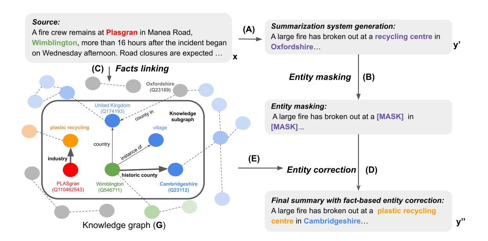
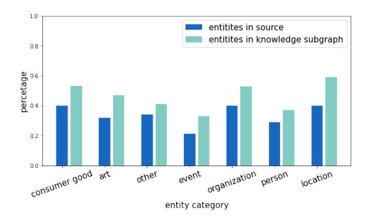
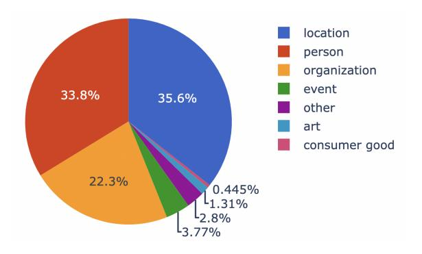
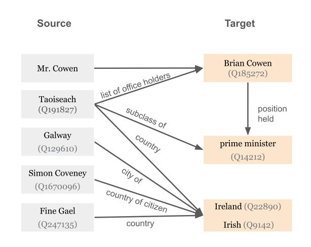

# Faithful to the Document or to the World? Mitigating Hallucinations via Entity-Linked Knowledge in Abstractive Summarization

Yue Dong1\* John Wieting2 Pat Verga2

1Mila / McGill University 2 Google Research yue.dong2@mail.mcgill.ca {jwieting, patverga}@google.com

#### **Abstract**

Existing abstractive summarization systems are hampered by content hallucinations in which models generate text that is not directly inferable from the source alone. Annotations from prior work have shown that some of these hallucinations, while being 'unfaithful' to the source, are nonetheless factual. Our analysis in this paper suggests that these factual hallucinations occur as a result of the prevalence of factual yet unfaithful entities in summarization datasets. We find that these entities are not aberrations, but instead examples of additional world knowledge being readily used to latently connect entities and concepts – in this case connecting entities in the source document to those in the target summary. In our analysis and experiments, we demonstrate that connecting entities to an external knowledge base can lend provenance to many of these unfaithful yet factual entities, and further, this knowledge can be used to improve the factuality of summaries without simply making them more extractive.

#### 1 Introduction

Despite producing fluent summaries with excellent automatic evaluation scores, current abstractive summarization methods routinely hallucinate – producing content that is not directly supported by the source text (Maynez et al., 2020). For instance, Pagnoni et al. (2021) demonstrated that 92% of the summaries generated by various summarization models on XSUM (Narayan et al., 2018) contain at least one factual error. In addition, the majority of these hallucinated errors are entity-based.

Maynez et al. (2020) divided these hallucinations into intrinsic and extrinsic. While intrinsic hallucination focuses on errors that are incorrectly aggregated from the source, the majority of hallucinations are extrinsic, meaning they cannot be inferred directly from the source. Most prior work considers

| Source                         | A fire crew remains at Plasgran in Manea Road, Wimblington, more than 16 hours after the incident began on Wednesday afternoon. Road closures are expected to stay in place until midday, the fire service said. About 75 firefighters worked into the night to put out the fire. They also prevented its spread to neighbouring properties. The incident was scaled down at 2300 GMT, when the fire was brought under control. |  |
|--------------------------------|---------------------------------------------------------------------------------------------------------------------------------------------------------------------------------------------------------------------------------------------------------------------------------------------------------------------------------------------------------------------------------------------------------------------------------|--|
| System Generated Summary | A large fire has broken out at a recycling centre in Oxfordshire, the fire service has said, forcing the closure of a road.                                                                                                                                                                                                                                                                                                     |  |
| After Correction            | A large fire has broken out at a plastic recycling centre in Cambridgeshire                                                                                                                                                                                                                                                                                                                                                     |  |
| Target                         | An investigation has begun into the cause of a fire which has severely damaged a plastics factory in Cambridgeshire.                                                                                                                                                                                                                                                                                                            |  |
| Reasoning Paths             | 1. Plasgran → industry → plastic recycling; 2. Wimblington → historic county → Cambridgeshire; 3. Wimblington → also known as → Wimblington, Cambridgeshire                                                                                                                                                                                                                                                                     |  |

Table 1: The target summary contains out-of-article entities – plastics factory and Cambridgeshire – that are important for comprehension. We can see that our model was able to correct the entities in the system-generated summary successfully with additional world knowledge linked from source entities (relevant facts).

extrinsic hallucinations as undesired (Falke et al., 2019; Kang and Hashimoto, 2020; Zhu et al., 2021; Nan et al., 2021; Raunak et al., 2021; Goyal and Durrett, 2021; Gabriel et al., 2021a; Goyal et al., 2022), as they are not directly faithfully consistent with the source.

Surprisingly, human annotations from Maynez et al. (2020); Ladhak et al. (2021) suggest that many of these unfaithful hallucinations are actually *factual*. Thus, while they are unfaithful to the source text, they are still faithfully consistent with commonsense and world knowledge. These facts, when included in the summary, may provide additional information that is important to under-

\*This work was done when the first author was an intern at Google Research.

Figure 1: Schematic view of building the summarization pipeline with knowledge enhanced entity correction. A) A standard seq-to-seq T5 model produces a generated summary. B) An entity linker is used to identify and mask out entities in the generated summary to produce a skeleton summary. C, D, E) The revision model (FILM) uses the source text, skeleton, and external knowledge base to revise and correct the masked entities.

stand the content (Cao et al., 2022). In this work, we investigate how external knowledge/facts in open-domain KBs can both lend provenance to extrinsic hallucinations and improve the factuality of generated summaries. Table 1 shows an example of this, where our method generates the target entity 'Cambridgeshire' through a reasoning path in the knowledge base originating at the source entity 'Wimblington'. We show that the training data frequently relies on facts that are not explicitly expressed in the text but instead require external knowledge to infer correctly (Section 2). This contradicts the widely held belief that hallucinations occur as a result of ineffective learning.

As a result, contrary to most of previous work that improves faithfulness by filtering training examples to contain only extractive entities (Nan et al., 2021; Narayan et al., 2021; Mao et al., 2020), we focus on improving the factuality of generated abstractive entities by *providing additional facts that are relevant to the source*. We focus on entities (e.g., person, event, location, organization) in summaries, as they are the most commonly hallucinated (Pagnoni et al., 2021; Kryscinski et al., 2020) and often contain the most salient information.

Our contributions in this work are:

• We provide a comprehensive study over

XSUM and CNNDMabs analyzing the connection between source document entities and those in target summaries via facts in external knowledge bases. We find for example, 59.9% of location entities in the gold reference summaries of XSUM are not in the source; 31.6% of these out-of-article entities can be found by following edges in a KB originating at source document entities (Section 2.1).

- We explore methods to improve the factuality of summaries by incorporating KB facts. For instance, we propose a two-stage revision model to edit entities in the generation and consider a method that incorporates facts from an open-domain KB (Section 3).
- We propose entity-based metrics that evaluate the factuality of generations by linking entity mentions to canonical IDs in a KB, and comparing those to linked entities in the gold reference targets. This allows us to account for variations in the surface forms of entities in our evaluation (Section 4).

# 2 Case Study: Faithful to the Document or the World?

The motivation for this work stems from the finding that many gold reference summaries in widely used

Figure 2: Increase of entity coverage by including external knowledge subgraphs. The knowledge subgraphs are constructed by including Wikidata facts that are one hop away from the set of entities in the source document.

summarization datasets, such as XSUM (Narayan et al., 2018), contain entities that are not explicitly mentioned in the source. Instead, they require additional knowledge to resolve. We show that **much of this knowledge can be found by identifying facts in KBs that involve source entities**. On XSUM, for example, 59.9% of target location entities are not in the source. Our experiments show that 31.6% of these entities can be found in the one-hop facts linked from the source entities in the knowledge graph.

## 2.1 Setup

The purpose of this investigation is to see if any unmentioned entities can be found in knowledge that is closely related to the source. For our analysis, we look at two widely-used summarization datasets: XSUM and CNN/Daily Mail (CNNDM) (Hermann et al., 2015; Nallapati et al., 2016). Compared to XSUM, CNNDM is largely extractive. We create CNNDM $_{abs}$ , an abstractive subset of the original dataset. On CNNDM $_{abs}$ , at least one location entity in the target is not present in the source. We obtained 95387/4357/3769 data instances for train/dev/test on this subset.

For a given example, we seek to supplement the source document with additional world knowledge by constructing a subgraph made up of facts in the Wikidata KB originating at source entities. To identify entities and their types in the source and targets, we use Google Cloud NLU1 for named entity recognition (NER) (Ratinov and Roth, 2009) and entity linking (Bunescu and Pasca, 2006). This

Figure 3: Entity proportion by type in XSUM.

is necessary as the surface forms of entities often vary; for example, Wikidata ID Q30 - United States of America - has 18 different surface forms.2 For each of the extracted entities in the source, we collect the set of one-hop facts in Wikidata that originate at those entities, which we call our knowledge subgraph.

#### 2.2 Findings

Figure 2 shows that depending on the entity category,  $60\% \sim 79\%$  of target entities do not appear in the source in XSUM. However, a large portion of these so-called out-of-article entities can instead be found in the knowledge subgraph that we constructed. Depending on the entity category,  $8\% \sim 19\%$  of target entities can be identified *exclusively* in the knowledge subgraph, resulting in  $20.6\% \sim 57.1\%$  improvement of entity coverage when compared to the set of source entities.

Following single-hop KB links alone does not yield all related entities. This is mostly due to both the limited schema of the KB and the fact that the KB itself is highly incomplete (Lin et al., 2018; Ebisu and Ichise, 2019). However, relevant information can often be encoded in multi-hop paths through the graph. For example, the KB schema may not include the relation type born in state and therefore lack a single hop path connecting a person to the state they were born. However, this fact could be instead inferred via the two-hop path:  $(Barack\ Obama\ o\ born\ in\ o\ Honalulu\ o$  $capital\ of\ o Hawaii$ ). To investigate this, we check whether an increase in the number of hops through the KB would result in higher coverage of target entities.

&lt;sup>2the United States of America | America | U.S.A. | USA | U.S. | US | the US | the USA | US of A | the United States | U.S.A. | U.S. | the States | the U.S. | 'Merica | U.S | United States | 'Murica

|          | Source | 1 Hop ↑    | 2 Hops ↑   | 3 Hops ↑   |
|----------|--------|------------|------------|------------|
| XSUM     | 40.1   | 59.8 49.2% | 60.2 50.1% | 60.3 50.4% |
| CNNDMabs | 52.3   | 65.4 25.1% | 66.1 26.4% | 66.2 26.6% |

Table 2: Target location entity coverage before and after including facts from different number of hops beginning from source entities of the KB. Green highlights the percentage of coverage improvement by the KB.

Table 2 shows that in these datasets, most of the facts that are needed to connect source entities to abstractive target entities are within one hop of the KB. The benefits of including longer reasoning paths to create the knowledge subgraph results in a negligible entity coverage gain, but adds significantly more facts to reason over. For example, the average number of facts in the knowledge subgraph in XSUM after one hop of traversing is 790. This number increases drastically to 5365 when including two hop paths.

## 2.3 Conclusions

Contrary to the common belief that the source contains all of the information in the summary, we have shown that a large portion of the gold references in XSUM and CNNDMabs require external knowledge to generate. We provide one way to discover this external knowledge by following reasoning paths in an external KB that originate from the set of source entities. However, there is still a considerable fraction of target entities that are neither in the source nor in the knowledge subgraph. This could be attributed to a variety of factors. First, like other KBs, our seed KG (Wikidata) is incomplete. Many links are missing (Min et al., 2013) as entries are provided by users from manual edits. Furthermore, the data needed to summarize XSUM and CNNDMabs may be temporally out of sync with the KG. For example, the President of the United States (Q11696) in Wikidata is Joe Biden (2021 - present); however, this was not the case when the summarization datasets were constructed. Additionally, different KBs and subgraph selection methods could increase the entity recall further while reducing the number of spurious links; however, we leave this exploration for future work.

# 3 Improving Factual Consistency with World Knowledge

In this section, we explore whether we can incorporate additional knowledge into a summarization model to reduce content hallucination and produce

more faithful summaries. Two approaches for incorporating external knowledge into summarization are investigated: (i) directly concatenate the knowledge subgraph to the source for a standard sequence-to-sequence summarization model; (ii) refine initial sequence-to-sequence output with a second-stage entity revision model that has access to relevant facts.

It is worth noting that there are a lot of options for the second-stage entity-revision model, and determining the "optimal" revision model will require more research. Instead, we aim to show that improving the factuality of generated summaries with a two-stage revision technique is a viable option.

## 3.1 Implementation Details

We use T5-3B (Raffel et al., 2020) as the base summarization model. The models are fine-tuned for 200k steps with a batch size of 128 on the Cloud TPU v3 Pod with a 128-core Pod slice. When finetuning, we utilize a constant learning rate of 1e-4 and execute early-stopping based on a held-out validation set. The Google Cloud NLU API is used for NER and entity linking. Our second-stage entity-revision model is the Fact Injected Language Model (FILM) (Verga et al., 2021) which predicts new entities based on the additional facts linked from the source (Section 3.3).

# 3.2 Generation with Facts Concatenation

Sequence-to-sequence models have become the most prevalent summarization approaches (Celikyilmaz et al., 2018; Gehrmann et al., 2018; Bae et al., 2019; Zhang et al., 2019; Liu and Lapata, 2019; Dong et al., 2019; Zhang et al., 2020; Qi et al., 2021; Liu et al., 2022). These models take a source document x = (x1, . . . , xn) as input and produce a generated summary y = (y1, . . . , yN ), where y = f(x). Building on this paradigm, concatenate additional facts with the source input is the most straightforward way to provide the model with new external knowledge. In the case of our knowledge subgraph, this yields xˆ = concat([x, k1, . . . , kn]) where (k1, . . . , kn) is the linearization of the facts in the knowledge subgraph.

In more details, we linearize facts into literal strings with "[SEP]" as the fact separator. For example, if the knowledge subgraph contains two facts: ("Simon Coveney", "country of citizen", "Ireland") and ("Taoiseach", "subclass of", "prime minister"), the linearized form of this knowledge subgraph is "[SEP] Simon Coveney country of cit-

| Input            | ROUGE-1 | ROUGE-L | FactCC |
|------------------|---------|---------|--------|
| source only      | 43.67   | 36.25   | 23.71  |
| + random words   | 44.40   | 36.50   | 23.72  |
| + random facts   | 44.59   | 36.54   | 24.11  |
| + location facts | 44.83   | 36.76   | 24.15  |

Table 3: Results of appending facts directly to the source using T5-3B model.

izen Ireland [SEP] Taoiseach subclass of prime minister [SEP]". As each linearized fact contains at least three tokens, the linearized facts for all entity categories drastically exceed the input length limitation of popular transformer-based summarization models. We opt to train the model to correct only location type of entities, as they appear most frequently in the source (Figure 3) and have the best coverage improvement by fact linking (Figure 2). Intuitively, the direct concatenation approach aims to teach the seq2seq model to learn to select useful facts in the source for the summary generation.

Similar to the approach described in Section 2.1, we construct training data as follows. For each input document, we extract all entities in the source which are linkable to a Wikidata ID. We then build the knowledge subgraph for this document by extracting all one-hop relations on the Wikidata knowledge graph that originate at any of the source entities. On average, this construction leads to 1837 facts in the knowledge subgraph for all source entities in the categories of {Location, Person, Organization, event, Art, Consumer Good, Other} per source document.

Table 3 shows the results of appending location facts to the source for XSUM. One intriguing finding is that adding any additional information to the end of the source input can boost the ROUGE and FactCC scores. We can observe that simply appending random words 3 to the input resulted in higher ROUGE scores. Furthermore, by attaching random or linked location facts (Section 2.1) to the seq2seq model, higher ROUGE and FactCC scores can be achieved. This suggests that using linked facts directly in seq2seq models can assist enhance the factual consistency of summaries.

Limitations: Despite restricting the knowledge subgraph to facts about location entities, this approach quickly becomes intractable. Most summarization models have a length limit of up to 1024 (Lewis et al., 2020a; Raffel et al., 2020), or 4096 for

longer transformers (Beltagy et al., 2020; Zaheer et al., 2020). However, the location-based knowledge subgraph yielded 790 facts on average, with a fact length of 7.8 on XSUM. Even Longformers (Beltagy et al., 2020) can only accommodate roughly 500 facts, not counting the input text itself. In the experiments, we set the T5 input token length to 1024 and facts that exceed this length will be automatically pruned. Heuristics or trained models may be used to further prune the facts, but given the lack of direct supervision, this is itself a challenging task.

## 3.3 Two-Stage Revision

We also consider a generate-and-revise approach that is less constrained by the number of facts. First, a conventional seq-to-seq model is used to produce a candidate summary from the source text (Figure 1-A). Next, an entity linking model identifies typed entities in the generated summary. These entities are then masked out, producing a skeleton summary (Figure 1-B). Finally, a second-stage revision model is used to predict new entities to fill those masks, yielding a final summary (Figure 1-D).4 For steps 1 and 2, we use the same T5-3B and Google Cloud NLU models described in Section 3.1.

For the revision model in step 3, we consider two options: a second, separately trained standard T5 masking prediction model (T5m), and the Fact Injected Language Model (FILM) (Verga et al., 2021). While language models like T5 have been shown to implicitly store knowledge akin to a KB (Petroni et al., 2019; Roberts et al., 2020), FILM is a neural language model that includes an explicit "fact memory" populated from a KB. Importantly, the model does not concatenate a seed set of facts to the input, but instead, stores them in a separate memory. The model learns to retrieve a small subset of facts from this memory and then incorporates those retrievals into its final prediction. This addresses the scaling issues of the previous section as the model can store millions of facts, learn to retrieve a set of relevant candidates, and incorporate that factual information into its predictions.

The input to the revision model is x = concat([source, skeleton]). T5m is used in the standard sequence-to-sequence setup to predict the masked tokens to produce the final summary. In the case of FILM, the model first produces hid-

3Obtained by sampling uniformly over the T5 vocabulary.

4During training, we use the gold reference summary as the candidate summary and use system-generated summary during the inference.

| Method | Abs. Subset   | Ext. Subset | Full Set |
|--------|---------------|-------------|----------|
|        |               | XSUM        |          |
| T5m    | 73.1          | 71.2        | 72.4     |
| FILM   | 77.5          | 67.2        | 74.5     |
|        | $CNNDM_{abs}$ |             |          |
| T5m    | 31.0          | 75.6        | 73.4     |
| FILM   | 33.8          | 73.2        | 68.4     |

Table 4: Accuracy of entity ID matching to the targets on XSUM and CNNDM $_{abs}$ . The entities are predicted using gold-reference summaries with MASK. FILM outperforms T5m on abstractive subsets where target entities are not in the source. The abstractive subset contains document-summary pairs where the gold reference summary contains at least one entity that is not in the source.

den states z=f(x). For hidden state  $z_i$  corresponding to a mask appearing at the ith token, the model performs an attention over the fact memory as  $a=g(z,M^{key})$ . Each entry in  $M^{key}$  corresponds to a single fact and is formed as a function of the subject and relation of that fact. The model then retrieves the corresponding values for the top K scoring fact keys, where each value is a function of the object set corresponding to the fact. For example a single fact would be  $M_j^{key}=h([Barack\_Obama,born\_in])$  with the corresponding value being  $M_j^{val}=\hat{h}(Hawaii)$ . Finally, the model predicts an output entity as  $\hat{y}_i=\hat{f}(z_i,a,M^{val})$ . Refer to Verga et al. (2021) for additional details on the FILM model.

#### 4 Main Results

This section discusses the results of using the revision model to correct entity errors. We divide the results into two parts: 1) oracle correction on gold-reference summaries, and 2) revision model based on system-generated summaries.

We propose using entity correctness as the criteria for assessing the factuality of generated entities. 5 Entity correctness *matches* predicted entities to the the target entities. Surface forms are linked to their *Wikidata IDs to resolve entity matching* in account for entity paraphrase (Section 2.1). All target entities in the summaries are further divided into two categories: abstractive entities that do not appear in the source and extractive entities that do.

| Method | Abs. Entities        | Ext. Entities             | All Entities              |
|--------|----------------------|---------------------------|---------------------------|
|        |                      | XSUM                      |                           |
| T5     | 68.72                | 64.29                     | 66.31                     |
| + T5m  | 68.73 ↑ 0.01%        | $64.33 \uparrow 0.06\%$   | 66.34 ↑ 0.05%             |
| + FILM | <b>73.40</b> ↑ 6.81% | <b>65.32</b> ↑ 1.60%      | <b>70.60</b> ↑ 6.47%      |
|        |                      | ${ m CNNDM}_{abs}$        |                           |
| T5     | 29.58                | 72.45                     | 66.85                     |
| + T5m  | 28.95 \ \ 2.12\%     | <b>74.88</b> ↑ 3.35%      | <b>67.15</b> ↑ 0.45%      |
| + FILM | <b>30.31</b> ↑ 2.47% | $72.25 \downarrow 0.28\%$ | $66.71 \downarrow 0.21\%$ |

Table 5: Entity matching accuracy of using revision models for error correction on T5 outputs on XSUM. Green / Red highlight the percentage of improvement/drop after revision. We report correctness by measuring the entity ID matching between targets and model predictions. On abstractive subsets where external knowledge is frequently required to infer the target entity, FILM outperforms other baselines.

The abstractive subset frequently require external knowledge to infer the target entity.

#### 4.1 Oracle Correction

To isolate the effects of the revision model from the summarization model itself, we first evaluate the revision model on entity-masked gold target summaries. Table 4 shows the oracle results of using FILM and T5m for entity revision. We observe that FILM, which incorporates the additional knowledge subgraph, outperforms T5m considerably on the abstractive subset when external knowledge is required to infer the target entity. Relative boosts of 6.1% (73.1  $\rightarrow$  77.5) and 8.8% (31.0  $\rightarrow$  33.8) are observed on XSUM and CNNDMabs respectively. This indicates that when target items are absent from the source, models utilizing external knowledge bases can better enhance the factuality of generated summaries.

We also observe both revision models are struggling on the abstractive subset of  $CNNDM_{abs}$ . This is probably because both revision models learned extractive strategies that prefer to predict source entities on this dataset. This is consistent with observations from Pagnoni et al. (2021). Additionally, as FILM frequently tries to generate abstractive entities with external knowledge, it upderperforms T5m on extractive subsets.

However, this does not imply that the entities replaced by FILM are incorrect. It is worth noting that entity correctness, as an automatic evaluation metric, has its own limitations. It only matches the generated entities to target entities with the consideration of paraphrasing. It is possible that, in

&lt;sup>5We also report ROUGE (Lin, 2004), FactCC (Kryscinski et al., 2020), and Entity Consistency for faithfulness evaluation in Analysis (Section 5).

the extractive subset, FILM might appropriately replace entities based on the facts in the KB, but this is not counted as a correct replacement. For example, if "Manhattan" appears both in the source and the target, and FILM decides to swap "Manhattan" for "New York City". Despite this generation being factual, it does not match the entity IDs in the target.

#### 4.2 Revision Model

Entity Factuality Table 5 shows the results of using FILM and T5m for entity revision based on the masked T5-generated candidate summary. We observe a pattern that is consistent with the oracle results. Compared to T5m, using FILM in conjunction with external open-domain knowledge results in higher correctness on abstractive entities. We observe relative boosts of 6.8% (68.7  $\rightarrow$  73.4) and 4.5% (29.0  $\rightarrow$  30.3) on XSUM and CNNDMabs respectively.

Additionally, FILM achieves greater overall correctness and correctness on extracting entities on XSUM. On the other hand, T5m performs better on extractive entities and generally on  $CNNDM_{abs}$ , because the majority of entities there are extractive (72.8%) as opposed to (33.5%) on XSUM. This does not imply that the entities replaced by FILM are inaccurate due to the limitations of entity correctness measure, as stated in Section 4.1. In order to determine whether the substitution by FILM improves the factuality of generated summaries, we conduct human evaluation described as follows.

**Human Evaluation** We present entity pairs before and after the revision by FILM (in randomized order) with the masked candidate summary sentence to three annotators. The annotators are asked to rate the two entities based on the factuality to the target sentence by choosing from the following four options 6: 1) entity A is better 2) entity B is better 3) equally factual 4) equally non-factual. In total, 288 annotations were obtained. Compared to the original entities, we observe a relative boost of 19.7% preferences for revised entities (22.3%  $\rightarrow$  26.7%). By using two-sample t-test (Cressie and Whitford, 1986), it was concluded that the revised entities were significantly preferred above the baseline (p< 0.05). Besides, 17.7%/31.3% of the annotations indicate both entities are factual/nonfactual, respectively. By calculating Fleiss's Kappa

| Method | Consistency | FactCC        | ROUGE-1 |
|--------|-------------|---------------|---------|
|        |             | XSUM          |         |
| T5     | 73.85       | 22.84         | 45.14   |
| + T5m  | 74.21       | 21.32         | 45.21   |
| + FILM | 73.15       | 21.32         | 45.09   |
|        |             | $CNNDM_{abs}$ |         |
| T5     | 84.12       | 69.22         | 44.32   |
| + T5m  | 85.31       | 71.02         | 44.67   |
| + FILM | 83.57       | 68.51         | 43.81   |

Table 6: Results for T5 outputs with and without revision models on XSUM. Consistency and FactCC both measure extractiveness by comparing to the source. We also report ROUGE-1; however, the ROUGE-1 of FILM is calculated by matching the canonical form of entities to the gold-reference target. This can often result in a string mismatch with the target summary (variance between an entity's surface form and its canonical name) and the model being penalized despite the underlying entities being the same.

( $\kappa = 0.74$ ), we can also conclude that the interannotator agreement for four-category annotations is adequate (more details in Appendix).

#### 5 Analysis and Discussion

Faithfulness vs. Factuality Although factuality and faithfulness are frequently used interchangeably in the literature, in our notion, they measure the generation from completely different perspectives. Additionally, they can occasionally have a negative correlation if the targets have a high proportion of abstractive entities that require external knowledge to resolve, like on XSUM. This is because extractive entities are encouraged to enhance the faithfulness of the generated summaries. In contrast, abstractive entities that match the targets are frequently encourages by the factuality metric.

In section 4, we demonstrated that models using external knowledge may increase the generation's factuality. This section assesses the faithfulness of the generations. We can see from Table 6 that FILM have lower faithfulness scores despite having higher factuality scores. By incorporating external knowledge, FILM seems to make the generated summary more abstractive. This may be penalized by faithfulness scores.

# Quality of KB vs. Factuality by Entity Category While our primary experiments focused on location entities, we also analyzed the performance of other entity categories using FILM as our revision

&lt;sup>6We encourage the annotators to check on search engines if an entity is not directly supported by the source or the target.

| Dev.         | Ext. Entities | Abs. Entities | In Source | Only in KB |
|--------------|------------------|------------------|--------------|---------------|
| location     | 95%              | 70%              | 40%          | 19%           |
| person       | 75%              | 65%              | 29%          | 8%            |
| organization | 50%              | 40%              | 40%          | 13%           |
| event        | 62%              | 35%              | 21%          | 12%           |
| art          | 59%              | 14%              | 32%          | 15%           |
| other        | 25%              | 30%              | 34%          | 7%            |

Table 7: Entity matching accuracy (1st column) of FILM and entity coverage by the knowledge subgraph (Section 2) by categories on XSUM. We can see that the quality of the KBs varies across different entity categories, and this is reflected in the performance of FILM.

model. We show that the performance of FILM is highly dependant on the quality and coverage of the knowledge subgraph. In Table 7 last column we see a large range on how the added coverage provided by the knowledge subgraph for the different entity types. Additionally, column 2 shows a similar wide range on the oracle prediction accuracy over those different entity types.

Looking at full pipeline results in Table 8, we see that the revision accuracy of location entities is substantially higher than person or organization. This is possibly due to variance in the coverage in the KB across types or a greater difficulty in identifying relevant facts. For example, even if a fact links a source entity to a target entity, there is no guarantee that it is relevant for making a prediction about a particular piece of text.

| Entity category | Subset type | Before FILM | After FILM |
|-----------------|-------------|-------------|------------|
| person          | abs.        | 79.95       | 76.07      |
|                 | ext.        | 79.80       | 72.63      |
| organization    | abs.        | 66.80       | 50.08      |
|                 | ext.        | 73.96       | 55.50      |
| location        | abs.        | 68.72       | 73.40      |
|                 | ext.        | 64.29       | 65.32      |

Table 8: Entity matching accuracy using FILM to revise T5 outputs on XSum by entity type.

## 6 Related Work

Faithfulness in Summarization Faithful consistency of summarization has drawn much research interest since the proposal of FactCC (Kryscinski et al., 2020), an evaluation model that classifies the generated summary as consistent/inconsistent to the source. Later, several question answering-based

summarization evaluation methods were proposed (Wang et al., 2020; Durmus et al., 2020; Nan et al., 2021; Zeng et al., 2021), in addition to diagnostic datasets (Gabriel et al., 2021b). These models measure the faithfulness by evaluating answers that are produced by a QA model with inputs of (question, source) and (question, generated summary). Numerous strategies are also proposed to increase faithfulness by imposing constraint w.r.t the source, such as quantity entity matching (Zhao et al., 2020), intermediate planning with entity chains (Narayan et al., 2021), extensible guidance (Dou et al., 2021), document's knowledge graph (Zhu et al., 2021), and simple filtering (Nan et al., 2021). In addition, Filippova (2020) controls hallucination with unconditional and conditional LMs. Dong et al. (2020); Cao et al. (2020) propose post-error corrections with QA-based models or denoising BART. Cao et al. (2018); Zhu et al. (2021) utilize dependency parsing tools to identify and match the relations in an input document to its summary.

Factuality in Summarization Cao et al. (2022) propose a novel detection approach that separates factual from non-factual hallucinations. Gunel et al. (2020) proposes to prime summarization models with embeddings that are learned through TransE on knowledge graphs. Additionally, many recent models have been proposed for retrieval augmented language models using passages (Guu et al., 2020; Lewis et al., 2020b), mentions (Sun et al., 2021), and facts (Verga et al., 2021). In this paper, we experiment with incorporating facts that are directly linked to the entities in the source. Several models have been proposed to combine symbolically interpretable factual information and subsymbolic neural knowledge (Cohen et al., 2020; Ren et al., 2020; Narayan et al., 2021). Different from the previous works, we investigate how facts in external open-domain knowledge can help with entity factuality of the generated summary.

## 7 Conclusion

In this paper, we show that a large portion of socalled external hallucinations in text summarization can be explained by external knowledge and verified by KB facts connecting source entities to target entities. We have explored multiple ways to combine this knowledge into a faithful and factual generation of summaries. Our research proposes a pipeline that, with a solid knowledge base as a foundation, can guarantee better factuality. Furthermore, we discuss some valuable insights about current limitations and promising directions for knowledge-grounded text generation.

# 8 Limitations

Alternative Approaches We presented two promising methods for utilizing external knowledge to improve the factuality of generated entities in summarization. It is important to note that the purpose of this study was not to claim to have found the optimal method, but instead, to demonstrate that external knowledge *can* be used to enhance the factuality of generated summaries. For example, countless other models could have been chosen as the revision model and a future research direction would be to more exhaustively examine more approaches and analyze the trade-offs between them.

Methods Our experimental results indicate that external open-domain knowledge can in some cases improve the factuality of the summaries. However, each of the proposed methods does have its own limitations. Direct concatenation of linearized facts to the input quickly becomes intractable as the number of facts rises, making it not scalable to long text. FILM, as a revision model and as such, relies heavily on the initial summaries generated by other systems. Additionally, running the summaries through a revision model also requires extra computational resources.

Knowledge Bases The usefulness of incorporating external knowledge is limited by the quality and coverage of the KB. It thus has the following limitations: first, the experiments conducted in this research may not generalize well to domains without associated KBs, such as story summarization. Second, the factuality under examination is solely restricted to entities from a small set of types, as external hallucinations involving more general concepts may not occur in any KB. Third, the enhancement of the generation's factuality depends on the correctness and completeness of the KB which is a known limitation of all KBs. Most of the positive experimental results were observed in location-based entities, where a substantial percentage of target entities are exclusive to our knowledge subgraph. In these location-based facts, issues like missing links or facts that are out of sync are uncommon. More investigation into erroneous facts and the temporal impacts of the KBs may be crucial for future research.

# References

- Sanghwan Bae, Taeuk Kim, Jihoon Kim, and Sanggoo Lee. 2019. [Summary level training of sentence](https://doi.org/10.18653/v1/D19-5402) [rewriting for abstractive summarization.](https://doi.org/10.18653/v1/D19-5402) In *Proceedings of the 2nd Workshop on New Frontiers in Summarization*, pages 10–20, Hong Kong, China. Association for Computational Linguistics.
- Iz Beltagy, Matthew E Peters, and Arman Cohan. 2020. Longformer: The long-document transformer. *arXiv preprint arXiv:2004.05150*.
- Razvan Bunescu and Marius Pa¸sca. 2006. [Using en](https://aclanthology.org/E06-1002)[cyclopedic knowledge for named entity disambigua](https://aclanthology.org/E06-1002)[tion.](https://aclanthology.org/E06-1002) In *11th Conference of the European Chapter of the Association for Computational Linguistics*, pages 9–16, Trento, Italy. Association for Computational Linguistics.
- Meng Cao, Yue Dong, and Jackie Cheung. 2022. [Hal](https://doi.org/10.18653/v1/2022.acl-long.236)[lucinated but factual! inspecting the factuality of](https://doi.org/10.18653/v1/2022.acl-long.236) [hallucinations in abstractive summarization.](https://doi.org/10.18653/v1/2022.acl-long.236) In *Proceedings of the 60th Annual Meeting of the Association for Computational Linguistics (Volume 1: Long Papers)*, pages 3340–3354, Dublin, Ireland. Association for Computational Linguistics.
- Meng Cao, Yue Dong, Jiapeng Wu, and Jackie Chi Kit Cheung. 2020. [Factual error correction for abstrac](https://doi.org/10.18653/v1/2020.emnlp-main.506)[tive summarization models.](https://doi.org/10.18653/v1/2020.emnlp-main.506) In *Proceedings of the 2020 Conference on Empirical Methods in Natural Language Processing (EMNLP)*, pages 6251–6258, Online. Association for Computational Linguistics.
- Ziqiang Cao, Furu Wei, Wenjie Li, and Sujian Li. 2018. Faithful to the original: Fact aware neural abstractive summarization. In *Proceedings of the AAAI Conference on Artificial Intelligence*.
- Asli Celikyilmaz, Antoine Bosselut, Xiaodong He, and Yejin Choi. 2018. [Deep communicating agents for](https://doi.org/10.18653/v1/N18-1150) [abstractive summarization.](https://doi.org/10.18653/v1/N18-1150) In *Proceedings of the 2018 Conference of the North American Chapter of the Association for Computational Linguistics: Human Language Technologies, Volume 1 (Long Papers)*, pages 1662–1675, New Orleans, Louisiana. Association for Computational Linguistics.
- William W. Cohen, Haitian Sun, R. Alex Hofer, and Matthew Siegler. 2020. [Scalable neural methods for](https://openreview.net/forum?id=BJlguT4YPr) [reasoning with a symbolic knowledge base.](https://openreview.net/forum?id=BJlguT4YPr) In *International Conference on Learning Representations*.
- NAC Cressie and HJ Whitford. 1986. How to use the two sample t-test. *Biometrical Journal*, 28(2):131– 148.
- Li Dong, Nan Yang, Wenhui Wang, Furu Wei, Xiaodong Liu, Yu Wang, Jianfeng Gao, Ming Zhou, and Hsiao-Wuen Hon. 2019. Unified language model pre-training for natural language understanding and generation. *Advances in Neural Information Processing Systems*, 32.

- Yue Dong, Shuohang Wang, Zhe Gan, Yu Cheng, Jackie Chi Kit Cheung, and Jingjing Liu. 2020. [Multi](https://doi.org/10.18653/v1/2020.emnlp-main.749)[fact correction in abstractive text summarization.](https://doi.org/10.18653/v1/2020.emnlp-main.749) In *Proceedings of the 2020 Conference on Empirical Methods in Natural Language Processing (EMNLP)*, pages 9320–9331, Online. Association for Computational Linguistics.
- Zi-Yi Dou, Pengfei Liu, Hiroaki Hayashi, Zhengbao Jiang, and Graham Neubig. 2021. [GSum: A gen](https://doi.org/10.18653/v1/2021.naacl-main.384)[eral framework for guided neural abstractive summa](https://doi.org/10.18653/v1/2021.naacl-main.384)[rization.](https://doi.org/10.18653/v1/2021.naacl-main.384) In *Proceedings of the 2021 Conference of the North American Chapter of the Association for Computational Linguistics: Human Language Technologies*, pages 4830–4842, Online. Association for Computational Linguistics.
- Esin Durmus, He He, and Mona Diab. 2020. [FEQA: A](https://doi.org/10.18653/v1/2020.acl-main.454) [question answering evaluation framework for faith](https://doi.org/10.18653/v1/2020.acl-main.454)[fulness assessment in abstractive summarization.](https://doi.org/10.18653/v1/2020.acl-main.454) In *Proceedings of the 58th Annual Meeting of the Association for Computational Linguistics*, pages 5055– 5070, Online. Association for Computational Linguistics.
- Takuma Ebisu and Ryutaro Ichise. 2019. [Graph pat](https://doi.org/10.18653/v1/N19-1104)[tern entity ranking model for knowledge graph com](https://doi.org/10.18653/v1/N19-1104)[pletion.](https://doi.org/10.18653/v1/N19-1104) In *Proceedings of the 2019 Conference of the North American Chapter of the Association for Computational Linguistics: Human Language Technologies, Volume 1 (Long and Short Papers)*, pages 988–997, Minneapolis, Minnesota. Association for Computational Linguistics.
- Tobias Falke, Leonardo F. R. Ribeiro, Prasetya Ajie Utama, Ido Dagan, and Iryna Gurevych. 2019. [Rank](https://doi.org/10.18653/v1/P19-1213)[ing generated summaries by correctness: An interest](https://doi.org/10.18653/v1/P19-1213)[ing but challenging application for natural language](https://doi.org/10.18653/v1/P19-1213) [inference.](https://doi.org/10.18653/v1/P19-1213) In *Proceedings of the 57th Annual Meeting of the Association for Computational Linguistics*, pages 2214–2220, Florence, Italy. Association for Computational Linguistics.
- Katja Filippova. 2020. [Controlled hallucinations:](https://doi.org/10.18653/v1/2020.findings-emnlp.76) [Learning to generate faithfully from noisy data.](https://doi.org/10.18653/v1/2020.findings-emnlp.76) In *Findings of the Association for Computational Linguistics: EMNLP 2020*, pages 864–870, Online. Association for Computational Linguistics.
- Saadia Gabriel, Antoine Bosselut, Jeff Da, Ari Holtzman, Jan Buys, Kyle Lo, Asli Celikyilmaz, and Yejin Choi. 2021a. [Discourse understanding and factual](https://doi.org/10.18653/v1/2021.eacl-main.34) [consistency in abstractive summarization.](https://doi.org/10.18653/v1/2021.eacl-main.34) In *Proceedings of the 16th Conference of the European Chapter of the Association for Computational Linguistics: Main Volume*, pages 435–447, Online. Association for Computational Linguistics.
- Saadia Gabriel, Asli Celikyilmaz, Rahul Jha, Yejin Choi, and Jianfeng Gao. 2021b. [GO FIGURE: A meta eval](https://doi.org/10.18653/v1/2021.findings-acl.42)[uation of factuality in summarization.](https://doi.org/10.18653/v1/2021.findings-acl.42) In *Findings of the Association for Computational Linguistics: ACL-IJCNLP 2021*, pages 478–487, Online. Association for Computational Linguistics.

- Sebastian Gehrmann, Yuntian Deng, and Alexander Rush. 2018. [Bottom-up abstractive summarization.](https://doi.org/10.18653/v1/D18-1443) In *Proceedings of the 2018 Conference on Empirical Methods in Natural Language Processing*, pages 4098–4109, Brussels, Belgium. Association for Computational Linguistics.
- Tanya Goyal and Greg Durrett. 2021. [Annotating and](https://doi.org/10.18653/v1/2021.naacl-main.114) [modeling fine-grained factuality in summarization.](https://doi.org/10.18653/v1/2021.naacl-main.114) In *Proceedings of the 2021 Conference of the North American Chapter of the Association for Computational Linguistics: Human Language Technologies*, pages 1449–1462, Online. Association for Computational Linguistics.
- Tanya Goyal, Jiacheng Xu, Junyi Jessy Li, and Greg Durrett. 2022. [Training dynamics for text summa](https://doi.org/10.18653/v1/2022.findings-acl.163)[rization models.](https://doi.org/10.18653/v1/2022.findings-acl.163) In *Findings of the Association for Computational Linguistics: ACL 2022*, pages 2061– 2073, Dublin, Ireland. Association for Computational Linguistics.
- Beliz Gunel, Chenguang Zhu, Michael Zeng, and Xuedong Huang. 2020. Mind the facts: Knowledgeboosted coherent abstractive text summarization. *arXiv preprint arXiv:2006.15435*.
- Kelvin Guu, Kenton Lee, Zora Tung, Panupong Pasupat, and Ming-Wei Chang. 2020. Realm: Retrievalaugmented language model pre-training. *arXiv preprint arXiv:2002.08909*.
- Karl Moritz Hermann, Tomas Kocisky, Edward Grefenstette, Lasse Espeholt, Will Kay, Mustafa Suleyman, and Phil Blunsom. 2015. Teaching machines to read and comprehend. In *NIPS*.
- Daniel Kang and Tatsunori B. Hashimoto. 2020. [Im](https://doi.org/10.18653/v1/2020.acl-main.66)[proved natural language generation via loss trunca](https://doi.org/10.18653/v1/2020.acl-main.66)[tion.](https://doi.org/10.18653/v1/2020.acl-main.66) In *Proceedings of the 58th Annual Meeting of the Association for Computational Linguistics*, pages 718–731, Online. Association for Computational Linguistics.
- Wojciech Kryscinski, Bryan McCann, Caiming Xiong, and Richard Socher. 2020. [Evaluating the factual](https://doi.org/10.18653/v1/2020.emnlp-main.750) [consistency of abstractive text summarization.](https://doi.org/10.18653/v1/2020.emnlp-main.750) In *Proceedings of the 2020 Conference on Empirical Methods in Natural Language Processing (EMNLP)*, pages 9332–9346, Online. Association for Computational Linguistics.
- Faisal Ladhak, Esin Durmus, He He, Claire Cardie, and Kathleen McKeown. 2021. Faithful or extractive? on mitigating the faithfulness-abstractiveness tradeoff in abstractive summarization. *arXiv preprint arXiv:2108.13684*.
- Mike Lewis, Yinhan Liu, Naman Goyal, Marjan Ghazvininejad, Abdelrahman Mohamed, Omer Levy, Veselin Stoyanov, and Luke Zettlemoyer. 2020a. [BART: Denoising sequence-to-sequence pre-training](https://doi.org/10.18653/v1/2020.acl-main.703) [for natural language generation, translation, and com](https://doi.org/10.18653/v1/2020.acl-main.703)[prehension.](https://doi.org/10.18653/v1/2020.acl-main.703) In *Proceedings of the 58th Annual Meeting of the Association for Computational Linguistics*,

- pages 7871–7880, Online. Association for Computational Linguistics.
- Patrick Lewis, Ethan Perez, Aleksandra Piktus, Fabio Petroni, Vladimir Karpukhin, Naman Goyal, Heinrich Küttler, Mike Lewis, Wen-tau Yih, Tim Rocktäschel, et al. 2020b. Retrieval-augmented generation for knowledge-intensive nlp tasks. *arXiv preprint arXiv:2005.11401*.
- Chin-Yew Lin. 2004. [ROUGE: A package for auto](https://aclanthology.org/W04-1013)[matic evaluation of summaries.](https://aclanthology.org/W04-1013) In *Text Summarization Branches Out*, pages 74–81, Barcelona, Spain. Association for Computational Linguistics.
- Xi Victoria Lin, Richard Socher, and Caiming Xiong. 2018. [Multi-hop knowledge graph reasoning with](https://doi.org/10.18653/v1/D18-1362) [reward shaping.](https://doi.org/10.18653/v1/D18-1362) In *Proceedings of the 2018 Conference on Empirical Methods in Natural Language Processing*, pages 3243–3253, Brussels, Belgium. Association for Computational Linguistics.
- Yang Liu and Mirella Lapata. 2019. [Text summariza](https://doi.org/10.18653/v1/D19-1387)[tion with pretrained encoders.](https://doi.org/10.18653/v1/D19-1387) In *Proceedings of the 2019 Conference on Empirical Methods in Natural Language Processing and the 9th International Joint Conference on Natural Language Processing (EMNLP-IJCNLP)*, pages 3730–3740, Hong Kong, China. Association for Computational Linguistics.
- Yixin Liu, Pengfei Liu, Dragomir Radev, and Graham Neubig. 2022. [BRIO: Bringing order to abstractive](https://doi.org/10.18653/v1/2022.acl-long.207) [summarization.](https://doi.org/10.18653/v1/2022.acl-long.207) In *Proceedings of the 60th Annual Meeting of the Association for Computational Linguistics (Volume 1: Long Papers)*, pages 2890–2903, Dublin, Ireland. Association for Computational Linguistics.
- Yuning Mao, Xiang Ren, Heng Ji, and Jiawei Han. 2020. Constrained abstractive summarization: Preserving factual consistency with constrained generation. *arXiv preprint arXiv:2010.12723*.
- Joshua Maynez, Shashi Narayan, Bernd Bohnet, and Ryan McDonald. 2020. [On faithfulness and factu](https://doi.org/10.18653/v1/2020.acl-main.173)[ality in abstractive summarization.](https://doi.org/10.18653/v1/2020.acl-main.173) In *Proceedings of the 58th Annual Meeting of the Association for Computational Linguistics*, pages 1906–1919, Online. Association for Computational Linguistics.
- Bonan Min, Ralph Grishman, Li Wan, Chang Wang, and David Gondek. 2013. [Distant supervision for re](https://aclanthology.org/N13-1095)[lation extraction with an incomplete knowledge base.](https://aclanthology.org/N13-1095) In *Proceedings of the 2013 Conference of the North American Chapter of the Association for Computational Linguistics: Human Language Technologies*, pages 777–782, Atlanta, Georgia. Association for Computational Linguistics.
- Ramesh Nallapati, Bowen Zhou, Cicero dos Santos, Çaglar Gulçehre, and Bing Xiang. 2016. ˘ [Abstrac](https://doi.org/10.18653/v1/K16-1028)[tive text summarization using sequence-to-sequence](https://doi.org/10.18653/v1/K16-1028) [RNNs and beyond.](https://doi.org/10.18653/v1/K16-1028) In *Proceedings of The 20th SIGNLL Conference on Computational Natural Language Learning*, pages 280–290, Berlin, Germany. Association for Computational Linguistics.

- Feng Nan, Ramesh Nallapati, Zhiguo Wang, Cicero Nogueira dos Santos, Henghui Zhu, Dejiao Zhang, Kathleen McKeown, and Bing Xiang. 2021. [Entity](https://doi.org/10.18653/v1/2021.eacl-main.235)[level factual consistency of abstractive text summa](https://doi.org/10.18653/v1/2021.eacl-main.235)[rization.](https://doi.org/10.18653/v1/2021.eacl-main.235) In *Proceedings of the 16th Conference of the European Chapter of the Association for Computational Linguistics: Main Volume*, pages 2727–2733, Online. Association for Computational Linguistics.
- Shashi Narayan, Shay B. Cohen, and Mirella Lapata. 2018. [Don't give me the details, just the summary!](https://doi.org/10.18653/v1/D18-1206) [topic-aware convolutional neural networks for ex](https://doi.org/10.18653/v1/D18-1206)[treme summarization.](https://doi.org/10.18653/v1/D18-1206) In *Proceedings of the 2018 Conference on Empirical Methods in Natural Language Processing*, pages 1797–1807, Brussels, Belgium. Association for Computational Linguistics.
- Shashi Narayan, Yao Zhao, Joshua Maynez, Gonçalo Simões, Vitaly Nikolaev, and Ryan McDonald. 2021. Planning with learned entity prompts for abstractive summarization. *Transactions of the Association for Computational Linguistics*, 9:1475–1492.
- Artidoro Pagnoni, Vidhisha Balachandran, and Yulia Tsvetkov. 2021. [Understanding factuality in abstrac](https://doi.org/10.18653/v1/2021.naacl-main.383)[tive summarization with FRANK: A benchmark for](https://doi.org/10.18653/v1/2021.naacl-main.383) [factuality metrics.](https://doi.org/10.18653/v1/2021.naacl-main.383) In *Proceedings of the 2021 Conference of the North American Chapter of the Association for Computational Linguistics: Human Language Technologies*, pages 4812–4829, Online. Association for Computational Linguistics.
- Fabio Petroni, Tim Rocktäschel, Sebastian Riedel, Patrick Lewis, Anton Bakhtin, Yuxiang Wu, and Alexander Miller. 2019. [Language models as knowl](https://doi.org/10.18653/v1/D19-1250)[edge bases?](https://doi.org/10.18653/v1/D19-1250) In *Proceedings of the 2019 Conference on Empirical Methods in Natural Language Processing and the 9th International Joint Conference on Natural Language Processing (EMNLP-IJCNLP)*, pages 2463–2473, Hong Kong, China. Association for Computational Linguistics.
- Weizhen Qi, Yeyun Gong, Yu Yan, Can Xu, Bolun Yao, Bartuer Zhou, Biao Cheng, Daxin Jiang, Jiusheng Chen, Ruofei Zhang, Houqiang Li, and Nan Duan. 2021. [ProphetNet-X: Large-scale pre-training mod](https://doi.org/10.18653/v1/2021.acl-demo.28)[els for English, Chinese, multi-lingual, dialog, and](https://doi.org/10.18653/v1/2021.acl-demo.28) [code generation.](https://doi.org/10.18653/v1/2021.acl-demo.28) In *Proceedings of the 59th Annual Meeting of the Association for Computational Linguistics and the 11th International Joint Conference on Natural Language Processing: System Demonstrations*, pages 232–239, Online. Association for Computational Linguistics.
- Colin Raffel, Noam Shazeer, Adam Roberts, Katherine Lee, Sharan Narang, Michael Matena, Yanqi Zhou, Wei Li, and Peter J Liu. 2020. Exploring the limits of transfer learning with a unified text-to-text transformer. *Journal of Machine Learning Research*, 21:1– 67.
- Lev Ratinov and Dan Roth. 2009. [Design challenges](https://aclanthology.org/W09-1119) [and misconceptions in named entity recognition.](https://aclanthology.org/W09-1119) In *Proceedings of the Thirteenth Conference on Computational Natural Language Learning (CoNLL-2009)*,

- pages 147–155, Boulder, Colorado. Association for Computational Linguistics.
- Vikas Raunak, Arul Menezes, and Marcin Junczys-Dowmunt. 2021. [The curious case of hallucinations](https://doi.org/10.18653/v1/2021.naacl-main.92) [in neural machine translation.](https://doi.org/10.18653/v1/2021.naacl-main.92) In *Proceedings of the 2021 Conference of the North American Chapter of the Association for Computational Linguistics: Human Language Technologies*, pages 1172–1183, Online. Association for Computational Linguistics.
- Hongyu Ren, Weihua Hu, and Jure Leskovec. 2020. [Query2box: Reasoning over knowledge graphs in](https://openreview.net/forum?id=BJgr4kSFDS) [vector space using box embeddings.](https://openreview.net/forum?id=BJgr4kSFDS) In *International Conference on Learning Representations*.
- Adam Roberts, Colin Raffel, and Noam Shazeer. 2020. [How much knowledge can you pack into the param](https://doi.org/10.18653/v1/2020.emnlp-main.437)[eters of a language model?](https://doi.org/10.18653/v1/2020.emnlp-main.437) In *Proceedings of the 2020 Conference on Empirical Methods in Natural Language Processing (EMNLP)*, pages 5418–5426, Online. Association for Computational Linguistics.
- Abigail See, Peter J. Liu, and Christopher D. Manning. 2017. [Get to the point: Summarization with pointer](https://doi.org/10.18653/v1/P17-1099)[generator networks.](https://doi.org/10.18653/v1/P17-1099) In *Proceedings of the 55th Annual Meeting of the Association for Computational Linguistics (Volume 1: Long Papers)*, pages 1073– 1083, Vancouver, Canada. Association for Computational Linguistics.
- Haitian Sun, Pat Verga, Bhuwan Dhingra, Ruslan Salakhutdinov, and William W Cohen. 2021. Reasoning over virtual knowledge bases with open predicate relations. *International Conference on Machine Learning*.
- Pat Verga, Haitian Sun, Livio Baldini Soares, and William Cohen. 2021. [Adaptable and interpretable](https://doi.org/10.18653/v1/2021.naacl-main.288) [neural MemoryOver symbolic knowledge.](https://doi.org/10.18653/v1/2021.naacl-main.288) In *Proceedings of the 2021 Conference of the North American Chapter of the Association for Computational Linguistics: Human Language Technologies*, pages 3678–3691, Online. Association for Computational Linguistics.
- Xinyu Wang, Xiaowen Sun, Tan Yang, and Hongbo Wang. 2020. [Building a bridge: A method for image](https://doi.org/10.18653/v1/2020.nlpbt-1.3)[text sarcasm detection without pretraining on image](https://doi.org/10.18653/v1/2020.nlpbt-1.3)[text data.](https://doi.org/10.18653/v1/2020.nlpbt-1.3) In *Proceedings of the First International Workshop on Natural Language Processing Beyond Text*, pages 19–29, Online. Association for Computational Linguistics.
- Manzil Zaheer, Guru Guruganesh, Kumar Avinava Dubey, Joshua Ainslie, Chris Alberti, Santiago Ontanon, Philip Pham, Anirudh Ravula, Qifan Wang, Li Yang, et al. 2020. Big bird: Transformers for longer sequences. In *NeurIPS*.
- Zhiyuan Zeng, Jiaze Chen, Weiran Xu, and Lei Li. 2021. [Gradient-based adversarial factual consistency evalu](https://aclanthology.org/2021.emnlp-main.337)[ation for abstractive summarization.](https://aclanthology.org/2021.emnlp-main.337) In *Proceedings of the 2021 Conference on Empirical Methods in Natural Language Processing*, pages 4102–4108, Online

- and Punta Cana, Dominican Republic. Association for Computational Linguistics.
- Haoyu Zhang, Jingjing Cai, Jianjun Xu, and Ji Wang. 2019. [Pretraining-based natural language genera](https://doi.org/10.18653/v1/K19-1074)[tion for text summarization.](https://doi.org/10.18653/v1/K19-1074) In *Proceedings of the 23rd Conference on Computational Natural Language Learning (CoNLL)*, pages 789–797, Hong Kong, China. Association for Computational Linguistics.
- Jingqing Zhang, Yao Zhao, Mohammad Saleh, and Peter Liu. 2020. Pegasus: Pre-training with extracted gap-sentences for abstractive summarization. In *International Conference on Machine Learning*, pages 11328–11339. PMLR.
- Zheng Zhao, Shay B. Cohen, and Bonnie Webber. 2020. [Reducing quantity hallucinations in abstractive sum](https://doi.org/10.18653/v1/2020.findings-emnlp.203)[marization.](https://doi.org/10.18653/v1/2020.findings-emnlp.203) In *Findings of the Association for Computational Linguistics: EMNLP 2020*, pages 2237– 2249, Online. Association for Computational Linguistics.
- Chenguang Zhu, William Hinthorn, Ruochen Xu, Qingkai Zeng, Michael Zeng, Xuedong Huang, and Meng Jiang. 2021. [Enhancing factual consistency](https://doi.org/10.18653/v1/2021.naacl-main.58) [of abstractive summarization.](https://doi.org/10.18653/v1/2021.naacl-main.58) In *Proceedings of the 2021 Conference of the North American Chapter of the Association for Computational Linguistics: Human Language Technologies*, pages 718–733, Online. Association for Computational Linguistics.

## A Appendix

## A.1 Datasets

Table 9 shows the statistics of the datasets used in our experiments. Note that summarization models finetuned on CNNDM often favor an extractive strategy (See et al., 2017). To encourage the finetuned summarization model to produce more outof-article entities, we filter an abstractive subset of CNN/Daily Mail dataset (Hermann et al., 2015; Nallapati et al., 2016), noted as CNNDMabs, where at least one location entity in the target is not in the source. We obtained 95387/4357/3769 data instances for train/dev/test on CNNDMabs.

| Dataset  | Train   | Dev    | Test   |
|----------|---------|--------|--------|
| XSUM     | 204,045 | 11,332 | 11,334 |
| CNNDM    | 287,226 | 13,368 | 11,490 |
| CNNDMabs | 95,387  | 4,357  | 3,769  |

Table 9: Dataset statistics in terms of number of examples in train, dev, and test splits for three summarization datasets used in our experiments.

# A.2 Finetuning FILM for summarization tasks

We modify the entity correction task in summarization as an open-domain question answering task, which FILM is designed for. The setup is as follows. We treat the source document as the context and the masked skeleton sentence, obtained from masking entities in either the gold reference summary or system-generated summary, as the question. FILM learns to extract useful information from the open domain (knowledge base) to provide evidence for the entity prediction. We focus on a subset of entities that are answerable using entities from the knowledge base. For example, the answer "United States" is an entity in Wikidata whose identity is Q30.

Same as described in Verga et al. (2021), at finetuning time, we freeze entity embeddings E and relation embeddings R. All transformer layers with four transformation matrices are finetuned with the loss:

$$loss_{finetune} = loss_{fact} + loss_{ans}.$$

The number of base parameters, including the encoder and decoder transformer parameters and the finetuning optimizer, is derived from the original papers. We set the max length of FILM to

512, as it only needs the skeleton summary and the original source document as the input for entity correction. The FILM models for XSUM and CNNDMabsare trained on Google Cloud TPU v3 Pod with 128-core Pod slices.

## A.3 Example of usefulness of abstractive entity

| Source | Mr. Cowen had to deny being drunk or hun gover during the RTE interview. The taoiseach was interviewed live from his party's conference, which is taking place in Galway I would hate to think the reputation of the country or the office of taoiseach would in any way be affected by what I had to say." Mr. Cowen again denied any suggestions he was hungover Simon Coveney, also of Fine Gael, who said in a Twit ter message on Tuesday that Mr. Cowen sounded "half-way between drunk and hungover" in the interview, has said he accepted the taoiseach's apology |
|--------|----------------------------------------------------------------------------------------------------------------------------------------------------------------------------------------------------------------------------------------------------------------------------------------------------------------------------------------------------------------------------------------------------------------------------------------------------------------------------------------------------------------------------------------------------------------------------------------------------------------|
| Target | Irish Prime Minister Brian Cowen has admitted that a controversial radio interview he gave on Tuesday was not his "best performance".                                                                                                                                                                                                                                                                                                                                                                                                                                                                    |
| Gen.   | Taoiseach Irish Prime Minister Brian Cowen has apologised for the " hoarseness" of his voice in an interview on Tuesday.                                                                                                                                                                                                                                                                                                                                                                                                                                                                                 |

Table 10: The target summary contains out-of-article entities – Irish Prime Minister and Brian Cowen – that are important to be included in the summary. We can see that a summarization model is able to generate this example successfully with additional world knowledge that "Taoiseach" is equivalent to "Irish Prime Minister" and "Taoiseach Mr. Cowen" refers to "Brian Cowen".

Figure 4: Example of facts in Wikidata KB that connect the source entities to abstractive target entities (entities that do not appear in the source).

## A.4 Annotation Guidelines

We conduct human evaluation based on randomized pair comparison for entities before and after revision. With the following guidelines, we present the three annotators with 1) the source, 2) the target, 3) the masked system-generated summary, and 2) the entities before and after revision in random order:

- 1. Read the source and the target completely.
- 2. Based on the masked system-generated summary, compare entity 1 and entity 2 in terms of "factuality" with respect to the source and the target.
- 3. Try to check on search engines if an entity cannot be directly inferred from the source or the target.
- 4. Select the entity that you think is more factual with respect to the source document and the target summary, or choose that they are equally factual/non-factual.

## A.5 Inter-Annotator Agreement

Our common set contains 96 samples for interannotator agreement evaluation. Three annotators are asked to annotate the common set. We report Fleiss's Kappa (κ) to evaluate the validity of the agreement between annotators. With κ = 0.7391 (0.70 ≤ κ ≤ 0.80), we achieve a decent agreement on the four-category annotation.

6 Four examples are omitted due to entity extraction errors.

| ReSUM Annotation (part 1)                                                                                                                                                                                                                                                                                                                                                                                                                                                                                                                                                    |
|------------------------------------------------------------------------------------------------------------------------------------------------------------------------------------------------------------------------------------------------------------------------------------------------------------------------------------------------------------------------------------------------------------------------------------------------------------------------------------------------------------------------------------------------------------------------------|
| You will be given a document (gold reference summary included) and a short summary of that document. The summary is machine-generated, so it may contain some information that is not backed by the document.                                                                                                                                                                                                                                                                                                                                                                |
| The summary contains a location [MASK], where entities generated from two different systems (randomized) are given as candidates. To select the candidate, you may need to use external knowledge from Google search or Wikipedia.                                                                                                                                                                                                                                                                                                                                           |
| Please read the entire summary and document, and then select the entity that fits in the [MASK].                                                                                                                                                                                                                                                                                                                                                                                                                                                                             |
| ⊗                                                                                                                                                                                                                                                                                                                                                                                                                                                                                                                                                                            |
|                                                                                                                                                                                                                                                                                                                                                                                                                                                                                                                                                                              |
|                                                                                                                                                                                                                                                                                                                                                                                                                                                                                                                                                                              |
| SUMMARY: cctv footage of two moped-riding thieves stealing mobile phones in                                                                                                                                                                                                                                                                                                                                                                                                                                                                                                  |
| [MASK] has been released by police                                                                                                                                                                                                                                                                                                                                                                                                                                                                                                                                           |
| GOLD REFERENCE: The police have released footage of two mobile phone thieves who went on an hour long mobile-phone-snatching raid through London.                                                                                                                                                                                                                                                                                                                                                                                                                            |
| DOCUMENT: 7 October 2016 Last updated at 11:26 BSTCavell Hutson, 21, of north London stole 21 mobile phones before he was arrested by police, but his accomplice managed to escape. The thefts, on 3 September, involved phones being grabbed out of people's hands as the thieves passed by on a moped. The video shows CCTV footage of the pair taking a phone and helicopter film of the moped being ridden through Kingsland Market in Hackney during a police pursuit. Hutson was sentenced to more than three years in prison at Blackfriars Crown Court on 3 October. |
| Cast London                                                                                                                                                                                                                                                                                                                                                                                                                                                                                                                                                                  |
| Condon                                                                                                                                                                                                                                                                                                                                                                                                                                                                                                                                                                       |
| O both are good                                                                                                                                                                                                                                                                                                                                                                                                                                                                                                                                                              |
| O both are bad                                                                                                                                                                                                                                                                                                                                                                                                                                                                                                                                                               |
|                                                                                                                                                                                                                                                                                                                                                                                                                                                                                                                                                                              |

Figure 5: An example of human annotation template.