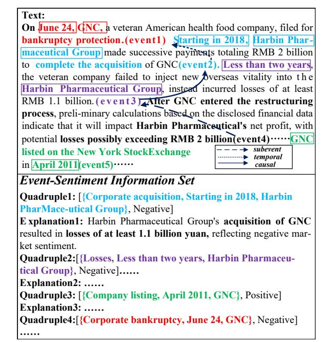
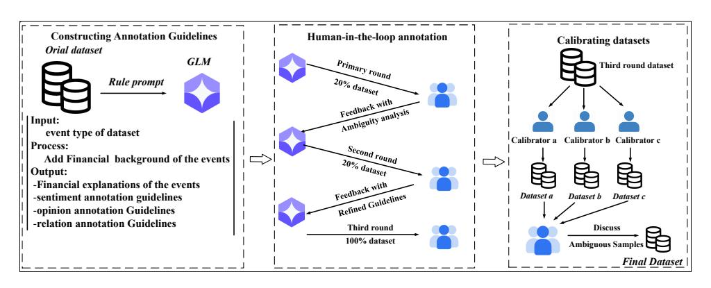
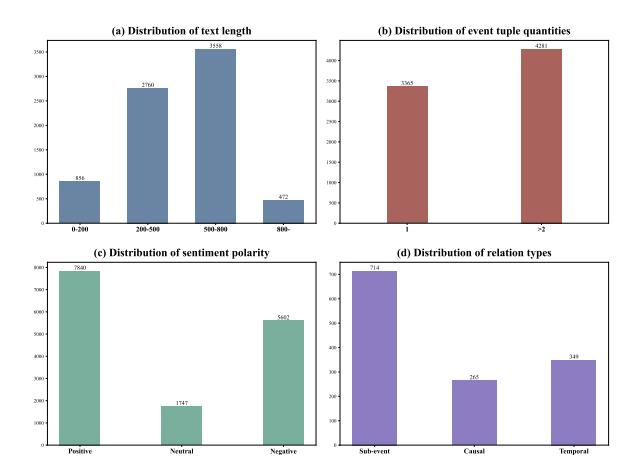
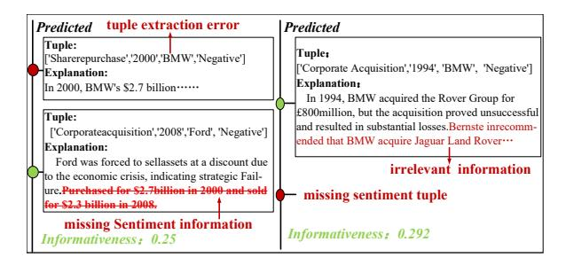
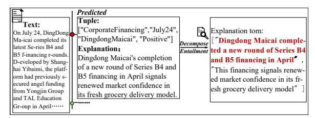
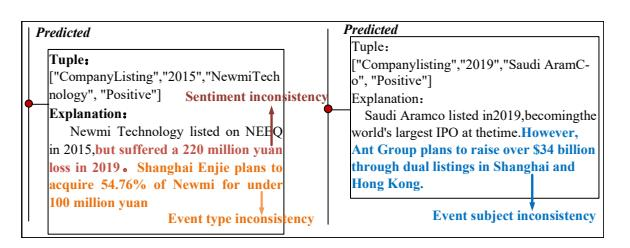
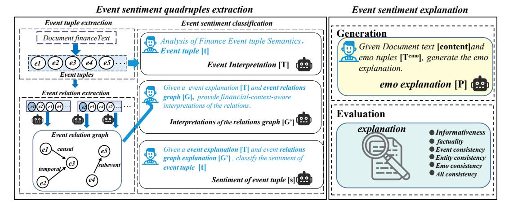
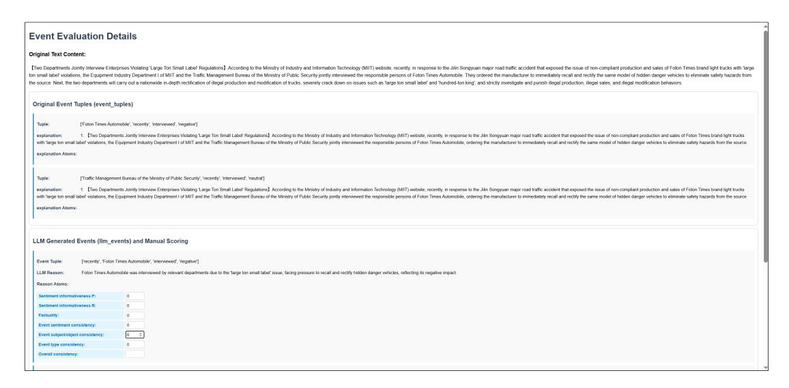

# Beyond Isolated Events: A Benchmark for Event Relation-Aware Sentiment Quadruple Extraction and Explanation Generation

#### **Anonymous ACL submission**

#### **Abstract**

Financial events usually contain rich implicit sentiment information, making accurate identification challenging. Existing event-level sentiment analysis predominantly focuses on isolated events, overlooking the impact of interevent relation on implicit sentiment and lacking investigation into its underlying causes. To this end, we introduce Fine-grained Finance Event Sentiment Analysis (FFESA) task from the perspectives of event structure information, event relation, event sentiment and sentiment cause, consisting of three sub-tasks: event sentiment quadruple extraction, event relation extraction, and sentiment explanation generation. To facilitate this research, we construct the fine-grained event-level sentiment dataset FFESA-bench<sup>1</sup>, which is annotated via human-in-the-loop interaction. The final dataset is verified by three experts to ensure quality. Additionally, drawing upon Grice's Cooperative Principle, we propose three evaluation metrics for event sentiment explanation, namely sentiment informativeness, factuality, and consistency, to validate the quality of sentiment explanations from multiple dimensions. Finally, we conducted a systematic evaluation of FFESA-Bench based on mainstream large language models. The experimental results reveal the challenges inherent in each sub-task and establish a benchmark for fine-grained financial event sentiment analysis.

#### 1 Introduction

013

027

The internet has disseminated large amounts of financial reports texts, which contain abundant event information. The implicit sentiment triggered by these events can impact the entire financial market and provide critical insights for financial decisions (Du et al., 2024). However, relying solely on the implicit sentiment polarity is insufficient to meet the demands of financial decision-making; and revealing the underlying financial logic is also essential

<span id="page-0-1"></span>

Figure 1: The examples of Fine-grained Event Sentiment Analysis in Financial Text.

(Xing et al., 2020; Luo et al., 2018). Therefore, event sentiment analysis not only focuses on event sentiment polarity, but also explains the underlying causes of event sentiment.

043

044

045

046

047

056

060

Affective Event Theory (Weiss and Cropanzano, 1996) suggests that sentiment typically stems from specific events. As illustrated in Figure 1, the "company listing" event (event 3) and the "corporate bankruptcy" event (event 4), both triggered by "GNC", exhibit diametrically opposite sentiment polarity. Furthermore, financial event sentiment depends not only on isolated events but also on inter-event relation. For instance, in Figure 1, the "corporate acquisition" event occurring in 2018 (event 1) conventionally carries a positive sentiment; however, due to its causal relationship with the subsequent loss event (event 2) two years later, its sentiment is classified as negative. Moreover, event sentiment explanations can clarify the under-

<span id="page-0-0"></span><sup>&</sup>lt;sup>1</sup>The dataset will be made publicly available upon acceptance of this paper.

 lying causes of the event sentiments. As shown in explanation1 in Figure [1,](#page-0-1) although event1 is a con- ventionally positive financial action, it triggered a loss of at least 1.1 billion yuan, rendering its sentiment negative. These cases demonstrate fi- nancial texts feature intertwined events and diverse sentiments, posing challenges for event sentiment analysis.

 Existing sentiment analysis research mainly in- cludes aspect-level and event-level task: (1) Aspect- level sentiment analysis focuses on aspect-term sentiment [\(Ding et al.,](#page-8-2) [2024;](#page-8-2) [Lawan et al.,](#page-8-3) [2025\)](#page-8-3) [a](#page-9-2)nd aspect-category sentiment [\(Bai et al.,](#page-8-4) [2024;](#page-8-4) [Xu](#page-9-2) [et al.,](#page-9-2) [2025;](#page-9-2) [Wu et al.,](#page-9-3) [2025\)](#page-9-3), excluding event infor- mation; (2) Event-level sentiment research focuses on event types [\(Zhou et al.,](#page-10-0) [2021;](#page-10-0) [Chen et al.,](#page-8-5) [2024;](#page-8-5) [Petrescu et al.,](#page-9-4) [2025\)](#page-9-4) or event structure [\(Zhang](#page-9-5) [et al.,](#page-9-5) [2022\)](#page-9-5), overlooking inter-event relations and failing to examine the combined impact of event types, information and relations. Furthermore, cur- rent sentiment explanation evaluation emphasizes polarity consistency [\(Zhou et al.,](#page-10-1) [2024;](#page-10-1) [Wang et al.,](#page-9-6) [2025\)](#page-9-6) or factuality verification [\(Deng et al.,](#page-8-6) [2023\)](#page-8-6), but lacking metrics for event-level assessment and coverage completeness metrics. To address these limitations, we conduct research from four aspects:

 Task Definition: We propose Fine-grained Finance Event Sentiment Analysis (FFESA) task comprising three interrelated sub-tasks: (1) Event sentiment quadruple extraction: identifying quadru- ple [event type, subject/object, time, sentiment]; (2) Event relation extraction: identifying causal, temporal, and sub-event relations among events; (3) Event sentiment explanation generation: gener- ating natural language explanations for the event sentiment to uncover the sentiment causes.

 Dataset Construction: To support the proposed [t](#page-8-7)ask, we extend Baidu's DuEE-Fin dataset [\(Han](#page-8-7) [et al.,](#page-8-7) [2022\)](#page-8-7) to construct FFESA-bench. We select 7,646 texts and devise a "rule guided + human in the loop" workflow to accomplish three annotation tasks: event relations, event sentiment polarities, and event sentiment explanations, thereby ensuring annotation quality and efficiency.

 Evaluation Metrics: To address the inadequacy of existing sentiment explanation metrics, we draw inspiration from Grice's Cooperative Principle to design three metrics: Sentiment informativeness, factuality, and consistency, aiming to measure the completeness, reliability, and logical coherence of the event sentiment explanation.

**112** Comprehensive Evaluation: Based on main-

stream large language models (LLMs), we design **113** end-to-end and pipeline schemes to evaluate the **114** performance of the three sub-tasks on the FFESA- **115** bench dataset. Experimental results reveal the chal- **116** lenges inherent in each task. **117**

In summary, our main contributions are: **118**

- We propose the task of fine-grained fi- **119** nancial event sentiment analysis and con- **120** struct a dataset comprising 1,328 event re- **121** lations, 15,189 event sentiment quadruples, **122** and 15,189 event sentiment explanations to **123** provide data resources for implicit event sen- **124** timent analysis research. **125**
- We establish multi-dimensional evaluation **126** metrics for sentiment explanations: sentiment **127** informativeness, factuality, and consistency, **128** which enable the assessment of information **129** completeness, reliability, and coherence. Hu- **130** man evaluation confirms their validity. **131**
- We conduct systematic evaluations of main- **132** stream LLMs on FFESA-Bench, revealing **133** bottlenecks in event sentiment quadruple ex- **134** traction and explanation generation, thereby **135** establishing a benchmark for future research. **136**

# 2 Related Works **<sup>137</sup>**

#### 2.1 Sentiment Analysis Dataset **138**

Existing sentiment analysis datasets mainly focus **139** on aspect-level or entity-level sentiment analysis. **140** For example, [Tang et al.](#page-9-7) [\(2023\)](#page-9-7) proposed a fi- **141** nancial entity-level sentiment dataset. [Zhu et al.](#page-10-2) **142** [\(2025\)](#page-10-2) further introduced a financial entity senti- **143** [m](#page-9-3)ent dataset with entity location information. [Wu](#page-9-3) **144** [et al.](#page-9-3) [\(2025\)](#page-9-3) built M-ABSA, a multilingual and **145** multi-domain aspect-based dataset. However, the **146** sentiment granularity in the above studies is lim- **147** ited to aspect terms or entities, making it difficult **148** to capture fine-grained sentiment information. **149**

Building on this, recent datasets have incorpo- **150** rated event information for sentiment analysis. In **151** terms of event types, [Chen et al.](#page-8-5) [\(2024\)](#page-8-5) proposed **152** extending sentiment analysis to coarse and fine- **153** grained event type hierarchies to predict finan- **154** cial market dynamics. [Petrescu et al.](#page-9-8) [\(2019\)](#page-9-8) ana- **155** lyzed sentiment tendencies of sudden social media **156** events. Furthermore, other research investigates **157** event structure information on sentiment analysis **158** tasks. [Zhou et al.](#page-10-0) [\(2021\)](#page-10-0) proposed using event **159** information to analyze the implied sentiment of **160**

<span id="page-2-0"></span>

Figure 2: Annotation workflow adopted in FFESA-bench dataset construction.

events. Zhang et al. (2022) leveraged structured event parameter to enhance event-level sentiment analysis. However, these works overlook interevent relations and lack a comprehensive study on how types, structures, and relations jointly influence sentiment.

#### 2.2 Sentiment Explanation Evaluation

With the advancement of LLMs, the hallucination problem in sentiment explanation generation has become increasingly pronounced. To assess this issue, Deng et al. (2023) proposed assessing sentiment faithfulness; Zhou et al. (2024) evaluated polarity preservation in generated texts; and Wang et al. (2025) measured sentiment consistency. However, current studies predominantly focus on polarity alignment, lacking a systematic evaluation for event-level sentiment granularity.

## <span id="page-2-1"></span>3 Task Formalization

FFESA task aims to aggregate event sentiment information of document into a unified and interpretable set  $L = \{(T_1, P_1), \dots, (T_i, P_i), R\}$ , where  $T_i$  denotes event sentiment quadruple, R denotes event relation and  $P_i$  denotes explanation.

#### (1) Event sentiment quadruple extraction

**Event tuple extraction:** Building upon the financial event extraction task (Han et al., 2022), we formally define the event tuple extraction task. Given a document text  $D = \{w_1, w_2, ..., w_n\}$ , and get tuple  $event_i = [type_i, time_i, subject_i/object_i]$ , yielding events set:  $Event = \{event_1, event_2, ..., event_m\}$ .

**Event sentiment classification:** This task aims to recognize the sentiment polarity of event tuples:

$$sentiment_i = f_{sen}(event_i|D)$$
 (1)

Where  $sentiment_i \in \{pos, neg, neu\}.$ 

Ultimately, we obtain the event sentiment quadruple:  $T_i = [event_i, sentiment_i]$ .

#### (2) Event relation extraction

This task aims to identify the relations  $r_{ij} = < event_i, event_j >$  between event tuples in the text, and construct an event relation graph G = (E, R), where  $R = \{r_{ij}\}$  is the relation set.

#### (3) Event sentiment explanation generation

This task aims to generate natural language sentiment explanation  $P_i$  for event sentiment quadruple, elucidating the underlying causes of the event sentiment, defined as follows:

$$P_i = f_e(T_i|D) \tag{2}$$

#### 4 Dataset Construction

#### 4.1 Dataset Annotation

Building upon Baidu's DuEE-Fin dataset (Han et al., 2022), we selected 7,646 high-quality texts for subsequent annotation. The annotation work comprises three tasks: event sentiment quadruples, event relation, and sentiment explanations. To ensure the standardization and reliability, we designed a "rule guided + human in the loop" workflow. As shown in Figure 2, it constructs three modules:

Constructing Annotation Guidelines: We first utilized Zhipu GLM-4.5 with rule prompts to generate initial annotations for event relation, sentiment polarity and explanations. The annotation team then refined these results through multiple rounds of domain knowledge guided discussion and calibration to produce the preliminary guidelines. Details can be found in the Appendix A.

**Human-in-the-loop Annotation:** Five finance-background annotators conducted the annotation. To balance quality and efficiency, we adopt a multi-round iterative strategy: First, we employ the LLM to annotate 20% of the data, and then manually

<span id="page-3-0"></span>

Figure 3: The statistics of distribution of FFESA-bench.

review the results to refine the guidelines by discussing ambiguous cases. Second, we annotate another independent 20% data to further validate and refine the guidelines. Third, with the finalized guidelines, we conduct full-scale annotation on the remaining dataset.

Calibrating datasets: Three independent calibrators (a/b/c) cross-validate the final-round samples, with discrepancies resolved via expert arbitration to yield the gold-standard dataset. Ultimately, Fleiss' Kappa coefficients for event relations, sentiment, and explanations are 0.8395, 0.8536, and 0.8058, demonstrating high annotation reliability. This dataset surpasses existing resources in annotation granularity, as detailed in Appendix B.

#### 4.2 Dataset Distribution

We statistically analyze the dataset from four dimensions: (1)As shown in Figure 3(a), the text length concentrates on the 500–800 character range, accommodating rich event and emotional information; (2) Figure 3(b) shows that the FFESA-bench dataset balances the proportion of single-event tuples and multi-event tuples, providing both benchmark data for single-event and multi-event sentiment research. (3) Figure 3(c) shows balanced positive and negative sentiment distribution; (4) As shown in Figure 3(d), The event relation distribution reveals 1,328 annotated relations covering sub-event, causal, and temporal, providing a logical basis for analyzing implicit event sentiment.

#### 5 Evaluation Framework

For the diverse task formats in section 3, we propose hierarchical evaluation framework for comprehensive and fair assessment.

#### 5.1 Event Sentiment quadruple Evaluation

The event sentiment quadruple extraction task is evaluated using Precision, Recall, and F1. We adopt fuzzy matching via maximum continuous substrings, with a subject, object, or time span considered correct if overlapping the ground truth by at least 70%. Furthermore, to address the inflated recall caused by LLM over-generation, we propose a count capping mechanism: correct matches for any category are capped at the reference count to adjust the True Positive calculation:

$$TP = \sum_{c \in C} \min(N_c^{pred}, N_c^{gold})$$
 (3)

Where C denotes the number of categories,  $N_c^{gold}$  and  $N_c^{pred}$  denote the number of predicted tuples and gold tuples for each category.

#### 5.2 Event Sentiment Explanation Evaluation

Inspired by Grice's Cooperative Principle (Grice, 1975), we propose three quantifiable metrics: Sentiment informativeness, Factuality, and Consistency.

# 5.2.1 Sentiment Informativeness and Factuality

Event sentiment explanations are characterized by expressive diversity and rich emotional reasoning content. Traditional n-gram metrics are limited by lexical matching (Ng and Abrecht, 2015). Therefore, we adopt the event atom as the fundamental evaluation unit (Min et al., 2023) and propose two metrics: sentiment informativeness and factuality.

### (1) Event Atoms and Reasoning

In this work, the event atom is the minimal semantic unit preserving consistency across expressions. Thus, each sentiment explanation  $P_i$  is decomposed into an event atom set  $S_i = \{e_1, e_2, \ldots, e_k\} = Decompose(P_i)$ . This function can be achieved by LLMs.

To quantify the degree of semantic matching between the predicted and reference sentiment explanations, we define an entailment function:

$$Entail(e, P) = \begin{cases} 1, & \text{if } P_i \Rightarrow e \\ 0, & \text{otherwise} \end{cases}$$
 (4)

where e represents an event atom in the predicted sentiment explanation, and P represents the reference sentiment explanation. This function can be implemented using widely-used Natural Language Inference models (Klemen et al., 2024). More details can be found in Appendix C.

<span id="page-4-0"></span>

Figure 4: Example of sentiment informativeness.

Based on this, the predicted reference sentiment explanation  $P_i$  and  $\hat{P}_i$  are respectively decomposed into atom sets  $S_i$  and  $\hat{S}_i$ . To evaluate the generated explanations, we use the entailment score  $Ent_p$  to measure the amount of valuable event information:

312

313

318

322

330

331

332

335

340

341

342

$$Ent_p(S_i, \hat{S}_i) = \frac{1}{|\hat{S}_i|} \sum_{\hat{e}_i \in \hat{S}_i} Entail(\hat{e}_i, S_i) \quad (5)$$

Similarly, we can get the entailment recall  $Ent_r$ . The entailment  $Ent_{f1}$  is calculated as follows:

$$Ent_{f1}(S_i, \hat{S}_i) = \frac{2 * Ent_r * Ent_p}{Ent_r + Ent_p}$$
 (6)

#### (2) Sentiment Informativeness

Sentiment informativeness quantifies the completeness of predicted explanations over reference sentiment information, and evaluates alignment at each node. As illustrated in Figure 4, four error categories are identified: (1) tuple extraction error; (2) missing sentiment tuple; (3) missing sentiment information; (4) irrelevant sentiment information.

The above examples show that event tuples affect explanation quality. Thus, evaluation requires the alignment of predicted and reference tuples, following the "align first, quantify later" principle:

First, to evaluate whether the predicted quadruple is correct, we define function as follows:

$$Match(\hat{T}, L) = \begin{cases} 1, & \text{if } \hat{T} \in L \\ 0, & \text{otherwise} \end{cases}$$
 (7)

where  $\hat{T}$  denotes predicted event sentiment tuple and L denotes reference sentiment line.

To align correctly predicted quadruple with reference explanation, we define function as follows:

$$Align(\hat{T}, L) = \begin{cases} P, if(T, P) \in Land T = \hat{T} \\ null, otherwise \end{cases}$$
(8)

where P denotes the reference explanations.

Second, for each predicted explanation  $P_i$ , we define the sentiment informativeness seninfo:

<span id="page-4-1"></span>

Figure 5: Example of factuality.

<span id="page-4-2"></span>

Figure 6: Example of consistency.

$$seninfo((\hat{T}_i, \hat{P}_i), L) = Ent_{f1}(Align(\hat{T}_i, L), \hat{P}_i)$$

$$*Match(\hat{T}_i, L)$$
(9)

Finally, we aggregate the sentiment explanations of the document text to obtain info:

$$info(\hat{L}) = \frac{1}{|\hat{L}|} \sum_{(\hat{T}_i, \hat{P}_i)}^{|\hat{L}|} seninfo(L, \hat{L})$$
 (10)

345

347

348

349

351

353

354

355

358

361

362

363

365

#### (3) Factuality

The factuality metric evaluates explanation truthfulness. Given LLMs' tendency to hallucinate (Ji et al., 2023) and misalign time-events (as shown in Figure 5), factuality detection is crucial (Xu et al., 2024; Setty, 2024). Therefore, we adopt atomic entailment precision to compare generated explanations against the original text, assessing the accuracy of each sentiment information unit. Factuality score is defined as follows:

$$Fact(\hat{L}, A) = \frac{1}{|\hat{L}|} \sum_{\hat{P} \in \hat{L}} Ent_p(\hat{P}, A)$$
 (11)

where A denotes the original finance text.

# 5.2.2 Consistency

The consistency metric measures the semantic alignment between explanations and tuples, incorporating three fine-grained consistencies, namely event type (EveC), subject/object (SojC), and sentiment (SenC), as well as overall consistency (AllC). Figure 6 illustrates common consistency issues.

<span id="page-5-0"></span>

Figure 7: Pipeline for event sentiment tuple extraction and explanation generation

 We design an evaluation pipeline inspired by pa- per review (1) Paraphrasing explanations to reduce bias; (2) Rating three fine-grained consistencies on a 1–3 scale with corresponding rationale; (3) Scoring overall coherence and soundness on a 1–5 scale by synthesizing fine-grained results.

 To reduce manual costs, we use Qwen3-Max- Thinking to automate evaluation, leveraging its proficiency in Chinese and annotated examples to ensure reliability. More details are in Appendix [D.](#page-12-0)

# **<sup>376</sup>** 6 Experiment

#### **377** 6.1 Experiment Schemes

**378** Given the tasks defined in Section [3,](#page-2-1) we design two **379** experimental schemes: pipeline and end-to-end.

## **380** (1) Pipeline Scheme

**381** The scheme evaluates the performance of each **382** sub-task on the FFESA-bench dataset. As shown **383** in Figure [7,](#page-5-0) this scheme consists of four modules:

**384** Event tuple extraction: We employ LLMs un-**385** der zero-shot and 3-shot settings and supervised **386** learning models for event tuple extraction.

 Event relation extraction: We employ LLMs under zero-shot and 3-shot settings to evaluate re- lation extraction performance across three relation types: causal, temporal, and subevent relations.

 Event sentiment classification: Motivated by the success of CoT in implicit sentiment analysis [\(Fei et al.,](#page-8-11) [2023\)](#page-8-11), we adopt a LLM-based Multi- hop Cross-event Sentiment Reasoning (MCSR) as a baseline. The steps of this baseline are as follows:

- **396** (a) Expand event tuple T via LLMs to generate **397** a semantically enhanced representation T'.
- **398** (b) Translate relations in G into natural language, **399** utilizing LLMs' domain knowledge to enrich back-**400** ground and generate a semantically enhanced G'.

(c) Integrate T' and G' for cross-event reasoning, **401** obtaining polarity s, and deriving quadruple T emo . **402**

For event tuples and relations in MCSR, we com- **403** pare between the predicted and gold label. **404**

Event Sentiment explanation: This module **405** adopts a zero-shot setting to generate explanations, **406** comparing the impact of predicted tuples(PT) and **407** gold tuples(GT) on quality. **408**

#### (2) End-to-end Scheme **409**

End-to-end joint quadruple extraction is assessed **410** under zero-shot, 3-shot, and fine-tuning settings. **411**

#### 6.2 Experiment Settings **412**

We utilize the following models for evaluation: **413**

Commercial API Models: Three LLms are ac- **414** cessed via API: Qwen-Plus [\(Yang et al.,](#page-9-13) [2025\)](#page-9-13), **415** Glm-4.5-API [\(Zeng et al.,](#page-9-14) [2025\)](#page-9-14) and Deepseek-v4- **416** pro-API (Deepseek) [\(DeepSeek-AI,](#page-8-12) [2026\)](#page-8-12). **417**

Locally deployed Models: Llama3.1-8B **418** [\(Dubey et al.,](#page-8-13) [2024\)](#page-8-13), Qwen3-8B [\(Yang et al.,](#page-9-13) [2025\)](#page-9-13) **419** and Glm4-9B [\(Zeng et al.,](#page-9-15) [2024\)](#page-9-15). **420**

Supervised Baselines: For event tuple extrac- **421** tion, we adopt ProCNet [\(Wang et al.,](#page-9-16) [2023\)](#page-9-16) and **422** CAINet [\(Pan et al.,](#page-9-17) [2024\)](#page-9-17) as baselines.Detailed **423** settings are provided in the Appendix [E.](#page-12-1)

<span id="page-5-1"></span>Table 1: Performance of event tuple extraction.

| Setting   | Model       | P     | R     | F1    |
|-----------|-------------|-------|-------|-------|
| Zero-shot | Glm-4.5-API | 55.64 | 37.51 | 44.81 |
|           | Qwen-Plus   | 50.51 | 44.88 | 47.53 |
|           | Deepseek    | 48.36 | 42.56 | 45.27 |
| 3-shot    | Glm-4.5-API | 63.27 | 56.88 | 59.90 |
|           | Qwen-Plus   | 55.26 | 48.69 | 51.77 |
|           | Deepseek    | 55.16 | 46.89 | 50.69 |
| Slms      | ProCNet     | 73.17 | 66.22 | 69.52 |
|           | CAINet      | 75.68 | 68.34 | 71.82 |
|           |             |       |       |       |

<span id="page-6-0"></span>

| Setting   | Model       | Causal |      | Subevent |      | Temporal |      | Overall |      |      |      |
|-----------|-------------|--------|------|----------|------|----------|------|---------|------|------|------|
|           |             | P      | R    | F1       | P    | R        | F1   | P       | R    | F1   | F1   |
| Zero-shot | Glm-4.5-API | 35.8   | 58.6 | 44.5     | 41.9 | 77.9     | 54.5 | 29.7    | 46.9 | 36.4 | 45.0 |
|           | Qwen-Plus   | 28.0   | 67.4 | 39.6     | 34.0 | 70.5     | 45.9 | 23.8    | 42.6 | 30.6 | 41.0 |
|           | Deepseek    | 30.7   | 43.0 | 35.9     | 30.3 | 62.6     | 40.9 | 18.1    | 45.4 | 25.9 | 35.8 |
| 3-shot    | Glm-4.5-API | 49.9   | 68.9 | 57.9     | 51.0 | 91.4     | 65.5 | 30.2    | 48.5 | 37.3 | 53.6 |
|           | Qwen-Plus   | 43.9   | 60.1 | 50.8     | 37.9 | 90.0     | 53.4 | 20.7    | 41.0 | 27.5 | 46.8 |
|           | Deepseek    | 45.2   | 36.3 | 40.2     | 34.6 | 82.1     | 48.7 | 20.5    | 47.9 | 28.7 | 40.8 |

# **424** 6.3 Result Analysis

#### **425** 6.3.1 Pipeline Scheme Result

## **426** (1) Event tuple extraction

 Table [1](#page-5-1) presents the event tuple extraction re- sults. (1) Under the zero-shot setting, all models ex- hibit limited performance, with the best-performing model Glm-4.5 achieving only an F1 of 44.81%; af- ter introducing 3-shot learning, performance gener- ally improves, indicating that contextual examples can effectively enhance LLMs' event tuple extrac- tion capabilities. (2) Compared with supervised models, it is found that although current LLMs demonstrate certain potential under the 3-shot set- ting, there remains a significant performance gap and considerable room for improvement overall.

#### **439** (2) Event relation extraction

 As shown in Table [2:](#page-6-0) (1) Overall, Glm-4.5 per- forms best across both settings, showing in-context examples effectively enhance inter-event under- standing. (2) By relation type, sub-event and causal relations show high recall but low precision, sug- gesting LLMs over-associate similar events due to boundary ambiguity; temporal relations perform worst, implying an over-reliance on surface mark-ers without deep logical reasoning.

#### **449** (3) Event sentiment classification

 Table 3 shows MCSR(Gold) baseline outper- forms 3-shot (Gold) by constructing logical associ- ations between events, validating their role in im- plicit reasoning. However, the F1 of MCSR (Pred) drops sharply, falling below the performance of 3- shot (Gold), highlighting sentiment classification's reliance on information extraction quality.

 Furthermore, to examine the impact of different event relations on sentiment reasoning, we com- pared causal, subevent, and temporal types. The results demonstrate that incorporating event rela- tions consistently improves event sentiment classi-fication across all models. Notably, subevent rela-

Table 3: Performance of sentiment classification.

| Setting       | Model       | P     | R     | F1    |
|---------------|-------------|-------|-------|-------|
|               | Glm-4.5-API | 60.70 | 59.19 | 59.94 |
| 3-shot (gold) | Qwen-Plus   | 52.14 | 52.10 | 52.12 |
|               | Deepseek    | 54.87 | 54.44 | 54.65 |
|               | Glm-4.5-API | 72.41 | 66.18 | 69.16 |
| MCSR (gold)   | Qwen-Plus   | 60.54 | 56.53 | 58.47 |
|               | Deepseek    | 65.45 | 66.90 | 66.17 |
|               | Glm-4.5-API | 37.32 | 31.81 | 34.35 |
| MCSR (pred)   | Qwen-Plus   | 33.63 | 28.88 | 31.08 |
|               | Deepseek    | 33.62 | 24.01 | 28.02 |
|               |             |       |       |       |

Table 4: performance of F1 on Different Event Relations.

| Setting        | Model             |       | Causal Subevent Temporal |       |
|----------------|-------------------|-------|--------------------------|-------|
|                | Glm-4.5-API 21.53 |       | 22.19                    | 24.80 |
| 3-shots (Gold) | Qwen-Plus         | 23.40 | 28.80                    | 20.34 |
|                | DeepSeek          | 18.32 | 19.07                    | 17.30 |
|                | Glm-4.5-API 54.89 |       | 61.88                    | 57.53 |
| MCSR (Gold)    | Qwen-Plus         | 38.70 | 43.12                    | 43.86 |
|                | DeepSeek          | 55.01 | 66.24                    | 52.19 |

tions yield the most significant performance gains, **463** whereas causal and temporal relations provide com- **464** parable and more limited improvements, suggest- **465** ing that effectively extracting and leveraging these **466** relation types for reasoning remains a challenge. **467**

#### (4) Event sentiment explanation **468**

Table [5](#page-7-0) show that (1) The performance gap be- **469** tween GT and PT indicates that erroneous tuples **470** cause sentiment information loss; (2) Factuality im- **471** proves most significantly under GT, as high-quality **472** tuples ground reasoning in source text and mini- **473** mize factual drift. (3)consistency metrics rise, indi- **474** cating that gold tuple constraints ensure stronger in- **475** ternal unity across event types, subjects/objects and **476** polarities. In summary, high-quality tuples reduce **477** factual errors and inconsistency; and LLMs still **478** exhibit persistent sentiment hallucinations, gener- **479** ating plausible yet ungrounded explanations. **480**

```
Case Study
Example-1
Bank of China (03988) announced that the US$500 million 0.95% notes due 2023 issued by its Paris branch under the bank's US$4 billion medium-term note program were 
listed on Euronext Paris on September 22, 2020…
Gold label: [{"Corporate Financing","September 22, 2020", "Bank of China"}, "Positive"]
Qwen-plus: [{"Company Listing", "September 22, 2020","Bank of China" }, "Positive"]
Example-2
High Sun Technology's Subsidiary Proposes to Acquire FinTech Company…… High Sun Technology announced that on October 9, 2020, VSP Hong Kong (an indirect 
non-wholly owned subsidiary of the Company) entered into a memorandum of understanding with the target company regarding the possible investment.……
Gold label: [{"Corporate Acquisition", "VSP Hong Kong", "October 9, 2020"},"Positive"]
Qwen-plus: [{" Corporate Acquisition","High Sun Technology","October 9, 2020"}, "Positive"]
Example-3
……Wabei.net, September 17 news, Kelun Pharmaceutical received a notice on September 16 2019 from Liu Gexin, the Chairman and controlling shareholder of the 
Company, regarding the release of pledge of some of his shares in the Company…
Gold label: [{"Release of Pledge", "Liu Gexin","September 16,2019"}, "Positive"]
Qwen-plus: [{"Release of Pledge","Liu Gexin", September 17"}, "Positive"]
Example-4
Goertek disclosed on the evening of October 21 that it plans to repurchase shares for CNY 500 million to 1 billion, with the funds intended for an employee stock ownership 
plan (ESOP). The market suspects this buyback is actually a "pump" to facilitate the major shareholder's sell-off.
Gold label: [{"Share Repurchase", " Goertek","Evening of October 21"}, "Negative"]
Qwen-plus: [{"Share Repurchase", "Goertek", "Evening of October 21"}, "Neutral"]
```

Figure 8: Examples include text, gold quadruple, and prediction, with red font denoting prediction errors.

<span id="page-7-0"></span>Table 5: Performance of sentiment explanation and comparison between Gold Tuple (GT) and Predictions (PT).

| Setting | Model                   | Info | Fact        |      |      | EveC SojC SenC AllC |      |
|---------|-------------------------|------|-------------|------|------|---------------------|------|
|         | Glm4-9b                 |      | 20.34 60.34 | 2.13 | 2.26 | 2.26                | 2.71 |
| PT      | Glm-4.5-API 25.28 71.50 |      |             | 2.92 | 2.55 | 2.75                | 3.71 |
|         | Qwen3-8b                |      | 21.25 61.49 | 2.74 | 2.37 | 2.43                | 3.57 |
|         | Qwen-Plus               |      | 22.78 76.12 | 2.80 | 2.51 | 2.70                | 3.64 |
|         | Llama3.1-8b 20.98 60.28 |      |             | 2.43 | 2.35 | 2.38                | 3.02 |
|         | Glm4-9b                 |      | 43.96 90.47 | 2.79 | 2.32 | 2.37                | 2.91 |
| GT      | Glm-4.5-API 52.53 89.00 |      |             | 2.94 | 2.84 | 2.84                | 3.85 |
|         | Qwen3-8b                |      | 48.16 90.39 | 2.80 | 2.89 | 2.70                | 3.70 |
|         | Qwen-Plus               |      | 52.23 90.03 | 2.80 | 2.90 | 2.81                | 3.80 |
|         | Llama3.1-8b 48.94 90.61 |      |             | 2.78 | 2.57 | 2.40                | 3.21 |

**481** 6.3.2 End-to-end Scheme Result

 Table [6](#page-7-1) presents end-to-end results: (1) Under the zero-shot setting, joint extraction F1 is only 32.24%, indicating LLMs struggles with multi- event and multi-sentiment texts without exam- ple guidance; 3-shot learning raises the score to 41.44%, but challenges remain. (2) Full fine-tuning achieves 69.55%, significantly outperforming the zero-shot and 3-shot settings and demonstrating the value of our high-quality annotations for the task.

# **491** 6.4 Metrics Alignment with Human

 To validate consistency between human and au- tomatic evaluation, we randomly sampled 500 in- stances annotated by NLP experts. Pearson cor- relation analysis shows that informativeness and factuality scores reach 78.65% and 98.65%, with all consistency metrics exceeding 95.95%. The re- sults demonstrate the evaluation's reliability and validity. Details can be found in the Appendix [F.](#page-13-0)

<span id="page-7-1"></span>Table 6: This table presents the performance of end-toend joint event sentiment quadruple extraction.

| Setting     | Model       | P     | R     | F1    |
|-------------|-------------|-------|-------|-------|
| Zero-shot   | Glm-4.5-API | 18.19 | 21.29 | 19.62 |
|             | Qwen-Plus   | 25.86 | 25.53 | 25.69 |
|             | Deepseek    | 32.49 | 31.98 | 32.24 |
|             | Glm-4.5-API | 42.22 | 40.69 | 41.44 |
| 3-shot      | Qwen-Plus   | 35.11 | 41.65 | 38.10 |
|             | Deepseek    | 36.36 | 38.55 | 37.42 |
|             | Glm4-9b     | 49.82 | 47.77 | 48.78 |
| Fine-tuning | Qwen3-8b    | 75.29 | 64.62 | 69.55 |
|             | Llama3.1-8b | 63.02 | 56.30 | 59.47 |
|             |             |       |       |       |

# 7 Case Study **<sup>500</sup>**

To identify LLM limitations in event sentiment tu- **501** ple extraction, we identify four distinct error type **502** (Figure [8\)](#page-7-2): (1) Type confusion: high semantic simi- **503** larity leads to categorization error(Example-1), (2) **504** Subject misidentification: the model prefers fre- **505** quency entities in multi-entity contexts (Example- **506** 2), (3) Temporal misalignment: publication time **507** is frequently mistakenly extracted as event time **508** (Example-3), (4) Sentiment misjudgment: literal **509** keywords override implicit context (Example-4). **510**

# 8 Conclusion **<sup>511</sup>**

We introduce the fine-grained event-based finan- **512** cial sentiment analysis task, construct the FFESA- **513** bench dataset and three metrics to detect sentiment **514** explanation hallucinations, namely sentiment infor- **515** mativeness, factuality, and consistency. We inves- **516** tigate LLM performance bottlenecks across sub- **517** tasks through end-to-end and pipeline benchmarks. **518** In future work, we plan to diversify the language **519** sources and propose more effective LLM-based **520** methods for financial event sentiment analysis. **521**

# **<sup>522</sup>** Limitations

 Financial data annotation faces inherent challenges, such as dense domain-specific terminology and high context dependence, rendering dataset con- struction labor-intensive. Future work should focus on developing efficient annotation pipelines to facil- itate the expansion of fine-grained event sentiment datasets. To evaluate the FFESA task, we rely on large language models' APIs, which are costly and may not be accessible to all researchers. Due to the high API costs, we report the results from a single run. Furthermore, since the dataset used in this study is exclusively in Chinese, future research should explore more effective data collection and evaluation methods to extend the applicability to multilingual and multi-domain scenarios.

# **<sup>538</sup>** Ethics Statement

 All data in the FFESA-bench dataset are sourced from the DuEE-Fin dataset [\(Han et al.,](#page-8-7) [2022\)](#page-8-7), which is an open-source dataset available for aca- demic research. Our annotation process was car- ried out by postgraduate students from Chinese uni- versities serving as annotators, and they received appropriate compensation for their work.

# **<sup>546</sup>** References

- <span id="page-8-4"></span>**547** Yinhao Bai, Yalan Xie, Xiaoyi Liu, Yuhua Zhao, Zhixin **548** Han, Mengting Hu, Hang Gao, and Renhong Cheng. **549** 2024. [BvSP: Broad-view soft prompting for few-shot](https://doi.org/10.18653/v1/2024.acl-long.460) **550** [aspect sentiment quad prediction.](https://doi.org/10.18653/v1/2024.acl-long.460) In *Proceedings* **551** *of the 62nd Annual Meeting of the Association for* **552** *Computational Linguistics (Volume 1: Long Papers)*, **553** pages 8465–8482, Bangkok, Thailand. Association **554** for Computational Linguistics.
- <span id="page-8-5"></span>**555** Tianyu Chen, Yiming Zhang, Guoxin Yu, Dapeng **556** Zhang, Li Zeng, Qing He, and Xiang Ao. 2024. **557** [EFSA: Towards event-level financial sentiment anal-](https://doi.org/10.18653/v1/2024.acl-long.402)**558** [ysis.](https://doi.org/10.18653/v1/2024.acl-long.402) In *Proceedings of the 62nd Annual Meeting of* **559** *the Association for Computational Linguistics (Vol-***560** *ume 1: Long Papers)*, pages 7455–7467, Bangkok, **561** Thailand. Association for Computational Linguistics.
- <span id="page-8-12"></span>**562** DeepSeek-AI. 2026. Deepseek-v4: Towards highly **563** efficient million-token context intelligence.
- <span id="page-8-6"></span>**564** Yue Deng, Wenxuan Zhang, Sinno Pan, and Lidong **565** Bing. 2023. [SOUL: Towards sentiment and opinion](https://doi.org/10.18653/v1/2023.emnlp-main.538) **566** [understanding of language.](https://doi.org/10.18653/v1/2023.emnlp-main.538) In *Proceedings of the* **567** *2023 Conference on Empirical Methods in Natural* **568** *Language Processing*, pages 8704–8711, Singapore. **569** Association for Computational Linguistics.
- <span id="page-8-2"></span>**570** Xuanwen Ding, Jie Zhou, Liang Dou, Qin Chen, Yuan-**571** bin Wu, Arlene Chen, and Liang He. 2024. [Boosting](https://doi.org/10.18653/v1/2024.findings-emnlp.252)

- [large language models with continual learning for](https://doi.org/10.18653/v1/2024.findings-emnlp.252) **572** [aspect-based sentiment analysis.](https://doi.org/10.18653/v1/2024.findings-emnlp.252) In *Findings of the* **573** *Association for Computational Linguistics: EMNLP* **574** *2024*, pages 4367–4377, Miami, Florida, USA. Asso- **575** ciation for Computational Linguistics. **576**
- <span id="page-8-0"></span>Kelvin Du, Frank Xing, Rui Mao, and Erik Cambria. **577** 2024. [Financial sentiment analysis: Techniques and](https://doi.org/10.1145/3649451) **578** [applications.](https://doi.org/10.1145/3649451) *ACM Comput. Surv.*, 56(9). **579**
- <span id="page-8-13"></span>Abhimanyu Dubey, Abhinav Jauhri, Abhinav Pandey, **580** Abhishek Kadian, Ahmad Al-Dahle, Aiesha Letman, **581** Akhil Mathur, Alan Schelten, Amy Yang, Angela **582** Fan, Anirudh Goyal, Anthony S. Hartshorn, Aobo **583** Yang, Archi Mitra, Archie Sravankumar, Artem Ko- **584** renev, Arthur Hinsvark, Arun Rao, Aston Zhang, and **585** 510 others. 2024. [The llama 3 herd of models.](https://api.semanticscholar.org/CorpusID:271571434) **586**
- <span id="page-8-11"></span>Hao Fei, Bobo Li, Qian Liu, Lidong Bing, Fei Li, and **587** Tat-Seng Chua. 2023. [Reasoning implicit sentiment](https://doi.org/10.18653/v1/2023.acl-short.101) **588** [with chain-of-thought prompting.](https://doi.org/10.18653/v1/2023.acl-short.101) In *Proceedings* **589** *of the 61st Annual Meeting of the Association for* **590** *Computational Linguistics (Volume 2: Short Papers)*, **591** pages 1171–1182, Toronto, Canada. Association for **592** Computational Linguistics. **593**
- <span id="page-8-8"></span>H. Paul Grice. 1975. [Logic and conversation.](https://api.semanticscholar.org/CorpusID:222385009) *Syntax* **594** *and Semantics*, 3:41–58. **595**
- <span id="page-8-7"></span>Cuiyun Han, Jinchuan Zhang, Xinyu Li, Guojin Xu, **596** Weihua Peng, and Zengfeng Zeng. 2022. [Duee-fin:](https://doi.org/10.1007/978-3-031-17120-8_14) **597** [A large-scale dataset fornbsp;document-level event](https://doi.org/10.1007/978-3-031-17120-8_14) **598** [extraction.](https://doi.org/10.1007/978-3-031-17120-8_14) In *Natural Language Processing and* **599** *Chinese Computing: 11th CCF International Confer-* **600** *ence, NLPCC 2022, Guilin, China, September 24–25,* **601** *2022, Proceedings, Part I*, page 172–183, Berlin, Hei- **602** delberg. Springer-Verlag. **603**
- <span id="page-8-10"></span>Ziwei Ji, Nayeon Lee, Rita Frieske, Tiezheng Yu, Dan **604** Su, Yan Xu, Etsuko Ishii, Ye Jin Bang, Andrea **605** Madotto, and Pascale Fung. 2023. [Survey of halluci-](https://doi.org/10.1145/3571730) **606** [nation in natural language generation.](https://doi.org/10.1145/3571730) *ACM Comput.* **607** *Surv.*, 55(12). **608**
- <span id="page-8-9"></span>Matej Klemen, Aleš Žagar, Jaka Cibej, and Marko ˇ **<sup>609</sup>** Robnik-Šikonja. 2024. [SI-NLI: A Slovene natural](https://aclanthology.org/2024.lrec-main.1294/) **610** [language inference dataset and its evaluation.](https://aclanthology.org/2024.lrec-main.1294/) In *Pro-* **611** *ceedings of the 2024 Joint International Conference* **612** *on Computational Linguistics, Language Resources* **613** *and Evaluation (LREC-COLING 2024)*, pages 14859– **614** 14870, Torino, Italia. ELRA and ICCL. **615**
- <span id="page-8-3"></span>Adamu Lawan, Juhua Pu, Haruna Yunusa, Aliyu Umar, **616** and Muhammad Lawan. 2025. [Enhancing long-range](https://aclanthology.org/2025.coling-main.148/) **617** [dependency with state space model and kolmogorov-](https://aclanthology.org/2025.coling-main.148/) **618** [arnold networks for aspect-based sentiment analy-](https://aclanthology.org/2025.coling-main.148/) **619** [sis.](https://aclanthology.org/2025.coling-main.148/) In *Proceedings of the 31st International Con-* **620** *ference on Computational Linguistics*, pages 2176– **621** 2186, Abu Dhabi, UAE. Association for Computa- **622** tional Linguistics. **623**
- <span id="page-8-1"></span>Ling Luo, Xiang Ao, Feiyang Pan, Jin Wang, Tong **624** Zhao, Ningzi Yu, and Qing He. 2018. [Beyond polar-](https://doi.org/10.24963/ijcai.2018/590) **625** [ity: Interpretable financial sentiment analysis with hi-](https://doi.org/10.24963/ijcai.2018/590) **626** [erarchical query-driven attention.](https://doi.org/10.24963/ijcai.2018/590) pages 4244–4250. **627**

<span id="page-9-10"></span> Sewon Min, Kalpesh Krishna, Xinxi Lyu, Mike Lewis, Wen-tau Yih, Pang Koh, Mohit Iyyer, Luke Zettle- moyer, and Hannaneh Hajishirzi. 2023. [FActScore:](https://doi.org/10.18653/v1/2023.emnlp-main.741) [Fine-grained atomic evaluation of factual precision](https://doi.org/10.18653/v1/2023.emnlp-main.741) [in long form text generation.](https://doi.org/10.18653/v1/2023.emnlp-main.741) In *Proceedings of the 2023 Conference on Empirical Methods in Natural Language Processing*, pages 12076–12100, Singa-pore. Association for Computational Linguistics.

<span id="page-9-9"></span> [J](https://doi.org/10.18653/v1/D15-1222)un-Ping Ng and Viktoria Abrecht. 2015. [Better sum-](https://doi.org/10.18653/v1/D15-1222) [marization evaluation with word embeddings for](https://doi.org/10.18653/v1/D15-1222) [ROUGE.](https://doi.org/10.18653/v1/D15-1222) In *Proceedings of the 2015 Conference on Empirical Methods in Natural Language Process- ing*, pages 1925–1930, Lisbon, Portugal. Association for Computational Linguistics.

<span id="page-9-17"></span> Bangze Pan, Yang Li, Suge Wang, Xiaoli Li, Deyu Li, Jian Liao, and Jianxing Zheng. 2024. [Document-](https://aclanthology.org/2024.lrec-main.459/) [level event extraction via information interaction](https://aclanthology.org/2024.lrec-main.459/) [based on event relation and argument correlation.](https://aclanthology.org/2024.lrec-main.459/) In *Proceedings of the 2024 Joint International Con- ference on Computational Linguistics, Language Resources and Evaluation (LREC-COLING 2024)*, pages 5156–5166, Torino, Italia. ELRA and ICCL.

<span id="page-9-8"></span> Alexandru Petrescu, Ciprian-Octavian Truica, and ˘ Elena-Simona Apostol. 2019. [Sentiment analysis](https://doi.org/10.1109/ICCP48234.2019.8959677) [of events in social media.](https://doi.org/10.1109/ICCP48234.2019.8959677) In *2019 IEEE 15th Inter- national Conference on Intelligent Computer Com-munication and Processing (ICCP)*, pages 143–149.

<span id="page-9-4"></span> Alexandru Petrescu, Ciprian-Octavian Truica, Elena- ˘ Simona Apostol, and Adrian Paschke. 2025. [Edsa-](https://doi.org/10.1109/TAFFC.2024.3434355) [ensemble: An event detection sentiment analysis en-](https://doi.org/10.1109/TAFFC.2024.3434355) [semble architecture.](https://doi.org/10.1109/TAFFC.2024.3434355) *IEEE Transactions on Affective Computing*, 16(2):555–572.

<span id="page-9-12"></span> [V](https://doi.org/10.1145/3626772.3657663)inay Setty. 2024. [Factcheck editor: Multilingual text](https://doi.org/10.1145/3626772.3657663) [editor with end-to-end fact-checking.](https://doi.org/10.1145/3626772.3657663) In *Proceedings of the 47th International ACM SIGIR Conference on Research and Development in Information Retrieval*, SIGIR '24, page 2744–2748, New York, NY, USA. Association for Computing Machinery.

<span id="page-9-7"></span> Yixuan Tang, Yi Yang, Allen Huang, Andy Tam, and Justin Tang. 2023. [FinEntity: Entity-level sentiment](https://doi.org/10.18653/v1/2023.emnlp-main.956) [classification for financial texts.](https://doi.org/10.18653/v1/2023.emnlp-main.956) In *Proceedings of the 2023 Conference on Empirical Methods in Natu- ral Language Processing*, pages 15465–15471, Sin-gapore. Association for Computational Linguistics.

<span id="page-9-6"></span> Rui Wang, Tian Lan, Zufeng Wu, and Leyuan Liu. 2025. [Unsupervised extractive opinion summariza-](https://doi.org/10.1016/j.eswa.2025.126760) [tion based on text simplification and sentiment guid-](https://doi.org/10.1016/j.eswa.2025.126760)[ance.](https://doi.org/10.1016/j.eswa.2025.126760) *Expert Systems with Applications*, 272:126760.

<span id="page-9-16"></span> [X](https://doi.org/10.18653/v1/2023.acl-long.563)inyu Wang, Lin Gui, and Yulan He. 2023. [Document-](https://doi.org/10.18653/v1/2023.acl-long.563) [level multi-event extraction with event proxy nodes](https://doi.org/10.18653/v1/2023.acl-long.563) [and hausdorff distance minimization.](https://doi.org/10.18653/v1/2023.acl-long.563) In *Proceedings of the 61st Annual Meeting of the Association for Computational Linguistics (Volume 1: Long Papers)*, pages 10118–10133, Toronto, Canada. Association for Computational Linguistics.

<span id="page-9-1"></span>Howard Weiss and Russell Cropanzano. 1996. Affective **683** events theory: A theoretical discussion of the struc- **684** ture, cause and consequences of affective experiences **685** at work. *Research in Organizational Behavior*. **686**

<span id="page-9-3"></span>ChengYan Wu, Bolei Ma, Yihong Liu, Zheyu Zhang, **687** Ningyuan Deng, Yanshu Li, Baolan Chen, Yi Zhang, **688** Yun Xue, and Barbara Plank. 2025. [M-ABSA: A mul-](https://doi.org/10.18653/v1/2025.emnlp-main.128) **689** [tilingual dataset for aspect-based sentiment analysis.](https://doi.org/10.18653/v1/2025.emnlp-main.128) **690** In *Proceedings of the 2025 Conference on Empiri-* **691** *cal Methods in Natural Language Processing*, pages **692** 2530–2557, Suzhou, China. Association for Compu- **693** tational Linguistics. **694**

<span id="page-9-0"></span>Frank Xing, Lorenzo Malandri, Yue Zhang, and Erik **695** Cambria. 2020. [Financial sentiment analysis: An](https://doi.org/10.18653/v1/2020.coling-main.85) **696** [investigation into common mistakes and silver bul-](https://doi.org/10.18653/v1/2020.coling-main.85) **697** [lets.](https://doi.org/10.18653/v1/2020.coling-main.85) In *Proceedings of the 28th International Confer-* **698** *ence on Computational Linguistics*, pages 978–987, **699** Barcelona, Spain (Online). International Committee **700** on Computational Linguistics. **701**

<span id="page-9-2"></span>Hongling Xu, Yice Zhang, Qianlong Wang, and Ruifeng **702** Xu. 2025. DS<sup>2</sup> [-ABSA: Dual-stream data synthe-](https://doi.org/10.18653/v1/2025.acl-long.752) **703** [sis with label refinement for few-shot aspect-based](https://doi.org/10.18653/v1/2025.acl-long.752) **704** [sentiment analysis.](https://doi.org/10.18653/v1/2025.acl-long.752) In *Proceedings of the 63rd An-* **705** *nual Meeting of the Association for Computational* **706** *Linguistics (Volume 1: Long Papers)*, pages 15460– **707** 15478, Vienna, Austria. Association for Computa- **708** tional Linguistics. **709**

<span id="page-9-11"></span>Jundong Xu, Hao Fei, Liangming Pan, Qian Liu, Mong- **710** Li Lee, and Wynne Hsu. 2024. [Faithful logical rea-](https://doi.org/10.18653/v1/2024.acl-long.720) **711** [soning via symbolic chain-of-thought.](https://doi.org/10.18653/v1/2024.acl-long.720) In *Proceed-* **712** *ings of the 62nd Annual Meeting of the Association* **713** *for Computational Linguistics (Volume 1: Long Pa-* **714** *pers)*, pages 13326–13365, Bangkok, Thailand. As- **715** sociation for Computational Linguistics. **716**

<span id="page-9-13"></span>An Yang, Anfeng Li, Baosong Yang, Beichen Zhang, **717** Binyuan Hui, Bo Zheng, Bowen Yu, Chang Gao, **718** Chengen Huang, Chenxu Lv, Chujie Zheng, Dayi- **719** heng Liu, Fan Zhou, Fei Huang, Feng Hu, Hao Ge, **720** Haoran Wei, Huan Lin, Jialong Tang, and 41 others. **721** 2025. [Qwen3 technical report.](https://api.semanticscholar.org/CorpusID:278602855) **722**

<span id="page-9-14"></span>GLM-4.5 Team Aohan Zeng, Xin Lv, Qinkai Zheng, **723** Zhenyu Hou, Bin Chen, Chengxing Xie, Cunxiang **724** Wang, Da Yin, Hao Zeng, Jiajie Zhang, Kedong **725** Wang, Lucen Zhong, Mingdao Liu, Rui Lu, Shulin **726** Cao, Xiaohan Zhang, Xuancheng Huang, Yao Wei, **727** Yean Cheng, and 151 others. 2025. [Glm-4.5: Agen-](https://api.semanticscholar.org/CorpusID:280561359) **728** [tic, reasoning, and coding \(arc\) foundation models.](https://api.semanticscholar.org/CorpusID:280561359) **729** *ArXiv*, abs/2508.06471. **730**

<span id="page-9-15"></span>Team Glm Aohan Zeng, Bin Xu, Bowen Wang, Chenhui **731** Zhang, Da Yin, Diego Rojas, Guanyu Feng, Hanlin **732** Zhao, Hanyu Lai, Hao Yu, Hongning Wang, Jiadai **733** Sun, Jiajie Zhang, Jiale Cheng, Jiayi Gui, Jie Tang, **734** Jing Zhang, Juanzi Li, Lei Zhao, and 36 others. 2024. **735** [Chatglm: A family of large language models from](https://api.semanticscholar.org/CorpusID:270562306) **736** [glm-130b to glm-4 all tools.](https://api.semanticscholar.org/CorpusID:270562306) *ArXiv*, abs/2406.12793. **737**

<span id="page-9-5"></span>Qi Zhang, Jie Zhou, Qin Chen, Qingchun Bai, and Liang **738** He. 2022. [Enhancing event-level sentiment analysis](https://doi.org/10.1145/3477495.3531784) **739** [with structured arguments.](https://doi.org/10.1145/3477495.3531784) In *Proceedings of the 45th International ACM SIGIR Conference on Re- search and Development in Information Retrieval*, SIGIR '22, page 1944–1949, New York, NY, USA. Association for Computing Machinery.

<span id="page-10-0"></span> Deyu Zhou, Jianan Wang, Linhai Zhang, and Yulan He. 2021. [Implicit sentiment analysis with event-](https://doi.org/10.18653/v1/2021.emnlp-main.551) [centered text representation.](https://doi.org/10.18653/v1/2021.emnlp-main.551) In *Proceedings of the 2021 Conference on Empirical Methods in Natural Language Processing*, pages 6884–6893, Online and Punta Cana, Dominican Republic. Association for Computational Linguistics.

<span id="page-10-1"></span> Yongxin Zhou, Fabien Ringeval, and François Portet. 2024. [PSentScore: Evaluating sentiment polarity](https://aclanthology.org/2024.lrec-main.1163/) [in dialogue summarization.](https://aclanthology.org/2024.lrec-main.1163/) In *Proceedings of the 2024 Joint International Conference on Computa- tional Linguistics, Language Resources and Evalu- ation (LREC-COLING 2024)*, pages 13290–13302, Torino, Italia. ELRA and ICCL.

<span id="page-10-2"></span> Senbin Zhu, ChenYuan He, Hongde Liu, Pengcheng Dong, Hanjie Zhao, Yuchen Yan, Yuxiang Jia, Hongying Zan, and Min Peng. 2025. [SILC-EFSA:](https://aclanthology.org/2025.coling-main.333/) [Self-aware in-context learning correction for entity-](https://aclanthology.org/2025.coling-main.333/) [level financial sentiment analysis.](https://aclanthology.org/2025.coling-main.333/) In *Proceedings of the 31st International Conference on Computational Linguistics*, pages 4980–4992, Abu Dhabi, UAE. As-sociation for Computational Linguistics.

# **<sup>767</sup>** A Details of the Annotation Workflow

#### <span id="page-10-3"></span>**768** A.1 Annotation Prompts

 To bootstrap the annotation process efficiently, we utilized Zhipu GLM-4.5 to conduct preliminary analysis for each event type , aiming to grasp the macroscopic distribution of event sentiment polar- ities(figure [9\)](#page-11-0) and event relations(figure [10\)](#page-11-1). To mitigate hallucinations, we required the LLM to provide supporting rationales and explanations dur- ing relation extraction and sentiment discrimina- tion, thereby facilitating subsequent manual ver- ification. Leveraging these interpretable outputs, experts from both the financial domain and NLP sentiment analysis convened to discuss the results, ultimately constructing the initial annotation guide-**782** lines.

# **783** A.2 Annotation Guidelines

 Taking "Corporate Acquisition" as an example, the annotation rules vary by role. For the acquirer, suc- cessful acquisitions or progress updates are labeled as positive, while obstacles, regulatory inquiries, or post-acquisition losses are labeled as negative. For the acquiree, premium acquisitions, stock price increases, or mutual efforts to advance the deal are labeled as positive, whereas hostile takeovers or

other adverse scenarios are labeled as negative. In **792** the absence of such explicit information, the label **793** is neutral. **794**

#### A.3 Ambiguous Examples **795**

Event Type: Corporate Acquisition **796**

Target Event: ["Corporate Acquisition", "2008", **797** "Ford Motor"] **798**

Correct Polarity: Negative **799**

In the original text, "*...in 2000, BMW sold Rover,* **800** *which owned the Land Rover brand, to Ford for* **801** *\$2.7 billion...in 2008, Ford, hit by the economic cri-* **802** *sis, sold it to India's Tata Motors for \$2.3 billion*," **803** the sentiment polarity of this event is clearly nega- **804** tive. However, during the initial annotation phase, **805** LLMs and some annotators tended to mislabel it as **806** positive due to insufficient contextual association. **807**

In fact, through cross-sentence numerical com- **808** parison, it is evident that Ford's selling price in **809** 2008 (\$2.3 billion) was significantly lower than its **810** acquisition price in 2000 (\$2.7 billion). The asset **811** depreciation is clear; therefore, contextual reason- **812** ing is essential to arrive at the correct negative **813** judgment. **814**

# <span id="page-10-4"></span>B Dataset Resources **<sup>815</sup>**

# B.1 Comparison of Resources **816**

Compared with existing datasets, FFESA-Bench **817** provides finer-grained event sentiment annotations. **818** As shown in Table [7,](#page-12-2) it is currently the only re- **819** source that simultaneously encompasses event an- **820** notation, event relations, sentiment explanations, **821** and event sentiments. pifont **822**

#### B.2 Dataset Release **823**

Upon acceptance of the paper, FFESA-Bench will **824** be publicly released in the standard JSONL format, **825** containing sentiment quadruples, event relations, **826** and corresponding sentiment explanation fields. **827**

# <span id="page-10-5"></span>C Event Atoms Decomposition and **<sup>828</sup>** Reasoning **<sup>829</sup>**

Event atom-based evaluation metrics require sep- **830** arate decomposition of reference event emotion **831** explanations and generated event emotion explana- **832** tions. Specifically, event atoms in reference event **833** emotion explanations are pre-annotated by human **834** annotators, while decomposition of generated event **835** emotion explanations is performed using Qwen- **836** Plus for real-time automatic decomposition. **837**

```
Financial Event Sentiment Analysis Prompt
You are financial event sentiment analysis expert
##Task Overview
Analyze sentiment polarity of financial events in text documents with precision and domain expertise.
##Core Tasks
1. **Sentiment Polarity Analysis**: Classify each event tuple as positive/negative/neutral
2. **Evidence-based Explanation**: Provide sentiment explanation strictly based on original text
3. **Confidence Scoring**: Assign confidence score (0-1 scale)
## Analysis Principles
The {Analysis principles} were established by financial domain experts and NLP sentiment analysis experts and define sentiment 
analysis guidelines for each event type. Corporate acquisition is provided as an example:
#### For the Acquirer Company
**Positive Sentiment Markers:** mark as positive if the acquisition completes successfully with mutual benefits, strategic 
alignment, favorable pricing, synergies, or positive market reaction; 
**Negative Sentiment Markers:**mark as negative if it fails, faces regulatory rejection, overpricing concerns, financial strain, 
integration risks, or negative market response. 
**Other**: Cases not fitting above categories
#### For the Target Company
**Positive Sentiment Markers**:Mark as positive if shareholders receive premium prices, better development opportunities, job 
security, or strategic benefits;
**Negative Sentiment Markers**: Mark as negative if the price is undervalued, core business is threatened, layoffs expected, or 
forced sale due to distress.
**Other**: Cases not fitting above categories
Consider stakeholder perspectives, market signals, management statements, and acquisition stage when making judgments.
## Output Format
{
 "sentiment": "positive/negative/neutral",
 "explanation": "Sentiment explanation based on the original text",
 "confidence_score": "0-1"
}
## Input
Text: {Finance document text}
Event tuple:<triple>
```

Figure 9: Initial prompts for event sentiment annotation and explanation generation in the preliminary phase.We show examples for the model to better comprehend the task.

```
System Prompt
### Task
Your task is to analyze the evolutionary logic and hierarchical relationships between multiple events in a given financial text. Please annotate the provided event 
pairs (such as E1 and E2) from the following three dimensions: subevent relationship, causal relationship, and temporal relationship. 
### Output
Return a standard JSON object with the following structure. If no relationship exists, the relations array should be empty:
{
 "relations": [
 {
 "head_id": "EX", 
 "tail_id": "EY", 
 "relation_type": "subevent/causal/temporal", 
 "evidence": "Brief rationale"
 }
 ]
}
##Examples
(1)Subevent Relationship Example:
E1[Annual loss of 1 billion] and E2[Q2 loss of 300 million]
**Relation**: subevent
**Evidence**: E2 represents a specific quarterly component that constitutes the annual loss described in E1
(2)Causal Relationship Example:
E1[Excessive acquisition costs] leads to E2[Unsatisfactory post-acquisition benefits resulting in losses]
**Relation**: causal
**Evidence**: High acquisition costs directly caused the subsequent financial losses
(3)Temporal Relationship Example:
E1[Original chairman's term expiration] followed by E2[Election of new chairman]
**Relation**: temporal
**Evidence**: Events follow chronological business process sequence without dependency or causation
Input
Financial text {Text}
Containing event set :{Events} 
You are an expert proficient in event logic modeling.
```

Figure 10: Initial prompts for event relation extraction in the preliminary phase. We show examples for the model to better comprehend the task.

| Table 7: Comparison of FFESA-Bench with existing financial event-sentiment datasets. |  |  |
|--------------------------------------------------------------------------------------|--|--|
|--------------------------------------------------------------------------------------|--|--|

<span id="page-12-2"></span>

| Dataset     | Event Annotation | Event Relation | Sentiment Explanation | Event Sentiment |
|-------------|------------------|----------------|-----------------------|-----------------|
| FinEntity   | ✗                | ✗              | ✗                     | ✗               |
| DuEE-Fin    | ✓                | ✗              | ✗                     | ✗               |
| EFSA        | ✓                | ✗              | ✗                     | ✓               |
| FFESA-Bench | ✓                | ✓              | ✓                     | ✓               |

#### **838** C.1 Manual Decomposition Process

**839** Event Atom Decomposition Process:

- **840** (1) Context Understanding: Carefully read the **841** entire event sentiment explanation to understand **842** the main event or narrative described, then identify **843** the primary subject/object and action/state in the **844** sentence.
- **845** (2) Event Atom Decomposition: Break down **846** complex sentences into event atom units based on **847** independent actions/states.This approach is demon-**848** strated by breaking down the explanation "Ding-**849** dong Mall completed a new round of B4 and B5 **850** financing in April, which indicates that the mar-**851** ket has regained confidence in its new fresh food **852** delivery model" into two coherent event units:
- **853** Tom 1: "Dingdong Maicai completed a new **854** round of Series B4 and B5 financing in April"
- **855** Tome 2: "This financing signals renewed mar-**856** ket confidence in its fresh grocery delivery **857** model"

# **858** C.2 Atomic Decomposition

**859** We employed Qwen-Plus for fully automatic **860** atomic decomposition, with the specific implemen-**861** tation details presented in figure [11.](#page-13-1)

# **862** C.3 Reasoning

 We employ Qwen3-Max-Thinking, which demon- strates superior performance in Chinese language processing, as the core tool for entailment judg-**866** ment.

# <span id="page-12-0"></span>**<sup>867</sup>** D Details of the consistency

 The evaluation process consists of two steps. In the first step, evaluators score three fine-grained consis- tencies, as shown in figure [12,](#page-14-0) figure [13,](#page-15-0) and figure [14.](#page-16-0) They must rate each aspect on a 1-to-3 scale and provide required rationales to prevent arbitrary scoring. The second step involves an overall evalu- ation, where evaluators synthesize the scores and rationales from the first step to assign an overall

score on a 1-to-5 scale. This overall score assesses **876** the coherence and logical soundness of the entire **877** explanation, with the evaluation prompt shown in **878** Figure [15.](#page-16-1) Together, these steps form a complete **879** pipeline from detailed inspection to overall assess- **880** ment. **881**

#### Case Study **882**

Quadruple: ["Company Listing","2019", **883** "Saudi Aramco", "Positive"] **884**

Explanation: Saudi Aramco successfully went **885** public in 2019, marking the world's largest IPO **886** at the time and a significant milestone in Saudi **887** Arabia's economic transformation. However, Tesla **888** also built a Gigafactory in Shanghai that same year; **889** its stock price soared, with market capitalization **890** breaking 100 billion USD, making it the biggest **891** winner in the capital markets. **892**

LLM Error Assessment: The opinion infor- **893** mation explicitly mentions Saudi Aramco's 2019 **894** listing with a positive sentiment, which is fully **895** consistent with the quadruple and introduces no **896** irrelevant information. **897**

Error Attribution Analysis: The text is actu- **898** ally only partially consistent. Due to local match- **899** ing bias, the LLM focused solely on the target **900** entity information in the first half while ignoring **901** the irrelevant financial entity (Tesla) and its senti- **902** ment descriptions in the second half, resulting in **903** an inflated score. **904**

Solution: By refining and strictly enforcing the **905** evaluation prompts, the model's ability to filter **906** out irrelevant entity interference was significantly **907** enhanced, thereby largely resolving this type of **908** evaluation bias. **909**

# <span id="page-12-1"></span>E Experimental Setup Details **<sup>910</sup>**

To ensure experimental reproducibility and trans- **911** parency, we provide detailed descriptions of the **912** experiment. **913**

```
System Prompt
### Task
As a Financial Sentiment Analysis Expert, you will receive an event sentiment explanation in the financial domain. This event sentiment explanation may contain 
descriptions of multiple events as well as different viewpoints. Your task is to decompose this opinion information into simpler atomic propositions or event 
descriptions. Each atomic proposition or event description should be clear, concise, and accurately reflect a specific event or viewpoint in the original text. Please 
write each decomposed result as an independent sentence.
### Output
Strictly follow the format below, no extra characters allowed.
Return a list of sentences in the format: ['Sentence 1', 'Sentence 2', ...]
}
### Example
Ford was forced to sell assets at a discount due to the economic crisis, purchased for $2.7 billion in 2000, sold for $2.3 billion in 2008, the text implies strategic 
failure.
Output: ['Ford was forced to sell assets at a discount due to the economic crisis', 'Ford purchased the assets for $2.7 billion in 2000', 'Ford sold the assets for $2.3 
billion in 2008', 'The text implies Ford's strategic failure']
Input
Event sentiment explanation {explanation}
Atomic Decomposition Prompt
```

Figure 11: Prompts for atomic decomposition. We show examples for the model to better comprehend the task.

## **914** E.1 API Model Versions

**915** The specific versions and access dates of the APIs **916** we used are as follows:

- **917** DeepSeek-v4-pro: Accessed on 2026-04-24
- **918** Qwen-Plus: Accessed on 2025-12-01
- **919** GLM-4.5-API: Accessed on 2025-07-28

#### **920** E.2 Fine-tuning Hyperparameters

 For locally deployed models, all fine-tuning proce- dures were executed via the LLaMA-Factory frame- work. Rather than performing task-specific hyper- parameter searches, we adopted its standardized default configuration (covering learning rate, batch size, warmup steps, etc.) uniformly across all runs.

## **927** E.3 Dataset Splitting Strategy

 Prior to any model training or evaluation, the com- plete corpus was randomly partitioned into training, validation, and test sets at a ratio of 8:1:1. To fa- cilitate experimental reproducibility, the resulting splits will be released in our repository in the stan- dard train/dev/test format, ensuring that the data preprocessing pipeline remains fully transparent and reusable.

# <span id="page-13-0"></span>**<sup>936</sup>** F Details of Human Evaluation

 The evaluation work invited three experts with ex- tensive experience in the fields of finance and natu- ral language processing, and expertise in sentiment analysis, to participate. The experimental dataset consists of 500 samples, encompassing financial texts, event sentiment quadruples, and predicted

explanations. To ensure objectivity and representa- **943** tiveness, samples were selected via stratified sam- **944** pling, maintaining the original sentiment category **945** distribution. **946**

The evaluation process adhered to pre- **947** established criteria. First, the three evaluators **948** independently conducted the initial scoring for **949** all samples; subsequently, the evaluation team **950** held a discussion session to conduct an analysis **951** and negotiation regarding samples with significant **952** scoring discrepancies or ambiguities; finally, **953** based on the discussion results, the evaluators **954** performed a second round of annotation to obtain **955** the corrected final scores. **956**

As shown in Figure [16,](#page-17-0) the evaluation centered **957** on seven core dimensions: sentiment informative- **958** ness P, sentiment informativeness R, factuality, **959** event type consistency, event Subject/Object con- **960** sistency, event sentiment consistency, and overall **961** consistency. Specific scoring criteria were estab- **962** lished for each dimension to ensure the reliability **963** and comparability of the evaluation results. **964**

```
### Task
You are a rigorous reviewer responsible for evaluating the "event type consistency" between 【tuple event】 and 【sentiment explanation】.
Please strictly score the input according to the following rules and provide an evidence.
### Core Principles:
(1)Main focus: Whether the sentiment description in the sentiment explanation closely revolves around the tuple event.
(2)If the sentiment information extends to company or market reactions closely related to the tuple event, it is considered relevant supporting information and will 
not reduce the score.
(3)Only when events completely unrelated to the sentiment of the tuple event appear, should the score be reduced.
Scoring rules:
3 = Excellent The sentiment description in the sentiment explanation is completely consistent with the tuple event and expressed comprehensively; no events 
unrelated to the sentiment of the tuple event are introduced.
2 = Good The sentiment explanation includes the tuple event with complete sentiment description; however, it simultaneously introduces other events unrelated to 
the sentiment of the tuple event.
1 = Poor The sentiment explanation mentions the tuple event, but the sentiment description of this event is incomplete or vague; and introduces other events 
unrelated to the sentiment of the tuple event.
0 = Irrelevant/Error The sentiment explanation does not mention the tuple event; or the event in the sentiment explanation is completely inconsistent with the tuple 
event.
Output Format:
The output must use JSON format, with a fixed format of:
{"score": X, "evidence": "Your explanation"}
Example:
Example 1:
Quadruple: ["company listing", "2015", "Newmi Technology", "positive"] Tuple Event: company listing
Sentiment Explanation: Newmi Technology was listed on the NEEQ in 2015.
Output: {{"score": 3, "evidence": "The sentiment explanation accurately covers the tuple event (company listing), with consistent sentiment and complete 
expression, without any sentiment content unrelated to this event."}}
Example 2:
Quadruple: ["company listing", "2015", "Newmi Technology", "positive"] Tuple Event: company listing
Sentiment Explanation: Newmi Technology was listed on the NEEQ in 2015. ENJET plans to acquire 54.76% of Newmi Technology's shares, with the expected 
transaction cost not exceeding 100 million yuan.
Output: {{"score": 2, "evidence": "The sentiment explanation fully mentions the tuple event and accurately conveys its positive sentiment, but simultaneously 
introduces the acquisition event, which is unrelated to the company listing, resulting in a score reduction."}}
Example 3:
Quadruple: ["company listing", "2015", "Newmi Technology", "positive"] Tuple Event: company listing
Sentiment Explanation: ENJET plans to acquire 54.76% of Newmi Technology's shares, with the expected transaction cost not exceeding 100 million yuan.
Output: {{"score": 1, "evidence": "The sentiment explanation does not cover the core content of the tuple event (company listing), but only describes the acquisition 
event, and introduces sentiment events unrelated to the tuple, resulting in a low score."}}
Example 4:
Quadruple: ["company listing", "2015", "Newmi Technology", "positive"] Tuple Event: company listing
Sentiment Explanation: Tesla plans to expand its Gigafactory in Shanghai.
Output: {{"score": 0, "evidence": "The sentiment explanation does not mention the tuple event, and the company listing is completely inconsistent with the 
content."}}
Input
Event Sentiment Quadruple :{tuple} Tuple event type: {tuple[0]}
Event Sentiment Explanation: {explanation}
```

**System Prompt**

<span id="page-14-0"></span>Event type Consistency Evaluation Prompt

Figure 12: Prompts for event type consistency evaluation. We show examples for the model to better comprehend the evaluation.

```
System Prompt
### Task
You are a rigorous reviewer responsible for evaluating the "sentiment consistency" between 【quadruple】 and 【sentiment explanation】.Please strictly score the 
input according to the following rules and provide an explanation.
Scoring rules:
3 = Excellent The sentiment polarity in the sentiment explanation is completely consistent with the tuple;
Sentiment expression is clear, complete, and unambiguous.
2 = Good The sentiment explanation contains sentiment polarity consistent with the tuple;
But the expression is not clear enough, or there is slight ambiguity;
Overall sentiment still focuses on the tuple's sentiment.
1 = Poor The sentiment explanation involves the tuple event, but the sentiment polarity is clearly inconsistent with the tuple;
Or the sentiment expression is ambiguous, making it difficult to determine the attitude; Resulting in low sentiment consistency with the tuple.
0 = Irrelevant/Error The sentiment explanation does not express sentiment for the tuple event at all;
Or conveys sentiment polarity opposite to the tuple, causing serious conflict.Output Format:
The output must use JSON format, with a fixed format of: {"score": X, "explanation": "Your explanation"}
### Core Principles
Main focus: Whether the sentiment polarity (positive/negative/neutral) of the target event in the sentiment explanation is consistent with the sentiment polarity in 
the tuple.If the sentiment polarity in the sentiment explanation is completely consistent with the tuple → High score;If the sentiment polarity expressed in the 
sentiment explanation is inconsistent with, missing, or ambiguous compared to the tuple → Reduce score;If the sentiment explanation does not involve relevant 
sentiment at all → Record as the lowest score.
Example:
Example 1:
Quadruple: ["2015", "Newmi Technology", "company listing", "positive"] Tuple Sentiment: positive
Sentiment Explanation: Newmi Technology was listed on the NEEQ in 2015, successfully raised funds, and received enthusiastic market response.
Output: {{"score": 3, "explanation": "The sentiment explanation conveys clear positive sentiment, consistent with the tuple's positive sentiment, with complete 
expression."}}
Example 2:
Quadruple: ["2015", "Newmi Technology", "company listing", "positive"] Tuple Sentiment: positive
Sentiment Explanation: Newmi Technology was listed on the NEEQ in 2015, but the market response was mediocre.
Output: {{"score": 2, "explanation": "The sentiment explanation generally tends to be positive, but the tone is not positive enough, with slight ambiguity, thus 
scoring as good."}}
Example 3:
Quadruple: ["2015", "Newmi Technology", "company listing", "positive"] Tuple Sentiment: positive
Sentiment Explanation: Newmi Technology was listed on the NEEQ in 2015, but suffered a loss of 220 million yuan in 2019, with declining market share.
Output: {{"score": 1, "explanation": "The sentiment explanation includes the listing event, but overall conveys negative sentiment, inconsistent with the tuple's 
positive sentiment."}}
Example 4:
Quadruple: ["2015", "Newmi Technology", "company listing", "positive"] Tuple Sentiment: positive
Sentiment Explanation: Newmi Technology suffered a loss of 220 million yuan in 2019, with declining market share.
Output: {{"score": 0, "explanation": "The sentiment explanation does not express sentiment for the listing event; the sentiment in the explanation is irrelevant to the 
tuple sentiment."}}
Please score the new input according to the above rules and examples.
Input
Quadruple: {event_tuple}
Quadruple Sentiment: {event_tuple[3]}
Sentiment Explanation: {explanation}
```

Event Sentiment Consistency Evaluation Prompt

Figure 13: Prompts for event sentiment consistency evaluation. We show examples for the model to better comprehend the evaluation.

```
System Prompt
### Task
You are a rigorous reviewer responsible for evaluating the "financial event subject/object consistency" between 【quadruple】 and 【Event sentiment 
explanation】. Please score the input according to the following rules and provide an explanation.
Scoring rules:
3 = Excellent: The financial entities in the explanation are completely consistent with the tuple entities, and all sentiment information is directly related to this 
entity; reasonable details related to this entity (such as time, amount, project name, business background, etc.) can be included, which will not affect the score; 
sentiment information about other financial entities unrelated to the tuple entity must not be introduced.
2 = Good: Contains and clearly expresses the sentiment of the target entity; but simultaneously introduces secondary sentiment about unrelated entities, with 
slightly distracted attention.
1 = Poor: The target entity appears but its sentiment expression is vague/unclear; accompanied by sentiment about unrelated entities, causing obvious interference 
or focus shift. Sentiment information about other financial entities unrelated to the tuple entity also appears, causing interference.
0 = Irrelevant/Error: The explanation does not mention the tuple entity; or the financial entity involved is completely inconsistent with the tuple entity.
Output Format:
The output must use JSON format, with a fixed format of:
{"score": X, "explanation": "Your explanation"}
Example:
Example 1:
Quadruple: ["Saudi Aramco", "2019", "company listing", "positive"]
Explanation: Saudi Aramco listed in 2019, becoming the largest IPO at that time.
Output: {"score": 3, "explanation": "The explanation completely corresponds to the tuple entity, with clear and complete sentiment expression, without introducing 
additional financial entities."}
Example 2:
Quadruple:["Saudi Aramco", "2019", "company listing", "positive"]
Explanation: Saudi Aramco listed in 2019, becoming the largest IPO at that time. However, Ant Group plans to raise over $34 billion through listings in Shanghai 
and Hong Kong, which will exceed Saudi Aramco.
Output: {"score": 2, "explanation": "Contains the tuple entity and fully expresses its sentiment, but simultaneously introduces sentiment information about the 
additional financial entity Ant Group."}
Example 3:
Quadruple: ["Saudi Aramco", "2019", "company listing", "positive"]
Explanation:Ant Group plans to raise over $34 billion through listings in Shanghai and Hong Kong, which will exceed Saudi Aramco.
Output: {"score": 1, "explanation": "Although Saudi Aramco is mentioned, its listing sentiment information is not fully expressed, and sentiment information about 
the additional financial entity Ant Group is also introduced."}
Example 4:
Quadruple:["Saudi Aramco", "2019", "company listing", "positive"]
Explanation:Tesla plans to expand its Gigafactory in Shanghai.
Output: {"score": 0, "explanation": "The explanation does not mention the tuple entity Saudi Aramco, and the financial entities are completely inconsistent."}
Input
Event Sentiment Quadruple :{tuple}
Event Sentiment Explanation: {explanation}
Event Subject/Object Consistency Evaluation Prompt
```

Figure 14: Initial prompts for event subjec/object consistency evaluation. We show examples for the model to better comprehend the evaluation.

```
System Prompt
### Task
You are a rigorous reviewer responsible for comprehensively evaluating the overall consistency of the 【Sentiment Explanation】 based on three fine-grained 
consistency scores, and assessing its logical coherence.
## Evaluation Dimensions
Dimension 1: Fine-Grained Consistency Comprehensive Performance (Weight: 50%)
Dimension 2: Logical and Linguistic Coherence Assessment (Weight: 50%)
Comprehensively evaluate the logical structure and language expression of the sentiment explanation:
###Evaluation Elements:
(1) Information Completeness: Whether it fully covers the key elements of the tuple event
(2) Argument Rationality: Whether supporting information has reasonable relevance to the core event
(3) Expression Fluency: Whether the language is natural and fluent, without abrupt transitions
(4) Transition Naturalness: Whether transitions between sentences are natural
(5) Sentiment Consistency: Whether the overall sentiment tone maintains consistency with the tuple sentiment
###Scoring Criteria (1-5 points):
5 points (Excellent): Logical structure is rigorous and clear, language is extremely fluent, arguments are sufficient, no flaws whatsoever
4 points (Good): Logic is basically clear, language is fluent, occasional minor flaws that don't affect understanding
3 points (Average): Logic is basically coherent, language is basically fluent, with slight jumps or lack of fluency
2 points (Poor): Logic is chaotic, language is not fluent, with obvious contradictions or breaks
1 point (Terrible): Logic is severely chaotic, language is severely unfluent, incomprehensible
Comprehensive Score = (Fine-Grained Consistency Average Score ÷ 3 × 0.5 + Logical Coherence Score ÷ 5 × 0.5) × 5
##Output Format:
{
 "overall_score": X.X,
 "comprehensive_evidence": "Comprehensive evidence stating the reasons for the score, contribution of each dimension, and improvement suggestions",
}
Input
Event Quadruple: {tuple}
Sentiment Explanation: {explanation}
Three Fine-Grained Consistency Score Results
1. Sentiment Consistency Score
Score: {sentiment score} / 3
Reason: {evidence}
2. Event Consistency Score
Score: {event score} / 3
Reason: {evidence}
3. Entity Consistency Score
Score: {entity score} / 3
Reason: {evidence}
Overall Consistency Evaluation Prompt
```

Figure 15: Prompts for overall consistency evaluation.

<span id="page-17-0"></span>

Figure 16: The manual evaluation system and examples.