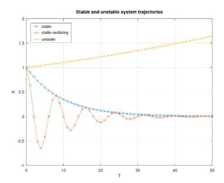

# Integrating the Attention Mechanism into State Space Models

Tomas Hrycej

Institute for Computer Science
University of St.Gallen
St.Gallen, Switzerland
tomas.hrycej@unisg.ch

Bernhard Bermeitinger

Institute for Computer Science in Vorarlberg

University of St.Gallen

Dornbirn, Austria

bernhard.bermeitinger@unisg.ch

Siegfried Handschuh

Institute for Computer Science
University of St.Gallen
St.Gallen, Switzerland
siegfried.handschuh@unisg.ch

Abstract—The last decades have seen alternating focus on two approaches to natural language processing: (a) mapping the sequence of past words or tokens to the forecast of the next word, represented by the Attention Mechanism (AM), and (b) recurrent processing of the sequence while keeping contextual information in the memory. The quadratic complexity of AM sets limits to the sequence lengths. This has led to the revival of interest in recurrent models, now in the form of State Space Models (SSMs). SSMs are a traditional approach from systems and control theory. Expanding SSMs into the convolutional form shows, after some transformations, essential structural similarity to attention processing. Existing proofs of formal similarity do not point out some aspects of functional difference. This work applies the system-theoretical view to assign both approaches to fundamentally different model categories. It is argued that AM corresponds to the parameter-extensive concept of Finite Impulse Response models, while SSMs are related to the parametereconomical Infinite Impulse Response models. The second, more compact, category has a more general modeling potential. This finding motivates the search after resolving the inability of SSMs to explicitly capture the relevance of the context independently of the position. Based on this, an extension of SSMs is proposed, which introduces the concept of similarity, which is analogous to that of the attention mechanism. Implementing and testing this extension is nontrivial and will be the task for the future.

Index Terms—natural language processing, attention mechanism, state space models, recurrent models, dynamical systems

#### I. INTRODUCTION

The transformer architecture [1] with the (Self-)Attention Mechanism (AM) introduced by [2] is currently the dominant approach to language modeling, with an excellent application record. A single head configuration of AM is described by the formally linear transformation

$$y_i = \left(\sum_{j=1}^i a_{i,j} x_j W_V\right) W_O = \sum_{j=1}^i x_j W_{i,j}$$
 (1)

with

$$W_{i,j} = a_{i,j} W_V W_O \tag{2}$$

Strictly speaking, the idea of the AM is implemented with the help of matrices  $W_Q$ ,  $W_K$ ,  $W_V$ . However, there is always the matrix  $W_O$  scaling the (possibly multiple) head dimensions into the original model dimension, as in the seminal paper [1], formula in Section 3.2.2.

Nonlinear weights  $a_{i,j}$ , organized in vectors  $a_i$  are defined as

$$a_i = \text{Softmax}(s_i) \tag{3}$$

and the vector of similarities to the respective query  $x_i$ . The elements of this vector  $s_i = \begin{bmatrix} s_{i1} & s_{i2} & \cdots & s_{ii} \end{bmatrix}$  correspond to the products

$$a_{i,j} = x_i W_K W_O^T x_i^T \tag{4}$$

They measure the similarity between a present token  $x_i$ , the *query*, and another token  $x_j$ , the *key*. These weights express the context relevance of the key for the given query.

With a growing variety of applications, the length of text sequences processed has also grown. The inherent property of AM is the computing expense quadratic with the sequence length. This became a conceptual limitation of the approach.

With this problem in mind, interest in recurrent concepts is revived. Recurrent architectures had a long application history, starting with the backpropagation through time of [3]. Their application to language processing has culminated in the popular Long Short-Term Memory (LSTM) [4]. Recurrent architectures can work with virtually unlimited sequence lengths, but suffer from difficulties with gradients along long sequences. The State Space Model (SSM) is a linear form of recurrent architecture. It is a well-understood concept extensively used in engineering applications and modeling physical, technical, and economic systems. Most control theory algorithms are based on the concept of state space. The state space idea goes back to [5]. Its time-discrete variant is

$$h_i = h_{i-1}A + x_iB$$
  

$$y_i = h_iC$$
(5)

with input x, output y, hidden state vector h as well as matrices A, B and C of corresponding dimensions. Assuming that the initial state at position zero is  $h_0=0$ , the model can be expanded by mathematical induction to a series

$$y_{i} = h_{i}C = x_{i}BC + h_{i-1}AC$$

$$= x_{i}BC + x_{i-1}BAC + h_{i-2}A^{2}C + \cdots$$

$$= \sum_{j=1}^{i} x_{j}BA^{i-j}C = \sum_{j=1}^{i} x_{j}V_{i,j}$$
(6)

with

$$V_{i,j} = BA^{i-j}C (7)$$

referred to as the *convolutional form* of an SSM because of the convolution between xj and Ai−j .

A striking relationship to the recurrent architecture has not been widely noticed for a long time, but [6] has formulated the *Dynamical Systems Framework* (DSF) and presented both AM and SSM to be instances of this framework. Several developments, such as those by [7], have recently built on this relationship.

Our work presented in the following sections focuses on disclosing the functional differences (section II), realizable dynamic properties (section III), and the possibility of introducing AM to capture context relevance in SSMs (section IV).

### II. TWO FORMS OF DYNAMICAL SYSTEM MODELS

The formal similarity of AM and SSM highlighted by [6] shadows a fundamental difference. The state matrix of AM in DSF has the dimension of the whole preceding token sequence. This corresponds to a special type of dynamic model, the *Finite Impulse Response* model (FIR). This model type considers the output to be the weighted sum of past inputs, with individual weights for each one. The state from which the forecast is made consists of the entire past embedding sequence, that is, the number of tokens multiplied by the embedding vector length.

The state space approach is a form of the *Infinite Impulse Response* (IIR) model. It is characterized by the feedback materialized by (5). The feedback term contains the matrix A, multiplied by the past state hi−1, which is usually substantially shorter than the past sequence of FIR. In fact, the past sequence length is the upper bound for the state dimension, as there is no information beyond the sequence itself. This approach is more universal than FIR.

FIR models can approximate IIR models [8]. A sufficiently long input sequence usually gives a good approximation of the infinite response. This occurs at the expense of a strongly increased number of parameters (see, e.g., [9]).

#### III. DIAGONAL FORM OF SSM AND ITS PROPERTIES

The key role in the behavior of SSM is played by the *eigenvalues* of matrix A. They determine the dynamic properties of an SSM. Generally, the eigenvalues λi of a real-valued matrix A are real numbers or complex conjugate pairs.

In the time-discrete variant of SSM, complex (or negative) eigenvalues lead to oscillating behavior, and eigenvalues with an absolute value exceeding unity lead to unstable (i.e., divergent) behavior. Systems whose eigenvalues are all real non-negative numbers not exceeding unity are stable and non-oscillating. For better understanding, hypothetical timediscrete systems exhibiting these types of qualitative behavior are illustrated in Fig. 1.

• A stable system converges to a stationary value in a monotonic way (here: zero).

Fig. 1. Stable, oscillating and unstable behavior of a dynamical system.

- A stable oscillating system also converges to a stationary value but exhibits sinusoidal swings with diminishing amplitude.
- An unstable system (oscillating or not) diverges to values growing to infinity (here: non-oscillating).

Linear unstable systems diverging to genuine infinity do not occur in the physical world, typically because of limitations of resources such as energy supply. They are mostly bounded by some *saturation*, an example of which is the sigmoid nonlinearity or hard limits.

The system matrix A can be of considerable size. Motivated by reducing the number of parameters, the matrix is frequently committed to a diagonal form, with only N instead of N2 free parameters to be fitted (with N being the state vector size). This may seem to restrict the scope of the systems that can be modeled. This is why a short analysis of this restriction follows.

Of key importance for the behavior of an SSM are the eigenvalues of matrix A. As stated in section II, the properties of eigenvalues determine the behavioral properties of the SSM. In its time-discrete variant, there are two types of undesirable behavior: oscillating behavior (caused by complex eigenvalues) and unstable (i.e., divergent) behavior (inherent to eigenvalues with an absolute value exceeding unity).

Instability is undesirable for any model, and thus also for a language model. Eventually, it leads to numerical overflows of internal variables. In systems with nonlinear saturation terms, the divergence can be disguised by getting stuck in the saturation term without a possibility of return. Such model would then produce a constant output.

Oscillatory behavior is nothing more than repetition of the output with a certain periodicity given by the particular complex-valued eigenvalue of the system matrix. It is hardly conceivable in which language applications periodically repeating the same text might be desirable.

By these arguments, stable and non-oscillating behavior can be formulated as *requirement* on the recurrent language model. Consequently, it is sufficient to consider models with such behavior. This is exactly the class of models with realvalued eigenvectors and positive real eigenvalues with unity upper bound. To show this, we can use the well-known statement of linear algebra about matrix similarity, with the special case of similarity transformation matrix P being the matrix of eigenvectors. Here, the similarity transformation is applied to the state matrix  $A_0$ . Then, arbitrary system matrices  $A_0, B_0, C_0$ , as introduced in section I, can be transformed to their equivalent counterparts A, B, C according to

$$A = PA_0P^{-1}$$

$$B = B_0P^{-1}$$

$$C = PC_0$$
(8)

with a diagonal matrix A and matrix P of eigenvectors of  $A_0$ . The positiveness and unity upper bound of eigenvalues can be satisfied, e.g., by using a sigmoid function.

In a diagonal SSM, the diagonal elements of A and their powers ensure exponential forgetting of past inputs. With a state vector of dimension N, N separate forgetting rates act simultaneously, allowing various patterns of semantic relevance of past words to be implemented. The diagonal form of the convolutional expansion (6) can be decomposed as a sum of spectral components of rank 1:

$$V_{i,j} = BA^{i-j}C = \sum_{k=1}^{N} a_k^{i-j} b_k c_k = \sum_{k=1}^{N} a_k^{i-j} E_k$$
 (9)

with  $b_k$  being the k-th column vector of B and  $c_k$  the k-th row vector of C.

Every matrix  $V_{i,j}$  transforming the j-th input token to a summand of the i-th output token contains the set of independent forgetting rates  $a_k$ , individually depending on the relative position difference i-j. The series of matrices  $V_{i,j}$  for fixed i and varying j shows the forgetting process with this set of independent forgetting rates.

## IV. CAPTURING THE CONTEXT IN SSMS

The structures (1) and (6) are closely related. Both correspond to the weighted transformations of past tokens  $x_j$ . The main difference is in the aspects on which the weighting matrices  $W_{i,j}$  and  $V_{i,j}$  depend.

- $W_{i,j}$  expresses the contextual similarity of the keys j to the query i. It consists of a fixed factor  $W_VW_O$  and the token-specific context relevance weight  $a_{i,j}$ . Its function is weighting by context, but an additional mechanism must supply the positional information.
- Vi,j represents forgetting distant past tokens. It encodes
  the positional information directly, but fails to capture
  the contextual relevance specific to the preceding tokens
  explicitly.

AM with an embedding of dimension M requires  $4M^2$  parameters to specify the matrices  $W_V$ ,  $W_O$ ,  $W_Q$ , and  $W_K$ . In the single-head configuration, they can be collapsed to  $W_{VO} = W_V W_O$  and  $W_{QK} = W_Q W_K^T$ , with only  $2M^2$  parameters. A diagonal SSM with a state space vector of dimension N has (2M+1)N free matrix elements to determine.

The SSMs' weakness in capturing the context relevance of individual tokens has been noticed, and various attempts have been made to alleviate it. They include gating concepts and variable matrices B and C [10].

Considering the conceptual parallelism to AM, the successful similarity concept of the attention architecture is also a meaningful candidate. The basic idea is motivated by the different ways in which the information relevant to the context is represented in both competing approaches. In AM, this information is distributed over the entire past sequence. It is selectively compressed only by the weighted addition of the past embedding for a single token (*query*). In SSM, the relevant information for the context is collected in the state vector. The claim is that there is no other information beyond the state vector is *complete*. It is also to be *minimal* in the sense of system theory [11]. Otherwise, the state is redundant and contains parts that are not observable with the help of input sequences.

The concept proposed here is that instead of measuring the similarity between the current and past tokens, every input is weighted by its similarity to the current state. This would amount to higher weights of future tokens contextually related to the state collected from the past sequence.

The mathematical means to do this are identical to those used in AM: the vector product. As the dimensions of  $x_i$  and  $h_{i-1}$  are different, the one of both with higher dimensionality (typically the state  $h_{i-1}$ ) must be transformed into the lower-dimensional space of the other. This can be done with the help of the matrix  $W_H$ . This matrix extracts those features from the state  $h_{i-1}$  that are relevant to measure semantic similarity with the current token  $x_i$ . The index i accounts for the recurrent operation of the model: the hidden state  $h_i$  is updated with the help of token  $x_i$  at the moment of processing this token.

A nonlinear function  $\sigma$ , such as the sigmoid, can restrict the similarity value to (0,1). The scalar weight of input  $x_i$  is then

$$g(x_i, h_{i-1}) = \sigma(x_i W_H h_{i-1}^T)$$
(10)

This modifies the input matrix B to  $g(x_i, h_{i-1})B$ . The recurrent form of such a modified system is, in analogy to (5):

$$h_i = h_{i-1}A + x_i g(x_i, h_{i-1}) B$$
  
 $y_i = h_i C$  (11)

It is an open question how far this model is easy to learn with currently popular learning algorithms. Experience with recurrent models suggests possible problems with vanishing gradient.

Nevertheless, the topic of vanishing gradient for the linear form is rather transparent when observing the convolutional form with a diagonal state matrix (9). The terms in the past of the text sequence differ from the recent ones only in the power of the diagonal element  $a_k$  (equal to the real eigenvalue). The derivative of the n-th power  $a_k^n$  is  $\frac{da_k^n}{da_k} = na_k^{n-1}$ . It is diminishing proportionally to the weight of the past term, additionally magnified by n. This is not identical to the genuine "vanishing gradient". It is only a weighting of the gradient by its contribution to the loss, even overweighted by n. Recent input tokens with small powers n remain strongly

weighted and thus have a substantial gradient. (This is an analogy to the popular concept of *residual connections*.)

Alternatively, systems and control theory offers analytical algorithms for identifying an SSM from data. One such algorithm is the subspace algorithm in [12]. However, the massive training datasets used in language modeling may be a major obstacle. This algorithm also does not guarantee the model's stable eigenvalues: noisy data of a stable system with eigenvalues close to unity can erroneously lead, by noisy numerical imprecisions, to an instable model.

Furthermore, it is probably not easily extensible for the nonlinear similarity term in a straightforward way. So, it could serve as a vehicle for generating a good initial solution without accounting for the contextual similarity. A numerical finetuning may follow to determine the similarity parameters WH.

#### V. DISCUSSION AND FURTHER WORK

The material presented shows a strong relationship between AM on the one hand and SSM on the other. This is not particularly surprising, since both approaches follow a common goal: to capture the context information from a sequence preceding a given token.

Nevertheless, it is fruitful to be aware of this relationship. Both approaches seem, at first glance, to be strongly different. They have been developed with a different focus. The development of AM has been driven by the goal of picking up the relevant context information of the sequence independently of the position. However, the position information also turned out to be crucial. Subsidiary mechanisms deliver position encoding, whose optimal form is still an object of discussion.

Recurrent models like the SSM allow the accumulation of context information at a distinct place, the state vector. In this way, past information is implicitly retained but subject to forgetting. The quantitative extent of forgetting is expressed by the eigenvectors of the state matrix, which account for a large set of parallel forgetting rates.

Natural language processing is, without a doubt, a dynamic system in the sense defined in system theory. The SSM is the preferred approach to modeling such systems in physical, engineering, and economic applications. It is also attractive from some application viewpoints of language processing. Typical tasks include formulating a prompt, such as a query, and letting the system produce an answer. The prompt corresponds to exciting the system's state during the query, accumulating the entire query semantics in the system state vector. Producing the answer corresponds to a transient system response over time until a zero state ("answer terminated") is reached. The prompt sequence can be imagined as the successive filling of a kind of *semantic bag*, collected in the state vector, letting the system dynamics empty the bag by a transient response sequence.

This is analogous to a simple physical example of a pendulum: it is excited by pushing it to a specific position. The response is transient swings until the stable equilibrium. A more general physical analogy is the case of supplying energy to a system and the subsequent energy dissipation.

Obviously, the idea of a state in which all relevant information is collected in the current state is common to physical systems and languages. All information relevant to the future behavior of a pendulum is its current position and velocity. This may be analogous to the state of mind after asking a question: both the question content and the knowledge available to answer it are accumulated in the present state.

These analogies may motivate the search after surmounting practical problems when using recurrent systems. Some ideas on capturing the relevant context more explicitly have been suggested in section IV. Another group of problems concerns the efficient learning of such systems. The solution may come from improving traditional numerical gradient methods and system-theoretical approaches such as the mentioned subspace method of [12].

Pursuing these practical problems in concrete implementations and testing them on widespread benchmarks is essential. Due to the considerable resources necessary, these experiments are an immediate task for the near future.

## REFERENCES

- [1] A. Vaswani, N. Shazeer, N. Parmar, J. Uszkoreit, L. Jones, A. N. Gomez, L. Kaiser, and I. Polosukhin, "Attention is all you need," in *Proceedings of the 31st International Conference on Neural Information Processing Systems*, ser. NIPS'17. Red Hook, NY, USA: Curran Associates Inc., Dec. 2017, pp. 6000–6010.
- [2] D. Bahdanau, K. Cho, and Y. Bengio, "Neural Machine Translation by Jointly Learning to Align and Translate," in *ICLR 2015*, May 2016. [Online]. Available: http://arxiv.org/abs/1409.0473
- [3] P. J. Werbos, "Generalization of backpropagation with application to a recurrent gas market model," *Neural Networks*, vol. 1, no. 4, pp. 339–356, 1988. [Online]. Available: https://www.sciencedirect.com/ science/article/pii/089360808890007X
- [4] S. Hochreiter and J. Schmidhuber, "Long Short-Term Memory," *Neural Computation*, vol. 9, no. 8, pp. 1735–1780, Nov. 1997. [Online]. Available: https://direct.mit.edu/neco/article/9/8/1735-1780/6109
- [5] R. E. Kalman, "A new approach to linear filtering and prediction problems," *Journal of Basic Engineering*, vol. 82, no. 1, pp. 35–45, Mar. 1960. [Online]. Available: https://doi.org/10.1115/1.3662552
- [6] J. Sieber, C. A. Alonso, A. Didier, M. N. Zeilinger, and A. Orvieto, "Understanding the differences in Foundation Models: Attention, State Space Models, and Recurrent Neural Networks," Dec. 2024, arXiv:2405.15731 [cs]. [Online]. Available: http://arxiv.org/abs/2405. 15731
- [7] A. Gu, K. Goel, and C. Re, "Efficiently modeling long sequences ´ with structured state spaces," in *ICLR 2022*, 2022. [Online]. Available: https://arxiv.org/abs/2111.00396
- [8] N. B. Rizvandi, M. R. N. Ranjbar, and M. M. Nejad, "Approximation of IIR Filters with Equivalent FIR Filters in Magnitude and Group Delay Responses," in *15th International Conference on Digital Signal Processing*. Cardiff, UK: IEEE, Aug. 2007, pp. 288–291. [Online]. Available: http://ieeexplore.ieee.org/document/4288575/
- [9] T. Munker, "Machine learning with finite impulse response ¨ models," Ph.D. dissertation, Universitat Siegen, 2021, publisher: ¨ Universitatsbibliothek Siegen. [Online]. Available: https://dspace.ub. ¨ uni-siegen.de/handle/ubsi/2118
- [10] A. Gu and T. Dao, "Mamba: Linear-Time Sequence Modeling with Selective State Spaces," May 2024, arXiv:2312.00752 [cs]. [Online]. Available: http://arxiv.org/abs/2312.00752
- [11] B. Schutter, "Minimal state-space realization in linear system theory: an overview," *Journal of Computational and Applied Mathematics*, vol. 121, no. 1-2, pp. 331–354, Sep. 2000. [Online]. Available: https://linkinghub.elsevier.com/retrieve/pii/S0377042700003411
- [12] M. Verhaegen, "Subspace techniques in system identification," in *Encyclopedia of systems and control*, J. Baillieul and T. Samad, Eds. Cham: Springer International Publishing, Aug. 2021, pp. 2235–2244. [Online]. Available: https://doi.org/10.1007/978-3-030-44184-5 107