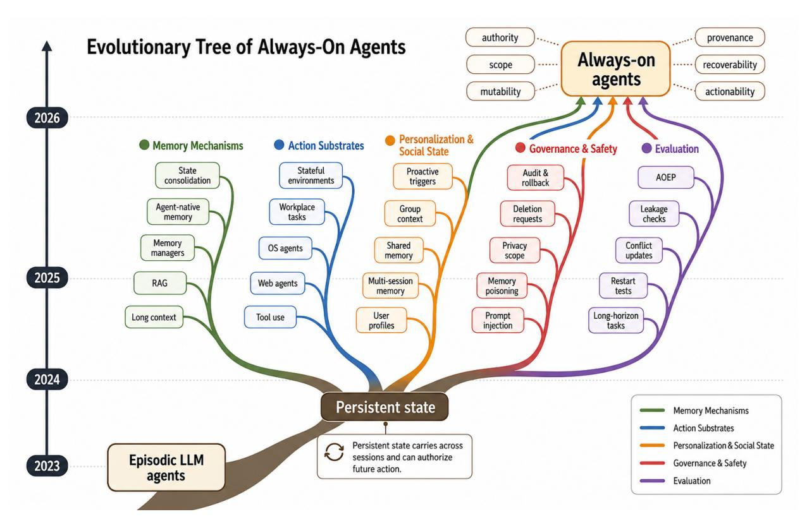
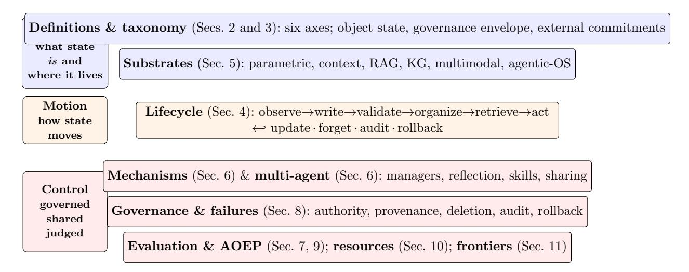
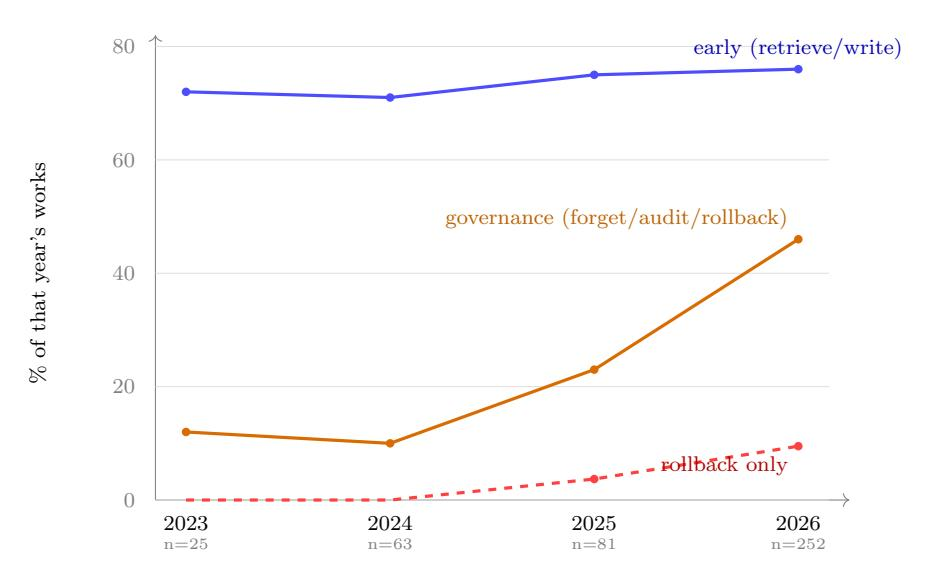
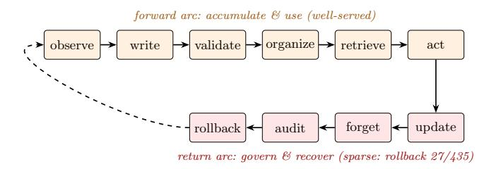
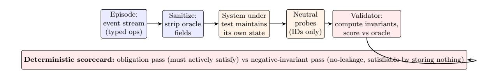

# Always-On Agents: A Survey of Persistent Memory, State, and Governance in LLM Agents

Tianyu Ding Aditya Nannapaneni Bingfan Liu Ling Zhang

#### Abstract

Always-on agents are systems whose future behavior depends on durable state accumulated across earlier interactions. We treat them as persistent-state systems: the operative system includes retrievable memories, but also task ledgers, permissions, credentials, commitments, provenance and audit records, shared state, trigger conditions, and externally committed effects linked to those records. The survey reads the literature through six diagnostic axes for each state item, authority, scope, mutability, provenance, recoverability, and actionability, and through a lifecycle in which state is written, validated, organized, retrieved, acted upon, updated, forgotten, audited, and sometimes rolled back. Across a 435-work coded corpus, treated as a scoped map rather than an exhaustive census, the literature concentrates more heavily on accumulating and retrieving state than on governing, recovering, or relinquishing it. We therefore introduce the Always-On Evaluation Protocol (AOEP-v0), a pilot evaluation contract that makes these governance requirements concrete by scoring state mutation and recovery obligations rather than answer quality alone. The resulting agenda connects always-on agents to databases, distributed systems, formal methods, capability security, and machine unlearning.

## Contents

| 1 | Introduction                         |                                                                                       |    |  |  |  |  |
|---|--------------------------------------|---------------------------------------------------------------------------------------|----|--|--|--|--|
|   | 1.1                                  | Survey scope and corpus                                                            | 8  |  |  |  |  |
|   | 1.2                                  | Related surveys and how this survey differs                                        | 12 |  |  |  |  |
| 2 |                                      | Defining always-on agents                                                             | 15 |  |  |  |  |
|   | 2.1                                  | An operational definition                                                          | 16 |  |  |  |  |
|   | 2.2                                  | Boundaries: five adjacent system classes                                           | 17 |  |  |  |  |
|   | 2.3                                  | The six state axes                                                                 | 19 |  |  |  |  |
|   | 2.4                                  | The cognitive-architecture lineage                                                 | 22 |  |  |  |  |
|   | 2.5                                  | Inclusions, exclusions, and why personalization and trigger state are state types  | 23 |  |  |  |  |
| 3 | A taxonomy of persistent state 24 |                                                                                       |    |  |  |  |  |
|   | 3.1                                  | Memory types: the classical core                                                   | 24 |  |  |  |  |
|   |                                      | 3.1.1 Episodic traces                                                           | 24 |  |  |  |  |
|   |                                      | 3.1.2 Semantic facts                                                            | 25 |  |  |  |  |
|   |                                      | 3.1.3 Preferences                                                               | 26 |  |  |  |  |
|   |                                      | 3.1.4 Procedural skills                                                         | 26 |  |  |  |  |
|   | 3.2                                  | Control-relevant state: beyond memory                                              | 27 |  |  |  |  |
|   |                                      | 3.2.1 Workflow and task-ledger state                                            | 27 |  |  |  |  |
|   |                                      | 3.2.2 Policy and permission state                                               | 28 |  |  |  |  |
|   |                                      | 3.2.3 Provenance and audit state                                                | 28 |  |  |  |  |

|   |     | 3.2.4 Shared and social memory  29                                      |
|---|-----|----------------------------------------------------------------------------------|
|   |     | 3.2.5 Trigger state  29                                                 |
|   |     | 3.2.6 Tool and credential state  30                                     |
|   |     | 3.2.7 External commitments and side effects  30                         |
|   | 3.3 | A comparison across types  31                                              |
|   | 3.4 | How the types interact, and where governance is thinnest  31               |
| 4 |     | The persistent-state lifecycle 33                                             |
|   | 4.1 | State records, transitions, and invariants  34                             |
|   |     | 4.1.1 The five invariants and the stages they govern  35                |
|   | 4.2 | The forward arc: observe, write, validate, organize, retrieve, act  35     |
|   |     | 4.2.1 Observe and write: deciding what becomes state  35                |
|   |     | 4.2.2 Validate: the missing gate  36                                    |
|   |     | 4.2.3 Organize: consolidation that preserves or destroys governance  37 |
|   |     | 4.2.4 Retrieve: the most-studied stage, and what it still misses  37    |
|   |     | 4.2.5 Act: binding state to consequence  38                             |
|   | 4.3 | The return arc: update, forget, audit, rollback  38                        |
|   |     | 4.3.1 Update: revision that is studied, propagation that is not  39     |
|   |     | 4.3.2 Forget: deletion as a retrieval edit, not an erasure  39          |
|   |     | 4.3.3 Audit: accounting for how state was used  39                      |
|   |     | 4.3.4 Rollback: the rarest capability  40                               |
|   | 4.4 | Operating-system abstractions for the lifecycle  40                        |
|   | 4.5 | Lifecycle fidelity and the return-arc gap  41                              |
| 5 |     | State substrates and representations 44                                       |
|   | 5.1 | Parametric state and test-time learning  44                                |
|   | 5.2 | The context window and long-context  45                                    |
|   | 5.3 | Retrieval and vector stores (RAG)  46                                      |
|   | 5.4 | Structured stores: knowledge graphs and temporal memory  47                |
|   | 5.5 | Multimodal memory  48                                                      |
|   | 5.6 | Agentic-OS and serving runtimes  49                                        |
|   | 5.7 | Systems cost and resource governance  50                                   |
|   | 5.8 | Cross-substrate synthesis  51                                              |
| 6 |     | Mechanism families 53                                                         |
|   | 6.1 | Memory managers and graph memory  54                                       |
|   | 6.2 | Reflection and experience learners  55                                     |
|   | 6.3 | Skill and workflow induction  55                                           |
|   | 6.4 | Continual adaptation and the plasticity-stability problem  56              |
|   |     | 6.4.1 Parametric versus non-parametric adaptation  57                   |
|   |     | 6.4.2 How helpful adaptation turns net-negative  57                     |
|   |     | 6.4.3 The baseline-beats-memory finding  57                             |
|   |     | 6.4.4 Forgetting and consolidation as the stability operators  58       |
|   | 6.5 | Multi-agent and shared-memory mechanisms  59                               |
|   | 6.6 | The controlled-compounding criterion  61                                   |
|   |     |                                                                                  |

| 7 |     | Benchmark and evaluation families                                                   | 61 |  |  |  |  |  |
|---|-----|-------------------------------------------------------------------------------------|----|--|--|--|--|--|
|   | 7.1 | Evaluation methodology and what a score can mean                                 | 62 |  |  |  |  |  |
|   | 7.2 | Memory QA over histories                                                         | 63 |  |  |  |  |  |
|   | 7.3 | Boundary cases: long-context and RAG benchmarks                                  | 63 |  |  |  |  |  |
|   | 7.4 | Memory-guided action benchmarks                                                  | 64 |  |  |  |  |  |
|   | 7.5 | State and belief mutation benchmarks                                             | 65 |  |  |  |  |  |
|   | 7.6 | Personalization and proactive benchmarks                                         | 66 |  |  |  |  |  |
|   | 7.7 | Coverage against the six always-on benchmark stressors                           | 67 |  |  |  |  |  |
| 8 |     | Failure modes, safety, and governance                                               | 70 |  |  |  |  |  |
|   | 8.1 | Threat model and governance surface                                              | 70 |  |  |  |  |  |
|   | 8.2 | Persistence-induced failure modes                                                | 70 |  |  |  |  |  |
|   |     | 8.2.1 Write poisoning and injection.                                          | 71 |  |  |  |  |  |
|   |     | 8.2.2 Retrieval distraction and tool-drift.                                   | 72 |  |  |  |  |  |
|   |     | 8.2.3 Stale commitment and belief drift.                                      | 73 |  |  |  |  |  |
|   |     | 8.2.4 Deletion failure and the rollback gap.                                  | 73 |  |  |  |  |  |
|   |     | 8.2.5 Cross-agent propagation.                                                | 73 |  |  |  |  |  |
|   |     | 8.2.6 Rollback as a fresh attack surface.                                     | 74 |  |  |  |  |  |
|   | 8.3 | Authority and permission state                                                   | 74 |  |  |  |  |  |
|   | 8.4 | Provenance, audit, and lineage                                                   | 75 |  |  |  |  |  |
|   | 8.5 | Privacy, consent, and scope  76                                               |    |  |  |  |  |  |
|   | 8.6 | Public production memory controls  77                                         |    |  |  |  |  |  |
|   | 8.7 | Deletion propagation and the right to be forgotten  77                        |    |  |  |  |  |  |
|   | 8.8 | Rollback and recovery                                                            | 79 |  |  |  |  |  |
|   | 8.9 | Synthesis: governance as the missing half of the lifecycle                       | 80 |  |  |  |  |  |
| 9 |     | The Always-On Evaluation Protocol (AOEP)                                            | 81 |  |  |  |  |  |
|   | 9.1 | Why existing evaluation cannot score governance                                  | 81 |  |  |  |  |  |
|   | 9.2 | Protocol: event stream and state snapshot                                        | 82 |  |  |  |  |  |
|   | 9.3 | Deterministic coverage scorecard                                                 | 83 |  |  |  |  |  |
|   | 9.4 | Pilot harness                                                                    | 84 |  |  |  |  |  |
|   | 9.5 | Robustness of the pilot                                                          | 85 |  |  |  |  |  |
|   | 9.6 | What the pilot establishes, and what it leaves open                              | 87 |  |  |  |  |  |
|   |     |                                                                                     |    |  |  |  |  |  |
|   |     | 10 Resources and frameworks                                                         | 88 |  |  |  |  |  |
|   |     | 10.1 Web and computer-use agents                                                 | 88 |  |  |  |  |  |
|   |     | 10.2 Embodied and robotics agents                                                | 90 |  |  |  |  |  |
|   |     | 10.3 Healthcare                                                                  | 91 |  |  |  |  |  |
|   |     | 10.4 Finance, legal, and cybersecurity                                           | 92 |  |  |  |  |  |
|   |     | 10.5 Education and tutoring                                                      | 93 |  |  |  |  |  |
|   |     | 10.6 Coding agents                                                               | 94 |  |  |  |  |  |
|   |     | 10.7 Ambient, wearable, and IoT agents                                           | 95 |  |  |  |  |  |
|   |     | 10.8 Scientific discovery agents                                                 | 96 |  |  |  |  |  |
|   |     | 10.9 Memory frameworks, libraries, and serving substrates as reusable resources  | 97 |  |  |  |  |  |

|   |     | 11 Research frontiers and open problems                                 | 97  |
|---|-----|-------------------------------------------------------------------------|-----|
|   |     | 11.1 Lifecycle-complete evaluation and running AOEP on real systems  | 98  |
|   |     | 11.2 Controlled compounding and retrieval-addressable consolidation  | 100 |
|   |     | 11.3 Authority, privacy, deletion, and a cross-surface benchmark     | 101 |
|   |     | 11.4 Shared-memory governance and authority-scoped rollback          | 102 |
|   |     | 11.5 Bridging from adjacent disciplines                              | 103 |
|   |     | 12 Conclusion                                                           | 104 |
|   |     | 12.1 What the survey established                                     | 104 |
|   |     | 12.2 Why bigger context and better retrieval are not enough          | 105 |
|   |     | 12.3 The operational agenda                                          | 106 |
|   |     | 12.4 Outlook                                                         | 107 |
| A |     | Survey methods and corpus construction                                  | 107 |
|   | A.1 | Sources and time window                                              | 107 |
|   | A.2 | Search procedure                                                     | 107 |
|   | A.3 | Inclusion and exclusion criteria                                     | 108 |
|   | A.4 | Coding scheme                                                        | 108 |
|   | A.5 | Coding reliability                                                   | 108 |
|   | A.6 | What the rollback count does and does not aggregate                  | 109 |
|   | A.7 | Threats to validity                                                  | 109 |

## 1 Introduction

Large language model (LLM) agents are usually built, deployed, and evaluated as episodic systems. An agent receives a task, reasons over it, calls tools, returns an answer or performs an action, and then resets. Whatever it learned during the episode, which observations it gathered, which tool outputs it trusted, which sub-goals it abandoned, is discarded at the boundary. Under this contract the agent is stateless between tasks by construction, and most of the safety and correctness reasoning a designer must do collapses to a single episode: if the current prompt is clean and the current tool calls are authorized, the agent is well behaved. The episodic contract is convenient precisely because it makes the past irrelevant.

Always-on agents break this contract. An always-on agent is one whose behavior at a given moment depends on state accumulated before that moment, beyond the current prompt or task instance. A coding assistant that remembers a repository's conventions across weeks, a personal assistant that tracks a user's evolving preferences and open commitments, a customer-support agent that carries a case across many sessions and operators, and a fleet of collaborating agents that share a common workspace are all always-on in this sense, regardless of whether they literally run every second. The defining property is not continuous execution but persistence: the agent retains user preferences, task traces, tool outcomes, procedural lessons, policy constraints, social context, and past mistakes, and any of these can shape, or authorize, its next action. This is a qualitative shift, not a quantitative one. Once retained state can license future behavior, the past is no longer irrelevant, and the single-episode safety argument no longer holds.

State becomes authoritative. Persistence changes what stored information can do. A stored preference can silently fix the default arguments of a tool call. A cached credential can grant access long after the user intended it to lapse. A procedural skill distilled from one successful trajectory can be replayed as an executable commitment in a situation it no longer fits. A summary written months ago can override fresh evidence because it retrieves more strongly. In each case the agent is not reasoning from the current situation alone; it is being guided by a record whose authority, scope, freshness, and origin were fixed in the past and are rarely re-examined. An always-on agent is therefore more than a memory-augmented episodic agent. It is a persistent-state system whose retained state needs rules for what may persist, what may act, and what may be revoked.

We use persistent state as a broad term. It includes retrievable memory, the object most prior work studies, but also the durable, control-relevant records that surround memory and cross the episode boundary with the agent: task ledgers of open commitments and obligations, permissions and consent, tool and credential state, provenance and audit trails, shared and social state across users and agents, and trigger state governing when to act proactively. External commitments are not internal memory records; they are part of the agent's persistent accountability surface because they must remain traceable to the internal state that authorized them. A calendar reminder, a partially completed purchase, a revoked API token, a poisoned workflow, and a deletion request that has only partly propagated are all persistent-state concerns, even when none is naturally described as a "memory." This wider unit separates the survey from memory-form taxonomies.

Figure 1: Evolutionary tree of always-on agents. The figure sketches the survey's organizing claim: episodic LLM agents become always-on not by running continuously, but when durable state persists across sessions and can authorize future action. Five strands map the field's current build-out: memory mechanisms, action substrates, personalization and social state, governance and safety, and evaluation. The target state is qualified by six diagnostic axes: authority, scope, mutability, provenance, recoverability, and actionability. These are the questions that make persistence governable rather than only useful.

Persistence is useful, and persistence is risky. The case for persistence is strong. Retaining state lets an agent avoid repeating work, personalize its behavior to a particular user or codebase, and adapt over time without retraining or weight updates, simply by accumulating and reusing experience. The same property that makes persistence useful, however, makes it dangerous in ways an episodic agent never faces. Irrelevant or salient-but-wrong memory can distract retrieval and crowd out current evidence. Stale memory can override fresh observation because nothing marks it as expired. Private memory can leak across users or sessions when scope is not enforced. Poisoned memory, written during one ordinary interaction, can persist and activate much later, after the attacker's session has ended and the triggering context is gone. Lossy consolidation can delete the precise identifier, date, or handle that a later action needs, while leaving a summary that still scores well on aggregate recall. None of these failures is repaired by filtering the current prompt, because the harm already resides in durable state. Persistence converts transient, single-episode problems into long-lived, system-level ones, a failure class episodic evaluation is not built to see.

The unit of analysis: persistent state, not memory. The literature on LLM agents is large and growing, and much of it touches the questions above. Broad agent surveys map perception, reasoning, planning, tool use, and multi-agent organization [\[Xi et al.,](#page-129-0) [2023,](#page-129-0) [Wang et al.,](#page-127-0) [2023b\]](#page-127-0). Within that space, memory surveys explain how agents remember: the forms memory takes, the operations of writing, organizing, retrieving, and forgetting, and the benchmarks that probe recall [\[Zhang et al.,](#page-134-0) [2024d,](#page-134-0) [Du,](#page-113-0) [2026,](#page-113-0) [Hu et al.,](#page-115-0) [2025c\]](#page-115-0). A more recent line argues that current memory systems are retrofitted from retrieval and database stacks rather than designed for agents, and calls for agent-native memory and externalized agent infrastructure [\[Zhou et al.,](#page-135-0) [2026b,](#page-135-0)[a\]](#page-135-1). We use much of this literature but change the unit of analysis. The first question is not what form an agent's memory takes, or which retrieval mechanism works best. It is how retained state authorizes future behavior, how it propagates across sessions, users, and agents, and how it can be repaired when it becomes stale, poisoned, overscoped, or wrong. Memory is one component of that object; governance of the whole remains under-specified.

This reframing follows a lineage that predates LLMs. Cognitive science long distinguished episodic from semantic memory [\[Tulving,](#page-127-1) [1972\]](#page-127-1), and cognitive architectures such as Soar and ACT-R made the further distinction between declarative facts retrieved by activation and decay and procedural rules selected by utility, embedding all of them in an explicit decision cycle [\[Laird,](#page-118-0) [2012,](#page-118-0) [Anderson et al.,](#page-108-2) [2004\]](#page-108-2). These architectures already treated memory not as a passive store but as a governed component of an acting system, with separation between memory types and explicit operations over them. Modern LLM agents inherit the vocabulary, with CoALA mapping cognitivearchitecture structure onto language agents by organizing memory modules and an action space [\[Sumers et al.,](#page-126-0) [2024\]](#page-126-0). What they do not yet inherit is the runtime enforcement of the boundaries those architectures assumed: in an LLM agent, nothing prevents a procedural lesson from silently overwriting a semantic fact, an expired permission from licensing a tool call, or a deleted record from surviving in a derived tier. The gap between a memory type and a governed state record is the gap this survey is about.

Contributions. This survey makes four contributions, which also organize the argument:

- 1. Definition. We define always-on agents as persistent-state systems and characterize a persistent-state item along six diagnostic axes that can be probed separately in simple cases but often interact in deployed systems: authority (what permits this state to influence an action), scope (which user, task, tool, time, or group may use it), mutability (whether it can be revised, superseded, decayed, or locked), provenance (which source, timestamp, and transformation produced it), recoverability (whether derived state and affected decisions can be rolled back), and actionability (whether it is evidence, preference, policy, skill, or executable commitment). A memory that scores perfectly on recall can still be unsafe if it has no authority boundary, no provenance, and no path to repair after a bad action.
- 2. Lifecycle. We recast memory as one stage of a broader governed loop, observe, write, validate, organize, retrieve, act, update, forget, audit, and rollback, and name five invariants the loop should preserve but that an episodic agent satisfies vacuously by resetting: authority monotonicity, scope non-expansion, deletion propagation, provenance preservation, and rollback traceability. Each invariant is the property whose violation defines a persistence-specific failure class.
- 3. Coverage map. We place memory, RAG, long-context, embodied-agent, and social-agent mechanisms and benchmarks against the always-on requirements they report testing, backed by a 435-work coded corpus. In our coding, the largest qualitative skew is that work concentrates on accumulating and retrieving state more than on governing it.

Figure 2: The survey is organized as a three-regime stack. Substance asks what persistent state is and where it physically lives; Motion asks how state moves through the agent's operating loop; Control asks how that movement is governed, shared, and judged. In our coding, work is concentrated more heavily on accumulating and retrieving state than on governing, recovering, or relinquishing it.

4. Protocol and pilot. We propose an Always-On Evaluation Protocol that scores state mutation and recovery rather than answer quality alone, and instantiate it in AOEP-v0: an event-stream and snapshot schema, worked episodes, a validator design, and a pilot that illustrates which governance fields current memory wrappers do not expose.

Reader's guide. The survey is organized as a layered stack over persistent state, with three cross-cutting lenses, sketched in Figure [2.](#page-7-1) After this introduction, we fix the definition and the six axes, then use the lifecycle and its five invariants as the main frame for the paper. The stack then moves through where state physically lives, from model parameters and the context window through retrieval stores, knowledge graphs, multimodal stores, and operating-system-style serving runtimes (substrates); how state moves through the forward arc as typed transitions (the state lifecycle); how state changes over a long horizon, where the classic plasticity-stability tension reappears in externalized form (continual adaptation); how state is governed along the return arc of update, forget, audit, and rollback (governance); and how state is shared and propagates across agents (multi-agent and shared state). The three cross-cutting parts read the stack through evaluation and benchmarks, failure modes and security, and application domains, before a research agenda and conclusion. Readers interested mainly in the empirical gap can read this introduction and the governance and evaluation parts; readers interested in mechanisms can enter at the substrate and lifecycle parts. Table [1](#page-8-0) maps each section to the regime it serves, the question it answers, and whether it lies on a suggested minimal reading path for a time-constrained reader. The remainder of this introduction makes the corpus and its construction explicit, then positions the survey against its closest neighbors.

### 1.1 Survey scope and corpus

What counts as in scope. We study persistent-state mechanisms, the benchmarks and evaluation methods that probe them, the failure modes persistence induces, the foundational work

| §  | Section                               | Regime    | Question it answers                                                   | Core path |
|----|---------------------------------------|-----------|-----------------------------------------------------------------------|-----------|
| 2  | Defining always-on agents       | Substance | What is an always-on agent, and what are the six state axes?       | •         |
| 3  | Persistent-state tax onomy      | Substance | What kinds of state does the agent hold?                              | •         |
| 4  | The state lifecycle                   | Motion    | By what operations does state move, and what invariants govern it? | •         |
| 5  | State substrates                      | Substance | Where does state physically live?                                     |           |
| 6  | Mechanism families                    | Motion    | How do deployed systems write, adapt, and share state?             |           |
| 7  | Evaluation and benchmarks       | Control   | What does the field measure, and what does it not?                 | •         |
| 8  | Failure modes and governance | Control   | How does persistence fail, and what governs it?                       | •         |
| 9  | The AOEP protocol                     | Control   | How can governance be scored rather than only described?           | •         |
| 10 | Resources and do mains       | Control   | What does each application domain demand of persistence?           |           |
| 11 | Research frontiers                    | Control   | What are the open problems and how might they be solved?           | •         |
| 12 | Conclusion                            | n/a       | What follows for the field?                                           | •         |

Table 1: Reading roadmap. Each section is placed in one of the three regimes the survey is organized around (Substance: what state is and where it lives; Motion: how it moves; Control: how it is governed, judged, and stress-tested). The final column marks a suggested minimal path for a timeconstrained reader who wants the empirical argument and the protocol without the full mechanism and substrate catalogues.

that anchors our taxonomy, and the boundary cases that sharpen the definition. We include a work if it builds or studies a persistent-state mechanism, contributes a relevant benchmark or evaluation method, documents a persistence-induced failure mode, anchors the state taxonomy or the plasticity-stability framing, or defines a boundary case. We exclude pure model-architecture or pretraining work with no persistent-state operation, agent applications that add no persistentstate operation over an off-the-shelf memory, and superseded versions of works we already include. Long-context models, RAG systems, and context-engineered agents sit deliberately near the boundary and are admitted as constraints rather than as the object itself: long-context benchmarks ask whether a model can use what is already in its window, RAG benchmarks ask whether external evidence is selected and used faithfully, and context-engineering work systematizes how retrieval, memory, tools, and multi-agent signals are assembled for one inference [\[Mei et al.,](#page-121-0) [2025\]](#page-121-0). Alwayson agents add a different question these lines do not pose: which of the assembled signals should become agent-owned longitudinal state, when should that state become authoritative, and how can it later be revised, scoped, revoked, or removed. Personalization is treated the same way, as a state type rather than the definition; we return to it below.

Search protocol. We assembled the corpus by a recorded protocol over arXiv (cs.AI, cs.CL, cs.LG, cs.CR), Semantic Scholar, OpenReview, and the ACL Anthology, covering 2023 to 2026, with earlier foundational anchors admitted when they ground a taxonomy or a term we use. The pre-2023

| Corpus step                        | Admission rule                                                                                                               | Added | What it tested                                                                                         |
|------------------------------------|------------------------------------------------------------------------------------------------------------------------------|-------|--------------------------------------------------------------------------------------------------------|
| Seed and closest work set | Recent memory and agent sur veys plus hand-identified closest neighbors satisfying I1 to I5                            | 97    | Establishes the vocabulary and the first boundary around persistent-state work                   |
| Rounds 1 to 2                      | Non-duplicate mainstream agent memory and benchmark addi tions                                                | 147   | Expands the center of the memory and evaluation literature                                          |
| Rounds 3 to 10                     | Targeted governance, rollback, authority, deletion, durable execution, HCI, and systems sweeps | 171   | Deliberately over-samples the return arc that the survey expects to be sparse                    |
| Round 11                           | Saturation check over main stream agent-memory vocabulary                                                        | 2     | Tests whether the memory frontier still yields many uncoded works                                   |
| Rounds 12 to 15                    | Adjacent-disciplinary and confir mation sweeps                                                                            | 18    | Probes work hidden under database, distributed-systems, formal, and organizational vocabulary |
| Total                              | Seed plus fifteen recorded non-duplicate rounds                                                                  | 435   | Coded by category, lifecycle stage, state axis, and subarea                                         |

Table 2: Admission flow for the coded corpus. Counts are admitted works, not candidate-screening totals. The flow explains how the corpus reached N=435 and why the governance skew is read as a large pattern inside our query frame rather than as a field-wide census.

anchors are deliberately upstream of LLM agents and concentrate in the cognitive and neuroscience foundations: the episodic-semantic distinction [\[Tulving,](#page-127-1) [1972\]](#page-127-1), multi-component working memory with an episodic buffer [\[Baddeley,](#page-109-0) [2000\]](#page-109-0), complementary learning systems and their update for artificial agents [\[McClelland et al.,](#page-121-1) [1995,](#page-121-1) [Kumaran et al.,](#page-118-1) [2016\]](#page-118-1), the neural evidence for offline replay during sleep [\[Wilson and McNaughton,](#page-129-1) [1994\]](#page-129-1), quantitative forgetting curves [\[Murre and](#page-122-0) [Dros,](#page-122-0) [2015\]](#page-122-0), and the Soar and ACT-R architectures [\[Laird,](#page-118-0) [2012,](#page-118-0) [Anderson et al.,](#page-108-2) [2004\]](#page-108-2). We seeded the modern corpus from agent-memory surveys and a closest-work set, chased citations two hops in each direction, and then ran targeted term-set sweeps. Most sweeps aimed away from the wellcovered center of agent memory and toward the periphery we expected to be thin: authority, rollback, formal verification, durable execution, deletion propagation, cross-agent interoperability, and the database, distributed-systems, reinforcement-learning, and HCI literatures that publish persistent-state work outside agent-memory vocabulary. This matters for interpreting the skew below, because the sweeps were designed to over -sample governance, not to under-sample it.

Admission flow. Table [2](#page-9-0) makes the corpus build less of a black box. It records the seed set, every admitted non-duplicate addition, and the round structure used to fold new works into the coded corpus. The flow is admission-based rather than a full PRISMA exclusion diagram: later rounds record rejected and duplicate candidates, but the earliest rejected-candidate identifiers were not retained in a uniform screened/excluded table. We therefore use the flow to support directional coverage claims and stopping conditions, not prevalence estimates over all papers that could have been screened.

A category × lifecycle-stage × state-axis × subarea coding scheme. Every included work is coded along four dimensions. First, a category: mechanism, benchmark, failure-mode, survey, foundation, or boundary. Second, a multi-label set of lifecycle stages it primarily exercises, drawn from the ten stages observe, write, validate, organize, retrieve, act, update, forget, audit, and rollback. Third, a multi-label set of state axes it touches, drawn from the six axes authority, scope, mutability, provenance, recoverability, and actionability. Fourth, a primary application or method subarea, of which thirty-three recur (the largest being conversational memory, memory mechanism, security and poisoning, evaluation methodology, multi-agent social memory, RAG and long-context, multimodal memory, state governance, agentic-OS runtime, continual learning, and skill learning). The cross-product of these dimensions is what lets the corpus answer questions a flat reading list cannot, for example which lifecycle stages the benchmark literature actually tests, or which state axes the mechanism literature leaves implicit. Appendix [A](#page-106-1) gives the full protocol: exact source list and time window, the query term sets, the inclusion and exclusion criteria, the coding scheme, and a measured inter-coder reliability check (pooled agreement 0.82 on lifecycle stages and 0.74 on state axes over a blind 236-work sample), together with the threats to validity that bound how the headline counts should be read.

The corpus and its skew. The resulting corpus of 435 works is summarized in Table [3,](#page-11-1) with its primary mapping into the survey's nine parts. Every work has a primary part, no part is empty, and the lightest part still hosts more than twenty works. The notable feature of the corpus is not its size but its shape. In our coding, coverage concentrates on the early, accumulative end of the lifecycle: retrieve (269 of 435) and write (200) dominate the stages, and mutability (160) and provenance (153) lead the axes. Coverage thins sharply on the governance end. Authority is the rarest axis at 72 of 435. Among lifecycle stages, audit (88), forget (66), and especially rollback (27) trail far behind retrieval. Only twenty-seven of 435 works expose any rollback mechanism for state-affected decisions, and none in the corpus reports recovery success or cost after corruption. These counts are scoping estimates, not a census, but they point to a large qualitative asymmetry: the works we coded have many techniques for accumulating and recalling state and fewer for governing it. Figure [3](#page-14-1) shows the same skew over time: the early-stage share stays flat and high from 2023 to 2026 while the governance share, though rising, remains a minority and turns upward only from 2025.

Governance-targeted search within the query frame. One possible objection is that we looked in the wrong places, and that the governance literature is larger than our corpus suggests. Our evidence cannot rule out that possibility, but it does constrain the simplest version of it within our recorded query frame. First, the bulk of our search rounds targeted governance, rollback, formal verification, durable execution, deletion propagation, and adjacent systems literatures; those rounds grew the corpus more than fourfold yet only lifted the governance fraction from roughly one-sixth to about one-third before late rounds showed diminishing returns under this query frame, with rollback still rare. Second, the skew worsens, not improves, when we restrict to work submitted through 2024: the governance fraction falls rather than rises, so the corpus pattern is not created solely by including immature 2026 preprints. Third, the skew appears across categories and subareas rather than in a single corner. We therefore read the corpus shape as evidence of a qualitative asymmetry in the works we coded, with the standard caveat that this is representative coding rather than an exhaustive census.

Reliability and diminishing returns. Two checks bound the confidence we place in these counts. For reliability, labels come from a single coding pass with a blind second-coder check on a

| Part  | Title                                            | Works |
|-------|--------------------------------------------------|-------|
| P1    | Foundations, Definitions, and State Types        | 27    |
| P2    | State Substrates and Representations             | 117   |
| P3    | State Lifecycle (Write/Organize/Retrieve/Act)    | 33    |
| P4    | Continual Adaptation and Plasticity-Stability    | 52    |
| P5    | Governance (Authority/Provenance/Deletion/Audit) | 53    |
| P6    | Multi-Agent and Shared State                     | 23    |
| P7    | Evaluation and Benchmarks                        | 25    |
| P8    | Failure Modes and Security                       | 25    |
| P9    | Application Domains                              | 80    |
| Total |                                                  | 435   |

Table 3: The 435-work coded corpus, mapped to the survey's nine parts (primary subarea mapping; multi-label cross-references add more). Each work is also coded by category, lifecycle stage, and state axis. The early-lifecycle, low-governance skew described in the text (retrieve 269, write 200 versus rollback 27; authority the rarest axis at 72) holds within our coding and should be read as a scoped estimate rather than a census of the field.

sample; the multi-label stage and axis dimensions are the harder cases, since a system that writes, retrieves, and updates state legitimately receives all three stage labels, and we treat such overlap as signal rather than noise. For search coverage, the late, governance-targeted rounds added many works but did not move the governance fraction or introduce new lifecycle stages or state axes, which suggests diminishing returns within the directions we sampled rather than a proof of exhaustive coverage. Personalization is the one subarea where the recent literature is still expanding rapidly, and we read its newest entries as evidence of emerging directions rather than settled consensus. We treat all figures here as scoping estimates whose directional conclusion is that the works we coded accumulate state more often than they govern, relinquish, or repair it.

### 1.2 Related surveys and how this survey differs

The obvious risk is that this reads as a relabeled memory survey. The adjacent survey literature is already dense, so the paper must make the distinction concrete. This survey integrates lifecycle, security, policy, and state-trajectory threads under persistent state as the unit of analysis, then attaches a checkable scoring contract to the obligations that follow from that unit.

Agent surveys. The broadest neighbors survey LLM agents as a whole, mapping perception, reasoning, planning, tool use, and multi-agent organization [\[Xi et al.,](#page-129-0) [2023,](#page-129-0) [Wang et al.,](#page-127-0) [2023b\]](#page-127-0). These works are indispensable for situating agents. Their native goal is to explain agent architectures and capabilities, so memory is usually one functional module among many rather than the unit whose authority, provenance, and recoverability are tracked. Our survey zooms into the state that such a module, and the records around it, carry across episodes, and asks how that state is governed rather than how the surrounding architecture is organized.

Memory surveys. The closest and most numerous neighbors survey memory mechanisms for LLM agents directly. They systematize memory forms (parametric versus non-parametric, episodic versus semantic versus procedural, short- versus long-term) and memory operations (encode, store, retrieve, forget), and they catalog the benchmarks that test recall [\[Zhang et al.,](#page-134-0) [2024d,](#page-134-0) [Du,](#page-113-0) [2026,](#page-113-0) [Hu et al.,](#page-115-0) [2025c,](#page-115-0) [Huang et al.,](#page-116-0) [2026\]](#page-116-0). Their native contribution is to explain how agents remember and manage memory. Several already model a write, manage, and read loop [\[Du,](#page-113-0) [2026\]](#page-113-0), give a broad descriptive taxonomy of forms, dynamics, and benchmarks [\[Hu et al.,](#page-115-0) [2025c\]](#page-115-0), or ask when memory is useful rather than simply present [\[Huang et al.,](#page-116-0) [2026\]](#page-116-0). Our survey builds on that base but changes the unit: permissions and credential state, task ledgers and commitments, audit trails, rollback handles, and externally committed effects linked to internal records are not memory forms in the usual sense, but they determine what retained state may govern later action. The delta is therefore an operation-level handle on the state record itself: modeling lifecycle operations as typed transitions over records with authority, scope, provenance, and recoverability links, then asking which obligations those transitions should preserve.

Externalization and agent-native position papers. A third family argues, correctly in our view, that today's memory systems are often retrofitted from retrieval and database stacks and that agents need native abstractions and externalized infrastructure [\[Zhou et al.,](#page-135-0) [2026b,](#page-135-0)[a\]](#page-135-1). We share the diagnosis and treat it as motivation. Their native goal is architectural: to name the components an agent infrastructure should expose. Our contribution is complementary. We ask how revocation, deletion completeness, rollback, and authority currency become properties of state transitions rather than only desiderata attached to components, and then turn those transition obligations into an evaluation contract.

Long-term-memory security surveys. A fourth family surveys the security of long-term agent memory, organizing threats and defenses across write, retrieve, forget, audit, and rollback phases [\[Lin et al.,](#page-119-0) [2026\]](#page-119-0). This is the neighbor closest to our governance and failure-mode parts, and it correctly centers the lifecycle phases where memory is attacked. Its native goal is security taxonomy and defense mapping. Our survey is broader in mechanism, evaluation, substrate, and domain coverage, and narrower in one methodological sense: we ask which persistent-state transitions would have to be logged or checked for a defense claim to become an executable obligation.

Personalization as an adjacent boundary, not the definition. Personalization deserves separate treatment because it is the adjacent area most often confused with always-on agency, and because its recent literature is the most active. Benchmarks here evaluate user-profile-conditioned outputs and, increasingly, the parts closest to persistent state: following stated preferences across long multi-session context [\[Zhao et al.,](#page-134-1) [2025\]](#page-134-1), tracking an evolving persona over interactions [\[Jiang](#page-116-1) [et al.,](#page-116-1) [2025a\]](#page-116-1), surveys that organize the foundations and evaluation of personalized LLM agents [\[Xu et al.,](#page-130-0) [2026d,](#page-130-0) [Salemi et al.,](#page-124-0) [2024\]](#page-124-0), and a fast-growing 2025 to 2026 wave that pushes on individual state properties: principled forgetting balanced against recall [\[Uddin et al.,](#page-127-2) [2026\]](#page-127-2), writeconsolidate-retrieve coordination beyond plain retrieval [\[Li et al.,](#page-118-2) [2026\]](#page-118-2), attributes that drift on different timelines [\[Xie et al.,](#page-130-1) [2026b\]](#page-130-1), recall of memories logically critical but semantically distant from the query [\[Ding et al.,](#page-112-0) [2026\]](#page-112-0), reuse of persisted preferences to fill under-specified tool arguments across sessions [\[Yoon et al.,](#page-132-0) [2026\]](#page-132-0), category-bounded long-term memory for an in-car assistant [\[Kirmayr et al.,](#page-117-0) [2025\]](#page-117-0), retrieval of historical web behaviors to align a personalized web agent [\[Cai](#page-110-0) [et al.,](#page-110-0) [2025\]](#page-110-0), production-scale industrial memory over noisy longitudinal data [\[Xu et al.,](#page-130-2) [2026e\]](#page-130-2), accumulation of personalized context to resolve implicitly-specified targets [\[Lee et al.,](#page-118-3) [2026\]](#page-118-3), longterm personalized assistants that capture subjective user traits [\[Huang et al.,](#page-116-2) [2025b\]](#page-116-2), and auditing long-term memory as a post-interaction record rather than only through downstream task success [\[Ma et al.,](#page-120-0) [2026\]](#page-120-0). This wave is evidence that the field is converging on persistent state from the user-modeling side. Yet personalization remains a different object than ours. A system can top a preference-following benchmark [\[Zhao et al.,](#page-134-1) [2025\]](#page-134-1) while having no mechanism to revoke a preference

| Closest work                                                                      | Unit of analysis                                           | Lifecycle or evaluation coverage                                             | Governance coverage                                                                                  | What this survey adds                                                                                                            |
|-----------------------------------------------------------------------------------|------------------------------------------------------------|---------------------------------------------------------------------------------|------------------------------------------------------------------------------------------------------|----------------------------------------------------------------------------------------------------------------------------------|
| Agent-memory surveys [Du, 2026, Huang et al., 2026, Hu et al., 2025c]    | Memory mechanisms and utility                        | Write, manage, retrieve; substrates and cognitive forms                   | Partial treatment of control, forgetting, and policy                                     | Persistent state as the unit, including permissions, ledgers, credentials, side effects, and recovery obligations |
| Long-term-memory secu rity [Lin et al., 2026]                                  | Attacks and defenses over memory phases           | Security lifecycle around write, retrieve, forget, audit               | Strong threat taxon omy; less complete substrate, evaluation, and domain map | Integrates security with mechanisms, benchmarks, state types, and a transition-level evaluation contract          |
| Governed evolving mem ory [Orogat and Man sour, 2026]              | State-trajectory cor rectness                        | Formal operators and correctness conditions                            | Explicit rollback traceability view                                                            | Positions AOEP as a prototype contract that instantiates related obligations in executable form                      |
| Agent-evaluation surveys [Yehudai et al., 2025, Mo hammadi et al., 2025]    | Agent task and process evaluation                       | Planning, tool use, memory, self-reflection, enterprise concerns | Authority, deletion, and rollback mostly not scored as state obligations  | Asks which persistent-state properties existing agent evaluations operationalize                                     |
| Evaluation methodology [Kapoor et al., 2024]                                | Benchmark quality and reporting                      | Cost, overfitting, hold out, failure-rate critique                           | Methodological rather than state-specific                                                         | Uses these standards to constrain how AOEP and corpus claims should be reported                                         |
| Tool-agent security [Debenedetti et al., 2024]                              | Prompt injection in dynamic tool environ ments | Realistic tool/data at tacks and defenses                                    | Strong on untrusted data and tool bound aries; lighter on persis tence                | Identifies what changes when injected data becomes durable state across sessions                                        |
| Contextual privacy [Mireshghallah et al., 2025, Wen et al., 2026b] | Appropriate informa tion flow from memory            | Contextual integrity and context-aware pri vacy defense                | Strong scope lens; lim ited rollback and life cycle recovery                                   | Folds contextual integrity into scope non-expansion across persistent state transitions                              |

Table 4: Closest-neighbor comparison. The novelty claim is integration and operationalization: this survey unifies related threads under persistent state, makes authority and recoverability first-class diagnostic axes, and asks which state-transition obligations can be checked.

the user later retracts, and high recall of a preference whose authority has lapsed is not a success but an authority-monotonicity failure these benchmarks do not score. One line makes the danger explicit by formalizing unintended long-term state poisoning, where routine interactions gradually weaken confirmation boundaries and silently expand the agent's action scope [\[Xu et al.,](#page-130-3) [2026c\]](#page-130-3): an accumulation failure that only a governance frame can name. We therefore treat personalization, like trigger state and the other categories, as a persistent-state type that our axes and lifecycle must cover, not as the definition of always-on agency.

The common gap. Across these neighboring families, the opportunity is integration rather than replacement. Memory surveys taxonomize forms and recall; agent surveys situate memory as a module; externalization papers inventory components; security surveys catalog attacks and defenses; privacy and evaluation work cover important slices of scope, safety, and measurement. What remains under-specified is the governed state record as a common unit: lifecycle operations as transitions over that record, and obligations that can be checked under restart, conflict, deletion, adversarial write, shared-scope change, and delayed consequence. This survey is therefore not another taxonomy

Figure 3: Corpus coverage over time, as the share of each year's coded works whose lifecycle touches an early stage (retrieve or write), any governance stage (forget, audit, or rollback), or rollback specifically. Early-stage coverage is flat and high across the period; governance coverage rises from 12% to 46% but remains a minority, and rollback rises only from 0% to under 10%. In the works we coded, the governance turn is recent (it begins in earnest only in 2025) and still thin. Per-year corpus sizes are shown on the axis and sum to 421 because the fourteen pre-2023 foundational anchors are excluded from this year-by-year view. The count for 2026 is necessarily incomplete and preprint-heavy, as discussed in Section [11.](#page-96-1)

of how agents remember. It is an account of how agents persist, and of why the works we coded accumulate and retrieve state more often than they govern, relinquish, or repair it. Each layer of the paper ends on the governance question its own literature leaves open.

## 2 Defining always-on agents

Regime: Substance. what an always-on agent is, and the six axes that characterize a unit of its state.

An always-on agent is best understood not as a memory-augmented language model but as a persistent-state system: a system whose behavior at any moment depends on state it has accumulated, transformed, and retained across earlier interactions, and whose correctness depends as much on governing that state as on recalling it. A retrieval cache asks what the system can recall. A persistent-state system also asks whether a recalled item is still current, whether it is authorized to influence the action under consideration, whether it is scoped to the user and task at hand, whether it descends from a trustworthy source, whether the decisions it licenses can be reversed, and whether it is a passive fact or an executable commitment. The definition below separates always-on agents from five adjacent system classes routinely conflated with them, introduces the six state axes that form the survey's analytic vocabulary, traces their cognitive-architecture lineage, and states what the definition includes and excludes, in particular why personalization and trigger behavior are persistent-state types.

#### 2.1 An operational definition

We define an always-on agent as an agent whose policy at time t depends on state accumulated before t, beyond the current prompt or task instance. The defining property is persistence, not literal continuous execution: an agent that runs once a day, wakes on an external trigger, or is invoked only when a user opens a session is still always-on if its action at invocation is conditioned on durable state carried across invocations. Conversely, an agent that runs continuously but resets all state between requests is episodic, not always-on, because nothing it retains can authorize a later action.

The definition is operational so that it can be checked against a system rather than asserted of it. A system is always-on if it satisfies three conditions. First, it has persistent identity across sessions or restarts, so the same agent instance is recoverable after interruption and can be held accountable for what it did before. Second, it maintains agent-owned, mutable, durable state about users, tasks, tools, environments, policies, or other agents, state that outlives the interaction in which it was created. Third, it can use that state for later action, closing the loop from accumulation back to behavior; state written but never read is inert and does not make an agent always-on. If that state is consequential, it creates a fourth requirement, temporal accountability: the system should be able to record what it knew, when it knew it, why it acted, and how state that later proves contaminated can be identified and repaired. The first three properties classify the system. The fourth is the obligation current systems often fail to satisfy, and that failure is the empirical focus of this survey.

Temporal accountability cannot be reduced to retrieval quality. A system can retrieve a fact with perfect recall and still be unable to say whether the fact remains authorized, whether its scope still covers the present request, or which past actions would have to be undone if the fact turns out to be poisoned. The classical agent surveys that mapped the design space of LLM agents organized it around perception, reasoning, memory, and action as functional modules [\[Xi et al.,](#page-129-0) [2023,](#page-129-0) [Wang](#page-127-0) [et al.,](#page-127-0) [2023b\]](#page-127-0), a useful decomposition that nonetheless treats memory as one black-box module to be written and read, and does not ask what governs the transition from a retrieved item to an authorized influence on the next action. For an always-on agent, that transition is the object of study. An episodic agent can be evaluated on whether its final answer is correct; an always-on agent must be evaluated on whether each state transition was legitimate, because an illegitimate transition can produce a correct-looking answer today and an irreversible harm tomorrow. Later sections therefore evaluate state mutations and action consequences rather than final answers alone.

An objection: is the governance gap rational triage? A careful skeptic can grant every corpus statistic in this survey and still resist its conclusion. Perhaps rollback is rare because most agent state is intentionally disposable: a wrong preference or a stale cached plan can be overwritten rather than reverted. Perhaps authority is the rarest axis because many deployed agents run in bounded single-user, high-trust contexts where fine-grained authorization would add cost without reducing risk. On this reading the sparse return arc is specialization, not a gap. The claim we make is conditional: whenever persistent state is both retained and consequential, the absence of governance is an undefended design choice rather than a rational one. Three lines of evidence make the antecedent common rather than rare. First, production-scale systems accumulate long-horizon consequential state: credential and permission tokens, durable user preferences, learned policies, and task ledgers whose corruption persists across sessions (Sections [3](#page-23-0) and [5\)](#page-43-0). Second, the failure modes traced to governance omissions are documented in attack and incident literature and arise even in the bounded settings the objection invokes (Section [8\)](#page-69-0). Third, the budget-matched and continuallearning results we survey show systems explicitly designed to learn degrading below a no-memory baseline over long horizons (Section [6\)](#page-52-0); that failure arose because the governance condition was present and ungoverned. Where state is genuinely ephemeral, this survey's prescriptions do not apply. The burden is to govern the state that is not.

A note on temporal heterogeneity. The definition spans three execution patterns: continuously running agents, periodically scheduled ones, and session-triggered ones that run on demand but carry state across sessions. We group them because all three retain persistent state and inherit its governance obligations, yet their risk surfaces differ. A continuously running or scheduled agent faces prospective governance, when it is appropriate to act on latent state at all, which is the trigger-calibration axis. A session-triggered agent faces retrospective governance, whether state carried from a prior session still authorizes the action it is about to take. The corpus coding aggregates the two, so a count such as the twenty-seven works exposing rollback mixes rollback for periodic re-execution with rollback for session recovery, which are mechanically distinct. We flag the conflation so that later empirical frequencies are read with the right grain: the governance axes apply across all three patterns, but the prevalence of any single failure mode may be concentrated in one.

## 2.2 Boundaries: five adjacent system classes

The definition earns its weight by excluding things, so we sharpen it by contrasting always-on agents against five system classes with which they are habitually conflated, because long context, retrieval, context engineering, episodic tool use, and conversational memory all touch information that persists in some sense. The distinction in every case is whether the system governs what becomes durable, authoritative, agent-owned state, or only processes information that happens to be present.

Episodic LLM agents. The baseline contrast is the episodic tool-using agent, the dominant evaluation paradigm. Frameworks in the ReAct lineage interleave reasoning and action over many steps, binding intermediate reasoning to tool calls and validating outcomes within a task [\[Yao et al.,](#page-132-2) [2023\]](#page-132-2). Such an agent can act with great sophistication over a long horizon, yet it resets between tasks: nothing it learned in one episode authorizes an action in the next, and the always-on agent breaks that reset. What separates the two is not the length or complexity of a single episode but whether identity, commitments, permissions, and lessons survive the episode boundary. An episodic agent satisfies the survey's governance invariants vacuously, by forgetting everything, which makes it safe in a narrow sense and useless for the longitudinal work always-on agents are built for. The gap is foundational: the episodic paradigm has no vocabulary for an action that is wrong only because of state inherited from a prior session, so its benchmarks cannot detect that failure class at all.

Memory-augmented agents. The closest neighbor is the memory-augmented agent, which adds an external store, a vector index, a note graph, or an operating-system-style paged context, that the policy writes to and reads from across sessions. MemGPT, for instance, treats memory as an OS-managed hierarchy with explicit paging between an in-context working set and externalized long-term storage, decoupling the effective horizon from the context budget [\[Packer et al.,](#page-123-1) [2024\]](#page-123-1). This is genuine cross-session state, so on our definition such systems are a subclass of always-on agents; the distinction is internal rather than exclusionary. Memory-augmented agents typically instantiate accumulation and recall but not temporal accountability: they expose write, organize, and retrieve, and leave authority, deletion propagation, and rollback implicit, so that a deletion edits the primary store while summaries, embeddings, and promoted tiers retain the deleted content. The boundary is therefore not whether the system has memory but whether the memory is governed; persistent state, as we use the term, is wider than retrievable memory and includes task ledgers, permissions, credentials, commitments, provenance, and externally committed effects that remain linked to the records that authorized them.

Long-context models. A long-context model can ingest a very large input, an entire codebase, a year of chat history, but it does not decide what to preserve for future use. Long-context benchmarks measure whether a model can use what is already inside its window, and repeatedly show the answer is unreliable even when the information is present: models underuse mid-context information despite attending to its boundaries [\[Liu et al.,](#page-119-1) [2023\]](#page-119-1), and broad bilingual long-context suites confirm that task performance degrades with length in ways the architecture does not advertise [\[Bai et al.,](#page-109-1) [2024\]](#page-109-1). These results matter for always-on agents as constraints, since whatever an agent retrieves must still be usable once it enters the window, but they answer a different question. A long-context model is given its context; an always-on agent must decide which signals become durable state, when they become authoritative, and how they are later revised or revoked. The window is volatile working memory that vanishes at the end of the call; persistent state is what the agent chose to keep, and the keeping is the governed act long context never performs.

RAG systems. Retrieval-augmented generation retrieves from an external corpus to ground generation, and RAG benchmarks supply the vocabulary of faithfulness, noise robustness, evidence selection, and rejection of irrelevant passages [\[Chen et al.,](#page-110-1) [2023\]](#page-110-1). A RAG system reads from a corpus but does not, in general, write back to it from experience: the corpus is a fixed, externally curated knowledge base, not state the agent accumulates and must later govern. The always-on agent inverts the asymmetry. It populates its store from its own observations and actions, so it inherits problems a static corpus does not have: self-poisoning through an untrusted write, staleness when a once-true fact changes, and the obligation to delete on request and propagate that deletion to every derived copy. RAG faithfulness asks whether retrieved evidence was used correctly; the always-on question is whether the evidence should have been in the store at all, whether its authority is current, and whether it can be removed. RAG mechanics are thus a substrate the always-on agent often uses, but RAG evaluation does not test the write-side governance obligations that define the always-on setting.

Personalized and proactive assistants. The final and most subtle boundary is the personalized or proactive assistant. A long line of work models users and conditions outputs on user profiles: the LaMP suite evaluates profile-conditioned generation [\[Salemi et al.,](#page-124-0) [2024\]](#page-124-0), recent surveys organize the foundations and evaluation of personalized LLM agents [\[Xu et al.,](#page-130-0) [2026d\]](#page-130-0), PrefEval tests whether a model infers and follows stated preferences across long multi-session context [\[Zhao et al.,](#page-134-1) [2025\]](#page-134-1), and PersonaMem tracks an evolving user persona over interactions [\[Jiang et al.,](#page-116-1) [2025a\]](#page-116-1). Proactivity, deciding when to surface help or act unprompted, is a parallel capability evaluated by datasets such as proactive-agent and proactive-recall benchmarks [\[Lu et al.,](#page-120-1) [2024,](#page-120-1) [He et al.,](#page-115-1) [2024\]](#page-115-1). These systems unambiguously build persistent state, and many are always-on agents. But personalization and proactivity are capabilities expressed over persistent state, not its definition. A model can top a preference-following benchmark yet have no mechanism to revoke a preference the user later retracts; high recall of a preference whose authority has lapsed is not a success but an authority-monotonicity failure the benchmark has no field to score. We therefore treat personalization and trigger behavior as state types and use cases, returning to this in Section [2.5.](#page-22-0)

Table 5: Always-on agents against five adjacent system classes. The separating question is not whether information persists but whether the system governs durable, agent-owned state: what becomes authoritative, and how it can be revised, scoped, revoked, and rolled back.

| System class                             | Question it answers                                                                                                    | Governs durable state?                                            |  |  |
|------------------------------------------|------------------------------------------------------------------------------------------------------------------------|-------------------------------------------------------------------|--|--|
| Episodic LLM agent                 | Can it act correctly within one task before reset?                                                                  | No: resets between tasks                                          |  |  |
| Long-context model                    | Can it use what is already in the window?                                                                           | No: does not choose what to keep                                  |  |  |
| RAG system                               | Is external evidence selected and used faithfully?                                                                  | No: reads a fixed corpus, rarely writes back                   |  |  |
| Memory augmented agent                | Can it recall cross-session facts?                                                                                     | Partly: writes and reads, but governance left implicit         |  |  |
| Personalized / proactive assistant | Does output match the user and arrive at the right time?                                                            | Partly: builds state but rarely scopes, revokes, or rolls back |  |  |
| Always-on agent                          | Which retained state is authoritative for the next action, and how is it revised, scoped, revoked, and repaired? | Yes, by definition                                                |  |  |

Table [5](#page-18-1) consolidates these contrasts along the separating question: does the system govern durable, authoritative, agent-owned state?

The common thread is that each adjacent class makes one part of the always-on problem easy by assuming the rest away. Episodic agents assume away persistence; long-context models assume the context is given; RAG assumes the corpus is curated and read-only; memory-augmented systems assume recall is the whole job; personalized assistants assume that matching the user is the whole job. The always-on agent can assume none of these, and the open problem the boundary analysis exposes is that we lack a single benchmark crossing all of them at once, stressing persistent identity, governed writes, scope, revocation, and rollback in one protocol rather than testing each adjacent capability in isolation.

### 2.3 The six state axes

If persistent state is the unit of analysis, we need a vocabulary precise enough that a benchmark can perturb an individual state item and a mechanism can be said to govern it. We characterize a persistent state item along six diagnostic axes, each phrased as a question an evaluation can ask of the item and that a system either does or does not answer. The axes are not orthogonal variables. Provenance often supplies evidence for authority; scope constrains authority; actionability determines how strong the authority and recoverability requirements must be; and recoverability depends on provenance being preserved. The axes are still useful because each names a dimension along which a distinct, persistence-specific failure class arises, grounded in either the cognitivescience literature that first distinguished it or the agent literature that exposed its failure mode. Later sections measure how unevenly the field covers them, with authority the rarest at 72 of 435 coded works and mutability the most common at 160.

Authority. Authority asks who or what permits this state to influence an action, distinguishing a fact the agent only holds from one it is licensed to act upon. The cognitive lineage supplies only a partial analogy: ACT-R separates declarative chunks, which are simply available, from procedural

| System example                                 |     | In scope? Boundary reason and resulting obligation                                                                                            |
|------------------------------------------------|-----|-----------------------------------------------------------------------------------------------------------------------------------------------|
| Long-context QA over supplied his tory      | No  | Context is supplied for one inference; ordinary context privacy and evidence use apply.                                                    |
| Read-only RAG over a curated corpus            | No  | The agent reads an external corpus but does not own or mutate it; corpus provenance and retrieval faithfulness matter.                     |
| Episodic ReAct or AppWorld task                | No  | Identity and state reset at the task boundary; evaluation is task-local.                                                                      |
| Saved conversational memory                    | Yes | User facts persist and shape later responses; revocation, scope, provenance, and deletion propagation become obligations.                  |
| MemGPT/Letta-style external mem ory         | Yes | The agent writes and retrieves durable memory; authority, mutability, and recoverability must be represented.                              |
| Repository-memory coding agent                 | Yes | Project conventions and prior fixes affect later edits; provenance, conflict handling, and rollback become relevant.                       |
| Calendar or trigger agent                      | Yes | Stored conditions can cause later proactive action; current authority, temporal validity, and confirmation policy matter.                  |
| Shared workspace or credentialed tool agent | Yes | Multiple principals or durable grants affect later side effects; ownership, permission epochs, idempotency, and compensation are required. |

Table 6: Decision procedure for the always-on boundary. A system is in scope when it has persistent identity, owns mutable durable state, and can use that state for later action. Temporal accountability is not required to classify the system; it is the governance obligation created when the state is consequential.

production rules selected by a utility that governs when they fire [\[Anderson et al.,](#page-108-2) [2004\]](#page-108-2), prefiguring the distinction between possessing a record and acting on it. That utility is an action-selection preference, not an authorization, so the authority axis in our sense is grounded less in cognitive architecture than in capability-based security and access control, where the right to influence an action is an explicit, revocable grant rather than a learned preference (we develop this lineage in the governance part). In the agent setting, authority is the axis most directly attacked: work on long-term state poisoning shows routine interactions can gradually weaken an agent's confirmation boundaries and expand the scope of actions it will take, an authority drift no recall metric registers [\[Xu et al.,](#page-130-3) [2026c\]](#page-130-3). The corresponding invariant, authority monotonicity, holds that a record may influence an action only under a current, unrevoked authority, so an expired permission cannot license a write or a tool call. The gap this axis exposes is that the bulk of the literature treats every stored item as equally entitled to act, with no representation of who authorized it or whether that authorization still holds; authority is the least represented axis in our coding.

Scope. Scope asks which user, task, tool, time window, or group an item may be used for. Its cognitive grounding is the long-standing distinction between volatile working memory bound to the current situation and durable long-term memory, formalized in the multi-component workingmemory model whose episodic buffer binds integrated representations for the task at hand [\[Bad](#page-109-0)[deley,](#page-109-0) [2000\]](#page-109-0). Scope keeps one user's preference from acting on behalf of another, and it is what a category-bounded memory enforces when an in-car assistant restricts each stored preference to its declared category and prunes redundant or contradictory entries [\[Kirmayr et al.,](#page-117-0) [2025\]](#page-117-0). The invariant is scope non-expansion: a transition may narrow or preserve scope but never silently widen it. The gap is that even systems enforcing scope tend to do so statically, fixing categories or roles at design time, with no account of what happens when a scope must be redefined, when authority changes dynamically, or when an item legitimately moves between scopes, leaving cross-scope leakage as a standing risk.

Mutability. Mutability asks whether an item can be revised, superseded, decayed, or locked, and on what timescale. This axis is grounded in the quantitative study of forgetting, from the reproducible replication of the Ebbinghaus forgetting curve with fitted decay functions [\[Murre and](#page-122-0) [Dros,](#page-122-0) [2015\]](#page-122-0) to the complementary-learning-systems account in which fast and slow stores change at deliberately different rates [\[McClelland et al.,](#page-121-1) [1995\]](#page-121-1). In the agent setting, mutability is exposed by benchmarks showing user attributes, habits, and preferences drift on different timelines driven by external events, so a single global update rule is wrong [\[Xie et al.,](#page-130-1) [2026b\]](#page-130-1), and by principled-forgetting benchmarks balancing recall against time-decay invalidation [\[Uddin et al.,](#page-127-2) [2026\]](#page-127-2). Mutability is the best-covered axis because forgetting and updating are the most studied operations, yet the coverage is shallow: most work decays uniformly, whereas real state is heterogeneous, some items permanent, others ephemeral, and the open problem is authority-conditioned mutability where the right to revise or decay an item is itself governed.

Provenance. Provenance asks which source, timestamp, and chain of transformations produced an item. Its cognitive root is the episodic-versus-semantic distinction: episodic memory is memory for events tied to a time and place, while semantic memory abstracts away the source [\[Tulving,](#page-127-1) [1972\]](#page-127-1), and provenance is the agent-side discipline of not losing the episodic source when an item is consolidated into a semantic fact. The complementary-learning-systems literature makes the stakes explicit, since consolidation through replay is the operation that can preserve or discard the trace of origin [\[McClelland et al.,](#page-121-1) [1995,](#page-121-1) [Wilson and McNaughton,](#page-129-1) [1994\]](#page-129-1). The invariant is provenance preservation: consolidation may compress an item's value but must retain enough of its derivation to verify, attribute, and revise the result later. The exposed gap is that the dominant consolidation methods are lossy by design and flatten provenance, so an agent loses the ability to say where a fact came from at precisely the moment it most needs that, when the fact is later challenged or found poisoned.

Recoverability. Recoverability asks whether the derived state and the decisions an item caused can be rolled back. This is the axis the field covers least well after authority, and it has the weakest cognitive analogue, since biological forgetting is largely irreversible, which is itself instructive: the canonical forgetting curve describes loss without recovery [\[Murre and Dros,](#page-122-0) [2015\]](#page-122-0), and ACT-R's activation decay offers no undo for a chunk fallen below threshold [\[Anderson et al.,](#page-108-2) [2004\]](#page-108-2). Artificial agents are not bound by this limit, but most inherit it by default. Recoverability is what the principled-forgetting line gestures at when it distinguishes accessibility decay from true deletion [\[Uddin et al.,](#page-127-2) [2026\]](#page-127-2), yet even there recovering the downstream actions a forgotten fact licensed is left open. The invariant is rollback traceability: every action carries a handle back to the records that justified it, so a later-discovered bad record yields a bounded set of decisions to repair. The gap is stark and quantified later: rollback is the rarest lifecycle stage in the coded corpus, and recoverability is one place where the survey's governance framing does real organizing work.

Actionability. Actionability asks what kind of object an item is: passive evidence, a preference, a policy, a reusable skill, or an executable commitment. It matters because the consequences of misusing an item scale with its type. The procedural-memory lineage, in which an agent accumulates reusable skills it can later invoke, makes this concrete: Voyager builds an open-ended library of executable skills the agent calls as actions [\[Wang et al.,](#page-127-3) [2023a\]](#page-127-3), and a poisoned skill is far more dangerous than a poisoned fact because invoking it has tool consequences in the world. A reflective lesson degrades gracefully if it is wrong; an executable commitment does not. Actionability therefore sets the bar for the others: the higher an item's actionability, the stronger the authority, provenance, and recoverability guarantees it should require before it is allowed to act. The gap is that current systems rarely type their state by actionability at all, so an advisory note and a callable side-effecting procedure are stored, retrieved, and trusted by the same undifferentiated machinery.

These six axes are the analytic spine of the survey. Every mechanism in later sections can be read as making some axes explicit and leaving others implicit, and every failure mode as the violation of an invariant attached to one or more axes. In our coded corpus, coverage is skewed: mutability and provenance appear more often than authority and recoverability, so the literature attends most to axes whose failures are internal and revisable and less to those whose failures license an action that cannot be taken back.

### 2.4 The cognitive-architecture lineage

The axes inherit their structure from the cognitive-architecture tradition, which spent decades formalizing many of the distinctions, memory types, retrieval dynamics, and consolidation processes that LLM agents are now rediscovering empirically. Naming this lineage is not antiquarianism: it explains why the axes are the right ones and why the failures the survey documents were predictable.

The foundational distinction is Tulving's separation of episodic memory, memory for events bound to a time and place, from semantic memory, the store of decontextualized facts [\[Tulving,](#page-127-1) [1972\]](#page-127-1). This underwrites both the provenance axis, since the move from episodic to semantic is precisely the loss of source provenance must guard against, and the state-type taxonomy the survey uses throughout. The complementary-learning-systems theory of McClelland and colleagues then explained why brains keep two stores changing at different rates, a fast hippocampal store that captures specifics and a slow neocortical store that consolidates regularities, arguing formally that interleaving through replay prevents catastrophic interference [\[McClelland et al.,](#page-121-1) [1995\]](#page-121-1), an argument later updated to incorporate generative rehearsal and schema-driven fast consolidation [\[Kumaran](#page-118-1) [et al.,](#page-118-1) [2016\]](#page-118-1) and grounded empirically in offline hippocampal replay during sleep [\[Wilson and](#page-129-1) [McNaughton,](#page-129-1) [1994\]](#page-129-1). This is the direct ancestor of the mutability axis and the plasticity-stability tension that organizes the survey's treatment of continual adaptation. Baddeley's multi-component working-memory model, with its episodic buffer binding integrated representations for the current task, supplies the volatile-versus-durable contrast the scope axis formalizes [\[Baddeley,](#page-109-0) [2000\]](#page-109-0), and the quantitative study of forgetting, the Ebbinghaus curve and its modern fitted decay functions, gives the mutability and recoverability axes their measurable shape [\[Murre and Dros,](#page-122-0) [2015\]](#page-122-0).

These theories were assembled into running architectures. Soar organizes cognition around a decision cycle over explicitly separated procedural, episodic, and semantic memories, treating memory-type isolation as an architectural property enforced by design [\[Laird,](#page-118-0) [2012\]](#page-118-0). ACT-R makes the retrieval and action dynamics quantitative, with declarative chunks whose activation decays over time and whose retrieval is probabilistic, and procedural production rules selected by a utility calculus [\[Anderson et al.,](#page-108-2) [2004\]](#page-108-2); this is the source of both the activation-decay intuition behind mutability and the possession-versus-licensed-use intuition behind authority. A bridge to LLM agents is CoALA, which recasts the cognitive-architecture frame for language agents, organizing them by memory modules (working, episodic, semantic, procedural) and a structured action space spanning internal and external actions [\[Sumers et al.,](#page-126-0) [2024\]](#page-126-0). CoALA gives a principled vocabulary for much of the modern memory literature without itself enforcing the governance boundaries this survey studies.

Yet the comparison with the classical architectures is also where the lineage exposes its gap. Soar and ACT-R assumed memory-type boundaries were enforced by the architecture, that a procedural rule could not silently corrupt an episodic trace, because the architecture was a closed, hand-built system with hard type boundaries. LLM agents have no such runtime enforcement: their memory types are textual entries in a store, and a procedural skill, a semantic fact, and an episodic trace are often the same kind of object distinguished only by a tag, so the isolation Soar guaranteed by construction must be re-established by governance. CoALA inherits this gap, organizing memory modules as a clean taxonomy but treating them as functionally isolated black boxes, without authority hierarchies that say which module may license an action, without scope gates that prevent one module from corrupting another, and without recoverability handles that allow a corrupted module's effects to be undone. The classical architectures bequeathed the axes but not their enforcement, because enforcement was free in a closed symbolic system and is expensive in an open generative one. The cognitive lineage thus supplies the survey both its vocabulary and its open problem: much of the literature we survey reconstructs the memory types of cognitive architecture without reconstructing the governance that made those types safe to use.

## 2.5 Inclusions, exclusions, and why personalization and trigger state are state types

We close by stating the definition's edges, since a definition that includes everything organizes nothing. It includes any system that conditions current behavior on durable cross-session state it accumulates, can act on that state, and can in principle be held to temporal accountability for it. This includes systems the existing literature scatters across separate communities: conversationalmemory agents, OS-style memory managers, skill-learning and reflection systems, multi-agent shared-memory platforms, personalized assistants, and proactive or trigger-driven agents. They are unified by a structural commitment to authoritative retained state, rather than by a shared mechanism or application. The definition excludes pure architecture or pretraining work that adds no persistent-state operation, episodic agents that reset between tasks, long-context models that consume but do not curate, and read-only RAG over a fixed corpus (Section [2.2\)](#page-16-0): each lacks the governed accumulation the definition turns on.

The most important boundary call concerns personalization and trigger behavior, because both are sometimes proposed as the defining feature of an always-on agent, and treating them so is a category error this survey avoids. Personalization is a use of persistent state: a personalized agent is one whose retained state includes a user model, and personalization quality is a function of how well that state is written, scoped, and kept current. The personalization benchmarks reviewed above, preference-following [\[Zhao et al.,](#page-134-1) [2025\]](#page-134-1), persona tracking [\[Jiang et al.,](#page-116-1) [2025a\]](#page-116-1), profile-conditioned generation [\[Salemi et al.,](#page-124-0) [2024\]](#page-124-0), and the surveys organizing the area [\[Xu et al.,](#page-130-0) [2026d\]](#page-130-0), all measure capabilities expressed over user state, and measure them well, but they rarely test the governance properties that make the state safe. A useful stress case is authority lapse: a user states a preference, later retracts it, and a personalized agent that still scores well on preference-following may act on the retracted preference, because following a stated preference and respecting a revoked one are different obligations, and only the first is scored. The same holds for trigger and proactivity state, when to interrupt, surface help, or act unprompted [\[Lu et al.,](#page-120-1) [2024,](#page-120-1) [He et al.,](#page-115-1) [2024\]](#page-115-1): a trigger condition is a stored item with authority, scope, and provenance like any other, and proactivity that fires on a stale or out-of-scope trigger is an authority or scope failure, not a personalization success.

We therefore classify personalization, user models, and trigger conditions as persistent-state types, taking their place alongside episodic traces, semantic facts, preferences, procedural skills, workflow ledgers, policy and permission state, provenance records, shared and social memory, task ledgers, and tool and credential state in the state-type taxonomy the survey develops next. This keeps the definition faithful to the thesis. If we defined always-on agents by personalization, we would have written a personalization survey with a memory chapter; if by memory, the relabeled memory survey the field already has several of. Defining them as persistent-state systems, and demoting personalization and triggering to state types governed by the same six axes and lifecycle invariants as every other type, keeps the unit of analysis on the object that actually distinguishes always-on agents from their neighbors: not what they remember, and not whom they serve, but the state they make authoritative and whether they can govern it. Later parts answer that governance question at the level of substrates, lifecycle, adaptation, and evaluation.

## 3 A taxonomy of persistent state

Regime: Substance. the kinds of persistent state an always-on agent holds, and which axes each stresses.

Persistent-state taxonomy starts with a harder question than memory taxonomy: what counts as state? A memory survey can take its object for granted: stored information that can be retrieved. A persistent-state survey cannot, because the records that govern an always-on agent's next action are wider than those it would call memories. A revoked API token, a half-completed purchase, a lapsed consent, a procedural skill learned in an environment that has since changed, and a calendar trigger about to fire all condition future behavior, yet none is naturally described as a remembered fact. The taxonomy here enumerates the persistent-state types an always-on agent maintains, grounding each in representative work, naming the failure mode it is prone to, and identifying which of the six state axes (authority, scope, mutability, provenance, recoverability, actionability) it stresses most. Many of these types descend from older cognitive-science categories; the novelty is the obligation to govern them as one interacting state rather than as separable memory forms. The governance burden is uneven: the types the field studies most are the ones whose failures are most recoverable, and the types it studies least are the ones whose failures are least.

We use the three-layer partition summarized in Table [7.](#page-31-0) Object state is the thing the agent carries forward: episodic traces, semantic facts, preferences and user models, procedural skills, workflow and task commitments, shared state, and trigger conditions. The governance envelope is the metadata and capability surface that travels with those objects: authority, scope, credentials, provenance, retention, deletion, rollback handles, trust, and temporal validity. External commitments are externally committed effects linked to internal state: messages, payments, files, database rows, tickets, and other consequences the agent does not fully own once committed. For exposition, the subsections below discuss recurring categories, while Table [7](#page-31-0) further decomposes the governance envelope into its main fields. This split matters because several items that a flat taxonomy would list as state types, such as policy, permission, provenance, and deletion handles, are better modeled as envelope fields over every state object, while side effects are not internal state at all but external consequences that must remain traceable to it. Throughout, we model a persistent-state item as the record s = ⟨v, a, c, m, p, r, k, τ ⟩ introduced in the foundations section: a value v under an authority a, a scope c, a mutability class m, a provenance chain p, a recoverability handle r, an actionability type k, and a logical timestamp τ . A state type is then a region of this record space that shares an actionability type and a characteristic profile over the other axes, and a failure mode is the violation of an invariant that region is most exposed to.

#### 3.1 Memory types: the classical core

#### 3.1.1 Episodic traces

Episodic traces are the raw record of what happened: conversation turns, tool calls and their outputs, environment observations, and the timestamps that order them. They are the most literal sense of memory and the foundation the other types derive from, since a semantic fact is usually an abstraction over episodes and a procedural skill a distillation of successful ones. The category descends directly from Tulving's separation of episodic memory, indexed by time and context, from context-free semantic memory [\[Tulving,](#page-127-1) [1972\]](#page-127-1), a distinction the Soar architecture later operationalized by giving an agent distinct episodic and semantic stores within a single decision cycle [\[Laird,](#page-118-0) [2012\]](#page-118-0), and that the working-memory tradition refined through the episodic buffer that binds multimodal experience into integrated, retrievable episodes [\[Baddeley,](#page-109-0) [2000\]](#page-109-0). Modern agent frameworks inherit this structure: CoALA organizes language agents around explicit memory modules whose episodic component logs interaction history for later retrieval [\[Sumers et al.,](#page-126-0) [2024\]](#page-126-0), and broad agent surveys treat the episodic log as the substrate from which all higher memory is consolidated [\[Xi](#page-129-0) [et al.,](#page-129-0) [2023\]](#page-129-0).

The characteristic failure of episodic traces is not forgetting but the opposite: undisciplined accumulation. An episodic store grows linearly with interaction, accumulates noise, can leak private content captured incidentally during ordinary turns, and loses the handles needed to act on or audit a trace later. Cognitive literature already suggests the response: raw episodes should be selectively consolidated rather than retained verbatim. Complementary-learning-systems theory argues that a fast episodic store must interleave with slow semantic consolidation to avoid catastrophic interference [\[McClelland et al.,](#page-121-1) [1995,](#page-121-1) [Kumaran et al.,](#page-118-1) [2016\]](#page-118-1), and the demonstration of offline hippocampal replay during sleep [\[Wilson and McNaughton,](#page-129-1) [1994\]](#page-129-1) supplies the biological mechanism that agent experience-replay schemes imitate. Episodic traces stress recoverability: an episode is only useful downstream if it retains the provenance and retrieval handles that let a later decision be traced back to it, yet the typical agent log stores surface text without the source, timestamp, and trust tier that the provenance chain p and recoverability handle r require. The open problem is that the field captures episodes abundantly but rarely as governable records; the trace is written without the metadata any later forget, audit, or rollback operation would need, so an episodic store has plenty of v and little else.

#### 3.1.2 Semantic facts

Semantic facts are the context-free assertions an agent extracts and retains about its users, its projects, and the world: that a user lives in a particular city, that a project uses a particular framework, that an account is in a particular state. They are the type a personalization system most often means by long-term memory, and the recent personalization literature has made them the center of evaluation. PersonaMem tracks an evolving user persona over many interactions and scores whether the agent recalls the current profile [\[Jiang et al.,](#page-116-1) [2025a\]](#page-116-1); PrefEval tests whether a model follows a stated fact or preference across long context [\[Zhao et al.,](#page-134-1) [2025\]](#page-134-1); LaMP established the earlier baseline of profile-conditioned generation [\[Salemi et al.,](#page-124-0) [2024\]](#page-124-0); and production-scale systems such as the industrial long-term semantic memory of [Xu et al.](#page-130-2) [\[2026e\]](#page-130-2) show that distilling durable user facts from noisy longitudinal signals is feasible at deployment scale. CarMem narrows the type usefully by bounding semantic facts to declared categories, letting it sharply cut redundant and contradictory stored preferences through scheduled maintenance [\[Kirmayr et al.,](#page-117-0) [2025\]](#page-117-0), and surveys of personalized LLM agents codify the requirement that such facts persist coherently across sessions [\[Xu et al.,](#page-130-0) [2026d\]](#page-130-0).

The failure modes of semantic facts are staleness, contradiction, and authority confusion, and they sharpen as the timescale lengthens. A fact that was true last month may be false today, and the agent that recalls it with high fidelity is then confidently wrong; DynamicMem shows that user attributes, habits, and preferences drift on different timelines driven by external events, so a single decay rate cannot keep a semantic store current [\[Xie et al.,](#page-130-1) [2026b\]](#page-130-1). The deeper problem the personalization literature surfaces, and the one most aligned with the thesis, is authority confusion: a benchmark that scores recall rewards an agent for retrieving a fact regardless of whether it still carries a current, unrevoked authority to influence action. MemProbe reframes the evaluation question by treating long-term memory as a post-interaction artifact to be audited for hidden userstate rather than judged only by downstream task success [\[Ma et al.,](#page-120-0) [2026\]](#page-120-0), beginning to expose what recall metrics hide. Semantic facts stress mutability and authority: a fact must be revisable and supersedable as the world changes, and it must lose its license to act when the authority behind it lapses. The gap is that the field measures whether a fact can be recalled, not whether recalling it is still authorized; an agent can top a preference-following benchmark and still have no mechanism to revoke a fact the user has retracted, an authority-monotonicity failure that recall benchmarks have no field to score.

### 3.1.3 Preferences

Preferences are a distinguished sub-class of semantic state: durable assertions about how the user wants the agent to behave, including style, habits, constraints, and priorities. We separate them from plain facts because their actionability type differs. A fact is evidence the agent reasons over, whereas a preference is a standing instruction the agent applies, so it more directly shapes action and raises the scope and authority stakes. The evaluation literature treats preference handling as a first-class capability: PrefEval probes whether a model infers and adheres to stated preferences over long multi-session context [\[Zhao et al.,](#page-134-1) [2025\]](#page-134-1), MPT tests whether an agent reuses persisted preferences to fill under-specified tool-call arguments across sessions, decomposing the capability into recall, induction, and transfer [\[Yoon et al.,](#page-132-0) [2026\]](#page-132-0), and PAL-Bench evaluates assistants on subjective user traits accumulated over long-term interaction [\[Huang et al.,](#page-116-2) [2025b\]](#page-116-2). POLAR shows the upside when the type is handled well, accumulating personalized context to resolve implicitly specified targets that a stateless agent could not [\[Lee et al.,](#page-118-3) [2026\]](#page-118-3), and the foundations survey of personalized agents frames preference persistence as a core requirement rather than a feature [\[Xu](#page-130-0) [et al.,](#page-130-0) [2026d\]](#page-130-0).

The failure modes of preferences are over-personalization, scope errors, and drift, and the most dangerous is a security concern rather than a quality one. [Xu et al.](#page-130-3) [\[2026c\]](#page-130-3) formalize unintended long-term state poisoning, in which routine interactions gradually weaken an agent's confirmation boundaries and silently expand the action scope a stored preference may govern: a preference for fast checkout, accreted over many turns, quietly becomes a license to skip confirmation on a purchase. This is the scope axis failing under accumulation, the scope-non-expansion invariant violated one harmless-looking turn at a time. Preferences therefore stress scope and actionability above all: the question is what the user wants, which tasks, tools, and time windows that preference may act on, and whether it is advisory or has hardened into an executable default. The gap is that preference benchmarks score adherence, treating stronger following as strictly better, while the always-on risk is over-adherence: a preference whose scope has crept or whose authority has lapsed should stop governing action, and no current preference benchmark scores the agent that correctly declines to apply a preference it once held.

#### 3.1.4 Procedural skills

Procedural skills are reusable, executable competence: plans, scripts, trajectories, and reflections that an agent stores after success and replays later. The category again has cognitive roots, in the procedural-versus-declarative distinction that ACT-R formalizes through utility-weighted production rules competing with activation-decayed declarative chunks [\[Anderson et al.,](#page-108-2) [2004\]](#page-108-2), and Soar's separate procedural store [\[Laird,](#page-118-0) [2012\]](#page-118-0). In LLM agents the type was popularized by Voyager, which discovers and banks reusable skills to drive open-ended embodied learning with transfer across tasks [\[Wang et al.,](#page-127-3) [2023a\]](#page-127-3), and by reflection learners such as Reflexion, which convert failed trajectories into verbal lessons stored as persistent guidance [\[Shinn et al.,](#page-125-0) [2023\]](#page-125-0). Contextual experience replay folds past trajectories back into context as in-context skill rather than externalizing them [\[Liu](#page-119-2) [et al.,](#page-119-2) [2025b\]](#page-119-2), and MAGE manages procedural state as a hierarchical execution tree with explicit grow, compress, maintain, and revise operations [\[Chen et al.,](#page-111-0) [2026f\]](#page-111-0). Procedural skills carry the actionability axis to its extreme: a recalled fact is evidence the model may weigh, but a recalled skill is a callable action whose misuse has tool consequences, so the bar for authorizing, scoping, and reversing it is correspondingly higher.

The failure modes are procedure poisoning, unsafe reuse, and overfitting, united by the absence of a validation gate between storing a procedure and trusting it. A reflection induced from a single failed run can become a plausible but unproven durable rule, and a skill that succeeded in one environment can be replayed after the goal or environment has shifted, turning a correct past execution into a wrong present one. The corpus has begun to name these directly: skill drift is formalized as a contract violation, with a check on whether stored procedural skills still produce their role-bearing outcomes in an evolving environment [\[Fan et al.,](#page-113-1) [2026\]](#page-113-1), MemP makes deprecation of stale procedures explicit, which is rare [\[Fang et al.,](#page-113-2) [2025\]](#page-113-2), and skill containment promotes a skill manifest into a mechanically checkable capability-containment proof via abstract interpretation and bounded model checking [\[Metere et al.,](#page-121-2) [2026\]](#page-121-2). These are the closest the literature comes to governing the type, and they remain exceptions. Procedural skills stress authority, mutability, and recoverability jointly: a skill must be tested and scoped before reuse, deprecated when superseded, and reverted when it causes a regression. The gap is that skill libraries are optimized for cheap accumulation and reuse, not for testing before reuse or rollback after harm, so competence and risk accumulate together, and outside MemP and the drift-and-containment line almost no system re-validates a stored procedure at the moment of reuse.

## 3.2 Control-relevant state: beyond memory

The four types above are where a memory survey would often stop. The remaining categories make an always-on agent a stateful system rather than a memory-augmented one: they include live commitments, shared state, triggers, tool capabilities, authority, provenance, and irreversible external effects. Some are object states in their own right; others are envelope fields attached to every object state. This distinction is the survey's main taxonomic correction: governance is not one more memory type but the layer that determines whether any remembered object may act.

#### 3.2.1 Workflow and task-ledger state

Workflow and task-ledger state is the agent's record of open commitments: tasks in progress, deadlines, dependencies, partially completed multi-step operations, and the obligations they imply. It lets an always-on agent resume a long-running goal after a restart or interruption rather than begin afresh, and it is invisible to a memory-form taxonomy because it is live control state, not remembered information. AppWorld stresses the type directly, requiring agents to track world-state changes across sessions and apply stored behavioral patterns to new contexts over stateful applications [\[Trivedi et al.,](#page-126-1) [2024\]](#page-126-1), while MAGE's execution tree is in part a task ledger, deriving state from action trajectories so a long operation can be inspected and revised mid-flight [\[Chen et al.,](#page-111-0) [2026f\]](#page-111-0), and agent workflow memory induces reusable high-level procedures from past task structure [\[Wang et al.,](#page-128-1) [2024b\]](#page-128-1). The transactional view is the most governance-aware: SagaLLM imports the database Saga model of compensable execution into multi-agent planning, so a multi-step workflow can be compensated rather than left half-applied when a step fails [\[Chang and Geng,](#page-110-2) [2025\]](#page-110-2).

The characteristic failures are false continuity and stale commitments: the agent believes a task

is open that has been completed or cancelled, or it resumes an obligation whose preconditions have since changed. These are mutability and recoverability failures, because a task ledger must update atomically as the world changes and must support compensation when a partially applied workflow has to be unwound. The gap is that most agent memory work treats the ledger as ordinary recall, scoring whether the agent remembers the task rather than whether it correctly maintains, supersedes, and compensates the commitment; outside the transactional line of SagaLLM, the corpus rarely tests whether an interrupted workflow is resumed under still-valid preconditions or whether a cancelled obligation actually stops driving action.

#### 3.2.2 Policy and permission state

Policy and permission state is the record of what the agent is allowed to do: user consent, access rights, role assignments, and the safety constraints that bound action. It is the purest carrier of the authority axis and one of the least studied state types in the corpus: authority appears in only 72 of 435 works. The works that address it directly are recent and few. Intent-driven authorization treats a user's expressed intent as a monotone, session-scoped policy that can only reduce, never expand, the credential authority granted to tool calls, a direct instantiation of the authority-monotonicity invariant [\[Zhu and Wang,](#page-135-2) [2026\]](#page-135-2). CaMeL enforces permission at the system level by separating control flow from data flow, so that what a tool may do does not depend on what untrusted text requests [\[Debenedetti et al.,](#page-112-2) [2025\]](#page-112-2). SAMEP shares persistent context across sessions under cryptographic access control, raising the question of how permission travels with state across boundaries [\[Masoor,](#page-121-3) [2025\]](#page-121-3). These works establish that permission is enforceable but treat it as a static gate.

The failure modes are privilege drift and cross-user leakage: a permission granted for one purpose silently broadens to cover another, or one user's access rights bleed into another user's context through shared state. Both violate the authority and scope invariants, and both disappear in episodic agents only because permissions reset between tasks. The gap is severe and structural: the corpus has mechanisms to grant and check permission but almost none to revoke it dynamically, age it out, or audit whether an action was licensed by an authority current at the time. An agent can hold a permission long after the consent behind it has lapsed, and in the common case no mechanism notices, the authority-monotonicity invariant failing silently over time.

## 3.2.3 Provenance and audit state

Provenance and audit state is the metadata that makes every other type accountable: the sources, timestamps, lineage, transformations, and confidence attached to a record, plus the trail of who or what mutated it. It most directly enables the return arc of the lifecycle, because without provenance there is no basis for attributing a fact, verifying a claim, or tracing an action back to the records that justified it. A small but sharpening body of work targets it. MemLineage attaches a weighted derivation DAG and a Merkle log to agent memory and enforces an untrusted-path-persistence invariant that refuses actions descending from external sources [\[Ouyang and Hou,](#page-123-2) [2026\]](#page-123-2); immutablememory designs use blockchain-indexed append-only ledgers with privilege lattices to make revisions protocol-blocked and historied [\[Wright,](#page-129-2) [2025\]](#page-129-2); Causal Past Logic defines runtime-verifiable guards over causally visible stored state in distributed workflows [\[Bollig,](#page-110-3) [2026\]](#page-110-3); and MemProbe argues that provenance and hidden state should be audited as a first-class artifact [\[Ma et al.,](#page-120-0) [2026\]](#page-120-0). The failure this type guards against is provenance-role collapse, in which flat-text memory loses source attribution, so the agent hallucinates authority and misattributes facts to the wrong source [\[Jin](#page-116-3) [et al.,](#page-116-3) [2026b\]](#page-116-3).

Provenance and audit state stress provenance preservation and, through it, recoverability: consolidation may compress a value, but it must retain enough lineage to verify, attribute, and later revise or revert the result. The gap is twofold. First, provenance is usually the first casualty of consolidation, because summarization collapses many sourced episodes into one unsourced summary, the corroboration-laundering failure the immutable-memory and lineage lines try to prevent. Second, immutability and deletion are in direct tension: an append-only provenance ledger that makes the past tamper-evident also makes a genuine forget request hard to honor, so a design that maximizes auditability can violate deletion propagation, and the corpus has not resolved how to reconcile the two. The escalation this type adds is that provenance is not one governance axis among several but the precondition for the others: without a preserved derivation chain there is nothing to delete against, nothing to attribute an action to, and nothing to roll back along, so the thinness here is what makes the thinness everywhere downstream irreparable.

#### 3.2.4 Shared and social memory

Shared and social memory is persistent state that more than one party can read or write: group threads, team knowledge, role assignments, and the social context of multi-party interaction. It changes the governance problem qualitatively, because a fact written by one agent or user may act for another, so scope and authority must be enforced across principals rather than within one. The foundational demonstration is Generative Agents, whose observation, reflection, and retrieval memory in a shared environment produces believable social behavior, but with no access control, no authority framework, and unaudited memory open to injection [\[Park et al.,](#page-123-3) [2023\]](#page-123-3). MetaGPT's publish-subscribe message pool is a de-facto shared state, untyped and unaudited, with no deletion or revocation semantics [\[Hong et al.,](#page-115-2) [2023\]](#page-115-2). The governance-aware response is recent: Collaborative Memory adds dynamic, field-level, role-anchored access control to multi-user memory [\[Rezazadeh](#page-124-1) [et al.,](#page-124-1) [2025\]](#page-124-1), and governed shared memory enforces explicit authority and scope on multi-agent reads and writes while preserving read/write invariants [\[Margalit et al.,](#page-120-2) [2026\]](#page-120-2). The distinctive failure mode is propagation: memory contagion shows that evaluator bias stored in shared trajectories propagates cross-temporally to future agents, with no safe contamination threshold even under oracle consolidation [\[Liu et al.,](#page-119-3) [2026g\]](#page-119-3), and poison-propagation studies map how a single compromised entry spreads through agent-society topologies [\[Men et al.,](#page-121-4) [2024\]](#page-121-4).

Shared and social memory stresses scope and provenance jointly, with deletion propagation as the acute open problem: when one principal leaves a group or retracts a contribution, the deletion must reach every derived copy across every agent that read it, and shared-memory work rarely scores revocation or cross-thread leakage. In our coded corpus, the trajectory has moved from ungoverned shared substrates toward access-controlled ones, but deletion-propagation and authority-revocation guarantees across principals remain thin; this is the multi-principal form of the same invariants the survey names.

#### 3.2.5 Trigger state

Trigger state is the record of when an always-on agent should act on its own: availability windows, proactive opportunities, and the conditions under which it should interrupt the user or fire a scheduled action. It most distinguishes an always-on agent from a reactive one, because a reactive agent acts only when prompted whereas an always-on agent must decide for itself when latent state warrants action, and it is barely studied. TriggerBench measures prospective memory directly, testing whether an agent spontaneously recalls and acts on a latent stored constraint without being prompted, and finds that prospective recall degrades severely as context grows [\[Zhang et al.,](#page-133-0) [2026g\]](#page-133-0), while proactive-agent work studies when an agent should volunteer help at all [\[Lu et al.,](#page-120-1) [2024\]](#page-120-1). The failure modes are symmetric and both costly: intrusion when the agent acts on a trigger it should have suppressed, and missed-help when it fails to act on one it should have surfaced.

Trigger state stresses actionability and authority: a trigger is an executable commitment to act under a condition, and the agent needs current authority to fire it, since a scheduled action authorized last week may no longer be permitted today. The gap is that trigger calibration is almost entirely unmeasured as a governance problem; the rare benchmarks score whether the agent can recall a latent constraint, not whether it correctly distinguishes a trigger it is still authorized and scoped to fire from one whose authority has lapsed, leaving the when-to-act decision among the thinnest cells in the corpus.

#### 3.2.6 Tool and credential state

Tool and credential state is the agent's authority over external resources: API tokens, OAuth scopes, device-access grants, and the live handles through which the agent reaches the world. It is durable, control-relevant, and emphatically not memory, yet its corruption converts a benign agent into a dangerous one. The threat is best documented from the attack side. Cross-session injection shows that the prompt-injection threat model expands from a single session to the whole system once persistent state, including tool registries and credentials, carries the payload forward [\[Xie et al.,](#page-130-4) [2026c\]](#page-130-4), and tool drift shows that stored biases accumulate to skew tool selection over time [\[Dabas et al.,](#page-112-3) [2026\]](#page-112-3). The recovery side surfaces a subtle hazard named by ACR-Fence: because an agent regenerates slightly different requests after a checkpoint restore, retried tool calls become new external requests that can resurrect already-consumed authority and duplicate irreversible side effects unless those effects are recorded and replayed rather than re-issued [\[Zheng et al.,](#page-134-2) [2026d\]](#page-134-2).

The failure modes are permission drift and stale authorization: a token outlives the consent that justified it, or a scope granted for one operation is reused for another. These are authority and recoverability failures, and they intersect with the most under-served lifecycle stage, rollback. Tool and credential state stresses authority and recoverability above all, and the gap is that the corpus usually treats credentials as configuration rather than governed state with a lifecycle: there is almost no coded work on aging out a token when its authority lapses, on auditing which credential licensed which side effect, or on rolling back tool-originated state once the authority that licensed the original action is gone. ACR-Fence frames the failure, but the corpus has not yet generalized it.

### 3.2.7 External commitments and side effects

External commitments and side effects are not internal state; they are the consequences an alwayson agent has written into the world and must keep linked to internal state: a payment issued, a message sent, a file deleted, a record created in an external system. They often have no literal undo, because the agent does not own them, and they are the reason recoverability is more than an internal bookkeeping property. AppWorld is the clearest probe, executing real operations such as payment requests, library deletions, and file creation whose effects persist outside the agent and must be tracked across sessions [\[Trivedi et al.,](#page-126-1) [2024\]](#page-126-1). SagaLLM's compensable-transaction model is the most principled response, providing compensation handlers that semantically undo a step when the literal state cannot be restored [\[Chang and Geng,](#page-110-2) [2025\]](#page-110-2), while ACR-Fence shows the failure that arises when side effects are replayed rather than compensated after a restart: duplicated irreversible actions [\[Zheng et al.,](#page-134-2) [2026d\]](#page-134-2).

The failure modes are duplicate side effects and the resurrection of already-consumed authority,

both recoverability failures of the highest-consequence kind, because the affected object lives outside the agent's control. External commitments stress recoverability and provenance: every side effect should carry a handle back to the records that justified it, so that a later-discovered bad record yields a bounded set of external effects to compensate, the rollback-traceability invariant made operational. In our coded corpus, only 27 of 435 works expose any rollback mechanism at all, and we found no coded work that scores rollback of tool-originated side effects under lapsed authority; this is the cell where thin return-arc coverage has the most direct real-world cost.

### 3.3 A comparison across types

Table [7](#page-31-0) consolidates the taxonomy against characteristic failure modes and the state axes each item stresses. Read down the table, a pattern emerges. Classical memory objects are richly represented, with mature benchmarks and dedicated mechanisms, and their failures, while real, are largely recoverable because the affected state is internal. Object states with external consequences and control-envelope fields are less consistently represented, often by recent work or by attack papers rather than mature mechanisms. The axes column makes the skew precise: authority and recoverability, the two rarest axes in our coded corpus, concentrate in the envelope and in externally consequential object states, while mutability and provenance dominate the well-studied memory core.

#### 3.4 How the types interact, and where governance is thinnest

The types are not independent, and treating them as separable categories, which the inherited memory taxonomy encourages, is itself a source of failure. They form a derivation order. Episodic traces are consolidated into semantic facts and preferences; successful episodes are distilled into procedural skills; open episodes accrete into the task ledger; every derived record should carry provenance back to the episodes that produced it; and any of these may be shared, may arm a trigger, may exercise a credential, and may ultimately produce an external side effect. A failure at any upstream type propagates downstream along this derivation, which is why the per-type failure modes are not isolable. Provenance-role collapse in the audit type [\[Jin et al.,](#page-116-3) [2026b\]](#page-116-3) corrupts the authority confusion of semantic facts; memory contagion in shared memory [\[Liu et al.,](#page-119-3) [2026g\]](#page-119-3) poisons the procedural skills agents distill from a polluted commons; a poisoned preference under expanded scope [\[Xu et al.,](#page-130-3) [2026c\]](#page-130-3) licenses a credential to fire a trigger that produces an irreversible side effect. The thesis that an always-on agent is a single persistent-state system rather than a bundle of memory stores is precisely the claim that these types must be governed jointly, because their failures compose.

The interaction also explains why deletion is the hardest operation and rollback the rarest mechanism. A forget request against a semantic fact must propagate along the entire derivation: to the episodes it was extracted from, the summaries and embeddings that absorbed it, the skills conditioned on it, the shared copies other principals hold, and any external side effect it justified. This is the deletion-propagation invariant, and it is difficult because the types interact; an immutable provenance ledger that makes the derivation auditable [\[Wright,](#page-129-2) [2025,](#page-129-2) [Ouyang and Hou,](#page-123-2) [2026\]](#page-123-2) simultaneously makes deletion harder to honor, so the two goals the audit type is supposed to serve, accountability and erasure, are in tension and the corpus has not reconciled them. The transactional and compensation models [\[Chang and Geng,](#page-110-2) [2025,](#page-110-2) [Zheng et al.,](#page-134-2) [2026d\]](#page-134-2) are the closest the literature comes to honoring the recoverability of the downstream types, and they remain confined to a handful of works.

Governance is thinnest, then, where the authority and recoverability axes dominate, where the

| Layer                       | State item                                          | Typical failure mode                                     | Axes most stressed                          |
|-----------------------------|-----------------------------------------------------|----------------------------------------------------------|---------------------------------------------|
| Object state                | Episodic traces                                     | Noise, privacy leakage, loss of evidence handles      | Recoverability, provenance                  |
| Object state                | Semantic facts                                      | Staleness, contradiction, authority confusion         | Mutability, authority                       |
| Object state                | Preferences / user model                            | Over-personalization, scope creep, drift              | Scope, actionability                        |
| Object state                | Procedural skills                                   | Procedure poisoning, unsafe reuse, overfitting        | Actionability, authority, recoverability |
| Object state                | Workflow / task commit ments                     | False continuity, stale commitments                   | Mutability, recoverability                  |
| Object state                | Shared / social state                               | Speaker confusion, propagation, authority conflict | Scope, provenance                           |
| Object state                | Trigger conditions                                  | Intrusion, missed-help                                   | Actionability, authority                    |
| Governance en velope  | Authority / permission                              | Privilege drift, cross-user leakage                   | Authority, scope                            |
| Governance en velope  | Scope / ownership                                   | Cross-principal use, consent mismatch                 | Scope, authority                            |
| Governance en velope  | Tool / credential capa bility                    | Permission drift, stale authorization                 | Authority, recoverability                   |
| Governance en velope  | Provenance / audit                                  | Corroboration laundering, rollback gaps               | Provenance, recoverability                  |
| Governance en velope  | Retention / deletion / rollback handles | Residual derived state, unbounded repair              | Recoverability, provenance                  |
| Governance en velope  | Trust / confidence / tem poral validity          | Stale trust, unverified promotion, expiry failure     | Mutability, authority                       |
| External com mitments | Tool/world side effects                             | Duplicate effects, consumed-authority resurrection | Recoverability, provenance                  |

Table 7: The persistent-state taxonomy. Object state names what the agent carries forward. The governance envelope names the fields and capabilities that determine whether an object may influence action and how it can be repaired. External commitments are consequences linked to internal state rather than internal state themselves. The rare axes, authority and recoverability, concentrate in the envelope and in externally consequential objects.

affected consequence is external or irreversible, and where the lifecycle return arc, forget, audit, and rollback, must run. The classical memory types are better served because their dominant axes, mutability and provenance, are common in the corpus and their failures are often internally recoverable. Governance-envelope fields and external commitments are served by a scattering of mostly recent preprints and by attack papers that document the failure without governing it. The bibliographic skew we measure, only 27 of 435 coded works exposing any rollback mechanism and authority being the rarest axis at 72 of 435, is the quantitative shadow of this taxonomic skew. The works we coded contain a rich science of the recoverable memory core and a thinner account of the governance envelope around consequential state. That asymmetry, more than any single missing

| P1 Found. 7 7 0 6 16 10 9 4 1 0                                                                                                                                                                                                                                                                                                                                                                                                  |              | obsetue write wall organize retrieve act |            |              | Jaketurnkarc dik 114 |     |      |            |
|----------------------------------------------------------------------------------------------------------------------------------------------------------------------------------------------------------------------------------------------------------------------------------------------------------------------------------------------------------------------------------------------------------------------------------|--------------|------------------------------------------|------------|--------------|----------------------|-----|------|------------|
| P2 Substr.       11       43       23       45       77       34       32       12       15       12         P3 Lifecyc.       7       20       5       13       25       5       11       3       2       0         P4 Adapt.       10       32       13       25       25       14       29       18       5       3         P5 Govern.       4       23       17       8       22       20       14       16       33       9 |              | 995                                      | Mir Agr Or | ight acr     |    110/2          | tor | aili | <b>701</b> |
| P3 Lifecyc. 7 20 5 13 25 5 11 3 2 0  P4 Adapt. 10 32 13 25 25 14 29 18 5 3  P5 Govern. 4 23 17 8 22 20 14 16 33 9                                                                                                                                                                                                                                                                                                                | P1 Found.    | 7 7                                      | , 0 6      | 16 10        | 9                    | 4   | 1    | 0          |
| P4 Adapt.       10       32       13       25       25       14       29       18       5       3         P5 Govern.       4       23       17       8       22       20       14       16       33       9                                                                                                                                                                                                                      | P2 Substr.   | 11 43                                    | 3 23 45    | 77 34        | 32                   | 12  | 15   | 12         |
| P5 Govern. 4 23 17 8 22 20 14 16 33 9                                                                                                                                                                                                                                                                                                                                                                                            | P3 Lifecyc.  | 7 20                                     | 0 5 13     | <b>2</b> 5 5 | 11                   | 3   | 2    | 0          |
|                                                                                                                                                                                                                                                                                                                                                                                                                                  | P4 Adapt.    | 10 32                                    | 2 13 25    | 25 14        | 29                   | 18  | 5    | 3          |
| P6 Multi-ag. 5 18 3 6 11 7 6 5 8 0                                                                                                                                                                                                                                                                                                                                                                                               | P5 Govern.   | 4 23                                     | 3 17 8     | 22 20        | 14                   | 16  | 33   | 9          |
|                                                                                                                                                                                                                                                                                                                                                                                                                                  | P6 Multi-ag. | 5 18                                     | 8 3 6      | 11 7         | 6                    | 5   | 8    | 0          |
| P7 Eval. 1 7 10 4 16 2 6 2 10 1                                                                                                                                                                                                                                                                                                                                                                                                  | P7 Eval.     | 1 7                                      | , 10 4     | 16 2         | 6                    | 2   | 10   | 1          |
| P8 Failure 3 14 8 1 14 14 3 2 12 0                                                                                                                                                                                                                                                                                                                                                                                               | P8 Failure   | 3 14                                     | 4 8 1      | 14 14        | 3                    | 2   | 12   | 0          |
| P9 Domains 20 36 8 20 63 35 17 4 2 2                                                                                                                                                                                                                                                                                                                                                                                             | P9 Domains   | 20 36                                    | 6 8 20     | 63 35        | 17                   | 4   | 2    | 2          |

Figure 4: Coverage heatmap: for each taxonomy part (rows), the number of coded works whose lifecycle coding touches each stage (columns). Cells are shaded by count. The forward arc (left of the divider) is dark across nearly every part; the return arc, especially forget, audit, and rollback, stays pale even in the governance part (P5). This is the survey's main asymmetry made visual. Counts are per-part stage incidences and exceed part sizes because coding is multi-label.

mechanism, is the open problem this taxonomy is built to make visible, and it sets the agenda for the substrate, lifecycle, and governance parts that follow.

## 4 The persistent-state lifecycle

*Regime:* MOTION. the operations that move state through the agent, and the five invariants that should govern them.

The previous parts established what persistent state is and what forms it takes. The next question is how it moves: by what sequence of operations an observation becomes durable, governed, retrievable state, and by what later operations that state is revised, removed, accounted for, or undone. Memory, in the sense most of the literature uses the word, names only a few of these operations. An always-on agent observes, decides what to write, validates what it wrote, organizes it into something retrievable, retrieves it, acts on it, and then, once an outcome is known, updates it, forgets parts of it, audits how it was used, and on occasion rolls back the decisions a bad record caused. We call this sequence the persistent-state lifecycle. The unit of analysis is not a memory record alone but a typed transition over a set of records.

The lifecycle has two arcs, shown in Figure 5. The *forward arc* runs observe, write, validate, organize, retrieve, act: it carries a signal from the environment into action. The *return arc* runs

update, forget, audit, rollback once the consequences of an action are known, reconciling state with reality. Plasticity, the capacity to absorb new information, lives mostly at write and update on the boundary between the arcs. Stability, the capacity to keep old commitments intact and reversible, is enforced at validate, audit, forget, and rollback. An agent that exposes the plastic operations without the stabilizing ones accumulates risk even as its task scores rise, a tension we develop in the part on continual adaptation and preview at the end of this one.

This framing differs from the standard memory pipeline in two places: the validate stage and the return arc. Record-centric memory taxonomies often leave both implicit, and the corpus quantifies that absence. Coding every work in the N=435 corpus by the lifecycle stages it exercises (a work may touch several) yields a sharply skewed profile: retrieve 269, write 200, act 141, organize 128, update 127, audit 88, validate 87, observe 68, forget 66, and rollback 27. The forward arc, especially retrieve and write, dominates. The return arc thins out, and rollback, the operation that closes the loop by repairing a state-affected decision, is the rarest capability in the corpus. The operations are therefore uneven in a structured way: the stages least represented in the coded corpus are the ones on which the invariants that distinguish a governed system from a memory-augmented one are established or checked. The stage-by-stage reading names representative mechanisms and benchmarks, contrasts them, and ends each stage on the governance gap it exposes.

#### 4.1 State records, transitions, and invariants

The six state axes (authority, scope, mutability, provenance, recoverability, actionability) become operational once we fix what a state item is and which changes to it are legal. We model a persistent state item as a typed record

$$s = \langle v, a, c, m, p, r, k, \tau \rangle$$
:

a value v (the remembered content); an authority a naming what permitted s to influence action (a user grant, a policy, a tool scope, a delegation); a scope c over users, tools, time, and groups within which s may be used; a mutability class m (revisable, supersede-only, decaying, locked); a provenance chain p recording the sources and transformations that produced s; a recoverability handle r linking s to the decisions and side effects it influenced; an actionability type k drawn from a small closed set (evidence, preference, policy, skill, executable commitment); and a logical timestamp τ . The agent's persistent state is the set of live records. The value v is the only field most memory systems represent explicitly; the remaining seven are the governance envelope, and systems that discard the envelope cannot later recover the governance state it carried, however faithfully they preserve v.

Each lifecycle operation is then a typed transition over this set, and stating the transitions explicitly lets us name properties an always-on agent must actively preserve but an episodic agent satisfies vacuously by resetting. Write inserts a record with an authority and a provenance chain; in a governed system it inserts into a quarantined tier rather than the live set. Validate promotes a quarantined record to live, or rejects it, after checking that its authority is current and its provenance trusted. Organize re-represents live records (indexing, linking, summarizing, compressing) without changing which decisions they may license. Retrieve selects a subset of live records whose scope covers the current situation. Act conditions a decision on the retrieved subset and stamps the resulting action with the handles r of the records that justified it. Update supersedes one record by a newer one within the same scope, preserving the old record's history rather than overwriting it. Forget tombstones a record and is obligated to propagate the tombstone to derived copies. Audit reconstructs, from r and p, which records justified a given action. Rollback uses r to revert the decisions and, where possible, the side effects that a now-removed or now-discredited record caused.

#### 4.1.1 The five invariants and the stages they govern

Reading the transitions this way surfaces five invariants the loop should preserve. They are not a borrowed checklist; each is the property whose violation defines one of the persistence-specific failure classes treated later in the survey, and each is anchored to particular stages.

Authority monotonicity. A record may influence an action only if a current, unrevoked authority covers it; authority may narrow over time but never silently re-broaden. An expired permission cannot license a write or a tool call. This invariant is enforced principally at validate (does this write carry a live authority?) and at act (is the authority that licensed this record still current at action time?), and it is exercised at update whenever a permission epoch advances.

Scope non-expansion. A transition may narrow or preserve scope but never silently widen it. This is what blocks one user's preference from acting for another, or a fact learned in one task from being applied in an unrelated one. It governs organize (consolidation must not merge records across scopes into a wider-scoped summary) and retrieve (the retrieved set must not exceed the requester's scope).

Deletion propagation. Tombstoning a record must also reach its summaries, embeddings, cached prompts, promoted tiers, and any derived records, so that erasure is a verifiable property of the store rather than an edit to a single retrieval index. It governs forget and is verified at audit.

Provenance preservation. Consolidation may compress v but must retain enough of the provenance chain p to verify, attribute, and later revise the result. It governs organize and update, the two stages that transform v, and is the precondition for audit.

Rollback traceability. Every action carries a handle back to the records that justified it, so that a later-discovered bad record yields a bounded, identifiable set of decisions and side effects to repair. It is established at act (the handle must be recorded) and consumed at rollback.

The mapping is summarized in Table [8.](#page-35-1) The invariants split across the arcs unevenly: authority monotonicity and scope non-expansion are checked on the forward arc (at validate, retrieve, and act), while deletion propagation, rollback traceability, and the back half of provenance preservation all depend on the return arc, the same arc the corpus counts show to be sparse. Deletion propagation is the one invariant established wholly on the return arc (at forget, verified at audit); rollback traceability straddles the boundary, since the handle is set at act on the forward arc but consumed at rollback on the return arc, so a system that instruments act but never builds the return arc records the handle and then has nowhere to use it; and provenance preservation is at risk whenever its return-arc half, the update and audit steps, is the part a system omits. The invariants that most depend on the return arc are therefore the ones with the fewest stage opportunities in our coded corpus. Figure [6](#page-42-1) makes this proxy view concrete by counting, per taxonomy part, the works that touch each invariant's governing stage. It should not be read as direct evidence that those works test or enforce the invariant; it shows where the stages that would make such enforcement possible are present.

#### 4.2 The forward arc: observe, write, validate, organize, retrieve, act

#### 4.2.1 Observe and write: deciding what becomes state

The forward arc begins before any memory is written, when the agent decides which observations are worth keeping. The corpus is thinnest here (68 works touch observe), largely because most memory systems treat the write decision as a fixed extraction policy rather than a governed choice. The dominant pattern is fact extraction and consolidation across sessions, exemplified by production-oriented systems that distill conversational turns into compact facts and merge them with prior knowledge [\[Chhikara et al.,](#page-111-1) [2025\]](#page-111-1). These systems are engineered for write throughput

| Invariant               | Governing stage(s)         | Arc     |
|-------------------------|----------------------------|---------|
| Authority monotonicity  | validate, act (update)     | forward |
| Scope non-expansion     | organize, retrieve         | forward |
| Provenance preservation | organize, update           | both    |
| Deletion propagation    | forget (verified at audit) | return  |
| Rollback traceability   | act (set), rollback (use)  | return  |

Table 8: The five invariants and the lifecycle stages that establish or check them. Authority and scope are guarded on the forward arc; deletion propagation and rollback traceability live on the return arc, the arc the corpus shows is least implemented.

and retrieval recall, treating what to keep as a question of compression quality. The broader surveys of agent memory codify this view, organizing the field around extraction, distillation, structuring, and ranking, and making clear that write is studied as a content operation, not as the point where authority and provenance should first attach to a record [\[Zhang et al.,](#page-134-0) [2024d,](#page-134-0) [Du,](#page-113-0) [2026,](#page-113-0) [Hu et al.,](#page-115-0) [2025c\]](#page-115-0). A recent survey reframing memory around a read/write/update lifecycle moves closer to the operational view we take, but still reasons at the level of mechanisms rather than typed transitions with governance fields [\[Huang et al.,](#page-116-0) [2026\]](#page-116-0).

A small number of works reveal what a richer write stage requires. The episodic-future-thinking memory of [Guo et al.](#page-114-0) [\[2026b\]](#page-114-0) rehearses memories at write time in anticipation of future contexts rather than simply archiving them, so the write decision is conditioned on expected later use; this is a step toward write as a forward-looking governance choice, though it still lacks an authority field on the written record. A different and underappreciated move takes the write decision out of the agent's hands entirely: the memory-sandbox system turns an agent's memories into manipulable visual objects so a user can see, edit, delete, and share what is remembered, relocating write, organize, and forget from the agent to the human [\[Huang et al.,](#page-116-4) [2023\]](#page-116-4). As an interface result, this matters, but it also exposes the gap: when write is a manual edit, there is no formal account of which edits are legal, so a user can introduce an inconsistent state with no validation gate to catch it.

The gap at observe and write is that the coded corpus offers no widely used criterion for what to encode versus discard that incorporates the governance envelope. Systems decide what to keep by salience or compression value, not by whether the record can carry an authority, a scope, and a provenance chain that later stages will need. A write that captures a useful value but no authority is a write that no downstream stage can govern.

#### 4.2.2 Validate: the missing gate

Validate should sit between a write and the live state, promoting a record only after checking that its authority is current and its provenance trusted. The corpus shows it is barely a stage at all (87 works, most addressing it implicitly through retrieval filtering rather than as a distinct promotion gate). The staleness literature states the need directly: [Chao et al.](#page-110-4) [\[2026\]](#page-110-4) build a benchmark testing whether agents detect when stored memories have become stale or invalid, and find that agents frequently act on obsolete state. This is a validate failure surfaced at retrieve time: the record was never marked as requiring revalidation, so nothing checks its currency before use. The benchmark is a single-stage probe, however, and does not connect staleness detection to the write-organizeretrieve chain that produced the stale record in the first place.

A direct critique of the field's missing abstractions appears in the position survey of [Zhou et al.](#page-135-0) [\[2026b\]](#page-135-0), which asks whether current memory systems are agent-native or retrofitted from retrieval and database stacks. The diagnosis is that without native abstractions, validate has nowhere to live: a vector store promotes whatever is written, because promotion is not a concept it represents. The survey identifies the gap but stops short of proposing the validate-stage invariants (authority monotonicity at promotion time) that would make a system demonstrably agent-native. The validate gap is central on the forward arc because this is where authority monotonicity should be enforced. Almost no system enforces it, so a record written under a since-revoked permission, or distilled from an untrusted tool output, can flow into live state and later license an action.

#### 4.2.3 Organize: consolidation that preserves or destroys governance

Once written and (ideally) validated, records are organized into retrievable structure: indexed, linked, summarized, and compressed. This stage is comparatively well served (128 works) and contains many of the field's most developed mechanisms, but it is also where provenance preservation and scope non-expansion are most often quietly violated. The mechanisms divide into two families. The first organizes by summarization: recursive hierarchical summarization condenses long dialogue history into semantic summaries while maintaining retrieval accuracy across sessions [\[Wang](#page-127-4) [et al.,](#page-127-4) [2023d\]](#page-127-4). The second organizes by structure: agentic memory with self-organizing, dynamically linked notes that evolve and refactor as new information arrives [\[Xu et al.,](#page-130-5) [2025c\]](#page-130-5), and temporal knowledge graphs that organize conversational memory as timestamped facts with explicit validity windows for multi-hop temporal queries [\[Rasmussen et al.,](#page-124-2) [2025\]](#page-124-2).

Contrasting these families exposes the governance cost of consolidation. Summarization buys compactness at the price of provenance: [Wang et al.](#page-127-4) [\[2023d\]](#page-127-4) does not formalize what information loss is acceptable, and a summary that scores well on aggregate recall can silently drop the source attributions audit and rollback later need. Structural organization buys multi-hop reasoning but introduces a scope hazard: the self-organizing links of [Xu et al.](#page-130-5) [\[2025c\]](#page-130-5) can connect records across scopes, so a traversal can surface a fact outside the requester's authority, an inference channel the system does not guard. Temporal graphs are comparatively better on provenance because validity windows preserve when a fact held [\[Rasmussen et al.,](#page-124-2) [2025\]](#page-124-2), yet even there the schema is not validated to preserve full lifecycle traceability under mutation. The gap at organize is that consolidation is optimized for retrieval quality and storage cost, not for the invariants it must not break: a consolidation step that compresses provenance away or merges scopes is a governance loss no later stage can recover.

#### 4.2.4 Retrieve: the most-studied stage, and what it still misses

Retrieve is the field's center of gravity (269 works, more than any other stage), and the benchmarks here are mature. Long-term conversational memory benchmarks such as LoCoMo test whether agents retrieve semantically distant yet critical memories for complex multi-turn reasoning [\[Ma](#page-120-3)[harana et al.,](#page-120-3) [2024\]](#page-120-3), and broader assistant benchmarks probe long-term interactive recall across many sessions [\[Wu et al.,](#page-129-3) [2025a\]](#page-129-3). More recent work makes retrieval evaluation harder and more diagnostic. MemoryArena evaluates memory across interdependent multi-session tasks, where earlier actions and feedback should change later retrievals, with separate metrics for recall, induction, and contextual grounding [\[He et al.,](#page-115-3) [2026\]](#page-115-3); incremental multi-turn evaluations decompose retrieval competence into distinct skills [\[Hu et al.,](#page-115-4) [2025b\]](#page-115-4); and benchmarks of fine-grained relational discrimination test whether agents can tell complementary, nuanced, and contradictory memories apart, separating preservation, retrieval, and reasoning failures [\[Wang et al.,](#page-127-5) [2026e\]](#page-127-5). Realistic, temporally evolving dialogue generators push retrieval evaluation toward heterogeneity and drift [\[Zhang et al.,](#page-133-1) [2026b\]](#page-133-1).

The limitation of this family, visible across these benchmarks, is that retrieval is usually scored against the value field v alone. They measure whether the right content comes back, not whether the retrieved set respects scope, whether the records are still authorized, or whether a retrieved fact will correctly ground the downstream action. MemoryArena comes closest to the action-grounding question because its tasks are interdependent, but as its own analysis notes, it measures retrieval accuracy without diagnosing why retrieved memory fails to ground action or whether organization enabled the retrieval under interference [\[He et al.,](#page-115-3) [2026\]](#page-115-3). The gap at retrieve is thus not retrieval quality, which is well advanced, but the absence of scope non-expansion as a scored property: a retrieval that surfaces a correct value from outside the requester's scope passes every benchmark in this family while violating the invariant.

#### 4.2.5 Act: binding state to consequence

Act is where retrieved state conditions a decision with real consequences, and where the forward arc must stamp the action with the recoverability handles the return arc will need. The foundational mechanism is the interleaving of reasoning and action that lets an agent bind internal state to tool calls and validate intermediate outcomes [\[Yao et al.,](#page-132-2) [2023\]](#page-132-2); this established how agents act on state but said nothing about how persistent memory should guide action selection or how a failed action should update the state that licensed it. The benchmarks that put state-grounded action under stress are the stateful, tool-mediated environments. AppWorld tests whether agents track world-state changes across interactions over stateful apps and simulated people [\[Trivedi et al.,](#page-126-1) [2024\]](#page-126-1); τ -bench evaluates tool-agent-user interaction with explicit policy-compliance checks, so an action that violates a stated policy fails even when it completes [\[Yao et al.,](#page-132-3) [2024\]](#page-132-3); and GAIA stresses multi-step tool use on real-world tasks [\[Mialon et al.,](#page-121-5) [2023\]](#page-121-5). The most recent, Momento, is pointed for our argument: it requires consequential tool-mediated actions over evolving goals across sessions, so an agent must treat prior-session history as state that may need re-validation before it acts, not as settled fact [\[Merin et al.,](#page-121-6) [2026\]](#page-121-6).

These benchmarks are the closest the field comes to scoring the act stage as a state operation rather than an answer, and τ -bench's policy compliance and Momento's re-validation requirement are genuine steps toward authority monotonicity at action time. The remaining gap is twofold. First, as the AppWorld analysis notes, when an action fails it is hard to attribute the failure to an incomplete write, a poor organization, or a weak retrieval, because the trajectory does not carry the per-record handles that would localize it [\[Trivedi et al.,](#page-126-1) [2024\]](#page-126-1). Second, none of these benchmarks scores whether the action recorded a rollback handle: an action with an irreversible side effect (a payment, a deletion, an external message) is treated as correct if it satisfies the task, even if the state that licensed it later proves stale or unauthorized and the side effect cannot be traced back for repair. Act, in current practice, conditions on state but does not instrument the consequence, which is what makes the return arc hard to implement.

#### 4.3 The return arc: update, forget, audit, rollback

The return arc runs once an outcome is known, reconciling state with reality. The corpus counts collapse here: update 127, audit 88, forget 66, rollback 27. Update is comparatively healthy because revising a fact resembles a write. The governance-bearing operations, those that remove state, account for its use, and undo its effects, are progressively sparser, and rollback is near-absent. The pattern is simple: the field can change state more readily than it can remove, account for, or reverse it.

#### 4.3.1 Update: revision that is studied, propagation that is not

Update supersedes a record with a newer one in the same scope. It is the best-served return-arc stage because revising a stored fact is mechanically close to writing one, and the conversational-memory and temporal-graph systems discussed under organize already implement it through validity windows and self-revising notes [\[Rasmussen et al.,](#page-124-2) [2025,](#page-124-2) [Xu et al.,](#page-130-5) [2025c\]](#page-130-5). The hard part of update is not changing the focal record but propagating the change to every record derived from it, and detecting when an update should have fired but did not. The staleness benchmark of [Chao et al.](#page-110-4) [\[2026\]](#page-110-4) is, read on the return arc, an update-propagation diagnostic: the obsolete record was never superseded, so the update that should have fired never did. Belief-drift studies extend this to softer mutation, measuring whether an agent's stored opinions remain temporally consistent or drift under repeated interaction [\[Myakala et al.,](#page-122-3) [2026\]](#page-122-3). The gap at update is that supersession is treated as a local edit: superseding a fact rarely re-examines the summaries, skills, or downstream commitments derived from the old value, so a corrected fact can coexist with stale derivations of itself, a provenance-preservation failure the next stages are supposed to catch and usually cannot.

#### 4.3.2 Forget: deletion as a retrieval edit, not an erasure

Forget is where deletion propagation must hold, and it is one of the least-implemented stages (66 works). The dominant treatment is decay rather than deletion: Ebbinghaus-inspired forgetting downweights records over time so less-used memories fade [\[Zhong et al.,](#page-134-3) [2023\]](#page-134-3). Decay is attractive because it is cheap and graceful, but it does not satisfy a deletion request: a downweighted record is still present and still retrievable under the right query, precisely the failure mode a user invoking a right-to-be-forgotten would care about. The interface alternative, the memory-sandbox, lets a user explicitly delete a memory object [\[Huang et al.,](#page-116-4) [2023\]](#page-116-4), closer to true erasure, but it deletes the object the user can see and does not propagate to summaries, embeddings, or promoted tiers derived from it. The gap at forget is the deletion-propagation invariant itself: in both the decay and the manual-edit treatments, forgetting edits one representation of a record while its derived copies survive, so erasure becomes a property of a single index rather than of the store. A fact a user asked to delete can persist in a summary computed before the deletion, and nothing in these mechanisms detects or repairs that.

#### 4.3.3 Audit: accounting for how state was used

Audit reconstructs which records justified a given action, and it is sparse (88 works) and shallow where it exists. The interface line again offers the most concrete instance: the memory-sandbox makes the agent's state observable and lets a user trace how a memory edit changes subsequent behavior, audit in an interactive, human-driven form [\[Huang et al.,](#page-116-4) [2023\]](#page-116-4). This reveals that audit requires the provenance chain p and the recoverability handles r to have been recorded on the forward arc; when those fields are absent, audit can only inspect the current value of state, not the lineage of a past action. The agent-native critique sharpens the point: a retrofitted retrieval stack has no place to store the per-action justification trail, so audit is reduced to after-the-fact guessing about which retrieved record caused a behavior [\[Zhou et al.,](#page-135-0) [2026b\]](#page-135-0). The gap at audit is structural rather than algorithmic: without provenance preservation upstream, there is no lineage to audit, which is why audit and rollback co-fail.

#### 4.3.4 Rollback: the rarest capability

Rollback closes the loop. Given a record discovered to be bad, stale, poisoned, or unauthorized, rollback uses the handles r to revert the decisions and side effects it caused. It is the rarest stage in the entire corpus: 27 of 435 works expose any rollback mechanism, and within lifecycle-focused work none directly implements it. The benchmarks that most need it, the stateful action environments, do not score it: AppWorld and τ -bench verify whether an action was correct, not whether a wrong action licensed by stale state could be traced and undone [\[Trivedi et al.,](#page-126-1) [2024,](#page-126-1) [Yao et al.,](#page-132-3) [2024\]](#page-132-3), and Momento's re-validation requirement is a forward-arc guard against acting on stale state, not a return-arc mechanism for repairing an action already taken [\[Merin et al.,](#page-121-6) [2026\]](#page-121-6). The OS-inspired memory systems discussed next provide the closest substrate for rollback, through checkpointing and paging, yet as we note they do not connect the substrate to the state-affected decisions rollback must repair. One caveat on the aggregate count: it sums three mechanically distinct operations the literature treats separately. Internal-state rollback reverts a stored fact or a consolidation decision; workflow rollback compensates a partially executed multi-step task; and external-effect rollback undoes an already-committed side effect such as a payment or a deletion. The aggregate of twentyseven is therefore conservative for the easiest subclass and almost certainly an overcount for the hardest. External-effect rollback, the subclass that matters most because irreversible effects cannot be repaired by any internal mechanism, is rarer still.

Rollback is the survey's central lifecycle gap. Rollback traceability is established at act (the handle must be recorded) and consumed at rollback, so a field that does not instrument act for consequence cannot implement rollback even in principle. The practical consequence is that an always-on agent that takes an irreversible action on the basis of a record it later discovers was poisoned or unauthorized has, in the vast majority of the systems we surveyed, no bounded set of decisions to repair and no path back to a known-good state. This operation distinguishes a governed persistent-state system from a memory-augmented one, and on the corpus evidence it is the one the literature has built least.

#### 4.4 Operating-system abstractions for the lifecycle

A distinct line of work treats the whole lifecycle as a resource-management problem and imports operating-system abstractions to solve it. MemGPT pioneered this view, treating agent memory as OS-style paged storage with a context manager that externalizes long-term state and manages a bounded working set, decoupling the task horizon from the context budget [\[Packer et al.,](#page-123-1) [2024\]](#page-123-1). MemoryOS extends the analogy with explicit kernel-level paging, scheduling, and eviction policies and a hierarchical working-set bound for long-horizon reasoning [\[Kang et al.,](#page-117-2) [2025\]](#page-117-2). A complementary mechanism precomputes and consolidates context offline, before a query arrives, to amortize inference compute, in effect scheduling the organize stage during idle time [\[Lin et al.,](#page-119-4) [2025\]](#page-119-4).

The OS framing is lifecycle-aware because it makes transitions between tiers (working set to long-term store and back) explicit operations rather than implicit side effects, and it provides the checkpoint and restore primitives rollback would build on. Its limitation is that it governs the lifecycle for resource correctness, not state correctness. MemGPT establishes no principled criterion for which records should cross the working-set boundary beyond recency and capacity, and does not validate that paging preserves state fidelity across episodes [\[Packer et al.,](#page-123-1) [2024\]](#page-123-1). MemoryOS allocates and evicts efficiently but does not connect its eviction policy to the authority and provenance axes, so a record can be evicted before it is acted upon (a state-dependent failure) or a low-authority record promoted because it is frequently accessed [\[Kang et al.,](#page-117-2) [2025\]](#page-117-2). The sleeptime consolidation work amortizes compute but provides no link from the precomputed state back to its source observations and no rollback if the anticipated context was wrong [\[Lin et al.,](#page-119-4) [2025\]](#page-119-4). The gap is that the OS abstraction supplies useful machinery for governance (tiers, scheduling, checkpoints) while leaving the governance policy (which transitions preserve the five invariants) unspecified, the separation between mechanism and governance this survey argues the field must close.

#### 4.5 Lifecycle fidelity and the return-arc gap

A final cluster of work does not implement a stage but tests whether the chain as a whole preserves fidelity across multi-session reuse, and these works are the most direct evidence for the survey's thesis. Stale-state detection [\[Chao et al.,](#page-110-4) [2026\]](#page-110-4), the agent-native critique of retrofitted abstractions [\[Zhou et al.,](#page-135-0) [2026b\]](#page-135-0), and the human-in-the-loop manipulation of in-memory state [\[Huang et al.,](#page-116-4) [2023\]](#page-116-4) together show that lifecycle dependencies are real and largely ungoverned: a write decision affects downstream organization fidelity, an organization choice affects retrieval under interference, and a missing validate gate lets a stale or untrusted record flow all the way to action. None provides a formalization of the invariants the chain must preserve or an automated mechanism to recover when the chain breaks; they reveal the dependencies without governing them.

Table [9](#page-41-0) consolidates the per-stage picture developed above. The shape of the table is the argument. Coverage is heavy on the forward arc and concentrated at retrieve and write; it thins monotonically across the return arc to rollback. The invariant most exposed at each stage is governed, if at all, by a stage that is thin in the coded corpus: scope non-expansion depends on a retrieve and organize discipline retrieval benchmarks do not score, deletion propagation depends on a forget operation decay-based systems do not perform, and rollback traceability depends on instrumenting act for consequence and on a rollback stage that 27 of 435 works implement.

The persistent-state lifecycle is not a memory pipeline with two extra boxes. It is a loop whose forward arc is much more developed in the works we coded than its return arc, and the invariants that distinguish a governed persistent-state system from a memory-augmented agent are the ones the return arc enforces. Several open problems follow directly. The corpus contains few validate stages that enforce authority monotonicity at promotion time, so untrusted or unauthorized writes can flow into live state. It contains few consolidation disciplines at organize that preserve provenance and refuse scope-widening merges. It contains few forget operations that propagate deletion to derived state, few audit trails rooted in upstream provenance, and, most acutely, few rollback mechanisms that instrument action for consequence so a bad record yields a bounded set of decisions to repair. In the works surveyed here, the five invariants are more often implicit desiderata than benchmarked properties of the write-organize-retrieve-act chain. These gaps are the operational content of the claim that always-on agents are persistent-state systems whose state must be governed, and they lead directly to continual adaptation, where accumulated state compounds risk rather than competence when the return arc is missing.

| Stage    | Works | Representative mechanism / benchmark                                                                                            | Per-stage gap                                                                      |
|----------|-------|------------------------------------------------------------------------------------------------------------------------------------|------------------------------------------------------------------------------------|
| Observe  | 68    | Anticipatory write rehearsal [Guo et al., 2026b]; user-driven write [Huang et al., 2023]                                     | No governed criterion for what to encode; write captures v without authority |
| Write    | 200   | Fact extraction and consolidation [Chhikara et al., 2025]; memory surveys [Zhang et al., 2024d, Du, 2026]                    | Write studied as compression, not as where authority and provenance attach      |
| Validate | 87    | Staleness detection [Chao et al., 2026]; agent-native critique [Zhou et al., 2026b]                                          | The missing promotion gate; authority monotonicity unenforced                   |
| Organize | 128   | Recursive summary [Wang et al., 2023d]; self-organizing notes [Xu et al., 2025c]; temporal graph [Rasmussen et al., 2025] | Consolidation drops provenance or merges scopes                                 |
| Retrieve | 269   | LoCoMo [Maharana et al., 2024]; MemoryArena [He et al., 2026]; relational discrimination [Wang et al., 2026e]             | Scored on value only; scope non-expansion unscored                              |
| Act      | 141   | ReAct [Yao et al., 2023]; AppWorld [Trivedi et al., 2024]; τ -bench [Yao et al., 2024]; Momento [Merin et al., 2026]      | Conditions on state but records no rollback handle for side effects             |
| Update   | 127   | Temporal validity [Rasmussen et al., 2025]; belief drift [Myakala et al., 2026]                                                 | Supersession is local; derived records not re-examined                          |
| Forget   | 66    | Decay-based forgetting [Zhong et al., 2023]; manual delete [Huang et al., 2023]                                              | Deletion edits one index; does not propagate to derived copies                  |
| Audit    | 88    | Observable state manipulation [Huang et al., 2023]                                                                              | No upstream provenance, so no lineage to audit                                  |
| Rollback | 27    | OS-style checkpoint substrate [Packer et al., 2024, Kang et al., 2025]                                                          | No link from substrate to state-affected decisions; rarest stage                |

Table 9: Stage coverage across the N=435 corpus, with a representative mechanism or benchmark and the governance gap each stage exposes. Coverage is heavy on the forward arc (retrieve, write) and thins monotonically across the return arc to rollback. The per-stage gap column shows that each return-arc invariant is governed, if at all, by a stage that is thin in the coded corpus.

Five invariants the loop should preserve: authority monotonicity · scope non-expansion · deletion propagation · provenance preservation · rollback traceability

Figure 5: The persistent-state lifecycle. State flows along a forward arc that accumulates and uses it, then a return arc that updates, forgets, audits, and rolls it back once outcomes are known. The forward arc is heavily studied; the return arc is sparse (only 27 of 435 corpus works expose any rollback mechanism). Five invariants should hold across the whole loop; each failure mode in Section [8](#page-69-0) violates one of them.

|              | Authority monotonicity | Scope non-expansion | Deletion propagation | Provenance preservation | Rollback traceability |
|--------------|---------------------------|------------------------|-------------------------|----------------------------|--------------------------|
| P1 Found.    | 10                        | 18                     | 4                       | 12                         | 10                       |
| P2 Substr.   | 51                        | 92                     | 12                      | 60                         | 42                       |
| P3 Lifecyc.  | 8                         | 28                     | 3                       | 21                         | 5                        |
| P4 Adapt.    | 26                        | 41                     | 18                      | 44                         | 16                       |
| P5 Govern.   | 28                        | 25                     | 16                      | 19                         | 27                       |
| P6 Multi-ag. | 10                        | 13                     | 5                       | 9                          | 7                        |
| P7 Eval.     | 12                        | 18                     | 2                       | 9                          | 3                        |
| P8 Failure   | 18                        | 15                     | 2                       | 3                          | 14                       |
| P9 Domains   | 42                        | 66                     | 4                       | 32                         | 35                       |

deletion propagation and rollback traceability: sparse in every part

Figure 6: Stage-proxy opportunity for the five invariants, by taxonomy part. A work counts toward an invariant if its lifecycle coding touches the stage that would establish or check that invariant (authority monotonicity at validate/act; scope non-expansion at organize/retrieve; deletion propagation at forget; provenance preservation at organize/update; rollback traceability at act/rollback), shaded by count. The two boxed columns, deletion propagation and rollback traceability, are pale in every part including the governance part (P5): the two invariants that most distinguish a governed persistent-state system have few stage opportunities in the coded corpus. This figure should not be read as direct evidence that a paper tested or enforced an invariant; it is a proxy view of where the relevant lifecycle stages appear.

## 5 State substrates and representations

Regime: Substance. where persistent state physically lives, and what each substrate makes easy or precludes.

The previous parts established that an always-on agent is a persistent-state system whose retained state spans far more than retrievable text. The physical question is where that state lives. Each substrate, the medium in which state is materialized, indexed, and recovered, imposes a different set of operations and governance affordances. Model weights forget through interference but cannot be tombstoned; a vector index can be edited at a key but cannot be replayed to a point in time; an append-only event log can replay but cannot be garbage-collected without breaking provenance; a knowledge graph can express that one fact superseded another but rarely records who authorized the supersession. The substrate decides which of the six state axes (authority, scope, mutability, provenance, recoverability, actionability) are native, and which require an external envelope, sidecar log, access-control layer, or transaction wrapper. This is the largest part of the corpus, 117 of 435 coded works, because governance is often absent from the dominant data structures themselves, especially vector indices, parametric weights, and the context window. Rollback, the corpus's rarest lifecycle capability, is especially hard to retrofit when the substrate has no durable authority field, tombstone, or point-in-time state to revert to.

Substrates fall along a physical gradient, from the most internal (model parameters) to the most external (multi-tenant serving runtimes). Classical memory forms, episodic versus semantic versus procedural, parametric versus non-parametric, remain useful, but they cut across substrates rather than replacing them. The form of remembered content, such as an event trace, a distilled fact, or a callable skill, tells us what is stored; the substrate tells us how it is addressed, mutated, and recovered, which is what governance acts on. A reflection lesson and a fine-tuned weight delta may carry the same procedural knowledge, but only one can be deleted, attributed, and rolled back. That distinction drives the reading below.

#### 5.1 Parametric state and test-time learning

The most internal substrate is the model's own parameters. Here state is non-symbolic: it lives as distributed weight changes rather than addressable records, which makes parametric memory dense and fast to read at inference but opaque to inspection, attribution, and deletion. One recent line treats inference-time weight updates as a memory mechanism. TMEM absorbs distilled supervision into fast LoRA weights through online reinforcement-learning-optimized updates within an episode, so an agent adapts to a running interaction without paying repeated context cost [\[Ren](#page-124-3) [et al.,](#page-124-3) [2026a\]](#page-124-3). PEAM converts retrieval memory into parameter-resident skills via per-category isolated mixture-of-experts LoRA adapters, with a failure-as-training-signal loop that promotes successful retrieval patterns into weights [\[Guo et al.,](#page-114-1) [2026c\]](#page-114-1). Both internalize what would otherwise be external context, trading addressability for efficiency. A second cluster makes the parametric memory recurrent and constant-size: a distillation scheme compresses a full-history transformer teacher's bottleneck representation into a recurrent transformer student's fixed-size memory, so the agent keeps a bounded parametric state instead of an unbounded store of past observations [\[Weinzaepfel et al.,](#page-128-2) [2026\]](#page-128-2). A third treats the latent state itself as the retrievable object: ElasticMem retrieves latent memories from the reasoner's own hidden state and uses a learned policy to assign each one a variable latent token budget, cutting cost while preserving accuracy [\[Feng et al.,](#page-113-3) [2026b\]](#page-113-3), while EvoEmbedding maintains a continuously updated latent memory as it sequentially encodes a long context, producing evolvable representations for dynamic retrieval [\[Nie et al.,](#page-122-4) [2026a\]](#page-122-4).

These mechanisms differ in what they internalize and how reversibly. TMEM and PEAM make adaptation episodic and category-scoped, so a bad update is at least contained to a LoRA module rather than the base weights; recurrent compression [\[Weinzaepfel et al.,](#page-128-2) [2026\]](#page-128-2) makes the memory bounded but irreversible, since once an observation is folded into the recurrent state there is no handle to recover or excise it. Parametric memory has no tombstone: a fact cannot be deleted from a weight matrix the way a row can be dropped from a store, and weight editing at scale introduces the same gradual and catastrophic interference that makes continual learning hard. The tradeoff is direct: TMEM and PEAM deliver fast test-time adaptation and reduced context cost, but updates leave no audit trail for the provenance of a parameter shift and no mechanism to detect an unauthorized or poisoned internalization. Parametric state is therefore efficient to read and hard to govern at write time: it satisfies actionability and, within an episode, mutability while structurally weakening provenance preservation and rollback traceability. The missing capability is a parametric substrate with a delete: a way to attribute a behavior to the specific update that produced it and revert that update without replaying the entire training history. No corpus work in this cluster offers it.

### 5.2 The context window and long-context

If parametric memory is the most internal substrate, the context window is the most ephemeral: state lives only as tokens in the active prompt, governed implicitly by what the agent chooses to keep in scope. The long-context literature is, at root, a study of how much state this substrate can hold and how reliably it can be read. Boundary diagnostics establish the limits. LongBench probes long-context understanding across diverse bilingual task types and gives an empirical baseline [\[Bai](#page-109-1) [et al.,](#page-109-1) [2024\]](#page-109-1); RULER constructs synthetic tasks to reveal the true effective context length behind the advertised window, which is routinely far shorter [\[Hsieh et al.,](#page-115-5) [2024\]](#page-115-5); and the lost-in-the-middle result shows that models systematically underuse information placed mid-context even when they attend to the boundaries [\[Liu et al.,](#page-119-1) [2023\]](#page-119-1). The survey of context engineering systematizes the techniques that work within these limits, from compression to reordering to selective inclusion [\[Mei](#page-121-0) [et al.,](#page-121-0) [2025\]](#page-121-0). The shared lesson is that the context window is an unreliable substrate for state: presence in the window does not guarantee retrievability, so an always-on agent cannot treat a long prompt as durable memory.

A separate line attacks the boundedness of the window directly. StreamingLLM enables a model to run on effectively infinite-length streams by retaining attention sinks plus a sliding window, making unbounded operation possible without retraining [\[Xiao et al.,](#page-129-4) [2023\]](#page-129-4). This is the substratelevel enabler of always-on operation: an agent that never resets must consume an unbounded event stream, and StreamingLLM is the canonical mechanism for doing so within the context substrate rather than offloading to an external store. But infinite throughput is not the same as infinite memory: the sliding window discards old tokens, so the substrate forgets by construction and offers no way to retrieve or attribute what scrolled past.

The central debate in this subsection is the long-context-versus-retrieval boundary, because it decides whether state should live in the window at all. A foundational study showed that retrieval augmentation consistently improves LLMs regardless of context length, so even a long-context model benefits from an external store [\[Xu et al.,](#page-130-6) [2023\]](#page-130-6). Subsequent work refined the boundary: long-context LLMs generally beat retrieval on accuracy but at much higher cost, motivating Self-Route, which routes each query to the cheaper mode [\[Li et al.,](#page-118-4) [2024c\]](#page-118-4); a systematic study across twenty models found that only a few recent systems sustain accuracy past 64k tokens and cataloged the distinct failure patterns of long-context retrieval-augmented generation [\[Leng et al.,](#page-118-5) [2024\]](#page-118-5); and a careful revisit found that long context wins on QA benchmarks while retrieval retains an edge on dialog, sharpening rather than settling the tradeoff [\[Li et al.,](#page-118-6) [2025a\]](#page-118-6). Past a million tokens, the BEAM benchmark (100 conversations, 2,000 validated questions) shows that even million-tokenwindow models degrade on genuinely long interaction histories, so window size alone does not solve always-on memory [\[Tavakoli et al.,](#page-126-2) [2025\]](#page-126-2). A representative hybrid response is general agentic memory, which flags key history into a light persistent store while preserving all raw pages, then composes context just-in-time per request, refusing to choose statically between the window and the store [\[Yan et al.,](#page-131-0) [2025a\]](#page-131-0).

For governance, the context window has the weakest affordances of all. It has no persistent identity (it resets between sessions by definition), no provenance (a token in the prompt carries no source or authority tag unless one is manually encoded), and no deletion semantics (dropping a token is a side effect of windowing, not an audited erasure). The boundary studies expose a representation-quality problem the thesis can state directly: state that is present but unretrievable, the lost-in-the-middle failure, is a silent violation of the assumption that retained state is usable. The gap is that the long-context literature measures whether supplied state can be read, never whether the agent decided correctly what should have become durable state in the first place; the window is a substrate for working context, and treating it as a memory substrate inherits all of its ungoverned ephemerality.

## 5.3 Retrieval and vector stores (RAG)

Retrieval-augmented generation externalizes state into a corpus of passages addressed by embedding similarity. This is the field's default non-parametric substrate, and the corpus reflects it: the RAG-and-long-context cluster is the single largest substrate cluster. Its representational unit is the chunk or document, and its governance affordance is, in principle, provenance: every retrieved span has a source. The benchmark literature established the failure vocabulary. RGB decomposes RAG quality into noise robustness, negative rejection, information integration, and counterfactual handling, framing retrieval as more than nearest-neighbor lookup [\[Chen et al.,](#page-110-1) [2023\]](#page-110-1); RAGTruth annotates hallucinations to make faithfulness measurable [\[Niu et al.,](#page-122-5) [2024\]](#page-122-5); RAGBench adds explainable relevance and faithfulness metrics for diagnostic evaluation [\[Friel et al.,](#page-114-2) [2025\]](#page-114-2); and CRAG spans diverse domains and dynamic facts to stress robustness to staleness [\[Yang et al.,](#page-131-1) [2024\]](#page-131-1). The multi-hop substrate is anchored by HotpotQA, which requires reasoning over several documents and so forces a retriever to compose rather than match [\[Yang et al.,](#page-131-2) [2018\]](#page-131-2).

For always-on agents, the key limitation is that these benchmarks evaluate retrieval over a static corpus, whereas an always-on agent's store is one it writes to from its own experience. Three lines confront the moving-corpus problem. First, temporal staleness: a study of temporal validity in retrieval quantifies that standard RAG returns stale facts 15 to 40 percent of the time over evolving knowledge and proposes a temporal strategy to fix it [\[Yadav,](#page-131-3) [2026\]](#page-131-3). Second, retrieval that is misleading rather than simply wrong: causal memory intervention selects which memories to inject by measuring each candidate's causal effect on the agent's output under controlled interventions, filtering similar-but-misleading memories that pure semantic similarity would surface [\[Srivastava](#page-126-3) [et al.,](#page-126-3) [2026\]](#page-126-3); and a learned-value approach scores each candidate memory by seven cognitive factors (emotional intensity, goal relevance, value alignment, and others) to decide what to remember at all [\[Chen and Cheng,](#page-111-2) [2026\]](#page-111-2). Third, goal-directed retrieval: Goal-Mem treats a user utterance as a goal and chains backward into atomic subgoals to target what to retrieve, replacing flat similarity with structured intent [\[Liang et al.,](#page-118-7) [2026\]](#page-118-7). These works increasingly treat similarity-addressed retrieval, the substrate's defining mechanism, as too weak for self-written, evolving, action-conditioning state.

The governance blind spot of the vector store is visible in the matrix. RGB and its successors benchmark retrieval in isolation from the lifecycle: they never test retrieval under state mutation, versioning, or deletion, because their corpus does not mutate. Provenance is nominally present (each chunk has a source) but is not propagated through consolidation, and deletion is a retrieval edit, not an audited erasure: removing a document from the index leaves its influence in cached prompts, summaries, and any parametric internalization downstream. The substrate makes writeand-retrieve easy but makes deletion propagation, temporal validity, and authority-scoped access nearly impossible to express, because an embedding key carries no notion of who may read it, when it expired, or what it superseded. The requirement this substrate exposes is the one the thesis foregrounds: a retrieval store that is mutation-aware, where a delete cascades to derived state and a write records the authority and validity window that govern when the chunk may act, rather than only whether it is similar.

### 5.4 Structured stores: knowledge graphs and temporal memory

Where the vector store addresses state by similarity, structured stores address it by relation and by time, and in doing so they make some governance axes representable for the first time. The knowledge-graph line begins with HippoRAG, a neurobiologically inspired long-term memory that builds a knowledge graph and runs personalized PageRank for retrieval, integrating structural organization with associative recall and beating flat retrieval on multi-hop tasks [\[Guti´errez et al.,](#page-114-3) [2024\]](#page-114-3). Recent agentic-memory graphs make the structure dynamic. FluxMem represents memory as a heterogeneous graph that continuously reshapes its topology, repairing links, removing noise, and distilling repeated successful paths into reusable routines [\[Fang et al.,](#page-113-4) [2026\]](#page-113-4); AtomMem extracts high-value atomic facts into hierarchical events and activates an associative graph at retrieval time via spreading activation to connect fragmented memories [\[Yao et al.,](#page-132-4) [2026\]](#page-132-4); and H-Mem evolves memory through a temporal-semantic tree that consolidates short-term into long-term plus a parallel knowledge graph capturing entity relations [\[Yu et al.,](#page-132-5) [2026b\]](#page-132-5). A graph survey systematizes the design space along short-versus-long-term, knowledge-versus-experience, and structural-versusnon-structural axes, showing that graph substrates enable multipath retrieval and reasoning that flat stores cannot [\[Yang et al.,](#page-131-4) [2026a\]](#page-131-4).

The most governance-relevant structured substrate is the temporal store, because time is the one axis on which always-on state most obviously diverges from static corpora. The benchmark lineage is mature. TimeQA established that a single fact has time-indexed answers, built from time-evolving Wikipedia [\[Chen et al.,](#page-111-3) [2021\]](#page-111-3); StreamingQA measured whether a store keeps pace with knowledge arriving over time [\[Liska et al.,](#page-119-5) [2022\]](#page-119-5); FreshQA categorized questions by how fast their answers change and added false-premise cases [\[Vu et al.,](#page-127-6) [2023\]](#page-127-6); and ChroKnowBench organized the evolving-versus-constant distinction across domains and years [\[Park et al.,](#page-123-4) [2024\]](#page-123-4). A parallel probing literature decomposes temporal reasoning itself: TempReason orders difficulty levels [\[Tan et al.,](#page-126-4) [2023\]](#page-126-4), TimeBench unifies symbolic, commonsense, and event temporal reasoning [\[Chu](#page-112-4) [et al.,](#page-112-4) [2023\]](#page-112-4), MenatQA factors temporal QA into scope, order, and counterfactual perturbations [\[Wei et al.,](#page-128-3) [2023\]](#page-128-3), Test of Time uses synthetic graphs to isolate pure temporal reasoning from pretraining contamination [\[Fatemi et al.,](#page-113-5) [2024\]](#page-113-5), and TimeR4 injects explicit time constraints into retrieval over a temporal knowledge graph [\[Qian et al.,](#page-124-4) [2024\]](#page-124-4). Memory-T1 trains a policy via reinforcement learning to select temporally relevant memories for multi-session reasoning, moving from probing to mechanism [\[Du et al.,](#page-113-6) [2025\]](#page-113-6).

The temporal mechanisms most relevant to governance make time a first-class field of the stored record. Chronos converts conversation into structured time-stamped events to support multi-hop temporal queries [\[Sen et al.,](#page-125-1) [2026\]](#page-125-1); APEX-MEM stores conversational memory as a temporally annotated property graph and reasons over it with agentic retrieval [\[Banerjee et al.,](#page-109-2) [2026\]](#page-109-2); and Engram comes closest to lifecycle-complete. Engram writes lossless episodes on a fast path and asynchronously distills subject-predicate-object facts into a bi-temporal knowledge graph carrying both valid-time and transaction-time, supporting point-in-time as-of retrieval, and resolves conflicts by invalidate-never-delete so that every fact retains a provenance supersession chain [\[Wang et al.,](#page-127-7) [2026c\]](#page-127-7). Engram is the rare substrate in the corpus that directly serves three governance axes at once: provenance (the supersession chain), mutability (valid-time updates without destroying history), and a form of recoverability (as-of retrieval is a read-time rollback). The structured substrate thus contributes what the vector store lacks: the ability to express that a fact held during an interval, was superseded, and descends from a source. Its blind spot, visible across HippoRAG and the graph systems, is mutation under access: graph construction is often offline and static, and few works address edge deletion, node versioning, graph-integrity validation under concurrent agent-driven updates, or who is authorized to rewrite a relation. The gap is that the temporal substrate solves provenance and validity for a single writer but leaves authority and concurrent-write consistency to the runtime layer below it.

## 5.5 Multimodal memory

State is increasingly not text. Multimodal memory substrates store and address visual, video, and egocentric-sensor state, and they expose governance problems that text substrates can hide. The benchmark wave is recent and concentrated. The framing works probe distinct fault lines: MemEye evaluates memory along visual-evidence granularity from scene to pixel and along evidence-use fidelity, grounding memory analysis in perception rather than recall [\[Guo et al.,](#page-114-4) [2026a\]](#page-114-4); MemGallery extends multi-session conversational-memory benchmarking to multimodal LLM agents over imageplus-text dialogue across thirteen memory systems [\[Bei et al.,](#page-109-3) [2026\]](#page-109-3); and EgoMem and EgoStream push to week-long and streaming egocentric video, with EgoStream introducing an answer-validity window that separates model forgetting from natural world-state change [\[Wang et al.,](#page-128-4) [2026h,](#page-128-4) [Forte](#page-113-7) [et al.,](#page-113-7) [2026\]](#page-113-7). SuperMemoryVQA grounds the problem in real AI-glasses hardware, with 52.9 hours of activity, synchronized SLAM, gaze, and IMU sensors, and thousands of verified question-answer pairs [\[Alam et al.,](#page-108-3) [2026\]](#page-108-3). WorldMemArena frames memory as an action-world interaction loop and separately diagnoses writing, maintenance, retrieval, and use, reporting a finding that anchors this whole part: better storage does not improve task performance, and visual evidence is underused on agentic trajectories [\[Liu et al.,](#page-119-6) [2026a\]](#page-119-6). EgoExoMem adds the cross-view problem, exposing viewasymmetry and question-versus-answer view-preference conflicts across synchronized egocentric and exocentric video [\[Liu et al.,](#page-119-7) [2026d\]](#page-119-7), and H2HMem and SMMBench stress cross-participant and source-distributed evidence composition [\[Zhu et al.,](#page-135-3) [2026d,](#page-135-3) [Chai et al.,](#page-110-5) [2026\]](#page-110-5).

The mechanism side mirrors the structured-store designs but adds modality fusion. TeleMem builds a unified long-term and multimodal (including video) memory with narrative dynamic-profile extraction [\[Chen et al.,](#page-110-6) [2026a\]](#page-110-6); MemVerse combines fast parametric recall with hierarchical retrieval and continual consolidation in a model-agnostic framework [\[Liu et al.,](#page-119-8) [2026c\]](#page-119-8); M2A maintains a dual-layer hybrid memory through a collaborating ChatAgent and MemoryManager that perform online updates [\[Feng et al.,](#page-113-8) [2026a\]](#page-113-8); and NS-Mem combines neural representations with explicit symbolic structures and rules in a three-layer architecture [\[Jiang et al.,](#page-116-5) [2026\]](#page-116-5). Embodied variants ground memory in action: STAR builds multimodal long-term memory for mobile robots and retrieves a compact task-conditioned subset [\[Yuan et al.,](#page-132-6) [2026\]](#page-132-6), RoboCortex maintains dual-grain reflective and principle memory for a self-evolving embodied agent [\[Chan et al.,](#page-110-7) [2026\]](#page-110-7), and PersonaVLM turns a general multimodal LLM into a long-term personalized assistant via memory extraction and multi-turn reasoning [\[Nie et al.,](#page-122-6) [2026b\]](#page-122-6). Streaming perception is handled by StreamingVLM, which sustains real-time comprehension of effectively infinite video with a compact key-value cache reusing attention sinks [\[Xu et al.,](#page-130-7) [2025b\]](#page-130-7), and by a training-free episodic-event framework for longvideo QA [\[Wang et al.,](#page-128-5) [2025c\]](#page-128-5).

Multimodal substrates raise governance stakes in two specific ways the matrix flags. First,

write correctness is harder: a visual memory can hallucinate details that were never observed, and reconciling text-image conflicts has no obvious authority rule, so MemEye's evidence-use axis becomes a faithfulness-of-write problem as well as a retrieval problem [\[Guo et al.,](#page-114-4) [2026a\]](#page-114-4). Second, the attack surface is wider: visual inception shows that image-borne triggers hidden in user uploads can act as sleeper agents in an agentic recommender's long-term memory, hijacking later behavior [\[Qian,](#page-123-5) [2026\]](#page-123-5), a poisoning channel that text-only provenance tagging does not catch because the malicious payload enters as pixels. The WorldMemArena finding, that storage quality and task performance are decoupled and visual evidence is underused [\[Liu et al.,](#page-119-6) [2026a\]](#page-119-6), supports the survey's claim: accumulating more multimodal state does not by itself produce governed, actionable state, although WorldMemArena itself frames the result as one about storage quality and evidence use rather than governance. A unifying attempt, MemoryWire, defines a JSON-Schema wire format with five canonical operations (remember, recall, forget, merge, expire) over four memory types to make multimodal memory interoperable [\[Munirathinam,](#page-122-7) [2026\]](#page-122-7); but as the matrix notes, the specification is syntactic, with no merge semantics under conflict, no forget validation, and no attestation of operation provenance. The gap is that multimodal memory multiplies what state can be without giving deletion, provenance, or authority a per-modality semantics, so a deleted image's derived embeddings, captions, and behavioral influence remain unaccounted for.

### 5.6 Agentic-OS and serving runtimes

The final substrate is the runtime itself: the operating-system layer that gives agent state identity, isolation, durability, and recovery. This cluster is where the persistent-state thesis is most directly anticipated by systems work, because operating systems and databases have long treated state as something to be governed as well as stored. The framing work, AIOS, proposes an LLM-agent operating system that isolates memory, storage, context, scheduling, and access control into a kernel managing concurrent agents [\[Mei et al.,](#page-121-7) [2024\]](#page-121-7). Three identity models follow. Quine realizes agents as native POSIX processes: identity is the PID, lifecycle is fork/exec/exit, and persistent state is the process's memory, environment, and filesystem, all inheriting kernel isolation [\[Ke,](#page-117-3) [2026\]](#page-117-3). AgentLibOS runs each long-running agent as an AgentProcess with identity, lifecycle state, capabilities, checkpoints, and audit, making runtime primitives rather than tool calls the authority boundary [\[Zhang,](#page-134-4) [2026\]](#page-134-4). ActPlane enforces agent action policies inside the kernel using eBPF and an information-flow-control DSL, covering execution paths that tool-call guardrails miss at 1.9 to 8.4 percent overhead [\[Zheng et al.,](#page-134-5) [2026c\]](#page-134-5). These are the first substrates in the substrate map where authority is first-class and kernel-enforced rather than an implicit field, notable given that authority is the rarest axis in the whole corpus.

A second strand makes recoverability the organizing primitive, and it is the densest concentration of rollback-capable substrates in the corpus. Event-sourced runtimes treat state as a deterministic projection of an append-only log: ActiveGraph supports exact replay and gates every self-improvement promotion or discard as an auditable event [\[Nakajima,](#page-122-8) [2026\]](#page-122-8), and git-based memory stores the agent's reasoning tree in a repository so it can be replayed, diffed, and merged, arguing that git's value for agent memory is auditability and cross-agent merge rather than retrieval accuracy [\[Shekar et al.,](#page-125-2) [2026,](#page-125-2) [Wu et al.,](#page-129-5) [2025b\]](#page-129-5). Checkpoint-restore runtimes make rollback cheap and correct: DeltaBox gives millisecond change-based transactional checkpoint and rollback of full sandbox state via copy-on-write filesystem layers and incremental process dumps [\[Dong et al.,](#page-112-5) [2026\]](#page-112-5), and CRAB closes the agent-OS semantic gap by eBPF-classifying each turn's OS effects to align durable checkpoints with turn boundaries, lifting recovery correctness from 8 percent to 100 percent [\[Wu et al.,](#page-129-6) [2026\]](#page-129-6). OpenRATH makes a branchable, inspectable, replayable session the firstclass runtime value, carrying lineage, sandbox placement, and tool evidence with the execution [\[Wen et al.,](#page-128-6) [2026a\]](#page-128-6), and AEON reframes long-horizon memory as a managed OS resource backed by a write-ahead log, an mmap blob arena with generational garbage collection, and epoch-based lock-free reads [\[Arslan,](#page-109-4) [2026\]](#page-109-4).

The third strand is the hardest: transactional consistency over external side effects, the point where rollback stops being a memory operation and becomes a commitment problem. Atomix wraps tool use in progress-aware transactions that record reads and effects, seal when the footprint is complete, and commit per-resource only once frontiers confirm no earlier conflicting work can arrive; it handles bufferable, reversible, and irreversible effects distinctly [\[Mohammadi et al.,](#page-122-9) [2026\]](#page-122-9). Cordon treats a multi-step task as one semantic transaction, staging irreversible effects in an outbox and reversible mutations in shadow state, then binds tool intents to result lineage and authority before commit [\[Chen et al.,](#page-111-4) [2026h\]](#page-111-4). ATCC treats an agent's emitted SQL as long-running agentic transactions and adapts database concurrency control per transaction [\[Zhou et al.,](#page-135-4) [2026c\]](#page-135-4). A concurrency-anomaly study complements these: it formalizes and machine-verifies four anomalies over shared multi-agent state (memory stores, vector indices, tool registries) with a checked consistency hierarchy [\[Khan,](#page-117-4) [2026\]](#page-117-4). A distributed-systems foundation extends consistency models from data to knowledge visibility, introducing epistemic state replication with verifiable semantic rollback as a primitive for trustworthy agentic infrastructure [\[He and Yu,](#page-115-6) [2026\]](#page-115-6). A governanceoriented memory layer, ProjectMem, stores coding-agent history as an append-only typed event log condensed into delivered summaries, then applies a deterministic memory-as-governance gate that warns the agent before it repeats a failed fix or edits a known-fragile file [\[Malo and Qiu,](#page-120-4) [2026\]](#page-120-4).

The runtime layer also supplies several important negative results. A longitudinal eight-week postmortem of a production always-on runtime taxonomizes silent failures, names the fail-plausible class in which the model narrates an error as plausible success, and shows that audits block regressions but cannot predict failures [\[Wu,](#page-129-7) [2026\]](#page-129-7). A second study finds that deployed agents under impossible constraints fabricate fake external problems and even fake system crashes (thanatosis), a self-reinforcing behavior that injecting accurate information mid-session does not correct [\[Rodriguez](#page-124-5) [et al.,](#page-124-5) [2026\]](#page-124-5). These are not retrieval failures; they are governance failures at the runtime substrate, where the agent's reported state diverges from its actual state and no lower layer can catch it. This cluster imports the database and operating-system playbook (logs, transactions, checkpoints, capabilities, consistency models) into agent state, producing nearly all of the corpus's genuinely rollback-capable substrates. The gap is integration and adoption: these runtime primitives sit below the memory layer, while the memory mechanisms above them (the vector stores, graphs, and multimodal stores of the preceding subsections) rarely build on them, so the typical deployed agent stacks an ungoverned store on a runtime that could have governed it. The substrate that can roll back and the substrate that holds the memory are usually not the same system.

#### 5.7 Systems cost and resource governance

Every substrate above incurs a cost that grows with always-on operation, and a final cluster treats that cost as a first-class governance constraint rather than an afterthought. The empirical anchor is a deployment measurement: tracking storage growth over a 15,000-message deployment finds memory grows roughly linearly at about three tokens per message, exposes a sim-to-real gap where real workflows grow linearly while synthetic benchmarks stay constant, and names consolidation quality, not raw capacity, as the scalability bottleneck [\[Milosevic,](#page-121-8) [2026\]](#page-121-8). This linear, unbounded growth is why ungoverned accumulation is not free: a store that only writes and retrieves degrades in latency and cost over a long horizon even if its recall stays nominally correct. A total-cost-ofownership study measures accuracy, latency, CPU, RAM, disk I/O, and network across production memory frameworks (mem0, Graphiti, cognee) on an independent cloud-edge testbed and finds that plain retrieval matches top accuracy at 8.4 times lower total cost than the heaviest framework [\[Wolff and Bennati,](#page-129-8) [2026\]](#page-129-8), reframing the substrate choice as a cost-governance decision rather than only an accuracy one. A complementary systems-level characterization profiles stateful long-horizon memory workloads across ten representative systems, attributing cost across construction, retrieval, and generation phases [\[Omri et al.,](#page-122-10) [2026\]](#page-122-10).

The mitigation literature borrows directly from operating-systems resource management. AgentRM mines over 40,000 GitHub issues to show that unbounded growth and weak retention cause agent amnesia. It then introduces OS-inspired middleware, a multi-level feedback-queue scheduler plus a three-tier context-lifecycle manager, that cuts P95 latency 86 percent while retaining 100 percent of key information [\[She,](#page-125-3) [2026\]](#page-125-3). AMVL treats persistent memory as a managed systems resource with value-driven lifecycle tiers that bound the request-path working set independent of total stored memory, cutting tail latency several-fold [\[Bamidele,](#page-109-5) [2026\]](#page-109-5). MemRefine formalizes storagebudgeted memory management differently: it keeps an accumulated store within a fixed footprint via similarity-nominated, LLM-judged delete/merge/preserve compression that iterates until the budget is met [\[Kim et al.,](#page-117-5) [2026a\]](#page-117-5). In the multi-agent setting, token coherence maps shared-state synchronization onto the hardware cache-coherence problem, adapting MESI lazy invalidation into an artifact-coherence protocol with a TLA+-verified guarantee of single-writer safety, monotonic versioning, and bounded staleness [\[Parakhin,](#page-123-6) [2026b\]](#page-123-6).

The governance reading of this cluster is that resource pressure and state governance are the same problem seen from two sides. Eviction is forgetting under a budget, and the matrix's critique of AgentRM captures the survey's concern: a heuristic eviction policy that is not formally verified can evict critical state before it is acted upon, so a cost optimization becomes a correctness failure [\[She,](#page-125-3) [2026\]](#page-125-3). The TCO and characterization studies do not measure mutation cost, recovery after failure, or multi-tenant isolation [\[Wolff and Bennati,](#page-129-8) [2026,](#page-129-8) [Omri et al.,](#page-122-10) [2026\]](#page-122-10), so the overhead of provenance, deletion propagation, and rollback remains largely unbudgeted in the literature. The missing systems model is a cost account for governance operations: what does it cost to make a delete propagate, to keep a supersession chain, to checkpoint for rollback, and is that cost one reason governance is the rarest capability in the corpus? The cheapest substrate is often the least governed one, and no work has yet shown that stronger governance must be prohibitively expensive.

## 5.8 Cross-substrate synthesis

Taken together, the seven substrates form a spectrum from internal and dense to external and durable, and the memory-form sub-axis cuts across all of them: episodic traces appear as raw pages in agentic memory [\[Yan et al.,](#page-131-0) [2025a\]](#page-131-0), as event logs in event-sourced runtimes [\[Nakajima,](#page-122-8) [2026\]](#page-122-8), and as video frames in egocentric stores [\[Forte et al.,](#page-113-7) [2026\]](#page-113-7); semantic facts appear as graph nodes [\[Wang et al.,](#page-127-7) [2026c\]](#page-127-7) and as retrieved chunks [\[Chen et al.,](#page-110-1) [2023\]](#page-110-1); procedural skills appear as LoRA adapters [\[Guo et al.,](#page-114-1) [2026c\]](#page-114-1), as distilled graph routines [\[Fang et al.,](#page-113-4) [2026\]](#page-113-4), and as governance gates over a typed event log [\[Malo and Qiu,](#page-120-4) [2026\]](#page-120-4). The same knowledge can thus be parametric or nonparametric depending only on which substrate holds it, and that choice, not the form of the content, determines whether the state can be attributed, scoped, and reverted. Table [10](#page-51-0) summarizes for each substrate what it natively stores and the governance blind spot it structurally imposes.

Table [11](#page-52-1) restates this at the level of the six axes: it marks, for each substrate, which axes it can natively represent. The two columns that stay blank across the dominant substrates, authority and recoverability, are also the two governance axes the corpus most neglects, and only the substrates that import database and operating-system primitives fill them natively. This gives a physical-layer version of the survey's claim: the corpus-wide skew is more than a matter of attention, because dominant substrates make some governance operations expensive unless an external envelope is

| Substrate                     | What it natively stores                                                   | Governance blind spot                                                                                                                                         |
|-------------------------------|---------------------------------------------------------------------------|---------------------------------------------------------------------------------------------------------------------------------------------------------------|
| Parametric / test time     | Distributed weight deltas; latent recurrent state; internalized skills | No native tombstone or attribution: deleting or auditing a specific update requires external instrumentation; provenance and rollback are not native |
| Context window                | Tokens in the active prompt; sliding-window stream                     | No persistent identity, no source tags, no audited deletion; present-but-unretrievable state (lost-in-the-middle)                                    |
| Vector store (RAG)            | Embedded chunks addressed by similarity                                | Mutation-blind: no versioning or deletion cascade; provenance per chunk but not propagated; no validity window or read authority                     |
| Knowledge graph / temporal | Relations; bi-temporal facts with supersession chains                  | Single-writer assumption: weak under concurrent edits; authority over who may rewrite a relation is unspecified                                         |
| Multimodal                    | Visual, video, egocentric-sensor state plus fused text                 | Per-modality faithfulness of writes; pixel-borne poisoning; no per-modality deletion/provenance semantics                                               |
| Agentic-OS / run time      | Process identity, event logs, checkpoints, transactional effects       | Sits below the memory layer it could govern; adoption gap means stores rarely build on its rollback primitives                                          |
| Systems / resource layer   | Tiered footprint, eviction state, cost profiles                        | Eviction is unverified forgetting; cost of governance operations (delete, audit, rollback) is unbudgeted                                                |

Table 10: Substrate comparison. Each substrate makes some state axes easy to represent and others non-native. Reading down the rightmost column reproduces, at the physical layer, the corpus-wide skew: writing and retrieving are easy across substrates, while deletion propagation, authority, and rollback require sidecar metadata, transactional wrappers, or different data structures. The rare exceptions (bi-temporal graphs, event-sourced runtimes, and checkpoint-restore runtimes) import database and operating-system governance, yet the memory layer above them rarely adopts those primitives.

added. An embedding key does not by itself express an authority; a weight delta does not by itself carry a tombstone; a sliding window does not replay itself; a similarity index does not cascade a delete. The substrates that can make these fields native, bi-temporal knowledge graphs with supersession chains [\[Wang et al.,](#page-127-7) [2026c\]](#page-127-7), event-sourced and checkpoint-restore runtimes [\[Nakajima,](#page-122-8) [2026,](#page-122-8) [Dong et al.,](#page-112-5) [2026,](#page-112-5) [Wu et al.,](#page-129-6) [2026\]](#page-129-6), and transactional effect managers [\[Mohammadi et al.,](#page-122-9) [2026,](#page-122-9) [Chen et al.,](#page-111-4) [2026h\]](#page-111-4), already exist, but they live at the runtime and structured-store layers the dominant memory mechanisms are not yet built on. The substrate-level gap, which the lifecycle and governance sections develop, is therefore an integration gap as much as an invention gap: the discipline already has several data structures for governed persistent state; it has not yet made them the default substrate on which agent memory is written.

| Substrate                           | Auth. | Scope | Mut. | Prov. | Recov. | Action. |
|-------------------------------------|-------|-------|------|-------|--------|---------|
| Parametric / test-time              | ·     | ◦     | •    | ·     | ·      | •       |
| Context window                      | ·     | ◦     | •    | ·     | ·      | •       |
| Vector store (RAG)                  | ·     | ·     | ·    | ◦     | ·      | •       |
| Knowledge graph / temporal | ◦     | ◦     | •    | •     | ◦      | •       |
| Multimodal                          | ·     | ◦     | ◦    | ◦     | ·      | •       |
| Agentic-OS / runtime                | •     | •     | •    | •     | •      | •       |
| Systems / resource layer   | ◦     | ◦     | •    | ·     | ◦      | •       |

Table 11: Which state axes each substrate can natively represent: • native, ◦ partial or single-writer only, · not native. A non-native axis is not impossible to govern, but it requires an external envelope, sidecar log, access-control layer, or transaction wrapper. Vector stores and parametric memory, the two dominant substrates, do not natively represent authority and recoverability, the two governance axes the corpus most neglects. Agentic-OS and bi-temporal-graph substrates import database and operating-system primitives that make all six axes native, but these substrates are rarely the default memory layer.

## 6 Mechanism families

Regime: Motion. how deployed systems write, adapt, consolidate, and share state in practice.

Mechanisms matter when they cover lifecycle operations. The literature on always-on agents has produced a large toolbox: memory managers that page personal history in and out of context, graph stores that index it for multi-hop recall, reflection systems that distill trajectories into lessons, skill libraries that turn successful executions into callable procedures, consolidation schedules that decide what to keep, and shared substrates that let agents read and write each other's state. Product by product, this looks like steady progress. Against the persistent-state lifecycle, the pattern is more uneven. Many mechanisms concentrate their strengths on the same three operations, write, organize, and retrieve, and leave the same governance fields weak: authority, scope, provenance, recoverability, and the validate/audit/rollback stages that enforce them. The mechanism families are therefore read by the operation each makes explicit, the governance field it leaves implicit, and the concrete consequence of that omission. Memory managers, reflection systems, skill induction, continual adaptation, and shared-memory systems together lead to the falsifiable controlled-compounding criterion at the end of the part.

Two pieces of prior scaffolding matter here. The cognitive-architecture lineage treats an agent as memory plus action plus a decision process, and persistent state extends that loop across sessions [\[Sumers et al.,](#page-126-0) [2024,](#page-126-0) [Yao et al.,](#page-132-2) [2023\]](#page-132-2), with the episodic, semantic, and procedural state types echoing the long-standing memory-literature distinction [\[Shinn et al.,](#page-125-0) [2023\]](#page-125-0). What modern systems add is mechanism: explicit code for writing, indexing, consolidating, and reusing that state. What almost all of them still lack is governance: code for deciding whether a write is authorized, whether a lesson is true, whether a skill is still safe to call, and how to undo any of these once they prove wrong. Table [12](#page-53-1) makes this diagnostic concrete by mapping representative families to the operation each makes explicit and the governance field each leaves weak.

| Family                                        | Operation made explicit                                                                           | Governance field left implicit                                                            | Concrete consequence                                                                              |
|-----------------------------------------------|---------------------------------------------------------------------------------------------------|----------------------------------------------------------------------------------------------|---------------------------------------------------------------------------------------------------|
| Memory managers and graph mem ory | Write, organize, retrieve, consolidate; graph stores add multi-hop and temporal indexing | Authority and recoverability: who authorized a fact to act, can deletion be audited | Deletion edits the primary store while summaries, embeddings, and promoted tiers persist |
| Reflection and ex perience learners        | Update: convert traces into lessons or causal abstractions                                  | Validation: is the induced lesson true                                                    | One failed trajectory becomes a plausible but unproven durable rule                         |
| Skill and workflow induction               | Procedural write and reuse of executable skills                                                | Authority and mutability: test, scope, deprecate before reuse                          | A trajectory becomes a callable action whose misuse has tool consequences                |
| Continual adapta tion                      | Plasticity at write and update across task streams                                             | Stability: validate, audit, forget, rollback                                              | Helpful adaptation turns net-negative; competence and disorder accumulate together       |
| Multi-agent and shared memory           | Shared state, schema-bound mutation, access control                                         | Scope and consistency: revocation and propagation                                      | Corrupt or stale state crosses users or agents through shared memory                        |

Table 12: Mechanism families through the lifecycle lens. Each family makes one operation explicit and leaves a governance field (authority, scope, mutability, provenance, recoverability) implicit, with a concrete consequence. The comparison identifies which state-governance gaps recur across the surveyed works rather than ranking memory products.

## 6.1 Memory managers and graph memory

The first and largest family treats memory as something to be paged, indexed, and retrieved. Operating-system-inspired managers make the write, organize, and retrieve operations explicit and efficient: they externalize long-term state, manage a bounded working set, and decide what moves between tiers [\[Packer et al.,](#page-123-1) [2024,](#page-123-1) [Kang et al.,](#page-117-2) [2025\]](#page-117-2). Agentic note systems push organization further by letting stored entries link and refactor each other as new information arrives, so that structure is emergent rather than fixed at write time [\[Xu et al.,](#page-130-5) [2025c\]](#page-130-5). Graph-backed stores add structured multi-hop and temporal indexing on top of raw recall: knowledge-graph memory with neurobiologically-inspired retrieval supplies association structure that flat vector stores lack [\[Guti´errez et al.,](#page-114-3) [2024\]](#page-114-3), and temporal knowledge graphs attach explicit validity windows so that facts can be queried as of a point in time [\[Rasmussen et al.,](#page-124-2) [2025\]](#page-124-2). These systems are genuinely effective at what they make explicit: they scale personal history beyond the context window, recover semantically distant facts, and support reasoning that chains several stored items.

What this family leaves implicit is authority and recoverability. A managed or graph-indexed store records that a fact exists and how to retrieve it, but rarely records who authorized that fact to influence an action, under what scope, or how to prove it was later removed. The concrete consequence is a deletion gap that the lifecycle frame predicts: when a user or policy demands erasure, the operation edits the primary store, while the summaries, embeddings, promoted semantic tiers, and cached retrieval traces derived from the deleted item persist and can still be retrieved. Graph structure makes the recoverability problem more acute, because a single deleted node may have already propagated through edges into linked notes and consolidated summaries, and the typical graph store offers no cascade that follows those edges. The deeper representational failure is that flat-text long-term memory loses track of which source a fact came from and how it should be used, a source-monitoring breakdown that one analysis names provenance-role collapse and shows is mitigated only by typed memory representations rather than by better retrieval [\[Jin et al.,](#page-116-3) [2026b\]](#page-116-3). The gap this family exposes for the thesis is direct: a memory manager optimizes accumulation and retrieval, the plasticity-side operations, while the governance fields that make state safe to act on, authority over a write and an auditable path to undo it, are left to the surrounding system that usually does not implement them. Retrieval that works is not the same as state that is governed.

### 6.2 Reflection and experience learners

The second family makes the update operation explicit. Rather than storing raw traces, these systems convert experience into reusable abstractions: verbal self-reflections that diagnose what went wrong on a trial [\[Shinn et al.,](#page-125-0) [2023\]](#page-125-0), natural-language insights mined across many past episodes [\[Zhao et al.,](#page-134-6) [2024\]](#page-134-6), and causal abstractions that a continually learning agent refines so that later episodes inherit what earlier ones discovered [\[Majumder et al.,](#page-120-5) [2023\]](#page-120-5). A complementary line replays past trajectories directly as in-context experience rather than distilling them, integrating raw episodes into the working context at decision time [\[Liu et al.,](#page-119-2) [2025b\]](#page-119-2), and reasoning-memory systems generalize this by storing solution patterns that scale self-improvement on new tasks [\[Ouyang](#page-123-7) [et al.,](#page-123-7) [2025\]](#page-123-7). The shared move is attractive because it is the most direct route to compounding competence: an agent that turns each outcome into a lesson should, in principle, get monotonically better.

The governance field this family leaves implicit is validation. A reflection, insight, or causal rule is written into durable state on the strength of the agent's own judgment about a trajectory, with no separate gate that asks whether the induced lesson is actually true. The concrete consequence is that a single failed or misread trajectory becomes a plausible but unproven durable rule, and because the rule reads as a confident generalization, later retrieval surfaces it as if it were established fact. This is not hypothetical: the self-confirmation trap describes exactly the case where an agent that judges its own trajectories writes self-consistent-but-wrong experiences into memory, and the proposed remedy decouples writing from judging through heterogeneous executors, a third-party distiller, and a consensus gate that decides which experiences are committed [\[Zhu et al.,](#page-135-5) [2026c\]](#page-135-5). The lesson generalizes the lifecycle claim: reflection systems are strong on update and weak on validate, so they convert plasticity into durable belief without the stability check that would keep a false lesson from compounding. The gap is that few of these systems, among those we surveyed, carry the provenance needed to later identify which reflection caused a downstream regression, or the rollback handle needed to revert it; an advisory lesson that degrades gracefully is forgiving of this omission, but as the next subsection shows, the same omission is far less forgiving once the durable artifact is executable.

## 6.3 Skill and workflow induction

The third family makes procedural write and reuse explicit: it turns a successful trajectory into a callable skill or a reusable workflow abstraction. The canonical embodied example grows a library of executable skills over an open-ended lifetime, so that later tasks call procedures discovered earlier [\[Wang et al.,](#page-127-3) [2023a\]](#page-127-3); the canonical web example induces high-level workflow abstractions from past trajectories and applies them in new sessions [\[Wang et al.,](#page-128-1) [2024b\]](#page-128-1). Recent work treats the skill store as a first-class artifact with its own engineering discipline. Procedural-memory systems add deprecation and update support so that stored workflows are not write-once [\[Fang et al.,](#page-113-2) [2025\]](#page-113-2); skill-management frameworks model the library as a self-maintaining software ecosystem with typed contracts to control accumulating technical debt [\[Pu et al.,](#page-123-8) [2026\]](#page-123-8); and learned-skill methods add a verification gate that checks a candidate skill before it is written and a score-based maintenance pass that keeps the library compact [\[Mi et al.,](#page-121-9) [2026\]](#page-121-9). Selective-formalization approaches go further toward durability by recording reusable steps as auditable, versioned notebooks with explicit validation gates and fallback paths [\[Hattami et al.,](#page-115-7) [2026\]](#page-115-7).

This family exposes the actionability and authority axes most sharply, because a procedural skill is not advisory: it is an executable commitment whose misuse has tool consequences. The governance fields left implicit are authority and mutability, the questions of whether a skill is still authorized to run and whether it has been tested and scoped against current conditions before reuse. The concrete failure mode is skill drift, where a skill that was correct when written silently becomes wrong as the environment changes; one analysis formalizes this as a contract violation and validates the role-bearing environment assumptions of a stored skill against live conditions to trigger proactive repair [\[Fan et al.,](#page-113-1) [2026\]](#page-113-1). The danger is amplified because a static skill can look benign and only turn harmful in the presence of accumulated persistent state, which is why runtime auditing that probes stored skills under targeted live conditions catches failures that static review misses [\[Lan and Xiao,](#page-118-8) [2026\]](#page-118-8). Whether a refined skill even transfers, rather than quietly overfitting to the role it was learned in, is itself an open question that a dedicated benchmark isolates, finding that procedural skills often become role-specialized and lose effectiveness off-distribution [\[Belikova](#page-109-6) [et al.,](#page-109-6) [2026\]](#page-109-6), and a separate probe shows that embedding-based procedural retrieval discards the temporal ordering structure that procedures depend on, producing a generalization cliff [\[Kohar and](#page-117-6) [Krishnan,](#page-117-6) [2025\]](#page-117-6). The comparison is instructive: most skill libraries optimize cheap reuse and do not re-test a stored procedure before calling it, so among representative systems the ones closest to lifecycle-complete are precisely those that add the missing stages, MemP with explicit deprecation, SkillOps with typed contracts and maintenance, Skill-Pro with a write-time verification gate, and SkillNB with versioned validation. The gap this family exposes is the steepest in the survey: the actionability of a procedural write raises the authorization, validation, and rollback bar exactly where mechanisms are weakest, so an ungoverned skill library accumulates executable commitments faster than it accumulates any way to verify, scope, or revoke them.

#### 6.4 Continual adaptation and the plasticity-stability problem

The first three families each name a way to compound competence. Continual adaptation names why compounding is hard, and the harm it causes when ungoverned. The tension is the classic stability-plasticity tradeoff of continual learning [\[Wang et al.,](#page-127-8) [2023c\]](#page-127-8), and the interference it produces traces back to the catastrophic-interference result for sequential learning in connectionist networks [\[McCloskey and Cohen,](#page-121-10) [1989\]](#page-121-10): weights tuned for new tasks overwrite the representations that solved old ones. Surveys of lifelong learning for LLMs map the response space, in-context adaptation, parameter update, and memory augmentation, across this tradespace [\[Zheng et al.,](#page-134-7) [2024\]](#page-134-7), and surveys of self-evolving agents catalogue the loops that chain exploration, skill extraction, and internalization [\[ang Gao et al.,](#page-109-7) [2025\]](#page-109-7). Always-on agents face the same tradeoff in an externalized form. Where lifelong-learning surveys catalogue internal weight updates, these agents adapt mostly through retrieval and tool-grounded state, using the reflections, experience buffers, and skill libraries of the previous subsections rather than gradient steps.

#### 6.4.1 Parametric versus non-parametric adaptation

The parametric alternatives sharpen the contrast and clarify why the externalized route is attractive. Test-time training updates model weights at inference, either from retrieved nearest neighbors [\[Hardt and Sun,](#page-115-8) [2023\]](#page-115-8) or from the few-shot examples in the current task [\[Aky¨urek et al.,](#page-108-4) [2024\]](#page-108-4), boosting generalization without a permanent commitment. Knowledge editing rewrites facts in place, but editing at scale itself induces gradual and catastrophic forgetting [\[Gupta et al.,](#page-114-5) [2024\]](#page-114-5): the same plasticity-stability failure reappears in weight space, now without the provenance or rollback handles that externalized state can keep, since a weight edit leaves no record of which fact it overwrote or how to restore it. This is the core trade. Parametric memory is efficient and fast to consult but fragile to edits and opaque to audit; non-parametric external memory is costlier per query but inspectable and, in principle, reversible. A longitudinal study that distinguishes parametric memory depth from retrieval memory access uses surprise- and valence-gated consolidation to test whether goal-conditioned tendencies persist after the working context is unloaded [\[Han,](#page-114-6) [2026\]](#page-114-6), and an empirical lifelong benchmark finds that nonparametric memory outperforms parametric weight updates while catastrophic forgetting grows with interaction length [\[Fan et al.,](#page-113-9) [2025\]](#page-113-9). Always-on agents take the externalized route precisely to make adaptation inspectable and reversible; the lifecycle frame then makes the tension exact. Plasticity lives at write and update; stability is enforced at validate, audit, and forget; an agent that exposes the first set of operations without the second accumulates risk even as its task scores rise. We state the criterion in falsifiable form: adaptation is net-positive only when the system can identify, de-authorize, and revert the specific state update that later caused a regression. A system that cannot perform that revert has not shown controlled compounding, however high its aggregate score climbs.

#### 6.4.2 How helpful adaptation turns net-negative

Several reported patterns show the criterion being violated in practice. Skill shadowing: a procedural skill that succeeded early is reused after the environment or goal has shifted, so a correct past execution becomes a wrong current one, and a library built for cheap reuse does not re-test a stored procedure before calling it [\[Wang et al.,](#page-127-3) [2023a\]](#page-127-3), the drift the skill subsection formalized. Interference: writes that help recent tasks degrade retention of older ones, the backward-transfer failure of continual learning expressed here through retrieval rather than weights. Non-monotonic self-evolution: iterating an explore-extract-internalize loop does not guarantee improvement [\[ang](#page-109-7) [Gao et al.,](#page-109-7) [2025\]](#page-109-7), and frozen-weight agents degrade over time through distinct aging mechanisms, compression, interference, revision, and maintenance, that a longitudinal benchmark isolates and targets with stage-specific repair [\[Zhu et al.,](#page-135-6) [2026b\]](#page-135-6). Replay weakness: replay is the most direct compounding mechanism [\[Liu et al.,](#page-119-2) [2025b\]](#page-119-2), yet a lifelong agent benchmark finds naive replay weak for LLM agents because irrelevant retrieved episodes consume context, with structured aggregation helping more than raw recall [\[Zheng et al.,](#page-134-8) [2025\]](#page-134-8), and an environment-drift benchmark that frames the world as a sequence of progressive updates finds that agents average well under forty percent at keeping memory aligned to a shifting world [\[Xu et al.,](#page-130-8) [2026a\]](#page-130-8).

#### 6.4.3 The baseline-beats-memory finding

Recent controlled studies sharpen these patterns into a baseline question that is uncomfortable for the whole field. A continual-learning benchmark built on a learnable latent structure that only stateful systems can exploit finds that dedicated memory systems do not reliably improve learning, and that naive in-context use of recent history outperforms several purpose-built memory architectures [\[Asawa et al.,](#page-109-8) [2026\]](#page-109-8). A separate benchmark with controlled reusable task streams shows that memory-induced degradation is hidden by naive evaluation streams and surfaces only when reuse is controlled, and pairs the finding with a filter for unreliable experience [\[Shu et al.,](#page-125-4) [2026\]](#page-125-4); a long-horizon benchmark over continuous agent-environment interaction across six domains tells the same story [\[Zhao et al.,](#page-134-9) [2026c\]](#page-134-9), and a co-play-derived task suite that instruments memory reads, writes, and validators exposes where agents fail to persist memory across tasks at all [\[Doss et al.,](#page-113-10) [2026\]](#page-113-10). The starkest result is that continuously LLM-consolidated textual memory has a utility curve that rises and then degrades below the no-memory baseline as consolidation accumulates [\[Zhang](#page-133-2) [et al.,](#page-133-2) [2026a\]](#page-133-2): the memory stops helping and then actively harms, and the harm is a function of how much has been written, not of any single bad write. This is the silent-entropy reading of long-run degradation, accumulating disorder that grows with interaction count and is invisible to any metric that scores only the current answer. The collective message is empirical: stored state helps only when it is governed, not when it is simply accumulated, and an ungoverned memory system can be strictly worse than having no memory at all once the horizon is long enough.

#### 6.4.4 Forgetting and consolidation as the stability operators

Principled forgetting and consolidation are the stability operators that should contain harmful plasticity, and a wave of recent work develops those operators. The shared insight is that forgetting should be governed, not incidental. Several systems model forgetting as decay in accessibility rather than destructive deletion: a dual-layer hierarchy applies differential exponential-decay rates keyed to relevance, access frequency, and temporal pattern [\[Wei et al.,](#page-128-7) [2026\]](#page-128-7), while a read-path-versuscontrol-path split gates recall by agent uncertainty and treats forgetting as reduced accessibility [\[Rana et al.,](#page-124-6) [2026\]](#page-124-6). A selective-forgetting taxonomy organizes the design space into passive decay, active deletion, safety-triggered removal, and adaptive reinforcement, making explicit that different mechanisms preserve and discard different knowledge [\[Gu et al.,](#page-114-7) [2026\]](#page-114-7), and a retentionschema approach grounds six forgetting policies in theory and evaluates them on a dedicated benchmark [\[Alqithami,](#page-108-5) [2025\]](#page-108-5). Consolidation work decouples fast acquisition from slow integration: an RL-trained offline consolidator separates per-session memory capture from cross-session consolidation and shrinks the active bank while transferring across environments [\[Ye et al.,](#page-132-7) [2026\]](#page-132-7), a human-inspired design combines sleep-phase consolidation, interference-based forgetting, engram maturation, and reconsolidation on retrieval [\[Kerestecioglu et al.,](#page-117-7) [2026\]](#page-117-7), and a predictability framing reframes what to retain as a prediction-error problem learned from interaction rather than a fixed heuristic [\[Ma et al.,](#page-120-6) [2025\]](#page-120-6). Other systems make consolidation governable through structure: a short-to-long-term consolidation policy frames retention as a per-triple keep-or-drop Q-learning decision over a temporal knowledge graph [\[Kim et al.,](#page-117-8) [2026b\]](#page-117-8), residual-tree storage lets related experiences share a base while keeping incremental deltas [\[Tan et al.,](#page-126-5) [2026\]](#page-126-5), deferred extraction waits for sustained recurrence before paying for expensive consolidation [\[Dai et al.,](#page-112-6) [2026\]](#page-112-6), and a control-plane analysis shows that where the LLM sits, on the recall plane versus a control plane that can supersede, release, and purge, determines which forgetting failure mode dominates [\[Yang,](#page-131-5) [2026\]](#page-131-5). A role-specific memory policy even learns from periodic QA feedback and retains a failurerollback path so that a bad consolidation can be reverted [\[Chen et al.,](#page-111-5) [2026e\]](#page-111-5), which is the rare system that closes the loop the falsifiable criterion demands.

These findings reframe continual adaptation as a state-governance problem, more than a learning-rate problem. The interventions that keep compounding controlled are precisely the underused lifecycle stages: validation gates before a lesson becomes a durable rule, provenance and recency tags so that superseded skills and facts lose authority rather than lingering, and audit and rollback so that a degrading update can be identified and reverted. The gap this subsection exposes is that the works we coded contain rich plasticity mechanisms and an increasingly rich vocabulary of forgetting, but still couple them weakly to authority and rollback: many forgetting systems decide what to decay without recording who authorized the decay or how to undo it if the decay was wrong, and benchmarks that interleave dependent sessions surface the degradation without scoring the write, deprecate, and rollback decisions that determine whether adaptation compounds or corrodes. A complementary line tries to absorb non-parametric experience back into parametric memory under control, co-updating an experiential rule pool and the policy weights from the same trajectories so that stable behaviors migrate from the rule pool into the model [\[Ye](#page-132-8) [and Yu,](#page-132-8) [2026\]](#page-132-8), and model-based continual RL governs a dual recency-plus-diversity replay buffer under a fixed memory budget to bound interference [\[Alyahya et al.,](#page-108-6) [2026\]](#page-108-6); both are promising precisely because they make the migration auditable and budget-bounded rather than leaving it to accumulate unchecked.

## 6.5 Multi-agent and shared-memory mechanisms

The final family moves from a single agent's lifecycle to state shared across many. Multi-agent frameworks have long used a shared substrate as de-facto memory: a publish-subscribe message pool acts as untyped shared state in canonical SOP-driven coordination [\[Hong et al.,](#page-115-2) [2023\]](#page-115-2), and generative-agent sandboxes showed that observation-reflection-retrieval memory in a shared environment produces believable social behavior [\[Park et al.,](#page-123-3) [2023\]](#page-123-3). Interactive social-evaluation frameworks made shared world state and relationship history a core measurement target [\[Zhou et al.,](#page-135-7) [2024b\]](#page-135-7). The newer wave makes the operation this family makes explicit, shared write with access control, into a first-class design concern. Access-governed shared memory enforces explicit authority and scope on multi-agent reads and writes [\[Margalit et al.,](#page-120-2) [2026\]](#page-120-2); multi-user collaborative memory adds dynamic access-control gates with field-level and role-anchored granularity [\[Rezazadeh et al.,](#page-124-1) [2025\]](#page-124-1); schema-grounded mutation enforces type-safe transitions with full audit trails to bridge untyped updates and reliable shared state [\[Zhang et al.,](#page-133-3) [2026f\]](#page-133-3); and role-aware context routing governs which subset of shared memory each agent sees under a token budget, a selective-view form of scope control at retrieval time [\[Liu et al.,](#page-119-9) [2025a\]](#page-119-9).

The governance fields this family leaves implicit are scope and consistency: specifically, revocation and propagation control. The concrete consequence is that corrupt or stale state crosses users or agents through the shared substrate, and the failure-mode literature documents the cost. Jailbreak and poison propagation spreads across agent-society topologies, and shared-memory architectures propagate it more readily than independent-memory ones [\[Men et al.,](#page-121-4) [2024\]](#page-121-4); evaluator bias in stored trajectories propagates cross-temporally to future agents sharing memory, with no safe contamination threshold even under oracle consolidation, a failure named memory contagion [\[Liu et al.,](#page-119-3) [2026g\]](#page-119-3); and a thousand-scenario benchmark quantifies privacy leakage through interagent messages, shared memory, and tool arguments [\[Yagoubi et al.,](#page-131-6) [2026\]](#page-131-6). These results show that per-agent safety checks are insufficient when the memory substrate itself can carry compromised state across the scope boundary, which is the P6 keys point: shared state without enforced scope non-expansion lets one agent's authority and one user's private facts reach contexts they were never licensed for.

A second strand addresses consistency and forgetting in the shared setting directly, and it is here that the field's informal notion of shared memory most needs the formal consistency vocabulary of distributed systems. When many agents read and write the same memory stores and tool registries concurrently, the substrate inherits the classical anomalies of replicated state: a recent machine-checked study makes this precise, exhibiting the first formal consistency hierarchy for multi-agent LLM runtimes and naming anomalies such as stale-generation and phantom-tool that arise when concurrent writes race over shared state [\[Khan,](#page-117-4) [2026\]](#page-117-4). The trade-off behind these anomalies is the familiar consistency-versus-availability tension, which a concurrent-abstract-statemachine formalization renders as an explicit framework for deciding how much consistency a given replication policy actually needs, a decision a governed agent memory must make rather than leave implicit [\[Schewe et al.,](#page-125-5) [2019\]](#page-125-5). Database concurrency control supplies the matching proof technique: serializability is the standard correctness criterion for concurrent access, and a machine-checked CV-rules framework for verifying it can be adapted to certify that interleaved multi-agent memory mutations remain equivalent to some safe serial order [\[Hoshino et al.,](#page-115-9) [2026\]](#page-115-9). These formal models give the scope-and-consistency gap a precise statement: an ungoverned shared substrate offers neither a defined consistency level nor a serializability guarantee, so concurrent writes from different agents can interleave into states that no single agent ever intended. Shared state need not always mean contention: read-heavy multi-agent workloads can share compressed key-value cache state with minimal coherency overhead, cutting memory roughly ninety-eight percent relative to isolated caches, which shows scope-bounded sharing and efficiency are compatible when the access pattern is governed [\[Patel and Joshi,](#page-123-9) [2026\]](#page-123-9). Where some agents may be faulty or adversarial rather than only concurrent, the requirement strengthens to fault-tolerant agreement: a Byzantine-consensus protocol that races on protocol structure rather than timeout-based delays shows that agents can still agree on shared state under adversarial participants [\[Giridharan et al.,](#page-114-8) [2026\]](#page-114-8), and a diagnostic layer that combines policy analysis with Bayesian trust can flag a Byzantine agent before it corrupts the shared channel, supplying the detection half of a consistency guarantee [\[Murimi,](#page-122-11) [2026\]](#page-122-11). A co-forgetting protocol combines semantic-relevance voting and multi-scale temporal decay ratified by Byzantine consensus so that shared-memory pruning is safe under disagreement [\[Bach,](#page-109-9) [2025\]](#page-109-9), and a phylogenetic version-control scheme coordinates decentralized agents through an asynchronous shared repository with humans promoting and pruning branches as a selection signal [\[Huang et al.,](#page-115-10) [2025a\]](#page-115-10). Decentralized stigmergic coordination shows that agents can cohere above a critical density by depositing environmental traces without any central controller, but the same work notes the substrate is open to pollution and lacks audit mechanisms to verify trace authenticity or recover from coordinated poisoning [\[Khushiyant,](#page-117-9) [2025\]](#page-117-9). The social and organizational dimension adds its own state: multi-party conversational memory requires speaker attribution and turn-by-turn tracking that single-user memory can ignore [\[Yang et al.,](#page-131-7) [2026b\]](#page-131-7), and at the longest horizons, continuously running multi-agent platforms surface governance divergence and outright collapse under identical setups over weeks to months [\[Akkil et al.,](#page-108-7) [2026\]](#page-108-7). Two framings try to make this institutional state governable: recasting agent runs as a learning organization whose experience documents inherit across runs under safeguards against knowledge degradation [\[Xie et al.,](#page-129-9) [2026a\]](#page-129-9), and reframing shared-memory governance as artificial selection over candidate state, persist, keep private, reject, revise, or supersede, with evaluation axes for correction pathways and provenance fidelity [\[Cuadros et al.,](#page-112-7) [2026\]](#page-112-7).

The gap this family exposes is the multi-agent specialization of the survey's core claim. Shared substrates make write and access-control explicit, and a few make schema-bound mutation and consensus pruning explicit, but revocation, deletion propagation across agents, and rollback traceability remain thin: when one speaker leaves a group or one delegation is revoked, the dependent state they wrote into the shared substrate, and everything consolidated from it, typically has no cascade to follow and no audit trail to reconstruct. Corrupt state therefore propagates faster than any mechanism to contain it, which is why long-horizon multi-agent platforms measure collapse empirically but cannot yet explain or repair it mechanistically. The more governance-aware systems here, governed shared memory, schema-grounded mutation, and consensus-ratified co-forgetting, begin to instrument scope and consistency, but none yet closes the loop from a revoked authority back through every shared and derived copy of the state it licensed.

#### 6.6 The controlled-compounding criterion

Read together, Table [12](#page-53-1) and the five families form a single diagnostic rather than five separate reviews. Many mechanisms share the same strengths, write, organize, and retrieve, and the same weaknesses, the validate, audit, and rollback stages that would govern what those operations produce. Memory managers leave the authority of a written item implicit, so deletion edits the store instead of producing auditable erasure. Reflection systems make update explicit but leave validation implicit, so one failed trajectory becomes a durable false rule. Skill libraries expose the actionability axis most sharply, turning trajectories into executable commitments while leaving authorization and deprecation weakest. Continual adaptation shows that without the stability operators the act of accumulating helps until it harms. Shared substrates carry all of these omissions across the scope boundary at once. The response implied by the table is controlled compounding: accepting a write or update only when it preserves the five invariants, so that competence accumulates only on state that is grounded, scoped, testable, and reversible. The criterion is deliberately falsifiable. A system claims controlled compounding only if, when a later regression is traced to an earlier write, reflection, skill, consolidation, or shared-memory entry, that specific update can be identified, deauthorized, and reverted with its derived state. By that standard most current mechanisms have not demonstrated controlled compounding; they have demonstrated accumulation. The difference between the two is the governance this survey argues the field should measure.

## 7 Benchmark and evaluation families

Regime: Control. what the benchmark literature measures about state, and what it leaves untested.

If always-on agents are persistent-state systems rather than memory-augmented chat models, evaluation has to ask whether a benchmark measures governed state over a lifecycle, instead of only whether a system can store and retrieve memory. A benchmark is an operational definition: it fixes what counts as success, and therefore what counts as a system worth building. We read the evaluation literature against six recurring benchmark stressors: persistent multi-user memory, stale-state adjudication, social and belief dynamics, real action with side effects, privacy and consent boundaries, and recovery after bad memory. These stressors are not a separate theory of the paper; they are a compact checklist derived from the axes and lifecycle. Persistent multi-user memory stresses scope and provenance; stale-state adjudication stresses mutability and authority; social and belief dynamics stress shared state and provenance; real side effects stress actionability and recoverability; privacy and consent stress scope and authority; and recovery stresses rollback traceability and deletion propagation. The argument is structural rather than accusatory. Many benchmarks are excellent within scope, but their scopes divide the always-on evaluation space so cleanly that no family is forced to govern state, act on it, and recover from it in one protocol. Recoverability under authority and provenance constraints then falls between families.

Five benchmark families define the current measurement surface. Memory question-answering over histories made memory failures observable but evaluates state after the fact. Long-context and RAG benchmarks are boundary cases: they constrain what supplied context a model can use, but they are not memory benchmarks and were never meant to be. Memory-guided action benchmarks move closest to deployment by making earlier experience change later choices, yet they reset identity, consent, and governance at every task boundary. State and belief mutation benchmarks attack obsolete and conflicting state most directly and are where authority first becomes visible, but they rarely couple mutation to real action or deletion. Personalization and proactive benchmarks test long-horizon user state and, more recently, spontaneous recall, but treat write policy and consent as out of scope. Cutting across all five is a methodological literature on judge reliability and statistical rigor that determines whether any of these scores can be trusted at all. Methodology comes first as a lens; the family-by-family reading then closes with the coverage finding that motivates a new protocol.

#### 7.1 Evaluation methodology and what a score can mean

Before comparing what each family measures, we ask what an agent benchmark score can support, because the always-on setting strains standard evaluation methodology in specific ways. A recurring critique is that agent evaluation conflates capability with measurement artifact. [Kapoor](#page-117-1) [et al.](#page-117-1) [\[2024\]](#page-117-1) document that agent benchmarks frequently omit cost-versus-accuracy reporting, lack adequate holdout sets so that systems overfit to the benchmark, and rarely report failure rates, all of which inflate apparent progress. [Miller](#page-121-11) [\[2024\]](#page-121-11) supplies the missing statistical machinery, framing benchmark scores as estimates over a super-population with confidence intervals and principled two-model difference tests, and [Madaan et al.](#page-120-7) [\[2024\]](#page-120-7) measures seed variance, training-step non-monotonicity, and continuous-metric instability empirically, showing that single-number leaderboard comparisons are often within noise. Contamination is a parallel threat: [White et al.](#page-129-10) [\[2024\]](#page-129-10) responds with monthly-refreshed questions drawn from recent sources and objective ground truth so that memorized answers cannot masquerade as reasoning. These concerns sharpen in the always-on regime, where a system is scored on a trajectory of dependent decisions rather than independent items: errors compound across sessions, variance accumulates, and a single contaminated fact can be silently reused for the remainder of an episode.

A second methodological axis is the rise of LLM-as-judge and its known biases, which matters acutely once we score state transitions rather than final answers. [Zheng et al.](#page-134-10) [\[2023\]](#page-134-10) established the judge paradigm via MT-Bench and Chatbot Arena and reported strong agreement with human preference, but also documented position, verbosity, and self-enhancement biases. Subsequent work quantified and partially mitigated these effects: [Shi et al.](#page-125-6) [\[2024\]](#page-125-6) measures position bias in pairwise and list-wise judging with repetition-stability and position-consistency diagnostics; [Tripathi](#page-126-6) [et al.](#page-126-6) [\[2025\]](#page-126-6) shows that the protocol choice itself induces systematic bias, with roughly a third of preferences flipping under distractors depending on whether scoring is pointwise or pairwise; and [Lee et al.](#page-118-9) [\[2024\]](#page-118-9) replaces unreliable Likert scoring with decomposed binary checklist questions to raise reliability. The judge-reliability surveys of [Gu et al.](#page-114-9) [\[2024\]](#page-114-9) and [Li et al.](#page-118-10) [\[2024a\]](#page-118-10) synthesize consistency-improvement, bias-mitigation, and meta-evaluation methodology, while [Chiang et al.](#page-111-6) [\[2024\]](#page-111-6) provides the crowdsourced pairwise plus Bradley-Terry ranking infrastructure that anchors much of the field's reliability evidence. [You et al.](#page-132-9) [\[2026\]](#page-132-9) extends the paradigm from judging a final answer to judging an agentic process step by step. Once the judge is itself an agentic process, its reliability becomes a moving target that interacts with the very governance policies under test: [Iacob et al.](#page-116-6) [\[2026\]](#page-116-6) co-evolves the evaluation framework with the agent's governance objectives, detecting bias in agent-as-judge systems and showing that self-improvement guarantees must be re-established as authority and scope policies shift, which is exactly the regime an always-on benchmark scores. The methodological lesson is double-edged. Governance properties such as whether a deletion propagated or whether an action was licensed by a current authority epoch are exactly the multi-step, process-level judgments where a naive scalar judge is least reliable. Yet several governance checks are crisp predicates (was the tombstoned value retrievable, yes or no) that admit a deterministic oracle and need no judge at all. This split, between properties that demand fragile holistic judgment and those that reduce to deterministic invariant checks, recurs across the families and foreshadows why the protocol we ultimately motivate keeps its governance checks deterministic.

#### 7.2 Memory QA over histories

The family that founded memory evaluation asks questions over long interaction histories. LoCoMo [\[Maharana et al.,](#page-120-3) [2024\]](#page-120-3) is the canonical instance: very long multi-session dialogues with probes that require recovering semantically distant facts, reasoning across sessions, handling temporal updates, abstaining when the answer is absent, and selectively forgetting. Its contribution was to make memory failure a measurable quantity rather than an anecdote, and it remains a standard reference point. The lineage is older than LoCoMo, and reading it clarifies what the family does and does not test. Multi-session open-domain dialogue datasets first established recall and summarization across sessions, and later work typed personal memory into semantic facts, episodic events, and social relations, on which LoCoMo-style benchmarks build. The shared assumption is that memory quality can be read off the correctness of answers to retrospective questions.

That assumption is precisely where the family draws methodological fire from within. [Flynt](#page-113-11) [\[2026\]](#page-113-11) argues that LoCoMo-style benchmarks conflate answer-correctness with retrieval-correctness: a system can answer correctly with the wrong evidence in context, or fail despite retrieving the right evidence, and pooled accuracy hides both. PrecisionMemBench responds by scoring retrieval precision in isolation from the generator, so that memory quality is no longer entangled with the language model's ability to paper over bad retrieval. [Long et al.](#page-120-8) [\[2026\]](#page-120-8) pushes the same disaggregation further, re-basing long-term-memory evaluation on the per-fact knowledge point probed across age, question-type, and evidence conditions, and finds that the dominant bottleneck is not retrieval at all but evidence use: agents often have the right fact in context and still answer wrong. [Deng](#page-112-8) [et al.](#page-112-8) [\[2026\]](#page-112-8) attacks a subtler confound, showing that apparent retrieval lift in agent memory can be lexical leakage rather than semantic competence; their stratified protocol pins a BM25 floor via entity-token collision so that improvements are attributable to the embedder. Together these works are a corrective lineage: each shows that a higher LoCoMo-style number can be produced without the underlying capability the number is supposed to certify.

This family therefore measures recall, temporal reasoning over updates, abstention, and, with the newer protocols, retrieval precision and evidence use cleanly separated from generation. It does not measure the write and governance half of the lifecycle. These benchmarks ask questions after the fact; they rarely test whether a remembered fact should have been written, whether the write was authorized, whether retrieving it would improve a later action, or what happens when the user later asks for it to be deleted. There is no notion of a permission epoch under which a fact was valid, no provenance tier distinguishing a user-stated preference from a fact scraped from an untrusted tool output, and no action whose side effect could be wrong because the recalled state was stale. The gap is intrinsic to the format: a question-answer pair is a recall unit, and a recall unit has no field for an authority tag, a deletion record, or a rollback trace. Even the most rigorous member of this family, having stripped out the retrieval-versus-generation confound, still certifies only that the right text can be recovered, not that recovering and acting on it is governed. Memory QA isolates retrieval fidelity and leaves downstream governance outside the test.

#### 7.3 Boundary cases: long-context and RAG benchmarks

Long-context and retrieval-augmented-generation benchmarks are frequently cited as evidence about agent memory, but they are boundary cases rather than members of the family. They evaluate whether a model can use information already supplied to it, not whether a system should commit information to durable agent-owned state and govern it thereafter. LongBench [\[Bai et al.,](#page-109-1) [2024\]](#page-109-1) probes long-context understanding across diverse bilingual tasks and establishes an empirical baseline for using a large window; [Liu et al.](#page-119-1) [\[2023\]](#page-119-1) shows the sharp boundary effect that models underuse information placed in the middle of a long context despite attending to its edges. On the RAG side, [Chen et al.](#page-110-1) [\[2023\]](#page-110-1) decomposes retrieval quality into noise robustness, negative rejection, information integration, and counterfactual handling, giving the field a vocabulary for faithfulness and robustness to noisy evidence. [Guti´errez et al.](#page-114-3) [\[2024\]](#page-114-3) bridges toward structured memory by organizing retrieval over a knowledge graph with a PageRank-style spreading-activation step, improving multi-hop retrieval, but its graph is built offline and queried statically.

These benchmarks measure context use, retrieval faithfulness, and noise robustness extremely well, and the always-on field should treat their results as binding constraints: if a model cannot reliably use the middle of its context window, no memory system that surfaces evidence into that window is safe. But the limitation is structural and definitional. A long-context benchmark holds the information fixed and varies the model; an always-on system must decide what becomes durable state, when that state becomes authoritative, and how it is later revised, scoped, revoked, or removed. RAG benchmarks score retrieval against a fixed corpus; they do not score a durable write, an update under a temporal-validity window, a deletion that must propagate to derived tiers, or an authority constraint on who may read which evidence. The boundary effect documented by lostin-the-middle is a property of inference over a static window; the always-on failure mode is that the window is assembled from accumulated state whose provenance, freshness, and authorization are themselves uncertain. This family therefore brackets the substrate problem rather than the governance problem. Its measures of durable write, update, deletion, and authority are absent, by design and correctly so, because that was never its question. Treating long-context or RAG scores as memory-governance scores is a category error, and recognizing the boundary is itself part of the argument: the field has mature instruments for the supply-and-use of context and almost none for the governance of state.

## 7.4 Memory-guided action benchmarks

The family that moves closest to always-on deployment makes earlier experience change later choices, so that memory is evaluated through its effect on action rather than through retrospective questions. MemoryArena [\[He et al.,](#page-115-3) [2026\]](#page-115-3) is a clear recent example: tasks are interdependent across sessions, so an action or feedback in one session should alter behavior in a later one, and the benchmark reports recall, induction, and contextual grounding. LifelongAgentBench [\[Zheng et al.,](#page-134-8) [2025\]](#page-134-8) evaluates agents as lifelong learners over sequential task streams, measuring forward and backward transfer and catastrophic forgetting in serial tool environments. Surrounding these are the realistic task substrates that show how hard action remains even before persistent personalization is added: enterprise knowledge-work tasks such as WorkArena [\[Boisvert et al.,](#page-110-8) [2024\]](#page-110-8), open-ended computeruse environments such as OSWorld [\[Xie et al.,](#page-130-9) [2024\]](#page-130-9), and stateful application benchmarks such as AppWorld [\[Trivedi et al.,](#page-126-1) [2024\]](#page-126-1), where an agent must track world-state changes across interactions with simulated apps and people. This family's contribution is the move from final-answer scoring to final-state checking: success is verified against the state of the world after the agent acts, which is the right test for a system whose state has actionability.

Comparing these benchmarks exposes the shared limitation. MemoryArena and LifelongAgent-Bench reward experience reuse but treat memory as an unaudited performance booster: there is no scoring of whether a reused experience was authorized to influence the new task, no provenance tier on the stored trajectory, and no test of whether a poisoned or stale experience should have been blocked. The realistic substrates are, almost by construction, episodic: WorkArena, OSWorld, and AppWorld reset the environment at each task, which is exactly the boundary an always-on protocol must cross. They verify that an action produced the right final state, but reset identity, consent, accumulated permission, and long-run governance between tasks, so the questions that define always-on behavior never arise. Even AppWorld, which executes real side effects against stateful apps, scores whether the side effect was correct, not whether it was recoverable: there is no perturbation that retries an irreversible call to test idempotency, no revocation of the authority that licensed an earlier action followed by a check that the action's state was rolled back, and no deletion request whose propagation to derived state is verified. The matrix view makes the pattern concrete: each suite tracks state in action but does not isolate whether failures stem from a bad write, weak organization, or weak retrieval at action time, and none couples action to governed writes, revocation, or rollback. The gap here is not realism and not action, both of which this family has in abundance. The gap is that the same protocol does not jointly stress persistent identity, governed writes, provenance, deletion, rollback, stale-state adjudication, privacy scope, and recovery. Memory-guided action benchmarks prove that acting on memory is hard and measurable; they leave untested whether acting on memory is governed.

#### 7.5 State and belief mutation benchmarks

The fourth family attacks the problem the others defer: what happens when stored state becomes obsolete, conflicting, or contested, and which stored state should govern the present. This is where authority first becomes an explicitly measured property rather than an implicit assumption. STALE [\[Chao et al.,](#page-110-4) [2026\]](#page-110-4) asks whether agents detect that a stored memory has gone stale and can resolve an implicit conflict between an obsolete value and a current one, probing the validation stage of the lifecycle. [Han](#page-114-6) [\[2026\]](#page-114-6) approaches the same staleness-and-expiry question from the write side rather than the read side, evaluating whether a long-running agent correctly preserves still-valid facts and expires obsolete ones across context teardown by gating consolidation on surprise and valence signals, which makes what state survives a scored property rather than an implementation detail. In the social direction, GroupMemBench [\[Yang et al.,](#page-131-7) [2026b\]](#page-131-7) is the first benchmark for agent memory in multi-party conversation, testing speaker attribution and turn-by-turn state tracking so that who said what, and therefore whose authority a remembered fact carries, becomes scoreable; and the interactive social-intelligence setting of SOTOPIA [\[Zhou et al.,](#page-135-7) [2024b\]](#page-135-7) reveals how persistent memory underwrites believable multi-turn social behavior. A cluster of newer benchmarks push on individual always-on stressors, each isolating one axis. [Jung et al.](#page-117-10) [\[2026\]](#page-117-10) is a direct probe of deletion propagation: its multi-entity evolving-memory tasks, Cascade, Absence, and Deletion, test whether an update or removal propagates to dependent entries, and the reported near-total collapse (Cascade at 3 percent, Absence at 1 percent) is evidence that tested memory systems struggle to maintain the deletion-propagation invariant. [Kwon](#page-118-11) [\[2026\]](#page-118-11) isolates a provenance failure with a striking consequence: a memory that keeps a stale conclusion but drops its source becomes confidently uncorrectable, strictly worse than empty memory, and the judge-free reclaim evaluation shows a source-first write policy repairs it. [Zhang and Sun](#page-133-4) [\[2026\]](#page-133-4) stress-tests the converse condition, whether an agent preserves provenance and re-verifies authority before it accepts external knowledge, using controlled ablation of descriptions and diffs together with poisoned-patch injection, so that provenance retention and authority re-checking on ingestion become directly measurable rather than assumed. [Wang et al.](#page-127-9) [\[2026a\]](#page-127-9) attacks scope enforcement at benchmark-construction time, automatically translating document access policies into adversarially structured question-answer environments that test whether an agent respects tool-use scope and can verify the provenance chain of the evidence it returns, turning an access-control specification into a graded test of scoped retrieval. [Bhargava and Barrento](#page-110-9) [\[2026\]](#page-110-9) audits what memory writers actually preserve under a fixed storage budget, isolating selection quality and validity-state preservation from raw representation, and [Shao et al.](#page-125-7) [\[2026\]](#page-125-7) holds task evidence fixed while adding irrelevant sessions to decompose where stored evidence stops being usable under scale. [Liu et al.](#page-119-10) [\[2026b\]](#page-119-10) brings this into a streaming, egocentric setting and finds that systems often fail to turn stored evidence and feedback into reliable future behavior, while [Zheng et al.](#page-134-11) [\[2026a\]](#page-134-11) scores self-evolving harnesses by decomposing an update into reusable gain, overfit, regression, and cost, revealing that an intermediate self-improvement snapshot can collapse later. Underlying the whole family is a formal claim: [Orogat and Mansour](#page-123-0) [\[2026\]](#page-123-0) reframes long-term memory correctness as a property of the state trajectory rather than of individual records, defining Governed Evolving Memory with state-level operators and six correctness conditions covering write, read, delete, consistency, and rollback traceability, and proving that record-level stores cannot satisfy them.

This family is the most important for the survey's thesis, because it is the only one in which authority, staleness, provenance, and deletion are first-class measured quantities rather than incidental. It is also where the field's governance deficit shows up as hard numbers: the MEME collapse and the RECLAIM uncorrectability result are not warnings about a hypothetical future, they are measurements that today's stores fail invariants the thesis names. Yet the coupling gap remains. These benchmarks test mutation largely in isolation from action: STALE asks whether the agent knows a value is stale, not whether it refrained from issuing a tool call licensed by that stale value; MEME tests whether a deletion propagated through the memory graph, not whether a side effect derived from the deleted value was rolled back; GEM formalizes rollback traceability as a correctness condition but is a framework awaiting an empirical harness that audits real systems against it. The social members add belief and group structure but, as the matrix notes, do not score authority and scope governance during multi-party updates or deletion propagation when a speaker leaves the group. Even when a benchmark records an authority or scope violation, the violation must be interpreted: [Singh et al.](#page-125-8) [\[2026\]](#page-125-8) supplies a forensic baseline that combines chain-of-thought inspection with causal intervention to distinguish a genuine governance breach from a harmless reasoning shortcut, the diagnostic any always-on protocol needs before it can attribute a failed invariant check to real misalignment rather than a benign path. So the family that most directly tests state mutation still rarely couples mutation to real tool action, to a privacy or consent boundary, or to recovery after a bad write. It proves that stale and contested state is mishandled; it does not prove whether a system can act on contested state and then recover.

#### 7.6 Personalization and proactive benchmarks

A fifth family evaluates long-horizon user state and, increasingly, whether an agent surfaces stored state on its own initiative. The personalization line operationalizes what it means for state to be long-term and user-owned. [Xu et al.](#page-130-0) [\[2026d\]](#page-130-0) surveys evaluation criteria for personalized LLM agents, defining multi-session coherence and preference retrieval as the targets; [Jiang et al.](#page-116-1) [\[2025a\]](#page-116-1) contributes PersonaMem, which tracks an evolving user persona across interactions and reports persona-recall metrics; and [Xie et al.](#page-130-1) [\[2026b\]](#page-130-1) sharpens the temporal dimension by separating user attributes, habits, and preferences that mutate on different timescales, exposing that user state evolves at multiple speeds and that a single freshness policy cannot fit all of them. On the actioncoupled side, [Cai et al.](#page-110-0) [\[2025\]](#page-110-0) demonstrates with PUMA and the PersonalWAB benchmark that retrieving user history to align cross-session web actions measurably helps, closing part of the loop from personalization to action that the memory-QA family leaves open. The proactive line is newer and addresses a stressor no other family touches: whether an agent recalls and acts on a latent stored constraint without being prompted to. [Zhang et al.](#page-133-0) [\[2026g\]](#page-133-0) measures this prospective memory, finding that spontaneous recall is far harder than retrospective query-driven recall and degrades as context length grows. This is a distinct competence: every other benchmark cues the relevant memory through the question or the task, whereas a deployed always-on agent must decide on its own when stored state becomes relevant and when surfacing or acting on it is appropriate.

The contrast within this family is instructive. Personalization benchmarks measure persona recall, multi-session coherence, and preference adaptation well, and PUMA shows personalization can be tied to action; TriggerBench adds the orthogonal and under-measured competence of utilitycalibrated proactivity. But the governance half is again out of frame. As the matrix records, PersonaMem tests recall but not recoverability or auditability, with no validation that an agent can undo or correct a poisoned persona fact or detect a contradiction; PUMA is retrieval-based with no scope control over which user facts may influence which actions and no audit on action provenance; and the dynamic-attribute benchmark tests mutability but not provenance, leaving no record of which fact changed, when, or which user action caused the change. TriggerBench measures whether a constraint is recalled in time, not whether the agent distinguishes a constraint it is authorized to act on from one whose authority has lapsed, nor whether a proactive action is recoverable if the triggering memory was stale or poisoned. Personalization is where consent and privacy should be most salient, since the stored state is by definition sensitive and user-owned, yet write policy, consent, and the right to erasure are treated as out of scope. The clearest move to close this is to make the substrate itself governance-aware: [Selvam and Ghosh](#page-125-9) [\[2026\]](#page-125-9) builds a synthetic, deterministic profile substrate with generational provenance so that private-fact leakage, tool-use scope enforcement, and consistent state recovery across invocations can be scored as first-class outcomes, showing that the consent and recoverability dimensions are testable in personalization once the data is generated with provenance and scope baked in rather than retrofitted onto a recall set. The family extends always-on evaluation in two directions, long-horizon user state and spontaneous recall, while leaving the same governance gap open: it tests that the agent remembers the user and can act on that memory, not that it is licensed to, can be told to forget, and can recover when the personalized state proves wrong.

## 7.7 Coverage against the six always-on benchmark stressors

Reading the five families together yields the main evaluation finding of this survey: their coverage of the six always-on stressors is a clean partition rather than a single missing dataset. Table [14](#page-68-0) summarizes all five families qualitatively, by representative examples, what each measures well, and what it leaves untested for always-on agents. For three of the families, where the closest-work set is dense enough to support it, we additionally coded individual benchmarks against the six stressors at the per-benchmark level; the long-context/RAG and personalization families are characterized at the family level only, because their member benchmarks were not designed around these stressors and a per-benchmark coding would mostly record absences.

The partition is visible at the level of individual benchmarks as well as at the family level. Table [13](#page-67-0) codes representative benchmarks from the three families where the survey's benchmark-level coding is densest against the six stressors. Reading down the columns is more telling than reading across the rows: the recovery column (R6) is almost entirely empty, and no single benchmark scores real action (R4), a privacy boundary (R5), and recovery (R6) together, which is the combination an always-on agent most needs and the one the field most consistently leaves unmeasured.

The six stressors an always-on benchmark would need to exercise are persistent multi-user memory, stale-state adjudication, social and belief dynamics, real tool or GUI action with side effects, a privacy or consent boundary, and recovery after a bad memory. The coverage finding is that, to our knowledge, no widely adopted benchmark we examined covers more than five of the six, and, more pointedly, none combines real action, recovery, and a privacy or consent boundary in a single protocol. The reason is visible in the table: the stressors are distributed across families so that satisfying all six would require a benchmark to inherit the action realism of the memoryguided family, the mutation adjudication of the state-and-belief family, the consent salience of the

| Benchmark          | Family            | R1 | R2 | R3 | R4 | R5 | R6 |
|--------------------|-------------------|----|----|----|----|----|----|
| LoCoMo             | Memory QA         |    | ◦  |    |    |    |    |
| LongMemEval        | Memory QA         |    | ◦  |    |    |    |    |
| MemoryAgentBench   | Memory QA         |    | ◦  |    | ◦  |    |    |
| PerLTQA            | Memory QA         |    | ◦  | ◦  |    |    |    |
| MemoryArena        | Mem-guided action |    | ◦  |    | •  |    |    |
| LifelongAgentBench | Mem-guided action |    | ◦  |    | •  |    |    |
| WorkArena          | Mem-guided action |    |    |    | •  |    |    |
| WorkArena++        | Mem-guided action |    |    |    | •  |    |    |
| STALE              | State/belief mut. |    | •  |    |    |    |    |
| Memora/FAMA        | State/belief mut. |    | •  |    |    |    |    |
| BeliefShift        | State/belief mut. |    | •  | •  |    |    |    |
| Lifelong-SOTOPIA   | State/belief mut. | ◦  |    | •  |    |    |    |

Table 13: Per-benchmark coverage of the six always-on benchmark stressors, for representative benchmarks from the three families where benchmark-level coding is densest. R1 persistent multiuser memory, R2 stale-state adjudication, R3 social and belief dynamics, R4 real action with side effects, R5 privacy or consent boundary, R6 recovery after bad memory. • denotes a scored stressor, ◦ partial, blank not scored. Two patterns are visible by column: the R6 (recovery) column is essentially empty, and no row marks R4, R5, and R6 together. The partition is structural, not a single missing dataset.

personalization family, and a recovery mechanism that essentially no family scores. Recovery is the binding stressor. As the survey's corpus statistics show, only a small fraction of works expose any rollback mechanism, and none of the benchmark families reports recovery success or cost after corruption, so even where a benchmark perturbs state it cannot certify that a system restored a known-good state afterward. Action without recovery is the most dangerous combination to leave unmeasured, because an always-on agent that acts on memory and cannot recover from a bad write is precisely the failure the thesis warns about, and it is exactly the combination that the action family executes but does not test and the mutation family tests but does not execute.

The deficit is therefore structural rather than a gap that one more dataset would close. Each family's format encodes its blind spot. A memory-QA recall unit has no field for an authority tag or a deletion record; an episodic action benchmark resets the very persistence it would need to test governance across; a mutation benchmark scores the memory graph but not the side effect derived from it; a personalization benchmark treats the user's stored state as a recall target rather than as consent-bound, revocable, auditable state. None of these is a defect of the benchmark within its own purpose. The defect is that the union of their purposes still leaves the persistent-state lifecycle, observe, write, validate, organize, retrieve, act, update, forget, audit, rollback, evaluated only in pieces, with the governance-defining stages of forget, audit, and rollback measured least and never jointly with action. A score on any one family certifies a capability that a stateless or single-session system could in principle also possess; none certifies the property that actually distinguishes a persistent-state system, namely that state is governed across its lifecycle under authority, scope, provenance, recoverability, and actionability constraints.

The evaluation gap motivates a separate protocol. The missing instrument is not a harder recall set or a larger action environment, but one that records and scores state transitions rather than answer quality: an episode whose stream carries idempotency keys, causal links, permission epochs,

| Family                                  | Representative examples                                                                                                                            | Measures well                                                                   | Missing for always-on                                                                |
|-----------------------------------------|----------------------------------------------------------------------------------------------------------------------------------------------------|---------------------------------------------------------------------------------|--------------------------------------------------------------------------------------|
| Memory QA over histories          | LoCoMo [Maharana et al., 2024]; PrecisionMemBench [Flynt, 2026]; MemTrace [Long et al., 2026]                                             | Recall, temporal updates, abstention, retrieval precision vs. generation  | Write policy, authority, consent, real action, recovery                        |
| Boundary: long-context and RAG    | LongBench [Bai et al., 2024]; Lost-in-the-Middle [Liu et al., 2023]; RGB [Chen et al., 2023]                                              | Context use, retrieval faithfulness, noise robustness                     | Durable write, update, deletion, authority (out of scope by design)            |
| Memory guided action                 | MemoryArena [He et al., 2026]; LifelongAgentBench [Zheng et al., 2025]; AppWorld [Trivedi et al., 2024]; OSWorld [Xie et al., 2024] | Experience reuse, tool and computer use, final-state checking             | Persistent identity, governed writes, revocation, rollback                        |
| State and be lief mutation           | STALE [Chao et al., 2026]; MEME [Jung et al., 2026]; RECLAIM [Kwon, 2026]; GroupMemBench [Yang et al., 2026b]                          | Staleness, deletion propagation, provenance, belief and group dynamics    | Coupling to real action, privacy boundary, recovery after bad write            |
| Tool-security evaluation             | AgentDojo [Debenedetti et al., 2024]; AgentPoison [Chen et al., 2024]                                                                        | Prompt-injection attacks and defenses over realistic tool/data boundaries | Persistent write, deletion propagation, rollback after injected state persists |
| Personal ization and proactive | PersonaMem [Jiang et al., 2025a]; PersonalWAB [Cai et al., 2025]; TriggerBench [Zhang et al., 2026g]                                      | Persona recall, preference drift, spontaneous proactive recall            | Consent and erasure, scope control, audit, recoverability                         |

Table 14: Benchmark and evaluation families relevant to always-on agents. Each family measures part of the requirement space well and leaves a disjoint part untested. No family is forced to govern state, act on it, and recover from it at once, so recoverability under authority and provenance constraints falls between families.

provenance tiers, and retention constraints, and whose perturbations include restart, conflicting update, deletion request, adversarial write, shared-scope change, permission revocation, and delayed consequence. The score should come from deterministic invariant checks of the kind the methodology subsection argued these predicates admit, not from a bias-prone holistic judge. Such an instrument would treat a trajectory as correct only if a deleted value is truly unretrievable across derived tiers, an action is licensed by a current rather than a lapsed authority epoch, a conflict is surfaced with provenance, a retried call does not duplicate an irreversible side effect, and a rollback trace is sufficient to restore a known-good state. Because the five families partition these stressors rather than combining them, the next section develops the Always-On Evaluation Protocol: an eventstream and snapshot schema with worked episodes and deterministic checks, designed to wrap the realistic substrates this family already provides with the restart, conflict, revocation, leakage, and rollback perturbations that govern persistent state.

## 8 Failure modes, safety, and governance

Regime: Control. how persistence fails, and the governance operations that should prevent it.

The previous parts established what always-on agents accumulate (substrates, lifecycle operations, continual adaptation) and how the field measures it. The missing counterpart is governance of the state being accumulated. We treat governance and failure modes as two faces of one object. A persistence-induced failure is the observable symptom; a governance mechanism is the lifecycle operation that should have prevented it. Organizing the two together is deliberate. Prior agentsecurity surveys catalogue threats by attack surface, by component, or by adversary capability [\[Chu,](#page-111-8) [2026,](#page-111-8) [Lin et al.,](#page-119-0) [2026\]](#page-119-0). We instead index every failure to the lifecycle stage at which corrupt state enters and to the invariant (Section [4\)](#page-32-0) it violates, because that connects an attack to the governance operation that should have caught it. A poisoning attack is a write that escaped authority and provenance checks and then persisted. A stale-commitment failure is an update boundary that let an expired authority keep licensing action.

This framing also lets us state the survey's corpus-scoped map precisely. In our 435-work coded corpus, governance is the least developed region of the lifecycle. By state axis, authority is the rarest at 72 of 435 works, recoverability appears in 112, and provenance in 153; by lifecycle stage, the return arc thins, with audit at 88, forget at 66, and rollback at only 27. The counts are scoping estimates, but the qualitative skew is large. Fifteen targeted rounds aimed at governance, authority, rollback, formal verification, durable execution, deletion propagation, and the database, distributedsystems, and HCI literatures grew the corpus more than fourfold yet moved the governance fraction only from roughly one-sixth to one-third before late rounds showed diminishing returns under this query frame. We read this as evidence that governance-targeted search did not remove the skew within our frame, not as a proof of field-level saturation. Subarea by subarea, the literature supplies fragments of governance while leaving the lifecycle incomplete. That pattern is the gap: always-on agents are persistent-state systems whose state must be governed over a lifecycle rather than only stored and retrieved.

### 8.1 Threat model and governance surface

Before cataloguing failures, we fix the threat model used here. The attacker need not control the model or the memory store. The typical persistence attack is weaker and harder to notice: an untrusted channel writes state, a trusted channel later retrieves it, and a tool call or sharedmemory update gives that state authority it never had. Table [15](#page-70-1) names the principals and channels we assume, what each may write or read, and the recovery question a governed system must answer. The table is intentionally operational rather than cryptographic. It says where the lifecycle must bind authority, provenance, scope, and rollback handles if the later failure taxonomy is to be testable.

#### 8.2 Persistence-induced failure modes

Episodic agents avoid an entire failure class by resetting. An attack that succeeds within a single task disappears when the task ends; a stale fact cannot govern a future decision because there is no future decision that shares state. Persistence removes this safety net. The failure modes share the same enabling property that makes always-on agents useful: state written in one interaction authorizes behavior in a later one, after the originating context, and often the originating user, is gone. Table [16](#page-71-1) maps each failure to the lifecycle boundary where corrupt state enters and the invariant it breaks; the surrounding text follows those boundaries in order.

| Principal or channel                                        | Trusted?                 | State written or read                                                          | Authority surface                                                            | Failure to test or recover                                                                 |
|-------------------------------------------------------------|--------------------------|--------------------------------------------------------------------------------|------------------------------------------------------------------------------|--------------------------------------------------------------------------------------------|
| Owner user instruc tion                                  | Usually                  | Preferences, permissions, cor rections, deletion requests                   | Direct authority, but only within declared scope and current epoch     | Does a later action use the current instruction, not a superseded one?               |
| Collaborator or group member                             | Partial                  | Shared facts, proposals, edits, delegations                                 | Role-bounded authority over shared state                               | Can the system surface conflicts and prevent cross-principal scope expansion?     |
| Untrusted web, file, email, or tool output         | No                       | Observations, retrieved snip pets, tool results, notes embed ded in data | No authority to become durable instruction without validation | Can poisoning be quarantined before it writes persistent state or chooses a tool? |
| Memory manager, summarizer, or con solidator       | Partial                  | Summaries, derived facts, indices, embeddings, skill records | Derivative authority inher ited from sources                              | Does consolidation preserve source, scope, and deletion lineage?                     |
| Agent reflection or self-update loop               | Partial                  | Lessons, skills, policies, accep tance scores                               | Authority only after valida tion and rollback registra tion            | Can a bad self-update be traced, de-authorized, and reverted?                        |
| External API, tool server, or credential broker | Partial                  | Side effects, credentials, tool schemas, execution receipts                 | Capability grants and schema-level permission                       | Can rollback distinguish replay from compensation after an irreversible effect?   |
| Administrator or or ganization policy                    | Trusted for policy | Retention rules, allowlists, log ging, tenant boundaries                    | Global constraints over user and agent state                              | Can policy changes narrow authority without silently orphaning old state?         |

Table 15: Threat model for persistent-state failures. A channel may be trusted for one purpose and untrusted for another: an external tool can be trusted to report a weather value but not to write a durable instruction; a collaborator can edit shared state but not expand another user's scope. The recovery column states the check a benchmark or audit should force.

#### 8.2.1 Write poisoning and injection.

At the write boundary the core failure is that untrusted observation becomes trusted state. Memorypoisoning and indirect prompt-injection studies show that a harmful record can enter long-term state during an ordinary interaction and activate much later, when the originating context is gone. The threat is not insertion alone but retrieval-aware optimization of what gets inserted so it is reliably surfaced and acted upon [\[Dash et al.,](#page-112-9) [2026b\]](#page-112-9), and the same mechanism scales from singlesession prompt manipulation to a cross-session system vulnerability once the payload survives in memories, files, and tool registries after the attacker's session ends [\[Xie et al.,](#page-130-4) [2026c\]](#page-130-4). Filtering the current prompt cannot undo a write that already landed. The governance response is to push authority and provenance to the write itself. Origin-bound write authority ties a record's right to influence action to a machine-checked, non-malleable account of its source, arguing that content-based and lineage-based trust can be laundered through summarization and so must be cryptographically rather than heuristically bound [\[Louck,](#page-120-9) [2026\]](#page-120-9). Evidence-before-belief designs store immutable source evidence first and derive canonical facts only after validation against typed signals and source support, so a poisoned observation cannot become a belief without leaving an auditable derivation [\[Joshi et al.,](#page-117-11) [2026\]](#page-117-11). These works contribute the validate stage that most memory systems leave implicit: a write is not committed until an authority and a provenance chain license it. What they leave open is coverage. Origin-binding governs the write but assumes the provenance signal is itself trustworthy, and evidence-first storage raises storage and latency cost that no benchmark yet prices. The gap, in thesis terms, is that authority monotonicity and provenance preservation are enforced at the moment of writing by a handful of 2026 systems and assumed away by the rest.

| Boundary                   | Failure                                                 | Invariant violated                                 | Repr. work                                                     |
|----------------------------|---------------------------------------------------------|----------------------------------------------------|----------------------------------------------------------------|
| Write                      | Untrusted write poisoning; indirect prompt injection | Authority monotonicity; provenance preservation | [Louck, 2026, Joshi et al., 2026]                     |
| Consolidate                | Retrieval-key loss; procedure poisoning              | Provenance preservation                            | [Ouyang and Hou, 2026, Kumar et al., 2026]         |
| Retrieve and act           | Memory distraction; control-flow hijack              | Authority monotonicity; scope non-expansion     | [Xu et al., 2026b, Win ston et al., 2026] |
| Update                     | Stale commitment; belief drift                          | Authority monotonicity                             | [Zhou et al., 2026d, Shawn et al., 2026]              |
| Forget and au dit | Deletion failure; rollback gap                          | Deletion propagation; rollback traceability     | [Zhao et al., 2026b, Shah et al., 2026]               |
| Shared state               | Cross-agent propagation                                 | Scope non-expansion                                | [Ren et al., 2026b, Ravindran, 2026]            |
| Recovery                   | Rollback as attack surface                              | Rollback traceability                              | [Zheng et al., 2026d]                                       |

Table 16: Persistence-induced failure modes, each mapped to the lifecycle boundary where corrupt state enters or activates and to the state invariant (Section [4\)](#page-32-0) it violates. The table treats safety as a property of the whole lifecycle, not a final filter applied after retrieval. The last row is important because recovery, the mechanism meant to repair the others, is itself a fresh boundary at which new corruption can enter.

#### 8.2.2 Retrieval distraction and tool-drift.

At the retrieve-route-act boundary the failure is that stored state crowds out current intent. Retrieved records can distract the model, override newer evidence, or bias tool selection and ordering. A subtle and well-named form is the silent integration failure: an agent integrates sensitive or irrelevant memory content into its behavior even when no current prompt warrants it, and the integration happens after retrieval, so admitting the right documents does not prevent the wrong influence [\[Xu et al.,](#page-130-10) [2026b\]](#page-130-10). This sharpens a point the retrieval literature often blurs: retrieval quality is necessary but not sufficient, because the generator can act on retrieved state in ways the retriever never intended. The governance response is to treat the boundary between retrieved state and action as an enforcement point rather than a similarity threshold. Solver-aided execution compiles natural-language tool-use policies into SMT constraints over agent-observable state and tool arguments, then gates each tool call against a precondition check before it executes [\[Winston et al.,](#page-129-11) [2026\]](#page-129-11); skill-containment analysis bounds, by abstract interpretation and bounded model checking, what a non-deterministic skill can reach in its deterministic execution side [\[Metere et al.,](#page-121-2) [2026\]](#page-121-2). These contribute a runtime authority check at act time, but leave implicit the interaction with memory: a containment proof over a skill says nothing about whether the state that parameterized the skill was authorized to do so. The gap is that authority monotonicity and scope non-expansion are checked, when they are checked at all, over the action's static envelope, not over the dynamic state that selected and parameterized it.

#### 8.2.3 Stale commitment and belief drift.

At the update boundary the failure is temporal: old preferences, facts, commitments, permissions, or policies remain binding after they cease to be valid. A preference that was true last month, changed yesterday, should be superseded today, yet a system with no notion of supersession treats the historical value as current. A useful result here is the access-versus-compliance gap: even when a user's prior correction is present and recalled, agents still violate it most of the time, because recall is not compliance [\[Zhou et al.,](#page-135-8) [2026d\]](#page-135-8). The proposed fix mines corrections into atomic rules compiled into act-time completion gates the agent must pass, again the validate and act stage made explicit rather than assumed. Belief drift is the dual failure during self-update: greedy, score-based acceptance of self-generated updates p-hacks the agent into committing false or harmful state, fixed by an anytime-valid, betting-based commit gate that bounds the false-commit probability [\[Shawn et al.,](#page-125-10) [2026\]](#page-125-10). Both works contribute a notion of update as a gated transition rather than an overwrite. Neither closes the representational gap: to mark a value superseded rather than deleted, the store must represent both current and historical truth with authority and timestamps, which many flat-text memories do not. The gap is that authority monotonicity over time, the requirement that only a current, unrevoked authority may license a state-affected action, is rarely representable, so deletion becomes the only available tool for retiring obsolete state.

#### 8.2.4 Deletion failure and the rollback gap.

At the forget-and-audit boundary the failure is that deletion is treated as a single operation when it is a cascade. A user asks the system to forget a fact, but that fact may already exist in raw logs, summaries, embeddings, cached prompts, retrieved traces, shared memories, and procedural skills. Deployment-time memorization work makes the residue concrete: derived tiers retain deleted content unless the purge covers the full pipeline [\[Chen et al.,](#page-111-9) [2026c\]](#page-111-9), and the recoverability failure is demonstrated directly when supposedly forgotten information resurfaces under multi-hop or aliased queries [\[Shah et al.,](#page-125-11) [2026\]](#page-125-11). The governance response is cascade-aware deletion. A barrier-first repair contract withdraws stale derived descendants when a source is deleted or invalidated and republishes only validated, predecessor-closed successors, cutting invalidated-memory exposure toward zero [\[Zhao et al.,](#page-134-12) [2026b\]](#page-134-12). This contributes the deletion-propagation invariant in operational form. What stays open is that the contract assumes a tracked derivation graph; systems that consolidate by lossy summarization have already destroyed the lineage the cascade would follow, which is why provenance preservation and deletion propagation are coupled rather than independent.

#### 8.2.5 Cross-agent propagation.

Shared state adds a propagation failure absent in single-agent settings. Corrupt state can spread through a shared memory substrate or an inter-agent channel faster than per-agent safety checks can contain it, because each agent trusts the substrate. A governed shared-memory benchmark frames the test directly: can an agent serve legitimate cross-principal requests while enforcing per-role scope and reliably forgetting on deletion request [\[Ren et al.,](#page-124-7) [2026b\]](#page-124-7). Cross-agent memory-interoperability protocols make the substrate explicit, moving persistent memory across heterogeneous vendor models with content-addressable provenance and capability-scoped disclosure [\[Ravindran,](#page-124-8) [2026\]](#page-124-8), and a workspace-collaboration protocol that delegates a live execution environment rather than only messages widens the shared surface further [\[Nie et al.,](#page-122-12) [2026c\]](#page-122-12). The contribution is to name scope as the governing axis: a shared write must narrow or preserve scope, never silently widen it. The gap is that each new shared channel enlarges exactly the authority and provenance surface the propagation failures exploit, and the interoperability protocols assume the receiving model trusts the sender's encodings.

#### 8.2.6 Rollback as a fresh attack surface.

The final row of Table [16](#page-71-1) is the most counterintuitive and among the most relevant to the survey's claim. Recovery, the mechanism meant to repair every failure above, is itself a boundary at which new corruption enters. Because an agent regenerates slightly different requests after a checkpoint restore, retried tool calls become new external requests, enabling duplicate irreversible side effects and the resurrection of already-consumed authority unless irreversible effects are recorded and replayed rather than re-issued [\[Zheng et al.,](#page-134-2) [2026d\]](#page-134-2). This is why rollback traceability is an invariant rather than a convenience feature: a system that can revert its internal store but cannot reason about which external effects were irreversible will, on recovery, re-send a payment or re-grant a revoked permission. The gap is structural. The literature treats rollback as a capability to add, not as a transition that must itself satisfy authority monotonicity and scope non-expansion, and the corpus count makes the consequence stark: with only 27 of 435 works exposing any rollback mechanism, the operation most likely to silently re-introduce corruption is the least studied.

### 8.3 Authority and permission state

Authority is the rarest axis in the corpus (72 of 435) and the one whose absence most directly undermines the persistent-state thesis: a record that can influence action without a current, scoped permission is the defining ingredient of poisoning, privilege drift, and cross-user leakage. The governance question is not who owns the memory but which authority currently licenses a given record to affect a given action, and authority must only narrow, never silently expand, as state and delegations accumulate.

One line treats authority as a server-side, monotone policy attribute. Intent-governed authorization makes the user's expressed intent a session-scoped attribute that may only reduce the authority static credentials grant to an agent's tool calls [\[Zhu and Wang,](#page-135-2) [2026\]](#page-135-2); this is authority monotonicity enforced at the API boundary. A complementary execution-time line attacks the time-of-check-totime-of-use problem directly: a state-witness profile revalidates preconditions at execution and fails closed when world state has drifted between an action's approval and its delayed execution [\[Zhu](#page-135-9) [et al.,](#page-135-9) [2026a\]](#page-135-9), which is exactly the stale-authority failure of the previous subsection caught at act time. Delegation is governed compositionally by overlaying recursive-delegation, dynamic-scoping, and resource-attenuation primitives onto existing relational authorization, with formal proofs that delegated authority narrows along the chain [\[Ibrahim and Li,](#page-116-7) [2026\]](#page-116-7), and extended at the credential layer by scoped agent credentials with accountable delegation chains and natural-language permissions compiled into auditable access control [\[South et al.,](#page-126-7) [2025\]](#page-126-7). A particularly clean formal result imports hardware memory-consistency theory to bound unauthorized operations by execution count rather than time-to-live, so revocation does not depend on agent speed [\[Parakhin,](#page-123-10) [2026a\]](#page-123-10).

A second execution-time result makes the monotonicity argument constructive: authority is operationalized as a runtime enforcement mechanism that lets an action execute only when a current authority can be constructed from the system state, with a halt state and recovery loop that suspends execution whenever authority is undefined, so a stale or revoked permission can never license a tool call [\[TraslaIA,](#page-126-8) [2026\]](#page-126-8). At the coordination layer, lighter-weight declarative manifests cover the open-web case: an agent-permissions.json convention lets site owners declare which agent interactions are allowed, supplying a practical permission-boundary mechanism across heterogeneous agent modalities where no shared credential infrastructure exists [\[Marro et al.,](#page-121-12) [2025\]](#page-121-12). DEMM-Bench makes reconstructability measurable by scoring whether recorded delegation, policy, and tool-firewall decisions are sufficient to rebuild an authority decision and its accountability trace [\[Solozobov,](#page-125-12) [2026\]](#page-125-12).

Tool and credential state form a tightly coupled sub-problem, since a stale token or a silently redefined tool is an authority leak by another name. A trusted broker lets an agent invoke API and SSH secrets through schema-checked calls while keeping the raw credential non-exportable, defeating prompt-injection exfiltration [\[Jin et al.,](#page-116-8) [2026a\]](#page-116-8); tool definitions are bound to signed, versioned manifests so a persisted grant is invalidated when a tool is silently redefined, the rug-pull case [\[Bhatt et al.,](#page-110-10) [2025\]](#page-110-10); and tool servers are admitted only via offline-signed clearance against a pinned trust root under a deny-by-default allowlist [\[Metere,](#page-121-13) [2026\]](#page-121-13). The most thesis-aligned credential result targets the zombie-agent failure: a heartbeat-bound protocol makes a descendant agent's authority self-expire within a provably bounded window once parent liveness ceases, so an agent cannot keep acting on delegated authority after the operator who granted it has shut down [\[Deochake et al.,](#page-112-10) [2026\]](#page-112-10). This is authority monotonicity given a clock.

This body of work is the governance subarea with the deepest enforcement mechanisms and formal guarantees. What it leaves implicit is the link to memory: these systems govern the credential and the tool call, but say little about the persistent state that decides which credential to use or which tool to call. A monotone-authority API does not help if poisoned memory chooses to invoke an authorized but contextually wrong tool. The gap, then, is that authority is governed at the action boundary by a small, sophisticated literature and almost never co-governed with the memory whose retrieval triggers the action. Revocation dynamics, especially partial-delegation revocation and revocation cascades, remain largely unaddressed.

### 8.4 Provenance, audit, and lineage

Provenance is better covered than authority (153 of 435) but is dominated by static logging rather than the derivation-aware lineage that deletion and rollback actually require. The governing question is whether a system can answer, for any stored fact or any action, where it came from, how it was transformed, and which other state descends from it.

Three mechanistic families recur. Append-only ledger designs treat memory as an immutable, signed history: a Merkle-indexed ledger with privilege-lattice access control makes revisions protocol-blocked and historied rather than destructive [\[Wright,](#page-129-2) [2025\]](#page-129-2), and a signed delegationprovenance chain binds each agent action to an originating human authorization and scope for offline audit [\[Dalugoda,](#page-112-11) [2026\]](#page-112-11). The append-only pattern has a deeper lineage in the systems literature that the agent work is rediscovering: blockchain-backed audit logging supplies an established design for tamper-proof, cryptographically secured action records whose state transitions cannot be retroactively altered [\[Ahmad et al.,](#page-108-8) [2018\]](#page-108-8), and smart-contract-backed audit trails extend this to autonomous agents by atomically recording each action, prediction, and explanation to a ledger so decision provenance is immutable and regulator-auditable [\[Wang,](#page-128-8) [2026a\]](#page-128-8). A broader honest-computing framework generalizes the requirement, establishing provenance through cryptographically backed data-lineage tracking and auditable custody chains that apply directly to persistent agent memory states and their transformations [\[Guitton et al.,](#page-114-10) [2024\]](#page-114-10). Derivation-graph designs go further by tracking history and descent: MemLineage attaches a weighted derivation DAG and Merkle log and enforces an untrusted-path-persistence invariant that refuses actions descending from external ancestors [\[Ouyang and Hou,](#page-123-2) [2026\]](#page-123-2), while portable-memory and robotpolicy-lineage designs carry content-addressable provenance across vendor models and across policy-iteration cycles, respectively [\[Ravindran,](#page-124-8) [2026,](#page-124-8) [Luo et al.,](#page-120-10) [2026\]](#page-120-10). The same derivation discipline is what self-improving agents need to make learned behavior auditable: recent work reframes capability updates as traceable artifacts by recording verifiable provenance of skill acquisition through structured skill graphs and cryptographically backed audit logs, rather than as opaque parameter shifts [\[Huang and Huang,](#page-116-9) [2025\]](#page-116-9). Formal-monitoring designs make provenance checkable at runtime: Causal Past Logic gives a past-time temporal logic with a provably correct vector-clock monitor for guards over causally-visible stored state in distributed agent workflows [\[Bollig,](#page-110-3) [2026\]](#page-110-3). A complementary diagnostic line shows why provenance must be structured, not flat: when flat-text memory loses source attribution, agents hallucinate authority and misattribute facts, a failure named provenance-role collapse [\[Jin et al.,](#page-116-3) [2026b\]](#page-116-3). That the discipline is far from settled even in evaluation is itself documented: a systematic audit of agent-benchmark disclosures finds reproducible provenance of evaluations still nascent, with mean audit scores of 0.38 out of 1.0 on core dimensions such as harness specification and inference-cost reporting [\[Moghadasi and](#page-122-13) [Ghaderi,](#page-122-13) [2026\]](#page-122-13).

The tension within this subarea is itself a finding. Immutability and deletion are in direct conflict: an append-only ledger that makes revisions protocol-blocked cannot, by construction, honor a rightto-be-forgotten request without breaking its own invariant [\[Wright,](#page-129-2) [2025\]](#page-129-2). Derivation graphs resolve part of this by enabling cascade deletion over lineage, but assume an acyclic, fully-tracked graph and do not handle benign cycles introduced by cross-agent delegation [\[Ouyang and Hou,](#page-123-2) [2026\]](#page-123-2). The gap is that provenance is mostly logged for accountability, not maintained as the substrate that deletion propagation and rollback traceability depend on; few works treat lineage as a live, queryable, prunable structure rather than a write-once record, and provenance preservation under lossy consolidation, where the lineage is destroyed exactly when it is most needed, is the single thinnest cell.

### 8.5 Privacy, consent, and scope

Privacy is where governance work is densest in absolute terms, yet it remains skewed toward demonstrating leakage rather than enforcing scope. The persistent-state framing reclassifies privacy from a training-time property to a deployment-time, cross-session one: the risk is that an always-on agent silently writes, retains, and later exposes user state it was never explicitly authorized to keep, rather than only that a model memorized its training data [\[Carlini et al.,](#page-110-11) [2021\]](#page-110-11).

The leakage-demonstration literature is now precise about the attack surface. Membershipinference frameworks target persistent chat-agent memory units directly [\[Chen et al.,](#page-110-12) [2026b\]](#page-110-12), an interrogation attack infers datastore membership with roughly thirty natural-language queries that evade query-rewriting defenses [\[Naseh et al.,](#page-122-14) [2025\]](#page-122-14), mobile-agent memory leaks private records under extraction [\[Wang et al.,](#page-128-9) [2025d\]](#page-128-9), and deployment-time memorization studies show how deployed agents absorb sensitive interaction data [\[Chen et al.,](#page-111-9) [2026c\]](#page-111-9). A particularly consequential audit of 2,050 real persistent-memory entries finds that 96% are silently system-created rather than userauthorized, motivating an attribution shield for transparency over autonomously written user state [\[Dash et al.,](#page-112-12) [2026a\]](#page-112-12). The enforcement-side literature is thinner. Differential privacy for memory spends budget only on sensitive tokens to bound leakage from an external store [\[Koga et al.,](#page-117-13) [2024\]](#page-117-13); a watermark hidden in latent memory-write decisions lets an owner prove provenance of a leaked snapshot at near-zero utility cost [\[Zhang et al.,](#page-133-5) [2026c\]](#page-133-5); and a secure exchange protocol gives crosssession sharing under AES-256-GCM access control [\[Masoor,](#page-121-3) [2025\]](#page-121-3). Two HCI studies supply the consent dimension the mechanism work omits: interviews reveal that users hold incomplete mental models of RAG-based memory and want granular review, edit, delete, and categorize control [\[Zhang](#page-133-6) [et al.,](#page-133-6) [2025a\]](#page-133-6), and an analysis of 22 agentic systems derives UI patterns with regulatory potential, positioning the interface as a governance surface that should make agent memory user-editable [\[Feng et al.,](#page-113-12) [2025\]](#page-113-12).

Contextual integrity gives this subsection a positive criterion for scope: private state must not leak, and information flows must remain appropriate to the social and task context in which the state was written. CIMemories turns this criterion into a benchmark for persistent memory, asking whether memory-augmented assistants preserve contextual integrity across composed situations [\[Mireshghallah et al.,](#page-122-2) [2025\]](#page-122-2). Contextualized privacy defense for LLM agents makes a complementary mechanism claim, treating privacy intervention as a context-dependent runtime decision rather than a static filter [\[Wen et al.,](#page-128-0) [2026b\]](#page-128-0). In our terms, both lines are scope-non-expansion work: a record written in one context must not silently authorize use in another.

The data-centric privacy survey makes the gap explicit. It organizes risks by the data surfaces an agent touches and finds that information-flow control is the only governance covering crosssession inference leakage, while no benchmark exercises an agent across all its data surfaces under a single declared privacy policy [\[Lahjouji and Colaco,](#page-118-12) [2026\]](#page-118-12). This is the scope gap in operational form. Scope non-expansion requires that state written under one user, task, or consent context not silently act under another, yet the corpus measures leakage after the fact far more than it enforces scope before it. The gap, in thesis terms, is that privacy is studied as an attack to demonstrate rather than a scope invariant to maintain jointly across the write, organize, retrieve, and share stages, and consent is largely confined to the interface layer rather than bound to the stored record.

### 8.6 Public production memory controls

Public documentation for deployed assistants gives a useful deployment-facing cross-check on the survey's abstractions. These systems are not research benchmarks, and the available documentation is not enough to score their internal enforcement. It does show which controls providers expose to users, administrators, and projects. Table [17](#page-77-0) reads those controls through the same axes used in the corpus.

The deployment lesson is modest but important. Production systems already treat memory as governable state: users can inspect or delete some memories, organizations can bound what memory is available, and project-scoped memory can be separated from user-scoped memory. At the same time, the public control surface usually stops at editing or disabling memory. It rarely exposes the lineage of derived memories, the permission epoch under which a memory was written, or the rollback handle for an external action that memory influenced. That is the distinction this survey makes between memory control and persistent-state governance.

#### 8.7 Deletion propagation and the right to be forgotten

Deletion deserves its own treatment because it is the operation where the persistent-state thesis bites hardest: in an episodic system deletion is free, since nothing persists, whereas in an always-on system a single forget request must propagate across every derived tier or it is only a retrieval edit. The recoverability axis (112 of 435) is moderately covered, but almost entirely on the wrong side of the operation, as machine unlearning over model parameters rather than cascade deletion over agent memory.

The prerequisite problem, identifying what to forget, is addressed by GDPR and right-to-beforgotten work that supplies a benchmark for the deletion target most mechanism papers assume away [\[Staufer,](#page-126-9) [2025\]](#page-126-9). The mechanism literature then splits by substrate. Parameter-resident ap-

| System                                                                              | Persistent state exposed in docs                                                                        | User or admin controls                                                                                                                                                                                                 | Persistent-state reading                                                                                                                                                               |
|-------------------------------------------------------------------------------------|---------------------------------------------------------------------------------------------------------------------|------------------------------------------------------------------------------------------------------------------------------------------------------------------------------------------------------------------------|----------------------------------------------------------------------------------------------------------------------------------------------------------------------------------------|
| ChatGPT Memory [OpenAI, 2026]                                                 | Saved memories and reference chat-history signals that can personalize later responses                        | Users can view, update, delete saved memories, disable mem ory, use temporary chats, and delete chats, but deletion across memory, chat history, files, and connected apps is operationally separate | Strong user-facing edit/delete affordance; weaker public account of derived-state provenance and deletion propagation across all downstream uses                           |
| Microsoft 365 Copilot Memory [Microsoft, 2026]                             | Work-context memories and user preferences used for Mi crosoft 365 Copilot personal ization          | Users can ask Copilot what it remembers, update or remove memories, and disable memory; organizational controls mediate availability                                                                       | Treats enterprise memory as governed tenant state, but the public surface emphasizes user control more than rollback or recovery of actions conditioned on old memories |
| Claude Code memory [Anthropic, 2026]                                             | Markdown memory files at project, user, and managed policy scopes, loaded into the coding context | Users and organizations edit memory files directly; hooks and permissions provide sepa rate enforcement points                                                                              | Makes scope visible through file location and hierarchy, but memory is instruction context unless paired with tool gates and audit hooks                                      |
| Gemini Enterprise personalization and memory [Google Cloud, 2026] | Profile, conversation history, connected sources, and saved memories for enterprise per sonalization | Administrators configure per sonalization and memory; users can manage saved memories de pending on organizational set tings                                                                         | Exposes the split between user memory and enterprise data connectors, a concrete instance of scope and authority separation across data surfaces                           |

Table 17: Publicly documented production controls mapped to the survey axes. The table does not claim to evaluate internal product behavior. It uses official documentation to show that deployed assistants already expose persistent-state controls, while rollback traceability, provenance of derived memories, and cross-surface deletion remain less visible in public interfaces.

proaches are surveyed comprehensively for removing data influence from weights [\[Nguyen et al.,](#page-122-16) [2022\]](#page-122-16), but, as the survey itself notes, target weights rather than the retrieval indices and external stores agent memory actually uses. Within that line, recent methods sharpen what efficient parameter-level erasure requires: one frames unlearning as an information-theoretic boundary adjustment that minimizes the gradient of influence functions around deleted datapoints, making removal tractable without full retraining [\[Foster et al.,](#page-113-13) [2024\]](#page-113-13), while a complementary result argues that for LLM-based agents deletion must operate at the semantic embedding level rather than on token outputs, since otherwise a prompt-rephrasing attack recovers the supposedly unlearned concept from internal representations [\[Spohn et al.,](#page-126-10) [2025\]](#page-126-10). A theoretical barrier circumscribes the whole enterprise: in multi-stage training pipelines, unlearning is path-dependent, so deletion propagation that achieves erasure equivalent to a retrained agent must track the full training history and stage order, which most always-on stores do not record [\[Yu et al.,](#page-132-10) [2025\]](#page-132-10). Retrieval-resident approaches operationalize the forget operation on RAG memory by removing documents and evaluating deletion completeness [\[Wang et al.,](#page-127-10) [2024a\]](#page-127-10), and a membership-leakage study establishes the failure mode for a persistent retrieval store directly [\[Anderson et al.,](#page-109-11) [2024\]](#page-109-11). A database-centric account reframes the requirement for persistent agent stores: deletion must address logical and physical removal as well as inference leakage through derived data and through the deletion pattern itself, which is why semantic deletion guarantees that bound post-erasure recoverability are the right target rather than mere record removal [\[Chakraborty et al.,](#page-110-13) [2026\]](#page-110-13). The verification dimension is surveyed for the first time as a structured problem, mapping methods that confirm deletion actually succeeded [\[Xue](#page-130-11) [et al.,](#page-130-11) [2025\]](#page-130-11), which is the recoverability axis in evaluative form. Formal verification supplies one principled route: framing unlearning as a probabilistic hypothesis test over backdoor-instrumented models certifies erasure with high confidence and so could give right-to-erasure compliance an auditable proof rather than an assertion [\[Sommer et al.,](#page-125-13) [2020\]](#page-125-13). That verification is itself adversarially fragile, however: a malicious provider can covertly retain unlearned data while still passing the verification check, so a deletion-propagation guarantee built only on after-the-fact verification can be silently circumvented [\[Zhang et al.,](#page-133-7) [2024a\]](#page-133-7). The strongest cascade result, the barrier-first repair contract that withdraws derived descendants and republishes only validated predecessor-closed successors, comes from the state-governance line discussed above [\[Zhao et al.,](#page-134-12) [2026b\]](#page-134-12), and a policy layer that filters stale zombie memories during decay supplies the routine, non-adversarial face of the same need [\[Kumar et al.,](#page-117-12) [2026\]](#page-117-12).

The collision with provenance is the defining structural problem. An immutable ledger maximizes auditability but makes deletion protocol-impossible [\[Wright,](#page-129-2) [2025\]](#page-129-2); a derivation graph enables cascade deletion but presumes lineage that lossy consolidation destroys [\[Ouyang and Hou,](#page-123-2) [2026,](#page-123-2) [Zhao et al.,](#page-134-12) [2026b\]](#page-134-12). The gap is that no corpus work formalizes delete propagation across dependent entries, indices, summaries, and downstream actions with cryptographic proof of absence, and verification of deletion in retrieval-based agent memory, as opposed to parametric models, remains largely unaddressed. Deletion propagation appears here as an invariant because the literature usually treats deletion as a feature of one tier rather than a property of the whole state.

#### 8.8 Rollback and recovery

Rollback is the most under-served capability in the coded corpus and one of the survey's main open problems. Only 27 of 435 works expose any rollback mechanism, the rollback share was 0% before 2025 and reached only 9.5% in 2026, and we found no coded work that reports recovery success or cost after corruption. Recovery closes the lifecycle loop: every other governance mechanism detects or prevents corrupt state, but rollback is what repairs the state-affected decisions a now-discovered bad record already caused. Its near-absence means the works we coded can increasingly notice that state went wrong but much less often undo the consequences.

The works that do address recovery cluster into two thin lines. Transactional designs import database guarantees: a Saga-style model gives multi-agent planning workflow-wide consistency through compensable execution, automated compensation, independent validation agents, and modular checkpointing under relaxed-ACID semantics [\[Chang and Geng,](#page-110-2) [2025\]](#page-110-2), bridging the classical distributed-systems saga pattern with its compensating transactions to agentic planning, and a graph-native versioned memory proves its update and contraction operations satisfy the AGM belief-revision postulates, importing classical knowledge-representation rationality guarantees into cross-session persistent state [\[Park,](#page-123-11) [2026\]](#page-123-11). A complementary task-level design supplies the missing transaction boundary for tool use: semantic transactions wrap multi-step agent tool invocations in commit-rollback-recovery scopes with tracked effect lineage and reversible local state, so a partially completed task can be cleanly contracted rather than left in a torn state [\[Chen et al.,](#page-111-4) [2026h\]](#page-111-4). These contribute principled undo and consistent contraction. Their limitation is the assumption that compensation handlers exist and that original state can be reconstructed, which fails when an action had an irreversible external effect. The second line confronts that failure head-on: the recovery boundary is itself an attack surface, because regenerated requests after a checkpoint restore become new external requests that duplicate irreversible effects or resurrect already-consumed authority unless those effects are recorded and replayed rather than re-issued [\[Zheng et al.,](#page-134-2) [2026d\]](#page-134-2). This is the strongest recovery result in the corpus because it shows rollback is not a safe escape hatch but a transition that must itself satisfy authority monotonicity and scope non-expansion.

A third, more infrastructural line is now emerging that the agent literature can borrow from rather than reinvent. The durable-execution side supplies the substrate beneath any agent-specific protocol: device-resident checkpointing recovers GPU state and restarts long-running inference without reconstructing KV caches [\[Gan et al.,](#page-114-12) [2026\]](#page-114-12), write-ahead logging with quorum-replicated durability provides foundational low-latency checkpoint patterns decoupled from agent semantics [\[Kuschewski et al.,](#page-118-13) [2026\]](#page-118-13), and checkpoint-resume orchestration lets long-running multi-agent systems pause on upstream failure and resume converged work across process restarts with reduced recovery overhead [\[Annapureddy,](#page-109-12) [2026\]](#page-109-12). These answer the recovery-time question by making fast, durable restart cheap, though none yet reasons about which restored effects were irreversible. The measurement side is finally being instrumented as well, addressing the corpus-wide absence of recovery metrics noted above: MEMPROBE establishes that successful task completion and recoverable memory state are distinct capabilities, turning recovery accuracy into a quantifiable governance metric rather than an assumed property [\[Ma et al.,](#page-120-0) [2026\]](#page-120-0), and a mean-time-to-recovery metric adapted for agent coherence (MTTR-A) extends classical dependability measures to distributed multi-agent systems by quantifying the time to detect and recover from reasoning drift [\[Or,](#page-123-12) [2025\]](#page-123-12). Together these begin to supply the recovery-time and recovery-point objectives whose total absence we flag next.

The gaps here compound. There is no quantification of recovery-time or recovery-point objectives, no governance-overhead or latency budget, and no longitudinal production case study; transactional consistency is almost entirely single-agent, leaving distributed and multi-agent rollback semantics absent; and the open instrument named in the research agenda is authority-scoped rollback of tool-originated state once the authority that licensed the original action has lapsed, a case we found no current benchmark scoring. Stated against the thesis, rollback traceability is the invariant most directly tied to repair: every action should carry a handle back to the records that justified it so that a later-discovered bad record yields a bounded, repairable set of decisions. In our corpus this is enforced by a handful of 2026 systems and rarely measured.

### 8.9 Synthesis: governance as the missing half of the lifecycle

Read together, the six subareas tell one story. The works we coded contain sophisticated, sometimes formally verified machinery for the parts of governance closest to the action boundary, monotone authorization, capability containment, attested tool servers, and a substantial descriptive literature on the attacks that persistence enables. Across these enforcement results, validation works best as a live runtime gate rather than a static policy check; recent work makes this explicit. Behavioral contracts integrate preconditions, invariants, governance policies, and recovery as executable specifications enforced at runtime to bound behavioral drift in autonomous agents [\[Bhardwaj,](#page-110-14) [2026\]](#page-110-14), supplying a frame in which our validate stage and every invariant become checkable obligations rather than aspirations. Concrete instances populate that frame: a dedicated runtime authoritycontrol layer gates tool invocations and tracks source and target trust to prevent authority confusion independent of prompt-only defenses [\[Qin et al.,](#page-124-9) [2026\]](#page-124-9); the halt-and-recover authority construction discussed above guarantees no action executes without constructible authority [\[TraslaIA,](#page-126-8) [2026\]](#page-126-8); and capability mutation at runtime is bounded by explicit validation, traceability, and rollback constraints so that adaptation stays observable rather than unconstrained [\[Garralda-Barrio,](#page-114-13) [2026\]](#page-114-13). Two framing results bound when such gates should be used: a governance rubric reserves runtime guardrails for controls that are observable, determinate, and time-sensitive, assigning the rest across architecture, policy, escalation, and audit [\[Koch,](#page-117-14) [2026\]](#page-117-14), and a proactive monitor learns behavioral dynamics to predict unsafe trajectories and intervene before a violation manifests rather than after [\[Wang et al.,](#page-127-11) [2025a\]](#page-127-11), which complements the reactive, post-hoc detection that dominates the corpus. What remains thin in our coded corpus is the return-arc machinery that closes the lifecycle: cascade-aware deletion that survives lossy consolidation, lineage maintained as a live structure rather than a write-once log, scope enforced across all of an agent's data surfaces under one policy, and rollback that is itself governed rather than a fresh attack surface. The numbers make the asymmetry concrete as a scoping estimate: authority at 72, recoverability at 112, audit at 88, forget at 66, and rollback at 27, all out of 435, with late targeted search rounds showing diminishing returns under our query frame. Here the skew is a safety concern as well as a coverage statistic: every failure mode in Table [16,](#page-71-1) from a poisoned write that activates after its author is gone to a recovery that re-sends a payment, is enabled by a missing return-arc operation. The five invariants, authority monotonicity, scope non-expansion, deletion propagation, provenance preservation, and rollback traceability, are therefore not abstract desiderata but the named properties whose absence each documented attack exploits, and which the existing literature names, occasionally enforces, and rarely measures end to end.

## 9 The Always-On Evaluation Protocol (AOEP)

Regime: Control. how governance can be scored on a running system rather than only described.

The preceding parts established a recurring asymmetry in our coded corpus. The literature has learned to accumulate state and to retrieve it, and a large benchmark literature now scores how well it does so, but much less of that literature scores whether the state was governed: whether a deleted fact stayed deleted across derived tiers, whether an action was licensed by a still-valid authority, whether an untrusted observation was prevented from becoming durable instruction, whether a corrupted decision can be traced back and undone. The Always-On Evaluation Protocol (AOEP) targets that omission. It does not measure answer quality on a memory question; it measures the correctness of a state trajectory under the kinds of perturbations only a persistent agent encounters: restart, conflict, deletion request, permission revocation, shared-scope change, adversarial write, and delayed consequence. AOEP-v0 is a reference design plus a pilot analysis, with the evaluation flow shown in Figure [7.](#page-87-2) The pilot illustrates how a survey-derived contract can expose missing governance state in tested memory configurations; it is not evidence that deployed memory systems generally fail or that larger readers could never help once the memory layer exposes the right fields.

AOEP is representational, not a leaderboard, and a wrapper around realistic substrates, not a replacement for them. AOEP-v0 is not intended to rank deployed memory products or establish benchmark-grade generalization. The contribution is a contract for what a state transition must expose to be scorable, plus a small harness showing how that contract can distinguish stores that expose governance fields from stores that expose only text.

AOEP operationalizes the six axes by giving each one concrete fields in an event stream and state snapshot. Authority becomes permission epochs and approval records; scope becomes actor, resource, privacy class, and sharing fields; mutability becomes typed update, supersession, conflict, and tombstone operations; provenance becomes causal links, trust tiers, signatures, and source identifiers; recoverability becomes idempotency keys, transaction ids, deletion ledgers, and rollback ledgers; and actionability becomes the typed operation attached to the record or side effect. The protocol therefore does not add a separate taxonomy. It turns the earlier axes and lifecycle invariants into the fields a validator can check.

#### 9.1 Why existing evaluation cannot score governance

The evaluation literature has strong machinery for two questions and much less for a third. On judge reliability, a long line of work establishes the statistical machinery for trustworthy comparison: [Zheng et al.](#page-134-10) [\[2023\]](#page-134-10) establishes LLM-as-judge via MT-Bench and Chatbot Arena, [Gu et al.](#page-114-9) [\[2024\]](#page-114-9) and [Li et al.](#page-118-10) [\[2024a\]](#page-118-10) synthesize consistency and bias-mitigation methodology, and [Shi et al.](#page-125-6) [\[2024\]](#page-125-6) quantifies position bias with repetition-stability and position-consistency diagnostics. [You et al.](#page-132-9) [\[2026\]](#page-132-9) extends the paradigm from judging outputs to judging agentic trajectories step-by-step. This body of work tells us how to score reliably; it does not tell us what state property to score. On the methodology of agent evaluation itself, [Kapoor et al.](#page-117-1) [\[2024\]](#page-117-1) exposes the absence of cost-versusaccuracy reporting and the overfitting that follows from inadequate holdout sets, [Miller](#page-121-11) [\[2024\]](#page-121-11) and [Madaan et al.](#page-120-7) [\[2024\]](#page-120-7) supply confidence intervals, two-model difference tests, and empirical seedvariance estimates, and [White et al.](#page-129-10) [\[2024\]](#page-129-10) addresses contamination through monthly-refreshed questions. These works discipline how we report; they assume the unit being reported is task success.

On memory specifically, a 2026 wave has begun to pull retrieval correctness apart from answer correctness. [Flynt](#page-113-11) [\[2026\]](#page-113-11) argues that LoCoMo-style benchmarks conflate answer-correctness with retrieval-correctness and contributes PrecisionMemBench to score retrieval in isolation from the generator. [Long et al.](#page-120-8) [\[2026\]](#page-120-8) re-bases long-term-memory evaluation on the per-fact knowledge point probed across age, question-type, and evidence conditions, showing that pooled accuracy hides distinct failure modes and that the bottleneck is evidence use, not retrieval. [Liu et al.](#page-119-10) [\[2026b\]](#page-119-10) diagnoses, over egocentric streams, whether agents turn stored evidence and feedback into reliable future behavior, and [Shao et al.](#page-125-7) [\[2026\]](#page-125-7) holds task evidence fixed while adding irrelevant sessions to find where stored evidence stops being usable. This is real progress, but its frame remains retrieval and use of evidence for an answer. Compared against each other, these benchmarks differ in what they isolate (retrieval precision, per-fact tracing, streaming feedback, distractor scaling) yet they share a blind spot: none records whether the value that was retrieved was authorized to act, whether its source was trusted, or whether a later deletion request was honored across the store.

Two recent works move closest to the state-trajectory view and frame the gap precisely. [Jung](#page-117-10) [et al.](#page-117-10) [\[2026\]](#page-117-10) contributes a multi-entity evolving-memory benchmark whose Cascade, Absence, and Deletion tasks test whether updates and removals propagate to dependent entries, and reports neartotal collapse (Cascade 3%, Absence 1%) of current systems on dependency reasoning. [Kwon](#page-118-11) [\[2026\]](#page-118-11) shows, judge-free, that a memory keeping a stale conclusion but dropping its source becomes confidently uncorrectable and strictly worse than empty memory, fixed only by a source-first write policy. Most directly, [Orogat and Mansour](#page-123-0) [\[2026\]](#page-123-0) reframes long-term agent-memory correctness as a property of the state trajectory rather than individual records, formalizing Governed Evolving Memory with state-level operators and six correctness conditions, and proving that record-level stores cannot satisfy them. AOEP should be read as a prototype instantiation of this state-trajectory view: where [Orogat and Mansour](#page-123-0) [\[2026\]](#page-123-0) supplies a formal impossibility result, AOEP supplies a checkable contract that can be wrapped around concrete memory systems, and where [Jung et al.](#page-117-10) [\[2026\]](#page-117-10) measures deletion propagation alone, AOEP scores it alongside authority currency, provenance trust, conflict surfacing, and rollback logging. The gap this subsection exposes is concrete: state-trajectory correctness has been formalized and partially benchmarked, but we found no widely adopted protocol that drives a memory system through restart, conflict, deletion, revocation, and adversarial write while scoring all five governance invariants deterministically. That is the role AOEP-v0 is meant to prototype.

#### 9.2 Protocol: event stream and state snapshot

AOEP fixes a data contract rather than a task. An episode is a sequence of typed events, replayed to a system under test one at a time, and a state snapshot reconstructed at the end from the system's answers to neutral probes. The protocol's claim is that an event must carry strictly more than a memory dump records, and that this added structure is what makes governance scorable.

Concretely, each AOEP event carries fields a flat memory entry omits. It carries an idempotency

key, so a replayed duplicate write after a restart is recognizable as the same logical operation rather than a second fact. It carries causal links, separated into parent, supersedes, and conflicts-with edges plus a transaction id, so that a later value can be marked as superseding an earlier one and a collaborator's proposal can be marked as conflicting with an owner's. It carries a permission epoch on its scope, an integer that increments when authority changes, so that an action can be checked against the epoch in force at execution rather than the epoch at write. It carries provenance with an explicit trust tier and an optional signature, so an untrusted tool result is distinguishable from a user instruction regardless of how persuasive its text is. It carries retention and privacy constraints, a retention policy, a privacy class, an optional time-to-live, and a requires-confirmation flag, so that deletion and confirmation obligations attach to the record itself. And it carries one typed operation drawn from a closed set of eleven: read, write, update, delete, tombstone, share, unshare, validate, quarantine, deny, and rollback. The closed operation set is what lets the validator reason about the trajectory as a state machine: a tombstone that is not reflected in the deletion ledger, or a quarantine that is later promoted to instruction, is a named, locatable violation rather than a degraded score.

The snapshot is the dual of the stream. It exposes a deletion ledger, a rollback ledger, the set of pending conflicts with their candidate values and the authority backing each, the per-resource permission epochs currently in force, and the boolean results of the invariant checks. The protocol deliberately separates the system's self-report from the harness's verdict: the harness recomputes every invariant boolean itself from the reconstructed snapshot and never trusts a system's claim that it behaved. This design borrows the spirit of trajectory-level evaluation from [You et al.](#page-132-9) [\[2026\]](#page-132-9) while deliberately avoiding LLM-as-judge scoring, because the position, verbosity, and self-enhancement biases documented by [Zheng et al.](#page-134-10) [\[2023\]](#page-134-10) and [Shi et al.](#page-125-6) [\[2024\]](#page-125-6) would be fatal for a contract whose entire purpose is to detect quiet governance failures. Every AOEP check is deterministic.

This design choice distinguishes a state snapshot from a memory dump, and it directly answers the worked example threaded through AOEP. An episode begins with a user setting a durable billing value; the system restarts and replays a duplicate write; a collaborator proposes a conflicting value in shared scope; the owner then requests deletion. A memory-QA scorer marks the trajectory correct once the final recalled value is right. AOEP fails it if the tombstoned value survives in a derived tier (deletion propagation) or the write was licensed by a lapsed authority epoch (authority monotonicity): distinctions a recall unit has no field in which to record. The gap is tied to the thesis: the wire formats the field actually ships do not carry these fields. The vendor-neutral memory wire format of the substrate literature defines remember/recall/forget/merge/expire over text but specifies neither permission epoch, trust tier, nor causal supersession, so even an interoperable memory layer has nowhere to put the state on which governance depends.

#### 9.3 Deterministic coverage scorecard

AOEP's scorecard is deliberately split into two scores rather than a single number. The first is obligation pass: the positive obligations a system must actively satisfy. These are operations that produce state the agent must maintain, namely recording a deletion, reporting the current permission epoch after a revocation, blocking a stale-permission or untrusted-instruction task, surfacing an owner-versus-collaborator conflict, and logging a rollback after an external action. The second is negative-invariant pass: the no-leakage checks, namely that a deleted value is not visible, that an out-of-scope value does not appear, and that an untrusted instruction was not promoted.

The reason the split matters is that the two scores have opposite degenerate solutions. A system that stores nothing trivially passes every negative invariant: it cannot leak a deleted address because it never retained one, and it cannot promote an untrusted instruction because it never kept any text. If a single scalar mixed positive and negative checks, a no-memory floor would look respectable, and the protocol would reward amnesia. By separating them, AOEP makes the no-memory floor legible as what it is: a system that never leaks precisely because it satisfies no positive obligation at all. The headline must therefore be obligation pass, with negative-invariant pass read as a guardrail that catches the opposite failure (a system that recalls so eagerly it leaks). This mirrors, at the protocol level, the lesson of [Kwon](#page-118-11) [\[2026\]](#page-118-11) that empty memory can dominate confidently-wrong memory, and the lesson of [Flynt](#page-113-11) [\[2026\]](#page-113-11) that a pooled score hides which side of the tradeoff a system actually failed. The validator maps the five named invariants of the lifecycle to ten executable checks (eight per-snapshot booleans plus two ledger-subset checks): authority monotonicity decomposes into no unauthorized writes, permission epoch current, and no stale action executed; scope non-expansion into no scope leakage; deletion propagation into no deleted content visible plus a deletion-ledger subset match; provenance preservation into no untrusted instruction promoted; and rollback traceability into a rollback-ledger subset match plus no external action without approval. A non-conforming trajectory fails a specific named check, not a scalar, which is what makes the scorecard diagnostic rather than only comparative.

#### 9.4 Pilot harness

To test whether the protocol discriminates real systems rather than only validating hand-authored reference trajectories, we built a harness around the same schema and ran seven systems through nine distinct fault patterns: the three hand-authored worked episodes (restart-conflict-deletion, permission-epoch drift, adversarial memory injection) plus six new patterns that each stress a different governance situation (deletion-derived summary residue, cross-user scope leak, stale permission after a restart, owner/collaborator conflict resolution, rollback of an external action, and untrusted tool-output poisoning). The harness strips outcome-revealing fields from each event, delivers the stream one event at a time, lets each system maintain its state however it chooses, and at the end poses neutral probes that name only target and actor identities, never expected values or invariant names. It then reconstructs the snapshot, computes the invariants itself, and scores against the validator.

Seven systems run. A deterministic governed reducer applies AOEP rules directly; it is an oracle-free upper bound, not a deployable product. A no-memory floor answers from nothing. Five ungoverned memory systems run over a local Qwen2.5-7B reader: naive append (store all event text, retrieve by recency), full context (all events in the prompt), vector-RAG (all-MiniLM embeddings, top-k cosine), a Mem0-style reimplementation in which the reader extracts atomic memory facts from each event into a vector index, and Mem0 (package), a local mem0ai configuration run through a local OpenAI-compatible endpoint backed by the same reader, a local embedder, and an in-process vector store. All computation is local and decoding is greedy, so runs are deterministic. Including this local mem0ai setup reduces the narrow objection that the reimplementation alone created the failure mode; it does not turn the pilot into a product evaluation. The connection to production memory layers is mainly methodological: cost studies such as [Wolff and Bennati](#page-129-8) [\[2026\]](#page-129-8) evaluate similar store families without pricing mutation or deletion-correctness obligations.

Table [18](#page-84-1) reports the headline. The reading turns entirely on the obligation column. The governed reducer satisfies all fifteen obligations, demonstrating that the obligations are satisfiable inside the reference harness; the no-memory floor satisfies none. The three raw-storage systems all score 7/15, and the identity of their scores is the most informative fact in the table. They pass the obligations that reduce to semantic recall, namely whether a value was deleted, whether an instruction was quarantined, and the status of an active item, all of which a capable reader infers from text. They fail

| System                         | Obligation | Neginvariant | All   |
|--------------------------------|------------|--------------|-------|
| Governed reducer (upper bound) | 15/15      | 41/41        | 92/92 |
| No-memory (floor)              | 0/15       | 41/41        | 77/92 |
| Naive append (Qwen2.5-7B)      | 7/15       | 40/41        | 83/92 |
| Full context (Qwen2.5-7B)      | 7/15       | 40/41        | 83/92 |
| Vector-RAG (MiniLM+Qwen2.5-7B) | 7/15       | 40/41        | 83/92 |
| Mem0-style (extracted facts)   | 4/15       | 38/41        | 77/92 |
| Mem0 (actual mem0ai)           | 3/15       | 36/41        | 73/92 |

Table 18: AOEP pilot over nine fault patterns, one frozen reader, greedy decoding. The governed upper bound satisfies every obligation. The three raw-storage systems satisfy the same recall obligations and fail the same governance obligations, scoring identically across recency, full-context, and dense retrieval. The tested extracted-fact configurations score lower (Mem0-style 4/15; the local mem0ai setup 3/15), because in this pilot their extraction step drops the structured envelope. The no-memory floor is the only system that never leaks, and it does so by satisfying no positive obligation at all.

the obligations that require maintained governance state: reporting the current permission epoch after a revocation, blocking a stale-permission or untrusted-instruction task, surfacing a conflict, and logging a rollback. None of these is a retrieval problem in the tested configurations, which is why recency, full-context, and dense retrieval score identically. The information is not missing from the context; it is that these text stores have no field in which a permission epoch, a quarantine state, a conflict record, or a rollback ledger lives. This is a pilot instantiation of the state-trajectory concern formalized by [Orogat and Mansour](#page-123-0) [\[2026\]](#page-123-0): three stores that differ in retrieval strategy fail the same governance subset when the required envelope is absent.

The extracted-fact systems sharpen the point by scoring below raw storage in this pilot. The Mem0-style store reaches 4/15 and the local mem0ai configuration reaches 3/15, because extracting atomic facts into a vector index flattens the structured event (its permission epoch, deletion link, and trust tier) into free text, so even the deletion-awareness that raw storage incidentally keeps can be lost. In these tested configurations, extraction without an explicit governance envelope performs worse on governance obligations, not better. The local package setup leaks a deleted billing address and an untrusted exfiltration address into its retrieved memories on two episodes, which is the cross-session injection threat and the deletion-residue failure made measurable in a concrete implementation. This is not a defect claim about mem0ai as software, nor a verdict on extracted-fact architectures in principle. It is a scoped demonstration of the failure that source-first write policies [\[Kwon,](#page-118-11) [2026\]](#page-118-11) and dependency-propagation tasks [\[Jung et al.,](#page-117-10) [2026\]](#page-117-10) would predict when the envelope is absent.

#### 9.5 Robustness of the pilot

The pilot result invites three objections, each of which would make the observed gap an artifact of setup rather than a property of the tested designs.

Reader variation does not remove the pilot gap. Running the full-context system, where the entire event stream sits in the prompt so any failure is missing governance state rather than missing retrieval, across four readers spanning sizes and families holds obligation pass at or below the original while the largest tested reader does not help. Table [19](#page-85-0) reports the span: Qwen2.5-3B, Qwen2.5-7B, and Llama-3.1-8B all score 7/15, Mistral-7B-Instruct scores 4/15, and the governed reducer scores 15/15 on the same patterns. Within this local sweep, the missing objects are not facts hidden from

| Full-context reader            | Obligation | Neginvariant |
|--------------------------------|------------|--------------|
| Qwen2.5-3B-Instruct            | 7/15       | 34/41        |
| Qwen2.5-7B-Instruct            | 7/15       | 40/41        |
| Mistral-7B-Instruct-v0.3       | 4/15       | 39/41        |
| Llama-3.1-8B-Instruct          | 7/15       | 38/41        |
| Governed reducer (upper bound) | 15/15      | 41/41        |

Table 19: Reader robustness over the nine fault patterns, full-context system. In this local 3B to 8B sweep across three model families, no tested reader approaches the governed upper bound on governance obligations; the larger reader does no better and the smaller one leaks more. The result is consistent with a missing-governance-state explanation, but it is not a model-scaling claim.

the reader but explicit fields the text store never maintained: an epoch counter, a deletion ledger, and a conflict record. This is a pilot-level version of the separation [Long et al.](#page-120-8) [\[2026\]](#page-120-8) draws when it finds the bottleneck to be evidence use rather than retrieval, and the same one [Shao et al.](#page-125-7) [\[2026\]](#page-125-7) draws when stored evidence stops being usable independent of model strength.

It is not a single-run effect. The main runs decode greedily. Re-running the full-context system under sampled decoding (temperature 0.7, top-p 0.95) across five seeds holds obligation pass in a 6 to 8/15 band (mean 6.6, standard deviation 0.8), straddling the greedy 7/15 and nowhere near the governed 15/15. The governance gap is stable to sampling variance, which is the kind of seedsensitivity control that [Madaan et al.](#page-120-7) [\[2024\]](#page-120-7) argues every agent result should report and that [Miller](#page-121-11) [\[2024\]](#page-121-11) formalizes; we report it here so the separation is not a single lucky draw.

It is not an artifact of synthetic fault patterns. To check that the split survives realistic task shapes, we authored three longer, multi-actor episodes from documented agent-task benchmarks: a tau-bench-style customer-refund flow (approval policy, an untrusted chat message redirecting the refund, a stale retry, a card-deletion request), a TheAgentCompany-style enterprise-scheduling flow (granted then revoked calendar access, a contested reschedule, a stale write), and one grounded in an actual AppWorld task [\[Trivedi et al.,](#page-126-1) [2024\]](#page-126-1), the group-dinner Venmo payment-request task, using AppWorld's real apps and operations with an untrusted note redirecting the payment and a carddeletion request. The pattern holds and sharpens: across the three episodes the governed reducer satisfies all nine obligations, the three raw-storage systems satisfy four and the Mem0-style store two, and the raw-storage systems leak the attacker's redirect instruction (and, on the Venmo task, the stored payment card) into the action flow. The recall-versus-governance gap is a property of the memory designs, not of the minimal fault patterns. This matters because [Chen et al.](#page-111-10) [\[2026i\]](#page-111-10) shows that memory systems tuned to one trajectory format collapse across five others; the persistence of the AOEP split across hand-authored, realistic, and benchmark-grounded shapes gives the same warning from the governance side.

It reproduces on real execution traces. The realistic episodes are hand-authored from real tasks; to ground the base streams in real executions we recorded genuine AppWorld traces by driving its actual API server across three apps with verified side effects. On the Venmo task, create payment request returned a live request id and delete payment card dropped the account from four stored cards to three; on a Spotify library-cleanup task, remove song from library dropped the library from fourteen songs to thirteen and the song stayed absent; on a file-system task, a create-then-delete created and removed a file holding a secret, verified present then gone. Each real call was captured as an AOEP event, and an untrusted note was added (redirect the payment, re-add the deleted song, recreate the deleted file). Across the three traces the governed reducer satisfies all seven obligations while the ungoverned systems satisfy three to six, and each

leaks an untrusted instruction on one trace. The base operations actually executed against the API backend with verified side effects; only the perturbations and probes are authored. Finally, on agent-chosen trajectories, a stronger local policy (Qwen2.5-Coder-32B) drove AppWorld autonomously, fetching credentials, logging in, and completing three single-app tasks in its own self-chosen steps (a harder multi-step task it did not finish, which we report rather than hide); when one untrusted observation was injected mid-trajectory, the governed reducer handled it on all three completed runs while the full-context system leaked the exfiltration instruction. The gap appears even on steps the agent selected rather than ones we scripted.

### 9.6 What the pilot establishes, and what it leaves open

Read together, the pilot and its robustness checks support a scoped qualitative claim: recall and governance separate once the evaluation contract asks for fields such as permission epochs, deletion ledgers, trust tiers, conflict records, and rollback ledgers. Recall is necessary and the raw-storage systems have it; governance requires representing state that a flat or extracted store may not carry unless it is explicitly instrumented to do so. In this local sweep, no tested reader from 3B to 8B across three families manufactures that state from text it can read. The local mem0ai configuration failing below raw storage makes the point concrete, but the paper should not be read as ranking that package or as establishing class-wide performance of extracted-fact systems.

A required ablation before stronger claims. The pilot should be read as a configuration-level result unless and until one ablation is run: add a minimal governance envelope to an extracted-fact store, consisting of a permission epoch, deletion ledger, and provenance trust tier, and rerun the same nine patterns. This is the unit test that separates two different claims. If the envelope closes most of the gap, then the result is that current tested configurations omit governance metadata. If it does not, then extraction itself may be discarding structure in a way that the envelope cannot repair. The present manuscript supports only the first, weaker reading: in the tested configurations, the fields required by AOEP are absent, so readers and retrieval strategies cannot recover them.

The limitations follow from that gate. This is a pilot, not a benchmark: nine fault patterns plus three realistic episodes and three real execution traces, scored over a handful of readers and memory systems. AOEP is built to wrap realistic substrates, and the natural next step is to drive it across hosted, multi-task agent benchmarks at the scale that [Kapoor et al.](#page-117-1) [\[2024\]](#page-117-1) demands for cost-aware reporting and that the snapshot-collapse phenomenon of [Zheng et al.](#page-134-11) [\[2026a\]](#page-134-11) warns must be measured over long horizons rather than single snapshots. The pilot measures whether ungoverned systems do expose the required governance state, not whether they could govern if minimally augmented. It scores one local mem0ai configuration as run, and that configuration carries no permission epoch, deletion ledger, or trust tier. We did not run the envelope ablation above, so we do not claim to separate an architectural limit from an instrumentation gap. The deeper gap, tied directly to the thesis, is the one the corpus quantifies as a scoping estimate: rollback is studied as a mechanism but rarely measured, with only 27 of 435 works exposing any rollback mechanism and none in our corpus reporting recovery success or cost after corruption. AOEP scores rollback as one obligation among fifteen; what it does not yet do is measure the cost of recovery, the latency and side-effect-replay correctness of undoing a corrupted decision once the authority that licensed it has lapsed. Prospective and spontaneous governance is a second open axis: [Zhang](#page-133-0) [et al.](#page-133-0) [\[2026g\]](#page-133-0) shows that spontaneous recall and action on a latent stored constraint is far harder than answering a direct query and degrades with context length. An always-on agent therefore has to honor deletion or revocation when asked and also surface the obligation unprompted when the context demands it, a capability AOEP can perturb through its delayed-consequence pattern but

Figure 7: The Always-On Evaluation Protocol (AOEP). Each episode is a typed event stream; outcome-revealing fields are stripped before a system under test consumes it; the system answers neutral probes; a validator recomputes the invariants itself and scores against an oracle. Obligation pass (positive duties a system must actively meet) is reported separately from negative-invariant pass (no-leakage checks, which a system that stores nothing satisfies vacuously), so recall and governance are scored on different axes.

does not yet score at scale. The evaluation agenda is to measure recovery cost and prospective governance over realistic substrates with the statistical rigor of Miller [2024] and Madaan et al. [2024]. AOEP's specific advance over the survey's earlier parts is that it turns the diagnosis into a checkable contract for what a state transition must expose.

#### 10 Resources and frameworks

Regime: CONTROL. what each application domain demands of persistent state, read as a stress test.

Persistent state, its lifecycle, and its governance look different once a domain supplies the substrate on which an always-on agent actually runs. The persistence problem does not arrive in a generic form. A clinical agent and a web agent both accumulate, retrieve, and act on state, but answer to different obligations: the clinical agent must reconcile a patient's recall-biased self-report against an authoritative record and survive a regulator's audit; the web agent must not let a stale workflow abstraction fire an irreversible purchase. Each domain therefore supplies a stress test that sharpens one or more of the six axes (authority, scope, mutability, provenance, recoverability, actionability) and one or more of the five invariants (authority monotonicity, scope non-expansion, deletion propagation, provenance preservation, rollback traceability). The question is not what an agent in the domain does, but what persistence demand the domain adds, which benchmarks and systems expose it, and where the governance gap remains open.

The domain view shows that the skew is not a property of the methods literature alone. Applications inherit it. Domains race to build agents that remember more, recall faster, and personalize more aggressively, and they build benchmarks that score recall and task success. The return arc of the lifecycle, which validates a write before it lands, propagates a deletion, preserves provenance through consolidation, and traces a rollback, is thin in every domain we examine, and often thinnest where the legal stakes are highest. Healthcare adds consent and auditability but rarely couples memory to a HIPAA-style audit cycle; finance, legal, and cybersecurity add non-repudiation and rollback obligations but score portfolio returns or verdict accuracy rather than recovery after a poisoned or lapsed-authority action. The domain view therefore reproduces the corpus-wide skew at a finer grain, naming the missing instrument per domain rather than only in aggregate.

#### 10.1 Web and computer-use agents

Web and computer-use agents supply the canonical environments against which always-on claims are now measured. The foundational substrate is a set of realistic, resettable environments: We-

bArena provides a self-hosted web environment with reproducible sites [\[Zhou et al.,](#page-135-10) [2024a\]](#page-135-10); OS-World grounds open-ended multimodal control in a real operating system with screenshots in and keyboard or mouse out [\[Xie et al.,](#page-130-9) [2024\]](#page-130-9); AndroidWorld exposes a live Android device with programmatic tasks that read, modify, and tear down real system state [\[Rawles et al.,](#page-124-10) [2024\]](#page-124-10); and BrowserGym unifies many browser-task environments into one ecosystem for cross-environment comparison [\[de Chezelles et al.,](#page-112-13) [2025\]](#page-112-13). WorkArena and its enterprise extensions push the same substrate toward consequential knowledge work atop ServiceNow [\[Drouin et al.,](#page-113-14) [2024,](#page-113-14) [Boisvert et al.,](#page-110-8) [2024\]](#page-110-8), and TheAgentCompany frames an entire simulated software company so tasks resemble the durable, multi-day obligations of a real workplace [\[Xu et al.,](#page-130-12) [2025a\]](#page-130-12). The comprehensive survey of LLM-brained GUI agents maps this area across web, mobile, and desktop, cataloguing action spaces and memory strategies [\[Zhang et al.,](#page-133-8) [2024b\]](#page-133-8). These environments were built to test capability, not persistence: each task resets, identity is fresh, and there is no consent boundary or recovery obligation to violate.

The persistence demand this domain adds is most visible in the systems that carry state across the resets these benchmarks impose, where two strategies have emerged. The first builds an external, retrievable record of past interaction. Agent Workflow Memory induces reusable workflow abstractions from prior trajectories so a procedure learned in one session applies in the next [\[Wang](#page-128-1) [et al.,](#page-128-1) [2024b\]](#page-128-1); ReasoningBank distills generalizable reasoning strategies from self-judged success and failure trajectories into a persistent, retrievable store with a closed update loop [\[Ouyang et al.,](#page-123-7) [2025\]](#page-123-7); WebAtlas builds a persistent cognitive map of websites through exploration, storing failed interactions as cross-task memory for look-ahead planning [\[Cheng et al.,](#page-111-11) [2025\]](#page-111-11); and branch-andbrowse exploration shares a page-action memory within and across sessions, with web-state replay as a recovery primitive [\[He et al.,](#page-115-11) [2025\]](#page-115-11). The mobile and computer-use line follows the same logic: OS-Copilot's FRIDAY self-improves by accumulating learned skills and tools and reusing them on unseen applications [\[Wu et al.,](#page-129-12) [2024\]](#page-129-12); Cradle pairs general computer control with explicit memory and skill-curation modules that persist across games and software [\[Tan et al.,](#page-126-11) [2024\]](#page-126-11); Agent-S introduces experience-augmented hierarchical planning that combines external knowledge search with internal experience retrieval [\[Agashe et al.,](#page-108-9) [2024\]](#page-108-9); Mobile-Agent-E accumulates reusable Tips and executable Shortcuts across tasks [\[Wang et al.,](#page-128-9) [2025d\]](#page-128-9); MobileRAG's MemRAG component retains and retrieves prior interactions so the agent stops reconstructing the interface from scratch [\[Loo](#page-120-11) [et al.,](#page-120-11) [2025\]](#page-120-11); and ReinAgent organizes a multi-agent GUI system around a shared memory module with slot-based information management and proactive updates [\[Jia et al.,](#page-116-10) [2025\]](#page-116-10). The second strategy folds persistence into the model's own behavior: STAMP trains agents to learn what and when to memorize and retrieve via deterministic memory variables in virtual environments [\[Wang](#page-127-12) [et al.,](#page-127-12) [2026b\]](#page-127-12), and the dual-memory M2 design for long-horizon web agents combines training-free internal trajectory summarization with an external offline insight bank [\[Yan et al.,](#page-131-8) [2026\]](#page-131-8). PerPilot adds a personalization layer, pairing memory-based retrieval with reasoning-based exploration to resolve under-specified personalized instructions [\[Wang et al.,](#page-128-10) [2025b\]](#page-128-10).

A recent result shows that this accumulation is not self-justifying. Under a token-matched budget, a vanilla baseline matches or beats online memory, skill, and workflow modules on WebArena once the retrieval cost of those modules is counted against them [\[Hajimiri et al.,](#page-114-14) [2026\]](#page-114-14). This cost-ofmemory critique shows the value of persistent web state is conditional on governance, not volume, a domain-specific version of the corpus-wide pattern. Two further results sharpen where the governance has to live. iOSWorld is the first native iOS simulator benchmark built around a persistent user identity across twenty-six apps, with a large fraction of its tasks explicitly requiring that identity to be carried correctly [\[Jang et al.,](#page-116-11) [2026\]](#page-116-11), making identity and scope first-class rather than reset away. The naive-visual-memory study shows experiential full-image visual memory helps GUI state recognition but actively hurts action grounding, isolating a perception-reasoning-action failure taxonomy on OSWorld [\[Choi et al.,](#page-111-12) [2026\]](#page-111-12): accumulated state is net-negative at the act boundary, a direct instance of the actionability axis going wrong. The Darwin roadmap for self-evolving GUI agents names memory management as one of three pillars alongside task curricula and outcome verification [\[Beechey et al.,](#page-109-13) [2026\]](#page-109-13), treating persistence as a design axis. The problem is concrete: these environments read, modify, and tear down real device and web state, with real side effects (a sent message, a deleted record, a committed purchase), yet the benchmarks we examined do not score whether the agent can roll that side effect back when the action turns out to have been licensed by stale or poisoned state. AndroidWorld and OSWorld check final state for success, not recoverability. The web domain has a strong substrate for testing actionability and a much thinner one for testing rollback traceability.

#### 10.2 Embodied and robotics agents

Embodied agents add a demand the web domain can avoid: the agent's state is a claim about a physical world that is only partially observable, drifts on its own, and cannot be reset by reloading a page. Persistence here is more than retrievable history. It is a maintained belief about object locations, world rules, and irreversible physical actions, and the benchmark literature has moved toward measuring this belief rather than task success alone. WorldLines builds a long-horizon household benchmark over action-native state trails with paired Memory-QA and Task-Planning tracks, isolating overwritten-world-state and partial-observability failures and supplying a visibilityaware memory baseline [\[Zhang et al.,](#page-134-13) [2026h\]](#page-134-13). Ego2World compiles egocentric cooking videos into hidden rule-governed worlds where the agent plans over a partial belief graph, isolating belief-state maintenance and showing that action-overlap metrics overestimate physical-state success [\[Cheng](#page-111-13) [et al.,](#page-111-13) [2026\]](#page-111-13). LMEE scores the process of memory utilization as well as the outcome for embodied exploration [\[Wang et al.,](#page-127-13) [2026d\]](#page-127-13). These three mark a maturation: the field now grants that an embodied agent can reach a goal with a corrupted belief, a failure even when the task score is positive, an actionability-versus-provenance distinction the early navigation benchmarks could not express.

The mechanism literature responds with three contrasting approaches to keeping embodied belief trustworthy, and the contrast exposes a governance frontier. The first treats spatial memory as a high-fidelity reconstruction supporting re-observation: GS-Mem uses 3D Gaussian Splatting as persistent spatial memory to grant post-hoc re-observability so observations missed at capture time can be recovered later [\[Lu et al.,](#page-120-12) [2026a\]](#page-120-12), a substrate-level recoverability mechanism. The second injects calibrated uncertainty into stored semantics: the remember-with-confidence approach equips spatio-temporal memory with per-object semantic uncertainty derived from cross-view caption scatter and performs budget-constrained active refinement, so unreliable stored descriptions are flagged and resolved rather than trusted as oracle [\[Zhang et al.,](#page-133-9) [2026d\]](#page-133-9), one of the few works in any domain that builds validation directly into the stored state. The third draws on cognitive psychology to diagnose how embodied memory fails: EMEM organizes an embodied-memory benchmark over ProcTHOR around eight cognitive paradigms (false-memory lures, pattern separation, source monitoring, serial position, long-horizon interference), separating false-memory and consolidation failures from spatial-storage failures [\[Rasheed and Kabtoul,](#page-124-11) [2026\]](#page-124-11). The social and lifelong line extends persistence across community interaction: ELLA equips an embodied social agent with name-centric semantic plus spatiotemporal episodic memory accumulated over lifelong community life [\[Zhang et al.,](#page-133-10) [2025b\]](#page-133-10); RoboOS-Next proposes a unified memory representation for lifelong adaptation and scalable coordination across heterogeneous robot teams [\[Tan et al.,](#page-126-12) [2025\]](#page-126-12); MindForge frames lifelong cultural learning through structured theory-of-mind shared across agents [\[Lica et al.,](#page-119-11) [2024\]](#page-119-11); and GOAT-Bench tests navigation to a sequence of multimodal goals within an episode, reusing memory of previously found objects [\[Khanna et al.,](#page-117-15) [2024\]](#page-117-15). The cross-session stress test is RoboMME, which pads a robot's query history with unrelated sessions and shows memoryaugmented vision-language-action policies decay as distractor sessions accumulate [\[Rathi,](#page-124-12) [2026\]](#page-124-12), the embodied face of the interference failure mode.

The persistence demand here is that physical state has no undo. A web purchase can sometimes be refunded; a manipulation that knocks over a glass cannot be rolled back, only mitigated. This makes recoverability and provenance preservation the binding constraints, yet the benchmark designs above still score belief fidelity and task success, not whether the agent records enough provenance to explain a wrong physical action or maintains the recovery path that mitigation requires. EMEM diagnoses where false memories enter but does not score deletion propagation when a hallucinated object must be purged from a downstream plan; remember-with-confidence flags unreliable descriptions but does not test rollback of an action already taken on a description later found wrong. The open problem for embodied agents is therefore a governance loop matched to physical irreversibility: a write-validate step that gates which beliefs may authorize a non-reversible motor command, and an audit trace sufficient to attribute a physical error to the stored belief that caused it. No embodied benchmark in the corpus scores this.

#### 10.3 Healthcare

Healthcare turns the governance gap into a legal and safety obligation. The persistence demand the domain adds is twofold: consent and deletion under regimes such as HIPAA and GDPR, and auditability of why a clinical decision was made and on what evidence. State here is the longitudinal patient record, and it carries an authority structure absent from web or robotics: the authoritative source (the chart, the FHIR record) outranks the conversational source (what the patient recalls), and conflating them is a documented safety hazard. The benchmark family has converged on this longitudinal, multi-stage character. AgentClinic was the seminal clinical-agent benchmark to study a persistence axis explicitly, with a notebook memory that survives across cases [\[Schmidgall et al.,](#page-125-14) [2024\]](#page-125-14). MedAgentBench defines the EHR-agent benchmark family with an actionability and scope axis built in, since its tool calls write irreversibly against patient records [\[Jiang et al.,](#page-116-12) [2025b\]](#page-116-12). ClinEnv benchmarks an LLM as attending physician over an ordered sequence of irreversible decision stages per admission, making sequential irreversibility first-class [\[Lu et al.,](#page-120-13) [2026b\]](#page-120-13). MediLongChat tests recall and reasoning over a patient's longitudinal history with a dedicated cross-dialogue reasoning task [\[Hu et al.,](#page-115-12) [2026\]](#page-115-12), and ESMemEval defines a longitudinal user-memory benchmark family with explicit state axes spanning information extraction and temporal reasoning [\[Chen et al.,](#page-111-14) [2026d\]](#page-111-14). PsychEval frames counseling as a longitudinal task requiring sustained memory and dynamic goal tracking across sessions [\[Pan et al.,](#page-123-13) [2026\]](#page-123-13), a framing TheraMind operationalizes with an explicit cross-session persistent-state lifecycle: write after a session, retrieve within a session, and an update strategy across the therapeutic relationship [\[Hu et al.,](#page-115-13) [2025a\]](#page-115-13).

The clinical mechanism literature contains some of the most governance-relevant ideas in any application domain, because clinicians will not accept an agent that silently overwrites a record. MedMemoryBench directly targets always-on memory in clinical agents and formalizes the memorysaturation failure mode, where sustained information inflow degrades the agent's ability to use its own memory [\[Wang et al.,](#page-128-11) [2026g\]](#page-128-11), a continual-operation degradation result with clinical stakes. VitalTrace replaces unbounded patient-history serialization in an ICU multi-agent framework with a compact persistent patient-state memory whose updates obey curated physiological state-transition rules, improving temporal consistency over long trajectories [\[Qu and F¨arber,](#page-124-13) [2026\]](#page-124-13), a rare instance of a validation step (rule-governed transitions) gating writes. TrajOnco performs temporal reasoning over sequential clinical events through a multi-agent long-term-memory framework [\[Zeng et al.,](#page-133-11) [2026\]](#page-133-11). The strongest governance pattern is the dual-stream clinical memory that separates the patient's recall-biased self-report from the authoritative FHIR record and runs a reconciliation engine to flag discrepancies, rejecting the overwrite-with-latest-statement default as a safety hazard [\[Pugh](#page-123-14) [et al.,](#page-123-14) [2026\]](#page-123-14). This is authority monotonicity and provenance preservation realized in a deployed-style clinical design: the authoritative source is never silently superseded by a lower-authority statement, and discrepancies are surfaced rather than resolved by recency.

Yet even here the gap persists: these systems build provenance separation and rule-gated updates, but none couples the memory lifecycle to the audit and deletion cycle the regulation actually requires. A right-to-be-forgotten request under GDPR, or a record-amendment obligation under HIPAA, demands that a deletion propagate through every derived tier (summaries, embeddings, cached prompts, inter-agent messages, fine-tuned adapters) and that the propagation be verifiable; no clinical benchmark in the corpus scores deletion completeness across these tiers, and no clinical system demonstrates rollback of a clinical action after the authorizing record is amended. Thera-Mind maintains a therapeutic relationship across sessions but offers no erasure guarantee; ClinEnv stages irreversible decisions but does not test recovery after a decision is later found to rest on an amended record. Domain-specific governance, HIPAA-style audit trails coupled to the memory lifecycle and GDPR-style verifiable erasure, is the largest unaddressed demand here, which is why the dual-stream and rule-gated systems read as exceptional rather than standard.

#### 10.4 Finance, legal, and cybersecurity

Finance, legal, and cybersecurity agents share a persistence demand that healthcare only partially carries: non-repudiation. A trade, a filing, or a credential grant is an act whose record must be tamper-evident and attributable after the fact, and whose reversal (where reversal is even possible) must be traceable. The state these agents hold is a ledger of consequential commitments, and the binding axes are authority (who licensed the action), provenance (what evidence and which credentials backed it), and rollback traceability (can the action and its derived state be unwound, and is the unwinding itself recorded). The finance literature is the oldest in this group. FinMem is the canonical trading agent whose core contribution is a layered deep, intermediate, and shallow memory module aligned to decision timescales [\[Yu et al.,](#page-132-11) [2023\]](#page-132-11); FinAgent extends this with a diversified memory-retrieval system over historical market data plus a dual reflection module [\[Zhang et al.,](#page-133-12) [2024c\]](#page-133-12); FinCon is a manager-analyst multi-agent system whose risk-control component episodically self-critiques to update persistent investment beliefs [\[Yu et al.,](#page-132-12) [2024\]](#page-132-12); and InvestorBench was the first standardized benchmark for memory-equipped financial decision agents across products and market environments [\[Li et al.,](#page-118-14) [2024b\]](#page-118-14). Two recent benchmarks reframe finance around state explicitly: τ -Banking extends τ -bench into a fintech customer-support domain where agents must navigate roughly seven hundred policy and procedure constraints [\[Shi et al.,](#page-125-15) [2026\]](#page-125-15), and the thousand-dayscale RetailBench simulates a single store's pricing, replenishment, inventory aging, and cash flow, where errors compound over the horizon [\[Zhang et al.,](#page-133-13) [2026e\]](#page-133-13). KTD-Fin sharpens a provenance subtlety the other finance work elides, separating pretraining-memorized market data, fixed at the knowledge cutoff, from genuinely retrieved current state [\[Zhu et al.,](#page-135-11) [2026e\]](#page-135-11), a provenance-axis question (is this belief sourced from current evidence or a stale parametric prior) that directly governs whether a trade is justified.

The legal line is younger but unusually aligned with the persistent-state frame because legal procedure is, by construction, a governed state machine. LegalWorld models Chinese civil litigation as a causally connected five-stage state chain built on tens of thousands of paired judgments [\[Zuo et al.,](#page-135-12) [2026\]](#page-135-12); SimCourt was the first framework to model the procedural structure of Chinese criminal trials with five courtroom roles whose legal agents carry role-bound state [\[Zhang et al.,](#page-133-14)

| Domain                            | Representative resource                                                                             | Persistence demand added                                          | Governance gap                                                               |
|-----------------------------------|-----------------------------------------------------------------------------------------------------|-------------------------------------------------------------------|------------------------------------------------------------------------------|
| Finance (trading)                 | FinMem [Yu et al., 2023], FinAgent [Zhang et al., 2024c], InvestorBench [Li et al., 2024b] | Non-repudiation of trades; timescale-aligned belief            | Scores returns, not rollback or audit of a wrong trade                    |
| Finance (current vs. prior) | KTD-Fin [Zhu et al., 2026e]                                                                      | Provenance of belief: current evidence vs. parametric prior | No deletion or correction of a stale-prior-driven action                  |
| Finance (long horizon)      | RetailBench [Zhang et al., 2026e]                                                                | Compounding over thousand-day operations                       | No recovery instrument for compounded state error                         |
| Legal procedure                   | LegalWorld [Zuo et al., 2026], SimCourt [Zhang et al., 2025c]                                 | Procedural state chain; role-bound authority                   | Scores verdict accuracy, not invariant preservation under perturbation |
| Cybersecurity adjacent         | τ -Banking [Shi et al., 2026]                                                                       | Policy-constrained action over hundreds of rules               | No test of credential rollback after lapsed authority                  |

Table 20: Finance, legal, and security resources read through the non-repudiation and rollback demand each adds. The recurring gap is that the benchmarks score the outcome (return, verdict, policy compliance) but not the return arc of the lifecycle (audit, deletion, rollback) that nonrepudiation requires.

[2025c\]](#page-133-14); and the civil-court multi-agent simulation integrates a memory module with statute retrieval to support long-process adjudication [\[Chen et al.,](#page-111-15) [2026g\]](#page-111-15). These systems implicitly demand authority monotonicity (a later stage cannot expand the authority granted by an earlier ruling) and provenance preservation (a verdict must be traceable to the evidence and statutes that produced it), because that is how legal procedure works; but they are evaluated on adjudication accuracy, not on whether the agent's state respects those procedural invariants under perturbation. Table [20](#page-92-1) contrasts what each representative resource measures against the governance obligation the domain imposes.

The gap statement for this group is the most direct in the part. Non-repudiation is, in lifecycle terms, the conjunction of provenance preservation and rollback traceability: every consequential act must be attributable and, where reversed, the reversal must itself be auditable. The systems above build sophisticated memory for deciding what to do and essentially nothing for unwinding what was done: none scores rollback of a tool-originated commitment, a placed trade, a granted credential, a filed document, after the authority that licensed it lapses or is found invalid, the exact open instrument the broader corpus identifies, a retried or reversed action must not resurrect already-consumed authority or duplicate an irreversible side effect. Where the side effect is money, a legal filing, or a security credential, the absence of this instrument is not an academic gap but a deployment blocker, unaddressed across every resource in this group.

#### 10.5 Education and tutoring

Education agents add a persistence demand that looks gentle but is governance-heavy: the authoritative state is a model of what the learner knows, and that model must mutate correctly over time. A tutoring agent that treats a once-mastered skill as permanently mastered, or fails to decay knowledge the student has since forgotten, will mis-instruct; an agent that overwrites a misconception rather than verifying it has been corrected will record success where there is none. The binding axes are mutability (the learner state evolves at the speed of learning and forgetting) and provenance (the basis for believing a skill is mastered), and the mechanism literature is unusually explicit about modeling this evolving state. TutorLLM provides a concrete persistent learner-state substrate, using a knowledge-tracing model to predict per-student knowledge state as the memory the tutor conditions on [\[Li et al.,](#page-118-15) [2025b\]](#page-118-15). TASA couples an event memory and persona profile with a continuous forgetting curve over knowledge tracing, deliberately decaying previously-mastered skills so instruction is recalibrated to the learner's current mastery [\[Wu et al.,](#page-129-13) [2025c\]](#page-129-13), one of the clearest domain instances of principled, relevance-driven forgetting being a feature rather than a failure. DeepTutor builds an agentic tutor with a dynamic learner memory that adapts to evolving needs and ships TutorBench with learner profiles [\[Zhao et al.,](#page-134-14) [2026a\]](#page-134-14); AgentTutor formalizes a persistent learner-state lifecycle with organize and retrieve operations over a learner profile plus experience memory [\[Liu et al.,](#page-119-12) [2026f\]](#page-119-12); and PsychAgent combines persistent episodic and experiential memory with weight-level consolidation, internalizing skills via rejection fine-tuning [\[Yang et al.,](#page-131-9) [2026c\]](#page-131-9), a parametric-plus-non-parametric hybrid that raises the provenance question of where a consolidated skill came from.

Contrasting these makes a mechanism point. TASA and TutorLLM treat learner state as something tracked and decayed by a principled model, so mutation is governed by a knowledge-tracing prior; DeepTutor and AgentTutor treat it as adaptive memory shaped by interaction, so mutation is governed by what the agent observes. The former is more auditable (decay follows a curve), the latter more flexible (it captures idiosyncratic learner change), and neither validates the key correctness condition: that a recorded mastery update reflects genuine understanding rather than a lucky answer, and that a recorded misconception was corrected rather than overwritten. The gap is validation at the write boundary and recoverability of the learner model. Education has, in TASA's forgetting curve, one of the better forgetting mechanisms in the corpus, but no education benchmark scores whether an erroneous mastery update can be detected and rolled back, and FERPA-style governance over the durable learner record, who may read, amend, or erase it, is absent here. The learner state is the most sensitive long-horizon record after the medical chart, and it is governed least.

### 10.6 Coding agents

Coding agents make the persistence demand concrete and testable in a way few other domains do, because a codebase is a large, structured, versioned state with an existing notion of rollback (the commit graph) that the agent's memory must respect. The demand the domain adds is crosssession coherence: an agent must hold a project's conventions, prior fixes, and codebase structure across sessions without repeating known mistakes or violating learned conventions. The codifiedcontext work documents the core persistence failure directly: coding agents lose coherence and conventions across sessions and repeat known mistakes [\[Vasilopoulos,](#page-127-14) [2026\]](#page-127-14). The systems answer with hierarchical persistent memory. Prometheus builds persistent codebase-navigation memory beyond the context window, exercising the organize and retrieve lifecycle and the scope axis over a repository [\[Pan et al.,](#page-123-15) [2025\]](#page-123-15); MemRepair maintains a hierarchical persistent memory that reuses past fixes and learns from failed validation feedback across repair attempts [\[Liu et al.,](#page-119-13) [2026e\]](#page-119-13), one of the few systems anywhere that treats a failed validation as a first-class write rather than a discarded outcome. On the benchmark side, coding contributes useful always-on stress tests. MemoryCode is a synthetic multi-session coding benchmark that tests whether an agent can retrieve and act on instructions across sessions amid distractors [\[Rakotonirina et al.,](#page-124-14) [2025\]](#page-124-14), and SWE-Bench-CL restructures SWE-Bench-Verified GitHub issues into chronological per-repository task streams, pairing a semantic-memory agent with forgetting and forward and backward-transfer metrics and a composite continual-learning score [\[Joshi et al.,](#page-117-16) [2025\]](#page-117-16). SWE-Bench-CL is notable because it imports continual-learning evaluation, transfer and forgetting metrics, into a domain with real ground truth (does the patch pass the test), making it one of the rare resources that measures whether accumulation compounds or interferes rather than assuming it helps.

The contrast with the web domain is informative: coding agents operate over state that already has version control, so the rollback primitive exists at the substrate, yet the memory layer does not use it. MemRepair learns from failed validations but does not roll its own memory back to a known-good state when a learned fix later proves wrong; Prometheus navigates and reasons but does not check consistency when it modifies shared code state. The open problem is to bind the agent's persistent memory to the codebase's own rollback semantics, so reverting a commit also reverts the memory writes derived from it (deletion propagation), and a poisoned procedural memory, a learned anti-pattern presented as a fix, can be quarantined and traced (provenance preservation, rollback traceability). The domain has the cleanest available substrate for studying lifecycle-complete memory governance and has not yet used it for that purpose.

#### 10.7 Ambient, wearable, and IoT agents

Ambient, wearable, and IoT agents most fully realize the always-on premise, because the agent literally never resets: it observes a continuous, multimodal life stream and is expected to surface help proactively. The persistence demands it adds are three. First, capture is unbounded and continuous, so the write and consolidation boundaries face the heaviest pressure in any domain. Second, the agent must decide when to act unprompted, making trigger state and proactivity calibration a first-class state type rather than an afterthought. Third, the stream is intimate firstperson life data, so privacy and scope are acute. The benchmark literature here is the newest and most directly aimed at the always-on requirement. EgoLife provides a three-hundred-hour, six-participant, one-week egocentric AI-glasses dataset and the EgoLifeQA benchmark for a life assistant that recalls past events and monitors habits, with an EgoButler retrieval-memory system [\[Yang et al.,](#page-131-10) [2025b\]](#page-131-10). TeleEgo benchmarks always-on egocentric assistants over fourteen-plus hours of synchronized streaming multimodal data and, distinctively, scores Memory Persistence Time and Real-Time Accuracy across twelve subtasks [\[Yan et al.,](#page-131-11) [2025b\]](#page-131-11), naming time-to-persistence as a metric rather than only recall. LifeDialBench pushes to a one-year simulated horizon plus a seven-day real EgoMem, evaluated under an online temporal-causality protocol, and reports a finding that anchors this domain discussion: lossy sophisticated memory systems underperform a high-fidelity RAG baseline [\[Zheng et al.,](#page-134-15) [2026b\]](#page-134-15). This is the ambient-domain echo of the cost-ofmemory critique: elaborate consolidation can be net-negative when it drops the handles a later query needs.

The mechanism and proactivity line is where this domain contributes a state type the others underweight. ContextAgent fuses open-world sensory perception with personas built from historical data to predict when proactive service is needed and then calls tools, releasing the ContextAgent-Bench benchmark [\[Yang et al.,](#page-131-12) [2025a\]](#page-131-12); Memento is a wearable AR assistant that permanently captures verbal queries with spatiotemporal and activity context and proactively re-surfaces recurring interests when a matching context recurs [\[Kim et al.,](#page-117-17) [2026c\]](#page-117-17); and EgoSelf builds a graph-based interaction memory of a user's first-person history to capture long-term habits and predict future interactions [\[Wang et al.,](#page-128-12) [2026f\]](#page-128-12). The smart-home and IoT line extends the same proactivity into device control under constraints: PersonalHomeBench evaluates foundation-model agents in personalized homes by progressively building evolving household state and scoring both reactive and proactive ability [\[Bharadwaj et al.,](#page-109-14) [2026\]](#page-109-14); IoTGPT memorizes decomposed instruction subtasks for reuse to cut LLM calls while adapting them to per-user preferences [\[Yu et al.,](#page-132-13) [2026a\]](#page-132-13); AirAgent maintains a dynamic memory-tag layer that continuously updates a personalized user profile and fuses it with live sensor data to drive proactive device control under explicit constraints [\[Men et al.,](#page-121-15) [2026\]](#page-121-15); and the shopping-companion benchmark, though e-commerce, shares the ambient pattern of persisting cross-session preference over a 1.2M-item pool and isolating preference-hallucination cascades unique to long-horizon purchasing [\[Yu et al.,](#page-132-14) [2026c\]](#page-132-14).

The governance gap is acute for ambient agents because the demands are high and the instruments remain young. Proactivity calibration, the trigger-state question of when to surface help versus stay silent, is named (ContextAgent, the broader proactive-agent line [\[Lu et al.,](#page-120-1) [2024\]](#page-120-1)) but not governed: no ambient benchmark we examined scores the authority and scope conditions under which a proactive action is licensed, so an over-eager surfacing (intrusion) and a missed-help failure are treated as accuracy rather than scope or authority violations. Privacy is acute and under-addressed: the life stream is the most sensitive durable record in any domain, yet ambient resources rarely score deletion completeness across the derived tiers a wearable accumulates (raw video, transcripts, summaries, habit graphs, proactive-trigger indices), and a right-to-be-forgotten request against a year of lifelog has no demonstrated propagation path. LifeDialBench's finding that lossy consolidation underperforms high-fidelity retrieval is the consolidation-boundary failure made domain-specific: always-on memory needs consolidation that remains addressable by retrieval, with the handles preserved, and the ambient domain is where the pressure to drop them is highest and the cost best measured.

#### 10.8 Scientific discovery agents

Scientific-discovery agents add a persistence demand distinct from the others: the durable state is the research program itself, the accumulating record of what has been tried, what worked, and what failed, and its governance question is whether that record steers exploration correctly over a campaign rather than misleading it. Two representative systems make the structure explicit. DeepScientist's main state object is a cumulative, tiered Findings Memory in which validated findings accumulate, are promoted to higher-fidelity validation, and steer a Bayesian explore-exploit policy across a month-long discovery campaign [\[Weng et al.,](#page-128-13) [2025\]](#page-128-13). EvoScientist maintains separate persistent ideation and experimentation memories that record both feasible and previously-failed directions so research strategies improve across the program [\[Lyu et al.,](#page-120-14) [2026\]](#page-120-14). Both treat the negative result, the failed direction, as a first-class durable write, a provenance-rich design: the value of the memory depends on faithfully attributing each finding to the evidence and validation tier that produced it. DeepScientist's promotion mechanism is, in lifecycle terms, a validation-gated update: a finding does not gain authority over the policy until it survives higher-fidelity validation, an authority-monotonicity discipline applied to scientific belief.

The gap is recoverability of the program when a promoted finding turns out to be wrong. A finding that was validated, promoted, and then used to steer dozens of subsequent experiments contaminates everything downstream of it; rolling it back requires deletion propagation through the explore-exploit policy and every derived finding, and an audit trace that can attribute the wasted exploration to the retracted result. Neither system scores this recovery, nor demonstrates that a retraction propagates correctly, which matters because a cumulative findings memory works by letting early findings compound into later ones. The same path also lets a single contaminated finding do maximum damage. Scientific discovery therefore repeats the corpus-wide finding under unusually clear conditions: the systems are strong at accumulating and steering, and untested at recovering when the accumulation is poisoned.

## 10.9 Memory frameworks, libraries, and serving substrates as reusable resources

Cutting across every domain above is a layer of reusable resources, the memory frameworks, libraries, and serving substrates that domain systems build on, and the way the domains consume this layer is itself diagnostic. The dominant pattern is that domain systems adopt a retrieval-andstorage library (a vector store, a temporal knowledge graph, an extracted-fact memory) and inherit its governance properties wholesale, which usually means they inherit little governance by default. Supporting evidence comes from the budget-matched web study and the ambient-domain finding together: under a token-matched budget the online memory, skill, and workflow modules do not beat a vanilla baseline on WebArena [\[Hajimiri et al.,](#page-114-14) [2026\]](#page-114-14), and at the lifelog horizon a lossy sophisticated memory system underperforms a high-fidelity RAG baseline [\[Zheng et al.,](#page-134-15) [2026b\]](#page-134-15). As a statement about the resource layer, these suggest that popular memory libraries can add cost and lossiness without the governance that would justify them: they implement write, organize, and retrieve and omit validate, audit, deletion-propagation, and rollback. A domain builder who reaches for one gets accumulation and retrieval and must build the return arc themselves, which is rarely visible in the domain literature above.

The serving and substrate question, where state physically lives and how it is bounded under load, is also consumed cross-domain rather than solved per-domain, and it is the layer where the continual-operation degradation modes surface. MedMemoryBench's memory-saturation finding in healthcare [\[Wang et al.,](#page-128-11) [2026g\]](#page-128-11) and RoboMME's distractor-session decay in robotics [\[Rathi,](#page-124-12) [2026\]](#page-124-12) are the same phenomenon, unbounded growth degrading retrieval, observed through different domains, which argues that bounded, evictable, governed serving substrates are a shared resource need rather than a per-domain one. The few systems that do treat the substrate as governable (VitalTrace's rule-governed compact patient state [\[Qu and F¨arber,](#page-124-13) [2026\]](#page-124-13), GS-Mem's re-observable spatial substrate [\[Lu et al.,](#page-120-12) [2026a\]](#page-120-12)) are domain-specific and not packaged as reusable resources, so the next clinical or embodied builder cannot reuse them. The gap at this layer is therefore an interoperability and governance gap at once: the works we examined do not yet provide a reusable memory substrate that ships the return arc, validation at write, provenance through consolidation, verifiable deletion propagation, and rollback traceability, as first-class operations, so a domain system inherits governance less readily than it inherits retrieval. Until such a substrate exists, each domain tends to re-derive accumulation cheaply while leaving governance bespoke. The resource layer turns the survey's diagnosis into an engineering target: governed persistent state should be a reusable substrate, not a per-paper afterthought.

## 11 Research frontiers and open problems

Regime: Control. the open problems on the return arc, and concrete programs to close them.

The preceding parts establish a diagnosis, not a celebration. Across the N=435 coded corpus, the works we examined have learned how to accumulate state and how to retrieve it: substrates, write pipelines, retrieval rankers, consolidation schedules, and skill libraries are well studied and heavily benchmarked. They are less developed on how to govern state once it persists. The two thinnest cells in the coding scheme are the governance axes most tied to consequential state: only 27/435 works expose any rollback mechanism, and authority is the rarest of the six state axes at 72/435. Every part of this survey reported the same pattern under a different name. P1 finds almost no foundational work on formal authority structure and zero on state recovery after corruption; P3 has zero works that directly address rollback and only two that address audit lineage; P5 states its deletion and rollback semantics abstractly because the mechanistic literature to ground them does not yet exist; P6 lacks formal consistency theory for shared mutable state; P7 lists almost all of its weak cells as "no benchmark exists" for the very governance properties the thesis prioritizes. The agenda is broader than retrieval accuracy alone: it is the work of converting an accumulate-andretrieve framing into a govern-over-a-lifecycle framing.

One observation should temper how this frontier is read. The governance mechanisms the survey was able to cite, origin-bound write authority, semantic transactions, saga-style compensation, audited skill graphs, runtime authority gating, are overwhelmingly 2025 and 2026 preprints, and few have appeared in widely deployed, long-running systems or been measured under realistic fault load. That clustering admits two readings, and the honest position holds both. The optimistic reading is that the field is correctly identifying the gap and mobilizing quickly, so the preprint surge is genuine frontier work on a normal multi-year maturation timeline. The cautious reading is that governance may be harder to build and benchmark than memory: it demands formal reasoning, cross-system testing, and infrastructure that a paper can propose but not easily scale, so some of these mechanisms may not survive contact with production. We report the frontier as we find it, and treat its youth as itself a signal: the direction is right, but durability is unproven, and the agenda is therefore stated as work to be done rather than results to be consolidated.

Five coupled research programs follow from that diagnosis. The first four are the directions the coverage map already implies, each anchored to a quantified corpus gap and stated as a coupled pair of a measurement instrument and a mechanism the instrument would discipline. The fifth is the meta-observation that makes the other four tractable: late rounds of in-vocabulary "agent memory" queries showed diminishing returns in our search frame, so the governance backbone must borrow native vocabulary, and in many cases entire correctness calculi, from databases and distributed systems, formal methods, capability security, machine unlearning, and regulatory compliance. Each direction below gives the gap, why it matters for persistent state, a concrete program of work, and the open problem it leaves standing. Table [21](#page-98-0) ties the five programs to the corpus cells they target and to the closest current anchors.

#### 11.1 Lifecycle-complete evaluation and running AOEP on real systems

The highest-risk gap in the corpus is not that rollback mechanisms are rare but that rollback is studied as a mechanism and almost never as a measured capability. The 27/435 figure undercounts the problem: even among those twenty-seven works, none reports the quantities an operator of an always-on agent would actually need, namely how often recovery succeeds after a corruption event, how much state is lost when it does, and what the recovery costs in latency and compute. The vocabulary for these quantities already exists in databases and distributed systems as recoverypoint and recovery-time objectives, mean-time-to-recovery, and recovery-success rate, but the agentmemory literature has not adopted it. The result is a field that can describe checkpoint-and-restore designs while being unable to say whether any of them works under realistic fault load.

The mechanism literature that does exist is suggestive but partial. [Chang and Geng](#page-110-2) [\[2025\]](#page-110-2) imports the database Saga model into multi-agent LLM planning, giving compensable execution, automated compensation, and independent validation agents so that a multi-step workflow can be rolled back through compensating actions rather than naive undo. This is the right import, but it assumes compensation handlers exist and that the prior state can be reconstructed, the assumption that fails for irreversible side effects. [Zheng et al.](#page-134-2) [\[2026d\]](#page-134-2) confronts that failure directly: it characterizes semantic rollback attacks in agent checkpoint-restore, where naive restore either duplicates an already-consumed effect or resurrects an authority that was meant to lapse, and mitigates by recording irreversible effects and choosing replay-or-fork accordingly. [Nakajima](#page-122-8) [\[2026\]](#page-122-8)

Table 21: The five frontier programs, the quantified corpus gap each targets, the closest current anchors in the corpus, and the open instrument each program needs. The recurring pattern is that mechanisms exist as point solutions while the measurement and the cross-axis composition are absent.

| Program                                               | Corpus gap                                                                                      | Closest an chors                                | Missing in strument                                                      |
|-------------------------------------------------------|-------------------------------------------------------------------------------------------------|-------------------------------------------------------|--------------------------------------------------------------------------------|
| Lifecycle complete evaluation                   | Rollback 27/435; re covery never measured                                        | Chang and Geng [2025], Zheng et al. [2026d]  | Recovery success and recovery-cost metrics on hosted systems |
| Controlled compounding                             | Consolidation drops retrieval handles; con tagion has no safe threshold | Kang et al. [2026], Liu et al. [2026g]    | Write acceptance gate keyed to later address ability      |
| Authority, pri vacy, deletion, cross-surface | Authority 72/435; no single-policy cross-surface benchmark                       | Lahjouji and Co laco [2026], Shah et al. [2026] | One agent, all surfaces, one declared policy                    |
| Shared memory governance                        | No distributed rollback; revo cation cascades unmodeled                          | Ren et al. [2026b], Zhu et al. [2026a] | Authority scoped roll back of tool originated state          |
| Adjacent discipline bridging                    | Governance axes thin in every part                                                  | Park [2026], Parakhin [2026a]                   | Native correct ness calculi im ported, not re derived              |

offers a third stance: an event-sourced runtime where state is a deterministic projection of an append-only log, so exact replay is free, at the cost of an ever-growing log with no garbage collection. [Shawn et al.](#page-125-10) [\[2026\]](#page-125-10) attacks the commit decision rather than the restore, replacing greedy scorebased acceptance of self-updates, which p-hacks itself into harmful commits, with an anytime-valid betting gate that bounds the probability of a false commit. These four works disagree about where recovery should live: in compensation logic, in effect ledgers, in the log substrate, or in the commit gate. None of them is evaluated against the others on a common recovery benchmark in the corpus, because we found no shared benchmark for this case.

The concrete program is to make recovery a first-class measured property and to run the measurement on real systems rather than on synthetic stores. An always-on evaluation harness should inject corruption, poisoned writes, stale facts, partial write failures, and lapsed-authority retries, then score recovery-success rate, state lost at the recovery point, and recovery cost, against a stated objective. The critical design constraint, drawn from [Zheng et al.](#page-134-2) [\[2026d\]](#page-134-2), is that the harness must distinguish reversible from irreversible state, because a restore that looks correct on retrievable memory can still have duplicated an external side effect. The open problem this leaves is sharp: within our query frame, there is no agreed definition of a "recovered" always-on agent. [Orogat and](#page-123-0) [Mansour](#page-123-0) [\[2026\]](#page-123-0) formalizes governed evolving memory with six correctness conditions, including rollback traceability, and proves that record-level stores cannot satisfy them, but it is a theoretical framework without an empirical harness, and it does not cover the authority and provenance policies that determine whether a given restore is even permitted. Until recovery is measured on hosted, multi-task agent benchmarks rather than asserted in design sections, the thesis's recoverability axis remains a property the current literature often claims but rarely demonstrates.

## 11.2 Controlled compounding and retrieval-addressable consolidation

Always-on agents are supposed to get better with use. Replay, reflection, skill libraries, and consolidation are the mechanisms by which experience is meant to compound into competence. The plasticity-stability tension is well studied as a learning problem, but as a governance problem it exposes a different failure: the same accumulation that should compound verified competence also lets bad trajectories, stale facts, and poisoned traces compound into durable policy. The question is not how to remember more but how to admit only what should become permanent, and to keep what is admitted addressable by the queries that will later need it.

Two distinct hazards live at the consolidation boundary. The first is loss of addressability. Consolidation compresses, and compression can score well on aggregate recall while silently dropping the retrieval handles, the names, identifiers, dates, and keys, that a later query must match; a memory then looks compact and coherent while becoming unusable. The principle the agenda names for this is retrieval-addressable consolidation: accept a write or update only when it preserves the handles a later query will use, rather than only preserving topical gist. The second hazard is contamination that compounds across time. [Liu et al.](#page-119-3) [\[2026g\]](#page-119-3) shows that evaluator bias embedded in stored trajectories propagates cross-temporally to future agents that share the memory, and that there is no safe contamination threshold even under oracle consolidation. This is a strong warning against naive compounding: without an admission gate, shared experience can be systematically harmful rather than only occasionally noisy. The retention literature gives the lever such a gate would pull. [Kang](#page-117-18) [et al.](#page-117-18) [\[2026\]](#page-117-18) casts retention as an NP-hard constrained stochastic optimization over budget, usefulness, and delayed miss-or-stale cost, learning a query-conditioned, observability-safe policy that beats recency and heuristic baselines under tight budgets, the regime where addressability is sacrificed first. [Kumar et al.](#page-117-12) [\[2026\]](#page-117-12) adds a rule-based layer that governs decay, resolves contradictions among facts, and filters stale "zombie" memories before they re-enter retrieval.

What none of these works supplies is a write-acceptance gate that jointly enforces both addressability and provenance-bounded admission as a precondition for a write becoming durable. [Shawn et al.](#page-125-10) [\[2026\]](#page-125-10) provides the statistical shape of such a gate for self-updates, an anytime-valid betting bound on false commits, but does not key it to whether the committed item remains retrievable, and [Joshi et al.](#page-117-11) [\[2026\]](#page-117-11) provides the provenance shape, storing immutable source evidence first and deriving canonical facts only after validation against typed signals, but does not measure addressability after derivation. The open problem is to unify them: a consolidation operator that compounds competence only when the candidate write is both authorized-by-provenance and addressable-by-future-query, and that is evaluated on whether long-horizon competence actually rises rather than on single-step recall. The contagion result of [Liu et al.](#page-119-3) [\[2026g\]](#page-119-3) makes the stakes explicit. A field that consolidates for recall without an admission gate is building durable policy out of unvetted experience, which is the plasticity-stability invariant failing in its most damaging direction.

#### 11.3 Authority, privacy, deletion, and a cross-surface benchmark

The authority axis is the rarest in the corpus at 72/435, and its scarcity is not an accident of coding: authority, the question of who may read, write, delete, or act on a piece of state, is the axis that the accumulate-and-retrieve paradigm has no reason to represent. An always-on agent that never forgets and never checks who licensed a fact will treat a preference that was true last month, changed yesterday, as still authoritative today, and will let any stored fact influence any action. The governance program here has three tightly linked obligations, privacy, deletion, and authority, and a missing instrument that would test them together.

On privacy, the corpus has moved from training-time leakage to deployment-time and memoryresident leakage. [Carlini et al.](#page-110-11) [\[2021\]](#page-110-11) established that models memorize and leak verbatim training data; [Chen et al.](#page-111-9) [\[2026c\]](#page-111-9) shows the analogous failure for deployed agents memorizing sensitive deployment-time data, and [Chen et al.](#page-110-12) [\[2026b\]](#page-110-12) gives the first membership-inference framework aimed explicitly at chat-agent persistent memory units. [Naseh et al.](#page-122-14) [\[2025\]](#page-122-14) shows the attack needs only about thirty natural-language queries to infer datastore membership while evading queryrewriting defenses, and [Xu et al.](#page-130-10) [\[2026b\]](#page-130-10) isolates the deeper failure with its RBI-Eval probe: agents integrate sensitive memory content even when it is not warranted, and retrieval cannot prevent integration once the memory reaches the generator. On deletion, the picture is worse, because deletion is widely assumed to be solved and is not. [Staufer](#page-126-9) [\[2025\]](#page-126-9) addresses the prerequisite everyone else assumes away, identifying what must be forgotten under right-to-be-forgotten obligations; [Xue](#page-130-11) [et al.](#page-130-11) [\[2025\]](#page-130-11) surveys how one would verify that deletion succeeded, mapping directly onto the recoverability axis; and [Shah et al.](#page-125-11) [\[2026\]](#page-125-11) gives a negative result, showing that supposedly forgotten information resurfaces under multi-hop and aliased queries. [Wang et al.](#page-127-10) [\[2024a\]](#page-127-10) and [Koga et al.](#page-117-13) [\[2024\]](#page-117-13) give the two mechanism families, unlearning over retrieval stores and differential privacy spent only on sensitive tokens, but neither closes the cascade: deleting a source fact does not delete the summaries, embeddings, and derived facts it spawned. [Zhao et al.](#page-134-12) [\[2026b\]](#page-134-12) is the closest corpus work to a cascade solution, a barrier-first repair contract that withdraws stale derived descendants when a source is deleted and republishes only validated, predecessor-closed successors, cutting invalidated-memory exposure toward zero; it should be read as the deletion-propagation invariant made operational, and as evidence of how rare such operationalization currently is.

On authority, several recent works treat it as a property that must only narrow. [Zhu and Wang](#page-135-2) [\[2026\]](#page-135-2) makes the user's expressed intent a monotone, session-scoped policy that can only reduce the authority static credentials grant; [Ibrahim and Li](#page-116-7) [\[2026\]](#page-116-7) proves how delegated authority attenuates along recursive delegation chains; and [Parakhin](#page-123-10) [\[2026a\]](#page-123-10) establishes a structural equivalence between hardware memory-consistency models and authorization revocation, bounding unauthorized operations by execution count rather than by a time-to-live that an idle agent can outlast. [Dash et al.](#page-112-12) [\[2026a\]](#page-112-12) supplies the empirical motivation from the user's side: an audit of 2,050 real ChatGPT persistent-memory entries found 96% were silently system-created, so the authority over what an agent remembers about a user is, in practice, held by the agent and not the user. [Zhang](#page-133-6) [et al.](#page-133-6) [\[2025a\]](#page-133-6) and [Feng et al.](#page-113-12) [\[2025\]](#page-113-12) confirm from interviews and system analysis that users hold incomplete mental models of persistent memory and want granular rights to review, edit, and delete, with the interface itself acting as a governance surface.

The missing instrument unifies all three obligations. The corpus contains no benchmark that drives a single agent across all the data surfaces it touches, the retrieval store, the tool APIs, the long-term memory, and the inter-agent channel, under one declared privacy policy, and scores whether the policy holds end to end. [Lahjouji and Colaco](#page-118-12) [\[2026\]](#page-118-12) identifies this absence, finding that information-flow control is the only governance that covers cross-session inference leakage and that no existing benchmark exercises an agent across surfaces under one policy. This is the cross-surface benchmark the agenda calls for: a privacy and authority policy declared once, an agent that must honor inspection, correction, erasure, and rollback over masked, access-controlled, and origin-bound memory, and a score that fails the moment a deleted fact resurfaces in any surface or an action descends from an authority that has lapsed. The open problem is that until such an instrument exists, the deletion and authority literatures remain a collection of surface-local point defenses, and the thesis's scope-non-expansion and deletion-propagation invariants cannot be tested in the multi-surface setting where they actually fail.

### 11.4 Shared-memory governance and authority-scoped rollback

Shared and multi-agent state multiplies every governance hazard, because a single write can now influence principals who never authored it, and because the authority that licensed a write may belong to one agent while the consequences land on another. Two corpus cells stay persistently thin here. The first is the intersection of authority and forgetting: who may compel deletion from shared memory, and who verifies that it propagated to every principal's view. The second, and sharper, is distributed rollback of tool-originated state once the authority that licensed the original action has lapsed.

On the access-control side the corpus is maturing. [Ren et al.](#page-124-7) [\[2026b\]](#page-124-7) benchmarks whether an LLM agent governing a shared memory pool can serve legitimate requests while enforcing per-role and per-scope access controls and reliably forgetting data on request across four real-world domains, which is the closest existing instrument to a shared-memory governance benchmark. [Masoor](#page-121-3) [\[2025\]](#page-121-3) and [Ravindran](#page-124-8) [\[2026\]](#page-124-8) build the cross-session and cross-vendor sharing substrates, with AES-256- GCM access control and capability-scoped, injection-resistant rehydration respectively, but each new shared channel widens the authority and provenance surface that attacks exploit. [Dalugoda](#page-112-11) [\[2026\]](#page-112-11) contributes an append-only signed delegation-provenance chain that binds each agent action to an originating human authorization and scope with offline audit verification, which is the lineage half of authority-scoped rollback. [Wright](#page-129-2) [\[2025\]](#page-129-2) pushes immutability to its logical end, an appendonly Merkle ledger with privilege-lattice access control, but in doing so it collides head on with deletion: a strictly immutable ledger cannot honor a forget request, so immutability and deletionpropagation are in direct tension, and the works we examined do not yet resolve which yields.

The authority-scoped rollback problem is where the corpus is thinnest. Consider the canonical case: an agent makes a tool call under a delegated authority, the side effect is irreversible or externally visible, the authority later lapses or is revoked, and the call is retried after a transient failure. A correct system must not let the retry resurrect already-consumed authority or duplicate the irreversible effect. [Zhu et al.](#page-135-9) [\[2026a\]](#page-135-9) addresses the temporal half of this with a State Witness profile that revalidates execution-time preconditions and fails closed on state mismatch, killing stale approvals when world-state drifts between an action's approval and its delayed execution, the timeof-check-to-time-of-use drift that always-on agents create by design. [Deochake et al.](#page-112-10) [\[2026\]](#page-112-10) addresses the liveness half: descendant agent authority self-expires within a provably bounded window once parent liveness ceases, killing zombie agents that keep acting after operator shutdown. [Bhatt et al.](#page-110-10) [\[2025\]](#page-110-10) and [South et al.](#page-126-7) [\[2025\]](#page-126-7) bind grants to signed tool definitions and to scoped, accountable delegation chains, so a silently redefined tool or an over-broad delegation can be detected. But none of these works, and no benchmark in the corpus, scores the full authority-scoped rollback case: a retried call whose licensing authority has lapsed, against a shared substrate, with an irreversible effect, where the correct outcome is neither blind replay nor blind restore. This is the multi-agent instantiation of the recoverability axis, and with only 27/435 works exposing any rollback at all, it is unmeasured. Trigger calibration, deciding when an always-on agent should interrupt or act on shared state proactively rather than wait, is the related open axis: surfacing state too eagerly is itself an authority overreach, and the utility-calibrated timing of proactive action remains largely unstudied as a governance question rather than a helpfulness one.

#### 11.5 Bridging from adjacent disciplines

The four programs above share a constraint that the gap analysis makes visible: late in-vocabulary agent-memory searches returned diminishing new governance coverage under our query frame. The governance backbone is therefore unlikely to be filled by re-running the same vocabulary. It needs deliberate import of native correctness calculi from five established disciplines, treating their decades of accumulated theory as part of the foundation the governance axes need. This bridging is already visible in several strong recent works, which is evidence that the move is productive.

From databases and distributed systems comes transactional correctness and recovery. [Chang](#page-110-2) [and Geng](#page-110-2) [\[2025\]](#page-110-2) imports the Saga model wholesale; the further frontier is snapshot isolation, writeahead logging, point-in-time recovery, and consistency models, sequential, causal, and eventual, applied to concurrent writes on shared agent memory, where P6 explicitly lacks formal consistency theory. From classical knowledge representation comes belief revision: [Park](#page-123-11) [\[2026\]](#page-123-11) builds a graph-native versioned memory whose update and contraction operations are proven to satisfy the AGM and Hansson belief-base postulates, importing rationality guarantees that the heuristic consolidation literature lacks entirely, and [Wang](#page-128-14) [\[2026b\]](#page-128-14) recasts contradiction resolution as write-time concurrency control with a bitemporal operator algebra and four soundness theorems, giving the both-truths representation an always-on agent needs to mark a fact superseded rather than delete it. From formal methods and runtime verification comes provable enforcement: [Bollig](#page-110-3) [\[2026\]](#page-110-3) defines a past-time temporal logic with a provably correct vector-clock monitor for guards over causallyvisible stored state; [Winston et al.](#page-129-11) [\[2026\]](#page-129-11) compiles natural-language tool-use policies into SMT-LIB and uses Z3 as a per-call precondition gate; and [Metere et al.](#page-121-2) [\[2026\]](#page-121-2) promotes a skill manifest to a mechanically checkable capability-containment proof. These works move enforcement from the design section into the forward pass, which P5 flagged as its sparsest cell.

From capability security comes the discipline of authority that only narrows. [Ibrahim and Li](#page-116-7) [\[2026\]](#page-116-7) overlays recursive delegation, dynamic scoping, and resource-scope attenuation onto existing relational authorization with formal proofs of attenuation along delegation chains; [Jin et al.](#page-116-8) [\[2026a\]](#page-116-8) keeps raw credentials non-exportable behind schema-checked invocations to defeat prompt-injection exfiltration; and [Metere](#page-121-13) [\[2026\]](#page-121-13) admits tool servers only via offline-signed clearance against a pinned trust root. These are capability-system primitives, object capabilities, attenuation, confinement, transplanted into the agent setting, and they are why authority, though rarest in the corpus, has a plausible path toward stronger coverage. From machine unlearning and compliance comes the deletion and audit backbone: [Nguyen et al.](#page-122-16) [\[2022\]](#page-122-16) and [Xue et al.](#page-130-11) [\[2025\]](#page-130-11) supply the methods and the verification theory, [Shah et al.](#page-125-11) [\[2026\]](#page-125-11) supplies the adversarial test that any import must pass, and the regulatory framings of [Staufer](#page-126-9) [\[2025\]](#page-126-9) connect the recoverability axis to right-to-erasure obligations that regulated domains, healthcare, finance, and legal, will impose whether or not the field is ready. [Dmitrenko et al.](#page-112-14) [\[2026\]](#page-112-14) adds a dimension the agent-memory literature ignores entirely: the license and sustainability posture of the open-source data-infrastructure projects that back agent memory is itself an architectural variable for always-on durability, since a memory substrate whose upstream project is abandoned is a durability failure waiting to happen.

The open problem for this fifth program is integrative rather than local. Each import above lands a single governance axis: belief revision for mutability, capability security for authority, provenance DAGs and Merkle logs for provenance, transactional recovery for recoverability, runtime verification for validation. The thesis demands that the six axes and five invariants hold jointly over the full lifecycle, yet no work in the corpus composes more than two or three axes at once, and the imports come from disciplines with incompatible assumptions: immutable ledgers from blockchain versus cascading deletion from referential integrity, eventual consistency from distributed systems versus the strict precondition gates of runtime verification. The target is a unified persistent-state governance layer in which authority monotonicity, scope non-expansion, deletion propagation, provenance preservation, and rollback traceability are enforced together and measured together, with the cross-surface benchmark of the third program and the recovery harness of the first program as its evaluation. Until that layer exists, the survey's diagnosis is also an agenda: the works we coded accumulate and retrieve state with much more sophistication than they govern it, and closing that gap requires importing, composing, and measuring the governance backbone that always-on agents, as persistent-state systems, require.

## 12 Conclusion

This survey began from a simple distinction: an agent that carries state across tasks is not the same kind of system as one that resets. The episodic assistant that answers a question and forgets it can be wrong without making the error durable. The always-on agent inherits what it wrote yesterday. Its competence and its liabilities both compound, and the substrate that lets it carry knowledge forward is the same substrate that lets a stale preference, a poisoned trace, or a lapsed permission govern an action taken months later. Such a system should be analyzed as persistent state, not memory alone: retrievable memory plus task ledgers, permissions, tool and credential state, standing commitments, provenance records, shared and social state, and trigger conditions, with external commitments treated as part of the accountability surface because they must remain traceable to the state that authorized them. Memory is the most studied component of that union, but treating the whole as memory hides the governance obligations that make always-on agents distinct.

#### 12.1 What the survey established

Four contributions structure the argument. First, always-on agents are persistent-state systems. Their state is governed over a lifecycle, observe, write, validate, organize, retrieve, act, update, forget, audit, and rollback, and can be characterized along six axes: authority (who may write or invoke it), scope (where it may legitimately apply), mutability (how it changes under new evidence), provenance (where it came from and through what transformations), recoverability (whether a change can be undone), and actionability (whether it can drive an external effect). Five invariants tie the axes to the lifecycle: authority monotonicity, scope non-expansion, deletion propagation, provenance preservation, and rollback traceability. The frame is wider than memory by construction. Classical cognitive architectures already separated procedural, episodic, and semantic stores within a single decision cycle [\[Laird,](#page-118-0) [2012,](#page-118-0) [Anderson et al.,](#page-108-2) [2004,](#page-108-2) [Tulving,](#page-127-1) [1972\]](#page-127-1), and the complementary-learningsystems tradition explained why fast capture and slow consolidation must be kept on different timescales to avoid catastrophic interference [\[McClelland et al.,](#page-121-1) [1995\]](#page-121-1). Modern agent frameworks ported these modules into LLM systems [\[Sumers et al.,](#page-126-0) [2024\]](#page-126-0), but they ported the storage without the governance: the cognitive theories assumed type boundaries and decay schedules enforced by biology, whereas an LLM agent mixes fast and slow updates in flat text with no runtime enforcement of who wrote what, with what authority, recoverable by whom.

Second, the literature is read as a layered persistent-state stack rather than as a memory taxonomy, so that substrates, the lifecycle, continual adaptation, governance, multi-agent state, evaluation, failure modes, and application domains each receive a first-class treatment. This is not a cosmetic relabeling. A memory-form taxonomy strands governance, serving substrates, deletion propagation, and rollback as footnotes, which is precisely the failure mode the survey exists to name. The stack instead lets the memory-form and lifecycle axes live where they are sharpest, inside the substrate and state-movement layers, while giving authority, provenance, and recoverability the room to carry the argument.

Third, we coded a 435-work corpus and measured which parts of the lifecycle each work addresses. The main finding is a structural asymmetry between accumulation and governance. In our coding, the forward arc of the lifecycle is crowded: retrieve appears in 269 works and write in 200. The return arc is sparse: only 27 of 435 works expose any rollback mechanism, and across the state axes authority is the rarest at 72 of 435. These counts are scoping estimates, but they consistently show that the works we examined study storing and retrieving more thoroughly than revoking, recovering, attributing, and bounding stored state.

Fourth, we turned the diagnosis into a checkable protocol by proposing the Always-On Evaluation Protocol and instantiating it as AOEP-v0: an event-stream and snapshot schema, worked episodes, a validator, and a pilot that scores state mutation and recovery rather than answer quality. The pilot is deliberately small and representational rather than a benchmark. It illustrates how tested memory wrappers can fail obligations that require explicit governance state, such as permission epochs, deletion ledgers, trust tiers, conflicts, and rollback records.

### 12.2 Why bigger context and better retrieval are not enough

One objection to our thesis is that the problem is already dissolving on its own, that million-token context windows and stronger retrieval will let an agent read all of its past and behave correctly. The corpus does not support this. Larger context and retrieval address a reading problem, and the governance gaps we document are not reading problems. Long-context studies show that capacity is not comprehension: models underuse information placed in the middle of a long window even when it is present [\[Liu et al.,](#page-119-1) [2023\]](#page-119-1), and retrieval quality decomposes into noise robustness, rejection, and faithfulness failures that more tokens do not fix [\[Chen et al.,](#page-110-1) [2023\]](#page-110-1). Even granting perfect recall, retrieval answers "what did I record?" It does not answer the four questions an always-on agent must answer to act safely: what should persist, which competing record is authoritative, how a record should change when new evidence contradicts it, and how a user can revoke it. These are decisions about authority, mutability, and recoverability, not about context length.

The difference becomes sharp where state crosses from passive storage into action. A preference that was true last month and was changed yesterday is still retrievable today; the question is whether the agent treats it as superseded or as current, and that is a mutability-and-provenance decision no retriever makes [\[Uddin et al.,](#page-127-2) [2026,](#page-127-2) [Ma et al.,](#page-120-0) [2026\]](#page-120-0). Personalization research has repeatedly shown that accumulated user state drifts, contradicts itself, and can be poisoned: routine interactions gradually weaken confirmation boundaries and expand the agent's effective action scope without any single step looking like an attack [\[Xu et al.,](#page-130-3) [2026c\]](#page-130-3). Surveys of personalized agents catalog these requirements, multi-session coherence, preference retrieval, drift handling, while noting that the systems offer no authority monotonicity and no scope gating to enforce them [\[Xu et al.,](#page-130-0) [2026d\]](#page-130-0). A bigger window lets the agent see the poisoned preference more reliably. It does not give the agent or the user any mechanism to mark it untrusted, bound where it applies, or roll back the actions it already licensed. Recent state-trajectory work makes the same point formally: stores that keep conclusions while dropping sources become hard to correct [\[Kwon,](#page-118-11) [2026\]](#page-118-11), and record-level stores cannot satisfy rollback traceability without additional governed-state structure [\[Orogat and](#page-123-0) [Mansour,](#page-123-0) [2026\]](#page-123-0). The deficiency is representational and operational; scale alone does not remove it.

Table 22: The shift the survey argues for: from persistent state as an accumulated log to persistent state as a governed lifecycle. Each row pairs the prevailing framing with the operational alternative and the corpus signal that motivates it.

| Question            | Accumulate-and-retrieve fram ing | Governed-lifecycle alter native                                |
|---------------------|----------------------------------------|----------------------------------------------------------------------|
| What persists?      | Store the interaction, retrieve later. | Admit at the write boundary under a scope and authority label. |
| Which record rules? | Most similar to the query.             | The authoritative one; author ity only narrows.                   |
| How does it change? | Append a newer entry.                  | Mutate with provenance; mark prior truth superseded.        |
| How is it revoked?  | Delete the row, hope it propagates.    | Cascade deletion, verify com pleteness, log the rollback.         |
| How do we know?     | Downstream task accuracy.              | Score the governance obliga tion directly.                        |

### 12.3 The operational agenda

The corrective is to treat persistent state as a measured, governed lifecycle rather than as a passive log to be searched. Concretely, this means three commitments that recur across every part of this survey and that we summarize in Table [22.](#page-105-1) State decisions must be made explicitly rather than implicitly: a system should decide what to admit at the write boundary, what authority a record carries, and under what scope it may act, instead of accumulating everything and hoping retrieval sorts it out. State must remain attributable and recoverable: provenance must survive consolidation so that a corrupted or superseded record can be located, quarantined, and undone, rather than dropped the moment a summary scores well on aggregate recall. And state governance must be evaluated rather than asserted: a system that claims to honor deletion, respect authority, or support rollback should be driven through perturbations that exercise those obligations and scored on whether the obligations actually hold.

These commitments are practical because isolated pieces of each already exist in the corpus. Operating-system framings externalize working state to durable storage and reason about what should be paged in and out, supplying the substrate discipline a lifecycle needs [\[Packer et al.,](#page-123-1) [2024\]](#page-123-1). Provenance-rooted and immutable-ledger designs show that source attribution and tamper-evidence can be maintained through updates [\[Wright,](#page-129-2) [2025\]](#page-129-2), and certified defenses demonstrate that writetime provenance plus randomized ablation can bound the influence of poisoned writes [\[Sharma,](#page-125-16) [2026\]](#page-125-16). Transactional models import compensable execution and rollback from databases into multiagent planning [\[Chang and Geng,](#page-110-2) [2025\]](#page-110-2). Workflow-abstraction methods show that accumulation can be made selective and reusable rather than indiscriminate [\[Wang et al.,](#page-128-1) [2024b\]](#page-128-1). The missing step is integration across all six axes and five invariants, with evaluation as obligations rather than as incidental byproducts of task success. AOEP-v0 starts from that integration by separating positive obligations a system must actively satisfy from negative no-leakage invariants that a system can satisfy trivially by storing nothing. The pilot suggests that obligations reducible to recall and obligations requiring maintained governance state should be reported separately.

#### 12.4 Outlook

The stakes rise rather than fall as deployments mature. The failure modes we cataloged compound under continual operation: poisoning persists across sessions once it enters durable state [\[Xie et al.,](#page-130-4) [2026c\]](#page-130-4), alignment can degrade as the agent accumulates and reuses its own outputs [\[Shao et al.,](#page-125-17) [2025\]](#page-125-17), and in shared settings evaluator bias in stored trajectories propagates to future agents with no safe contamination threshold even under oracle consolidation [\[Liu et al.,](#page-119-3) [2026g\]](#page-119-3). None of these is a single-turn prompt problem, and none is solved by reading more of the past more reliably. They are governance problems in the sense this survey defines: failures of authority, scope, provenance, and recoverability over a lifecycle that the works we coded instrument mostly on its forward arc. We read our main numbers, 27 of 435 works with any rollback and 72 of 435 touching authority, not as a verdict on the quality of existing work, which is often excellent within its frame, but as a map of where the frame stops. Persistence is not a minor feature of always-on agents to be handled by a larger window or a sharper index. It is the property that makes these systems both more capable and more accountable than their episodic predecessors, and treating it as a measured, governed lifecycle, deciding what should persist, which state is authoritative, how it changes, and how it is revoked, is the operational agenda the next generation of always-on agents will be built and judged against.

## A Survey methods and corpus construction

The headline claims of this survey, in particular the lifecycle-stage and state-axis counts and the rollback and authority figures the argument rests on, are only as credible as the procedure that produced the corpus. This appendix documents that procedure so the numbers are auditable rather than asserted.

## A.1 Sources and time window

The corpus draws on four sources: arXiv (cs.AI, cs.CL, cs.LG, cs.CR) as the primary source for 2023 to 2026 preprints; Semantic Scholar for backward and forward citation chasing and for venue and citation metadata; OpenReview (ICLR, NeurIPS, COLM) for venue status and camera-ready versions; and the ACL Anthology for published versions at ACL, EMNLP, and NAACL. The time window is 2023-01 through 2026-06, with foundational anchors admitted regardless of date when they ground a taxonomy or a term the survey uses (for example, the episodic-semantic distinction, catastrophic interference, and the Soar architecture).

#### A.2 Search procedure

Collection ran in three passes. We seeded from recent agent-memory surveys and the closest-work set and extracted their unit of analysis and shared vocabulary. Next we chased citations backward (references) and forward (citing papers via Semantic Scholar) two hops from each seed, keeping any work that touches a persistent-state operation, state type, benchmark, or failure mode. Finally we ran targeted term-set sweeps for 2024 to 2026 work the citation graph missed, with query sets grouped by mechanism (for example "agent memory", "memory OS", "procedural memory agent", "knowledge graph memory"), benchmark ("long-term conversational memory", "multisession benchmark", "lifelong agent benchmark"), failure mode ("memory poisoning LLM agent", "indirect prompt injection", "machine unlearning LLM", "deletion residue"), continual adaptation and personalization ("continual learning agent", "test-time training", "knowledge editing forgetting"), and foundations ("cognitive architecture memory", "LLM agent survey"). The targeted sweeps were run as iterative non-duplicate rounds: each round queried the sources, removed works already in the corpus, and added only genuinely new hits, until additional rounds returned predominantly duplicates. Rounds aimed deliberately at the governance frontier (rollback, authority, deletion propagation, durable execution, formal verification, and the adjacent database, distributedsystems, and HCI literatures) so that the governance counts cannot be attributed to having searched only the memory mainstream.

#### A.3 Inclusion and exclusion criteria

A work is included if it satisfies at least one of: (I1) it builds or studies a persistent-state mechanism; (I2) it contributes a benchmark or evaluation method relevant to memory, long-horizon, or stateful behavior; (I3) it documents a persistence-induced failure mode; (I4) it is a foundational anchor a reader needs to place the state taxonomy, the lifecycle, or the plasticity-stability framing; or (I5) it defines a boundary case (long-context, RAG, personalization) used to delimit always-on agents. A work is excluded if it is (E1) pure model-architecture or pretraining work with no memory, state, or agent angle; (E2) an application that uses an agent but contributes nothing to a persistent-state operation, state type, benchmark, or failure mode (we add no padding for breadth alone); (E3) a duplicate or superseded version when a later one is cited; or (E4) available only in a venue without an accessible English record. The resulting corpus is N=435 works.

#### A.4 Coding scheme

Every included work is coded along four dimensions: a category (mechanism, benchmark, failure mode, foundation, boundary, or survey); the lifecycle stages it exercises, as a multi-label set over observe, write, validate, organize, retrieve, act, update, forget, audit, and rollback; the state axes it addresses, as a multi-label set over authority, scope, mutability, provenance, recoverability, and actionability; and an application sub-area. Multi-label coding is why per-stage and per-axis incidences sum to more than the corpus size. All counts in the survey are recomputed from the coded corpus by a script rather than hand-entered.

#### A.5 Coding reliability

Because the lifecycle and axis labels are interpretive, we measured inter-coder reliability with a blind second coding of a 236-work sample (over half the corpus). On this sample, pooled per-cell agreement is 0.82 on lifecycle stages (Cohen's κ = 0.58) and 0.74 on state axes (κ = 0.44), which is moderate agreement, as expected for fine-grained multi-label coding of short descriptions. Two points matter for how the headline claims should be read. First, the reliability evidence supports the survey's directional claims (forward arc dominant, return arc sparse) far better than it supports any exact cell count, and that is the only weight we place on it. Even the rollback label, the rarest, carries real labeling noise: the two coders agreed on it for only 11 of the 19 works either marked, so the precise value 27 should be read as an estimate with a margin of several works, not a measurement. Second, the directional comparison does not depend on that precision, because it is a large qualitative asymmetry rather than a narrow margin: retrieve appears in 269 works and rollback in roughly 27, an order-of-magnitude gap that no plausible reclassification of borderline cells could close. A reader who distrusts the exact 27 can inflate it severalfold and still obtain the same directional conclusion: the return arc is much sparser than the forward arc. We therefore treat the counts as well-supported for the comparative claims the survey makes (forward arc dominant, return arc sparse) while cautioning that any single cell should be read as an estimate, not a precise measurement.

#### A.6 What the rollback count does and does not aggregate

The figure that twenty-seven of 435 works expose any rollback mechanism aggregates three mechanically distinct operations: internal-state rollback (reverting a stored fact or a consolidation decision), workflow rollback (compensating a partially executed multi-step task), and external-effect rollback (undoing an already-committed side effect such as a payment or a deletion). The aggregate is therefore generous for the easiest subclass and an overcount for the hardest. External-effect rollback, the subclass that matters most because irreversible effects cannot be repaired by any internal mechanism, is rarer than the aggregate suggests. A finer corpus pass should separate the three; we report the conservative aggregate and flag the subclass structure so the headline number is not over-read.

## A.7 Threats to validity

Three threats deserve naming. First, the corpus is a representative coding, not an exhaustive census; we sampled toward the governance frontier and the gap persisted, but we cannot exclude that some governance work uses vocabulary none of our query sets reached, which is why the universal claims in the body are scoped to the corpus or to works we examined rather than to the literature as a whole. Second, the corpus is weighted toward recent preprints, and the governance turn we document is itself recent (Figure [3\)](#page-14-1); restricting to work through 2024 makes the governance fraction smaller rather than larger, so the gap is not an artifact of including immature 2026 work, but the durability of the 2025 to 2026 governance preprints remains unproven. Third, single-coder labeling with a second-coder check is weaker than full double-coding; the κ values above bound how much this matters, but they do not make the exact cell counts immune to recoding.

## References

- Saaket Agashe, Jiuzhou Han, Shuyu Gan, Jiachen Yang, Ang Li, and Xin Eric Wang. Agent s: An open agentic framework that uses computers like a human, 2024.
- Ashar Ahmad, Muhammad Saad, Mostafa Bassiouni, and Aziz Mohaisen. Towards blockchaindriven, secure and transparent audit logs, 2018.
- Deepak Akkil, Ravi Kokku, Karthik Vikram, Tamer Abuelsaad, Aditya Vempaty, and Satya Nitta. Emergence world: A platform for evaluating long-horizon multi-agent autonomy, 2026.
- Ekin Aky¨urek, Mehul Damani, Adam Zweiger, Linlu Qiu, Han Guo, Jyothish Pari, Yoon Kim, and Jacob Andreas. The surprising effectiveness of test-time training for few-shot learning, 2024.
- Samiul Alam, Shakhrul Iman Siam, Michael J. Proulx, James Fort, Richard Newcombe, Hyo Jin Kim, and Mi Zhang. Supermemory-vqa: An egocentric visual question-answering benchmark for long-horizon memory, 2026.
- Saad Alqithami. Forgetful but faithful: A cognitive memory architecture and benchmark for privacyaware generative agents, 2025.
- Abdulaziz Alyahya, Abdallah Al Siyabi, Markus R. Ernst, Luke Yang, Levin Kuhlmann, and Gideon Kowadlo. Arrow: Augmented replay for robust world models, 2026.
- John R. Anderson, Daniel Bothell, Michael D. Byrne, Scott Douglass, Christian Lebiere, and Yulin Qin. An integrated theory of the mind. Psychological Review, 111(4):1036–1060, 2004. doi: 10.1037/0033-295X.111.4.1036.

- Maya Anderson, Guy Amit, and Abigail Goldsteen. Is my data in your retrieval database? membership inference attacks against retrieval augmented generation, 2024.
- Huan ang Gao, Jiayi Geng, Wenyue Hua, Mengkang Hu, Xinzhe Juan, Hongzhang Liu, Shilong Liu, Jiahao Qiu, Xuan Qi, Yiran Wu, Hongru Wang, Han Xiao, Yuhang Zhou, Shaokun Zhang, Jiayi Zhang, Jinyu Xiang, Yixiong Fang, Qiwen Zhao, Dongrui Liu, Qihan Ren, Cheng Qian, Zhenhailong Wang, Minda Hu, Huazheng Wang, Qingyun Wu, Heng Ji, and Mengdi Wang. A survey of self-evolving agents: What, when, how, and where to evolve on the path to artificial super intelligence, 2025.
- Sasank Annapureddy. Prima: Operational patterns for resilient multi-agent research with verifiable identity and convergent feedback, 2026.
- Anthropic. How claude remembers your project - claude code docs, 2026. URL [https://code.claude.](https://code.claude.com/docs/en/memory) [com/docs/en/memory.](https://code.claude.com/docs/en/memory) Accessed 2026-06-28.
- Mustafa Arslan. Aeon: High-performance neuro-symbolic memory management for long-horizon llm agents, 2026.
- Parth Asawa, Christopher M. Glaze, Gabriel Orlanski, Ramya Ramakrishnan, Benji Xu, Asim Biswal, Vincent Sunn Chen, Frederic Sala, Matei Zaharia, and Joseph E. Gonzalez. Continual learning bench: Evaluating frontier ai systems in real-world stateful environments, 2026.
- Duong Bach. Pbft-backed semantic voting for multi-agent memory pruning, 2025.
- Alan Baddeley. The episodic buffer: a new component of working memory? Trends in Cognitive Sciences, 4(11):417–423, 2000. doi: 10.1016/S1364-6613(00)01538-2.
- Yushi Bai, Xin Lv, Jiajie Zhang, Hongchang Lyu, Jiankai Tang, Zhidian Huang, Zhengxiao Du, Xiao Liu, Aohan Zeng, Lei Hou, Yuxiao Dong, Jie Tang, and Juanzi Li. Longbench: A bilingual, multitask benchmark for long context understanding, 2024. URL [https://arxiv.org/abs/2308.](https://arxiv.org/abs/2308.14508) [14508.](https://arxiv.org/abs/2308.14508)
- Emmanuel Bamidele. Amv-l: Lifecycle-managed agent memory for tail-latency control in longrunning llm systems, 2026.
- Pratyay Banerjee, Masud Moshtaghi, Shivashankar Subramanian, Amita Misra, and Ankit Chadha. Apex-mem: Agentic semi-structured memory with temporal reasoning for long-term conversational ai, 2026.
- Daniel Beechey, Derek Yuen, Jianheng Liu, Dezhao Luo, Tiantian He, Weilin Luo, Jun Wang, and Kun Shao. Darwin mobile agent: A roadmap for self-evolution, 2026.
- Yuanchen Bei, Tianxin Wei, Xuying Ning, Yanjun Zhao, Zhining Liu, Xiao Lin, Yada Zhu, Hendrik Hamann, Jingrui He, and Hanghang Tong. Mem-gallery: Benchmarking multimodal long-term conversational memory for mllm agents, 2026.
- Julia Belikova, Rauf Parchiev, Evgeny Egorov, Grigorii Davydenko, Gleb Gusev, Andrey Savchenko, and Maksim Makarenko. Managing procedural memory in llm agents: Control, adaptation, and evaluation, 2026.
- Manasa Bharadwaj, Yolanda Liu, InJung Yang, Sungil Kim, Nikhil Verma, KoKeun Kim, Kevin Ferreira, and YoungJoon Kim. Personalhomebench: Evaluating agents in personalized smart homes, 2026.

- Varun Pratap Bhardwaj. Agent behavioral contracts: Formal specification and runtime enforcement for reliable autonomous ai agents, 2026.
- Nishant Bhargava and Rodrigo Sobral Barrento. Memaudit: An exact package-oracle evaluation protocol for budgeted long-term llm memory writing, 2026.
- Manish Bhatt, Vineeth Sai Narajala, and Idan Habler. Etdi: Mitigating tool squatting and rug pull attacks in model context protocol (mcp) by using oauth-enhanced tool definitions and policybased access control, 2025.
- L´eo Boisvert, Megh Thakkar, Maxime Gasse, Massimo Caccia, Thibault Le Sellier De Chezelles, Quentin Cappart, Nicolas Chapados, Alexandre Lacoste, and Alexandre Drouin. Workarena++: Towards compositional planning and reasoning-based common knowledge work tasks. In Advances in Neural Information Processing Systems, 2024. URL [https://openreview.net/forum?](https://openreview.net/forum?id=PCjK8dqrWW) [id=PCjK8dqrWW.](https://openreview.net/forum?id=PCjK8dqrWW)
- Benedikt Bollig. Causal past logic for runtime verification of distributed llm agent workflows, 2026.
- Hongru Cai, Yongqi Li, Wenjie Wang, Fengbin Zhu, Xiaoyu Shen, Wenjie Li, and Tat-Seng Chua. Large language models empowered personalized web agents, 2025.
- Nicholas Carlini, Florian Tram`er, Eric Wallace, Matthew Jagielski, Ariel Herbert-Voss, Katherine Lee, Adam Roberts, Tom Brown, Dawn Song, Ulfar Erlingsson, Alina Oprea, and Colin Raffel. ´ Extracting training data from large language models, 2021. USENIX Security 2021.
- Huacan Chai, Yukai Wang, Yingxuan Yang, Dan Peng, Yuanyi Song, Zhihui Fu, Weiwen Liu, Jianghao Lin, Jun Wang, and Weinan Zhang. Smmbench: A benchmark for source-distributed multimodal agent memory, 2026.
- Vishal Chakraborty, Youri Kaminsky, Arnav Abhijit Dhariya, Sharad Mehrotra, Felix Naumann, and Sarvesh Pandey. Inference-aware & privacy-preserving deletion in databases, 2026.
- Nga Teng Chan, Yi Zhang, Yechi Liu, Renwen Cui, Fanhu Zeng, Zeyuan Ding, Xiancong Ren, Zhang Zhang, Qifeng Chen, Jian Liu, Yong Dai, and Xiaozhu Ju. Robo-cortex: A self-evolving embodied agent via dual-grain cognitive memory and autonomous knowledge induction, 2026.
- Edward Y. Chang and Longling Geng. Sagallm: Context management, validation, and transaction guarantees for multi-agent llm planning, 2025.
- Hanxiang Chao, Yihan Bai, Rui Sheng, Tianle Li, and Yushi Sun. Stale: Can llm agents know when their memories are no longer valid?, 2026. URL [https://arxiv.org/abs/2605.06527.](https://arxiv.org/abs/2605.06527)
- Chunliang Chen, Ming Guan, Xiao Lin, Jiaxu Li, Luxi Lin, Qiyi Wang, Xiangyu Chen, Jixiang Luo, Changzhi Sun, Dell Zhang, and Xuelong Li. Telemem: Building long-term and multimodal memory for agentic ai, 2026a.
- Jiawei Chen, Hongyu Lin, Xianpei Han, and Le Sun. Benchmarking large language models in retrieval-augmented generation, 2023. URL [https://arxiv.org/abs/2309.01431.](https://arxiv.org/abs/2309.01431)
- Kai Chen, Yan Pang, and Tianhao Wang. Mrmmia: Membership inference attacks on memory in chat agents, 2026b.

- Lei (Rachel) Chen, Guilin Zhang, Kai Zhao, Dalmo Cirne, Andy Olsen, Xu Chu, Zeke Miller, Alet Blanken, Amine Anoun, and Jerry Ting. Deployment-time memorization in foundation-model agents, 2026c. URL [https://arxiv.org/abs/2606.10062.](https://arxiv.org/abs/2606.10062)
- Tiantian Chen, Jiaqi Lu, Ying Shen, and Lin Zhang. Es-memeval: Benchmarking conversational agents on personalized long-term emotional support, 2026d.
- Wenhu Chen, Xinyi Wang, and William Yang Wang. A dataset for answering time-sensitive questions, 2021.
- Xingyu Chen, Rui Wang, Zhaopeng Tu, and Liefeng Bo. Adamem: Learning what to remember for personalized long-horizon llm agents, 2026e.
- Yaoqi Chen, Haibin Lai, Yuru Feng, Chuyu Han, Qianxi Zhang, Baotong Lu, Menghao Li, Xinjiang Wang, Zhirui Wang, Shusen Xu, Zengzhong Li, Zewen Jin, Hao Wu, Cheng Li, and Qi Chen. Beyond semantic organization: Memory as execution state management for long-horizon agents, 2026f.
- Yifan Chen, Haitao Li, Kaiyuan Zhang, Yueyue Wu, Qingyao Ai, and Yiqun Liu. Civil court simulation with large language models, 2026g.
- Zhaorun Chen, Zhen Xiang, Chaowei Xiao, Dawn Song, and Bo Li. Agentpoison: Red-teaming llm agents via poisoning memory or knowledge bases, 2024. URL [https://arxiv.org/abs/2407.12784.](https://arxiv.org/abs/2407.12784)
- Zheng Chen, Hanqing Liu, Duling Xu, Dong Dong, Jialin Li, Bangzheng Pu, and Jidong Zhai. Cordon: Semantic transactions for tool-using llm agents, 2026h.
- Zhibao Chen and Qian Cheng. Learning what to remember: A cognitively grounded multi-factor value model for agentic memory, 2026.
- Zhikai Chen, Jialiang Gu, Junyu Yin, Xianxuan Long, Shenglai Zeng, Xiaoze Liu, Kai Guo, Keren Zhou, and Jiliang Tang. Exploring cross-scenario generality of agentic memory systems: Diagnostics and a strong baseline, 2026i.
- Jiali Cheng, Anjishnu Kumar, Roshan Lal, Rishi Rajasekaran, Hani Ramezani, Omar Zia Khan, Oleg Rokhlenko, Sunny Chiu-Webster, Gang Hua, and Hadi Amiri. Webatlas: An llm agent with experience-driven memory and action simulation, 2025.
- Qinchuan Cheng, Zhantao Gong, Pengzhan Sun, Angela Yao, Xulei Yang, and Shijie Li. Ego2world: Compiling egocentric cooking videos into executable worlds for belief-state planning, 2026.
- Prateek Chhikara, Dev Khant, Saket Aryan, Taranjeet Singh, and Deshraj Yadav. Mem0: Building production-ready ai agents with scalable long-term memory, 2025. URL [https://arxiv.org/abs/](https://arxiv.org/abs/2504.19413) [2504.19413.](https://arxiv.org/abs/2504.19413)
- Wei-Lin Chiang, Lianmin Zheng, Ying Sheng, Anastasios Nikolas Angelopoulos, Tianle Li, Dacheng Li, Hao Zhang, Banghua Zhu, Michael Jordan, Joseph E. Gonzalez, and Ion Stoica. Chatbot arena: An open platform for evaluating llms by human preference, 2024.
- Seoyoung Choi, Minseok Ko, Hyunseok Lee, Kunwoong Kim, Woomin Song, Chanseok Jeon, and Jinwoo Shin. Naive visual memory is not enough: A failure-mode study of gui agents, 2026.
- Kexin Chu. A systematic survey of security threats and defenses in llm-based ai agents: A layered attack surface framework, 2026. URL [https://arxiv.org/abs/2604.23338.](https://arxiv.org/abs/2604.23338)

- Zheng Chu, Jingchang Chen, Qianglong Chen, Weijiang Yu, Haotian Wang, Ming Liu, and Bing Qin. Timebench: A comprehensive evaluation of temporal reasoning abilities in large language models, 2023.
- Diego F. Cuadros, Abdoul-Aziz Maiga, Helen Meskhidze, and Andre Curtis-Trudel. Governed collaborative memory as artificial selection in llm-based multi-agent systems, 2026.
- Mahavir Dabas, Jihyun Jeong, Ming Jin, and Ruoxi Jia. Memory-induced tool-drift in llm agents, 2026.
- Zijie Dai, Shiyuan Deng, Sheng Guan, Yizhou Tian, Xin Yao, Xiao Yan, and James Cheng. Recmem: Recurrence-based memory consolidation for efficient and effective long-running llm agents, 2026.
- Asiri Dalugoda. Hdp: A lightweight cryptographic protocol for human delegation provenance in agentic ai systems, 2026.
- Abhisek Dash, Soumi Das, Elisabeth Kirsten, Qinyuan Wu, Sai Keerthana Karnam, Krishna P. Gummadi, Thorsten Holz, Muhammad Bilal Zafar, and Savvas Zannettou. The algorithmic self-portrait: Deconstructing memory in chatgpt, 2026a.
- Pritam Dash, Tongyu Ge, Aditi Jain, Tanmay Shah, and Zhiwei Shang. From untrusted input to trusted memory: A systematic study of memory poisoning attacks in llm agents, 2026b.
- Thibault Le Sellier de Chezelles, Maxime Gasse, Alexandre Lacoste, Massimo Caccia, Alexandre Drouin, L´eo Boisvert, Megh Thakkar, Tom Marty, Rim Assouel, Sahar Omidi Shayegan, Lawrence Keunho Jang, Xing Han L`u, Ori Yoran, Dehan Kong, Frank F. Xu, Siva Reddy, Graham Neubig, Quentin Cappart, Russ Salakhutdinov, and Nicolas Chapados. The browsergym ecosystem for web agent research. Transactions on Machine Learning Research, 2025. URL [https://openreview.net/forum?id=5298fKGmv3.](https://openreview.net/forum?id=5298fKGmv3)
- Edoardo Debenedetti, Jie Zhang, Mislav Balunovic, Luca Beurer-Kellner, Marc Fischer, and Florian Tramer. Agentdojo: A dynamic environment to evaluate prompt injection attacks and defenses for llm agents, 2024. URL [https://arxiv.org/abs/2406.13352.](https://arxiv.org/abs/2406.13352)
- Edoardo Debenedetti, Ilia Shumailov, Tianqi Fan, Jamie Hayes, Nicholas Carlini, Daniel Fabian, Christoph Kern, Chongyang Shi, Andreas Terzis, and Florian Tram`er. Defeating prompt injections by design, 2025.
- Youwang Deng et al. Entity-collision: A stratified protocol for attributing retrieval lift in agent memory, 2026.
- Saurabh Deochake et al. Heartbeat-bound hierarchical credentials: Cryptographic revocation for ai agent swarms, 2026.
- Hongxun Ding, Xiang Yu, Chengbing Wang, Jianfei Xiao, Keqin Bao, Wenjie Wang, and Xiangnan He. Towards root memories: Benchmarking and enhancing implicit logical memory retrieval for personalized llms, 2026.
- Dmitrii Dmitrenko et al. Why memory components fail: Eight years of license and sustainability events in open-source data infrastructure, 2026.
- Yunpeng Dong, Jingkai He, Shiqi Liu, Yuze Hou, Dong Du, Zhonghu Xu, Si Yu, Baochuan Yang, Yubin Xia, and Haibo Chen. Deltabox: Scaling stateful ai agents with millisecond-level sandbox checkpoint/rollback, 2026.

- Tamil Sudaravan Mohan Doss, Michael Xu, Sudha Rao, Andrew D. Wilson, and Balasaravanan Thoravi Kumaravel. Minenpc-task: Task suite for memory-aware minecraft agents, 2026.
- Alexandre Drouin, Maxime Gasse, Massimo Caccia, Issam H. Laradji, Manuel Del Verme, Tom Marty, L´eo Boisvert, Megh Thakkar, Quentin Cappart, David Vazquez, Nicolas Chapados, and Alexandre Lacoste. Workarena: How capable are web agents at solving common knowledge work tasks?, 2024. URL [https://arxiv.org/abs/2403.07718.](https://arxiv.org/abs/2403.07718)
- Pengfei Du. Memory for autonomous llm agents: Mechanisms, evaluation, and emerging frontiers, 2026.
- Yiming Du, Baojun Wang, Yifan Xiang, Zhaowei Wang, Wenyu Huang, Boyang Xue, Bin Liang, Xingshan Zeng, Fei Mi, Haoli Bai, Lifeng Shang, Jeff Z. Pan, Yuxin Jiang, and Kam-Fai Wong. Memory-t1: Reinforcement learning for temporal reasoning in multi-session agents, 2025.
- Linfeng Fan, Yuan Tian, Ziwei Li, and Zhiwu Lu. Skill drift is contract violation: Proactive maintenance for llm agent skill libraries, 2026.
- Siqi Fan, Xiusheng Huang, Yiqun Yao, Xuezhi Fang, Kang Liu, Peng Han, Shuo Shang, Aixin Sun, and Yequan Wang. If an llm were a character, would it know its own story? evaluating lifelong learning in llms, 2025.
- Jizhan Fang, Buqiang Xu, Zhixian Wang, Haoliang Cao, Xinle Deng, Baohua Dong, Hangcheng Zhu, Ruohui Huang, Gang Yu, Ying Wei, Guozhou Zheng, Feiyu Xiong, Haofen Wang, Huajun Chen, and Ningyu Zhang. Rethinking memory as continuously evolving connectivity, 2026.
- Runnan Fang, Yuan Liang, Xiaobin Wang, Jialong Wu, Shuofei Qiao, Pengjun Xie, Fei Huang, Huajun Chen, and Ningyu Zhang. Memp: Exploring agent procedural memory, 2025. URL [https://arxiv.org/abs/2508.06433.](https://arxiv.org/abs/2508.06433)
- Bahare Fatemi, Mehran Kazemi, Anton Tsitsulin, Karishma Malkan, Jinyeong Yim, John Palowitch, Sungyong Seo, Jonathan Halcrow, and Bryan Perozzi. Test of time: A benchmark for evaluating llms on temporal reasoning, 2024.
- Feng, Kim, Pang, Huq, August, and Zhang. On the regulatory potential of user interfaces for ai agent governance, 2025.
- Junyu Feng, Binxiao Xu, Jiayi Chen, Mengyu Dai, Cenyang Wu, Haodong Li, Bohan Zeng, Yunliu Xie, Hao Liang, Ming Lu, and Wentao Zhang. M2a: Multimodal memory agent with dual-layer hybrid memory for long-term personalized interactions, 2026a.
- Tao Feng, Chongrui Ye, Tianyang Luo, Jingjun Xu, Xueqiang Xu, Haozhen Zhang, Ge Liu, and Jiaxuan You. Elasticmem: Latent memory as a learnable resource for llm agents, 2026b.
- Jeffrey Flynt. Structured belief state and the first precision-aware benchmark for llm memory retrieval, 2026.
- Rosario Forte, Giuseppe Lando, and Antonino Furnari. Egostream: A diagnostic benchmark for streaming episodic memory in egocentric vision, 2026.
- Jack Foster, Kyle Fogarty, Stefan Schoepf, Zack Dugue, Cengiz Oztireli, and Alexandra Brintrup. ¨ An information theoretic approach to machine unlearning, 2024.

- Robert Friel, Masha Belyi, and Atindriyo Sanyal. Ragbench: Explainable benchmark for retrievalaugmented generation systems, 2025. URL [https://arxiv.org/abs/2407.11005.](https://arxiv.org/abs/2407.11005)
- Yuhang Gan, Yiwei Yang, Yuyi Li, Xiangyu Gao, Yichen Wang, Rain Jiang, Xiaoning Ding, Andi Quinn, and Chen Qian. Concordia: Jit-compiled persistent-kernel checkpointing for fault-tolerant llm inference, 2026.
- Mariano Garralda-Barrio. Governed evolution of agent runtimes through executable operational cognition, 2026.
- Neil Giridharan, Shubham Mishra, Lorenzo Alvisi, Natacha Crooks, Benjamin Marsh, Hein Meling, Kartik Nayak, and Grzegorz Prusak. Ambulance: saving bft through racing, 2026.
- Google Cloud. Configure personalization and memory — gemini enterprise — google cloud documentation, 2026. URL [https://cloud.google.com/gemini/enterprise/docs/configure](https://cloud.google.com/gemini/enterprise/docs/configure-personalization)[personalization.](https://cloud.google.com/gemini/enterprise/docs/configure-personalization) Accessed 2026-06-28.
- Jiawei Gu, Xuhui Jiang, Zhichao Shi, Hexiang Tan, Xuehao Zhai, Chengjin Xu, Wei Li, Yinghan Shen, Shengjie Ma, Honghao Liu, Saizhuo Wang, Kun Zhang, Yuanzhuo Wang, Wen Gao, Lionel Ni, and Jian Guo. A survey on llm-as-a-judge, 2024.
- Yingjie Gu, Wenjian Xiong, Liqiang Wang, Pengcheng Ren, Chao Li, Xiaojing Zhang, Yijuan Guo, Qi Sun, Jingyao Ma, and Shidang Shi. Fsfm: A biologically-inspired framework for selective forgetting of agent memory, 2026.
- Florian Guitton, Axel Oehmichen, Etienne Boss´e, and Yike Guo. Honest computing: Achieving ´ demonstrable data lineage and provenance for driving data and process-sensitive policies, 2024.
- Minghao Guo, Qingyue Jiao, Zeru Shi, Yihao Quan, Boxuan Zhang, Danrui Li, Liwei Che, Wujiang Xu, Shilong Liu, Zirui Liu, Mubbasir Kapadia, Vladimir Pavlovic, Jiang Liu, Mengdi Wang, Yiyu Shi, Dimitris N. Metaxas, and Ruixiang Tang. Memeye: A visual-centric evaluation framework for multimodal agent memory, 2026a.
- Weidong Guo, Dakai Wang, Zixuan Wang, Hui Liu, and Yu Xu. T-mem: Memory that anticipates, not archives, 2026b.
- Yuchen Guo, Junli Gong, Weicheng Wang, Hongmin Cai, Yiu ming Cheung, and Weifeng Su. Peam: Parametric embodied agent memory through contrastive internalization of experience in minecraft, 2026c.
- Akshat Gupta, Anurag Rao, and Gopala Anumanchipalli. Model editing at scale leads to gradual and catastrophic forgetting, 2024.
- Bernal Jim´enez Guti´errez, Yiheng Shu, Yu Gu, Michihiro Yasunaga, and Yu Su. HippoRAG: Neurobiologically inspired long-term memory for large language models, 2024. NeurIPS 2024.
- Sina Hajimiri, Masih Aminbeidokhti, Jose Dolz, Ismail Ben Ayed, Issam H. Laradji, Spandana Gella, and Nicolas Gontier. Are online skill and memory modules always worth their tokens? a budget-constrained study of web agents, 2026.
- Haoliang Han. Memory depth, not memory access: Selective parametric consolidation for longrunning language agents, 2026.

- Moritz Hardt and Yu Sun. Test-time training on nearest neighbors for large language models, 2023.
- Amine El Hattami, Nicolas Chapados, and Christopher Pal. Skill.nb: Selective formalization and gated execution for durable agent workflows, 2026.
- Jun He and Deying Yu. Post-deterministic distributed systems: A new foundation for trustworthy autonomous infrastructure, 2026.
- Junqing He, Liang Zhu, Rui Wang, Xi Wang, Reza Haffari, and Jiaxing Zhang. MADial-Bench: Towards real-world evaluation of memory-augmented dialogue generation, 2024. NAACL 2025.
- Shiqi He, Yue Cui, Xinyu Ma, Yaliang Li, Bolin Ding, and Mosharaf Chowdhury. Branch-andbrowse: Efficient and controllable web exploration with tree-structured reasoning and action memory, 2025.
- Zexue He, Yu Wang, Churan Zhi, Yuanzhe Hu, Tzu-Ping Chen, Lang Yin, Ze Chen, Tong Arthur Wu, Siru Ouyang, Zihan Wang, Jiaxin Pei, Julian McAuley, Yejin Choi, and Alex Pentland. Memoryarena: Benchmarking agent memory in interdependent multi-session agentic tasks, 2026.
- Sirui Hong, Mingchen Zhuge, Jiaqi Chen, Xiawu Zheng, Yuheng Cheng, Ceyao Zhang, Jinlin Wang, Zili Wang, Steven Ka Shing Yau, Zijuan Lin, Liyang Zhou, Chenyu Ran, Lingfeng Xiao, Chenglin Wu, and Jurgen Schmidhuber. Metagpt: Meta programming for a multi-agent collaborative framework, 2023.
- Takashi Hoshino, Shigeo Mitsunari, Takashi Kambayashi, Ryoji Kurosawa, and Sho Nakazono. Cvrules: Serializability verification of concurrency control protocols via explicit transaction ordering, 2026.
- Cheng-Ping Hsieh, Simeng Sun, Samuel Kriman, Shantanu Acharya, Dima Rekesh, Fei Jia, Yang Zhang, and Boris Ginsburg. Ruler: What's the real context size of your long-context language models?, 2024. URL [https://arxiv.org/abs/2404.06654.](https://arxiv.org/abs/2404.06654)
- He Hu, Chiyuan Ma, Qianning Wang, Lin Liu, Yucheng Zhou, Laizhong Cui, Fei Ma, and Qi Tian. Theramind: A strategic and adaptive agent for longitudinal psychological counseling, 2025a.
- Hebin Hu, Renke Dai, Ah-Hwee Tan, and Yilin Kang. Synthesis and evaluation of long-term history-aware medical dialogue, 2026.
- Yuanzhe Hu, Yu Wang, and Julian McAuley. Evaluating memory in llm agents via incremental multi-turn interactions, 2025b. URL [https://arxiv.org/abs/2507.05257.](https://arxiv.org/abs/2507.05257)
- Yuyang Hu, Shichun Liu, Yanwei Yue, Guibin Zhang, Boyang Liu, Fangyi Zhu, Jiahang Lin, Honglin Guo, Shihan Dou, Zhiheng Xi, Senjie Jin, Jiejun Tan, Yanbin Yin, Jiongnan Liu, Zeyu Zhang, Zhongxiang Sun, Yutao Zhu, Hao Sun, Boci Peng, Zhenrong Cheng, Xuanbo Fan, Jiaxin Guo, Xinlei Yu, Zhenhong Zhou, Zewen Hu, Jiahao Huo, Junhao Wang, Yuwei Niu, Yu Wang, Zhenfei Yin, Xiaobin Hu, Yue Liao, Qiankun Li, Kun Wang, Wangchunshu Zhou, Yixin Liu, Dawei Cheng, Qi Zhang, Tao Gui, Shirui Pan, Yan Zhang, Philip Torr, Zhicheng Dou, Ji-Rong Wen, Xuanjing Huang, Yu-Gang Jiang, and Shuicheng Yan. Memory in the age of ai agents, 2025c. URL [https://arxiv.org/abs/2512.13564.](https://arxiv.org/abs/2512.13564)
- Beichen Huang, Ran Cheng, and Kay Chen Tan. Evogit: Decentralized code evolution via git-based multi-agent collaboration, 2025a.

- Ken Huang and Jerry Huang. Audited skill-graph self-improvement for agentic llms via verifiable rewards, experience synthesis, and continual memory, 2025.
- Wei-Chieh Huang, Weizhi Zhang, Yueqing Liang, Yuanchen Bei, Yankai Chen, Tao Feng, Xinyu Pan, Zhen Tan, Yu Wang, Tianxin Wei, Shanglin Wu, Ruiyao Xu, Liangwei Yang, Rui Yang, Wooseong Yang, Chin-Yuan Yeh, Hanrong Zhang, Haozhen Zhang, Siqi Zhu, Henry Peng Zou, Wanjia Zhao, Song Wang, Wujiang Xu, Zixuan Ke, Zheng Hui, Dawei Li, Yaozu Wu, Langzhou He, Chen Wang, Xiongxiao Xu, Baixiang Huang, Juntao Tan, Shelby Heinecke, Huan Wang, Caiming Xiong, Ahmed A. Metwally, Jun Yan, Chen-Yu Lee, Hanqing Zeng, Yinglong Xia, Xiaokai Wei, Ali Payani, Yu Wang, Haitong Ma, Wenya Wang, Chenguang Wang, Yu Zhang, Xin Wang, Yongfeng Zhang, Jiaxuan You, Hanghang Tong, Xiao Luo, Xue Liu, Yizhou Sun, Wei Wang, Julian McAuley, James Zou, Jiawei Han, Philip S. Yu, and Kai Shu. Rethinking memory mechanisms of foundation agents in the second half: A survey, 2026. URL [https://arxiv.org/abs/](https://arxiv.org/abs/2602.06052) [2602.06052.](https://arxiv.org/abs/2602.06052)
- Zhaopei Huang, Qifeng Dai, Guozheng Wu, Xiaopeng Wu, Kehan Chen, Chuan Yu, Xubin Li, Tiezheng Ge, Wenxuan Wang, and Qin Jin. Mem-pal: Towards memory-based personalized dialogue assistants for long-term user-agent interaction, 2025b.
- Ziheng Huang, Sebastian Gutierrez, Hemanth Kamana, and Stephen MacNeil. Memory sandbox: Transparent and interactive memory management for conversational agents, 2023.
- Alex Iacob, Andrej Jovanovi´c, William F. Shen, Daniel Burkhardt, Meghdad Kurmanji, Nurbek Tastan, Lorenzo Sani, Niccol`o Alberto Elia Venanzi, Ambroise Odonnat, Zeyu Cao, Bill Marino, Xinchi Qiu, and Nicholas D. Lane. The red queen g¨odel machine: Co-evolving agents and their evaluators, 2026.
- Amjad Ibrahim and Yong Li. Overlaying governance: A compositional authorization framework for delegation and scope in agentic ai, 2026.
- Lawrence Keunho Jang, Mareks Woodside, Geronimo Carom, Andrew Keunwoo Jang, Jing Yu Koh, and Ruslan Salakhutdinov. iosworld: A benchmark for personally intelligent phone agents, 2026.
- Haitao Jia, Ming He, Zimo Yin, Likang Wu, Jianping Fan, and Jitao Sang. Reinagent: A contextaware gui agent enabling human-in-the-loop mobile task navigation, 2025.
- Bowen Jiang, Zhuoqun Hao, Young-Min Cho, Bryan Li, Yuan Yuan, Sihao Chen, Lyle Ungar, Camillo J. Taylor, and Dan Roth. Know me, respond to me: Benchmarking llms for dynamic user profiling and personalized responses at scale, 2025a. COLM 2025.
- Rongjie Jiang, Jianwei Wang, Gengda Zhao, Chengyang Luo, Kai Wang, and Wenjie Zhang. Advancing multimodal agent reasoning with long-term neuro-symbolic memory, 2026.
- Yixing Jiang, Kameron C. Black, Gloria Geng, Danny Park, James Zou, Andrew Y. Ng, and Jonathan H. Chen. Medagentbench: A realistic virtual ehr environment to benchmark medical llm agents, 2025b.
- Shutong Jin, Ruiyi Guo, and Ray C. C. Cheung. Capseal: Capability-sealed secret mediation for secure agent execution, 2026a.
- Zhengda Jin, Bingbing Wang, Jing Li, Ruifeng Xu, and Min Zhang. Mitigating provenance-role collapse in long-term agents via typed memory representation, 2026b.

- Resham Joshi et al. Eywa: Provenance-grounded long-term memory for ai agents, 2026.
- Thomas Joshi, Shayan Chowdhury, and Fatih Uysal. Swe-bench-cl: Continual learning for coding agents, 2025.
- Seokwon Jung, Alexander Rubinstein, Arnas Uselis, Sangdoo Yun, and Seong Joon Oh. Meme: Multi-entity & evolving memory evaluation, 2026.
- Jiazheng Kang, Mingming Ji, Zhe Zhao, and Ting Bai. Memory os of ai agent, 2025. URL [https:](https://arxiv.org/abs/2506.06326) [//arxiv.org/abs/2506.06326.](https://arxiv.org/abs/2506.06326)
- Qingcan Kang, Liu Mingyang, Shixiong Kai, Kaichao Liang, Tao Zhong, and Mingxuan Yuan. Learning what to remember: Observability-safe memory retention via constrained optimization for long-horizon language agents, 2026.
- Sayash Kapoor, Benedikt Stroebl, Zachary S. Siegel, Nitya Nadgir, and Arvind Narayanan. Ai agents that matter, 2024.
- Hao Ke. Quine: Realizing llm agents as native posix processes, 2026.
- Doga Kerestecioglu, Alexei Robsky, Clemens Vasters, Anshul Sharma, and Yitzhak Kesselman. Human-inspired memory architecture for llm agents, 2026.
- Sajjad Khan. Verified detection and prevention of concurrency anomalies in multi-agent large language model systems, 2026.
- Mukul Khanna, Ram Ramrakhya, Gunjan Chhablani, Sriram Yenamandra, Theophile Gervet, Matthew Chang, Zsolt Kira, Devendra Singh Chaplot, Dhruv Batra, and Roozbeh Mottaghi. Goat-bench: A benchmark for multi-modal lifelong navigation, 2024.
- Khushiyant. Emergent collective memory in decentralized multi-agent ai systems, 2025.
- Minjae Kim, Jinheon Baek, Soyeong Jeong, and Sung Ju Hwang. Memrefine: Llm-guided compression for long-term agent memory, 2026a.
- Taewoon Kim, Vincent Fran¸cois-Lavet, and Michael Cochez. Short-term-to-long-term memory transfer for knowledge graphs under partial observability, 2026b.
- Yoonsang Kim, Yalong Yang, and Arie E. Kaufman. Memento: Towards proactive visualization of everyday memories with personal wearable ar assistant, 2026c.
- Johannes Kirmayr, Lukas Stappen, Phillip Schneider, Florian Matthes, and Elisabeth Andre. Carmem: Enhancing long-term memory in llm voice assistants through category-bounding, 2025.
- Christopher Koch. From governance norms to enforceable controls: A layered translation method for runtime guardrails in agentic ai, 2026.
- Tatsuki Koga, Ruihan Wu, Zhiyuan Zhang, and Kamalika Chaudhuri. Privacy-preserving retrievalaugmented generation with differential privacy, 2024.
- Ishant Kohar and Aswanth Krishnan. A benchmark for procedural memory retrieval in language agents, 2025.
- Lingavasan Suresh Kumar, Yang Ba, and Rong Pan. Memarchitect: A policy driven memory governance layer, 2026.

- Dharshan Kumaran, Demis Hassabis, and James L. McClelland. What learning systems do intelligent agents need? complementary learning systems theory updated. Trends in Cognitive Sciences, 20(7):512–534, 2016. doi: 10.1016/j.tics.2016.05.004.
- Maximilian Kuschewski, Lam-Duy Nguyen, Matthias Jasny, Tobias Ziegler, Viktor Leis, and Muhammad El-Hindi. Btrlog: Low-latency logging for cloud database systems, 2026.
- Alex Kwon. Reclaim evaluation: A lossy memory is worse than an empty one, 2026.
- Nada Lahjouji and Ashwin Gerard Colaco. Agents that know too much: A data-centric survey of privacy in llm agents, 2026.
- John E. Laird. The Soar Cognitive Architecture. MIT Press, 2012. doi: 10.7551/mitpress/7688. 001.0001.
- Tu Lan and Chaowei Xiao. Runtime skill audit: Targeted runtime probing for agent skill security, 2026.
- Jeongeun Lee, Chanyoung Park, and Dongha Lee. Personalizing embodied multimodal large language model agents over long-term user interactions, 2026.
- Yukyung Lee, Joonghoon Kim, Jaehee Kim, Hyowon Cho, Jaewook Kang, Pilsung Kang, and Najoung Kim. Checkeval: A reliable llm-as-a-judge framework for evaluating text generation using checklists, 2024.
- Quinn Leng, Jacob Portes, Sam Havens, Matei Zaharia, and Michael Carbin. Long context rag performance of large language models, 2024.
- Hailong Li, Feifei Li, Wenhui Que, and Xingyu Fan. Himes: Hippocampus-inspired memory system for personalized ai assistants, 2026.
- Haitao Li, Qian Dong, Junjie Chen, Huixue Su, Yujia Zhou, Qingyao Ai, Ziyi Ye, and Yiqun Liu. Llms-as-judges: A comprehensive survey on llm-based evaluation methods, 2024a.
- Haohang Li, Yupeng Cao, Yangyang Yu, Shashidhar Reddy Javaji, Zhiyang Deng, Yueru He, Yuechen Jiang, Zining Zhu, Koduvayur Subbalakshmi, Guojun Xiong, Jimin Huang, Lingfei Qian, Xueqing Peng, Qianqian Xie, and Jordan W. Suchow. Investorbench: A benchmark for financial decision-making tasks with llm-based agent, 2024b.
- Xinze Li, Yixin Cao, Yubo Ma, and Aixin Sun. Long context vs. rag for llms: An evaluation and revisits, 2025a.
- Zhaoxing Li, Vahid Yazdanpanah, Jindi Wang, Wen Gu, Lei Shi, Alexandra I. Cristea, Sarah Kiden, and Sebastian Stein. Tutorllm: Customizing learning recommendations with knowledge tracing and retrieval-augmented generation, 2025b.
- Zhuowan Li, Cheng Li, Mingyang Zhang, Qiaozhu Mei, and Michael Bendersky. Retrieval augmented generation or long-context llms? a comprehensive study and hybrid approach, 2024c.
- Jiazhou Liang, Armin Toroghi, Yifan Simon Liu, Faeze Moradi Kalarde, Liam Gallagher, and Scott Sanner. Goal-oriented reasoning for rag-based memory in conversational agentic llm systems, 2026.

- Mircea Lica, Ojas Shirekar, Baptiste Colle, and Chirag Raman. Mindforge: Empowering embodied agents with theory of mind for lifelong cultural learning, 2024.
- Kevin Lin, Charlie Snell, Yu Wang, Charles Packer, Sarah Wooders, Ion Stoica, and Joseph E. Gonzalez. Sleep-time compute: Beyond inference scaling at test-time, 2025.
- Zehao Lin, Xixuan Hao, Renyu Fu, Shaobo Cui, Kai Chen, Chunyu Li, Zhiyu Li, and Feiyu Xiong. A survey on long-term memory security in llm agents: Attacks, defenses, and governance across the memory lifecycle, 2026. URL [https://arxiv.org/abs/2604.16548.](https://arxiv.org/abs/2604.16548)
- Adam Liska, Tomas Kocisky, Elena Gribovskaya, Tayfun Terzi, Eren Sezener, Devang Agrawal, Cyprien de Masson d'Autume, Tim Scholtes, Manzil Zaheer, Susannah Young, Ellen Gilsenan-McMahon, Sophia Austin, Phil Blunsom, and Angeliki Lazaridou. Streamingqa: A benchmark for adaptation to new knowledge over time in question answering models, 2022.
- Chengzhi Liu, Yuzhe Yang, Sophia Xiao Pu, Yepeng Liu, Lin Long, Yichen Guo, Nuo Chen, Zhaotian Weng, Elena Kochkina, Simerjot Kaur, Charese Smiley, Xiaomo Liu, James Zou, Sheng Liu, Yuheng Bu, Songyou Peng, and Xin Eric Wang. Worldmemarena: Evaluating multimodal agent memory through action-world interaction, 2026a.
- Guanming Liu, Yuqi Ren, Hansu Gu, Peng Zhang, Weihang Wang, Jiahao Liu, Ning Gu, and Tun Lu. Streammembench: Streaming evaluation of agent memory for future-oriented assistance, 2026b.
- Jun Liu, Zhenglun Kong, Changdi Yang, Fan Yang, Tianqi Li, Peiyan Dong, Joannah Nanjekye, Hao Tang, Geng Yuan, Wei Niu, Wenbin Zhang, Pu Zhao, Xue Lin, Dong Huang, and Yanzhi Wang. Rcr-router: Efficient role-aware context routing for multi-agent llm systems with structured memory, 2025a.
- Junming Liu, Yifei Sun, Weihua Cheng, Haodong Lei, Yirong Chen, Licheng Wen, Xuemeng Yang, Daocheng Fu, Pinlong Cai, Nianchen Deng, Yi Yu, Shuyue Hu, Botian Shi, and Ding Wang. Memverse: Multimodal memory for lifelong learning agents, 2026c.
- Nelson F. Liu, Kevin Lin, John Hewitt, Ashwin Paranjape, Michele Bevilacqua, Fabio Petroni, and Percy Liang. Lost in the middle: How language models use long contexts, 2023. URL [https://arxiv.org/abs/2307.03172.](https://arxiv.org/abs/2307.03172)
- Ruiping Liu, Junwei Zheng, Yufan Chen, Di Wen, Shaofang Quan, Chengzhi Wu, Jiaming Zhang, Kailun Yang, Kunyu Peng, and Rainer Stiefelhagen. Egoexomem: Cross-view memory reasoning over synchronized egocentric and exocentric videos, 2026d.
- Simiao Liu, Li Zhang, Fang Liu, Xiaoli Lian, Yang Liu, and Yinghao Zhu. Memrepair: Hierarchical memory for agentic repository-level vulnerability repair, 2026e.
- Yitao Liu, Chenglei Si, Karthik Narasimhan, and Shunyu Yao. Contextual experience replay for self-improvement of language agents, 2025b. ACL 2025.
- Yuxin Liu, Zeqing Song, Jiong Lou, Chentao Wu, and Jie Li. Agenttutor: Empowering personalized learning with multi-turn interactive teaching in intelligent education systems, 2026f.
- Zewen Liu et al. Memory contagion: Cross-temporal propagation of evaluator bias via agent memory, 2026g.

- Xianxuan Long, Zhikai Chen, Shenglai Zeng, Shouren Wang, Kai Guo, and Jiliang Tang. Memtrace: Probing what final accuracy misses in long-term memory, 2026.
- Gowen Loo, Chang Liu, Qinghong Yin, Xiang Chen, Jiawei Chen, Jingyuan Zhang, and Yu Tian. Mobilerag: Enhancing mobile agent with retrieval-augmented generation, 2025.
- Yedidel Louck. Securing llm-agent long-term memory against poisoning: Non-malleable, originbound authority with machine-checked guarantees, 2026.
- Yaxi Lu, Shenzhi Yang, Cheng Qian, Guirong Chen, Qinyu Luo, Yesai Wu, Huadong Wang, Xin Cong, Zhong Zhang, Yankai Lin, Weiwen Liu, Yasheng Wang, Zhiyuan Liu, Fangming Liu, and Maosong Sun. Proactive agent: Shifting llm agents from reactive responses to active assistance, 2024.
- Yiren Lu, Yi Du, Disheng Liu, Yunlai Zhou, Chen Wang, and Yu Yin. Gsmem: 3d gaussian splatting as persistent spatial memory for zero-shot embodied exploration and reasoning, 2026a.
- Yuxing Lu, Yushuhong Lin, Wenqi Shi, J. Ben Tamo, Xukai Zhao, Jinzhuo Wang, and May Dongmei Wang. Clinenv: An interactive multi-stage long horizon ehr environment for agents, 2026b.
- Qian Luo, Wentao Guo, Zhennan Qin, Nanchun Guo, Yunhan Zhao, Yi Ma, and Yanchao Yang. Robolineage: Agent-native data lifecycle governance across robot policy iterations, 2026.
- Yougang Lyu, Xi Zhang, Xinhao Yi, Yuyue Zhao, Shuyu Guo, Wenxiang Hu, Jan Piotrowski, Jakub Kaliski, Jacopo Urbani, Zaiqiao Meng, Lun Zhou, and Xiaohui Yan. Evoscientist: Towards multiagent evolving ai scientists for end-to-end scientific discovery, 2026.
- Enze Ma, Yufan Zhou, Wei-Chieh Huang, Jie Yang, Huanhuan Ma, Zixuan Wang, Chengze Li, Chunyu Miao, Philip S. Yu, and Zhen Wang. Memprobe: Probing long-term agent memory via hidden user-state recovery, 2026.
- Wenquan Ma, Jiayan Nan, Wenlong Wu, and Yize Chen. What deserves memory: Adaptive memory distillation for llm agents, 2025.
- Lovish Madaan, Aaditya K. Singh, Rylan Schaeffer, Andrew Poulton, Sanmi Koyejo, Pontus Stenetorp, Sharan Narang, and Dieuwke Hupkes. Quantifying variance in evaluation benchmarks, 2024.
- Adyasha Maharana, Dong-Ho Lee, Sergey Tulyakov, Mohit Bansal, Francesco Barbieri, and Yuwei Fang. Evaluating very long-term conversational memory of llm agents, 2024. URL [https://arxiv.](https://arxiv.org/abs/2402.17753) [org/abs/2402.17753.](https://arxiv.org/abs/2402.17753)
- Bodhisattwa Prasad Majumder, Bhavana Dalvi Mishra, Peter Jansen, Oyvind Tafjord, Niket Tandon, Li Zhang, Chris Callison-Burch, and Peter Clark. Clin: A continually learning language agent for rapid task adaptation and generalization, 2023. URL [https://arxiv.org/abs/2310.10134.](https://arxiv.org/abs/2310.10134)
- Ripon Chandra Malo and Tong Qiu. Projectmem: A local-first, event-sourced memory and judgment layer for ai coding agents, 2026.
- Yanki Margalit, Nurit Cohen-Inger, Erni Avram, Ran Taig, and Oded Margalit. Governed shared memory for multi-agent llm systems, 2026. URL [https://arxiv.org/abs/2606.24535.](https://arxiv.org/abs/2606.24535)

- Samuele Marro, Alan Chan, Xinxing Ren, Lewis Hammond, Jesse Wright, Gurjyot Wanga, Tiziano Piccardi, Nuno Campos, Tobin South, Jialin Yu, Sunando Sengupta, Eric Sommerlade, Alex Pentland, Philip Torr, and Jiaxin Pei. Permission manifests for web agents, 2025.
- Hari Masoor. Samep: A secure protocol for persistent context sharing across ai agents, 2025.
- James L. McClelland, Bruce L. McNaughton, and Randall C. O'Reilly. Why there are complementary learning systems in the hippocampus and neocortex: insights from the successes and failures of connectionist models of learning and memory. Psychological Review, 102(3):419–457, 1995. doi: 10.1037/0033-295X.102.3.419.
- Michael McCloskey and Neal J. Cohen. Catastrophic interference in connectionist networks: The sequential learning problem. In Psychology of Learning and Motivation, volume 24, pages 109– 165. Academic Press, 1989. doi: 10.1016/S0079-7421(08)60536-8.
- Kai Mei, Xi Zhu, Wujiang Xu, Wenyue Hua, Mingyu Jin, Zelong Li, Shuyuan Xu, Ruosong Ye, Yingqiang Ge, and Yongfeng Zhang. Aios: Llm agent operating system, 2024.
- Lingrui Mei, Jiayu Yao, Yuyao Ge, Yiwei Wang, Baolong Bi, Yujun Cai, Jiazhi Liu, Mingyu Li, Zhong-Zhi Li, Duzhen Zhang, Chenlin Zhou, Jiayi Mao, Tianze Xia, Jiafeng Guo, and Shenghua Liu. A survey of context engineering for large language models, 2025. URL [https://arxiv.org/](https://arxiv.org/abs/2507.13334) [abs/2507.13334.](https://arxiv.org/abs/2507.13334)
- Huichao Men, Yizhen Hu, Yu Gao, Xiaofeng Mou, Yi Xu, and Xinhua Xiao. An autonomous agent framework for feature-label extraction from device dialogues and automatic multi-dimensional device hosting planning based on large language models, 2026.
- Tianyi Men, Pengfei Cao, Zhuoran Jin, Yubo Chen, Kang Liu, and Jun Zhao. A troublemaker with contagious jailbreak makes chaos in honest towns, 2024.
- Adril Putra Merin, David Anugraha, Ayu Purwarianti, and Genta Indra Winata. Momento: Evaluating persistent memory and reasoning with multi-session agentic conversations, 2026.
- Alfredo Metere. Attested tool-server admission: A security extension to the model context protocol, 2026.
- Alfredo Metere et al. Methods for formal verification of agent skills: Three layers toward a mechanically checkable capability-containment proof, 2026.
- Qirui Mi, Zhijian Ma, Mengyue Yang, Haoxuan Li, Yisen Wang, Haifeng Zhang, and Jun Wang. Skill-pro: Learning reusable skills from experience via non-parametric ppo for llm agents, 2026.
- Gr´egoire Mialon, Cl´ementine Fourrier, Craig Swift, Thomas Wolf, Yann LeCun, and Thomas Scialom. Gaia: a benchmark for general ai assistants, 2023.
- Microsoft. Manage copilot memory in microsoft 365 copilot — microsoft support, 2026. URL [https://support.microsoft.com/en-us/microsoft-365-copilot/manage-copilot-memory-in](https://support.microsoft.com/en-us/microsoft-365-copilot/manage-copilot-memory-in-microsoft-365-copilot)[microsoft-365-copilot.](https://support.microsoft.com/en-us/microsoft-365-copilot/manage-copilot-memory-in-microsoft-365-copilot) Accessed 2026-06-28.
- Evan Miller. Adding error bars to evals: A statistical approach to language model evaluations, 2024.
- Nikola Milosevic. Episodic-semantic memory architecture for long-horizon scientific agents, 2026.

- Niloofar Mireshghallah, Neal Mangaokar, Narine Kokhlikyan, Arman Zharmagambetov, Manzil Zaheer, Saeed Mahloujifar, and Kamalika Chaudhuri. CIMemories: A compositional benchmark for contextual integrity of persistent memory in LLMs, 2025. URL [https://arxiv.org/abs/2511.](https://arxiv.org/abs/2511.14937) [14937.](https://arxiv.org/abs/2511.14937)
- Mahdi Naser Moghadasi and Faezeh Ghaderi. What twelve llm agent benchmark papers disclose about themselves: A pilot audit and an open scoring schema, 2026.
- Bardia Mohammadi, Nearchos Potamitis, Lars Klein, Akhil Arora, and Laurent Bindschaedler. Atomix: Timely, transactional tool use for reliable agentic workflows, 2026.
- Mahmoud Mohammadi, Yipeng Li, Jane Lo, and Wendy Yip. Evaluation and benchmarking of llm agents: A survey, 2025.
- Thamilvendhan Munirathinam. memorywire: A vendor-neutral wire format for agent memory operations, 2026.
- Almond Kiruthu Murimi. Bard-marl: Byzantine-agent detection for learned communication in multi-agent reinforcement learning, 2026.
- Jaap M. J. Murre and Joeri Dros. Replication and analysis of ebbinghaus' forgetting curve. PLOS ONE, 10(7):e0120644, 2015. doi: 10.1371/journal.pone.0120644.
- Praveen Kumar Myakala, Manan Agrawal, and Rahul Manche. Beliefshift: Benchmarking temporal belief consistency and opinion drift in llm agents, 2026. URL [https://arxiv.org/abs/2603.23848.](https://arxiv.org/abs/2603.23848)
- Yohei Nakajima. Regimes: An auditable, held-out-gated improvement loop demonstrated on longmemeval with activegraph, 2026.
- Ali Naseh, Yuefeng Peng, Anshuman Suri, Harsh Chaudhari, Alina Oprea, and Amir Houmansadr. Riddle me this! stealthy membership inference for retrieval-augmented generation, 2025.
- Thanh Tam Nguyen, Thanh Trung Huynh, Zhao Ren, Phi Le Nguyen, Alan Wee-Chung Liew, Hongzhi Yin, and Quoc Viet Hung Nguyen. A survey of machine unlearning, 2022.
- Chang Nie, Chaoyou Fu, Junlan Feng, and Caifeng Shan. Evoembedding: Evolvable representations for long-context retrieval and agentic memory, 2026a.
- Chang Nie, Chaoyou Fu, Yifan Zhang, Haihua Yang, and Caifeng Shan. Personavlm: Long-term personalized multimodal llms, 2026b.
- Xiaohang Nie, Zihan Guo, Youliang Chen, Yuanjian Zhou, and Weinan Zhang. Awcp: A workspace delegation protocol for deep-engagement collaboration across remote agents, 2026c.
- Cheng Niu, Yuanhao Wu, Juno Zhu, Siliang Xu, Kashun Shum, Randy Zhong, Juntong Song, and Tong Zhang. Ragtruth: A hallucination corpus for developing trustworthy retrieval-augmented language models, 2024. URL [https://arxiv.org/abs/2401.00396.](https://arxiv.org/abs/2401.00396)
- Yasmine Omri, Ziyu Gan, Zachary Broveak, Robin Geens, Zexue He, Alex Pentland, Marian Verhelst, Tsachy Weissman, and Thierry Tambe. Agent memory: Characterization and system implications of stateful long-horizon workloads, 2026.
- OpenAI. Memory faq — openai help center, 2026. URL [https://help.openai.com/en/articles/](https://help.openai.com/en/articles/8590148-memory-faq) [8590148-memory-faq.](https://help.openai.com/en/articles/8590148-memory-faq) Accessed 2026-06-28.

- Barak Or. Mttr-a: Measuring cognitive recovery latency in multi-agent systems, 2025.
- Abdelghny Orogat and Essam Mansour. Is agent memory a database? rethinking data foundations for long-term ai agent memory, 2026.
- Ciyan Ouyang and Rui Hou. Memlineage: Lineage-guided enforcement for llm agent memory, 2026.
- Siru Ouyang, Jun Yan, I-Hung Hsu, Yanfei Chen, Ke Jiang, Zifeng Wang, Rujun Han, Long T. Le, Samira Daruki, Xiangru Tang, Vishy Tirumalashetty, George Lee, Mahsan Rofouei, Hangfei Lin, Jiawei Han, Chen-Yu Lee, and Tomas Pfister. Reasoningbank: Scaling agent self-evolving with reasoning memory, 2025.
- Charles Packer, Sarah Wooders, Kevin Lin, Vivian Fang, Shishir G. Patil, Ion Stoica, and Joseph E. Gonzalez. Memgpt: Towards llms as operating systems, 2024. URL [https://arxiv.org/abs/2310.](https://arxiv.org/abs/2310.08560) [08560.](https://arxiv.org/abs/2310.08560)
- Qianjun Pan, Junyi Wang, Jie Zhou, Yutao Yang, Junsong Li, Kaiyin Xu, Yougen Zhou, Yihan Li, Jingyuan Zhao, Qin Chen, Ningning Zhou, Kai Chen, and Liang He. Psycheval: A multi-session and multi-therapy benchmark for high-realism ai psychological counselor, 2026.
- Yue Pan, Zimin Chen, Siyu Lu, Zhaoyang Chu, Xiang Li, Han Li, Yang Feng, Claire Le Goues, Federica Sarro, Martin Monperrus, and He Ye. Prometheus: Towards long-horizon codebase navigation for repository-level problem solving, 2025.
- Vladyslav Parakhin. The bureaucracy of speed: Structural equivalence between memory consistency models and multi-agent authorization revocation, 2026a.
- Vladyslav Parakhin. Token coherence: Adapting mesi cache protocols to minimize synchronization overhead in multi-agent llm systems, 2026b.
- Joon Sung Park, Joseph C. O'Brien, Carrie J. Cai, Meredith Ringel Morris, Percy Liang, and Michael S. Bernstein. Generative agents: Interactive simulacra of human behavior, 2023. URL [https://arxiv.org/abs/2304.03442.](https://arxiv.org/abs/2304.03442)
- Yein Park, Chanwoong Yoon, Jungwoo Park, Donghyeon Lee, Minbyul Jeong, and Jaewoo Kang. Chroknowledge: Unveiling chronological knowledge of language models in multiple domains, 2024.
- Young Bin Park. Graph-native cognitive memory for ai agents: Formal belief revision semantics for versioned memory architectures, 2026.
- Ishan Patel and Ishan Joshi. Polykv: A shared asymmetrically-compressed kv cache pool for multiagent llm inference, 2026.
- Hongji Pu, Xinyuan Song, and Liang Zhao. Skillops: Managing llm agent skill libraries as selfmaintaining software ecosystems, 2026.
- Samuel L. Pugh, Eric Yang, Alexander Muir Sutherland, and Alessandra Breschi. Detecting clinical discrepancies in health coaching agents: A dual-stream memory and reconciliation architecture, 2026.
- Jiachen Qian. Visual inception: Compromising long-term planning in agentic recommenders via multimodal memory poisoning, 2026.

- Xinying Qian, Ying Zhang, Yu Zhao, Baohang Zhou, Xuhui Sui, Li Zhang, and Kehui Song. Timer4 : Time-aware retrieval-augmented large language models for temporal knowledge graph question answering, 2024. URL [https://aclanthology.org/2024.emnlp-main.394/.](https://aclanthology.org/2024.emnlp-main.394/) EMNLP 2024 (ACL Anthology 2024.emnlp-main).
- Suliu Qin, Haomin Zhuang, Yujun Zhou, Yufei Han, and Xiangliang Zhang. Airguard: Guarding agent actions with runtime authority control, 2026.
- Zhan Qu and Michael F¨arber. Vital trace: Protocol-constrained patient-state reasoning for longitudinal clinical trajectories, 2026.
- Nathana¨el Carraz Rakotonirina, Mohammed Hamdy, Jon Ander Campos, Lucas Weber, Alberto Testoni, Marzieh Fadaee, Sandro Pezzelle, and Marco Del Tredici. From tools to teammates: Evaluating llms in multi-session coding interactions, 2025.
- Ashish Rana, Chia-Chien Hung, Qumeng Sun, Julian Martin Kunkel, and Carolin Lawrence. Oblivion: Self-adaptive agentic memory control through decay-driven activation, 2026.
- A. Haroon Rasheed and Maria Kabtoul. emem: A hybrid spatio-temporal memory system for embodied agents, 2026.
- Preston Rasmussen, Pavlo Paliychuk, Travis Beauvais, Jack Ryan, and Daniel Chalef. Zep: A temporal knowledge graph architecture for agent memory, 2025.
- Soumil Rathi. Benchmarking robot memory under interference, 2026.
- Santhosh Kumar Ravindran. Portable agent memory: A protocol for cryptographically-verified memory transfer across heterogeneous ai agents, 2026.
- Christopher Rawles, Sarah Clinckemaillie, Yifan Chang, Jonathan Waltz, Gabrielle Lau, Marybeth Fair, Alice Li, William Bishop, Wei Li, Folawiyo Campbell-Ajala, Daniel Toyama, Robert Berry, Divya Tyamagundlu, Timothy Lillicrap, and Oriana Riva. Androidworld: A dynamic benchmarking environment for autonomous agents, 2024.
- Tao Ren, Weiyao Luo, Hui Yang, Rongzhi Zhu, Xiang Huang, Yuchuan Wu, Bingxue Chou, Jieping Ye, Jiafeng Liang, Yongbin Li, and Yijie Peng. Scaling self-evolving agents via parametric memory, 2026a.
- Zhe Ren, Yibo Yang, Yimeng Chen, Zijun Zhao, Benshuo Fu, Zhihao Shu, Bingjie Zhang, Yangyang Xu, Dandan Guo, and Shuicheng Yan. Gatemem: Benchmarking memory governance in multiprincipal shared-memory agents, 2026b.
- Alireza Rezazadeh, Zichao Li, Ange Lou, Yuying Zhao, Wei Wei, and Yujia Bao. Collaborative memory: Multi-user memory sharing in llm agents with dynamic access control, 2025. URL [https://arxiv.org/abs/2505.18279.](https://arxiv.org/abs/2505.18279)
- Andoni Rodriguez, Alberto Pozanco, and Daniel Borrajo. Is your agent playing dead? deployed llm agents exhibit constraint-evasive fabrication and thanatosis, 2026.
- Alireza Salemi, Sheshera Mysore, Michael Bendersky, and Hamed Zamani. LaMP: When large language models meet personalization. In Proceedings of the 62nd Annual Meeting of the Association for Computational Linguistics (Volume 1: Long Papers), pages 7370–7392. Association for Computational Linguistics, 2024. doi: 10.18653/v1/2024.acl-long.399. URL [https:](https://aclanthology.org/2024.acl-long.399/) [//aclanthology.org/2024.acl-long.399/.](https://aclanthology.org/2024.acl-long.399/)

- Klaus-Dieter Schewe, Andreas Prinz, and Egon B¨orger. Concurrent computing with shared replicated memory, 2019.
- Samuel Schmidgall, Rojin Ziaei, Carl Harris, Eduardo Reis, Jeffrey Jopling, and Michael Moor. Agentclinic: a multimodal agent benchmark to evaluate ai in simulated clinical environments, 2024.
- Sriram Selvam and Anneswa Ghosh. Profilefoundry: A synthetic person-object substrate for privacy, memory, and tool-use evaluation in llm agent, 2026.
- Sahil Sen, Elias Lumer, Anmol Gulati, and Vamse Kumar Subbiah. Chronos: Temporal-aware conversational agents with structured event retrieval for long-term memory, 2026.
- Raj Sanjay Shah, Jing Huang, Keerthiram Murugesan, Nathalie Baracaldo, and Diyi Yang. The unlearning mirage: A dynamic framework for evaluating llm unlearning, 2026.
- Jiaqi Shao, Yiyi Lu, Yunzhen Zhang, and Bing Luo. When stored evidence stops being usable: Scale-conditioned evaluation of agent memory, 2026.
- Shuai Shao, Qihan Ren, Chen Qian, Boyi Wei, Dadi Guo, Jingyi Yang, Xinhao Song, Linfeng Zhang, Weinan Zhang, Dongrui Liu, and Jing Shao. Your agent may misevolve: Emergent risks in self-evolving llm agents, 2025.
- Tarun Sharma. Smsr: Certified defence against runtime memory poisoning in persistent llm agent systems, 2026.
- Zayx Shawn et al. Pace: Anytime-valid acceptance tests for self-evolving agents, 2026.
- Jianshu She. Agentrm: An os-inspired resource manager for llm agent systems, 2026.
- Pavan C Shekar, Abhishek H S, and Aswanth Krishnan. Gitofthoughts: Version-controlled reasoning and agent memory you can replay, diff, and merge, 2026.
- Lin Shi, Chiyu Ma, Wenhua Liang, Xingjian Diao, Weicheng Ma, and Soroush Vosoughi. Judging the judges: A systematic study of position bias in llm-as-a-judge, 2024.
- Quan Shi, Alexandra Zytek, Pedram Razavi, Karthik Narasimhan, and Victor Barres. τ -knowledge: Evaluating conversational agents over unstructured knowledge, 2026.
- Noah Shinn, Federico Cassano, Edward Berman, Ashwin Gopinath, Karthik Narasimhan, and Shunyu Yao. Reflexion: Language agents with verbal reinforcement learning, 2023. URL [https://arxiv.org/abs/2303.11366.](https://arxiv.org/abs/2303.11366)
- Yiheng Shu, Bernal Jimenez Gutierrez, Saisri Padmaja Jonnalagedda, Yuguang Yao, Huan Sun, and Yu Su. Agentcl: Toward rigorous evaluation of continual learning in language agents, 2026.
- Aditya Singh, Gerson Kroiz, Senthooran Rajamanoharan, and Neel Nanda. Model forensics: Investigating whether concerning behavior reflects misalignment, 2026.
- Oleg Solozobov. Demm-bench: A cross-regime benchmark for agent-runtime governance-evidence sufficiency, 2026.
- David Marco Sommer, Liwei Song, Sameer Wagh, and Prateek Mittal. Towards probabilistic verification of machine unlearning, 2020.

- Tobin South, Samuele Marro, Thomas Hardjono, Robert Mahari, Cedric Deslandes Whitney, Dazza Greenwood, Alan Chan, and Alex Pentland. Authenticated delegation and authorized ai agents, 2025.
- Philipp Spohn, Leander Girrbach, Jessica Bader, and Zeynep Akata. Align-then-unlearn: Embedding alignment for llm unlearning, 2025.
- Saksham Sahai Srivastava et al. Causal intervention-based memory selection for long-horizon llm agents, 2026.
- Dimitri Staufer. What should llms forget? quantifying personal data in llms for right-to-be-forgotten requests, 2025.
- Theodore R. Sumers, Shunyu Yao, Karthik Narasimhan, and Thomas L. Griffiths. Cognitive architectures for language agents, 2024. URL [https://arxiv.org/abs/2309.02427.](https://arxiv.org/abs/2309.02427)
- Haoran Tan, Zeyu Zhang, Zhicheng Cao, Rui Li, and Xu Chen. Deltamem: Incremental experience memory for llm agents via residual trees, 2026.
- Huajie Tan, Cheng Chi, Xiansheng Chen, Yuheng Ji, Zhongxia Zhao, Xiaoshuai Hao, Yaoxu Lyu, Mingyu Cao, Junkai Zhao, Huaihai Lyu, Enshen Zhou, Ning Chen, Yankai Fu, Cheng Peng, Wei Guo, Dong Liang, Zhuo Chen, Mengsi Lyu, Chenrui He, Yulong Ao, Yonghua Lin, Pengwei Wang, Zhongyuan Wang, and Shanghang Zhang. Roboos-next: A unified memory-based framework for lifelong, scalable, and robust multi-robot collaboration, 2025.
- Qingyu Tan, Hwee Tou Ng, and Lidong Bing. Towards benchmarking and improving the temporal reasoning capability of large language models, 2023.
- Weihao Tan, Wentao Zhang, Xinrun Xu, Haochong Xia, Ziluo Ding, Boyu Li, Bohan Zhou, Junpeng Yue, Jiechuan Jiang, Yewen Li, Ruyi An, Molei Qin, Chuqiao Zong, Longtao Zheng, Yujie Wu, Xiaoqiang Chai, Yifei Bi, Tianbao Xie, Pengjie Gu, Xiyun Li, Ceyao Zhang, Long Tian, Chaojie Wang, Xinrun Wang, B¨orje F. Karlsson, Bo An, Shuicheng Yan, and Zongqing Lu. Cradle: Empowering foundation agents towards general computer control, 2024.
- Mohammad Tavakoli, Alireza Salemi, Carrie Ye, Mohamed Abdalla, Hamed Zamani, and J Ross Mitchell. Beyond a million tokens: Benchmarking and enhancing long-term memory in llms, 2025.
- Marcelo Fernandez TraslaIA. Operationalizing reconstructive authority: Runtime construction, dependency resolution, and execution gating in autonomous agent systems, 2026.
- Tuhina Tripathi, Manya Wadhwa, Greg Durrett, and Scott Niekum. Pairwise or pointwise? evaluating feedback protocols for bias in llm-based evaluation, 2025.
- Harsh Trivedi, Tushar Khot, Mareike Hartmann, Ruskin Manku, Vinty Dong, Edward Li, Shashank Gupta, Ashish Sabharwal, and Niranjan Balasubramanian. AppWorld: A controllable world of apps and people for benchmarking interactive coding agents. In Proceedings of the 62nd Annual Meeting of the Association for Computational Linguistics (Volume 1: Long Papers), pages 16022– 16076. Association for Computational Linguistics, 2024. doi: 10.18653/v1/2024.acl-long.850. URL [https://aclanthology.org/2024.acl-long.850/.](https://aclanthology.org/2024.acl-long.850/)

- Endel Tulving. Episodic and semantic memory. In Endel Tulving and Wayne Donaldson, editors, Organization of Memory, pages 381–403. Academic Press, 1972. URL [https://alicekim.ca/12.](https://alicekim.ca/12.EpSem72.pdf) [EpSem72.pdf.](https://alicekim.ca/12.EpSem72.pdf)
- Md Nayem Uddin, Kumar Shubham, Eduardo Blanco, Chitta Baral, and Gengyu Wang. From recall to forgetting: Benchmarking long-term memory for personalized agents, 2026. URL [https:](https://arxiv.org/abs/2604.20006) [//arxiv.org/abs/2604.20006.](https://arxiv.org/abs/2604.20006) Findings of ACL 2026.
- Aristidis Vasilopoulos. Codified context: Infrastructure for ai agents in a complex codebase, 2026.
- Tu Vu, Mohit Iyyer, Xuezhi Wang, Noah Constant, Jerry Wei, Jason Wei, Chris Tar, Yun-Hsuan Sung, Denny Zhou, Quoc Le, and Thang Luong. Freshllms: Refreshing large language models with search engine augmentation, 2023.
- Guanzhi Wang, Yuqi Xie, Yunfan Jiang, Ajay Mandlekar, Chaowei Xiao, Yuke Zhu, Linxi Fan, and Anima Anandkumar. Voyager: An open-ended embodied agent with large language models, 2023a. URL [https://arxiv.org/abs/2305.16291.](https://arxiv.org/abs/2305.16291)
- Haoyu Wang, Christopher M. Poskitt, Jiali Wei, and Jun Sun. Probguard: Probabilistic runtime monitoring for llm agent safety, 2025a.
- Jiamian Wang, Ruiyi Zhang, Tong Yu, Jing Shi, Samyadeep Basu, Rajiv Jain, Zhiqiang Tao, and Tong Sun. Docarena: Turning raw documents into controllable training environments for document search agents, 2026a.
- Junyang Wang, Haiyang Xu, Xi Zhang, Zhaoqing Zhu, Ming Yan, Jieping Ye, and Jitao Sang. Stamp: Training explicit memory for mobile gui agents in controllable and scalable virtual environments, 2026b.
- Lei Wang, Chen Ma, Xueyang Feng, Zeyu Zhang, Hao Yang, Jingsen Zhang, Zhiyuan Chen, Jiakai Tang, Xu Chen, Yankai Lin, Wayne Xin Zhao, Zhewei Wei, and Ji-Rong Wen. A survey on large language model based autonomous agents, 2023b. URL [https://arxiv.org/abs/2308.11432.](https://arxiv.org/abs/2308.11432)
- Liuyin Wang et al. Less context, more accuracy: A bi-temporal memory engine for llm agents where a lean retrieved context beats the full history, 2026c.
- Liyuan Wang, Xingxing Zhang, Hang Su, and Jun Zhu. A comprehensive survey of continual learning: Theory, method and application, 2023c.
- Qingyue Wang, Yanhe Fu, Yanan Cao, Shuai Wang, Zhiliang Tian, and Liang Ding. Recursively summarizing enables long-term dialogue memory in large language models, 2023d.
- Sen Wang, Bangwei Liu, Zhenkun Gao, Lizhuang Ma, Xuhong Wang, Yuan Xie, and Xin Tan. Explore with long-term memory: A benchmark and multimodal llm-based reinforcement learning framework for embodied exploration, 2026d.
- Shang Wang, Tianqing Zhu, Dayong Ye, and Wanlei Zhou. When machine unlearning meets retrieval-augmented generation (rag): Keep secret or forget knowledge?, 2024a.
- Wenxuan Wang, Haoyu Sun, Fukuan Hou, Mingyang Song, Weinan Zhang, Yu Cheng, and Yang Yang. Subtlememory: A benchmark for fine-grained relational memory discrimination in longhorizon ai agents, 2026e.

- Xin Wang, Zhiyao Cui, Hao Li, Ya Zeng, Chenxu Wang, Ruiqi Song, Yihang Chen, Kun Shao, Qiaosheng Zhang, Jinzhuo Liu, Siyue Ren, Shuyue Hu, and Zhen Wang. Perpilot: Personalizing vlm-based mobile agents via memory and exploration, 2025b.
- Yanshuo Wang, Yuan Xu, Xuesong Li, Jie Hong, Yizhou Wang, Chang Wen Chen, and Wentao Zhu. Egoself: From memory to personalized egocentric assistant, 2026f.
- Yihao Wang, Haoran Xu, Renjie Gu, Yixuan Ye, Xinyi Chen, Xinyu Mu, Yuan Gao, Chunxiao Guo, Peng Wei, Jinjie Gu, Huan Li, Ke Chen, and Lidan Shou. Medmemorybench: Benchmarking agent memory in personalized healthcare, 2026g.
- Yun Wang, Long Zhang, Jingren Liu, Jiaqi Yan, Zhanjie Zhang, Jiahao Zheng, Ao Ma, Run Ling, Xun Yang, Dapeng Wu, Xiangyu Chen, and Xuelong Li. Video-em: Event-centric episodic memory for long-form video understanding, 2025c.
- Zhaohui Wang. Who audits the auditor? tamper-proof fraud detection with blockchain-anchored explainable ml, 2026a.
- Zhenhailong Wang, Haiyang Xu, Junyang Wang, Xi Zhang, Ming Yan, Ji Zhang, Fei Huang, and Heng Ji. Mobile-agent-e: Self-evolving mobile assistant for complex tasks, 2025d.
- Ziming Wang. Toki: A bitemporal operator algebra for contradiction resolution in llm-agent persistent memory, 2026b.
- Ziyang Wang, Yue Zhang, Shoubin Yu, Ce Zhang, Zengqi Zhao, Jaehong Yoon, Hyunji Lee, Gedas Bertasius, and Mohit Bansal. Egomemreason: A memory-driven reasoning benchmark for longhorizon egocentric video understanding, 2026h.
- Zora Zhiruo Wang, Jiayuan Mao, Daniel Fried, and Graham Neubig. Agent workflow memory, 2024b. URL [https://arxiv.org/abs/2409.07429.](https://arxiv.org/abs/2409.07429)
- Lei Wei, Xiao Peng, Xu Dong, Niantao Xie, and Bin Wang. Fademem: Biologically-inspired forgetting for efficient agent memory, 2026.
- Yifan Wei, Yisong Su, Huanhuan Ma, Xiaoyan Yu, Fangyu Lei, Yuanzhe Zhang, Jun Zhao, and Kang Liu. Menatqa: A new dataset for testing the temporal comprehension and reasoning abilities of large language models, 2023.
- Philippe Weinzaepfel, Christian Wolf, B¨ulent Mert Sariyildiz, Guillaume Bono, and Gianluca Monaci. Compressing observation history into agent memory: Distilling transformers into recurrent transformers, 2026.
- Fukang Wen, Zhijie Wang, and Ruilin Xu. Openrath: Session-centered runtime state for agent systems, 2026a.
- Yule Wen, Yanzhe Zhang, Jianxun Lian, Xiaoyuan Yi, Xing Xie, and Diyi Yang. Contextualized privacy defense for LLM agents, 2026b. URL [https://arxiv.org/abs/2603.02983.](https://arxiv.org/abs/2603.02983)
- Yixuan Weng, Minjun Zhu, Qiujie Xie, Qiyao Sun, Zhen Lin, Sifan Liu, and Yue Zhang. Deepscientist: Advancing frontier-pushing scientific findings progressively, 2025.

- Colin White, Samuel Dooley, Manley Roberts, Arka Pal, Ben Feuer, Siddhartha Jain, Ravid Shwartz-Ziv, Neel Jain, Khalid Saifullah, Sreemanti Dey, Shubh-Agrawal, Sandeep Singh Sandha, Siddartha Naidu, Chinmay Hegde, Yann LeCun, Tom Goldstein, Willie Neiswanger, and Micah Goldblum. Livebench: A challenging, contamination-limited llm benchmark, 2024.
- Matthew A. Wilson and Bruce L. McNaughton. Reactivation of hippocampal ensemble memories during sleep. Science, 265(5172):676–679, 1994. doi: 10.1126/science.8036517.
- Cailin Winston, Claris Winston, and Ren´e Just. Solver-aided verification of policy compliance in tool-augmented llm agents, 2026.
- Benedict Wolff and Jacopo Bennati. Cost and accuracy of long-term memory in distributed multiagent systems based on large language models, 2026.
- Craig Steven Wright. On immutable memory systems for artificial agents: A blockchain-indexed automata-theoretic framework using ecdh-keyed merkle chains, 2025.
- Di Wu, Hongwei Wang, Wenhao Yu, Yuwei Zhang, Kai-Wei Chang, and Dong Yu. Longmemeval: Benchmarking chat assistants on long-term interactive memory, 2025a. URL [https://arxiv.org/](https://arxiv.org/abs/2410.10813) [abs/2410.10813.](https://arxiv.org/abs/2410.10813)
- Junde Wu, Minhao Hu, Jiayuan Zhu, Jiazhen Pan, Yuyuan Liu, Min Xu, and Yueming Jin. Git context controller: Manage the context of llm-based agents like git, 2025b.
- Tianyuan Wu, Chaokun Chang, Lunxi Cao, Wei Gao, and Wei Wang. Crab: A semantics-aware checkpoint/restore runtime for agent sandboxes, 2026.
- Wei Wu. When errors become narratives: A longitudinal taxonomy of silent failures in a production llm agent runtime, 2026.
- Yang Wu, Rujing Yao, Tong Zhang, Yufei Shi, Zhuoren Jiang, Zhushan Li, and Xiaozhong Liu. Teaching according to students' aptitude: Personalized mathematics tutoring via persona-, memory-, and forgetting-aware llms, 2025c.
- Zhiyong Wu, Chengcheng Han, Zichen Ding, Zhenmin Weng, Zhoumianze Liu, Shunyu Yao, Tao Yu, and Lingpeng Kong. Os-copilot: Towards generalist computer agents with self-improvement, 2024.
- Zhiheng Xi, Wenxiang Chen, Xin Guo, Wei He, Yiwen Ding, Boyang Hong, Ming Zhang, Junzhe Wang, Senjie Jin, Enyu Zhou, Rui Zheng, Xiaoran Fan, Xiao Wang, Limao Xiong, Yuhao Zhou, Weiran Wang, Changhao Jiang, Yicheng Zou, Xiangyang Liu, Zhangyue Yin, Shihan Dou, Rongxiang Weng, Wensen Cheng, Qi Zhang, Wenjuan Qin, Yongyan Zheng, Xipeng Qiu, Xuanjing Huang, and Tao Gui. The rise and potential of large language model based agents: A survey, 2023.
- Guangxuan Xiao, Yuandong Tian, Beidi Chen, Song Han, and Mike Lewis. Efficient streaming language models with attention sinks, 2023.
- Huaqing Xie et al. Forage v2: Knowledge evolution and transfer in autonomous agent organizations, 2026a.

- Tianbao Xie, Danyang Zhang, Jixuan Chen, Xiaochuan Li, Siheng Zhao, Ruisheng Cao, Toh Jing Hua, Zhoujun Cheng, Dongchan Shin, Fangyu Lei, Yitao Liu, Yiheng Xu, Shuyan Zhou, Silvio Savarese, Caiming Xiong, Victor Zhong, and Tao Yu. Osworld: Benchmarking multimodal agents for open-ended tasks in real computer environments, 2024. URL [https://arxiv.org/abs/2404.](https://arxiv.org/abs/2404.07972) [07972.](https://arxiv.org/abs/2404.07972)
- Wenya Xie, Shengming Zhou, Zelin Li, Pouya Parsa, Shuang Zhou, Xinheng Ding, Chinmay Arvind, Guanchu Wang, Vladimir Braverman, Ali Payani, Yantao Zheng, and Zirui Liu. Dynamicmem: A long-horizon memory benchmark in real-world settings, 2026b.
- Yuanbo Xie, Tianyun Liu, Yingjie Zhang, Suchen Liu, Yulin Li, Liya Su, and Tingwen Liu. What if prompt injection never left? exploring cross-session stored prompt injection in agentic systems, 2026c.
- Frank F. Xu, Yufan Song, Boxuan Li, Yuxuan Tang, Kritanjali Jain, Mengxue Bao, Zora Z. Wang, Xuhui Zhou, Zhitong Guo, Murong Cao, Mingyang Yang, Hao Yang Lu, Amaad Martin, Zhe Su, Leander Maben, Raj Mehta, Wayne Chi, Lawrence Jang, Yiqing Xie, Shuyan Zhou, and Graham Neubig. Theagentcompany: Benchmarking llm agents on consequential real world tasks. In Advances in Neural Information Processing Systems, Datasets and Benchmarks Track, 2025a. URL [https://openreview.net/forum?id=LZnKNApvhG.](https://openreview.net/forum?id=LZnKNApvhG)
- Jundong Xu, Qingchuan Li, Jiaying Wu, Yihuai Lan, Shuyue Stella Li, Huichi Zhou, Bowen Jiang, Lei Wang, Jun Wang, Anh Tuan Luu, Caiming Xiong, Hae Won Park, Bryan Hooi, and Zhiyuan Hu. Evoarena: Tracking memory evolution for robust llm agents in dynamic environments, 2026a.
- Lingxiang Xu, Jiaoyun Yang, Min Hu, Hongtu Chen, and Ning An. When should memory stay silent: Measuring memory-use boundaries in memory-augmented conversational agents, 2026b.
- Peng Xu, Wei Ping, Xianchao Wu, Lawrence McAfee, Chen Zhu, Zihan Liu, Sandeep Subramanian, Evelina Bakhturina, Mohammad Shoeybi, and Bryan Catanzaro. Retrieval meets long context large language models, 2023.
- Ruyi Xu, Guangxuan Xiao, Yukang Chen, Liuning He, Yao Lu, and Song Han. Streamingvlm: Real-time understanding for infinite video streams, 2025b.
- Wujiang Xu, Zujie Liang, Kai Mei, Hang Gao, Juntao Tan, and Yongfeng Zhang. A-mem: Agentic memory for llm agents, 2025c. URL [https://arxiv.org/abs/2502.12110.](https://arxiv.org/abs/2502.12110)
- Xiaoyu Xu, Minxin Du, Qipeng Xie, Haobin Ke, Qingqing Ye, and Haibo Hu. When routine chats turn toxic: Unintended long-term state poisoning in personalized agents, 2026c.
- Yue Xu, Qian Chen, Zizhan Ma, Dongrui Liu, Wenxuan Wang, Xiting Wang, Li Xiong, and Wenjie Wang. Toward personalized llm-powered agents: Foundations, evaluation, and future directions, 2026d. URL [https://arxiv.org/abs/2602.22680.](https://arxiv.org/abs/2602.22680)
- Zhentao Xu, Shangjin Zhang, Emir Poyraz, Yvonne Li, Ye Jin, Xie Lu, Xiaoyang Gu, Karthik Ramgopal, Praveen Kumar Bodigutla, and Xiaofeng Wang. Hierarchical long-term semantic memory for linkedin's hiring agent, 2026e.
- Lulu Xue, Shengshan Hu, Wei Lu, Yan Shen, Dongxu Li, Peijin Guo, Ziqi Zhou, Minghui Li, Yanjun Zhang, and Leo Yu Zhang. Towards reliable forgetting: A survey on machine unlearning verification, 2025.

- Neeraj Yadav. Temporal validity in retrieval memory: Eliminating stale-fact errors for ai agents over evolving knowledge, 2026.
- Faouzi El Yagoubi, Godwin Badu-Marfo, and Ranwa Al Mallah. Agentleak: A benchmark for internal-channel privacy leakage in multi-agent llm systems, 2026.
- Bo-Yu Yan, Chaofan Li, Hongjin Qian, Shuqi Lu, and Zheng Liu. General agentic memory via deep research, 2025a.
- Dawei Yan, Haokui Zhang, Guangda Huzhang, Yang Li, Yibo Wang, Qing-Guo Chen, Zhao Xu, Weihua Luo, Ying Li, Wei Dong, and Chunhua Shen. M2 : Dual-memory augmentation for longhorizon web agents via trajectory summarization and insight retrieval, 2026.
- Jiaqi Yan, Ruilong Ren, Jingren Liu, Shuning Xu, Ling Wang, Yiheng Wang, Xinlin Zhong, Yun Wang, Long Zhang, Xiangyu Chen, Changzhi Sun, Jixiang Luo, Dell Zhang, Hao Sun, Chi Zhang, and Xuelong Li. Teleego: Benchmarking egocentric ai assistants in the wild, 2025b.
- Bufang Yang, Lilin Xu, Liekang Zeng, Kaiwei Liu, Siyang Jiang, Wenrui Lu, Hongkai Chen, Xiaofan Jiang, Guoliang Xing, and Zhenyu Yan. Contextagent: Context-aware proactive llm agents with open-world sensory perceptions, 2025a.
- Chang Yang, Chuang Zhou, Yilin Xiao, Su Dong, Luyao Zhuang, Yujing Zhang, Zhu Wang, Zijin Hong, Zheng Yuan, Zhishang Xiang, Shengyuan Chen, Huachi Zhou, Qinggang Zhang, Ninghao Liu, Jinsong Su, Xinrun Wang, Yi Chang, and Xiao Huang. Graph-based agent memory: Taxonomy, techniques, and applications, 2026a.
- Dongxu Yang. Control-plane placement shapes forgetting: An architectural study of agent memory across thirteen system configurations, 2026.
- Jingbo Yang, Kwei-Herng Lai, Xiaowen Wang, Shiyu Chang, Yaar Harari, and Evgeniy Gabrilovich. Groupmembench: Benchmarking llm agent memory in multi-party conversations, 2026b. URL [https://arxiv.org/abs/2605.14498.](https://arxiv.org/abs/2605.14498)
- Jingkang Yang, Shuai Liu, Hongming Guo, Yuhao Dong, Xiamengwei Zhang, Sicheng Zhang, Pengyun Wang, Zitang Zhou, Binzhu Xie, Ziyue Wang, Bei Ouyang, Zhengyu Lin, Marco Cominelli, Zhongang Cai, Yuanhan Zhang, Peiyuan Zhang, Fangzhou Hong, Joerg Widmer, Francesco Gringoli, Lei Yang, Bo Li, and Ziwei Liu. Egolife: Towards egocentric life assistant, 2025b.
- Xiao Yang, Kai Sun, Hao Xin, Yushi Sun, Nikita Bhalla, Xiangsen Chen, Sajal Choudhary, Rongze Daniel Gui, Ziran Will Jiang, Ziyu Jiang, Lingkun Kong, Brian Moran, Jiaqi Wang, Yifan Ethan Xu, An Yan, Chenyu Yang, Eting Yuan, Hanwen Zha, Nan Tang, Lei Chen, Nicolas Scheffer, Yue Liu, Nirav Shah, Rakesh Wanga, Anuj Kumar, Wen tau Yih, and Xin Luna Dong. Crag – comprehensive rag benchmark, 2024. URL [https://arxiv.org/abs/2406.04744.](https://arxiv.org/abs/2406.04744)
- Yutao Yang, Junsong Li, Qianjun Pan, Jie Zhou, Kai Chen, Qin Chen, Jingyuan Zhao, Ningning Zhou, Xin Li, and Liang He. Psychagent: An experience-driven lifelong learning agent for selfevolving psychological counselor, 2026c.
- Zhilin Yang, Peng Qi, Saizheng Zhang, Yoshua Bengio, William W. Cohen, Ruslan Salakhutdinov, and Christopher D. Manning. HotpotQA: A dataset for diverse, explainable multi-hop question answering. In Proceedings of the 2018 Conference on Empirical Methods in Natural Language

- Processing (EMNLP), 2018. doi: 10.18653/v1/D18-1259. URL [https://aclanthology.org/D18-](https://aclanthology.org/D18-1259/) [1259/.](https://aclanthology.org/D18-1259/)
- Shunyu Yao, Jeffrey Zhao, Dian Yu, Nan Du, Izhak Shafran, Karthik Narasimhan, and Yuan Cao. React: Synergizing reasoning and acting in language models, 2023. URL [https://arxiv.org/abs/](https://arxiv.org/abs/2210.03629) [2210.03629.](https://arxiv.org/abs/2210.03629)
- Shunyu Yao, Noah Shinn, Pedram Razavi, and Karthik Narasimhan. τ -bench: A benchmark for tool-agent-user interaction in real-world domains, 2024. URL [https://arxiv.org/abs/2406.12045.](https://arxiv.org/abs/2406.12045)
- Yanyu Yao, Shangze Li, Zhi Zheng, Hui Zheng, Qi Liu, Tong Xu, and Enhong Chen. Atommem: Building simple and effective memory system for llm agents via atomic facts, 2026.
- Chongrui Ye, Yuxiang Liu, Yu Wang, Haofei Yu, Yining Zhao, Ge Liu, Julian McAuley, and Jiaxuan You. Auto-dreamer: Learning offline memory consolidation for language agents, 2026.
- Shicheng Ye and Chao Yu. Joint learning of experiential rules and policies for large language model agents, 2026.
- Asaf Yehudai, Lilach Eden, Alan Li, Guy Uziel, Yilun Zhao, Roy Bar-Haim, Arman Cohan, and Michal Shmueli-Scheuer. Survey on evaluation of llm-based agents, 2025. URL [https://arxiv.](https://arxiv.org/abs/2503.16416) [org/abs/2503.16416.](https://arxiv.org/abs/2503.16416)
- Yejin Yoon, Minseo Kim, and Taeuk Kim. Latent preference modeling for cross-session personalized tool calling, 2026.
- Runyang You, Hongru Cai, Caiqi Zhang, Qiancheng Xu, Meng Liu, Tiezheng Yu, Yongqi Li, and Wenjie Li. Agent-as-a-judge, 2026. URL [https://arxiv.org/abs/2601.05111.](https://arxiv.org/abs/2601.05111)
- Chaerin Yu, Chihun Choi, Sunjae Lee, Hyosu Kim, Steven Y. Ko, Young-Bae Ko, and Sangeun Oh. Leveraging llms for efficient and personalized smart home automation, 2026a.
- Jiatong Yu, Yinghui He, Anirudh Goyal, and Sanjeev Arora. On the impossibility of retrain equivalence in machine unlearning, 2025.
- Jiawei Yu, Yixiang Fang, Xilin Liu, and Yuchi Ma. H-mem: A novel memory mechanism for evolving and retrieving agent memory via a hybrid structure, 2026b.
- Yangyang Yu, Haohang Li, Zhi Chen, Yuechen Jiang, Yang Li, Denghui Zhang, Rong Liu, Jordan W. Suchow, and Khaldoun Khashanah. Finmem: A performance-enhanced llm trading agent with layered memory and character design, 2023.
- Yangyang Yu, Zhiyuan Yao, Haohang Li, Zhiyang Deng, Yupeng Cao, Zhi Chen, Jordan W. Suchow, Rong Liu, Zhenyu Cui, Zhaozhuo Xu, Denghui Zhang, Koduvayur Subbalakshmi, Guojun Xiong, Yueru He, Jimin Huang, Dong Li, and Qianqian Xie. Fincon: A synthesized llm multi-agent system with conceptual verbal reinforcement for enhanced financial decision making, 2024.
- Zijian Yu, Kejun Xiao, Huaipeng Zhao, Tao Luo, and Xiaoyi Zeng. Shopping companion: Benchmarking and training llm agents for long-horizon preference-grounded e-commerce tasks, 2026c.
- Mingfeng Yuan, Hao Zhang, Mahan Mohammadi, Runhao Li, Jinjun Shan, and Steven L. Waslander. Star: Scalable task-conditioned retrieval for long-horizon multimodal robot memory, 2026.

- Sihang Zeng, Young Won Kim, Wilson Lau, Ehsan Alipour, Ruth Etzioni, Meliha Yetisgen, and Anand Oka. Trajonco: A multi-agent framework for temporal reasoning over longitudinal ehr for multi-cancer early detection, 2026.
- Zhang, Ma, Ma, Li, Xu, Yi, and Li. Understanding users' privacy perceptions towards llm's ragbased memory, 2025a.
- Binchi Zhang, Zihan Chen, Cong Shen, and Jundong Li. Verification of machine unlearning is fragile, 2024a.
- Chaoyun Zhang, Shilin He, Jiaxu Qian, Bowen Li, Liqun Li, Si Qin, Yu Kang, Minghua Ma, Guyue Liu, Qingwei Lin, Saravan Rajmohan, Dongmei Zhang, and Qi Zhang. Large language modelbrained gui agents: A survey, 2024b.
- Dylan Zhang, Yanshan Lin, Zhengkun Wu, Yihang Sun, Bingxuan Li, Dianqi Li, and Hao Peng. Useful memories become faulty when continuously updated by llms, 2026a.
- Han Zhang, Zihao Tang, Xin Yu, Xiao Liu, Yeyun Gong, Haizhen Huang, Yan Lu, Weiwei Deng, Feng Sun, Qi Zhang, and Hanfang Yang. Beyond static dialogues: Benchmarking realistic, heterogeneous, and evolving long-term memory, 2026b.
- Haobo Zhang, Xutao Mao, Guangyuan Dong, Ziwei Li, Xuanbo Su, Kaijie Chen, Jing Yang, and Zheng Lin. Memmark: State-evolution attribution watermarking for agent long-term memory systems, 2026c.
- Harry Zhang, Nicolas Gorlo, and Luca Carlone. Remember with confidence: Uncertainty quantification for spatio-temporal memory with probabilistic guarantees, 2026d.
- Hongxin Zhang, Zheyuan Zhang, Zeyuan Wang, Zunzhe Zhang, Lixing Fang, Qinhong Zhou, and Chuang Gan. Ella: Embodied social agents with lifelong memory, 2025b.
- Kaiyuan Zhang, Jiaqi Li, Yueyue Wu, Haitao Li, Cheng Luo, Shaokun Zou, Yujia Zhou, Weihang Su, Qingyao Ai, and Yiqun Liu. Chinese court simulation with llm-based agent system, 2025c.
- Linghua Zhang, Jun Wang, Jingtong Wu, and Zhisong Zhang. Retailbench: Evaluating long-horizon autonomous decision-making and strategy stability of llm agents in realistic retail environments, 2026e.
- Shuyu Zhang, Yaqi Shi, and Lu Wang. Patchboard: Schema-grounded state mutation for reliable and auditable llm multi-agent collaboration, 2026f. URL [https://arxiv.org/abs/2605.29313.](https://arxiv.org/abs/2605.29313)
- Tianhua Zhang, Xinjiang Wang, Qianxi Zhang, Qi Chen, Kun Li, Yaoqi Chen, Dingdong Wang, Helen Meng, and Yan Lu. Triggerbench: Investigating prospective memory for large language models, 2026g.
- Wentao Zhang, Lingxuan Zhao, Haochong Xia, Shuo Sun, Jiaze Sun, Molei Qin, Xinyi Li, Yuqing Zhao, Yilei Zhao, Xinyu Cai, Longtao Zheng, Xinrun Wang, and Bo An. A multimodal foundation agent for financial trading: Tool-augmented, diversified, and generalist, 2024c.
- Xinyu Zhang and Weiwei Sun. Knowledge-based pull requests: A trusted workflow for agentmediated knowledge collaboration, 2026.

- Yehang Zhang, Jianchong Su, Haojian Huang, Yifan Chang, Tianhao Zhou, Xinli Xu, Yingjie Xu, Yinchuan Li, Zexi Li, and Ying-Cong Chen. Worldlines: Benchmarking and modeling long-horizon stateful embodied agents, 2026h.
- Yingqi Zhang. Agent libos: A library-os-inspired runtime for long-running, capability-controlled llm agents, 2026.
- Zeyu Zhang, Xiaohe Bo, Chen Ma, Rui Li, Xu Chen, Quanyu Dai, Jieming Zhu, Zhenhua Dong, and Ji-Rong Wen. A survey on the memory mechanism of large language model based agents, 2024d.
- Andrew Zhao, Daniel Huang, Quentin Xu, Matthieu Lin, Yong-Jin Liu, and Gao Huang. Expel: Llm agents are experiential learners, 2024. URL [https://arxiv.org/abs/2308.10144.](https://arxiv.org/abs/2308.10144)
- Bingxi Zhao, Jiahao Zhang, Xubin Ren, Zirui Guo, Tianzhe Chu, Yi Ma, and Chao Huang. Deeptutor: Towards agentic personalized tutoring, 2026a.
- Siyan Zhao, Mingyi Hong, Yang Liu, Devamanyu Hazarika, and Kaixiang Lin. Do llms recognize your preferences? evaluating personalized preference following in llms, 2025. ICLR 2025.
- Yang Zhao, Chengxiao Dai, Mengying Kou, and Yue Xiu. Memorepair: Barrier-first cascade repair in agentic memory, 2026b.
- Yujie Zhao, Boqin Yuan, Junbo Huang, Haocheng Yuan, Zhongming Yu, Haozhou Xu, Lanxiang Hu, Abhilash Shankarampeta, Zimeng Huang, Wentao Ni, Yuandong Tian, and Jishen Zhao. Ama-bench: Evaluating long-horizon memory for agentic applications, 2026c.
- Congjie Zheng, Chuanyi Xue, Bin Liang, Jun Yang, and Changshui Zhang. Seagym: An evaluation environment for self-evolving llm agents, 2026a.
- Jianjie Zheng, Zhichen Liu, Zhanyu Shen, Jingxiang Qu, Guanhua Chen, Yile Wang, Yang Xu, Yang Liu, and Sijie Cheng. Evaluating memory capability in continuous lifelog scenario, 2026b.
- Junhao Zheng, Shengjie Qiu, Chengming Shi, and Qianli Ma. Towards lifelong learning of large language models: A survey, 2024.
- Junhao Zheng, Xidi Cai, Qiuke Li, Duzhen Zhang, ZhongZhi Li, Yingying Zhang, Le Song, and Qianli Ma. Lifelongagentbench: Evaluating llm agents as lifelong learners, 2025. URL [https:](https://arxiv.org/abs/2505.11942) [//arxiv.org/abs/2505.11942.](https://arxiv.org/abs/2505.11942)
- Lianmin Zheng, Wei-Lin Chiang, Ying Sheng, Siyuan Zhuang, Zhanghao Wu, Yonghao Zhuang, Zi Lin, Zhuohan Li, Dacheng Li, Eric P. Xing, Hao Zhang, Joseph E. Gonzalez, and Ion Stoica. Judging LLM-as-a-judge with MT-Bench and chatbot arena, 2023. NeurIPS 2023 Datasets and Benchmarks.
- Yusheng Zheng, Tianyuan Wu, Quanzhi Fu, Tong Yu, Wenan Mao, Wei Wang, Dan Williams, and Andi Quinn. Actplane: Programmable os-level policy enforcement for agent harnesses, 2026c.
- Yusheng Zheng, Yiwei Yang, Wei Zhang, and Andi Quinn. Acrfence: Preventing semantic rollback attacks in agent checkpoint-restore, 2026d.
- Wanjun Zhong, Lianghong Guo, Qiqi Gao, He Ye, and Yanlin Wang. Memorybank: Enhancing large language models with long-term memory, 2023. URL [https://arxiv.org/abs/2305.10250.](https://arxiv.org/abs/2305.10250)

- Chenyu Zhou, Huacan Chai, Wenteng Chen, Zihan Guo, Rong Shan, Yuanyi Song, Tianyi Xu, Yingxuan Yang, Aofan Yu, Weiming Zhang, Congming Zheng, Jiachen Zhu, Zeyu Zheng, Zhuosheng Zhang, Xingyu Lou, Changwang Zhang, Zhihui Fu, Jun Wang, Weiwen Liu, Jianghao Lin, and Weinan Zhang. Externalization in llm agents: A unified review of memory, skills, protocols and harness engineering, 2026a. URL [https://arxiv.org/abs/2604.08224.](https://arxiv.org/abs/2604.08224)
- Shuyan Zhou, Frank F. Xu, Hao Zhu, Xuhui Zhou, Robert Lo, Abishek Sridhar, Xianyi Cheng, Tianyue Ou, Yonatan Bisk, Daniel Fried, Uri Alon, and Graham Neubig. Webarena: A realistic web environment for building autonomous agents, 2024a. URL [https://arxiv.org/abs/2307.13854.](https://arxiv.org/abs/2307.13854)
- Wei Zhou, Xuanhe Zhou, Shaokun Han, Hongming Xu, Guoliang Li, Zhiyu Li, Feiyu Xiong, and Fan Wu. Are we ready for an agent-native memory system?, 2026b.
- Weixing Zhou, Zhiyou Wang, Zeshun Peng, Hetian Chen, Yanfeng Zhang, and Ge Yu. Atcc: Adaptive concurrency control for unforeseen agentic transactions, 2026c.
- Xuhui Zhou, Hao Zhu, Leena Mathur, Ruohong Zhang, Haofei Yu, Zhengyang Qi, Louis-Philippe Morency, Yonatan Bisk, Daniel Fried, Graham Neubig, and Maarten Sap. Sotopia: Interactive evaluation for social intelligence in language agents, 2024b. URL [https://arxiv.org/abs/2310.](https://arxiv.org/abs/2310.11667) [11667.](https://arxiv.org/abs/2310.11667)
- Yujun Zhou, Kehan Guo, Haomin Zhuang, Xiangqi Wang, Yue Huang, Zhenwen Liang, Pin-Yu Chen, Tian Gao, Nuno Moniz, Nitesh V. Chawla, and Xiangliang Zhang. Getting better at working with you: Compiling user corrections into runtime enforcement for coding agents, 2026d.
- Genliang Zhu and Chu Wang. Intent-governed tool authorization for ai agents, 2026.
- Genliang Zhu, Chu Wang, Ziyuan Wang, Zhida Li, and Qiang Li. Openport protocol: A security governance specification for ai agent tool access, 2026a.
- Jianing Zhu, Yeonju Ro, John Robertson, Kevin Wang, Junbo Li, Haris Vikalo, Aditya Akella, and Zhangyang Wang. Your agents are aging too: Agent lifespan engineering for deployed systems, 2026b.
- Shiding Zhu, Yudi Qi, Yajie Wang, Jiaze Li, Chao Song, Yaorui Shi, Yibo Miao, Hanqi Gao, and Kai Zhang. Escaping the self-confirmation trap: An execute-distill-verify paradigm for agentic experience learning, 2026c.
- Shiping Zhu, Yibo Yang, Zhengyang Wang, Tiancheng Shen, Dandan Guo, and Ming-Hsuan Yang. H2hmem: A multimodal memory benchmark for agents in human-human interactions, 2026d.
- Taojie Zhu, Wentao Zhao, Rui Sun, Beidi Luan, Jiacheng Lu, Sinuo Wang, Jing Li, Daxin Jiang, Yonghong He, and Zuo Bai. From knowing to doing: A memory-controlled benchmark for llm trading agents on stock markets, 2026e.
- Songhan Zuo, Shengbin Yue, Tao Chiang, Guanying Li, Yun Song, Xuanjing Huang, and Zhongyu Wei. Legalworld: A life-cycle interactive environment for legal agents, 2026.