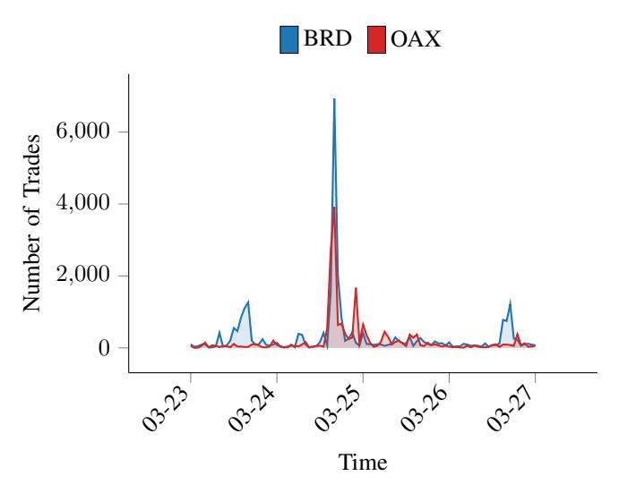
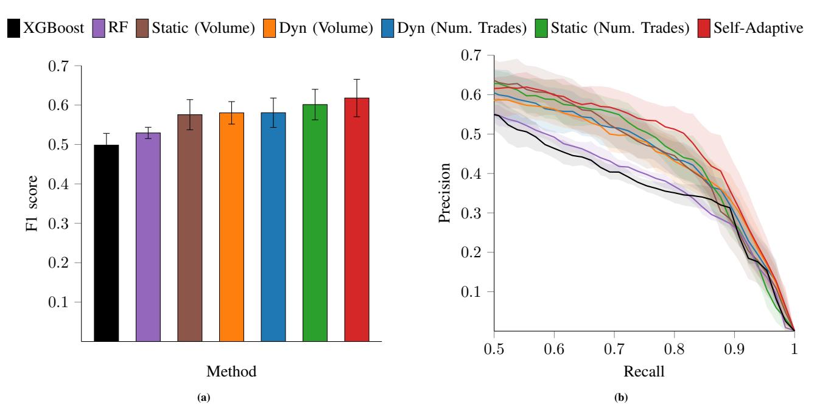
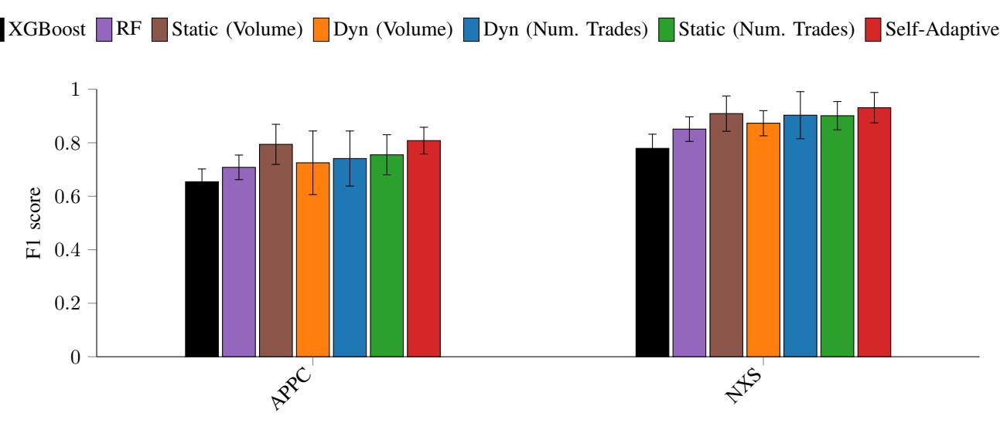

# Fraud Detection in Cryptocurrency Markets with Spatio-Temporal Graph Neural Networks

*Abstract*—Technological advancements in cryptocurrency markets have increased accessibility for investors, but concurrently exposed them to the risks of market manipulations. Existing fraud detection mechanisms typically rely on machine learning methods that treat each financial asset (i.e., token) and its related transactions independently. However, market manipulation strategies are rarely isolated events, but are rather characterized by coordination, repetition, and frequent transfers among related assets. This suggests that relational structure constitutes an integral component of the signal and can be effectively represented through graphical means. In this paper, we propose three graph construction methods that rely on aggregated hourly market data. The proposed graphs are processed by a unified spatio-temporal Graph Neural Network (GNN) architecture that combines attention-based spatial aggregation with temporal Transformer encoding. We evaluate our methodology on a real-world dataset comprised of pump-and-dump schemes in cryptocurrency markets, spanning a period of over three years. Our comparative results showcase that our graph-based models achieve significant improvements over standard machine learning baselines in detecting anomalous events. Our work highlights that learned market connectivity provides substantial gains for detecting coordinated market manipulation schemes.

*Index Terms*—spatio-temporal Graph Neural Network, market manipulation, pump-and-dump, cryptocurrency, fraud detection

#### I. INTRODUCTION AND RELATED WORK

Financial market manipulation is the attempt to distort the process by which the prices of financial assets are formed, so that they no longer reflect real information about supply and demand [\[1\]](#page-6-0). This encompasses many behaviors, but a useful research taxonomy distinguishes between trading-based, information-based and action-based manipulation [\[2\]](#page-6-1).

These phenomena can be traced back to the stock market itself [\[2\]](#page-6-1), yet there has recently been a notable surge in manipulative behaviour in the cryptocurrency markets. The fragmented liquidity and less stringent regulation of these markets may amplify the impact of manipulative activity, as discussed in [\[3\]](#page-6-2). Notable recent cases [\[4\]](#page-6-3), [\[5\]](#page-6-4) highlight that such fraudulent activities have a detrimental effect on both investors and on the credibility of the blockchain as an innovative system.

The coordination of market manipulation in crypto markets often occurs on encrypted messaging platforms, where channels are established with the objective of attracting speculators [\[6\]](#page-6-5). Empirically, these "campaigns" may leave distinct footprints in the price and the traded volume of the tokens. At the event level one typically observes: (i) a sudden increase in trading volume and number of trades over a short time interval, (ii) heavy concentration of activity on a single exchange or venue, and (iii) potential clustering of events in time, as the same groups may run multiple campaigns in quick succession. The

existence of these distinct patterns in cryptocurrency market manipulation motivates a statistical learning approach for their early detection.

The current state-of-the-art methods for detecting financial market frauds exploit the underlying structure of financial interactions [\[7\]](#page-6-6). They leverage graphical representations of financial data and deep learning, particularly graph neural networks (GNNs) [\[8\]](#page-6-7), to capture relational patterns in the network [\[9\]](#page-6-8), [\[10\]](#page-6-9). For cryptocurrencies in particular, fraud detection is increasingly graph-oriented, learning directly from interaction networks rather than just price or volume anomalies. In [\[11\]](#page-6-10), [\[12\]](#page-6-11) transaction-level cryptocurrency information is exploited (e.g., sender-receiver directed graphs), which inherently implies a direct notion of the graphical structure of the problem. However, many accessible real-world datasets provide only aggregated market observations at the token level, such as OHLCV information (open, high, low, close prices and trading volume) over fixed time intervals, number of trades, and derived indicators. In this context, the relational structure between activities is not directly observed, as there are no explicit edges or direct notions of relational interactions. Consequently, a graph-based approach requires constructing an adjacency structure from aggregated time series, with different constructions leading to different inductive biases in the downstream GNN models.

#### *Contributions and outline*

We introduce a framework that enables Spatio-Temporal GNN (ST-GNN) modeling through specific graph construction methods, utilizing only aggregated market data. To strictly evaluate and compare these construction strategies, we employ a unified ST-GNN predictor across all experiments. This architecture processes data in two stages: first, for each timestamp in a lookback window, a Transformer-style spatial GNN computes node embeddings based on the constructed graph. Second, these spatial embeddings are stacked into a sequence, enriched with positional encodings, and processed by a temporal Transformer encoder to map the spatiotemporal context to a final event probability. For the graph construction, we follow a correlation-based construction approach [\[13\]](#page-6-12) that quantifies co-movement in market aggregates during the training period. We adapt this idea to the problem of fraud detection in cryptocurrency markets, and derive the adjacency matrix from correlation coefficients, which we then sparsify via set thresholds. This graph construction approach is extended beyond a single static topology with two dynamic variants. Additionally, we consider a self-adaptive graph construction

variant that learns latent dependencies directly from the data, capturing interactions beyond feature-based correlations.

Our approach is evaluated on a real-world dataset of pump-and-dump (P&D) events extracted from [14] detected in the period 2017-2021. The three ST-GNN variants are compared against the widely used decision-tree methods Random Forests [15] and XGBoost [16]. Unlike existing P&D detection datasets, where the learning problem is formed by extracting a local window around each pump event and concatenating these labeled segments [6], [14], we consider a global historical window that is shared across all tokens in the sample. While local windows are well-suited to measuring event signatures, they also condition the sample on being near a pump, thereby discarding most daily market variation. This can reduce background market movements and may lead to an optimistic assessment of detection difficulty, i.e., a form of selection bias in the evaluation that results in high accuracy metrics. Our global window approach shifts the task toward a more realistic surveillance setting, i.e., a highly imbalanced learning problem in which fraudulent episodes are rare relative to the full stream of normal market activity. In particular, in our constructed dataset, we observe  $\sim 0.016\%$  of anomalous events in a total of  $\sim 1.9 \times 10^6$  observations.

The remainder of this paper is organized as follows. In Section II, we briefly recap the problem of detecting fraudulent events when assuming aggregated market data samples, and present a high level overview of our approach. In Section III we focus on our method for estimating graphs from these samples, and using them as input in a ST-GNN architecture to detect anomalous events. In Section IV, we perform numerical experiments on real-world data and compare with state-of-the-art decision-tree methods in order to validate our proposed routines, and finally in Section V we draw conclusions from this work. Our code and data are publicly available in Github.

#### Notation

In what follows, we denote scalar quantities with lowercase, vectors with lowercase bold, and matrices with uppercase bold characters. The (i,j)th entry of a matrix  $\mathbf{A}$  is symbolized by  $A_{ij}$  and all entries in row i or column j by  $\mathbf{A}_{i:}$  and  $\mathbf{A}_{:j}$ , respectively. Sets are denoted by capital calligraphic characters, for example,  $\mathcal{A}$ , the identity matrix as  $\mathbf{I}$  and the vector of all ones as  $\mathbf{e}$ .

#### <span id="page-1-0"></span>II. FRAUD DETECTION WITH AGGREGATED MARKET DATA

We address the detection of cryptocurrency fraud events at the token level, with hourly resolution using aggregated market data. In II-A we formally introduce the problem, and in II-B its formulation within a Graph Neural Network (GNN) architecture.

# <span id="page-1-2"></span>A. Problem setting

Let  $\mathcal{V} = \{1, \dots, N\}$  be the set of traded tokens and let  $t \in \{1, \dots, T\}$  be the index of discrete hourly timestamps. For each token  $i \in \mathcal{V}$  at time t, we observe a vector of aggregate

features  $\mathbf{x}_{i,t} \in \mathbb{R}^F$  and a binary label  $y_{i,t} \in \{0,1\}$  indicating whether a fraudulent episode occurs for token i at time t. Let  $\mathbf{X}_t \in \mathbb{R}^{N \times F}$  be the matrix containing all the feature vectors of the tokens at time t. Our goal is to learn a predictor  $f_{\theta}$  that estimates the probability  $\hat{p}_{i,t}$  of fraud for a specific token i at time t,

$$\hat{p}_{i,t} = f_{\theta}(\mathbf{x}_{i,t}, \mathbf{x}_{i,t-1}, \dots, \mathbf{x}_{i,t-W+1}) \in [0, 1],$$

$$\hat{y}_{i,t} = \mathbb{I}\{\hat{p}_{i,t} > \gamma\},$$
(1)

where W is the lookback window and  $\gamma \in (0,1)$  is a decision threshold to determine the binary prediction  $\hat{y}_{i,t}$ . In practice,  $\mathbf{x}_{i,t}$  typically includes OHLCV variables, trade counts, and additional engineered features, so that time-series information is available in tabular form.

#### <span id="page-1-3"></span>B. Formulation within a GNN architecture

Graph Neural Networks (GNNs) are architectures designed to learn from graph-structured data by iteratively updating node representations through information exchange along edges (i.e., message passing) [17]. Let  $\mathbf{h}_i^{(k)} \in \mathbb{R}^D$  denote the embedding of node i after the k-th propagation step, with  $\mathbf{h}_i^{(0)}$  typically initialized from the input features, i.e.,  $\mathbf{h}_i^{(0)} = \mathbf{x}_{i,t}$ . A generic update then reads

$$\mathbf{h}_{i}^{(k)} = \mathbf{U}^{(k)} \left( \mathbf{h}_{i}^{(k-1)}, AGG^{(k)} \left( \left\{ \mathbf{h}_{j}^{(k-1)} : j \in \mathcal{H}(i) \right\} \right) \right),$$
 (2)

where  $\mathcal{N}(i)$  is the neighborhood of i,  $\mathrm{AGG}^{(k)}(\cdot)$  is a permutation-invariant aggregating function over neighbors (e.g., sum/mean/max), and  $\mathrm{U}^{(k)}(\cdot)$  is typically implemented by a Multilayer Perceptron (MLP). The number of steps k controls the propagation depth; after k steps,  $\mathbf{h}_i^{(k)}$  incorporates information from nodes up to k hops away.

In our setting, nodes correspond to traded tokens and edges encode inter-token relations derived from aggregated market dynamics. A spatio-temporal GNN (ST-GNN) extends message passing to time-indexed observations by combining a spatial graph aggregation at each time t with a temporal model that captures how node representations evolve across a lookback window [18]–[20]. Many GNN variants can be interpreted within this message-passing template, differing mainly in the way neighbor information is computed and propagated [21]–[23].

A practical constraint in cryptocurrency fraud detection arises from relying on exchange- or aggregator-provided APIs [24], [25] for data collection. These sources typically expose only market-level aggregates per token and time (e.g., OHLCV and related features) rather than transaction-level interactions. Consequently, the relational structure between assets remains latent, as there are no explicit edges and any notion of connectivity must be inferred from the observed time series [26]. This limits the applicability of many graph-based approaches that rely on a pre-defined interaction network, thus motivating the development of methods capable of constructing graphs from aggregated data, and utilizing them in the prediction task.

<span id="page-1-1"></span><sup>&</sup>lt;sup>1</sup>Link suppressed due to double-blind evaluation process.

# <span id="page-2-0"></span>III. INFERENCE GRAPHS METHODS AND A UNIFIED SPATIO-TEMPORAL GNN

We infer the graphical structure of token interactions from aggregated data, and utilize it in a spatio-temporal GNN to detect fraudulent events. Subsection III-A defines data representation and temporal windowing, and in Subsection III-B introduces our graph inference strategies. Then, Subsection III-C details the proposed GNN architecture.

# <span id="page-2-1"></span>A. Data representation and temporal windowing

Given the node feature matrix  $\mathbf{X}_t \in \mathbb{R}^{N \times F}$ , temporal context is captured through a fixed lookback window of length W. For each node  $i \in \mathcal{V}$  at time t, we form the sequence

$$\mathbf{X}_{i,t}^{(W)} = \left[\mathbf{x}_{i,t-W+1}, \dots, \mathbf{x}_{i,t}\right] \in \mathbb{R}^{W \times F}.$$
 (3)

Stacking these sequences for all nodes yields the windowed tensor  $\mathbf{X}_t^{(W)} \in \mathbb{R}^{N \times W \times F}$ , whose *i*-th slice satisfies  $\mathbf{X}_t^{(W)}[i,:] = \mathbf{X}_{i,t}^{(W)}$ . The model outputs a probability per node for the current time t, i.e.,  $\hat{\mathbf{p}}_t \in [0,1]^N$ .

# <span id="page-2-2"></span>B. Graph inference strategies

We denote by  $\mathbf{A}_t \in \mathbb{R}^{N \times N}$  a weighted adjacency matrix at time t, and by  $\mathcal{E}_t = \{(i,j): A_{t,ij} \neq 0\}$  the corresponding directed edge set. Undirected connections are treated as directed edges from i to j and vice versa. When required for message passing, we equivalently represent  $\mathbf{A}_t$  as an edge list  $\mathcal{E}_t$  with associated edge weights  $\mathbf{a}_t = \{A_{t,ij}: (i,j) \in \mathcal{E}_t\}$ . Since the underlying market graph is latent, we define an inference operator

$$\mathbf{A}_t = g_t(\mathcal{D}_{\le t}),\tag{4}$$

which constructs  $\mathbf{A}_t$  relying solely on information available up to time t. This ensures that the graph construction respects the temporal order of observations, and in practice, is restricted only to training timestamps when building training-time graphs [27]. Here,  $\mathcal{D}_{\leq t}$  denotes the observed aggregated market data up to time t, i.e., the time series of token-level data used to build  $\mathbf{X}_t$  and any scalar time series  $s_{i,t}$  employed by the graph inference rule. We evaluate three graph construction methods for  $g_t$ , and summarize them in Algorithm 1.

#### (G1) Static correlation graph

We construct a single weighted adjacency from the training period and reuse it at every timestamp. Let  $\mathcal{T}_{\mathrm{tr}} \subseteq \mathcal{T}$  denote the set of training timestamps. Given a scalar time series  $s_{i,t}$  for each token i, obtained from a single chosen node feature (e.g., volume or number of trades), we define the log-transformed token-by-time matrix  $\mathbf{S} \in \mathbb{R}^{|\mathcal{T}_{\mathrm{tr}}| \times N}$  with entries:

$$S_{t,i} = \log(1 + s_{i,t}), \qquad t \in \mathcal{T}_{tr}, \ i \in \{1, \dots, N\}.$$
 (5)

We compute the Pearson correlation matrix  $\mathbf{C} \in [-1, 1]^{N \times N}$  and set the diagonal entries to zero:

$$C_{ij} = \operatorname{Corr}(\mathbf{S}_{:,i}, \mathbf{S}_{:,j}), \qquad C_{ii} = 0.$$
 (6)

# <span id="page-2-3"></span>Algorithm 1 Graph inference strategies from aggregated data

**Input:** Training timestamps  $\mathcal{T}_{tr}$ , fraud timestamps  $\mathcal{P}_{tr}$ , scalar feature  $s_{i,t}$ , density  $\rho$ , min threshold  $\tau_{\min}$ , dynamic horizon  $H{=}12$ , self-adaptive threshold  $\epsilon$ 

**Output:** Inferred adjacency (static **A**, dynamic updates  $\{\mathbf{A}^{(p)}\}\$ , or self-adaptive **A**)

#### (G1) Static

- 1: Compute C on  $\mathcal{T}_{tr}$  from  $\log(1 + s_{i,t})$
- 2:  $\tau \leftarrow \max(\tau_{\min}, Q_{\rho}(\{C_{ij}\}_{i < j}))$
- 3:  $A_{ij} \leftarrow C_{ij} \cdot \mathbb{I}\{C_{ij} > \tau\}$

# (G2) Dynamic event-driven

- 4: for each  $p \in \mathcal{P}_{tr}$  in chronological order do
- 5:  $\mathcal{W}(p) \leftarrow \{p L, \dots, p\}$
- 6: Compute  $\mathbf{C}^{(p)}$  on  $\mathcal{W}(p)$
- 7:  $\tau^{(p)} \leftarrow \max(\tau_{\min}, Q_{\rho}(\lbrace C_{ij}^{(p)} \rbrace_{i < j}))$
- 8: Add/update edges (i,j) where  $C_{ij}^{(p)} > \tau^{(p)}$  using running mean
- 9: Save  $\mathbf{A}^{(p)}$
- 10: end for

#### (G3) Self-adaptive

- 11: Learn  $\mathbf{E}_1, \mathbf{E}_2 \in \mathbb{R}^{N \times d}$ ; compute  $\mathbf{M} \leftarrow \mathbf{E}_1 \mathbf{E}_2^{\top}$
- 12:  $\mathbf{A} \leftarrow \operatorname{softmax}(\operatorname{ReLU}(\mathbf{M}))$  (row-wise)
- 13: Sparsify: keep (i, j) only if  $A_{ij} > \epsilon$

To sparsify this matrix, we select a data-driven threshold  $\tau$  via an off-diagonal quantile, subject to a minimum floor  $\tau_{\min}$ :

$$\tau = \max \left\{ \tau_{\min}, \ Q_{\rho} (\{C_{ij}\}_{i < j}) \right\}, \qquad A_{ij} = C_{ij} \, \mathbb{I} \{C_{ij} > \tau\},$$
(7)

with  $A_{ii}=0$  and  $(i\neq j)$ . Here  $Q_{\rho}$  denotes the  $\rho$ -quantile of the off-diagonal entries. This threshold retains only the strongest edges, i.e., the top  $1-\rho$  fraction of them, while  $\tau_{\min}$  ensured that retained edges represent statistically meaningfull correlations.

Since the resulting adjacency matrix is time-invariant, we have  $A_t = A$ ,  $\forall t$ . This approach assumes that even without explicit interactions, tokens can exhibit synchronized market activity. A static correlation graph is the simplest relational inductive bias compatible with aggregated token features [28].

# (G2) Event-driven dynamic correlation graph

Static graphs often fail to capture correlation shifts associated with manipulation episodes, as they rely on a fixed representation of the data, and do not update over time [29]. Our second graph construction approach addresses this limitation by constructing a piecewise-constant adjacency matrix that updates only around fraud events within the training data.

Let  $\mathcal{P}_{\mathrm{tr}} \subseteq \mathcal{T}_{\mathrm{tr}}$  be the set of training timestamps where at least one fraud event occurs. For each  $p \in \mathcal{P}_{\mathrm{tr}}$ , we consider a lookback window of L hours:

$$W(p) = \{p - L, \dots, p\} \cap \mathcal{T}_{tr}.$$
 (8)

Note that L denotes a graph construction lookback window, distinct from the feature window W in Section III-A. Using

the same scalar series  $s_{i,t}$  as in (G1), derived from volume or number of trades, we compute a window-specific correlation matrix  $\mathbf{C}^{(p)}$  from  $\{\log(1+s_{i,t}):t\in\mathcal{W}(p)\}$ , enforcing again  $C_{ii}^{(p)}=0$ . We then select edges representing significant interactions with a density-controlled threshold:

$$\tau^{(p)} = \max \left\{ \tau_{\min}, \ Q_{\rho} \left( \{ C_{ij}^{(p)} \}_{i < j} \right) \right\},$$
(9)

$$\mathcal{E}^{(p)} = \{ (i,j) : i < j, \ C_{i,j}^{(p)} > \tau^{(p)} \}. \tag{10}$$

For each undirected edge (i,j) we keep a cumulative sum  $S_{ij}$  of the correlation coefficients  $C_{ij}^{(p)}$ , and a counter  $n_{ij}$  representing the number of fraud event windows where the edge (i,j) was part of the graph, i.e.,  $(i,j) \in \mathcal{E}^{(p)}$ . The resulting edge weight is defined as the mean of these correlations,  $w_{ij} = S_{ij}/n_{ij}$ . The updated adjacency matrix  $\mathbf{A}^{(p)}$  is formed by setting  $A_{ij}^{(p)} = A_{ji}^{(p)} = w_{ij}$  and  $A_{ij}^{(p)} = 0$  otherwise.

At any time t, the model uses the graph state in the training set of the most recent fraud timestamp  $p^*$ ,

$$\mathbf{A}_{t} = \begin{cases} \mathbf{I}, & \text{if } \{p \in \mathcal{P}_{\text{tr}} : p \le t\} = \emptyset, \\ \mathbf{A}^{(p^{\star})}, & p^{\star} = \max\{p \in \mathcal{P}_{\text{tr}} : p \le t\}. \end{cases}$$
(11)

For timestamps in the validation and testing sets, the graph  $\mathbf{A}^{(p_{\mathrm{last}})}$  of the last training update is considered, with  $p_{\mathrm{last}} = \max \mathcal{P}_{\mathrm{tr}}$  being the last fraud event timestamp in the training set.

# (G3) Self-adaptive adjacency from node embeddings

While correlation-based graphs capture statistical synchronization between assets, they rely on fixed heuristic thresholds to determine connectivity, and thus, may not align with the optimal latent graph for fraud detection. To allow our model to discover latent dependencies directly from the data, we employ a self-adaptive adjacency construction approach inspired by [30].

We randomly initialize two learnable node embedding dictionaries  $\mathbf{E}_1, \mathbf{E}_2 \in \mathbb{R}^{N \times d}$ , representing source and target node embeddings, respectively. These embeddings are optimized together with the neural network weights via stochastic gradient descent, guided solely by minimizing the supervised classification objective. The hyperparameter d controls the rank of the learned adjacency matrix  $\mathbf{A}$ . The adjacency matrix, that can be considered as the transition matrix of a hidden diffusion process [30], is then computed as

$$\mathbf{A} = \operatorname{SoftMax}(\operatorname{ReLU}(\mathbf{E}_1 \mathbf{E}_2^\top)). \tag{12}$$

Here, the ReLU activation function eliminates weak or negative connections, while the row-wise SoftMax normalizes the weights to obtain a row-stochastic adjacency.

To sparsify this dense graph, we set edges with weights below a small tuned constant  $\epsilon$  to zero:

$$\mathcal{E} = \{(i,j) : A_{ij} > \epsilon\}, \qquad A_{ij} \leftarrow A_{ij} \mathbb{I}\{A_{ij} > \epsilon\}, \quad (13)$$

Unlike the undirected graphs in (G1) and (G2), this approach generates an unsymmetric matrix  $\mathbf{A} \neq \mathbf{A}^{\top}$ .

#### <span id="page-3-1"></span>C. ST-GNN architecture

All inferred graphs are used within the same spatio-temporal model architecture. At each hour t, the inferred adjacency  $\mathbf{A}_t$  defines the neighborhood  $\mathcal{N}_t(i) = \{j : A_{t,ij} \neq 0\}$ . We encode (i) spatial interactions on  $\mathbf{A}_t$  with a Transformer-style attention GNN layer [31], and (ii) temporal dependencies via a Transformer encoder over an L-hour lookback window [19], [32].

First, spatial aggregation is performed at each time step. For each node  $i \in \mathcal{V}$ , the input feature vector  $\mathbf{x}_{i,t}$  is mapped to a spatial embedding  $\mathbf{h}_{i,t} \in \mathbb{R}^D$  via attentive message passing over  $\mathbf{A}_t$ :

<span id="page-3-3"></span>
$$\mathbf{h}_{i,t} = \text{GraphTransformer}(\mathbf{x}_{i,t}, \mathbf{A}_t).$$
 (14)

Subsequently, we construct the temporal sequence by stacking the embeddings from the lookback window W:

$$\mathbf{H}_{i,t} = \left[ \mathbf{h}_{i,t-W+1}, \dots, \mathbf{h}_{i,t} \right] \in \mathbb{R}^{W \times D}. \tag{15}$$

We add learnable positional encodings into  $\mathbf{H}_{i,t}$ , and process the sequence with a temporal Transformer encoder, denoted by  $\mathrm{TE}(\cdot)$ . The fraud event probability for node i at time t is obtained by

$$\hat{p}_{i,t} = \sigma(\mathbf{w}^{\top} \text{TE}(\mathbf{H}_{i,t})[W] + b), \qquad (16)$$

where  $\mathbf{w} \in \mathbb{R}^D$  and  $b \in \mathbb{R}$  are learnable output parameters and  $\sigma(\cdot)$  is the sigmoid logistic function. Algorithm 2 summarizes the forward pass.

#### <span id="page-3-2"></span>Algorithm 2 ST-GNN forward pass

**Input:** Windowed node features  $\mathbf{X}_t^{(W)} \in \mathbb{R}^{N \times W \times F}$ , inferred graph  $(\mathcal{E}_t, \mathbf{a}_t)$  where  $\mathbf{a}_t$  are edge weights, parameters  $\theta$  **Output:** Event probabilities  $\hat{\mathbf{p}}_t \in [0, 1]^N$ 

 seq ← [] ▷ will store spatial embeddings for each hour in the window

```
2: for u = 1 to W do \Rightarrow iterate over window steps 3: \mathbf{H} \leftarrow \mathbf{W}_{\text{in}} \mathbf{X}_{t}^{(W)}[:, u, :]
```

4: 
$$\mathbf{H} \leftarrow \operatorname{TransformerConv}_1(\mathbf{H}, \mathcal{E}_t, \mathbf{a}_t)$$

5: 
$$\mathbf{H} \leftarrow \text{ReLU}(\mathbf{H})$$
;  $\mathbf{H} \leftarrow \text{Dropout}(\mathbf{H})$ 

6: 
$$\mathbf{H} \leftarrow \text{TransformerConv}_2(\mathbf{H}, \mathcal{E}_t, \mathbf{a}_t)$$

7:  $\mathbf{H} \leftarrow \text{ReLU}(\mathbf{H})$ 

8:  $seg.append(\mathbf{H})$ 

9: end for

10:  $\mathbf{S} \leftarrow \operatorname{Stack}(\operatorname{seq}) \in \mathbb{R}^{N \times W \times D}$ 

11:  $\mathbf{S} \leftarrow \mathbf{S} + \mathbf{P}$   $\triangleright$  positional embedding

12:  $\tilde{\mathbf{S}} \leftarrow \text{TemporalTransformerEncoder}(\mathbf{S})$ 

13:  $\mathbf{z} \leftarrow \mathbf{S}[:, W, :]$   $\triangleright$  last time token

14:  $\hat{\mathbf{p}}_t \leftarrow \sigma(\mathbf{W}_{\text{out}}\mathbf{z} + \mathbf{b})$ 

15: return  $\hat{\mathbf{p}}_t$ 

# IV. NUMERICAL RESULTS

<span id="page-3-0"></span>In this section, we present experimental results on real-world data for an extensive evaluation of the accuracy and efficacy of the proposed graph-based fraud detection routines outlined in Section [III.](#page-2-0) We will compare our methods against the following decision-tree based ensemble methods:

- 1) Random Forests (RF) [\[15\]](#page-6-14): Aggregates predictions from decorrelated decision trees trained on bootstrap samples and feature subsampling. We use a grid search to optimize the number of estimators nest ∈ {500, 1000}), maximum tree depth dmax ∈ {12, ∞}, minimum samples per leaf nmin ∈ {1, 10}, and the feature subset size considered at each split <sup>F</sup>sub ∈ {√ F , 0.8F}.
- 2) eXtreme Gradient Boosting (XGBoost) [\[16\]](#page-6-15): A gradientboosted tree method that sequentially fits trees to correct previous errors. We tune the learning rate η ∈ {0.05, 0.1}, maximum tree depth (dmax ∈ {4, 10}), number of estimators (nest ∈ {500, 1000}), and L2 regularization parameter λ ∈ {1.0, 10.0}, while fixing row and column subsampling rates at 0.8.

The following Subsection [IV-A](#page-4-0) summarizes our experimental setup, and then [IV-B](#page-5-1) is devoted in a comparison of the accuracy of the methods under consideration.

# <span id="page-4-0"></span>*A. Experimental setup*

We consider a real-world dataset of pump-and-dump events from, covering the period July 2017 – January 2021, where labels where assigned by monitoring encrypted messaging platforms and linking each market manipulation campaign to a target token [\[33\]](#page-7-13). We collect the available market data for quote currency BTC through the Binance API [\[24\]](#page-7-3), and assign a unique timestamp by combining the date and hour fields and localizing the resulting time to UTC. Since market data are represented as hourly candles[2](#page-4-1) , pump timestamps are rounded to the nearest hour boundary to enforce a consistent alignment between the pump schedule and the candle grid. A pump episode from our dataset is illustrated in Figure [1,](#page-4-2) where the number of trades spikes sharply around the event time for two tokens, highlighting both the market signature of coordinated activity and the presence of cross-token co-movement that motivates our graph-based approach.

For each token we download a continuous time interval spanning from the earliest to the latest pump timestamp in the schedule, both extended by a fixed margin of seven days. Consequently, all tokens share the same time boundaries, resulting in a panel that includes both normal market activity and rare fraud episodes, contains the candle timestamp, OHLCV information and trading activity. The binary fraud label flag is assigned by checking whether the candle timestamp belongs to the set of pump timestamps associated with that token. The dataset contains 1,905,850 observations for N = 84 tokens. The positive class (flagged pump hours) includes 314 positives, corresponding to a positive rate of ∼ 0.016%.

We compute 18 additional features on this base panel to capture abrupt regime shifts, typical of coordinated manipulation. Since our dataset is limited to candle-level aggregates

<span id="page-4-2"></span>

Fig. 1: Hourly number of trades for BRD and OAX over a four-day window around one pump event.

and does not include order-book information (e.g., bid–ask depth or spread), we construct a proxy for aggressive buy pressure using the ratio between taker buy quote volume and total traded volume at the candle level. For each token, we compute rolling statistics over a fixed window of 12 hours and then consider their percentage change over time, following the feature construction in [\[33\]](#page-7-13). Such percentage changes of rolling means or rolling standard deviations quantify how quickly the local average or local variability is shifting, which is the type of signal expected under coordinated activity. Following this approach, we compute percentage changes of rolling mean and standard deviation for the buy pressure, traded volume, number of trades, and close price. We then compute the same transformation for the rolling mean of the intraperiod maximum price. Last, since intraday patterns can be relevant when campaign timing is systematic, we derive an hour feature as the integer hour extracted from the timestamp. The full list of the features considered is offered in Table [I](#page-7-14) in Section [VI](#page-7-15) of the Appendix.

To respect temporal ordering and emulate a surveillance setting, we adopt a chronological hold-out split for all considered models. Let T denote the ordered set of unique hourly timestamps in the panel. We partition T into 60% for training, 20% for validation, and 20% for testing. Graph construction using historical observations is performed using only the training data, model hyperparameters and early stopping criteria are selected on the validation set, and the test set is utilized only for the final accuracy estimation. Then, to mitigate shortrange temporal dependence and reduce leakage around split boundaries, an embargo of z = 5 hours is adopted and the first z timestamps of the validation and test blocks are discarded [\[34\]](#page-7-16). We evaluate performance in terms of precision, recall, and F1 score, defined as:

<span id="page-4-3"></span>
$$F1\text{-score} = 2 \cdot \frac{\text{Precision} \cdot \text{Recall}}{\text{Precision} + \text{Recall}},$$
 (17)

<span id="page-4-1"></span>In financial market microstructures, a candle (or candlestick) aggregates trading activity over a fixed time interval and is typically represented by the OHLC information, together with volume and related trade counts for that interval.

<span id="page-5-2"></span>

Fig. 2: Classification performance for all methods under consideration. (a) F1-score, and (b) mean precision-recall curves for Recall ∈ [0.5, 1].

where precision is defined as Precision = TP/(TP + FP) and recall as Recall = TP/(TP + FN), with TP, FP, and FN denoting true positives, false positives, and false negatives classifications, respectively. All the results reported hereby correspond to their mean value after 9 runs. For all experiments, we employ the ST-GNN architecture defined in Section [III-C](#page-3-1) with a fixed learning rate of 10<sup>−</sup><sup>3</sup> , and a spatial embedding dimension of D = 64 (Eq. [14\)](#page-3-3), 2 attention heads, and a temporal window of W = 5 hours. Regarding graph construction, for the correlation-based strategies (G1, G2), we set the minimum threshold to τmin = 0.15, the dynamic lookback window to L = 12. The quantile density in (G1) is set to ρ = 0.90 when considering the number of trades, to 0.75 when considering the volume, and to 0.95 for both dynamic variants in (G1). Finally, for the self adaptive graph (G3), the learnable embedding dimension is d = 48 and the sparsity threshold is ϵ = 0.005. All the results reported hereby correspond to their mean value after 9 runs.

# <span id="page-5-1"></span>*B. Classification performance*

We present in Figure [2a](#page-5-2) the F1-score [\(17\)](#page-4-3) of the classification of the minority (i.e., fraudulent) class. The two tree-based methods achieve the lowest scores, with XGBoost (in black) yielding the lowest F1 = 0.49 ± 0.03 and Random Forests (in purple) improving upon it with F1 = 0.53 ± 0.01. All our introduced graph-based variants outperform these baselines in terms of classification accuracy. The static graph based on volume correlation (in brown), and its dynamic counterpart (in orange) achieve F1 = 0.575 ± 0.04 and F1 = 0.58 ± 0.02, respectively. The strongest correlation-based performance is obtained when connectivity is derived from the number of trades as a proxy for trading activity with F1 = 0.58 ± 0.04 for the dynamic graph (in blue) and F1 = 0.60 ± 0.04) for the

static one (in green). The self-adaptive graph (in red) achieves the best overall accuracy with F1 = 0.62 ± 0.05, indicating that allowing the model to adjust connectivity during training is beneficial when the graph topology is not available. The moderate error bars across seeds confirm that these rankings are stable and not driven by favorable initializations.

In Figure [2b,](#page-5-2) we report the mean Precision-Recall (PR) curves for Recall ∈ [0.5, 1]. Given the extreme class imbalance in our test set, containing only ∼ 0.016% positive pump hours in a total of ∼ 1.9 × 10<sup>6</sup> hours, we prioritize PR curves over ROC analysis, as the latter can be insensitive to the false-positive burden when negatives dominate [\[35\]](#page-7-17). The plot highlights a consistent performance gap, with graph-based models shifting the PR frontier upward relative to the tree-based baselines, implying higher precision for any given recall level. While performance naturally degrades as recall approaches 1, our graph-based methods maintain precision levels significantly longer than the tree-based baselines. The best method is the self-adaptive variant, which dominates the frontier across the majority of the sensitivity range.

In Figure [3](#page-6-18) we present the classification performance in terms of F1-score [\(17\)](#page-4-3) for the most affected tokens, with at least five recorded pump events in the test set. All graphbased variants introduced in Subection [III-B](#page-2-2) report accuracy scores higher than the competing tree-based methods. The self-adaptive variant (in red) achieves the highest scores with F1 = 0.808±0.05 for APPC and F1 = 0.931±0.06 for NXS.

### V. CONCLUSIONS

<span id="page-5-0"></span>We presented a framework to detect manipulation in cryptocurrency markets, specifically addressing the scenario where only aggregated market data are available, i.e., OHLCV and trading activity, while transaction-level information remains

<span id="page-6-18"></span>

Fig. 3: Classification performance in terms of F1-score for all methods under consideration for tokens with at least five pump events in the test set.

unobservable. To overcome this limitation, we proposed a methodology that infers token-to-token connectivity from market dynamics, and processes it via a unified spatio-temporal GNN (ST-GNN) architecture. We proposed three graph inference methods: static correlation, event-driven dynamic correlation, and self-adaptive adjacency learning.

We compared our graph-based solutions against tree-based methods on a real-world labeled dataset of pump-and-dump schemes spanning the period 2017–2021. Our results demonstrate that graph-based models are superior in terms of F1-score and Precision-Recall efficiency. Notably, the selfadaptive adjacency method achieved the highest fraud detection performance, confirming that the model can successfully learn latent interaction structure between tokens. Our work highlights the effectiveness of the introduced graph-based fraud detection algorithms, and their applicability for the monitoring of market manipulation events.

#### ACKNOWLEDGMENT

Suppressed due to double-blind evaluation process.

#### REFERENCES

- <span id="page-6-0"></span>[1] Netherlands Authority for the Financial Markets (AFM), "Market manipulation," Regulatory brochure (Market Abuse Regulation context), 2017, brochure processed ESMA Q&As up to 6 July 2017.
- <span id="page-6-1"></span>[2] T. J. Putnin¸s, "Market manipulation: A survey," ˇ Journal of Economic Surveys, vol. 26, no. 5, pp. 952–967, 2012.
- <span id="page-6-2"></span>[3] J. T. Hamrick, F. Rouhi, A. Mukherjee, A. Feder, N. Gandal, T. Moore, and M. Vasek, "An examination of the cryptocurrency pump-and-dump ecosystem," Information Processing and Management, vol. 58, no. 4, p. 102610, 2021.
- <span id="page-6-3"></span>[4] S. Shifflett and P. Vigna, "Some traders are talking up cryptocurrencies, then dumping them, costing others millions," The Wall Street Journal, Aug. 2018, available at: [https://www.wsj.com/graphics/](https://www.wsj.com/graphics/cryptocurrency-schemes-generate-big-coin/) [cryptocurrency-schemes-generate-big-coin/.](https://www.wsj.com/graphics/cryptocurrency-schemes-generate-big-coin/)
- <span id="page-6-4"></span>[5] B. Merewhuader, C. Polite, and T. Viane, "Class action complaint, merewhuader *et al.* v. safemoon llc *et al.*, no. 2:22-cv-01108 (c.d. cal. feb. 17, 2022)," Filed in U.S. District Court for the Central District of California, 2022.

- <span id="page-6-5"></span>[6] J. Xu and B. Livshits, "The anatomy of a cryptocurrency Pump-and-Dump scheme," in 28th USENIX Security Symposium (USENIX Security 19). Santa Clara, CA: USENIX Association, 2019, pp. 1609–1625.
- <span id="page-6-6"></span>[7] L. Akoglu, H. Tong, and D. Koutra, "Graph based anomaly detection and description: a survey," Data Mining and Knowledge Discovery, vol. 29, no. 3, pp. 626–688, 2015.
- <span id="page-6-7"></span>[8] X. Ma, J. Wu, S. Xue, J. Yang, C. Zhou, Q. Z. Sheng, H. Xiong, and L. Akoglu, "A comprehensive survey on graph anomaly detection with deep learning," IEEE transactions on knowledge and data engineering, vol. 35, no. 12, pp. 12 012–12 038, 2021.
- <span id="page-6-8"></span>[9] Y. Dou, Z. Liu, L. Sun, Y. Deng, H. Peng, and P. S. Yu, "Enhancing graph neural network-based fraud detectors against camouflaged fraudsters," in Proceedings of the 29th ACM International Conference on Information & Knowledge Management (CIKM '20). Virtual Event, Ireland: Association for Computing Machinery, Oct. 2020.
- <span id="page-6-9"></span>[10] J. Schmidt, D. Pasadakis, M. Sathe, and O. Schenk, "GAMLNet: a graph based framework for the detection of money laundering," in 2024 11th IEEE Swiss Conference on Data Science (SDS), 2024, pp. 241–245.
- <span id="page-6-10"></span>[11] C. Wu, J. Chen, Z. Zhao, K. He, G. Xu, Y. Wu, H. Wang, H. Li, Y. Liu, and Y. Xiang, "Tokenscout: Early detection of ethereum scam tokens via temporal graph learning," in Proceedings of the 2024 on ACM SIGSAC Conference on Computer and Communications Security, CCS 2024, Salt Lake City, UT, USA, October 14-18, 2024, B. Luo, X. Liao, J. Xu, E. Kirda, and D. Lie, Eds. ACM, 2024, pp. 956–970.
- <span id="page-6-11"></span>[12] C. Wu, J. Chen, J. Li, J. Xu, J. Jia, Y. Hu, Y. Feng, Y. Liu, and Y. Xiang, "Profit or deceit? mitigating pump and dump in defi via graph and contrastive learning," IEEE Transactions on Information Forensics and Security, vol. 20, pp. 8994–9008, 2025.
- <span id="page-6-12"></span>[13] K. da Costa, "Anomaly detection in global financial markets with graph neural networks and nonextensive entropy," 2023, arXiv:2308.02914v2.
- <span id="page-6-13"></span>[14] M. La Morgia, A. Mei, F. Sassi, and J. Stefa, "The pump and dump scheme in the bitcoin era: Real time detection of cryptocurrency market manipulations," in 2020 29th International Conference on Computer Communications and Networks (ICCCN). IEEE, 2020, pp. 1–9.
- <span id="page-6-14"></span>[15] L. Breiman, "Random forests," Machine Learning, vol. 45, no. 1, pp. 5–32, 2001.
- <span id="page-6-15"></span>[16] T. Chen and C. Guestrin, "Xgboost: A scalable tree boosting system," in Proceedings of the 22nd ACM SIGKDD International Conference on Knowledge Discovery and Data Mining, ser. KDD '16. New York, NY, USA: Association for Computing Machinery, 2016, p. 785–794.
- <span id="page-6-16"></span>[17] G. Corso, H. Stark, S. Jegelka, T. Jaakkola, and R. Barzilay, "Graph neural networks," Nature Reviews Methods Primers, vol. 4, no. 1, p. 17, 2024.
- <span id="page-6-17"></span>[18] B. Yu, H. Yin, and Z. Zhu, "Spatio-temporal graph convolutional networks: A deep learning framework for traffic forecasting," in Proceedings of the 27th International Joint Conference on Artificial Intelligence, 2018, pp. 3634–3640.

- <span id="page-7-11"></span>[19] G. Jin, Y. Liang, Y. Fang, Z. Shao, J. Huang, J. Zhang, and Y. Zheng, "Spatio-temporal graph neural networks for predictive learning in urban computing: A survey," IEEE transactions on knowledge and data engineering, vol. 36, no. 10, pp. 5388–5408, 2023.
- <span id="page-7-0"></span>[20] Z. Wu, S. Pan, G. Long, J. Jiang, X. Chang, and C. Zhang, "Connecting the dots: Multivariate time series forecasting with graph neural networks," in Proceedings of the 26th ACM SIGKDD International Conference on Knowledge Discovery & Data Mining, 2020, pp. 753–763.
- <span id="page-7-1"></span>[21] T. N. Kipf and M. Welling, "Semi-supervised classification with graph convolutional networks," in 5th International Conference on Learning Representations, ICLR 2017, Toulon, France, April 24-26, 2017, Conference Track Proceedings, 2017.
- [22] P. Velickovic, G. Cucurull, A. Casanova, A. Romero, P. Lio, and ` Y. Bengio, "Graph attention networks," in 6th International Conference on Learning Representations, ICLR 2018, Vancouver, BC, Canada, April 30 - May 3, 2018, Conference Track Proceedings, 2018.
- <span id="page-7-2"></span>[23] K. Xu, W. Hu, J. Leskovec, and S. Jegelka, "How powerful are graph neural networks?" in 7th International Conference on Learning Representations, ICLR 2019, New Orleans, LA, USA, May 6-9, 2019, 2019.
- <span id="page-7-3"></span>[24] Binance, "Binance spot api documentation: Rest api," [https://developers.](https://developers.binance.com/docs/binance-spot-api-docs/rest-api) [binance.com/docs/binance-spot-api-docs/rest-api,](https://developers.binance.com/docs/binance-spot-api-docs/rest-api) accessed: 2026-02-01.
- <span id="page-7-4"></span>[25] CoinGecko, "Coingecko api documentation," [https://docs.coingecko.com/](https://docs.coingecko.com/reference/introduction) [reference/introduction,](https://docs.coingecko.com/reference/introduction) accessed: 2026-02-01.
- <span id="page-7-5"></span>[26] D. Pasadakis, M. Bollhofer, and O. Schenk, "Sparse quadratic approxi- ¨ mation for graph learning," IEEE Transactions on Pattern Analysis and Machine Intelligence, vol. 45, no. 9, pp. 11 256–11 269, 2023.
- <span id="page-7-6"></span>[27] C. Shang, J. Chen, and J. Bi, "Discrete graph structure learning for forecasting multiple time series," in International Conference on Learning Representations (ICLR), 2021.
- <span id="page-7-7"></span>[28] M. Tumminello, T. Aste, T. Di Matteo, and R. N. Mantegna, "Correlation, hierarchies, and networks in financial markets," Journal of Economic Behavior & Organization, vol. 75, no. 1, pp. 40–58, 2010.
- <span id="page-7-8"></span>[29] D. Matsunaga, T. Suzumura, and T. Takahashi, "Exploring graph neural networks for stock market predictions with rolling window analysis," CoRR, vol. abs/1909.10660, 2019.
- <span id="page-7-9"></span>[30] Z. Wu, S. Pan, G. Long, J. Jiang, and C. Zhang, "Graph wavenet for deep spatial-temporal graph modeling," in Proceedings of the 28th International Joint Conference on Artificial Intelligence, ser. IJCAI'19. AAAI Press, 2019, p. 1907–1913.
- <span id="page-7-10"></span>[31] Y. Shi, Z. Huang, S. Feng, H. Zhong, W. Wang, and Y. Sun, "Masked label prediction: Unified message passing model for semi-supervised classification," in Proceedings of the Thirtieth International Joint Conference on Artificial Intelligence, IJCAI-21, Z.-H. Zhou, Ed. International Joint Conferences on Artificial Intelligence Organization, 8 2021, pp. 1548– 1554, main Track.
- <span id="page-7-12"></span>[32] A. Vaswani, N. Shazeer, N. Parmar, J. Uszkoreit, L. Jones, A. N. Gomez, Ł. Kaiser, and I. Polosukhin, "Attention is all you need," Advances in Neural Information Processing Systems, vol. 30, 2017.
- <span id="page-7-13"></span>[33] M. La Morgia, A. Mei, F. Sassi, and J. Stefa, "Pump and dumps in the bitcoin era: Real time detection of cryptocurrency market manipulations," in 2020 29th International Conference on Computer Communications and Networks (ICCCN), 2020, pp. 1–9.
- <span id="page-7-16"></span>[34] M. Lopez de Prado, ´ Advances in Financial Machine Learning. Hoboken, NJ: John Wiley & Sons, 2018.
- <span id="page-7-17"></span>[35] T. Saito and M. Rehmsmeier, "The precision-recall plot is more informative than the roc plot when evaluating binary classifiers on imbalanced datasets," PloS one, vol. 10, no. 3, p. e0118432, 2015.

#### VI. APPENDIX

<span id="page-7-15"></span><span id="page-7-14"></span>

| feature            | type | definition                               |
|--------------------|------|------------------------------------------|
| OHLCV              | raw  | Open/high/low/close and volume.          |
| quote asset volume | raw  | Volume in quote currency.                |
| num trades         | raw  | Trades per hour.                         |
| taker buy base     | raw  | Hourly taker-buy volume (base).          |
| taker buy quote    | raw  | Hourly taker-buy volume (quote).         |
| std rush order     | eng  | Pct. change 12h roll std (buy pressure). |
| avg rush order     | eng  | Pct. change 12h roll mean (buy pres      |
|                    |      | sure).                                   |
| std trades         | eng  | Pct. change 12h roll std (num trades).   |
| std volume         | eng  | Pct. change 12h roll std (volume).       |
| std price          | eng  | Pct. change 12h roll std (close).        |
| avg volume         | eng  | Pct. change 12h roll mean (volume).      |
| avg price          | eng  | Pct. change 12h roll mean (close).       |
| avg price max      | eng  | Pct. change 12h roll mean (high).        |
| hour of the day    | time | UTC hour of the day.                     |

TABLE I. Feature set used in the numerical experiment. Raw features are obtained directly from the market data downloader, engineered features (eng) are constructed during the feature engineering stage, and temporal features (time) are derived from the UTC timestamp of each observation.