# Epiplexity Guided Data Selection and Generation for Out-of-Distribution Generalization

Ellen Su∗<sup>1</sup> Andres Potapczynski∗<sup>1</sup> Shikai Qiu<sup>1</sup> Edward Hughes<sup>2</sup> Andrew Gordon Wilson<sup>1</sup>

<sup>1</sup>New York University <sup>2</sup> Inherent <sup>∗</sup>Equal contribution

# Abstract

Modern systems are increasingly expected to transfer across tasks not specified during training. What data facilitates generalization in these new, unanticipated settings? One hypothesis is that data with more structural information could contain shared circuits and subprograms that could be recycled in a wider array of downstream settings. Epiplexity, a recently proposed measure of the structural information a compute-bounded learner can extract from data, provides a mechanism to reason about this relationship. In this paper, we show how to operationalize epiplexity as an online training signal for data selection and synthetic data generation. For selection, we fit scaling laws to the training loss curves of natural data domains to predict the expected epiplexity gain as a function of training tokens, and use this signal to adaptively determine the sampling weights over domains during training. For synthetic data generation, we define a generator's reward as the change in the epiplexity of the learner's training data and use REINFORCE policy gradients to guide the generator toward an epiplexity-maximizing distribution. In both cases, higher epiplexity predicts improved downstream performance on zero-shot and fine-tuning based tasks, supporting the hypothesis that data rich in structural information yield representations that transfer across domains.

# 1 Introduction

Of model, optimizer, and data, it is *data* that is increasingly being recognized as the greatest lever for improving performance. This realization is compounded by an impending sense that we are entering a data-limited regime [\[1,](#page-10-0) [2\]](#page-10-1), where multi-epoch training is necessary at scale. Accordingly, there is a growing body of work exploring how training data interventions influence model performance. Current methods in data mixing and selection [\[3–](#page-10-2)[10\]](#page-11-0), curriculum and ordering [\[11,](#page-11-1) [12\]](#page-11-2), and self-play [\[13–](#page-11-3)[19\]](#page-11-4) all share the same implicit assumption that batches of data vary in how important they are to a learner, and that exploiting these differences can yield a model with better generalization. Many of these methods consider data quantity, diversity, and quality, but these notions are often vaguely defined. Moreover, models are increasingly deployed on new tasks and domains, many of which couldn't have been anticipated during training, making it even harder to reason about what properties of data ought to be desirable. In particular, how should we select data for greater *generality* in out-of-distribution (OOD) settings?

A recent theoretical development provides a promising starting point to reason about this question. Finzi et al. [\[20\]](#page-11-5) introduced *epiplexity*, a measure of the structural information content in data, characterized as the information in the model that minimizes the description length of data under computational constraints. Intuitively, epiplexity is how much useful information the data can teach the model. The area under the training loss curve above the final value of the loss is a simple approximation of epiplexity. Repetitive sequences have low epiplexity because they are learnable but compressible, and noise has low epiplexity because the model cannot learn from it. In contrast, data which makes a model work harder, through sustained and substantial decreases in loss, has high epiplexity. Further, as opposed to classical information measures, Finzi et al. [\[20\]](#page-11-5) establishes that epiplexity can be created

<span id="page-1-0"></span>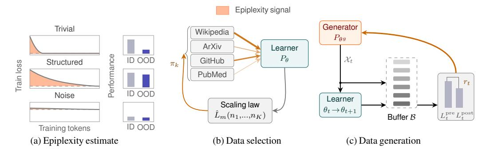

Figure 1: **Epiplexity for data selection and generation.** (a) Epiplexity, S(t), can be estimated as the area between the learner's training loss curve and its final loss as a function of training tokens. Data which is trivial to learn or unlearnable will yield low estimates of epiplexity and result in lower performance in OOD downstream tasks. (b) For data selection, we use scaling laws to forecast the per-domain loss curves and predict the change in epiplexity,  $\partial \hat{S}(t)/\partial n_j$ , as a function of in-domain tokens. We then greedily maximize  $\partial \hat{S}(t)/\partial n_j$  to determine the sampling weights  $\pi_k$  used in adaptive reweighting of the domains during data selection. (c) For data generation, we estimate  $d\hat{S}(t)/dt$  as the learner's loss reduction over an evaluation buffer  $\mathcal{B}$ , which stores the past training data. We set  $d\hat{S}(t)/dt$  as the reward and update the generator via REINFORCE to steer the generator toward producing epiplexity-maximizing synthetic data.

by computation, depends on the ordering of data, and can exceed the information content of the data-generating process itself, making it a compelling signal for interrogating the relationship between the structural information of training data and model generalization.

While Finzi et al. [20] contends that data with higher epiplexity should lead to better OOD generalization, since such data may contain shared structure that could be recycled in other settings, this hypothesis is largely untested. They show that existing data selection methods such as ADO [4] can *inadvertently* select for higher epiplexity data (relative to random batches), but neither develops a methodology that directly uses epiplexity for selection nor articulates the correspondence between epiplexity and downstream generalization. Thus, as it is unclear how to optimize these existing procedures of measuring epiplexity as an online training signal, key open questions remain: (1) how do we tractably estimate epiplexity during training? (2) how do we directly operationalize epiplexity for adaptive data selection? (3) could epiplexity be used for purely synthetic data *generation*? Answers to these questions require algorithmic innovation, but also provide new foundations for curriculum learning, synthetic data, and our scientific understanding of downstream generalization.

In this paper, we show two approaches to operationalizing epiplexity as a learning signal to intervene on training in both data selection and generation. In both cases, providing an optimizable online estimator for epiplexity is nontrivial. For selection, we fit scaling laws to per-domain loss curves in order to predict the expected epiplexity gain as a function of in-domain training tokens, and we maximize this signal to choose optimal batches of training data. For generation, we first train a generator to produce epiplexity-maximizing data for a learner by defining the reward as the increase in the epiplexity of the learner's training data then apply REINFORCE policy gradients [21, 22] to optimize the generator parameters. Intuitively, as both trivial and noisy data have near-zero epiplexity, this objective creates data that challenges the learner while remaining predictable. We show that our proposed data selection (EpiSelect) and generation (EpiGen) epiplexity-maximizing algorithms both advance performance over state-of-the-art.

In addition to our methodological proposals, our considerations also extend to *evaluation* of data selection for OOD generalization. We discover a key limitation of a popular benchmark, *The Pile* [23], in evaluating data selection methods for downstream generalization. Data selection methods are tasked with selecting an appropriate balance of the Pile sources (e.g. GitHub, Wikipedia, PileCC, ArXiv) in order to achieve the best zero-shot generalization in several downstream settings. However, surprisingly, we discover that the simple baseline of training only on the PileCC domain leads to better performance than the state-of-the-art (SOTA) data selection method. We therefore propose to pre-train data selection methods on the *Common Pile* [24] dataset, which controls for the influence

of domain size. Finally, we also evaluate the hypothesis that higher epiplexity corresponds to better OOD generalization and find that it holds across several settings.

### 2 Background

Our work integrates a diversity of research areas, including information theory and epiplexity, data selection, scaling laws, self-play, and measures for tracking learning progress.

**Epiplexity** Epiplexity [20] is a measure of the structural information in data that can be extracted by a model. Figure 1(a) builds intuition in showing that this quantity is small when the data is trivial to learn (rapid convergence to low loss), as in the case of simple repetitive sequences, and when the data is unlearnable (no loss decrease), as in the case of random noise. In both conditions, the data contains little to no information to help make future predictions. Conversely, this quantity is large when the data contains substantial structural information which can be gradually internalized by a model (sustained loss decrease). While natural images or highly informative text, like poetry, may be relatively incompressible, they contain rich structural information that enables strong downstream predictions.

The formal definition of epiplexity is the size of the model that minimizes the description length of data under a fixed compute budget. Computational constraints are important to the definition of epiplexity, because whether or not something appears unpredictable depends on our computational resources (for example, while pseudorandom numbers are deterministically generated, they are indistinguishable from actual random numbers if we only have polynomial-time computation). More concretely, suppose  $P_T$  is a probabilistic model that has a computational budget of T. The time-bounded minimum description length (MDL) representation of data is given by the size of the model,  $|P_T|$ , and the size of the data X given the model,  $\mathbb{E}[\log 1/P_T(X)]$ . Searching over the space of programs with a fixed computational budget, the model which minimizes this two part MDL is  $P_T^* = \operatorname{argmin}_{P_T \in \mathcal{P}_T}(|P_T| + \mathbb{E}[\log 1/P_T(X)])$ . Epiplexity is precisely the size of this program  $S(T) = |P_T^*|$ .

**Estimating Epiplexity** Finzi et al. [20] proposes using *prequential coding* to estimate epiplexity via the training curve. Suppose a randomly initialized model  $P_0$  is trained on a stream of i.i.d. sampled tokens  $X_i$ . The total entropy code length for the training data  $X_{:M} = \{X_0, \dots, X_{M-1}\}$  and final model weights  $P_M$  is given by  $L(X_{:M}, P_M) = \sum_{i=0}^{M-1} \log 1/P_i(X_i)$ . Appealing to the symmetry of information,  $L(Y) \approx L(X,Y) - L(X|Y)$ , we can approximate the final model size  $L(P_M)$ , which is precisely our target definition of epiplexity, as the difference of  $L(X_{:M}, P_M)$  and  $L(X_{:M}|P_M)$ :

<span id="page-2-0"></span>
$$|P_{\text{preq}}| \approx \sum_{i=0}^{M-1} (\log 1/P_i(X_i) - \log 1/P_M(X_i)).$$
 (1)

The prequential estimate of epiplexity is given by Equation 1, which has a simple geometric interpretation. Each term can be seen as the gap between the loss incurred on a token at the moment it was seen and the loss incurred on that same token by the final model. These cumulatively sum to the area between the training loss curve and the floor set by the best model obtainable under the compute budget. Crucially, we can build the first practically tractable estimators for epiplexity atop this approximation of the measure. In Sections 3 and 4, we introduce two novel estimation approaches, both of which replace the final loss with the current training loss, toward greedily maximizing epiplexity gain throughout training.

**Data Selection via Scaling Laws** Data selection methods rest on the hypothesis that there exist curricula, or data orderings, that lead to improved model performance over random shuffles [3–5, 7, 8, 10, 11, 25]. However, good curricula are hard to discover, relying on small model forecasting and expensive proxy training runs [3, 6], or meta-learning approaches which are computationally intractable [4, 9]. Prior work has proposed using neural scaling laws to extrapolate model loss as a function of training data [4, 26, 27]. For instance, a simple power law  $\hat{L}(n;\alpha,\beta,\epsilon) = \epsilon + \beta n^{-\alpha}$  reasonably models loss behavior over training when fit online. Jiang et al. [4] found that per-domain scaling laws can predict loss decreases and effectively guide data allocation across domains during training. However, this approach deferred to future work the modeling of cross-domain effects and instead relied on heuristic-based approximations. As the scaling laws trace the model's loss trajectories and epiplexity is measured as a function of that trajectory, this framework offers a natural opportunity to both apply epiplexity to the practical case of data selection among domains and to propose a parametric form for cross-domain scaling laws.

<span id="page-3-0"></span>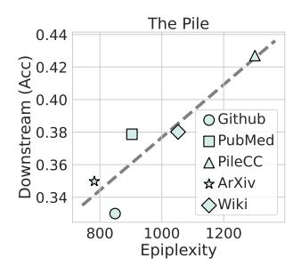

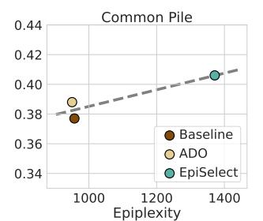

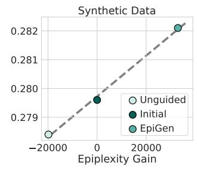

Figure 2: In all plots, we contrast epiplexity against the performance on a subset of the LM Eval Harness tasks (ARC, HellaSwag, LogiQA, WinoGrande, LAMBADA, SciQ and PIQA). (*Left*): **Higher epiplexity is correlated with better OOD generalization.** We estimate the epiplexity for the largest 5 domains on the Pile by solely training models on each domain. (*Middle*): EpiSelect achieves higher epiplexity than alternatives and outperforms state-of-the-art curriculum learning procedures. We contrast the measured epiplexity of EpiSelect on Common Pile against a baseline of selecting uniformly and ADO [4], a SOTA method. EpiSelect and ADO were initialized with a uniform distribution prior (Baseline) and both methods selected curricula which led to greater epiplexity and downstream accuracy. (*Right*): **Epiplexity guided synthetic data generation improves downstream performance.** We plot the performance of our initial checkpoint (Initial) and then compare the changes in epiplexity and performance when this checkpoint is trained on synthetic data naively generated from its original state (Unguided) versus training on synthetic from a generator trained to maximize epiplexity EpiGen.

**Model Self-Play** Self-play has proven to support model improvement and learning without human supervision across many applications [13, 14, 28]. In self-play, two co-evolving agents each yield an automatic learning curriculum which tracks the opponent's current skill level, leading to mutual improvement. Recent works have applied self-play to language model alignment [15, 16] and capability improvement [17–19]. In particular, Liu et al. [17] demonstrated that self-play on zero-sum games can effect a 10% improvement across reasoning benchmarks without the introduction of human-curated training data. The through-line goal of these works is for one agent to produce training data which is maximally informative—learnable, non-trivial, and that contains verifiable rewards—to the other agent at the current step in training. Epiplexity precisely targets this objective and offers a principled formalization of what self-play curricula aim to achieve.

Tracking Learning Progress Our implementation of epiplexity-guided synthetic data generation requires tracking the *learning progress* of a model throughout training. Rewarding a generator by learning-progress metrics is a long standing approach, dating back to literature in artificial curiosity [29–31] and active learning [32, 33]. These foundations have led to the broader paradigm of automatic curriculum learning, in which teacher models propose tasks at the limit of a learner model's competency [17, 19, 34, 35]. A failure mode in these approaches is that a generator rewarded purely for challenging the learner could collapse onto adversarial or low-entropy outputs that the learner memorizes without gaining generalizable structure [29]. To mitigate this issue, prior work pro-

<span id="page-3-1"></span>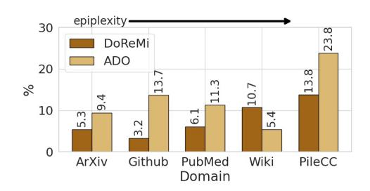

Figure 3: Prior data selection methods generally sample more data from domains with higher epiplexity. We show the percentage of training data DoReMi [3] and ADO [4] sample from each domain (ordered lowest to highest epiplexity) in the Pile.

poses verifiable environments (code executor, physical constraints in robotics, or surrogate difficulty tasks) to ground the rewards in external structure [17, 19, 31, 35]. In our approach, we estimate the prequential signal of epiplexity by evaluating the learner model over a generation history buffer. In this way, we are able to translate the information-theoretic quantity of epiplexity into a stable REINFORCE objective while obviating the need for external verifiers.

### <span id="page-4-0"></span>3 EpiSelect: Maximizing Epiplexity to Select Data Domains

We introduce EpiSelect, a new method that directly uses epiplexity to adaptively select batches of data through training. Section 3.1 shows that epiplexity of different data sources is a strong predictor of downstream performance. Section 3.2 introduces the EpiSelect procedure. In Section 3.3, we find the trivial procedure of only training on *PileCC* outperforms sophisticated curriculum learning procedures that had been benchmarked on *The Pile*. As a consequence, we propose instead evaluating curriculum procedures on the *Common Pile*, which has greater representation from a diversity of 30 sources. In Section 3.4, we show that EpiSelect on the *Common Pile* provides state-of-the-art performance across 10 downstream tasks.

### <span id="page-4-1"></span>3.1 Higher Epiplexity Predicts Better Downstream Generalization

Using The Pile [23], a popular benchmark for curriculum learning procedures, we evaluate whether higher epiplexity domains correspond to better downstream generalization.

We train separate 124M LLaMA 2 family architecture [36] models for 15B tokens on a few dominant (by size) domains in the Pile: arXiv, GitHub, PileCC, PubMed, and Wikipedia. We then compute a post-hoc estimate of the epiplexity of each domain using the prequential estimator (Equation 1) and evaluate each model on a suite of 7 zero-shot tasks in the Language Model Evaluation Harness [37]. As seen in Figure 2 (*Left*), epiplexity strongly predicts average downstream performance across data domains. In the leftmost panel, we train on the 5 largest individual Pile domains (since smaller domains lack sufficient in-domain tokens to train without multiple epochs, which violates the prequential estimator's assumption in Equation 1 that credits code-length reduction to unseen tokens). We find that, across domains, epiplexity correlates with OOD accuracy (Pearson r = 0.88, two-tailed p = 0.05), whereas the model's weight norm shows no such relationship (r = 0.01,  $\rho = 0.20$ , not significant). These results suggest that the predictive signal is specific to epiplexity rather than being a generic function of the trained checkpoint (details in Appendix B). In addition, we run two existing data selection methods DoReMi [3] and ADO [4] and show in Figure 3 that they implicitly upsample data domains with higher epiplexity. Together, these findings further motivate the design of our data selection method, EpiSelect, which explicitly maximizes epiplexity through training.

#### <span id="page-4-2"></span>3.2 Tractably Estimating Per-Domain Epiplexity

In data selection, we wish to adaptively select batches of training data, amongst various data domains, towards better downstream generalization. In other words, while standard training uses random minibatches of data, we wish to pursue *curriculum learning* and to adaptively choose the domain for each batch as we proceed through training. We propose a data selection procedure, EpiSelect, which chooses the batches at each iteration that maximizes epiplexity.

EpiSelect computes a distribution  $\pi \in \Delta^{K-1}$  over some K data domains in a given dataset in order to maximize the expected epiplexity gain during training. Following the prequential estimator of epiplexity (Equation 1), we estimate the total epiplexity  $\hat{S}$  at training step t with Equation 2, where  $n_k^{(s)}$  is the total number of domain k tokens seen at iteration s, and  $L_m(s)$  is the loss of domain m at iteration s.

<span id="page-4-3"></span>
$$\hat{S}(t) = \sum_{m=1}^{K} \hat{S}_m(t) = \sum_{m=1}^{K} \sum_{s=1}^{t} (L_m(s) - L_m(t))$$
(2)

In order to make online predictions for epiplexity gain during training, we follow prior work [4] to propose a cross-domain scaling law in Equation 3, which predicts the loss on each domain m as a function of the current token counts seen from every domain. During training, we repeatedly fit the scaling law for each domain  $\hat{L}_m$  to the observed per-domain losses  $L_m$  and per-domain tokens counts  $n_m$  collected from the training trajectory so far, using the form

<span id="page-4-4"></span>
$$\hat{L}_{m}(n_{1},...,n_{K}) = \epsilon_{m} + \beta_{m} \left( \sum_{k=1}^{K} \gamma_{m,k} n_{k} \right)^{-\alpha_{m}}$$
(3)

where  $\alpha_m$  and  $\beta_m$  are positive constants,  $\epsilon_m$  the irreducible error, and  $\gamma_{m,k} > 0$  (with  $\sum_{k=1}^K \gamma_{m,k} = 1$ ) the normalized influence of all the domains on domain m (fitting details in Appendix C). While our

model includes  $\gamma_{m,k}$  terms to capture cross-domain interactions, the single-domain scaling law can easily be recovered by setting  $\gamma_{m,k}=0$  for  $k\neq m$ . Substituting the scaling laws into Equation 2 and taking the derivative with respect to the number of tokens from domain j (full derivation in Appendix D), Equation 4 arrives at a proxy for how much additional structure would be gained by training on additional tokens from domain j at time t.

$$\frac{\partial \hat{S}}{\partial n_k} = \sum_{m=1}^K \frac{\partial \hat{S}_m}{\partial n_k} = \sum_{m=1}^K \frac{n_m \alpha_m \gamma_{m,k}}{\sum_{i=1}^K \gamma_{m,i} n_i} (\hat{L}_m(n_1, ..., n_K) - \epsilon_m)$$
(4)

To maximize the overall epiplexity accumulated throughout training, we greedily maximize  $\frac{\partial \hat{S}(t)}{\partial n_k}$  to select more tokens from domains which are predicted to contribute a great increase in epiplexity. In Equation 5, we compute the distribution over domains,  $\pi_k$ , as a softmax over  $\frac{\partial \hat{S}(t)}{\partial n_k}$ , scaled by temperature parameter  $\tau$ , which allows for interpolation between the uniform distribution  $\tau \to \infty$  and greedy maximization of marginal epiplexity  $\tau \to 0$ . In our experiments, we fixed  $\tau = 1$ .

<span id="page-5-2"></span><span id="page-5-1"></span>
$$\pi_k \propto \exp\left(\frac{1}{\tau} \frac{\partial \hat{S}(t)}{\partial n_k}\right)$$
 (5)

 $\pi_k$  serves as the domain sampling weights when selecting the next batch of training data. Algorithm 1 describes how we update the domain sampling weights with EpiSelect.

### Algorithm 1: Epiplexity Guided Data Selection

<span id="page-5-3"></span>**Input:** Initial parameters  $\theta$ , scaling law L, scaling law parameters  $\alpha, \beta, \gamma, \epsilon$ , loss function  $\mathcal{L}$ , momentum coefficient  $\omega \in (0,1)$ , clipping parameter  $\delta_{min}$ , temperature  $\tau \in (0,1)$ , batch size  $N \in \mathbb{N}$ , and update frequency  $\nu \in \mathbb{N}$ .

**Output:** Trained parameters  $\theta^{(T)}$ 

```
\begin{array}{l} \textbf{for } t = 1,2,...,T \ \textbf{do} \\ & \textbf{if} \quad \operatorname{mod}(t,\nu) = 0 \ \textbf{then} \\ & \quad \alpha,\beta,\gamma,\epsilon = \operatorname{FitScalingLaw}\left((L^{(s)})_{s=1}^t,(n^{(s)})_{s=1}^t\right) \\ & \quad \hat{S}(t) = \sum_{m=1}^K \sum_{s=1}^t (\hat{L}_m^{(s)} - \hat{L}_m^{(t)}) \\ & \quad \pi_k \propto \exp(\frac{1}{\tau} \frac{\partial \hat{S}(t)}{\partial n_k}) \\ & \quad \pi_k \leftarrow \operatorname{clip}(\omega \pi_k + (1-\omega)\bar{\pi}_k,\delta_{\min}) \\ & \quad \mathcal{B} \sim \pi, \ \text{with} \ |\mathcal{B}| = N = \sum_k b_k^{(t)} \\ & \quad \bar{\pi}_k \leftarrow \frac{t}{t+1}\bar{\pi}_k + \frac{1}{t+1}\pi_k \\ & \quad \mathcal{A}' \ \text{Global mean} \\ & \quad L_k^{(t)} = \frac{1}{n_k^{(t)}} \sum_{x \in \mathcal{B}_k} \mathcal{L}(\theta^{(t)},x) \\ & \quad \theta^{(t+1)} = \operatorname{OptimizerUpdate}(\theta^{(t)},\nabla_{\theta}\mathcal{L}(\theta^{(t)},\mathcal{B})) \\ \end{array}
```

### <span id="page-5-0"></span>3.3 Saturation of Data Selection Methods on Pile

In our first data selection experiment, following prior work, we trained 124M transformer models of the LLaMA 2 family [36] on the uncopyrighted subset of the Pile dataset [23], which contains around 210B tokens across 17 domains (excluding the original Books3, BookCorpus2, OpenSubtitles, YTSubtitles, and OWT2 domains due to copyright issues).

However, due to the inherent domain size imbalance in the Pile uncopyrighted dataset, with one domain, PileCC, dominating at 41% of the dataset tokens, we found that the performance of data selection methods on Pile is saturated. Not only were the performances across selection methods highly similar, but the differences in downstream performance could be predicted by the differences in how each method selected from PileCC. We then trained our model exclusively on the PileCC domain, and Figure 4 shows that this model was able to outperform ADO [4], the SOTA selection method. While it is valid that perhaps PileCC (a dataset of common crawl web text) is the most useful training data for model generalization, this result means that the ideal selector would only

<span id="page-6-2"></span>Table 1: EpiSelect generally provides the best performance at both model scales. Zero-shot accuracy (higher is better) on LM Evaluation Harness tasks for 124M- and 1.3B-parameter models. Highlighted cells indicate the top-performing method within each model family. We compare against checkpoints trained on the Natural data distribution and using the state-of-the-art ADO selector. Our improvement over ADO exceeds previously reported improvements over baselines [4].

|           | ARC   | BBQ   | BoolQ | CSQA  | HSwag | LAM   | OBQA  | PIQA  | SciQ  | WinoG | Average |
|-----------|-------|-------|-------|-------|-------|-------|-------|-------|-------|-------|---------|
| 124M      |       |       |       |       |       |       |       |       |       |       |         |
| Natural   | 0.199 | 0.352 | 0.529 | 0.194 | 0.279 | 0.263 | 0.134 | 0.597 | 0.708 | 0.519 | 0.377   |
| ADO [4]   | 0.206 | 0.365 | 0.493 | 0.197 | 0.277 | 0.252 | 0.146 | 0.596 | 0.734 | 0.524 | 0.379   |
| EpiSelect | 0.212 | 0.409 | 0.587 | 0.210 | 0.273 | 0.260 | 0.156 | 0.595 | 0.707 | 0.529 | 0.394   |
| 1.3B      |       |       |       |       |       |       |       |       |       |       |         |
| Natural   | 0.338 | 0.332 | 0.590 | 0.196 | 0.306 | 0.404 | 0.196 | 0.604 | 0.745 | 0.514 | 0.422   |
| ADO [4]   | 0.344 | 0.327 | 0.586 | 0.192 | 0.307 | 0.351 | 0.200 | 0.623 | 0.790 | 0.526 | 0.425   |
| EpiSelect | 0.352 | 0.356 | 0.599 | 0.209 | 0.315 | 0.404 | 0.184 | 0.613 | 0.772 | 0.511 | 0.431   |

ever select from the PileCC domain, which makes Pile uninformative as a benchmark for distinguishing between selection strategies. Therefore, in subsequent data selection experiments, we evaluate the selection methods on the Common Pile dataset, an 8TB collection of public-domain text.

Common Pile spans 30 domains, and the largest domain (Stack V2) accounts for roughly 14% of the entire dataset. We additionally built a token-balanced version of the Common Pile dataset (details in Appendix A) and report subsequent data selection results on this construction.

### <span id="page-6-0"></span>3.4 Data Selection Experiments

We now show that by directly selecting for domains with high epiplexity, EpiSelect provides a practically compelling framework for curriculum learning. In these experiments, we train decoder-only transformer models (124M and 1.3B) of the LLaMA 2 family architecture [36, 38] on the Common Pile dataset, an 8TB collection of public-domain text comprising 30 sources. We compare our method (EpiSelect) against a no selection baseline

<span id="page-6-1"></span>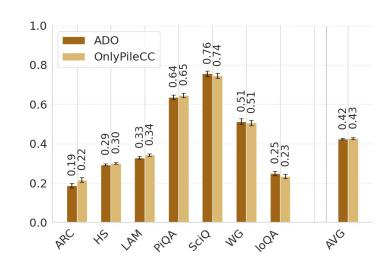

Figure 4: The Pile does not require data selection. Data selectors in the literature are trained to select domains on Pile, but solely training on the largest subdomain outperforms SOTA.

(Natural), which samples batches proportionally to domain size (balanced according to the procedure in Appendix A), and the ADO selection method [4], a state-of-the-art approach for curriculum learning. We chose baselines which have comparable training overhead, omitting prior works, such as DoReMi [3], which require trained smaller proxy models, incur larger costs, and underperform ADO. We train all models for a fixed budget of 15B tokens and evaluate all models on 10 common zero-shot downstream tasks in the Language Model Evaluation Harness [37]. Further details in E.1. Code available at https://github.com/eysu35/EpiSelect.

**Epiplexity Maximizing Selector Achieves Highest Performance Across Zero-Shot Tasks** We evaluate our epiplexity maximizing selector on a set of 10 zero-shot language understanding tasks from the LM Evaluation Harness [37]: ARC, BBQ, BoolQ, CSQA, HellaSwag (HSwag), LAMBADA (LAM), OBQA, PIQA, SciQ, and WinoGrande (WinoG).

In Table 1, we show that for both model sizes, EpiSelect achieves the highest average task accuracy (0.394 and 0.431 for 124M and 1.3B, respectively), outperforming both the Natural (no selection) baseline and ADO by margins comparable to those reported in prior work [4]. The improvements are consistent across task categories, with EpiSelect attaining the top score on 6 of 10 tasks for both model sizes. These results provide the initial support for our central hypothesis: by reweighting the batches toward domains predicted to contribute the largest marginal increase in epiplexity, the selector induces a training curriculum that produces representations which transfer more effectively to a diverse set of OOD tasks.

<span id="page-6-3"></span>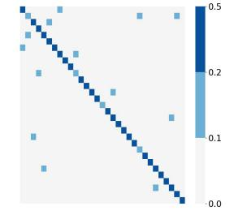

Figure 5: **Few domains** interact. Diagonal  $\gamma_{m,k}$  values dominate.

### **Cross-Domain Effects Are Sparse and Directional**

A key component of estimating epiplexity correctly is to model the cross-domain effects as seen in Equation 3. Figure 5 plots the matrix of fitted

 $\gamma_{m,k}$  values at the end of training, which captures the weighting that domain k tokens have when computing the predicted loss in domain m. We see that, beyond improved downstream performance, our cross-domain scaling laws surface an interpretable map of inter-domain influence. By the end of training, the fitted  $\gamma_{m,k}$  matrix is diagonally dominant, which aligns with our intuition that training on domain k tokens should have the highest impact toward reducing loss on domain k. We also observe a sparse set of strong cross-domain effects, in the off-diagonal values, and note an asymmetry in the domain interactions.

### <span id="page-7-0"></span>**EpiGen: Maximizing Epiplexity for Synthetic Data Generation**

We have shown that epiplexity can provide a practically compelling signal for data selection. Curriculum learning is often faced with the dilemma of whether we should learn on "hard" or "easy" problems first. Epiplexity provides a more nuanced resolution: train on batches that challenge the model, which incur sustained drops in loss, but are still learnable. What those batches are will depend on the state of the model throughout training.

We now move to the question of data generation. Purely synthetic data generation, not in the form of simple transformations, such as in data augmentation, is almost uncharted territory. When a training dataset is not neatly divided into domains or we require additional training data, synthetic data is especially promising. It is our contention that, in the future, synthetic data will become an indispensable component of the pretraining pipeline.

We show for the first time how epiplexity can be operationalized to select over generator model weights to effectively guide synthetic data generation. Intuitively, the generated data should challenge the learner, leading to sustained and substantial decreases in loss, while not being trivial (zero loss) or noise (high irreducible loss). As previously shown in panel (a) of Figure 1, the prequential coding estimate of epiplexity captures this notion and is well-suited to guide a generator model toward producing optimal synthetic data while mitigating reward hacking.

We train a generator model,  $P_{\theta^g}$ , to generate high-epiplexity synthetic data used to train a separate learner model,  $P_{\theta}$ . To estimate the epiplexity for the learner model, we implement a generation buffer  $\mathcal{B}$ , which accumulates the generated data throughout training, including the current batch  $\mathcal{X}_t$ . Our use of a buffer differs in function from experience replay [39, 40], where a buffer stores past transitions for off-policy training updates. In our method, the buffer is not used to train either model; instead, it serves as a reference distribution for reward computation and provides a tractable estimate of epiplexity. For each batch of generated data, Equation 6 estimates the change in epiplexity as the difference between the learner loss on the samples in the buffer before  $(P_{\theta_{t-1}})$  and after  $(P_{\theta_t})$  training on the current batch.

<span id="page-7-2"></span><span id="page-7-1"></span>
$$r_t = S(t) - S(t-1) = \sum_{x \in \mathcal{B}} \left( \log(1/P_{\theta_{t-1}}(x)) - \log(1/P_{\theta_t}(x)) \right)$$
 (6)

$$r_{t} = S(t) - S(t-1) = \sum_{x \in \mathcal{B}} \left( \log(1/P_{\theta_{t-1}}(x)) - \log(1/P_{\theta_{t}}(x)) \right)$$

$$\nabla_{\theta^{g}} \mathcal{J} = \mathbb{E}_{\mathcal{X}_{t} \sim P_{\theta^{g}}} \left[ (r_{t} - b) \cdot \sum_{x \in \mathcal{X}_{t}} \nabla_{\theta^{g}} \log P_{\theta^{g}}(x) \right]$$

$$(6)$$

In order for the generator to learn to maximize the resulting epiplexity, we can set the reward  $r_t$  for the model as this step-wise change in epiplexity and optimize the objective  $\mathcal{J}(\theta^g) = \mathbb{E}[r_t]$  using REINFORCE policy gradients [22]. In Equation 7, the gradient can be expressed as a product of an advantage term (where baseline  $b \leftarrow \beta \cdot b + (1 - \beta) \cdot r_t$  tracks the reward history with an exponential moving average) and the log-likelihood of the batch. Algorithm 2 describes this training procedure.

#### <span id="page-7-3"></span>Synthetic Data Generation Experiments

To empirically validate EpiGen, we initialize a generator and a learner model from the pretrained GPT-2 weights of Radford et al. [41], and train the learner on batches of synthetic data produced by the generator. We train the generator to optimize for an epiplexity-maximizing distribution via REINFORCE policy gradients. Fortunately, the variance of our REINFORCE gradients is not high, leading to stable generation dynamics as seen in Appendix F. We compare the final EpiGen learner model against the pretrained GPT-2 checkpoint (Pretrained) and a set of baseline learner models trained by the following generators: a frozen generator to match the total token count (FrozenGen), a

### Algorithm 2: Epiplexity Guided Data Generation

<span id="page-8-0"></span>Input: Pretrained checkpoint  $P_{\theta_0}$ ; learning rates  $\eta_\ell, \eta_g$ ; generation temperature  $\tau$ ; baseline EMA decay  $\beta$ ; batch size B, buffer subsample size M; iterations T, learner steps per iteration K

```
Output: Generator P_{\theta^g}, learner P_{\theta}
\theta^g \leftarrow \theta_0, \theta \leftarrow \theta_0
                                                                                                                                                                                                                                // Init generator, learner
b \leftarrow 0.\mathcal{B} \leftarrow \emptyset
                                                                                                                                                                                                                                          // Init baseline, buffer
for t = 1, 2, ..., T do
            \mathcal{X}_t \leftarrow \{x_i\}_{i=1}^B \stackrel{\text{i.i.d.}}{\sim} P_{\theta^g}(\cdot \mid \tau)
                                                                                                                                                                                                                                                                         // Generate batch
              |\hat{\mathcal{B}}_{t-1} \sim \mathcal{B}_{t-1}, \quad |\hat{\mathcal{B}}_{t-1}| = M
                                                                                                                                                                                                                                                               // Subsample buffer
           \begin{array}{l} \tilde{\mathcal{B}}_t \leftarrow \hat{\mathcal{B}}_{t-1}, \quad |\mathcal{D}_{t-1}| - M \\ \hat{\mathcal{B}}_t \leftarrow \hat{\mathcal{B}}_{t-1} \cup \mathcal{X}_t \\ L_t^{pre} \leftarrow \frac{1}{M+B} \sum_{x \in \hat{\mathcal{B}}_t} \mathcal{L}(\theta_{t-1}, x) \\ \theta_t \leftarrow \theta_{t-1} \\ \text{for } k = 1, 2, ..., K \text{ do} \\ \left[ \begin{array}{c} \theta_t \leftarrow \theta_t - \frac{\eta_\ell}{B} \sum_{x \in \mathcal{X}_t} \nabla_{\theta_t} \mathcal{L}(\theta_t, x) \end{array} \right] \end{array}
                                                                                                                                                                                                                                                                                       // Loss before
                                                                                                                                                                                                                                                                         // Learner update
          L_{t}^{post} \leftarrow \frac{1}{M+B} \sum_{x \in \mathcal{X}_{t}} \mathcal{L}(\theta_{t}, x)
r_{t} \leftarrow L_{t}^{pre} - L_{t}^{post}
\theta^{g} \leftarrow \theta^{g} + \frac{\eta_{g}}{B} [(r_{t} - b) \cdot \sum_{x \in \mathcal{X}_{t}} \nabla_{\theta^{g}} \log P_{\theta^{g}}(x)]
b \leftarrow \beta \cdot b + (1 - \beta) \cdot r_{t}
\mathcal{B}_{t} \leftarrow \mathcal{B}_{t-1} \cup \mathcal{X}_{t}
                                                                                                                                                                                                                                                                                            // Loss after
                                                                                                                                                                                                                                                                // Generator update
```

generator trained with a heuristic-based reward (PPL, negative log perplexity), and a generator trained with a learning-based reward that only considers the current batch of data (NoBuffer). To verify that the learner is shifting from the pretrained distribution, we track its performance on OpenWebText [42] (OWT), which is an open source reproduction of WebText, the pretraining dataset of GPT-2 [41]. Finally, we evaluate the learner model's generalization capacity on subtasks from the General Language Understanding Evaluation (GLUE) benchmark [43]. Additional details are provided in Appendix E.2. Code available at https://github.com/eysu35/EpiGen.

Training on Synthetic Data Improves Fine-Tuning Task Performance After training on synthetic data, we evaluate the learner on fine-tuning-based GLUE tasks [43] in order to assess the representation quality of the new learner model. For each model, we follow the standard procedure of fine-tuning all weights along with a linear classification head on seven GLUE natural language understanding tasks (CoLA, SST-2, MRPC, QQP, MNLI, QNLI, RTE) for 3 epochs using a learning rate of  $2 \times 10^{-5}$  and batch size 32, then evaluating the model on the development set. We report per-task scores using each task's standard metric as given in the benchmark reference (Matthews correlation coefficient for CoLA, accuracy for others) and the average score. Table 2 shows that training the generator with the epiplexity-maximizing reward yields a learner model which outperforms the pretrained baseline on most GLUE tasks.

Critically, none of the learner models evaluated in Table 2 have seen any more tokens of real data than the pretrained model. Yet we see the epiplexitymaximizing generator is able to produce synthetic data which yields a learner model that achieves the highest overall score across GLUE tasks (Table 2) while maintaining low perplexity on in-distribution OWT prediction (Appendix G). We note an uptick in performance even when the learner is trained on additional tokens sampled from the FrozenGen pretrained generator weights, which suggests that improvement is partially accredited to continued training on additional in-distribution tokens. However, the gap between the FrozenGen, PPL, and NoBuffer and EpiGen methods isolates the contribution of epiplexity-based guidance. One hypothesis we have for the source of the

<span id="page-8-1"></span>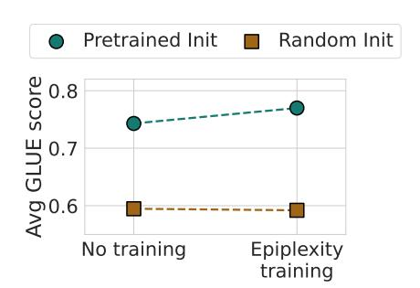

Figure 6: **Synthetic data learning signal emerges from pretrained model weights.** Average GLUE score for pretrained vs. random initialization, with and without epiplexityguided training.

improvement is that computing the reward over the data buffer may partially regularize the generator

<span id="page-9-0"></span>Table 2: **Training on synthetic data that maximizes epiplexity increases fine-tuning performance on GLUE.** Epiplexity-guided synthetic data training yields a 2.7-point average improvement in the learner model over the Pretrained baseline. Highlighted cells indicate the top-performing method for each task. All tasks report accuracies except CoLA, which reports Matthews Correlation Coefficient due to class imbalance. Higher is better for all.

|            | CoLA  | SST-2 | MRPC  | QQP   | MNLI  | QNLI  | RTE   | Average |
|------------|-------|-------|-------|-------|-------|-------|-------|---------|
| Pretrained | 0.264 | 0.930 | 0.779 | 0.891 | 0.814 | 0.884 | 0.639 | 0.743   |
| FrozenGen  | 0.388 | 0.924 | 0.774 | 0.893 | 0.817 | 0.882 | 0.632 | 0.759   |
| PPL        | 0.380 | 0.911 | 0.770 | 0.892 | 0.815 | 0.882 | 0.643 | 0.756   |
| NoBuffer   | 0.367 | 0.919 | 0.767 | 0.892 | 0.815 | 0.881 | 0.661 | 0.757   |
| EpiGen     | 0.422 | 0.920 | 0.777 | 0.892 | 0.817 | 0.886 | 0.675 | 0.770   |

model against mode collapse. Memorizing a particular batch  $\mathcal{X}_t$  of noise data would not reduce learner loss on the remainder of  $\mathcal{B}$ , meaning generating a non-generalizable sample will not guarantee a high reward. This hypothesis is partially supported by the fact that synthetic data quality seems to be maintained throughout the course of training, despite not having any external verifiers or grounding constraints in our setup. We provide a set of randomly selected synthetic text samples generated at steps 1000 and 60,000 (last) in Appendix H.

The Importance of Pretrained Initialization To better understand the efficacy of our method, we first investigate the effect of model initialization to determine where the additional learning signal sources from. We ran our data generation pipeline with generator and learner model initialized with random weights and with pretrained GPT-2 weights. Figure 6 shows that, while epiplexity-guided training improves average GLUE performance from 0.743 to 0.770 with the pretrained GPT-2 weights, it provides essentially no change (-0.003) with the random initialization. This finding is consistent with the observation that while the ceiling of reinforcement learning is in principle not bound to the pretrained model, empirically the quality of the pretrained initialization still constrains the performance after RL [44]. In our case, having a pre-trained generator proves necessary for RL to discover useful synthetic data.

**Mixtures of Synthetic and Real Data Prove Most Valuable** Finally, although self-play paradigms are inherently useful in not requiring additional data to improve model performance, we conduct a data mixing experiment to assess how the epiplexity-guided synthetic data stack up against novel real data.

<span id="page-9-1"></span>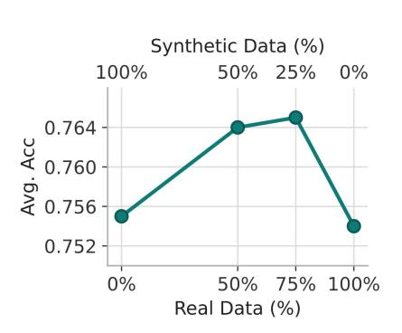

Figure 7: Mixing synthetic and real data yields the greatest improvement. Average GLUE score for learners trained on varying proportions of epiplexity-guided synthetic data and OWT data.

Here, we initialize the generator model as the trained, epiplexity-maximizing generator from Section 4.1. Then, we run the data generation pipeline with another learner model (initialized with the pretrained GPT-2 weights) and keep the generator weights frozen. In this way, we train the learner on the epiplexity-maximizing synthetic dataset for the entire duration of training, and can incrementally replace fractions of the batches of synthetic dataset with samples from the OWT dataset, all of the same sequence length, to further ablate the impact of synthetic data training on downstream performance. We make note of an additional analysis in Appendix G.1, in which we ablate the fraction of OWT data in the evaluation buffer to more realistically approximate epiplexity over all prior training data, real and synthetic. Figure 7 shows that learner models trained on 50% and 25% of synthetic data (and, subsequently, 50% and 75% of OWT data) achieve higher average performance on the OOD GLUE benchmark, indicating that training on synthetic and real data outperforms training on either one

individually. This result both further validates the performance improvement we observed in Table 2 and substantiates the need for principled synthetic data generation methods.

#### 5 Discussion

Machine learning research has historically operated under the assumption that we wish to maximize generalization performance on test points drawn from the same distribution as a set of training data. From the model selection side, this setting has led to principles such as Occam's razor, where we wish

to have the simplest explanation that is consistent with our observations. However, we are now entering uncharted territory, where we train models on heterogeneous data and deploy them in new unanticipated domains. This setting forces a shift in perspective from model selection to data selection. The principles here may be quite different: while we want the model for a given dataset to be as compressible as possible, perhaps we want to expose the model to data that makes the model as incompressible as possible. The rationale for this prescription is that we want our models to learn to the fullest extent, with the hope that what it is learning may be applied in a wide array of settings. This contention is at the heart of epiplexity.

We showed that epiplexity not only predicts better downstream generalization, but can be used to develop novel selection procedures that exceed state-of-the-art. Perhaps surprisingly, we also showed that epiplexity has promise as a learning signal for generating purely synthetic data that improves out-of-distribution generalization. The idea of synthesizing data for OOD generalization is entirely new, with many exciting future directions to explore. Multi-modal and multi-objective generation, as well as efficiency and scale, will be key considerations. We note some limitations of our work. First, we conducted our experiments on small models, which are inherently constrained in their performance on downstream tasks, and additional experiments should be conducted on the scalability and generalizability of these methods across model architectures. In addition, in both data selection and generation, we relied on a tractable proxy for epiplexity rather than the quantity itself, and we leave to future work the theoretical guarantees that maximizing for this proxy during training maximizes the true epiplexity. Further ahead, we will in time have a better understanding of what abstract properties of data are shared across domains beyond epiplexity, so that we can generate increasingly universal data samples, leading to broadly improved generalization.

Acknowledgements. We thank Eric Elmoznino, Guillaume Lajoie, Anthony GX-Chen, and all members of the Wilson Lab for helpful feedback. This work was supported by DARPA AIQ HR00112590066, NSF CAREER IIS-2145492, NSF CDS&E-MSS 2134216, Google's TPU Research Cloud (TRC) program, and Lambda's Research Grant Program. ES is supported by the Meta AIM PhD Fellowship. SQ is supported by the Two Sigma PhD Fellowship.

# References

- <span id="page-10-0"></span>[1] Niklas Muennighoff, Alexander Rush, Boaz Barak, Teven Le Scao, Nouamane Tazi, Aleksandra Piktus, Sampo Pyysalo, Thomas Wolf, and Colin A Raffel. Scaling data-constrained language models. *Advances in Neural Information Processing Systems*, 36:50358–50376, 2023.
- <span id="page-10-1"></span>[2] Pablo Villalobos, Anson Ho, Jaime Sevilla, Tamay Besiroglu, Lennart Heim, and Marius Hobbhahn. Position: Will we run out of data? limits of llm scaling based on human-generated data. In *Forty-first International Conference on Machine Learning*, 2024.
- <span id="page-10-2"></span>[3] Sang Michael Xie, Hieu Pham, Xuanyi Dong, Nan Du, Hanxiao Liu, Yifeng Lu, Percy Liang, Quoc V. Le, Tengyu Ma, and Adams Wei Yu. Doremi: Optimizing data mixtures speeds up language model pretraining. *ArXiv*, abs/2305.10429, 2023.
- <span id="page-10-3"></span>[4] Yiding Jiang, Allan Zhou, Zhili Feng, Sadhika Malladi, and J. Zico Kolter. Adaptive data optimization: Dynamic sample selection with scaling laws. *ArXiv*, abs/2410.11820, 2024.
- <span id="page-10-4"></span>[5] Qian Liu, Xiaosen Zheng, Niklas Muennighoff, Guangtao Zeng, Longxu Dou, Tianyu Pang, Jing Jiang, and Min Lin. Regmix: Data mixture as regression for language model pre-training. *ArXiv*, abs/2407.01492, 2024.
- <span id="page-10-7"></span>[6] Simin Fan, Matteo Pagliardini, and Martin Jaggi. Doge: Domain reweighting with generalization estimation. *ArXiv*, abs/2310.15393, 2023.
- <span id="page-10-5"></span>[7] Mayee F. Chen, Nicholas Roberts, Kush Bhatia, Jue Wang, Ce Zhang, Frederic Sala, and Christopher Ré. Skill-it! a data-driven skills framework for understanding and training language models. *ArXiv*, abs/2307.14430, 2023.
- <span id="page-10-6"></span>[8] Yuxian Gu, Li Dong, Hongning Wang, Yaru Hao, Qingxiu Dong, Furu Wei, and Minlie Huang. Data selection via optimal control for language models. *ArXiv*, abs/2410.07064, 2024.
- <span id="page-10-8"></span>[9] Yuxian Gu, Li Dong, Yaru Hao, Qingxiu Dong, Minlie Huang, and Furu Wei. Towards optimal learning of language models. *ArXiv*, abs/2402.17759, 2024.

- <span id="page-11-0"></span>[10] Zheng-Wen Lin, Zhibin Gou, Yeyun Gong, Xiao Liu, Yelong Shen, Ruochen Xu, Chen Lin, Yujiu Yang, Jian Jiao, Nan Duan, and Weizhu Chen. Rho-1: Not all tokens are what you need. *ArXiv*, abs/2404.07965, 2024.
- <span id="page-11-1"></span>[11] Yoshua Bengio, Jérôme Louradour, Ronan Collobert, and Jason Weston. Curriculum learning. In *Proceedings of the 26th Annual International Conference on Machine Learning*, ICML '09, page 41–48, New York, NY, USA, 2009. Association for Computing Machinery. ISBN 9781605585161. doi: 10.1145/1553374.1553380. URL <https://doi.org/10.1145/1553374.1553380>.
- <span id="page-11-2"></span>[12] Jisu Kim and Juhwan Lee. Strategic data ordering: Enhancing large language model performance through curriculum learning. *ArXiv*, abs/2405.07490, 2024.
- <span id="page-11-3"></span>[13] Gerald Tesauro. Temporal difference learning and td-gammon. *Commun. ACM*, 38(3):58–68, March 1995. ISSN 0001-0782. doi: 10.1145/203330.203343. URL [https://doi.org/10.](https://doi.org/10.1145/203330.203343) [1145/203330.203343](https://doi.org/10.1145/203330.203343).
- <span id="page-11-12"></span>[14] David Silver, Thomas Hubert, Julian Schrittwieser, Ioannis Antonoglou, Matthew Lai, Arthur Guez, Marc Lanctot, L. Sifre, Dharshan Kumaran, Thore Graepel, Timothy P. Lillicrap, Karen Simonyan, and Demis Hassabis. A general reinforcement learning algorithm that masters chess, shogi, and go through self-play. *Science*, 362:1140 – 1144, 2018.
- <span id="page-11-13"></span>[15] Zixiang Chen, Yihe Deng, Huizhuo Yuan, Kaixuan Ji, and Quanquan Gu. Self-play fine-tuning converts weak language models to strong language models. In *International Conference on Machine Learning*, 2024.
- <span id="page-11-14"></span>[16] Weizhe Yuan, Richard Yuanzhe Pang, Kyunghyun Cho, Sainbayar Sukhbaatar, Jing Xu, and Jason E. Weston. Self-rewarding language models. *ArXiv*, abs/2401.10020, 2024.
- <span id="page-11-15"></span>[17] Bo Liu, Leon Guertler, Simon Yu, Zi-Yan Liu, Penghui Qi, Daniel Balcells, Mickel Liu, Cheston Tan, Weiyan Shi, Min Lin, Wee Sun Lee, and Natasha Jaques. Spiral: Self-play on zero-sum games incentivizes reasoning via multi-agent multi-turn reinforcement learning. *ArXiv*, abs/2506.24119, 2025.
- [18] Pengyu Cheng, Tianhao Hu, Hang Xu, Zhisong Zhang, Yong Dai, Lei Han, and Nan Du. Selfplaying adversarial language game enhances llm reasoning. *ArXiv*, abs/2404.10642, 2024.
- <span id="page-11-4"></span>[19] Andrew Zhao, Yiran Wu, Yang Yue, Tong Wu, Quentin Xu, Matthieu Lin, Shenzhi Wang, Qingyun Wu, Zilong Zheng, and Gao Huang. Absolute zero: Reinforced self-play reasoning with zero data. *ArXiv*, abs/2505.03335, 2025.
- <span id="page-11-5"></span>[20] Marc Finzi, Shikai Qiu, Yiding Jiang, Pavel Izmailov, J. Zico Kolter, and Andrew Gordon Wilson. From entropy to epiplexity: Rethinking information for computationally bounded intelligence. *ArXiv*, abs/2601.03220, 2026.
- <span id="page-11-6"></span>[21] Junzi Zhang, Jongho Kim, Brendan O'Donoghue, and Stephen Boyd. Sample efficient reinforcement learning with reinforce. In *Proceedings of the AAAI conference on artificial intelligence*, volume 35, 12, pages 10887–10895, 2021.
- <span id="page-11-7"></span>[22] Richard S. Sutton, David A. McAllester, Satinder Singh, and Y. Mansour. Policy gradient methods for reinforcement learning with function approximation. In *Neural Information Processing Systems*, 1999.
- <span id="page-11-8"></span>[23] Leo Gao, Stella Biderman, Sid Black, Laurence Golding, Travis Hoppe, Charles Foster, Jason Phang, Horace He, Anish Thite, Noa Nabeshima, Shawn Presser, and Connor Leahy. The pile: An 800gb dataset of diverse text for language modeling. *ArXiv*, abs/2101.00027, 2020.
- <span id="page-11-9"></span>[24] Nikhil Kandpal, Brian Lester, Colin Raffel, Sebastian Majstorovic, Stella Biderman, Baber Abbasi, Luca Soldaini, Enrico Shippole, A Feder Cooper, Aviya Skowron, et al. The common pile v0. 1: An 8tb dataset of public domain and openly licensed text. *arXiv preprint arXiv:2506.05209*, 2025.
- <span id="page-11-10"></span>[25] Sören Mindermann, Jan Brauner, Muhammed Razzak, Mrinank Sharma, Andreas Kirsch, Winnie Xu, Benedikt Höltgen, Aidan N. Gomez, Adrien Morisot, Sebastian Farquhar, and Yarin Gal. Prioritized training on points that are learnable, worth learning, and not yet learnt, 2022. URL <https://arxiv.org/abs/2206.07137>.
- <span id="page-11-11"></span>[26] Jared Kaplan, Sam McCandlish, Thomas Henighan, Tom B. Brown, Benjamin Chess, Rewon Child, Scott Gray, Alec Radford, Jeff Wu, and Dario Amodei. Scaling laws for neural language models. *ArXiv*, abs/2001.08361, 2020.

- <span id="page-12-0"></span>[27] Jordan Hoffmann, Sebastian Borgeaud, Arthur Mensch, Elena Buchatskaya, Trevor Cai, Eliza Rutherford, Diego de Las Casas, Lisa Anne Hendricks, Johannes Welbl, Aidan Clark, Tom Hennigan, Eric Noland, Katie Millican, George van den Driessche, Bogdan Damoc, Aurelia Guy, Simon Osindero, Karen Simonyan, Erich Elsen, Jack W. Rae, Oriol Vinyals, and L. Sifre. Training compute-optimal large language models. *ArXiv*, abs/2203.15556, 2022.
- <span id="page-12-1"></span>[28] David Silver, Aja Huang, Chris J. Maddison, Arthur Guez, L. Sifre, George van den Driessche, Julian Schrittwieser, Ioannis Antonoglou, Vedavyas Panneershelvam, Marc Lanctot, Sander Dieleman, Dominik Grewe, John Nham, Nal Kalchbrenner, Ilya Sutskever, Timothy P. Lillicrap, Madeleine Leach, Koray Kavukcuoglu, Thore Graepel, and Demis Hassabis. Mastering the game of go with deep neural networks and tree search. *Nature*, 529:484–489, 2016.
- <span id="page-12-2"></span>[29] Jürgen Schmidhuber. Driven by compression progress: A simple principle explains essential aspects of subjective beauty, novelty, surprise, interestingness, attention, curiosity, creativity, art, science, music, jokes. *ArXiv*, abs/0812.4360, 2009.
- [30] Jürgen Schmidhuber. A possibility for implementing curiosity and boredom in model-building neural controllers. In *Proceedings of the First International Conference on Simulation of Adaptive Behavior on From Animals to Animats*, page 222–227, Cambridge, MA, USA, 1991. MIT Press. ISBN 0262631385.
- <span id="page-12-3"></span>[31] Pierre-Yves Oudeyer, Frdric Kaplan, and Verena V. Hafner. Intrinsic motivation systems for autonomous mental development. *IEEE Transactions on Evolutionary Computation*, 11(2): 265–286, 2007. doi: 10.1109/TEVC.2006.890271.
- <span id="page-12-4"></span>[32] Burr Settles. Active learning literature survey, 2009.
- <span id="page-12-5"></span>[33] Neil Houlsby, Ferenc Huszár, Zoubin Ghahramani, and Máté Lengyel. Bayesian active learning for classification and preference learning, 2011. URL <https://arxiv.org/abs/1112.5745>.
- <span id="page-12-6"></span>[34] Sainbayar Sukhbaatar, Ilya Kostrikov, Arthur Szlam, and Rob Fergus. Intrinsic motivation and automatic curricula via asymmetric self-play. *ArXiv*, abs/1703.05407, 2017.
- <span id="page-12-7"></span>[35] Tambet Matiisen, Avital Oliver, Taco Cohen, and John Schulman. Teacher–student curriculum learning. *IEEE Transactions on Neural Networks and Learning Systems*, 31:3732–3740, 2017.
- <span id="page-12-8"></span>[36] Hugo Touvron, Louis Martin, Kevin Stone, Peter Albert, Amjad Almahairi, Yasmine Babaei, Nikolay Bashlykov, Soumya Batra, Prajjwal Bhargava, Shruti Bhosale, Dan Bikel, Lukas Blecher, Cristian Canton Ferrer, Moya Chen, Guillem Cucurull, David Esiobu, Jude Fernandes, Jeremy Fu, Wenyin Fu, Brian Fuller, Cynthia Gao, Vedanuj Goswami, Naman Goyal, Anthony Hartshorn, Saghar Hosseini, Rui Hou, Hakan Inan, Marcin Kardas, Viktor Kerkez, Madian Khabsa, Isabel Kloumann, Artem Korenev, Punit Singh Koura, Marie-Anne Lachaux, Thibaut Lavril, Jenya Lee, Diana Liskovich, Yinghai Lu, Yuning Mao, Xavier Martinet, Todor Mihaylov, Pushkar Mishra, Igor Molybog, Yixin Nie, Andrew Poulton, Jeremy Reizenstein, Rashi Rungta, Kalyan Saladi, Alan Schelten, Ruan Silva, Eric Michael Smith, Ranjan Subramanian, Xiaoqing Ellen Tan, Binh Tang, Ross Taylor, Adina Williams, Jian Xiang Kuan, Puxin Xu, Zheng Yan, Iliyan Zarov, Yuchen Zhang, Angela Fan, Melanie Kambadur, Sharan Narang, Aurelien Rodriguez, Robert Stojnic, Sergey Edunov, and Thomas Scialom. Llama 2: Open foundation and fine-tuned chat models, 2023. URL <https://arxiv.org/abs/2307.09288>.
- <span id="page-12-9"></span>[37] Leo Gao, Jonathan Tow, Baber Abbasi, Stella Biderman, Sid Black, Anthony DiPofi, Charles Foster, Laurence Golding, Jeffrey Hsu, Alain Le Noac'h, Haonan Li, Kyle McDonell, Niklas Muennighoff, Chris Ociepa, Jason Phang, Laria Reynolds, Hailey Schoelkopf, Aviya Skowron, Lintang Sutawika, Eric Tang, Anish Thite, Ben Wang, Kevin Wang, and Andy Zou. A framework for few-shot language model evaluation, 07 2024. URL [https://zenodo.org/records/](https://zenodo.org/records/12608602) [12608602](https://zenodo.org/records/12608602).
- <span id="page-12-10"></span>[38] Ashish Vaswani, Noam Shazeer, Niki Parmar, Jakob Uszkoreit, Llion Jones, Aidan N. Gomez, Lukasz Kaiser, and Illia Polosukhin. Attention is all you need. In *Neural Information Processing Systems*, 2017.
- <span id="page-12-11"></span>[39] Volodymyr Mnih, Koray Kavukcuoglu, David Silver, Andrei A. Rusu, Joel Veness, Marc G. Bellemare, Alex Graves, Martin A. Riedmiller, Andreas Kirkeby Fidjeland, Georg Ostrovski, Stig Petersen, Charlie Beattie, Amir Sadik, Ioannis Antonoglou, Helen King, Dharshan Kumaran, Daan Wierstra, Shane Legg, and Demis Hassabis. Human-level control through deep reinforcement learning. *Nature*, 518:529–533, 2015.

- <span id="page-13-0"></span>[40] Longxin Lin. Self-improving reactive agents based on reinforcement learning, planning and teaching. *Machine Learning*, 8:293–321, 1992.
- <span id="page-13-1"></span>[41] Alec Radford, Jeffrey Wu, Rewon Child, David Luan, Dario Amodei, and Ilya Sutskever. Language Models are Unsupervised Multitask Learners. *OpenAI*, 2019.
- <span id="page-13-2"></span>[42] Aaron Gokaslan, Vanya Cohen, Ellie Pavlick, and Stefanie Tellex. Openwebtext corpus. [http:](http://Skylion007.github.io/OpenWebTextCorpus) [//Skylion007.github.io/OpenWebTextCorpus](http://Skylion007.github.io/OpenWebTextCorpus), 2019.
- <span id="page-13-3"></span>[43] Alex Wang, Amanpreet Singh, Julian Michael, Felix Hill, Omer Levy, and Samuel R. Bowman. Glue: A multi-task benchmark and analysis platform for natural language understanding. In *BlackboxNLP@EMNLP*, 2018.
- <span id="page-13-4"></span>[44] Yang Yue, Zhiqi Chen, Rui Lu, Andrew Zhao, Zhaokai Wang, Yang Yue, Shiji Song, and Gao Huang. Does reinforcement learning really incentivize reasoning capacity in llms beyond the base model?, 2025. *URL https://arxiv. org/abs/2504.13837*, 204:1–16.
- <span id="page-13-5"></span>[45] Daria Soboleva, Faisal Al-Khateeb, Robert Myers, Jacob R. Steeves, Joel Hestness, and Nolan Dey. SlimPajama: A 627B token cleaned and deduplicated version of RedPajama. [https://www.cerebras.net/blog/](https://www.cerebras.net/blog/slimpajama-a-627b-token-cleaned-and-deduplicated-version-of-redpajama) [slimpajama-a-627b-token-cleaned-and-deduplicated-version-of-redpajama](https://www.cerebras.net/blog/slimpajama-a-627b-token-cleaned-and-deduplicated-version-of-redpajama), June 2023. URL <https://huggingface.co/datasets/cerebras/SlimPajama-627B>.
- <span id="page-13-6"></span>[46] Guilherme Penedo, Hynek Kydlícek, Loubna Ben Allal, Anton Lozhkov, Margaret Mitchell, ˇ Colin Raffel, Leandro Von Werra, and Thomas Wolf. The FineWeb datasets: Decanting the web for the finest text data at scale. In *Advances in Neural Information Processing Systems (NeurIPS), Datasets and Benchmarks Track*, 2024. URL [https://openreview.net/forum?](https://openreview.net/forum?id=n6SCkn2QaG) [id=n6SCkn2QaG](https://openreview.net/forum?id=n6SCkn2QaG).

Appendix Outline This appendix is organized as follows. In section [A,](#page-14-1) we describe the tokenbalancing procedure used to construct the Common Pile dataset. In section [B,](#page-14-0) we analyze the correlation between epiplexity and downstream performance, contrasting it against the model's weight norm. In section [C,](#page-15-0) we provide the details of our cross-domain scaling laws, assess the accuracy of the fits, and present the ADO selector for comparison. In section [D,](#page-16-0) we derive the derivative of epiplexity gain with respect to the tokens seen from a domain. In section [E.1](#page-16-1) and section [E.2,](#page-16-2) we provide the implementation details for the data selection and data generation experiments. In section [F,](#page-17-0) we monitor the training dynamics of the epiplexity-guided generator. In section [G,](#page-17-1) we analyze the learner's language modeling quality across natural language distributions and study the effect of grounding the generator reward in the evaluation buffer. In section [H,](#page-19-0) we present truncated samples of the synthetic data produced by the generator.

# <span id="page-14-1"></span>A Common Pile Token Balancing

For the Common Pile dataset, we streamed up to 2B tokens for each of the 6 out of 30 largest domains and the maximum token count for the 24 out of 30 smaller domains, which totaled 29.7B tokens. Our data selection training requires 15.7B tokens over the 60,000 training steps. Thus, this construction serves as the token-balanced baseline, as truly balancing the token counts per domain would have to match the single-millions of tokens in the smallest domains, which would not provide sufficient unique tokens for training. Our natural baseline, which selects proportionally to the default domain sizes, reported in Table 1 was run on this construction.

# <span id="page-14-0"></span>B Epiplexity vs. Performance Analysis

<span id="page-14-2"></span>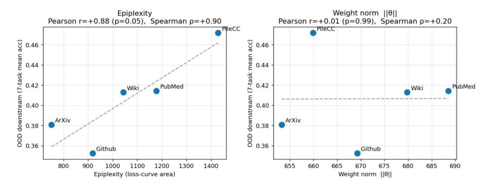

Figure 8: Epiplexity predicts OOD downstream performance. Each point is a 124M model trained for 15B tokens on a single Pile domain. Epiplexity is correlated with mean zero-shot accuracy (Pearson r= 0.88, Spearman ρ= 0.90), whereas the weight norm is uncorrelated (r= 0.01, ρ= 0.20). Dashed lines are least-squares fits.

To check that the association between epiplexity and downstream accuracy in Section [3](#page-4-0) reflects something specific to epiplexity, rather than any incidental property of a trained checkpoint, we compare it against the model's weight norm ∥θ∥. Both quantities are scalar summaries of a model trained to convergence on a single Pile domain, so if downstream accuracy were merely a generic function of "how much" the model changed during training, we would expect the weight norm to be similarly predictive.

Figure [8](#page-14-2) shows this is not the case. Across the five domains, epiplexity is associated with OOD accuracy (Pearson r= 0.88, p≈0.05, Spearman ρ= 0.90), with PileCC attaining both the highest epiplexity and the best downstream performance and ArXiv/GitHub the lowest on both. By contrast, the weight norm shows essentially no relationship with downstream accuracy (Pearson r= 0.01, p≈0.99, Spearman ρ= 0.20). This suggests that the predictive signal is carried by epiplexity specifically, and supports the case for using it as the quantity to maximize during data selection.

<span id="page-15-1"></span>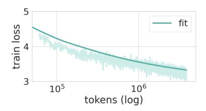

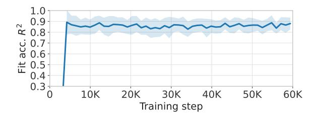

Figure 9: Panel (a): Example online cross-domain scaling-law fit for the Common-Crawl domain. Panel (b): Median fit accuracy over training over Common Pile domains, reported as  $\mathbb{R}^2$  and log-RMSE against the observed per-domain loss trajectories.

### <span id="page-15-0"></span>C Scaling Laws

Given some observed tokens  $n_k^{(s)}$  and loss values  $L_k^{(s)}$  for domains k at different points in time  $s=1,\ldots,t$ , we fit a cross domain scaling law by solving the following optimization problem

$$\min_{\alpha,\beta,\epsilon,\gamma} \sum_{k,s} \mathsf{HuberLoss}_{\delta}((L_k^{(s)})_{s=1}^t, (\hat{L}_k^{(s)}(\alpha,\beta,\epsilon,\gamma))_{s=1}^t)$$

where  $\hat{L}_k^{(s)} = \hat{L}_k(n_1^{(s)}, \cdots, n_K^{(s)}) = \epsilon_k + \beta_k \left(\sum_{j=1}^K \gamma_{k,j} n_j^{(s)}\right)^{-\alpha_k}$ . We refit the scaling law every 1000 iterations to make use of new available observed tokens and loss values. Additionally, we optimize our parameters in the log-space, and work with  $\alpha$ ,  $\log \beta$ ,  $\log \epsilon$  and  $\log \gamma$ . To satisfy the simplex constraints on  $\gamma_{m,k}$ , which are  $\gamma_{m,k} \geq 0$  and  $\sum_{k=1}^K \gamma_{m,k} = 1$ , we apply a softmax transformation.

We initialize all parameters with a grid derived by the Cartesian product of the following ranges per parameter: for  $\alpha \in \{0.0, 0.1, \cdots, 0.8\}$ ,  $\log \beta \in \{-2.0, -1.0, \cdots, 6.0\}$ ,  $\log \epsilon \in \{-2.0, -1.5, \cdots, 2.0\}$ . Finally, we sample  $\gamma_{m,k} \sim \mathrm{Dir}(p)$  via a Dirichlet distribution, where  $p_m = 10$  and  $p_k = 1$  if  $k \neq m$ . In other words, the Dirichlet distribution concentrates more mass on the domain which is indicated by the row index. This creates an initialization grid of 729 points which adds roughly 12 sec of overhead per fit, as opposed to the 3 seconds ADO takes since it does not have to fit  $\gamma_{m,k}$ . In practice, this increase is negligible as this overhead still constitutes less than 5% of the training time for our  $124\mathrm{M}$  model and less than 1% for the 1.3B model. Panel (a) of Figure 9 shows an example of our fitted scaling curve.

#### C.1 Accuracy of the Scaling-Law Fits

We assess how well the fitted scaling law reproduces the observed per-domain loss trajectories over the course of training for one of our runs. At every refit we compare the fitted function against the measured per-domain losses and report the coefficient of determination  $(R^2)$  and the root-mean-square error (RMSE) in log-loss space, matching the log-Huber objective. Panel (b) of Figure 9 shows that quality improves rapidly and then plateaus.  $R^2$  rises to 0.9 within the first 4k steps and remains stable for the remainder of training. At the final step, the median  $R^2$  across the 30 domains is 0.88 for the cross-domain law, with a median log-RMSE of 0.02 nats, meaning that predicted losses fall within roughly 2% of the true observation values. Three domains achieved slightly lower  $R^2$  (DM Mathematics, Enron Emails, and Ubuntu IRC), which aligns with these domains all exhibiting near-flat, noisy loss curves, so their reduced  $R^2$  does not indicate a problem with the fitting procedure. These results confirm that the fitted scaling laws are reliable for supporting domain selection decisions.

### C.2 ADO Selector for Comparison

We provide the ADO selector for reference. ADO [4] fits a power scaling law of the form  $\hat{L}(n;\alpha,\beta,\epsilon) = \epsilon + \beta n^{-\alpha}$  to each domain to inform the domain distribution  $\pi$ . Their preference distribution takes the form

$$\pi_k \propto \mu_k \frac{\alpha_k}{n_k} (\hat{L}_k(n_k) - \epsilon_k) \lambda_k \tag{8}$$

which is notably different from our epiplexity-maximizing objective, as they do not model the effect of the different domains on one another and introduce a heuristic credit score term  $\lambda_k$ , whose role is to capture some interaction between the domains.

### <span id="page-16-0"></span>D Estimating Epiplexity Gain from Scaling Laws

Below is the derivation for the derivative of change in epiplexity as a function of the tokens seen from domain k. Although Equation 2 writes the epiplexity sum over training steps t, we differentiate here with respect to the cumulative token count  $n_k$ , treating S as a function of the token counts that the step index t reaches.

$$\begin{split} \frac{\partial \hat{S}_k(n_k)}{\partial n_k} &= \hat{S}_k(n_k+1) - \hat{S}_k(n_k) \\ &= \sum_{i_k \leq n_k+1} (\hat{L}_k(i_k) - \hat{L}_k(n_k+1)) - \sum_{i_k \leq n_k} (\hat{L}_k(i_k) - \hat{L}_k(n_k)) \\ &= \left[ \sum_{i_k \leq n_k+1} \hat{L}_k(i_k) - (n_k+1) \hat{L}_k(n_k+1) \right] - \left[ \sum_{i_k \leq n_k} \hat{L}_k(i_k) - (n_k) \hat{L}_k(n_k) \right] \\ &= \left[ -n_k \hat{L}_k(n_k+1) \right] - \left[ -(n_k) \hat{L}_k(n_k) \right] \\ &= -n_k \frac{\partial \hat{L}_k}{\partial n_k} \end{split}$$

### **E** Implementation

#### <span id="page-16-1"></span>E.1 Data Selection

**Models** Our experiments use a decoder-only transformer from the LLaMA 2 family in two model parameter sizes 124M and 1.3B. The 124M model has 12 layers, 12 attention heads and an embedding size of 768. The 1.3B model has 24 layers, 16 attention heads and an embedding size of 2048. Both models use SwiGLU feed-forward layers, RMSNorm, and rotary position embeddings (RoPE). The vocabulary follows the GPT-NeoX-20B tokenizer (50,304 tokens) and the context length is 1,024 tokens. Parameters are stored in float32. Forward passes run in bfloat16. Models are implemented in JAX with Equinox for module definitions and use Optax for optimization.

**Training** Each model is trained for 60,000 steps with a global batch size of 256 sequences (262,144 tokens per step, 15.7B tokens total). We use AdamW with a peak learning rate of  $10^{-3}$ ,  $\beta_2 = 0.95$ , weight decay  $10^{-4}$ , a 500-step linear warm-up, and cosine decay to  $10^{-5}$ . We update the data-selection weights every 1,000 steps, after an initial 1,000 steps on the natural (by domain size) distribution to accumulate sufficient per-domain loss history for scaling-law fitting.

**Compute** All of our training was done on a single Cloud TPU v4-32 slice (4 host VMs, each with 8 TPU v4 chips). When launched, the model is replicated across all 32 chips, and each chip processes 8 sequences per step. Wall-clock training time is approximately 8 hours per 60,000-step run for the 124M model and 29 hours for the 1.3B model.

### <span id="page-16-2"></span>**E.2** Data Generation

**Models** We initialize both the generator and learner models with pretrained GPT-2 weights (117M parameters, 12 layers, 12 attention heads, 768-dimensional embeddings), loaded via HuggingFace Transformers. The frozen reference model used for computing pretrained perplexity is a copy of the same model with gradients disabled. All models use the GPT-2 tokenizer (50,257 tokens). Models are implemented in PyTorch with gradient check-pointing enabled during training.

**Training** We use a REINFORCE-based training loop with T=6,000 generator steps and K=10 learner gradient steps per generator step, for a total of 60,000 learner updates per run. At each step

<span id="page-17-2"></span>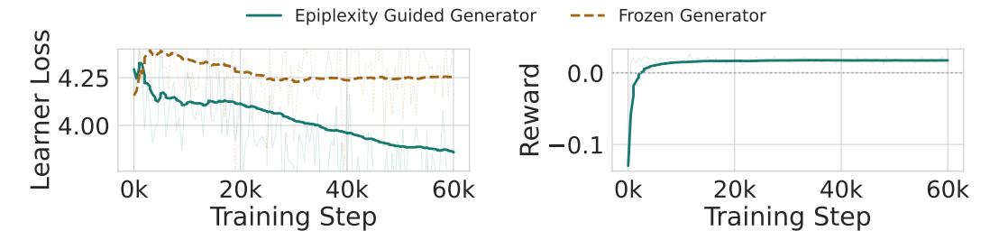

Figure 10: **Training dynamics of the epiplexity-guided generator.** (*Left*) Learner loss on generated data decreases over training for the epiplexity-guided generator, while remaining flat for the frozen generator baseline. (*Right*) REINFORCE reward increases over training, indicating that the generator learns to produce informative synthetic data throughout. No reward is computed for the frozen generator.

the generator produces a batch of 32 sequences of 512 tokens at temperature  $\tau=1.0$ . Each generated batch is appended to the accumulating buffer, which grows during training. At each step, 16 batches are sampled uniformly from the buffer and combined with the current batch to evaluate the learner. The epiplexity-based reward is computed as the decrease in learner loss before and after training on the evaluation batch. We implement gradient norm clipping (1.0) to reduce variance during the REINFORCE update. In the EMA baseline case, we use a  $\beta=0.99$ . The learner uses AdamW with lr =  $10^{-5}$  and weight decay  $10^{-2}$ , and the generator uses AdamW with lr =  $10^{-6}$  and weight decay  $10^{-2}$ . Finally, we compute the validation loss every 1000 learner steps on 500K tokens of OpenWebText [42], which is in the original training data of GPT-2, to measure drift from the original pretraining distribution.

**Compute** We conduct all runs on 4 NVIDIA L40S GPUs with PyTorch DDP. Wall-clock training time is approximately 10 hours per 60,000-step run.

### <span id="page-17-0"></span>F Monitoring Data Generation Training Dynamics

Figure 10 shows the training dynamics (learner train loss and reward) to verify that the REINFORCE training loop functions as intended. The learner loss is measured on the current batch of generated data after K learner gradient steps. Both runs initialize from the same pretrained checkpoint and therefore start at similar losses. Over training, the epiplexity-guided generator produces data on which the learner achieves progressively lower loss, indicating that the generator learns to synthesize data more aligned with the learner's current state. The frozen generator, by contrast, produces a stationary data distribution and the learner loss remains relatively flat throughout. Meanwhile, the reward is the epiplexity signal used to update the generator via REINFORCE. The reward rises steadily over training and remains positive, confirming that the generator consistently produces data that improves the learner beyond its EMA baseline. The frozen generator is never updated, so we do not compute the reward.

# <span id="page-17-1"></span>G DataGen Natural Language Distribution Analyses

We evaluate all methods for synthetic data generation on fidelity to in-distribution text via learner perplexity on the OpenWebText (OWT) [42] dataset. We stream the Skylion007/openwebtext train split, tokenize with the GPT-2 BPE tokenizer, and take a contiguous slice of 5M tokens for evaluation. We chunk these into non-overlapping sequences of 512 tokens (9,728 sequences in total) to pass to the learner model. We compute the perplexity (exponential of the mean token-level cross entropy), averaged across batches (batch size 32). The same protocol is applied for the SlimPajama [45] (5M tokens from the validation split of DKYoon/SlimPajama-6B source) and FineWeb [46] (5M tokens from the sample-10BT configuration of HuggingFaceFW/fineweb) datasets for the OOD natural language comparisons.

As pretraining on synthetic text steers the learner model away from the distribution of natural language, we expect that the models trained via the synthetic data generation pipeline will yield higher perplexity than the pretrained GPT-2 model. Indeed, we see that Pretrained achieves the lowest perplexity,

Table 3: **Epiplexity-guided training preserves language modeling quality, while reward ablations collapse.** Perplexity on 5M-token slices of OpenWebText (in-distribution) and of SlimPajama and FineWeb (out-of-distribution). The PPL and NoBuffer reward ablations degrade language modeling severely, whereas EpiGen stays within 3 points of the Pretrained baseline on OpenWebText. No method improves over Pretrained perplexity; the gains in Table 2 come without preserving it. Lower is better for all columns.

|            | OpenWebText | SlimPajama | FineWeb | Average |
|------------|-------------|------------|---------|---------|
| Pretrained | 24.64       | 29.80      | 35.12   | 29.85   |
| FrozenGen  | 26.49       | 31.14      | 37.57   | 31.73   |
| PPL        | 104.20      | 106.81     | 171.55  | 127.52  |
| NoBuffer   | 33.10       | 38.60      | 48.43   | 40.04   |
| EpiGen     | 27.58       | 33.09      | 39.74   | 33.47   |

followed by FrozenGen. This aligns with our intuition that the learner model trained *on* natural language will perform the best for in-distribution token prediction tasks, and the one trained by randomly sampled sequences from the training distribution will perform similarly. However, the fact that EpiGen greatly outperforms the reward baselines in the prediction task *and* outperforms all methods in the GLUE tasks indicates that although the epiplexity-guided learner model has shifted its distribution slightly away from the distribution of natural-language, its learned representations are potentially more useful for supporting downstream OOD settings.

#### <span id="page-18-0"></span>**G.1** Reward Grounding in the Evaluation Buffer

<span id="page-18-1"></span>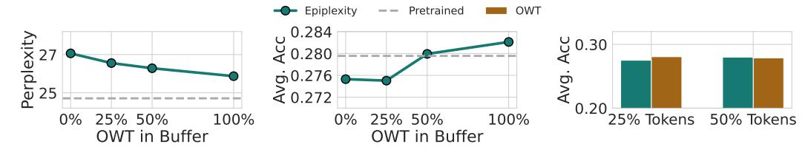

Figure 11: **Mixing OWT data into the evaluation buffer grounds the generator reward.** (*Left*) The learner's perplexity decreases monotonically as the fraction of OWT data in the buffer increases from 0% to 100%. (*Center*) Average zero-shot accuracy across 15 LM Eval Harness tasks similarly improves with more real data in the buffer. (*Right*) At matched token budgets, learners trained via epiplexity-guided synthetic data perform comparably to models fine-tuned directly on the same number of real OWT tokens.

While epiplexity-guided training consistently improves downstream performance in fine-tuning based tasks, it also subjects the learner to data which diverges from natural language and leads to an increase in validation perplexity on web text. In this section, we intervene on the training algorithm by mixing fractions of OWT data into the evaluation buffer [42]. In the ideal case, we would compute the change in epiplexity as the difference in learner loss over all previous data (pretraining and synthetic) that the learner has been trained on following Equation 1. Thus, as pretraining data greatly outsizes the synthetic data, we approximate this setting by sampling from the OWT dataset when constructing our evaluation buffer to compute the reward.

Additionally, we hypothesize that the inclusion of batches of OWT data grounds the generator's predictions in its initial distribution, which reduces the effect of potential self-referential rewards. Concretely, we hold all hyperparameters fixed and ablate the proportion of OWT data in the buffer between 0%, 25%, 50%, and 100%. We evaluate each learner model on OWT perplexity as well as on a suite of 15 zero-shot tasks from LM Evaluation Harness: ARC Challenge, ARC Easy, Arithmetic (2-digit addition), BoolQ, GSM8K, HellaSwag, LAMBADA, MathQA, MMLU College Computer Science, MMLU Elementary Mathematics, MMLU High School Computer Science, MMLU High School Mathematics, OpenBookQA, PIQA, and WinoGrande [37]. Figure 11 shows that increasing the fraction of OWT data in the buffer reduces OWT perplexity toward the pretrained GPT-2 baseline and improves average zero-shot accuracy on LM Eval Harness tasks beyond the pretrained GPT-2 baseline. Although the learner is never directly trained on real data, it is reasonable to assume being indirectly exposed to OWT data in the buffer might be driving the improvement. To measure this effect,

we compared our learner to token-matched baselines where we actually train the learner on OWT data and not synthetic generations. Surprisingly, we find that the learner trained via epiplexity-maximizing synthetic data performs comparably to the corresponding baselines, which not only validates our procedure but also shows that the synthetic data from the generator is as informative as real natural web text.

# <span id="page-19-0"></span>H Synthetic Data Outputs

We examined the samples of synthetic data generated by the epiplexity-trained generator at step 1,000 and step 60,000 (the final step) of training and show truncated snippets of text in Figure [12.](#page-20-0) Notably, the generator receives no verifier signal and is *never* exposed to real data during either training or in the evaluation buffer in this case. The epiplexity reward is computed entirely from the learner's loss decrease over a subsample of the previous synthetic data samples. Despite this, the generator maintains consistent web-text style throughout training, producing news articles, Q&As, and blog-style content that are stylistically coherent with the OpenWebText pretraining distribution. The qualitative similarity between early and late samples suggests that the generator does not degrade or collapse under the purely self-referential reward, but instead sustains a stable generative distribution across the full training run.

#### <span id="page-20-0"></span>Step 1,000

Maybe the bigger problem lies with this form of advertising. And perhaps I've answered everything. Save these emails and a free copy of my book instead, but just in case. Editor's note: This does not apply to tips and corrections. All parts of this article are intended for educational and informational purposes only, and do not necessarily reflect the views or opinions of TechCrunch and its parent company, Storage Spaces, Inc. Content Gaining Effectes. (a) The polar opposite. That's what happens when we assume that one form of style/coloring we use will boost effectiveness. [. . . ]

The Grand Prix Jaipur is to commence this spring. What's more, the P1 class's roster includes Vandoorne, Bora Senna, Jorge Renato, Robbie Hulkenberg, Benetton Nikola Karasevic, Caleb Ewan, Angelica Hutschi, Travis Meyer, Benjamin Marko, Frank Wolff and Masaaki Matsumoto. The 2016 Series champion consists of the result of the hit Midsport Dragonslaying 20m. Bora, Senna and Jamie Stewart returned to Hamilton for Barber Motorsports' quadrupleheader series four years ago. [. . . ]

#### Step 60,000 (Final)

Europe is "divesting itself of its remittances from Russia," Chancellor George Osborne told Parliament on Monday, the second such threat from the president of Russia since the meeting with UN delegates last December. The decision has alarmed European officials worried that Putin's economic dumping of assets to Russia is hurting thousands of EU citizens and their businesses in the troubled former Soviet bloc when Russia is perceived as something of a chess-playing player. [. . . ]

Do I write a 3-D magazine or not? No. This depends on the style, strength and variety of stories. Publishing and website design are done by hand or by skilled 3-D artists that are expert in computer animation at GE. Oh, so there are of course restrictions on what people can produce in 3 direct print magazines like these "Fairyballs" and can only print a wide range of images, so "99% 2002 images" variety? True, you can print out anything from red photographs to precious candied bunches of paper alongside your old 200 page collectibles! [. . . ]

Figure 12: Truncated samples of synthetic data generated at step 1,000 (left) and step 60,000 (right). Qualitatively, the generator produces web-text-like content throughout training (e.g. news articles, Q&As, blog posts), consistent with its OpenWebText pretraining distribution. While the content is stylistically plausible, it may be factually hallucinated.