# Cooking up Food Embeddings Understanding Flavors in the Recipe-Ingredient Graph

A CS224W Project Report By

Christopher Sauer, Alex Haigh, Jake Rachleff {cpsauer, haighal, jakerach}@cs.stanford.edu

Abstract—In this project, we explore the bipartite graph between recipes and ingredients. Previous work primarily used local, count-based metrics to explore the relationships between ingredients. We conduct a more complete exploration of the underlying network structure of ingredients through more rigorous graphical analysis and a novel graph analysis metric for finding substitute ingredients from edge weights. Further, we exploit advances in isomorphic problems in natural language processing to explore the latent flavor space in which ingredients and recipes are embedded. These flavor embeddings allow us to produce high quality substitute and ingredients pairs, understand the graph at a more global scale, and automatically generate new recipes.

#### I. INTRODUCTION

Ingredients and recipes form a natural bipartite graph ripe with information about their underlying flavor combinations. For years, only those experienced in the culinary arts had a true sense of the nature of this structure, and even then the understanding was strictly empirical and qualitative. In recent years, researchers have began to look into mathematically formalizing this network, and attempted to glean insights from it.

The tools used to gain these insights, however, are now comparatively elementary. Advances in network analysis have allowed us to gain a much more global view of the food network. We further present novel approaches to identifying ingredients' relations to each other. We present simple and intuitive novel approaches to finding complement and substitute metrics using purely network based approaches.

Finally, we explore structures isometric to networks to best explain the underlying ingredient structure. In recent years, word embeddings have come in vogue in the Natural Language Processing community. Their ability to capture meaning based on the context has allowed linguists to qualitatively define the meaning of words. The words themselves can be visualized in a graph, where edges are between words in the same context with some weight defined by how reliant they are on each other. This is the exact structure of our folded ingredient graph, where ingredients appear in the context of a recipe. Thus, we choose to represent our network as a series of food embeddings. We then use these embeddings to find complements and substitutes that more fully take into account the ideal context of the ingredient, and propose a novel recipe generation algorithm.

## II. RELATED WORK

Because of the relationship between recipes and ingredients, network analysis is a powerful tool to elucidate information about human tastes and preferences, especially as they differ across different geographies. The model of a "Recipe Graph" using data from online recipes websites was first introduced by Ahn et al. in 2011 in their paper *Recipe Recommendation Using Ingredient Networks*.

For every recipe on a dataset from allrecipes.com, Ahn et. al first collected the list of compounds found in each ingredient, and generated a bipartite graph in which there was an edge between an ingredient x and a compound y if y existed in x. They then folded their bipartite graph for analysis, creating a new graph between different ingredients only, where ingredients i, j have a link between them if they share an

ingredient and the edge has weight w(i,j)= the number of compounds i and j share.

Finally, they examined five different cuisine types - North American, Latin American, South European, West European, and East Asian - and sought out the most authentic ingredients, ingredient pairs, and ingredient triplets for each cuisine. To do so, they defined prevalence of each ingredient i in a cuisine c as  $P_i^c = \frac{n_i^c}{N_c}$ , where  $n_i^c$  is the number of recipes that contain the particular ingredient i in the cuisine and  $N_c$  is the total number of recipes in the cuisine. They then defined authenticity as the relative prevalence  $p_i^c = P_i^c - \langle P_i^{c'} \rangle_{c' \neq c}$  - the difference between the prevalence of i in cuisine c and the average prevalence of i in all other cuisines. They apply the same methodology for ingredient pairs and triplets that are overrepresented in a particular cuisine relative to other cuisines by defining relative pair and triplet prevalences.

Using this metric, they found empirical validation for "the flavor principle," the idea that differences between regional cuisines are due to outsize prevalence of a few key ingredients that have distinctive flavors. For example, East Asian cuisine is heavily features soy sauce, sesame oil, rice and ginger, while North American cuisine relies on dairy, eggs and wheat.

In Recipe recommendation using ingredient networks, Teng. et al expand the notion of an ingredient network to incorporate the relationship between recipes and ingredients. Using a different collection of online recipes, they create a graph of ingredients  $\leftrightarrow$  recipes, with an edge between ingredient x and recipe y if x is found in the recipe for y. They then fold this network over to create an undirected graph where every node is an ingredient, with an edge between ingredients a and b if they occur in a recipe together, where the edge is weighted by the Pointwise Mutual Information (PMI) between a and b:

$$PMI(a,b) = \log \frac{p(a,b)}{p(a) \cdot p(b)}$$

where

$$p(a,b) = \frac{number\ of\ recipes\ containing\ a\ and\ b}{number\ of\ recipes}$$
 
$$p(a) = \frac{number\ of\ recipes\ containing\ a}{number\ of\ recipes}$$
 
$$p(b) = \frac{number\ of\ recipes\ containing\ b}{number\ of\ recipes}$$

They then visualized this network, noticing that it was segregated into two main clusters: one of savory ingredients, the other sweet.

In parallel, the Teng et al. create a substitute network. To compile the necessary data, they scraped *allrecipes*' user comments looking for ones that suggested a substitution. The result was a weighted, directed network that consists of ingredients as nodes. The authors then eliminated any suggested substitutions that occurred fewer than 5 times and determined the weight of each edge by p(b|a), the proportion of substitutions of ingredient a that suggest ingredient b, across all recipes. They visualized this network using a random walk approach and found that it was highly clustered in groups of a few ingredients, with many substitutions leading to a healthier version of a recipe.

While Teng et al., and Ahn et al., make significant progress towards a quantitative analysis of culinary relationships, they focus their efforts almost entirely on local metrics and counts rather than analyzing the global structure of the graph. Just as PageRank and HITS use global vector-based analysis to provide significant additional insight over local and count based analysis, there seemed to be significant opportunity to use global vector-based methods to better understand the structure of the bipartite ingredients ↔ recipes graph.

Furthermore, Teng et al. had revealed that beyond just the bipartite structure of the graph, the graph's structure reflects a latent structure in flavor. In particular, given that ingredients are composed of overlapping sets of flavor chemicals in different amounts, we concluded that each ingredient could be better modeled as a point in that flavor chemical space. Similarly, recipes could be modeled as a weighted combination of their ingredients.

Given those two conclusions, we recognized as an isometric problem the embeddings models used in natural language processing. The isometry can be seen as follows:

- Word embedding models attempt to embed words in a latent meaning space. They solve this unsupervised problem by constructing a supervised one. We can interpret this task as predicting edges in a contrived graph of words to their neighbors.
- With our flavor embedding, we seek to understand ingredients as points in latent flavor space. We can do this by predicting edges in the natural graph formed between recipes and ingredients.

Given the isomorphism between the problems, we wanted to see if anyone had explored applying word embeddings to flavor spaces. The furthest exploration online, a post entitled *food2vec*, is still rather incomplete; however, it served as a good jumping off point for our investigation.

In *food2vec*, Jaan Altosaar deployed fastText, Facebook's widely used embedding system, on a dump of recipe strings [4], [6].

His writeup mostly covers results, so details about the methodology including his use of fastText rather than word2vec—come from us looking at his code. He appears to have run fastText with near default settings: using 100 dimensional vectors, negative sampling, and a skipgram task. The dataset is a merging of a raw scrape of AllRecipes and Ahn et al.'s dataset (which already includes AllRecipes).

Altosaar's writeup steps through the standard set of word embedding experiments:

- Projecting the embeddings into two dimensional space.
- Finding "similar" ingredients by cosine distance.
- Doing analogies of the form A : B :: C : D by finding D as the nearest neighbor of (B − A) + C.
- Using the model to predict an additional ingredient by finding the nearest neighbor of existing ingredients.

Altosaar makes a valuable contribution by seeing that word embeddings can be applied to find embeddings for recipe ingredients, and his interactive visualizations are excellent; however, problems and oversights in his methodology leave clear room for future exploration.

First, problems with the dataset muddy the results. As mentioned, the dataset includes AllRecipes data twice: once uncleaned and once as part of Ahn et al.'s data. The bias is a problem, as is the mix of cleaned and uncleaned data. For example, "crushed,ice,twisted,lemon,peel" appears from an uncleaned drink's ingredient set, and again as "crushed ice, twisted lemon peel" from the cleaned data. Different vectors end up getting generated for the cleaned and uncleaned terms, and it is difficult to use the results when adjectives like "twisted" show up as a standalone ingredients. This could be fixed by only using the cleaned data, since the uncleaned data should be subset of it (ignoring recipes that were added since the original crawl date.), so that is what we did in our experiments.

Second, and more importantly, the choice to simply run fastText with default parameters—rather than modify the algorithm to fit the recipe task—causes problems in the results. For example, as expressed in the dataset, recipes are atomic, unordered sets of ingredients, while by default, fastText attempts to preserve positional information in text through randomly distributed neighboring skipgrams.

Because skipgrams only capture nearby pairings, food2vec unknowingly only attempts to record food pairings. This leads food2vec's similarity metric to more accurately reflect ingredients that are complements than it does similar ingredients that could be substituted. For example, playing with the interactive tool, the words they list as "most similar" to 'milk' are ('yolk', 'chocolate chips & sanding sugar', etc.). These neighbors of milk look like ingredients that go well together in cookies, for example, and this pattern repeats with most other foods where the results are reasonable.

We believe this to be a result of using the fastText skipgram model because skip-gram models try to maximize the dot product of the input vector of each ingredient with the output vector of all those that appear with it. Since high co-occurrence is roughly transitive and food2vec considers only input vectors because that is what fastText outputs by default, we would expect co-occurring ingredients to have similar vectors. This means that similarity in the vector space would reflect complementarity rather than the substitutability that one would expect of similar ingredients.

A better choice would be to modify fastText's source to consider each recipe as a whole and to pose supervised tasks capable of capturing the dual complement and substitute nature of recipes that we—and the authors of the first two papers described above—underlies the space of ingredients. We expect to be able to mine 'substitute similarity' by switching from skip-grams to a bag-of-words model that captures the whole recipe at once. Bag-of-words models attempt to predict a single missing element of a recipe by dotting the average of other ingredients' input flavor vectors with the output vector of the missing ingredient. We would thus expect the dot product between an ingredient's input vector and another ingredient's output vector to reflect the two ingredients' complementarity, since that reflects how much the first ingredient encourages the second ingredient to occur with it. Further, bagging ingredients into a recipe breaks the transitivity and frees input vector to represent the flavor space and to be similar for ingredients that could be substitutes candidates for that missing ingredient.

Finally, the default hyperparameters for fastText were tuned to capture the meaning of all words in English, with a vocabulary size of 100,000s of words, so it is unlikely that that they are optimal for capturing embedding flavors. food2vec does not search for better parameters because fasttext provides no mechanism for validating a given hyperparameter choice. However, this is likely detrimental to the quality of results from food2vec. While we picked a good food2vec output for milk above, many outputs are incoherent. For example, the site suggests searching for "cooking apples," and the following suggestions back as its similar ingredients: "suet" (hard loin fat), "self raising flour," "mixed peel," "mincemeat," and "black treacle" (molasses). In our experiments we achieve better results by holding out a validation set, and writing GPU code to quickly evaluate embeddings by their performance on that dataset. This allows us to sweep through choices of loss function, vector dimension, learning rate, and training schedule to maximize the score of the task on the validation set.

By using a modified bag-of-words model, choosing a more appropriate embedding size, and using clean data, we hope to be able to embed ingredients based on flavor and complementarity more effectively than food2vec.

## III. APPROACH SUMMARY

In this paper, we build on the research of Wang, Ahn, and recent advances in natural language processing to provide a more robust analysis of the ingredient complement network. In particular, we use Ahn's dataset and the complement network methodology introduced in Wang to do the following:

- 1) We use the structure of the graph, and, in particular, our varying edge weight definitions to elucidate more information about ingredient complementarity.
- 2) We gain a more robust understanding of the foundational roles of ingredients, both globally and by cuisine by applying more rigorous network analysis tools (namely, an assortment of centrality metrics).
- 3) We propose a graph-based metric to measure ingredients that are good substitutes for each other as well as build on Altosaar's work and FastText to create an embedding-based approach for graph visualization, complement and substitute prediction, and recipe generation. Notably, these metrics do not rely on scraped information of suggested substitutes, as Wang et al. do.

## IV. DATASET

Our dataset (the same one used in Ahn et. al.) consists of 56,498 recipes from 11 different cuisine types scraped off of epicurious.com, allrecipes.com, and menupan.com. Each cuisine type marks a different continental region with relatively similar ingredients (North America, East Asia, Southern Europe, etc). Each data point x is a recipe that consists of a cuisine type and a list of ingredients; indistinguishable ingredients (i.e chicken-egg and egg) have been "merged" to clean the data set and lead to more clear inferences. Ingredient counts run from 20951 (egg) to 1 (sturgeon caviar). Since the primary two websites used for data collection (epicurious.com and allrecipes.com) are US based, recipes skew towards the tastes of the American population ( 80% North American).

## V. GRAPH STRUCTURE

#### *A. Methods*

As in Wang et al, we construct the bipartite graph of ingredients to recipes, then fold that graph to create a weighted, undirected ingredientto-ingredient graph. We use three different weight metrics w for any pair of ingredients i, j:

- *Raw Count*. Here, w(i, j) is simply the number of recipes that i and j co-occur in. This scales with the number of ingredients and/or recipes.
- *Pointwise Mutual Information (PMI)*. We use the same definition of PMI as Wang et al.:

$$PMI(i,j) = \log \frac{p(i,j)}{p(i) \cdot p(j)} = \log \frac{p(i|j)}{p(i)} = \log \frac{p(j|i)}{p(j)}$$

Note that PMI 1) doesn't vary with the scale of the graph, and 2) reflects whether or not i is more likely to occur in the recipe when j is there than in general.

• *Intersection Over Union (IOU)*. For sets Ri and Rj (the recipes which contain i and j, respectively) IOU is defined as:

$$IOU(i,j) = \frac{|R_i \cap R_j|}{|R_i \cup R_j|}$$

IOU also is a measure of the likelihood of co-occurrence and doesn't scale with the number of recipes or number of ingredients, but, unlike PMI, it is bounded between 0 and 1 (the log in PMI means it has domain (−∞, ∞))

In order to understand the underlying structure of the recipe graph, we ran four main centrality metrics on the folded ingredient graphs: betweenness, closeness, PageRank, and degree centrality. Through these metrics, we hoped to get a more global view of the relationship between ingredients. For each ingredient, we measured variance between their rankings for each centrality metric, and examined the relationship between rankings in each metric.

### *B. Results*

We began by visualizing our ingredient complement network using Cytoscape's force directed layout. Figure 1 below shows this visualization, which only included ingredients that occurred in more than 500 recipes and scaled node sized based on the number of recipes they occurred in. Interestingly, many of the most common ingredients (egg, vegetable oil, onion, garlic, wheat, butter, and milk) were very versatile - they were co-occurred frequently with a very high proportion of ingredients in the graph - and were positioned around the periphery. Internally, there are a few distinct clusters: dessert foods in the top left; meats (chicken, pork, sausage), fish and other food commonly found in entrees in the bottom; and, finally, appetizers and drinks (wines, cheeses, bread) in the top center. While offering insight into the structure of the graph, the graph's usefulness is limited by the density of ingredients in the center, creating an opportunity for an embedding-based visualization to offer additional understanding.

We also examined the overall distribution of recipe frequency, plotting the rank of each ingredient by number of recipes it appears in vs. the actual number of recipes it appears in. In plotting this (see Figure 2, we notice that the number of recipes that the rank i ingredient is in [we term this n(i)] follows a power law distribution: it is linear on a semilog scale and concave down on a log-log scale.

We evaluated the centrality rankings for each of the four metrics described in the methods section. We noticed that the rankings stayed relatively constant for closeness, PageRank, and degree centrality, but varied in betweenness centrality. Thus, we decided to visualize the rankings in relation to one another to understand their underlying meaning in the context of our food network.

Notice that PageRank and degree centrality, as well as PageRank and closeness centrality, have virtually the same rankings. There is almost a perfect relationship between them with extremely little variation. However, the relationship between Betweenness and PageRank centrality does have variation.

The three relatively equivalent centrality metrics have a straightforward meaning - the higher degree the node, the higher the score. Though this is also true of betweenness, we should look at the nodes with the highest difference between their PageRank and Betweenness rankings to see what Betweenness really measures. These ingredients, in order, are rose, blackberry, malt, strawberry juice, and blueberry. First, notice that these ingredients are all versatile: they can be used in all three main recipe categories (dessert, drinks, and dinners). The exception here is rose, which we think is actually a mistake in the dataset merging algorithm. The researchers combined "rose" and "rose." Rose may be ´ used in some desserts and fancy dinners, whereas rose is clustered with ´ drinks, which means that it should accidentally cross through distinct clusters. Each of the berries makes sense, since berries can be used in all three recipe clusters. Malt, as well, can be used in types of vinegar, chocolate, and beer, meaning it ranges all three.

Given the analysis above, we find it redundant to show the top ten most central nodes in all centrality metrics, but instead show just PageRank and betweenness (Table 1).

TABLE I: Top Ten Most Central Nodes (Globally)

| Ranking | PageRank      | Betweenness   |
|---------|---------------|---------------|
| 1       | egg           | egg           |
| 2       | wheat         | cream         |
| 3       | butter        | wheat         |
| 4       | cream         | butter        |
| 5       | black pepper  | garlic        |
| 6       | vegetable oil | black pepper  |
| 7       | garlic        | vegetable oil |
| 8       | vinegar       | vinegar       |
| 9       | onion         | olive oil     |
| 10      | olive oil     | onion         |

The top four ingredients for both are the same, and the next six for both are the same. Egg, wheat, cream, and butter can move between cooking and baking and probably lie in the shortest path of many of these nodes,

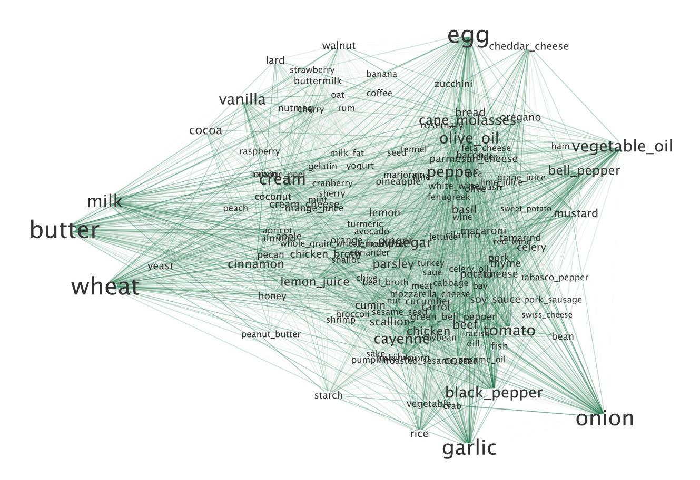

Fig. 1: Visualization of the folded ingredient complement network. Only ingredients that appear in more than 500 recipes are shown. Node size is proportional to the number of recipes an ingredient appears in, and edges are colored darker depending on the number of recipes the two ingredients co-occur in.

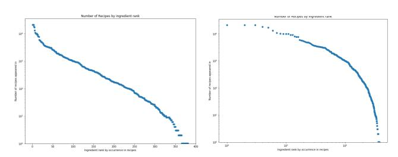

Fig. 2: Rank of ingredient *i* vs. the number of recipes in which it appears.

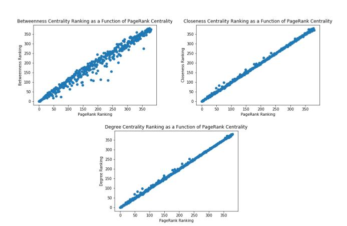

Fig. 3: Correlations between various centrality metrics.

making their PageRank and Betweenness scores really high. Along the same reasoning, the last six ingredients are all extremely common in cooking, so probably are in many shortest paths there and have high PageRank scores.

# VI. INGREDIENT COMPLEMENTS AND SUBSTITUTES USING NETWORK ALGORITHMS

#### A. Methods

We first sought to define complements of ingredients - both on a cuisine-level basis and globally - using graph-based methods rather than the count based approaches used in Ahn et al. Additionally, we sought to generate substitutes directly from the graph without relying on outside information about substitutes

Complements: We defined the complementarity between two ingredients i,j using the three different edge weight metrics discussed above: Count(i,j), IoU(i,j), and PMI(i,j). We were particularly excited about the predictive effect of PMI because it can be interpreted as a monotonic transformation of the conditional probability of one ingredient occurring given the other relative to its baseline probability (that is,  $\frac{p(i|j)}{p(j)} = \frac{p(j|i)}{p(j)}$ ). However, since PMI is not as robust to ingredients that occur very infrequently, we also attempted thresholding by recipe count to avoid ingredients that only occurred once or twice.

<u>Substitutes:</u> We began the substitute task by attempting to define a graph-based metric that relied on recipe-level information. Following the intuition that for an ingredient a, the set of complementary and substitute ingredients to a are nearly disjoint, we wanted to penalize for a high complementarity. Furthermore, we want to ensure that for any ingredient b that could be a substitute, recipes in the set of recipes that contain a and not b (which we will call X) are similar to recipes in the set of recipes

that contain b and not a (which we will call Y ). Thus, we proposed the following metric and aim to check the hypothesis that good substitutes can be defined this way:

$$\operatorname{sub}_{a,b} = \frac{\sum_{i} \max_{j} IoU(X_i, Y_j) + \sum_{j} \max_{i} IoU(X_i, Y_j)}{|A \cap B| + 1}$$

where Xi is recipe i in X, and Yj is recipe j in Y . This selects the best matching recipe from X for every recipe in Y and vice versa, and scores the similarities of the sets according to the similarities of their matches.

Due to the nature of the definition of our initial substitution metric, we had to run large computations on the unfolded recipe graph. For each pair of ingredients, we were effectively exploring all paths of length 4 between them: we were finding adjacent all recipes adjacent to each, and then generating a score based on the ingredient overlaps between a matching of those sets. Because the number of paths increases exponentially with the path length and has a high branching factor, this algorithm was computationally infeasible. Our optimized program would have taken nearly 5 CPU years to run over the recipe graph, so we continued in search of a more efficient metric.

For our second metric, we began with our intuition that substitutes appear in similar contexts, and we can construct an efficient metric for two ingredients appearing in similar contexts by combining our folded graph weightings. Intuitively, two ingredients appear in similar contexts if the distributions of ingredients that co-occur with them are similar. One good metric of similarity between two observed distributions is the Bhattacharyya distance,

$$D_B(p,q) = -\log \sum_{x \in X} \sqrt{p(x)q(x)}$$

which measures the amount of overlap between two probability density functions over all samples. We also selected it because it stays constant if each discrete value of x–ingredient nodes in our case–is subdivided into multiple identical nodes. Such scale invariance is a good property for graph metrics, as we argued for PMI and intersection over union.

For our ingredient co-occurence distributions, we define

$$p(x) = \frac{R_{p,x}}{\sum_{y \in I} R_{p,y}}$$

where Rp,x = the number of recipes that ingredients p and x co-occur in and I is the set of all ingredients in our dataset. Therefore, our Bhattacharyya distance metric for the "distance" between two ingredients p, q is:

$$D_B(p,q) = -\log \sum_{x \in I} \sqrt{\frac{R_{p,x}}{\sum_{y \in I} R_{p,y}} \frac{R_{q,x}}{\sum_{z \in I} R_{q,z}}}$$

$$= -\log \frac{1}{\sqrt{(\sum_{y \in I} R_{p,y})(\sum_{z \in I} R_{q,z})}} \sum_{x \in I} \sqrt{R_{p,x} R_{q,x}}$$

We then computed this metric for all pairs of ingredients and generated the best highest-ranked substitutes for several ingredients. Rather than taking several years of CPU power to compute, this metric took 10 seconds to compute for all pairs of ingredients.

## *B. Results*

Complements: We generated the top ten most complementary pairs of ingredients across all cuisines and weight metrics (See Appendix at the end of the document for full results). The raw counts across cuisines show an increased reliance on egg, wheat, dairy products, and vanilla in North America and Western Europe; olive oil, tomato, and onion in Southern Europe; cayenne in Latin America; and scallions, cayenne, and sesame oil in East Asia. Notably, there were some interesting similarities between South American cuisine and East Asian in their pairings of cayenne with onion and scallion, respectively.

The PMI and IoU metrics were initially noisier because they are tainted by the relative infrequence of certain ingredients: if an ingredient appeared a small number of times, and it occurred with another ingredient in each of those instances, it would have a very high PMI. This yielded strange and uninformative complements: in North American cuisine, the top two complements by PMI were geranium with pelargonium and fenugreek with turmeric.

To combat this, we sought a blend of the raw count metric with PMI/IOU to generate more relevant complements. We thresholded to only include ingredients that appeared in more than n = 25 recipes, which left ∼ 250 of the original 371 ingredients. With this modified algorithm, we generated some interesting insights about common food pairings by region: in North America, traditionally Asian foods and spices had very high PMI but not as high IoU (katsuobushi and seaweed, katsuobushi and sake, and a few other pairs were in the top 10); in Southern Europe, these yielded intuitive pairings (Mango and Papaya, oatmeal and berry, fennel and pork sausage) as well as one nonintuitive one (Chinese Cabbage and Salmon); in Latin America, a similarly nonintuitive pairing of blue cheese and blueberries was suggested.

In general, PMI placed heavier weight on pairs where a single one of those ingredients occurred very infrequently, leading to more interesting and less intuitive - but still valuable - results that had lesser alignment with raw count than IoU did (there is less of a probabilistic meaning of IoU, so ingredients with low count had less of an effect).

Substitutes: We computed the Bhattacharya Distance (DB(i, j), described above) between every pair of ingredients, and ranked them based on whether they were substitutes. Since we we're searching for substitutes and took a negative log of the overlap between the distributions in our DB calculation, we sorted for ingredients with the smallest Bhattacharya distance between them. The results can be seen in the table below.

TABLE II: Top 25 Substitute Pairs by Bhattacharyya Distance

| Ingredient 1      | Ingredient 2    | DB(i1, i2) |
|-------------------|-----------------|------------|
| pecan             | walnut          | 0.0206     |
| black pepper      | pepper          | 0.0254     |
| bacon             | ham             | 0.0309     |
| romano cheese     | parmesan cheese | 0.0345     |
| green bell pepper | bean            | 0.0348     |
| bell pepper       | bean            | 0.0359     |
| red wine          | white wine      | 0.0361     |
| chicken           | turkey          | 0.0366     |
| pork              | beef            | 0.0395     |
| meat              | beef            | 0.0403     |
| bell pepper       | pepper          | 0.0404     |
| oregano           | olive           | 0.0409     |
| fish              | shrimp          | 0.0409     |
| meat              | pork            | 0.0411     |
| white wine        | sherry          | 0.0411     |
| chicken           | pea             | 0.0412     |
| tomato            | bell pepper     | 0.0417     |
| celery            | meat            | 0.0417     |
| wine              | sherry          | 0.0424     |
| chicken           | bell pepper     | 0.0426     |
| black pepper      | bell pepper     | 0.0427     |
| yeast             | buttermilk      | 0.0429     |
| white bread       | bread           | 0.0431     |
| green bell pepper | bell pepper     | 0.0433     |
| buttermilk        | cream cheese    | 0.0435     |
|                   |                 |            |

Notice that, with the exception of the pairings between beans and two types of bell peppers, the list of the top substitute pairs includes some of the most intuitive substitutes that are conceivable: pecans for walnuts, black pepper for pepper, bacon for ham, chicken for turkey, pork for beef, beef for meat, meat for pork, red wine for white wine, and green bell peppers for bell peppers.

Our domain knowledge helps explain why many of our other "best" substitutes may be flawed. Some pairings (e.g. bell pepper and pepper) are ambiguous because pepper could be a different form of the vegetable or ground black pepper - this is an artifact of the data cleaning methodology used by Ahn et al. Additionally, it offers insight into the limitations of our Bhattachryya metric. Consider bell peppers and beans: they are both staples of Latin American food, and they appear in many Latin American recipes. So, they have highly overlapping distributions with other ingredients, even though they are actually complements and co-occur in many recipes.

Patterns like this manifest themselves in the ingredient-level substitutes in Table VI: the top 1-2 ingredients listed by score are excellent substitutes, then the algorithm begins to conflate complements with substitutes for lower down the list. This is one shortcoming of the algorithm; while utilizing the graph structure, it is solely edge weightbased and doesn't take into effect recipe-level information.

## VII. MODELING THE GRAPH WITH FOOD EMBEDDINGS

We have good reason to believe that ingredients are embedded in a latent space of flavors. Recall that Teng et al. revealed that ingredients are composed of overlapping sets of flavor chemicals in different amounts. Thus, each ingredient could be naturally modeled as a point in that flavor chemical space. Similarly, since recipes are an amalgamation of their ingredients, recipes can be naturally modeled as a weighted combination of their ingredients.

This is an even stronger story for using embedding models than in natural language processing (NLP), where they were originally used and have had the most impact to date. In NLP, embedding points in meaning space feels natural, but creating the supervised task often feels forced. The most popular supervised tasks, skipgram and continuous bag of words (cbow), arbitrarily and randomly cut streams of words into groups, slicing mid-sentence and spanning across sentence boundaries. Among these choices, in NLP skipgram is often chosen, not least because it can be easily accelerated for large corpora [7].

By contrast, asking a model to predict the ingredient missing from a recipe is a natural task that would require the model to learn about ingredient pairings. This maps roughly onto the "bag-of-words" task from NLP, but solves the issue of having arbitrary boundaries in text. Recipes—at least in the graph formulation—are sets of ingredients with clearly defined boundaries.

We modified the source code of fastText to adapt it to this task: sampling complete recipes, removing an ingredient, and asking the model to predict the missing ingredient. Formally, we take the mean µ of the input vectors for the ingredients that remain in the recipe and predict an output based on µ's dot product with the output vector of each ingredient. Both the input and output vectors are parameters to be learned. Further, we experiment with carrying over fastText's ability to use sub-word information from the name of each ingredient to encourage (but not require) the model to put together ingredients with common substrings in their names (e.g. "wheat bread" and "rye bread"). This can be done by modeling ingredient vectors as a mean of a word vector and the vectors of their constituent n-grams.

## *A. Hyperparameter Search*

Having adapted fastText's embedding learner to work on the somewhat isomorphic problem of ingredient understanding, and being cognizant of the previously described problems resulting from food2vec's less thorough approach, we undertook a rigorous hyperparameter search when training our embeddings.

Note that embedding models are often trained without any validation– so much so that fastText provides no tooling for validating its vectors or hyperparameter choices. To address this, we built our own crossvalidation tools: we randomly shuffled the recipe set and held out 10% of recipes as a validation set. We then implemented a cross-entropy loss on GPU with PyTorch to be able to evaluate models on the validation set.

Since the space of possible combinations in an embedding model is so large, we did mostly pairwise coordinate descent to avoid exploding the space of possible combinations, starting with those that seemed most likely to affect future training. All heat maps below use the same low point on the color scale to enable visual comparisons of progress across graphs.

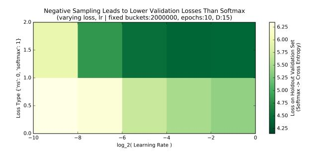

Fig. 4: Softmax performs far better than negative sampling with minimal slowdown. Softmax was therefore used for all future experiments.

We began by comparing two different loss functions: negative sampling and ordinary softmax loss across a variety of learning rates for a fixed dimensionality and number of epochs. Negative sampling is an approximation often used to speed up training on a large output vocabulary. Since our output vocabulary is small compared to English, we can feasibly train using full softmax. Since softmax performed far better with minimal slowdown (see Figure 4), we chose softmax as our loss function for subsequent experiments.

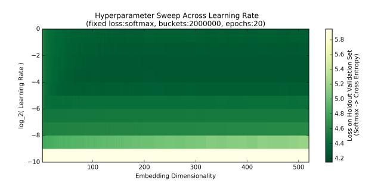

Fig. 5: To determine embedding size: Sweeping across all embedding dimensions between 2 and 200, and then until 500 by 20s. We also varied learning rates. Note asymptotic rather than quadratic-bowl-like behavior.

We then needed to determine the embedding dimensionality (see Figure 5). We had expected the model to overfit at large embedding sizes, but our experiments revealed the opposite. Instead, larger embedding sizes lowered validation loss asymptotically (see Figure 6). This is surprising because it indicates complex interactions and contradicts the idea of a simple flavor compound space advanced in other papers.

To ensure that substitute quality (our ultimate task) also improved for larger dimensionality, we checked for improvement by dimension qualitatively. To accomplish this, we found the best substitute for a constant ingredient over dimension size. For example, we viewed top substitutes for salmon over several dimension sizes. We find that before dimensionality of 50, many of the top substitutes are actually vegetables that pair well with salmon, but as dimensionality grows, top substitutes fill with other types of fish (e.g. tuna). We therefore chose the embedding size to be 175, approximately where the the loss hits its asymptote (see Figure 6).

We then examined the number of epochs we trained for. We sought to keep runtime manageable for the first sweeps and only trained for

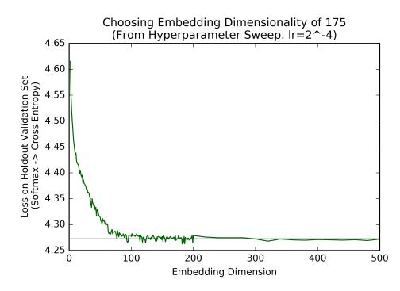

Fig. 6: Vertical cross section of Figure 5 at the best learning rate. Approximate asymptote drawn in grey. Embedding size chosen to be 175 which is approximately where the smoothed loss and the grey line intersect.

20 epochs—4x the fastText default. However, we noticed that there was significant opportunity for improvement with further training, which enabled further loss descent and information flow through longer paths in the graph (see Figure 7).

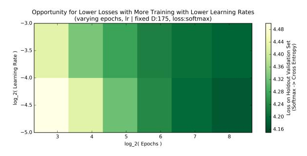

Fig. 7: Rank of ingredient *i* vs. the number of recipes in which it appears.

To reach convergence, we trained the models for 5,000 epochs (overnight). We validated a variety of learning rates and tested with and without subword information (see Figure 8). The difference will be discussed more in the next section.

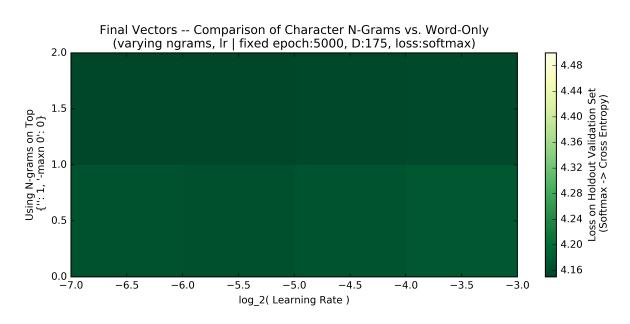

Fig. 8: Rank of ingredient *i* vs. the number of recipes in which it appears.

After cross-validating, we retrained on full dataset to get the best possible input and output embeddings since futher tasks are generative and unsupervised in nature.

## *B. Subword Information and Graphical Structure*

Through our hyperparameter search, we found that the loss differed only slightly between models with subword information and models without. Models with subword information are trained both using the continuous bag of words cost function, and according to the characterlevel ngrams that exist within them. Thus, the two ingredients "parmesan cheese" and "romano cheese" are more likely to be similar since they both contain the 6-gram "cheese", and carry all semantic meaning that exists within "cheese." In theory, this should lead to a radically better model of the ingredient space, since words with similar names often have similar roles in the kitchen. However, the small differences in losses indicated that the model without subword information had learned most of this information on its own.

In order to understand why our loss differed from our expectation, we used t-SNE to graph ingredient input vectors with and without subword information in two dimensions. By default, to model probabilities of closeness between nearest neighbors, most t-SNE packages follow the original paper [8] and use euclidean distance. To better fit our task, we changed the distance function for t-SNE to use cosine distance, and plotted the subword and non subword models. Since the full plots have 382 ingredients, we instead zoom in on subsections of the plot to highlight the true meaning of ingredients as well as the differences in embeddings caused by using subword models. We leave the full plots for the interested reader in the appendix.

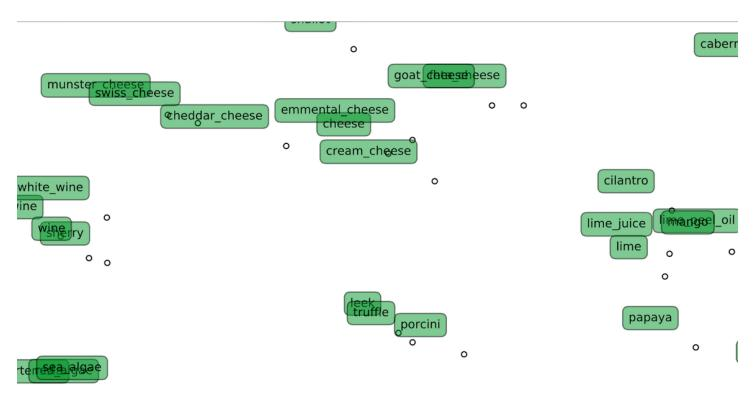

Fig. 9: Positive Effects of Subword Information

First, we consider the cluster from Figure 9, a small subsection of the full plot. Notice that different wines and sherry (similar to cooking wine) are clustered together on the right, cheeses at the top, mushrooms and leeks at the bottom, and key Latin American ingredients on the right. Each of these clusters has a clear, explainable, flavor meaning. Further, subword information helps cheeses stay clustered together, as well as with wines.

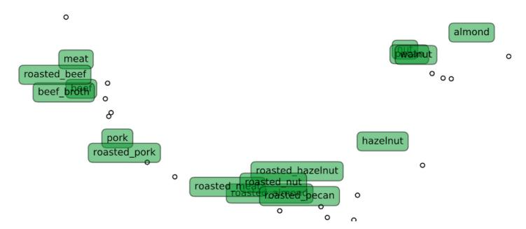

Fig. 10: Negative Effects of Subword Information

However, including subword information negatively impacts other clustering (see Figure 10). On the left of the figure, beef broth clustered with roasted beef and meat because of the shared subword "beef." Further, roasted meat clustered with a group of roasted nuts in the middle because of the shared subword "roasted." This also moved the nut cluster in the middle near the meat cluster on the left, even though they serve different functions in a recipe and rarely co-occur with the exception of charcuterie. This explains part of why models excluding subword information performed almost as well.

Examining Figure 11, we observe both the positive and negative effects of removing subwords. We can still generate high quality clusters (here, Italian spices are in the bottom right), and an ingredient like lima bean

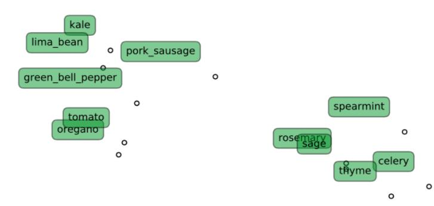

Fig. 11: Positive and Negative Effects of No Subwords

(top left) is entirely separate from other beans used in different contexts. However, this also reveals clear issues. Our ingredient list contains both "green bell peppers" and "bell peppers," which in practice are identical in every way except color. However, this model does not put bell peppers near green bell peppers, a gaping flaw. Subword information easily corrected this.

Though there are tradeoffs to using the subword information-based model, we decided to use it for the remainder of our tasks for 2 reasons. First, it had lower loss on the validation set, and, second, it had a greater ability to capture similar words in similar contexts.

## VIII. COMPLEMENTS AND SUBSTITUTES WITH FOOD EMBEDDINGS *A. Methods*

Complements: Two ingredients are complements if the first ingredient makes the appearance of the second more likely. In the continuous bag of words cost function, the "missing" word is found by taking an average of input vectors for the given bag of ingredients, and finding the dot product with each other ingredient's output vector. The maximum dot product corresponds to the guessed word.

Cbow causes the model to train an input vector of one ingredient to have a high dot product with the output vector of another ingredient if the presence of the first ingredient predicts/increases the likelihood of the presence of the second. Thus, cbow trains output vectors to be complements of input vectors.

To find the best complement for a given ingredient i with input vector xi, we find the maximum cosine similarity as follows:

$$\operatorname{argmax}_{j} \frac{x_{i} \cdot o_{j}}{||x_{i}||_{2}||o_{j}||_{2}} \tag{1}$$

where oj is the output vector of ingredient j.

Even though the cbow algorithm explicitly maximizes dot product, we choose to use cosine distance since it does not take into account the scale of input and output vectors, and thus does not discriminate against less frequently seen ingredients. Further, we ensured that only ingredients present in the dataset at least 50 times were considered as top complements.

### Substitutes:

Ingredients can substitute for each other if they play similar roles in the flavor of a recipe. Since recipe flavor is determined by the input vectors of its constituent ingredients, ingredients with similar flavor vectors ought to be substitutes. This aligns with our intuition behind our Bhattacharyya-distance based metric: that substitute ingredients should be complements with a similar distribution of other ingredients. In our embedding approach, ingredients that appear in similar contexts will have similar values because they will recieve similar gradient updates. Note that as long as we use cosine similarity, this is true even if one ingredient is far more popular than the other, and thus has a larger magnitude from more gradient updates. However, unlike with Bhattacharyya-distance, the embeddings model can still learn that two ingredients are substitutes if they occur with different ingredients that are themselves complements.

Equipped with this intuition, for an ingredient i with input vector xi, we say its best substitute (represented by index j and input vector xj ) is:

$$\operatorname{argmax}_{j} \frac{x_i \cdot x_j}{\|x_i\|_2 \|x_j\|_2} \tag{2}$$

Again, we use cosine similarity instead of dot product to make sure that we do not discriminate against less frequent ingredients, and have a frequency cutoff to make sure extremely rare ingredients do not appear as substitutes.

### *B. Results*

Complements: In order to fully assess the validity of our embedding based complement metric, we need to do an in depth qualitative analysis of the top complements globally and for a select group of ingredients.

TABLE III: Top 25 Complement Pairs with Embedding Model

| Ingredient 1     | Ingredient 2            | S(i1, i2) |
|------------------|-------------------------|-----------|
| cured pork       | mozzarella cheese       | 0.1814    |
| cured pork       | provolone cheese        | 0.1706    |
| cured pork       | parmesan cheese         | 0.1417    |
| black bean       | cheddar cheese          | 0.1416    |
| berry            | cranberry               | 0.1390    |
| pimento          | cheddar cheese          | 0.1338    |
| rye flour        | whole grain wheat flour | 0.1294    |
| veal             | romano cheese           | 0.1233    |
| egg noodle       | cottage cheese          | 0.1231    |
| cured pork       | macaroni                | 0.1224    |
| romano cheese    | mozzarella cheese       | 0.1222    |
| corn grit        | cheddar cheese          | 0.1222    |
| berry            | blackberry              | 0.1219    |
| provolone cheese | mozzarella cheese       | 0.1219    |
| artichoke        | parmesan cheese         | 0.1202    |
| egg noodle       | cheddar cheese          | 0.1168    |
| porcini          | parmesan cheese         | 0.1167    |
| sauerkraut       | swiss cheese            | 0.1167    |
| brassica         | chinese cabbage         | 0.1164    |
| cured pork       | romano cheese           | 0.1158    |
| romano cheese    | macaroni                | 0.1155    |
| peanut           | peanut butter           | 0.1153    |
| blueberry        | blackberry              | 0.1139    |
| roasted peanut   | peanut butter           | 0.1137    |
| broccoli         | cheddar cheese          | 0.1123    |

Notice that the top three best complements are cured pork with cheeses. These make perfect sense, cheese and charcuterie are known in the culinary world as perfect complements. Most pairs further down the list are also commonplace complements. Anecdotally, we were at first concerned to see egg noodles paired with cottage cheese, but, after further research, we found that epicurious users are quite fond of Polish Noodles - the recipe currently has 4.5 stars on allrecipes [9].

Additionally, our complement metric is not symmetric, since we compare the input vector for ingredient 1 and the output vector of ingredient 2. In plain terms, we can interpret the first ingredient as the "base," and the second as the complement that adds to the flavor of the first. We believe that inherently "complementary" ingredients may appear more frequently with high complement scores. Cheese is rarely eaten by itself, but is known to be a good addition to many foods, which is why it appears so many times in the top 25 as the *second* ingredient (but not the first).

Given this understanding of top complements for our embeddings based model, we dive deeper into the comparison between the embeddings model and the graphical analysis model.

On the whole, both metrics provide high-quality, intuitive results. The top complements for walnuts are other nuts and dried fruits. The

TABLE IV: Top 5 complements for select ingredients by both the graph- and embedding-based models

| Ingredient      | Metric    | Top 5 Complements                                                   |
|-----------------|-----------|---------------------------------------------------------------------|
| walnut          | Embedding | date, banana, berry, fig, coconut                                   |
|                 | PMI       | date, raisin, oat, fig, banana                                      |
| salmon          | Embedding | wasabi, dill, clam, horseradish, cognac                             |
|                 | PMI       | wasabi, dill, cognac, smoked_salmon, horseradish                    |
| bread           | Embedding | romano_cheese, provolone_cheese, swiss_cheese, veal, cured_pork     |
|                 | PMI       | provolone_cheese, swiss_cheese, mozzarella_cheese, lovage, veal     |
| wine            | Embedding | cured_pork, peanut_oil, star_anise, porcini, veal                   |
|                 | PMI       | okra, peanut_oil, star_anise, cured_pork, pork_sausage              |
| onion           | Embedding | black_bean, kidney_bean, cured_pork, avocado, egg_noodle            |
|                 | PMI       | tamarind, red_kidney_bean, kidney_bean, green_bell_pepper, lentil   |
| clam            | Embedding | mussel, lobster, squid, enokidake, saffron                          |
|                 | PMI       | mussel, squid, enokidake, kelp, scallop                             |
| parmesan_cheese | Embedding | cured_pork, artichoke, porcini, mozzarella_cheese, provolone_cheese |
|                 | PMI       | macaroni, mozzarella_cheese, porcini, artichoke, provolone_cheese   |
| lime_juice      | Embedding | lime_peel_oil, tequila, avocado, lemongrass, roasted_peanut         |
|                 | PMI       | lime_peel_oil, tequila, lemongrass, thai_pepper, mango              |
| cod             | Embedding | enokidake, pimento, saffron, beer, mussel                           |
|                 | PMI       | mussel, enokidake, lobster, beer, saffron                           |
| sesame oil      | Embedding | roasted_sesame_seed, peanut_oil, chinese_cabbage, seaweed, shiitake |
|                 | PMI       | roasted_sesame_seed, matsutake, chinese_cabbage, nira, seaweed      |

complements for sesame oil are other East Asian ingredients. The complements for parmesan chesese are all things that go nicely with cheese on top. Since the results for the embedding metric and the graph metric both are fairly obvious options, it is hard to evaluate which is truly "better."

Given our understanding of the underlying graph and definition of complements, this makes sense. Complements are defined by two ingredients that go well together. This is not a global task, but instead a local task. Since both graphical analysis and embeddings capture local structure, they should have relatively similar performance. This differs from substitutes, which cannot be gleaned from purely local structure.

Substitutes:

We performed the same analysis with substitutes, where we measured the top 25 best substitutes according to our input-input similarity metric.

TABLE V: Top 25 Substitute Pairs with Embedding Model

| Ingredient 1  | Ingredient 2        | $D(i_1,i_2)$ |
|---------------|---------------------|--------------|
| romano_cheese | parmesan_cheese     | 0.7583       |
| peanut_oil    | peanut              | 0.7431       |
| lime          | lime_juice          | 0.7403       |
| bell_pepper   | green_bell_pepper   | 0.7345       |
| strawberry    | raspberry           | 0.7341       |
| sesame_oil    | soy_sauce           | 0.7065       |
| pecan         | walnut              | 0.7025       |
| pepper        | bell_pepper         | 0.6723       |
| strawberry    | blueberry           | 0.6716       |
| orange_peel   | orange              | 0.6698       |
| bread         | white_bread         | 0.6664       |
| peanut        | peanut_butter       | 0.6648       |
| bell_pepper   | garlic              | 0.6629       |
| sesame_seed   | roasted_sesame_seed | 0.6559       |
| blueberry     | raspberry           | 0.6424       |
| soybean       | soy_sauce           | 0.6313       |
| scallion      | sesame_oil          | 0.6279       |
| bean          | black_bean          | 0.6274       |
| pepper        | green_bell_pepper   | 0.6221       |
| black_pepper  | bell_pepper         | 0.6168       |
| vanilla       | cocoa               | 0.6153       |
| cilantro      | lime_juice          | 0.6144       |
| soy_sauce     | scallion            | 0.6132       |
| strawberry    | peach               | 0.6111       |
| blueberry     | peach               | 0.6045       |

In Table V, notice the top substitute pair is romano and parmesan cheese. These two cheeses are so similar that people often buy the wrong type at the store. At first glance, it seems like a large majority of the substitutes are due our subword information model. This helps with pairs

like bell pepper and green bell pepper, or sesame seed and roasted sesame seed. However, looking closer, we see many substitutes that are more nuanced. Sesame oil and soy sauce are both used to create a base of flavor for East Asian cuisine. Walnut and Pecan are used in similar contexts for desserts and salads. Vanilla and Cocoa are the defining flavor behind a dessert. Garlic and Peppers server as base aromatics. These are all well known, complex substitutes that give insight into the way recipes are created.

Now that we have calculated substitute metrics from our graph based and embeddings based models, we can compare their results on an ingredient-level basis. In Table VI, we see the top five substitutes for ten popular ingredients. At a high level, the results are similar and impressive for both metrics. For each ingredient and metric, the top substitute, along with the majority of the top five substitute, makes qualitative sense. Lime juice is substituted for other Latin flavors; clam is substituted for other shellfish.

The difference is more apparent when looking at the errors in the suggested top 5 substitutes. As described earlier in the paper, Bhattacharyya distance can conflate substitutes and complements. While the embedding-based model picks other aromatics and spices at the top four substitutes for onion, the graphical model chooses meat and bread along with pepper. Onion pairs with meat and bread to make burgers and sandwiches, but is by no means a substitute. In the same vein, both models pick pecan and almond as the top substitute for walnut. However, while the embedding-based model finds other nuts and fruits as substitutes (hazelnut, apple, nut), the graph based model finds strange results (lard, nutmeg). It is worth noting that even though nutmeg has the subword nut in it, the embedding model is powerful enough that it understands walnut is a nut and nutmeg is a spice even though the two share this information. The early drop off in substitute quality is easily seen in most of the Bhattacharya based predictions in the table.

TABLE VI: Top 5 substitutes for select ingredients by both the graphand embedding-based models

| Ingredient      | Method        | Top 5 Substitutes                                                  |
|-----------------|---------------|--------------------------------------------------------------------|
| walnut          | Embeddings    | pecan, almond, hazelnut, apple, nut                                |
|                 | Bhattacharyya | pecan, almond, lard, cherry, nutmeg                                |
| salmon          | Embeddings    | smoked_salmon, tuna, crab, chervil, lobster                        |
|                 | Bhattacharyya | chicken, fish, tuna, asparagus, shrimp                             |
| bread           | Embeddings    | white_bread, rye_bread, wheat_bread, artichoke, macaroni           |
|                 | Bhattacharyya | white_bread, parsley, bacon, potato, cheese                        |
| wine            | Embeddings    | sherry, red_wine, white_wine, grape_juice, shallot                 |
|                 | Bhattacharyya | sherry, white_wine, rice, red_wine, pork                           |
| onion           | Embeddings    | green_bell_pepper, black_pepper, bell_pepper, garlic, kidney_bean  |
|                 | Bhattacharyya | bell_pepper, meat, black_pepper, bread, pepper                     |
| clam            | Embeddings    | shrimp, crab, oyster, mussel, lobster                              |
|                 | Bhattacharyya | shrimp, fish, mussel, cod, scallop                                 |
| parmesan_cheese | Embeddings    | romano_cheese, mozzarella_cheese, cheese, olive_oil, cured_pork    |
|                 | Bhattacharyya | romano_cheese, cheese, mushroom, mozzarella_cheese, basil          |
| lime_juice      | Embeddings    | lime, cilantro, mango, peanut_oil, coconut                         |
|                 | Bhattacharyya | lime, cilantro, mango, cumin, avocado                              |
| cod             | Embeddings    | crab, pea, squid, catfish, clam                                    |
|                 | Bhattacharyya | shrimp, chicken, clam, pea, scallop                                |
| sesame_oil      | Embeddings    | soy_sauce, scallion, soybean, chinese_cabbage, roasted_sesame_seed |
|                 | Bhattacharyya | sake, soybean, radish, soy_sauce, shiitake                         |

There are two results in the table that require a more in depth focus. First, a discerning reader may postulate that subword information drives input vector similarity, and causes high performance on ingredients like bread. To further understand the effect of subword information, we ran the same substitution test on embeddings trained without subword information, and found that the top 3 substitutes remained the same. This suggests that embeddings hold similar roles in the absence of subword information. Second, consider substitutes 4 and 5 for lime juice and the role of peanut oil in Asian cuisine, as well as coconut milk (which is considered as the same as coconut by our embeddings) in Southeast Asian cuisine. These are liquids that add flavors to bastes and marinades the same way lime juice works for Latin American food. This suggests that due to the more global nature of our embeddings, we are able to capture substitutes from radically different cuisine types. The results for Bhattacharya substitutes, cumin and avocado, do not show the same breadth. We believe that given these results, we may be able to use embeddings to gain new insights into the roles of ingredients.

#### IX. AUTOMATIC RECIPE GENERATION

Given the success of embeddings in predicting complement and substitute ingredients, we were excited to explore their effectiveness in automatically generating recipes. The recipe generation problem is defined as follows: seed in a list of current ingredients, and produce the best recipe possible by only adding ingredients to the list.

In our first generation algorithm, we used a model nearly identical to finding complements. A recipe was defined as the mean of its ingredients, and we computed the average cosine similarity between the recipe input vector and all output vectors. We treated the resulting score vector as a probability distribution by performing softmax over it, then sampling at random from said distribution. We did this iteratively until the selected ingredient was the stop token.

This algorithm, though good in theory, was ultimately unsuccessful. Since cosine similarity is normalized between -1 and 1, the probability distribution created by softmax was nearly uniform. Thus, we found extremely long recipes (because the stop token was not correctly guessed), and extremely nonsensical recipes (because ingredients were picked nearly uniformly at random).

In a second attempt, which we will refer to as the "dot product method," we replaced cosine distance with dot product before taking the softmax and creating a probability distribution. The dot product increased the likelihood of guessing the stop token since it has a high prior, and by adding a temperature multiple to adjust the entropy of the distribution, we created a non-uniform probability distribution. As seen in Table VII, recipes start to make sense. However, as in the case for the third and fourth seed ingredients in the table, we still have the issue of long recipes. Referring back to the t-SNE graph, certain types of ingredients are clustered together. Every ingredient from a cluster added to the recipe moves the recipe input vector closer to the centroid of the cluster. If an input vector is close to the centroid of said cluster, it will just spit out predictions from that cluster. In Table VII, both the third and fourth recipe started out in the heart of the East Asian cluster, and even though they may have found a good fit, rolled through that fit, and predicted 20+ ingredient recipes.

TABLE VII: Recipe Generation Results

| Seed Ingredients      | Method | Generated New Ingredients                         |  |  |  |  |
|-----------------------|--------|---------------------------------------------------|--|--|--|--|
| onion, lamb           | DP     | bread, garlic, olive_oil                          |  |  |  |  |
|                       | IC     | bread, marjoram, feta_cheese                      |  |  |  |  |
| tuna, rice            | DP     | mushroom, green_bell_pepper, onion, tomato,       |  |  |  |  |
|                       |        | pea, cayenne, garlic, thyme, pepper               |  |  |  |  |
|                       | IC     | seaweed, wasabi, sesame_seed, sake, radish        |  |  |  |  |
| squid, kelp           | DP     | clam, soybean, enokidake, sake, radish, shiitake, |  |  |  |  |
|                       |        | chinese_cabbage, roasted_sesame_seed, (15 more)   |  |  |  |  |
|                       | IC     | wasabi, sake, seaweed, radish, enokidake          |  |  |  |  |
| soy_sauce, sesame_oil | DP     | roasted_sesame_seed, sake, scallion, soybean,     |  |  |  |  |
|                       |        | ginger, chinese_cabbage, fish, (12 more)          |  |  |  |  |
|                       | IC     | sake, squid, shiitake, chinese_cabbage, oyster,   |  |  |  |  |
|                       |        | roasted_sesame_seed, enokidake, radish, clam      |  |  |  |  |
| cocoa, butter, egg    | DP     | vanilla, wheat, coffee, milk, pecan               |  |  |  |  |
|                       | IC     | banana, rum, coconut, macadamia_nut               |  |  |  |  |

Our revised and final recipe generation strategy, "Intersection of Complements," works as follows. As in the initial algorithm, at every iteration, we take the mean recipe input vector and use cosine similarity to find the best matching output vectors. We then select the top  $h_1$  best matches by cosine similarity, and form a set of potential next ingredients. In parallel, for each of the individual ingredients currently in the recipe, we form a set from their  $h_2$  best complements where  $h_2 > h_1$ . We then perform a set intersection on all of the generated sets to find the set of potential ingredients, and select from it uniformly at random. We end iteration when either the stop token is predicted, or no ingredients are in the set intersection.

To understand why this algorithm works so well, we dive further into our constants  $h_1, h_2$ . To ensure that our recipe as a whole generates the best possible match for its flavor profile, we set  $h_1$  to be low (in our case, around 5), since it says we can only select a new ingredient if it works well with the overall flavor profile of our recipe. We set  $h_2$  to

be relatively larger (in our case, around 40). This constant ensures that for every ingredient currently in the recipe, it loosely goes well with the new ingredient. By enforcing this constraint, we ensure that no two ingredients that interact poorly will be added to our recipe.

Inspecting the results, we see clear improvements with this algorithm. Notice that recipes no longer become unrealistically long. This suggests that our  $h_2$  constant is effective in eliminating poorly matching ingredients.

Consider the first recipe starting with onion and lamb. Since dot product relies on priors, it adds all common ingredients: bread, garlic, and olive oil. However, when running IC, we optimize for good fits with each ingredient. Here, the recipe created includes bread again, but then makes sure to find ingredients that still go well with lamb. This is why marjoram and feta cheese, two Mediterranean / Middle Eastern ingredients, are paired with lamb, which is common in those cultures. These same effects can be seen at play in the recipe seeded by tuna and rice. For DP, we see common ingredients that do not necessarily all go well together. Mushrooms, tuna, peas, and cayenne don't individually go well together. Inspecting IC, we see that it predicts our tuna and rice should have seaweed, wasabi, sesame seed, sake, and radish. These are the exact ingredients to an ahi sushi plate with a cup of sake and little, cut radishes. Finally, compare the two recipes seeded by cocoa, butter, and egg. DP produces a recipe that also has vanilla, coffee, and wheat in it. The flavors appear to conflict instead of complement each other, though on a whole they are in the dessert cluster. IC, on the other hand, creates what appears to be mixture of chocolate cake and rum-banana-coconut pie, which may delight those with a sweet tooth.

#### X. CONCLUSION

Here, we successfully build upon previous research into both the graphical structure of recipes and natural language processing to develop a deeper understanding of food and recipe construction. First, we use graphical tools, including PageRank and other centrality metrics, to understand the pillar ingredients of various cuisines. We also evaluate the most complementary ingredients using various edge weighting metrics (Raw Count, PMI, and IoU) to elucidate the best substitutes by cuisine type. Next, we created a novel graph-based metric that leverages Bhattachryya Distance to mine ingredient substitutes from network structure without relying on recipe comments or substitution tables. Finally, we used a modified version of the fastText algorithm to train food embeddings, then utilized these embeddings to determine ingredient complements and substitutes as well as to generate substitutes.

On complements, substitutes, and recipe generation, we achieved great success with both our graphical and embedding-based models: the ingredient pairings and recipes generated were highly intuitive and in line with staples of American or Asian food. Notably, our embeddings are able to capture more of the structure of the "flavor space," as seen by their superior performance on the complement and substitute tasks and the more robust clustering offered by their corresponding visualization. This is a result of incorporating data at the level of an individual recipe rather than in aggregate.

Our data also suggests natural future directions: first, using a neural network-based training model. We trained for 5,000 epochs on our dataset without loss converging to 0, suggesting complex non-linearities in our dataset that aren't captured by the simplicity of the fastText model. To that end, we would like to explore a feed-forward neural network over the embedding's outer product to train embeddings. Additionally, our recipe generation was highly biased towards North American and East Asian food as a result of the recipes we trained on being over 80% American or Korean; we're excited by our model's capability to generate recipes in other cuisines as well given training data from them.

#### REFERENCES

- [1] Ahn, Y., Ahnert, S., Bagrow, J., and Barabasi, A. Flavor network and the principles of food pairing. Bulletin of the American Physical Society 56 (2011).
- [2] Serrano, M. A., Boguñá, M., and Vespignani, A. Extracting the multiscale backbone of complex weighted networks. Proceedings of the National Academy of Sciences 106, 6483-6488 (2009)
- [3] Teng, C., Lin, Y., and Adamic, L. Recipe recommendation using ingredient networks. Proceedings of the 3rd Annual ACM Web Science Conference (WebSci'12), 298–307 (2012)
- [4] Altosaar, J. food2vec Augmented cooking with machine intelligence. Web. https://jaan.io/food2vec-augmented-cooking-machine-intelligence/ (2017)
- [5] Henderson, K., Gallagher B., Eliassi-Rad T., Tong, H., Basu, S., Akoglu, L., Koutra, D., Faloutsos, C., Li, L. RolX: structural role extraction & mining in large graphs. Proceedings of the 18th ACM international conference on knowledge discovery and data mining (SIGKDD), Beijing, China, 1231–1239 (2012)
- [6] Bojanowski, P., Grave, E., Joulin, A., Mikolov T. Enriching Word Vectors with Subword Information. CoRR, abs/1607.04606 (2016)
- [7] Jeffrey Pennington, Richard Socher, and Christopher D. Manning. 2014. GloVe: Global Vectors for Word Representation.
- [8] L.J.P. van der Maaten and G.E. Hinton. Visualizing High-Dimensional Data Using t-SNE. Journal of Machine Learning Research 9(Nov):2579-2605, 2008.
- [9] Polish Noodles (Cottage Cheese and Noodles). allrecipes. http://allrecipes.com/recipe/222405/polish-noodles-cottage-cheese-and-noodles/.

# APPENDIX A FULL T-SNE VISUALIZATIONS

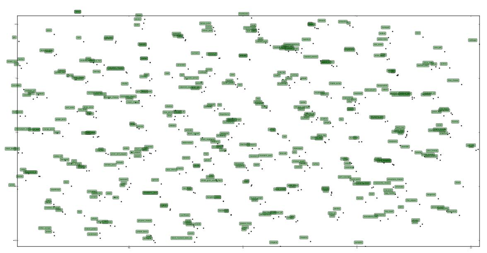

Fig. 12: Visualizing Embeddings with Subword Information in in 2D via cosine-distance t-SNE.

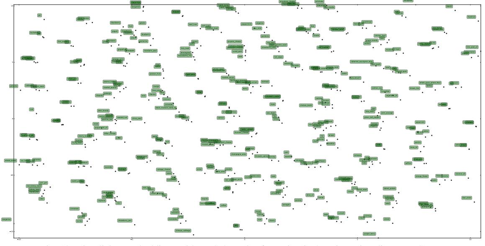

Fig. 13: Visualizing Embeddings without Subword Information in 2D via cosine-distance t-SNE.

## APPENDIX B GRAPH COMPLEMENTS BY CUISINE AND METRIC

**Figure: Most complementary ingredients by cuisine type and edge weight metric, only considering ingredients that appear in> 25 recipes**

|                                     |            |                                     |                         | North American Cuisine        |                         |                                   |                                |            |  |
|-------------------------------------|------------|-------------------------------------|-------------------------|-------------------------------|-------------------------|-----------------------------------|--------------------------------|------------|--|
|                                     |            | Ingredient 1 Ingredient 2 Raw Count |                         | Ingredient 1 Ingredient 2 IOU |                         |                                   | Ingredient 1 Ingredient 2 PMI  |            |  |
| egg                                 | wheat      | 11456                               | fenugreek               | turmeric                      | 0.81410256              | katsuobushi seaweed               |                                | 8.37701116 |  |
| butter                              | wheat      | 10940                               | coriander               | fenugreek                     | 0.71026723              | galanga                           | lemongrass                     | 7.31761959 |  |
| butter                              | egg        | 9304                                | coriander               | turmeric                      | 0.63793103              | black_mustard_seed_oil quince     |                                | 7.27839887 |  |
| milk                                | wheat      | 7355                                | egg                     | wheat                         | 0.52516732              | bone_oil                          | veal                           | 6.48374475 |  |
| egg                                 | milk       | 6942                                | butter                  | wheat                         | 0.48236332              | citrus                            | katsuobushi                    | 6.44215085 |  |
| butter                              | milk       | 6621                                | coriander               | cumin                         | 0.40182055              | katsuobushi peanut_oil            |                                | 6.33679033 |  |
| vanilla                             | wheat      | 6142                                | butter                  | egg                           | 0.3794144               | flower                            | lavender                       | 6.25982929 |  |
| egg                                 | vanilla    | 6114                                | milk                    | wheat                         | 0.36459624              | black_mustard_seed_oil star_anise |                                | 6.23243032 |  |
| garlic                              | onion      | 5858                                | garlic                  | onion                         | 0.35387218              | katsuobushi sake                  |                                | 6.03668574 |  |
| butter                              | vanilla    | 5545                                | cumin                   | fenugreek                     | 0.35034483              | galanga                           | thai_pepper                    | 5.96522678 |  |
|                                     |            |                                     |                         |                               |                         |                                   |                                |            |  |
|                                     |            |                                     |                         | Southern European Cuisine     |                         |                                   |                                |            |  |
|                                     |            | Ingredient 1 Ingredient 2 Raw Count |                         | Ingredient 1 Ingredient 2 IOU |                         | Ingredient 1 Ingredient 2 PMI     |                                |            |  |
| garlic                              | olive_oil  | 1760                                | chinese_cabbage nira    |                               | 1                       | chinese_cabbage nira              |                                | 10.9419605 |  |
| olive_oil                           | tomato     | 1250                                | garlic                  | olive_oil                     | 0.58028355              | chinese_cabbage kiwi              |                                | 10.2488133 |  |
| garlic                              | tomato     | 1196                                | fenugreek               | turmeric                      | 0.54545455              | kiwi                              | nira                           | 10.2488133 |  |
| olive_oil                           | onion      | 1063                                | chinese_cabbage kiwi    |                               | 0.5                     | kiwi                              | papaya                         | 10.2488133 |  |
| garlic                              | onion      | 962                                 | kiwi                    | nira                          | 0.5                     | bourbon_whiskey whiskey           |                                | 9.55566616 |  |
| onion                               | tomato     | 866                                 | kiwi                    | papaya                        | 0.5                     | seaweed                           | sweet_potato 9.55566616        |            |  |
| basil                               | olive_oil  | 831                                 | garlic                  | tomato                        | 0.46392552              | cassava                           | seaweed                        | 8.99605037 |  |
| basil                               | garlic     | 830                                 | basil                   | tomato                        | 0.4296496               | mango                             | papaya                         | 8.99605037 |  |
|                                     |            |                                     |                         |                               |                         |                                   |                                |            |  |
| basil                               | tomato     | 797                                 | olive_oil               | tomato                        | 0.42301184              | berry                             | oatmeal                        | 8.54406525 |  |
| olive_oil                           | parsley    | 786                                 | fennel                  |                               | pork_sausage 0.41561713 | chinese_cabbage salmon            |                                | 8.45705387 |  |
|                                     |            |                                     |                         |                               |                         |                                   |                                |            |  |
|                                     |            |                                     |                         | Latin American Cuisine        |                         |                                   |                                |            |  |
|                                     |            | Ingredient 1 Ingredient 2 Raw Count |                         | Ingredient 1 Ingredient 2 IOU |                         |                                   | Ingredient 1 Ingredient 2 PMI  |            |  |
| cayenne                             | onion      | 1496                                | bourbon_whiskey whiskey |                               | 1                       | bourbon_whiskey whiskey           |                                | 10.9419605 |  |
| garlic                              | onion      | 1456                                | garlic                  | onion                         | 0.66121708              | cashew                            | fig                            | 9.55566616 |  |
| cayenne                             | garlic     | 1413                                | cayenne                 | onion                         | 0.63497453              | kale                              | okra                           | 9.55566616 |  |
| onion                               | tomato     | 1338                                | onion                   | tomato                        | 0.62319516              | fig                               | lemon_peel                     | 9.33252261 |  |
| cayenne                             | tomato     | 1278                                | cayenne                 | garlic                        | 0.61838074              | roasted_sesame_seed sesame_oil    |                                | 9.33252261 |  |
| garlic                              | tomato     | 1231                                | garlic                  | tomato                        | 0.58619048              | blue_cheese blueberry             |                                | 9.15020105 |  |
| cumin                               | garlic     | 715                                 | cayenne                 | tomato                        | 0.56875834              | cauliflower                       | wasabi                         | 9.15020105 |  |
| cayenne                             | cumin      | 709                                 | fenugreek               | turmeric                      | 0.5                     | fig                               | orange_peel                    | 8.99605037 |  |
| cumin                               | onion      | 688                                 | cumin                   | garlic                        | 0.38235294              | leek                              | turnip                         | 8.86251898 |  |
| cayenne                             | corn       | 678                                 | black_pepper oregano    |                               | 0.37952559              | porcini                           | shiitake                       | 8.86251898 |  |
|                                     |            |                                     |                         |                               |                         |                                   |                                |            |  |
|                                     |            |                                     |                         | Western European Cuisine      |                         |                                   |                                |            |  |
| Ingredient 1 Ingredient 2 Raw Count |            |                                     |                         | Ingredient 1 Ingredient 2 IOU |                         |                                   | Ingredient 1 Ingredient 2 PMI  |            |  |
| butter                              | wheat      | 947                                 | fenugreek               | turmeric                      | 0.94444444              | chinese_cabbage nira              |                                | 10.2488133 |  |
| egg                                 | wheat      | 932                                 | cumin                   | fenugreek                     | 0.72340426              | octopus                           | papaya                         | 10.2488133 |  |
| butter                              | egg        | 817                                 | cumin                   | turmeric                      | 0.72340426              | gin                               | tequila                        | 9.55566616 |  |
| egg                                 | milk       | 509                                 | coriander               | fenugreek                     | 0.60714286              | matsutake                         | wasabi                         | 9.55566616 |  |
| milk                                | wheat      | 503                                 | coriander               | turmeric                      | 0.60714286              | brassica                          | kale                           | 9.55566616 |  |
| butter                              | milk       | 463                                 | lavender                | savory                        | 0.5862069               | lemongrass                        | octopus                        | 9.33252261 |  |
| cream                               | egg        | 403                                 | egg                     | wheat                         | 0.56519102              | nira                              | roasted_sesame_seed 9.33252261 |            |  |
| butter                              | cream      | 384                                 | coriander               | cumin                         | 0.55384615              | black_bean                        | peanut_oil                     | 8.99605037 |  |
| butter                              | onion      | 332                                 | butter                  | wheat                         | 0.54866744              | red_bean                          | sesame_seed 8.86251898         |            |  |
| cream                               | wheat      | 328                                 | chinese_cabbage nira    |                               | 0.5                     | shellfish                         | squid                          | 8.86251898 |  |
|                                     |            |                                     |                         |                               |                         |                                   |                                |            |  |
|                                     |            |                                     |                         | East Asian Cuisine            |                         |                                   |                                |            |  |
|                                     |            | Ingredient 1 Ingredient 2 Raw Count |                         | Ingredient 1 Ingredient 2 IOU |                         |                                   | Ingredient 1 Ingredient 2 PMI  |            |  |
| garlic                              | scallion   | 889                                 | cumin                   | fenugreek                     | 1                       | caraway                           | cauliflower                    | 10.9419605 |  |
| garlic                              | soy_sauce  | 847                                 | cumin                   | turmeric                      | 1                       | bitter_orange kumquat             |                                | 10.9419605 |  |
| cayenne                             | garlic     | 778                                 | fenugreek               | turmeric                      | 1                       | cognac                            | fig                            | 10.2488133 |  |
| scallion                            | soy_sauce  | 754                                 | caraway                 | cauliflower                   | 1                       | champagne_wine palm               |                                | 10.2488133 |  |
| cayenne                             | scallion   | 693                                 | bitter_orange kumquat   |                               | 1                       | oatmeal                           | raspberry                      | 10.2488133 |  |
| garlic                              | sesame_oil | 676                                 | grape                   | lima_bean                     | 1                       | lobster                           | rosemary                       | 10.2488133 |  |
| sesame_oil                          | soy_sauce  | 674                                 | coriander               | cumin                         | 0.63333333              | bitter_orange brandy              |                                | 10.2488133 |  |
| scallion                            | sesame_oil | 618                                 | coriander               | fenugreek                     | 0.63333333              | brandy                            | kumquat                        | 10.2488133 |  |
|                                     |            |                                     |                         |                               |                         |                                   |                                |            |  |
| garlic                              | ginger     | 609                                 | coriander               | turmeric                      | 0.63333333              | gruyere_cheesemilk_fat            |                                | 10.2488133 |  |
|                                     |            |                                     |                         |                               |                         |                                   |                                |            |  |

cayenne soy\_sauce 578 garlic scallion 0.55527795 mace turkey 10.2488133